# 第 63 章：打印服务

Android 的打印框架提供了一套完整的系统，用于发现打印机、渲染文档、暂存打印任务，
并将它们交付给物理打印机或虚拟打印机。该框架采用分层架构。系统服务
（`PrintManagerService`）管理每个用户的状态，并在各应用之间进行协调。打印
暂存器进程管理打印队列。可插拔的打印服务负责与特定打印机或协议之间的通信。

本章从公共 API 到系统服务内部实现，深入剖析打印框架。内容涵盖打印任务的
生命周期、文档渲染、打印机发现以及暂存器架构。

---

## 63.1 架构概览

打印框架分为四个主要层次：

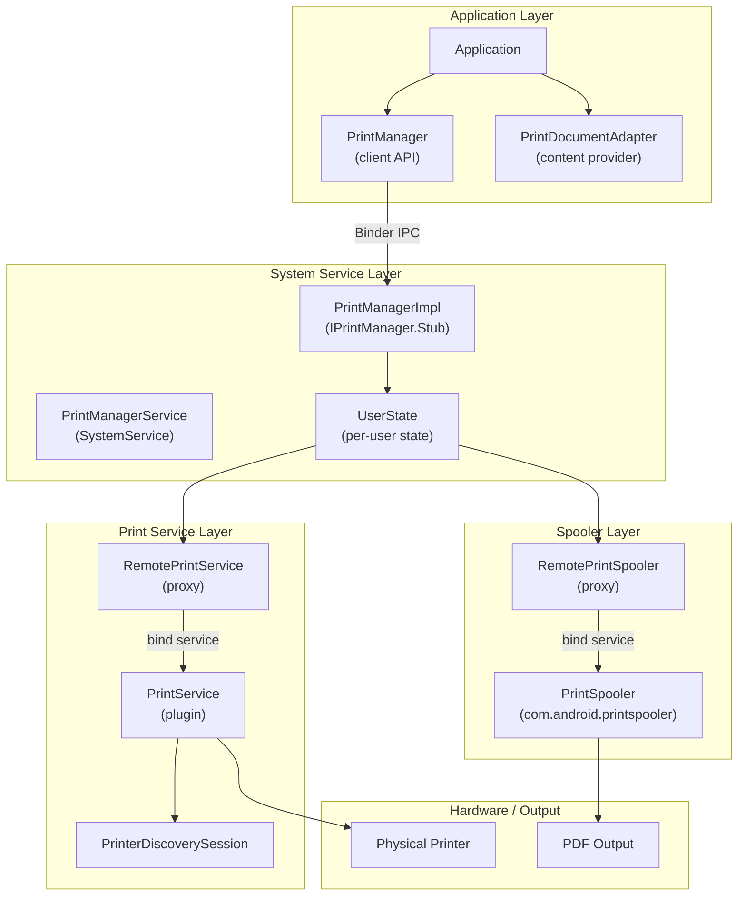

**关键源文件：**

| 文件 | 路径 | 用途 |
|------|------|---------|
| `PrintManager.java` | `frameworks/base/core/java/android/print/` | 面向客户端的 API |
| `PrintDocumentAdapter.java` | Same directory | 应用文档渲染契约 |
| `PrintJobInfo.java` | Same directory | 打印任务状态的表示 |
| `PrintJob.java` | Same directory | 应用可用的打印任务句柄 |
| `PrintAttributes.java` | Same directory | 页面尺寸、边距、颜色模式 |
| `PrinterInfo.java` | Same directory | 打印机描述（名称、状态、能力、设置意图） |
| `flags/flags.aconfig` | Same directory | `android.print.flags` aconfig 声明 |
| `PrintedPdfDocument.java` | `frameworks/base/core/java/android/print/pdf/` | PDF 渲染辅助类 |
| `PrintService.java` | `frameworks/base/core/java/android/printservice/` | 打印服务插件的基类 |
| `PrinterDiscoverySession.java` | Same directory | 打印机发现的生命周期 |
| `PrintManagerService.java` | `frameworks/base/services/print/java/com/android/server/print/` | 系统服务入口 |
| `UserState.java` | Same directory | 按用户管理打印状态 |
| `RemotePrintSpooler.java` | Same directory | 暂存器进程代理 |
| `RemotePrintService.java` | Same directory | 打印服务进程代理 |
| `PrintSpoolerService.java` | `frameworks/base/packages/PrintSpooler/src/com/android/printspooler/model/` | 暂存器进程中的任务存储 |
| `flags/flags.aconfig` | `frameworks/base/packages/PrintSpooler/` | `com.android.printspooler.flags` aconfig 声明 |

---

## 63.2 PrintManager —— 客户端 API

`PrintManager` 是打印能力的系统服务访问器。它带有 `@SystemService` 注解，并且
需要 `PackageManager.FEATURE_PRINTING` 特性：

```java
// frameworks/base/core/java/android/print/PrintManager.java
@SystemService(Context.PRINT_SERVICE)
@RequiresFeature(PackageManager.FEATURE_PRINTING)
public final class PrintManager {
    public static final String PRINT_SPOOLER_PACKAGE_NAME = "com.android.printspooler";
```

### 63.2.1 启动打印任务

应用通过在 Activity 中调用 `PrintManager.print()` 发起打印：

```java
// Application code
PrintManager printManager = (PrintManager) getSystemService(Context.PRINT_SERVICE);
PrintJob job = printManager.print("My Document", new MyPrintDocumentAdapter(), null);
```

`print()` 方法：

1. 创建一个 `PrintDocumentAdapterDelegate` 代理，用于跨进程通信
2. 通过 Binder IPC 将打印请求发送给 `PrintManagerImpl`
3. 读取系统在 `EXTRA_PRINT_DIALOG_INTENT` 下返回的 `IntentSender`，
   并以此启动打印界面（来自 `com.android.printspooler` 包）
4. 返回用于跟踪状态的 `PrintJob` 句柄；如果打印不可用，则返回
   `null`

Android 17 的实现强化了这一路径。`print()` 会构建带有
`MODE_BACKGROUND_ACTIVITY_START_ALLOWED` 的 `ActivityOptions`，从而允许从
打印请求中启动暂存器对话框。当对话框 Activity 无法解析时，它会捕获
`ActivityNotFoundException`。在这种情况下，它返回 `null`（文档中记载的
失败模式），而不是把异常抛给调用方：

```java
// frameworks/base/core/java/android/print/PrintManager.java
try {
    ActivityOptions activityOptions = ActivityOptions.makeBasic()
            .setPendingIntentBackgroundActivityStartMode(
                    ActivityOptions.MODE_BACKGROUND_ACTIVITY_START_ALLOWED);
    mContext.startIntentSender(intent, null, 0, 0, 0, activityOptions.toBundle());
    return new PrintJob(printJob, this);
} catch (SendIntentException sie) {
    Log.e(LOG_TAG, "Couldn't start print job config activity.", sie);
} catch (ActivityNotFoundException anfe) {
    Log.e(LOG_TAG, "Print preview activity not found: ", anfe);
}
return null;
```

### 63.2.2 查询打印任务

应用可以查询自己的打印任务（但不能查询其他应用的任务）：

```java
// Get all print jobs for this app
List<PrintJob> jobs = printManager.getPrintJobs();

// Check specific job state
for (PrintJob job : jobs) {
    PrintJobInfo info = job.getInfo();
    if (info.getState() == PrintJobInfo.STATE_COMPLETED) {
        // Job finished successfully
    }
}
```

### 63.2.3 打印任务状态变化监听器

应用可以注册状态变化通知：

```java
// frameworks/base/core/java/android/print/PrintManager.java
private static final int MSG_NOTIFY_PRINT_JOB_STATE_CHANGED = 1;
```

监听器机制使用基于 Handler 的回调，在主线程上传递状态变化。

### 63.2.4 服务选择常量

```java
// frameworks/base/core/java/android/print/PrintManager.java
public static final int ENABLED_SERVICES = 1 << 0;
public static final int DISABLED_SERVICES = 1 << 1;
public static final int ALL_SERVICES = ENABLED_SERVICES | DISABLED_SERVICES;
```

系统级调用方使用这些常量来查询设置中当前哪些打印服务处于启用或禁用
状态。

---

## 63.3 PrintDocumentAdapter —— 渲染契约

`PrintDocumentAdapter` 是应用为实现打印内容而实现的抽象类。它在应用与
打印框架之间定义了严格的生命周期契约。

### 63.3.1 生命周期

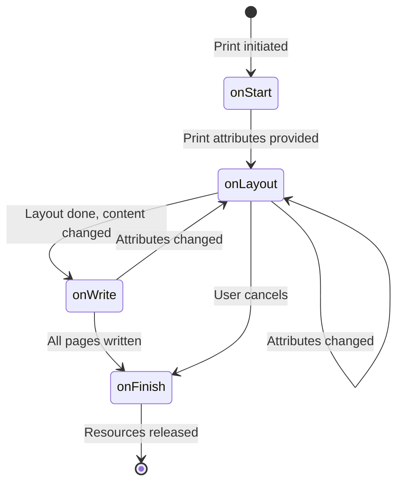

生命周期回调：

```java
// frameworks/base/core/java/android/print/PrintDocumentAdapter.java
public abstract class PrintDocumentAdapter {
    public static final String EXTRA_PRINT_PREVIEW = "EXTRA_PRINT_PREVIEW";

    // 1. Called once when printing starts
    public void onStart() { /* stub */ }

    // 2. Called when print attributes change (page size, density, etc.)
    public abstract void onLayout(PrintAttributes oldAttributes,
            PrintAttributes newAttributes,
            CancellationSignal cancellationSignal,
            LayoutResultCallback callback,
            Bundle extras);

    // 3. Called to render specific pages as PDF
    public abstract void onWrite(PageRange[] pages,
            ParcelFileDescriptor destination,
            CancellationSignal cancellationSignal,
            WriteResultCallback callback);

    // 4. Called once when printing finishes
    public void onFinish() { /* stub */ }
}
```

### 63.3.2 布局-写入协议

系统与适配器之间的交互遵循回调协议：

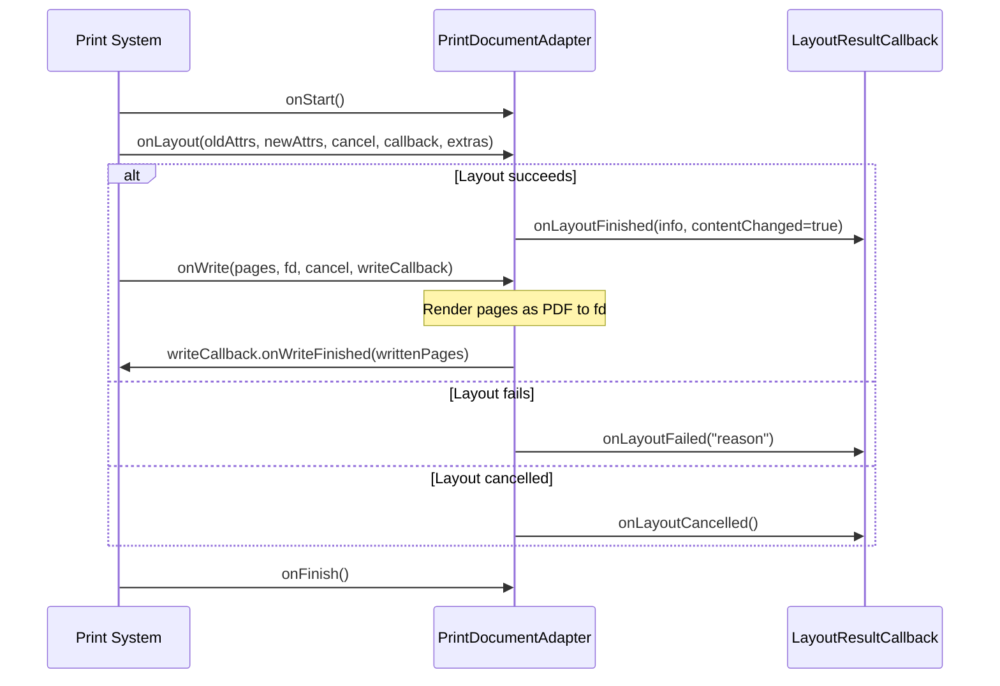

关键规则：

- `onLayout()` 只有在其中一个回调方法被调用之后才算**完成**
- `onWrite()` 只有在其中一个回调方法被调用之后才算**完成**
- 在当前生命周期方法完成之前，不会调用其他任何生命周期方法
- 适配器**必须**关闭传给 `onWrite()` 的 `ParcelFileDescriptor`
- `extras` bundle 中包含 `EXTRA_PRINT_PREVIEW`，用于指示预览模式

### 63.3.3 取消

`CancellationSignal` 参数允许系统请求取消：

```java
cancellationSignal.setOnCancelListener(new OnCancelListener() {
    @Override
    public void onCancel() {
        // Stop layout or write work
    }
});
```

当用户在正在进行的布局过程中更改打印选项时，这一点尤为重要——系统会
取消当前布局并请求新的布局。

### 63.3.4 PrintDocumentInfo

布局完成后，适配器报告文档元数据：

```java
PrintDocumentInfo info = new PrintDocumentInfo.Builder("document.pdf")
        .setContentType(PrintDocumentInfo.CONTENT_TYPE_DOCUMENT)
        .setPageCount(pageCount)
        .build();
callback.onLayoutFinished(info, contentChanged);
```

`contentChanged` 标志至关重要：如果为 `false`，系统可以复用之前渲染过
的页面，并跳过 `onWrite()` 调用。

---

## 63.4 打印任务生命周期

打印任务会经历七个状态，由 `PrintJobInfo` 跟踪：

### 63.4.1 状态常量

```java
// frameworks/base/core/java/android/print/PrintJobInfo.java
public static final int STATE_CREATED = 1;   // Being created in print UI
public static final int STATE_QUEUED = 2;    // Ready for processing
public static final int STATE_STARTED = 3;   // Being printed
public static final int STATE_BLOCKED = 4;   // Temporarily blocked
public static final int STATE_COMPLETED = 5; // Successfully printed (terminal)
public static final int STATE_FAILED = 6;    // Printing failed
public static final int STATE_CANCELED = 7;  // Canceled (terminal)
```

### 63.4.2 状态机

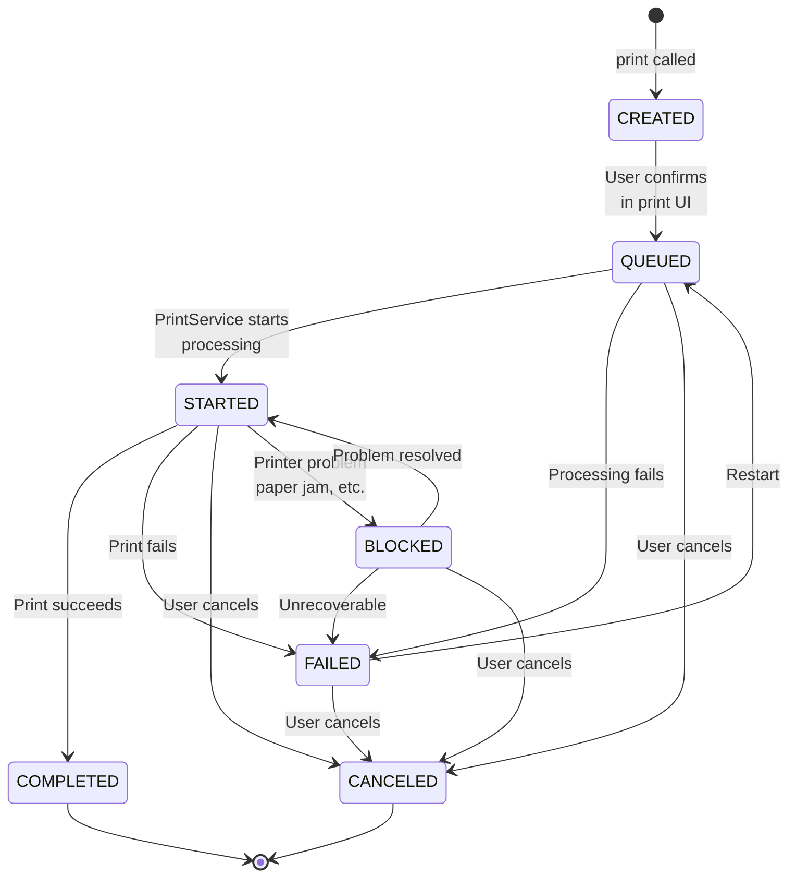

### 63.4.3 内部状态分组

系统使用聚合状态常量进行过滤：

| 常量 | 包含的状态 | 用途 |
|----------|----------------|---------|
| `STATE_ANY` | 所有状态 | 无过滤 |
| `STATE_ANY_VISIBLE_TO_CLIENTS` | 实际上只有 `BLOCKED`（见下文） | 对创建任务的应用可见 |
| `STATE_ANY_ACTIVE` | `CREATED`、`QUEUED`、`STARTED`、`BLOCKED` | 非终态 |
| `STATE_ANY_SCHEDULED` | `QUEUED`、`STARTED`、`BLOCKED` | 已交付给打印服务 |

`STATE_ANY_VISIBLE_TO_CLIENTS` 过滤器只在一个地方被使用，即
`PrintSpoolerService.isStateVisibleToUser()`。该方法要求
`isActiveState(state)`（`CREATED`、`QUEUED`、`STARTED` 或 `BLOCKED`）*并且*
要求是 `FAILED`、`COMPLETED`、`CANCELED` 或 `BLOCKED` 之一。这两个条件的
交集实际上只有 `STATE_BLOCKED`——而不是像这个名称可能让人以为的"除
`CREATED` 之外的所有状态"。

### 63.4.4 PrintJob 包装器

`PrintJob` 类为应用提供了一个便捷的包装器：

```java
// frameworks/base/core/java/android/print/PrintJob.java
public final class PrintJob {
    private final @NonNull PrintManager mPrintManager;
    private @NonNull PrintJobInfo mCachedInfo;

    public void cancel() {
        final int state = getInfo().getState();
        if (state == PrintJobInfo.STATE_QUEUED
                || state == PrintJobInfo.STATE_STARTED
                || state == PrintJobInfo.STATE_BLOCKED
                || state == PrintJobInfo.STATE_FAILED) {
            mPrintManager.cancelPrintJob(mCachedInfo.getId());
        }
    }
```

对于活动任务，缓存的 `PrintJobInfo` 会在每次调用 `getInfo()` 时刷新；而
对于终态（已完成/已取消）则直接返回，因为这些状态不会再变化。

---

## 63.5 PrintAttributes —— 描述打印输出

`PrintAttributes` 封装了内容在打印时应如何格式化：

### 63.5.1 介质尺寸

介质尺寸使用标准的 `MediaSize` 类定义页面尺寸：

```java
// frameworks/base/core/java/android/print/PrintAttributes.java
// Standard sizes include:
MediaSize.ISO_A4       // 210 x 297mm
MediaSize.NA_LETTER    // 8.5 x 11 inches
MediaSize.NA_LEGAL     // 8.5 x 14 inches
MediaSize.JIS_B5       // 182 x 257mm
```

尺寸在内部以 mil（千分之一寸）为单位存储。

### 63.5.2 颜色与双面模式

```java
// Color modes
public static final int COLOR_MODE_MONOCHROME = 1; // Black & white
public static final int COLOR_MODE_COLOR = 2;      // Full color

// Duplex modes
public static final int DUPLEX_MODE_NONE = 1;       // Single-sided
public static final int DUPLEX_MODE_LONG_EDGE = 2;  // Book-style
public static final int DUPLEX_MODE_SHORT_EDGE = 4;  // Notepad-style
```

### 63.5.3 分辨率与边距

`Resolution` 定义水平和垂直轴的 DPI（每英寸点数）。`Margins` 定义四边
的最小边距（以 mil 为单位）。

---

## 63.6 使用 PrintedPdfDocument 渲染 PDF

`PrintedPdfDocument` 是一个辅助类，用于简化基于 Android Canvas 图形 API
创建 PDF 输出的过程：

```java
// frameworks/base/core/java/android/print/pdf/PrintedPdfDocument.java
public class PrintedPdfDocument extends PdfDocument {
    private static final int MILS_PER_INCH = 1000;
    private static final int POINTS_IN_INCH = 72;

    private final int mPageWidth;
    private final int mPageHeight;
    private final Rect mContentRect;
```

### 63.6.1 坐标系统

该类在三种坐标系统之间进行转换：

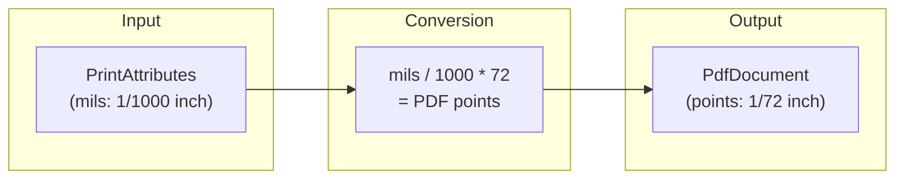

对于 8.5 x 11 英寸的 Letter 页面：

- 宽度：8500 mil -> 612 点
- 高度：11000 mil -> 792 点

### 63.6.2 使用模式

```java
// Typical implementation in a PrintDocumentAdapter
@Override
public void onWrite(PageRange[] pages, ParcelFileDescriptor destination,
        CancellationSignal cancel, WriteResultCallback callback) {

    PrintedPdfDocument document = new PrintedPdfDocument(context, printAttributes);

    for (int pageNum : pagesToWrite) {
        PdfDocument.Page page = document.startPage(pageNum);

        // Get the Canvas and draw content
        Canvas canvas = page.getCanvas();
        drawPageContent(canvas, pageNum);

        document.finishPage(page);
    }

    // Write to the file descriptor
    document.writeTo(new FileOutputStream(destination.getFileDescriptor()));
    document.close();

    callback.onWriteFinished(new PageRange[] { PageRange.ALL_PAGES });
}
```

### 63.6.3 内容矩形

内容矩形会考虑边距，从而得到可绘制区域：

```java
// frameworks/base/core/java/android/print/pdf/PrintedPdfDocument.java
Margins minMargins = attributes.getMinMargins();
final int marginLeft = (int) (((float) minMargins.getLeftMils() / MILS_PER_INCH)
        * POINTS_IN_INCH);
// ... similar for top, right, bottom
mContentRect = new Rect(marginLeft, marginTop,
        mPageWidth - marginRight, mPageHeight - marginBottom);
```

---

## 63.7 PrintManagerService —— 系统服务

`PrintManagerService` 封装了 `PrintManagerImpl` Binder 服务，并与
`SystemService` 生命周期集成：

```java
// frameworks/base/services/print/java/com/android/server/print/PrintManagerService.java
public final class PrintManagerService extends SystemService {
    private final PrintManagerImpl mPrintManagerImpl;

    @Override
    public void onStart() {
        publishBinderService(Context.PRINT_SERVICE, mPrintManagerImpl);
    }

    @Override
    public void onUserUnlocking(@NonNull TargetUser user) {
        mPrintManagerImpl.handleUserUnlocked(user.getUserIdentifier());
    }

    @Override
    public void onUserStopping(@NonNull TargetUser user) {
        mPrintManagerImpl.handleUserStopped(user.getUserIdentifier());
    }
}
```

### 63.7.1 多用户架构

每个用户都有独立的 `UserState` 实例，用于管理打印服务、暂存器连接和
打印机发现：

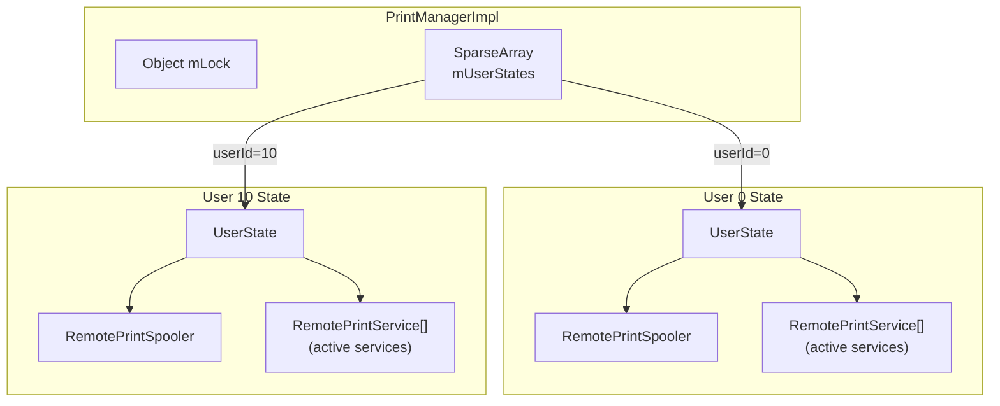

`UserState` 在用户解锁时创建，在用户停止时销毁：

```java
// frameworks/base/services/print/java/com/android/server/print/PrintManagerService.java
class PrintManagerImpl extends IPrintManager.Stub {
    private static final int BACKGROUND_USER_ID = -10;
    private final SparseArray<UserState> mUserStates = new SparseArray<>();
```

### 63.7.2 权限强制执行

`PrintManagerImpl` 中的 `print()` 方法会验证：

1. 适配器不为 null
2. 打印已启用（未被设备策略禁用）
3. 调用用户是当前的前台用户（或是其配置文件）

打印受 `UserManager.DISALLOW_PRINTING` 用户限制的约束，当管理员禁用
打印时，`DevicePolicyManager` 会设置该限制：

```java
// frameworks/base/services/print/java/com/android/server/print/PrintManagerService.java
private boolean isPrintingEnabled() {
    return !mUserManager.hasUserRestriction(UserManager.DISALLOW_PRINTING,
            Binder.getCallingUserHandle());
}
```

当打印被禁用时，`print()` 会通过
`DevicePolicyManagerInternal.getPrintingDisabledReasonForUser()` 获取
人类可读的原因，并以 toast 的形式显示。它会驱动适配器执行
`start()`/`finish()`，以便释放应用的资源。然后返回 `null`，且不创建
任务。

### 63.7.3 内容观察器与广播接收器

`PrintManagerImpl` 注册了：

- **内容观察器（Content observers）**，作用于
  `Settings.Secure.DISABLED_PRINT_SERVICES`，用于跟踪用户在设置中*禁用
  了*哪些打印服务。第 63.8.2 节解释了 Android 为什么跟踪禁用集而不是
  启用集。

- **包监视器（Package monitors）**，用于检测打印服务包的安装、移除
  或更新

---

## 63.8 UserState —— 按用户的打印管理

`UserState` 是核心的按用户协调器。它实现了三个回调接口：

```java
// frameworks/base/services/print/java/com/android/server/print/UserState.java
final class UserState implements
        PrintSpoolerCallbacks,       // Spooler lifecycle events
        PrintServiceCallbacks,       // Print service events
        RemotePrintServiceRecommendationServiceCallbacks {  // Recommendations
```

### 63.8.1 内部状态

```java
// Active (bound) print services
private final ArrayMap<ComponentName, RemotePrintService> mActiveServices;

// All installed print service packages
private final List<PrintServiceInfo> mInstalledServices;

// Disabled print services
private final Set<ComponentName> mDisabledServices;

// Cache of print jobs visible to apps
private final PrintJobForAppCache mPrintJobForAppCache;

// Printer discovery session mediator
private PrinterDiscoverySessionMediator mPrinterDiscoverySession;

// Spooler connection
private final RemotePrintSpooler mSpooler;
```

### 63.8.2 服务发现

当用户解锁时，`UserState` 通过向 `PackageManager` 查询具有
`android.printservice.PrintService` action 的服务来发现打印服务：

```java
// frameworks/base/services/print/java/com/android/server/print/UserState.java
private final Intent mQueryIntent =
        new Intent(android.printservice.PrintService.SERVICE_INTERFACE);
```

从 Android N 开始，系统持久化的是*禁用*集而不是启用集。除非打印服务的
`ComponentName` 出现在 `Settings.Secure.DISABLED_PRINT_SERVICES`（一个以
冒号分隔的列表）中，否则每个已安装的打印服务都被视为已启用。
`readDisabledPrintServicesLocked()` 将该设置解析到 `mDisabledServices`
中，`writeDisabledPrintServicesLocked()` 则将其持久化。
`Settings.Secure.ENABLED_PRINT_SERVICES` 仅作为一次性迁移输入而保留。
`upgradePersistentStateIfNeeded()` 读取任何旧版启用列表并将其转换为
等效的禁用集。然后它将 `ENABLED_PRINT_SERVICES` 清除为 `null`，使升级
永远不会再次运行：

```java
// frameworks/base/services/print/java/com/android/server/print/UserState.java
// Pre N we store the enabled services, in N and later we store the disabled services.
// Hence if enabledSettingValue is still set, we need to upgrade.
if (enabledSettingValue != null) {
    // ... compute disabledServices = installed - enabled ...
    writeDisabledPrintServicesLocked(disabledServices);
    Settings.Secure.putStringForUser(mContext.getContentResolver(),
            Settings.Secure.ENABLED_PRINT_SERVICES, null, mUserId);
}
```

### 63.8.3 服务生命周期管理

活动服务通过 `RemotePrintService` 代理来管理：

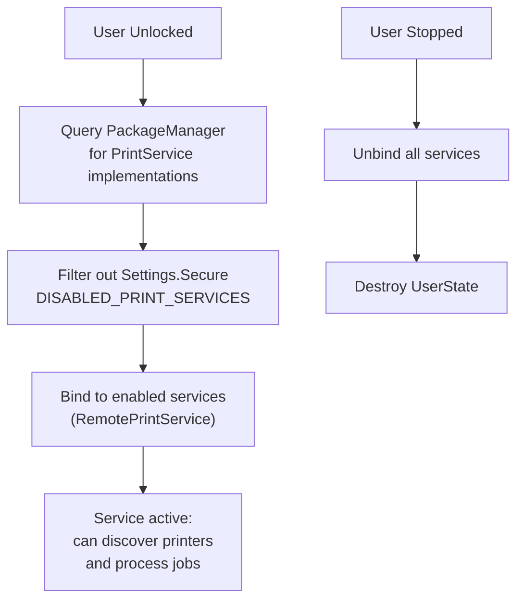

当服务崩溃时，`RemotePrintService` 会收到死亡通知，并安排在 500 毫秒后
重启：

```java
// frameworks/base/services/print/java/com/android/server/print/UserState.java
private static final int SERVICE_RESTART_DELAY_MILLIS = 500;
```

---

## 63.9 PrintService —— 插件 API

`PrintService` 是打印服务插件的基类。第三方应用（例如 HP Print
Service、Mopria Print Service）通过继承该类来支持特定打印机。

### 63.9.1 服务声明

打印服务必须在清单文件中声明自己，并指定特定的权限和 intent filter：

```xml
<service android:name=".MyPrintService"
         android:permission="android.permission.BIND_PRINT_SERVICE">
    <intent-filter>
        <action android:name="android.printservice.PrintService" />
    </intent-filter>
    <meta-data android:name="android.printservice"
               android:resource="@xml/printservice" />
</service>
```

`BIND_PRINT_SERVICE` 权限确保只有系统才能绑定到它。

### 63.9.2 关键回调

```java
// frameworks/base/core/java/android/printservice/PrintService.java
public abstract class PrintService extends Service {

    // Called when the system needs to discover printers
    protected abstract PrinterDiscoverySession onCreatePrinterDiscoverySession();

    // Called when a print job is queued and ready for processing
    protected abstract void onPrintJobQueued(PrintJob printJob);

    // Called when the user requests cancellation of a print job
    protected abstract void onRequestCancelPrintJob(PrintJob printJob);

    // Called after the system binds
    protected void onConnected() { }

    // Called before the system unbinds
    protected void onDisconnected() { }
}
```

### 63.9.3 打印任务处理流程

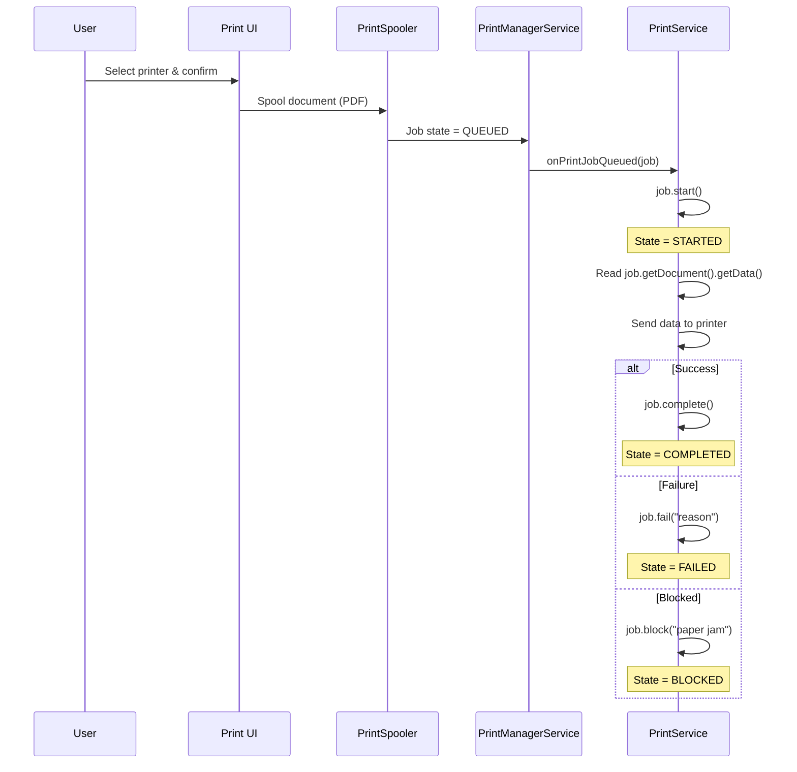

### 63.9.4 访问打印数据

打印服务通过 `PrintDocument` 访问已暂存的文档：

```java
// In the PrintService
@Override
protected void onPrintJobQueued(PrintJob printJob) {
    printJob.start();

    PrintDocument document = printJob.getDocument();
    InputStream data = new FileInputStream(
            document.getData().getFileDescriptor());

    // data is a PDF file -- send to printer
    sendToPrinter(data, printJob.getInfo());

    printJob.complete();
}
```

无论原始内容格式如何，该数据始终是 PDF 文件。

---

## 63.10 打印机发现

打印机发现通过 `PrinterDiscoverySession` 来管理，它具有独立于打印服务
自身的生命周期。

### 63.10.1 发现生命周期

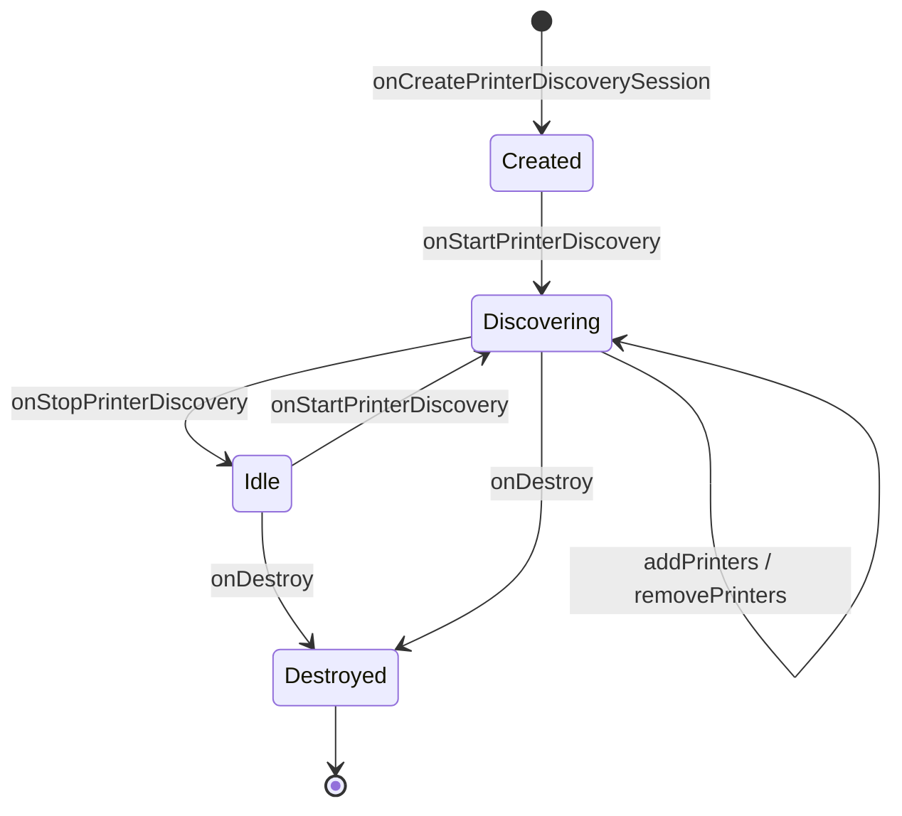

### 63.10.2 关键方法

```java
// frameworks/base/core/java/android/printservice/PrinterDiscoverySession.java
public abstract class PrinterDiscoverySession {

    // System requests to start discovering printers
    public abstract void onStartPrinterDiscovery(List<PrinterId> priorityList);

    // System requests to stop discovering
    public abstract void onStopPrinterDiscovery();

    // System requests validation of specific printers
    public abstract void onValidatePrinters(List<PrinterId> printerIds);

    // System is interested in real-time updates for a printer
    public abstract void onStartPrinterStateTracking(PrinterId printerId);

    // System no longer needs real-time updates
    public abstract void onStopPrinterStateTracking(PrinterId printerId);

    // Session is being destroyed
    public abstract void onDestroy();

    // Services call these to report printers
    public final void addPrinters(List<PrinterInfo> printers);
    public final void removePrinters(List<PrinterId> printerIds);
}
```

### 63.10.3 PrinterInfo 与能力

打印机使用 `PrinterInfo` 来描述：

```java
PrinterInfo printer = new PrinterInfo.Builder(printerId, "My Printer",
        PrinterInfo.STATUS_IDLE)
    .setDescription("Color Laser Printer")
    .setCapabilities(capabilities)
    .build();
```

`PrinterCapabilitiesInfo` 描述了打印机能做什么：


### 63.10.4 优先级列表

`onStartPrinterDiscovery()` 中的 `priorityList` 参数包含应优先被发现
的打印机——通常是用户最近使用过的打印机。这使打印服务能够对已知打印
机的网络发现进行优先排序。

### 63.10.5 打印机状态跟踪

当用户在打印界面中选择打印机时，系统会为该打印机调用
`onStartPrinterStateTracking()`。服务随后应提供实时状态更新（空闲、
繁忙、不可用），如果尚未提供的话还应提供能力信息。这种惰性能力加载避
免了一开始就查询所有已发现的打印机。

---

## 63.11 打印暂存器

打印暂存器（`com.android.printspooler`）是一个独立的系统进程，负责管理
打印队列并承载打印预览界面。

### 63.11.1 RemotePrintSpooler

`RemotePrintSpooler` 是系统服务到暂存器进程的代理：

```java
// frameworks/base/services/print/java/com/android/server/print/RemotePrintSpooler.java
final class RemotePrintSpooler {
    private static final long BIND_SPOOLER_SERVICE_TIMEOUT =
            (Build.IS_ENG) ? 120000 : 10000;

    private final ServiceConnection mServiceConnection = new MyServiceConnection();
    private IPrintSpooler mRemoteInstance;
```

### 63.11.2 定时远程调用

需要返回值的暂存器调用会通过 `TimedRemoteCaller` 实例执行，以强制执行
超时。这些调用用于获取或设置打印任务信息、状态和标签，其中还包括自
定义打印机图标操作：

```java
// Individual timed callers for each operation
private final GetPrintJobInfosCaller mGetPrintJobInfosCaller;
private final GetPrintJobInfoCaller mGetPrintJobInfoCaller;
private final SetPrintJobStateCaller mSetPrintJobStatusCaller;
private final SetPrintJobTagCaller mSetPrintJobTagCaller;
```

诸如 `createPrintJob()`、`writePrintJobData()` 和 `setStatus()` 之类
的「触发即忘」操作会跳过定时调用器，直接调用远程 `IPrintSpooler`
实例。

绑定超时在正式版构建上为 10 秒，在工程版构建上为 120 秒（以方便附加
调试器）。

### 63.11.3 暂存器绑定生命周期

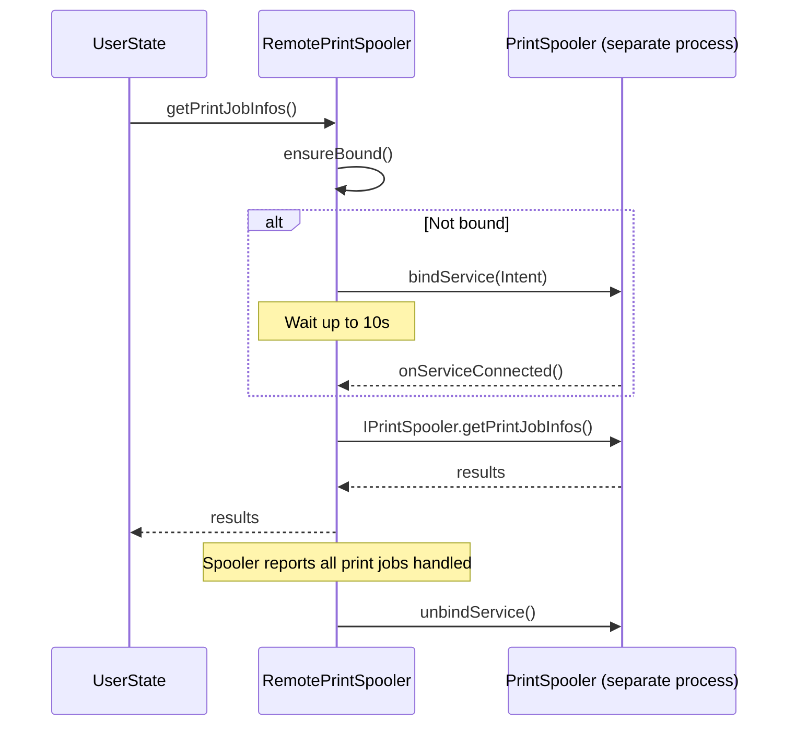

### 63.11.4 暂存器回调

暂存器通过 `PrintSpoolerCallbacks` 将状态变化通知系统服务：

```java
// frameworks/base/services/print/java/com/android/server/print/RemotePrintSpooler.java
public static interface PrintSpoolerCallbacks {
    public void onPrintJobQueued(PrintJobInfo printJob);
    public void onAllPrintJobsForServiceHandled(ComponentName printService);
    public void onPrintJobStateChanged(PrintJobInfo printJob);
}
```

---

## 63.12 RemotePrintService —— 服务进程代理

`RemotePrintService` 管理已绑定打印服务的生命周期：

```java
// frameworks/base/services/print/java/com/android/server/print/RemotePrintService.java
final class RemotePrintService implements DeathRecipient {
    private final List<Runnable> mPendingCommands = new ArrayList<>();
    private IPrintService mPrintService;
    private boolean mBinding;
    private boolean mHasActivePrintJobs;
    private boolean mHasPrinterDiscoverySession;
```

### 63.12.1 延迟命令

如果命令到达时服务尚未绑定，该命令会被添加到 `mPendingCommands` 中，
并在绑定完成后执行：

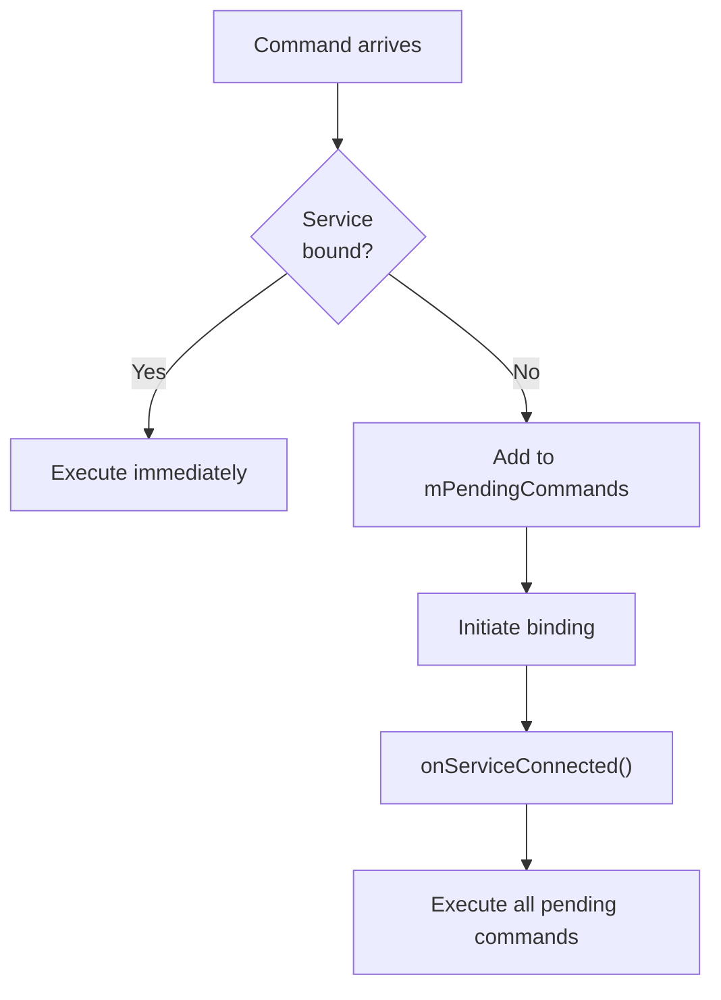

### 63.12.2 死亡处理

当打印服务进程死亡时：

```java
// frameworks/base/services/print/java/com/android/server/print/RemotePrintService.java
// implements DeathRecipient
```

`RemotePrintService` 会检测到死亡，通过
`PrintServiceCallbacks.onServiceDied()` 通知 `UserState`，然后
`UserState` 安排在 500 毫秒后重启。

### 63.12.3 受跟踪的打印机

代理会跟踪哪些打印机正被主动监视：

```java
@GuardedBy("mLock")
private List<PrinterId> mTrackedPrinterList;
```

这使代理能够在服务重启后重新请求打印机状态跟踪，从而从服务崩溃中
无缝恢复。

---

## 63.13 完整的打印流程

下面是从用户在应用中按下「打印」到文档送达打印机的端到端流程：

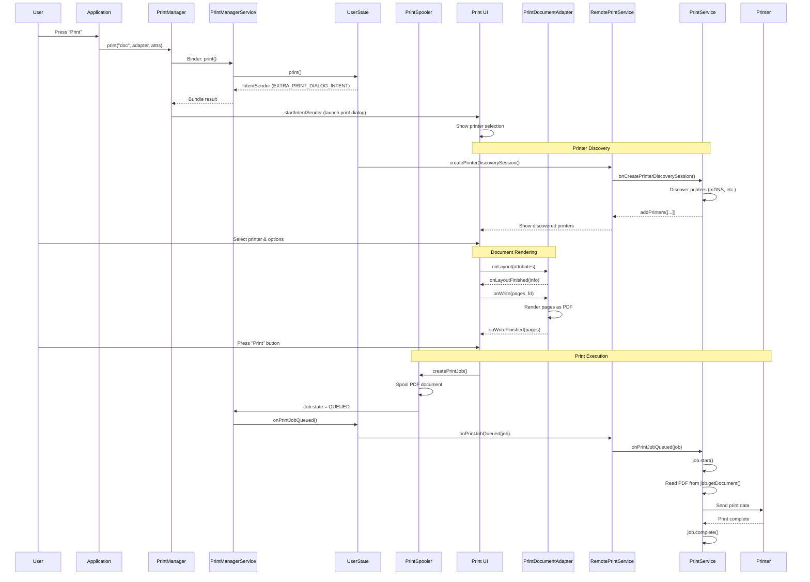

---

## 63.14 print() 方法的内部实现

`UserState.print()` 方法揭示了任务创建的内部机制：

```java
// frameworks/base/services/print/java/com/android/server/print/UserState.java
public Bundle print(@NonNull String printJobName, @NonNull IPrintDocumentAdapter adapter,
        @Nullable PrintAttributes attributes, @NonNull String packageName, int appId) {
    // Create print job place holder.
    final PrintJobInfo printJob = new PrintJobInfo();
    printJob.setId(new PrintJobId());
    printJob.setAppId(appId);
    printJob.setLabel(printJobName);
    printJob.setAttributes(attributes);
    printJob.setState(PrintJobInfo.STATE_CREATED);
    printJob.setCopies(1);
    printJob.setCreationTime(System.currentTimeMillis());

    // Track this job so we can forget it when the creator dies.
    if (!mPrintJobForAppCache.onPrintJobCreated(adapter.asBinder(), appId, printJob)) {
        return null; // Client is dead
    }

    Intent intent = new Intent(PrintManager.ACTION_PRINT_DIALOG);
    intent.setData(Uri.fromParts("printjob", printJob.getId().flattenToString(), null));
    intent.putExtra(PrintManager.EXTRA_PRINT_DOCUMENT_ADAPTER, adapter.asBinder());
    intent.putExtra(PrintManager.EXTRA_PRINT_JOB, printJob);
    intent.putExtra(Intent.EXTRA_PACKAGE_NAME, packageName);

    ActivityOptions activityOptions = ActivityOptions.makeBasic()
            .setPendingIntentCreatorBackgroundActivityStartMode(
                    ActivityOptions.MODE_BACKGROUND_ACTIVITY_START_DENIED);
    IntentSender intentSender = PendingIntent.getActivityAsUser(
            mContext, 0, intent, PendingIntent.FLAG_ONE_SHOT
                    | PendingIntent.FLAG_CANCEL_CURRENT | PendingIntent.FLAG_IMMUTABLE,
            activityOptions.toBundle(), new UserHandle(mUserId)).getIntentSender();

    Bundle result = new Bundle();
    result.putParcelable(PrintManager.EXTRA_PRINT_JOB, printJob);
    result.putParcelable(PrintManager.EXTRA_PRINT_DIALOG_INTENT, intentSender);
    return result;
}
```

关键实现细节：

1. **死亡跟踪**：适配器的 Binder 通过 `PrintJobForAppCache` 进行监视——
   如果创建任务的应用死亡，其打印任务会被清理

2. **PendingIntent**：打印对话框通过包装在 Bundle 中、位于
   `EXTRA_PRINT_DIALOG_INTENT` 之下的 `PendingIntent` 启动。客户端
   （第 63.2.1 节中的 `PrintManager.print()`）读取该 `IntentSender` 并
   启动它。这样对话框就能在跨进程边界的情况下以正确的安全上下文运行

3. **后台 Activity 限制**：`PendingIntent` 使用
   `setPendingIntentCreatorBackgroundActivityStartMode(MODE_BACKGROUND_ACTIVITY_START_DENIED)`
   构建，因此*创建*该 intent 的应用无法利用它启动后台 Activity

4. **初始状态**：每个打印任务都以 `STATE_CREATED` 状态和 1 份副本开始

### 63.14.1 PrintJobForAppCache

当应用创建打印任务时，它们会按应用 ID 为键记录在一个缓存中。这有两
个用途：

- **任务融合**：该缓存在 `getPrintJobInfos()` 中与暂存器数据合并，以
  提供完整的视图。暂存器不存储处于终态的任务，而缓存会一直保留它们，
  直到应用死亡

- **标签剥离**：在向应用返回任务时，标签和高级选项会被剥离——这些
  只对打印服务可见

```java
// frameworks/base/services/print/java/com/android/server/print/UserState.java
public List<PrintJobInfo> getPrintJobInfos(int appId) {
    List<PrintJobInfo> cachedPrintJobs = mPrintJobForAppCache.getPrintJobs(appId);
    // Note that the print spooler is not storing print jobs that
    // are in a terminal state as it is non-trivial to properly update
    // the spooler state for when to forget print jobs in terminal state.
    // Therefore, we fuse the cached print jobs for running apps (some
    // jobs are in a terminal state) with the ones that the print
    // spooler knows about (some jobs are being processed).
```

### 63.14.2 取消与重启流程

取消打印任务同时涉及暂存器和打印服务：

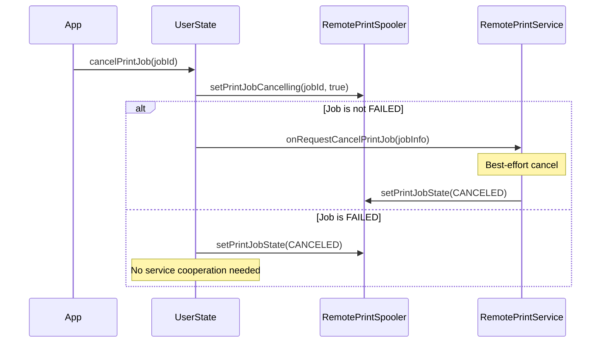

重启已失败的任务只是将其状态转换回 `QUEUED`：

```java
// frameworks/base/services/print/java/com/android/server/print/UserState.java
public void restartPrintJob(@NonNull PrintJobId printJobId, int appId) {
    PrintJobInfo printJobInfo = getPrintJobInfo(printJobId, appId);
    if (printJobInfo == null || printJobInfo.getState() != PrintJobInfo.STATE_FAILED) {
        return;
    }
    mSpooler.setPrintJobState(printJobId, PrintJobInfo.STATE_QUEUED, null);
}
```

### 63.14.3 任务路由到服务

当暂存器通知任务已入队时，`UserState` 根据打印机的 `ComponentName`
将其路由到正确的打印服务：

```java
// frameworks/base/services/print/java/com/android/server/print/UserState.java
@Override
public void onPrintJobQueued(PrintJobInfo printJob) {
    ComponentName printServiceName = printJob.getPrinterId().getServiceName();
    RemotePrintService service = mActiveServices.get(printServiceName);

    if (service != null) {
        service.onPrintJobQueued(printJob);
    } else {
        // The service is no longer enabled
        mSpooler.setPrintJobState(printJob.getId(), PrintJobInfo.STATE_FAILED,
                mContext.getString(R.string.reason_service_unavailable));
    }
}
```

在用户选择打印机之后、任务入队之前，目标打印服务可能会被禁用。在这种
情况下，任务会立即失败，并提示「服务不可用」。

---

## 63.15 PrintManagerImpl Binder 服务

`PrintManagerImpl` 内部类处理所有 Binder 调用，并实施严格的安全检查：

### 63.15.1 用户解析

每个 API 调用都会解析调用用户并验证权限：

```java
// frameworks/base/services/print/java/com/android/server/print/PrintManagerService.java
final int resolvedUserId = resolveCallingUserEnforcingPermissions(userId);
final int resolvedAppId;
final UserState userState;
synchronized (mLock) {
    // Only the current group members can start new print jobs.
    if (resolveCallingProfileParentLocked(resolvedUserId) != getCurrentUserId()) {
        return null;
    }
    resolvedAppId = resolveCallingAppEnforcingPermissions(appId);
    resolvedPackageName = resolveCallingPackageNameEnforcingSecurity(packageName);
    userState = getOrCreateUserStateLocked(resolvedUserId, false);
}
```

### 63.15.2 自定义打印机图标安全

来自打印服务的自定义打印机图标要经过用户边界验证，以防止跨用户信息
泄露：

```java
// frameworks/base/services/print/java/com/android/server/print/PrintManagerService.java
private Icon validateIconUserBoundary(Icon icon, int resolvedCallingId) {
    if (icon != null && (icon.getType() == Icon.TYPE_URI
            || icon.getType() == Icon.TYPE_URI_ADAPTIVE_BITMAP)) {
        final int iconUserId = ContentProvider.getUserIdFromAuthority(
                icon.getUri().getAuthority(), resolvedCallingId);
        synchronized (mLock) {
            if (resolveCallingProfileParentLocked(iconUserId) != getCurrentUserId()) {
                return null; // Block cross-user icon access
            }
        }
    }
    return icon;
}
```

### 63.15.3 打印服务查询

枚举打印服务需要 `READ_PRINT_SERVICES` 权限：

```java
// frameworks/base/services/print/java/com/android/server/print/PrintManagerService.java
public List<PrintServiceInfo> getPrintServices(int selectionFlags, int userId) {
    Preconditions.checkFlagsArgument(selectionFlags,
            PrintManager.DISABLED_SERVICES | PrintManager.ENABLED_SERVICES);
    mContext.enforceCallingOrSelfPermission(
            android.Manifest.permission.READ_PRINT_SERVICES, null);
```

---

## 63.16 打印服务推荐

Android 提供了一个推荐系统，用于建议用户可能想要安装的打印服务。
`RemotePrintServiceRecommendationService` 负责与推荐服务的连接：

```java
// frameworks/base/services/print/java/com/android/server/print/
// RemotePrintServiceRecommendationService.java
```

当没有已安装的打印服务能够与已发现的打印机通信时，推荐会在打印界面
中显示。

---

## 63.17 AIDL 接口

打印框架定义了多个用于跨进程通信的 AIDL 接口：

| 接口 | 方向 | 用途 |
|-----------|-----------|---------|
| `IPrintManager` | App -> System | 打印任务的创建、查询、取消 |
| `IPrintDocumentAdapter` | System -> App | 布局与写入回调 |
| `IPrintDocumentAdapterObserver` | App -> System | 适配器销毁通知（应用的适配器委托告知暂存器其 Activity 已被销毁） |
| `IPrintSpooler` | System -> Spooler | 暂存器中的任务管理 |
| `IPrintSpoolerCallbacks` | Spooler -> System | 任务状态变化回调 |
| `IPrintSpoolerClient` | Spooler -> System | 任务已入队 / 所有任务已处理回调（由系统通过 `IPrintSpooler.setClient()` 注册） |
| `IPrintService` | System -> Service | 打印服务控制 |
| `IPrintServiceClient` | Service -> System | 打印机与任务更新 |
| `IPrintJobStateChangeListener` | System -> App | 任务状态通知 |
| `IPrintServicesChangeListener` | System -> App | 服务列表通知 |
| `IPrinterDiscoveryObserver` | System -> App | 打印机发现事件 |
| `ILayoutResultCallback` | App -> System | 布局结果传递 |
| `IWriteResultCallback` | App -> System | 写入结果传递 |

### 63.17.1 监听器接口

`PrintManager` 客户端 API 暴露了三个监听器接口：

```java
// frameworks/base/core/java/android/print/PrintManager.java

// Notified when any print job state changes
public interface PrintJobStateChangeListener {
    void onPrintJobStateChanged(PrintJobId printJobId);
}

// Notified when the set of print services changes
@SystemApi
public interface PrintServicesChangeListener {
    void onPrintServicesChanged();
}

// Notified when print service recommendations change
@SystemApi
public interface PrintServiceRecommendationsChangeListener {
    void onPrintServiceRecommendationsChanged();
}
```

状态变化监听器被包装为兼容 Binder 的包装器，并通过主 Looper 的
Handler 传递：

```java
// frameworks/base/core/java/android/print/PrintManager.java
mHandler = new Handler(context.getMainLooper(), null, false) {
    @Override
    public void handleMessage(Message message) {
        switch (message.what) {
            case MSG_NOTIFY_PRINT_JOB_STATE_CHANGED: {
                SomeArgs args = (SomeArgs) message.obj;
                PrintJobStateChangeListenerWrapper wrapper =
                        (PrintJobStateChangeListenerWrapper) args.arg1;
                PrintJobStateChangeListener listener = wrapper.getListener();
                if (listener != null) {
                    PrintJobId printJobId = (PrintJobId) args.arg2;
                    listener.onPrintJobStateChanged(printJobId);
                }
                args.recycle();
            } break;
        }
    }
};
```

### 63.17.2 PrintManager 内部 Extras

`PrintManager` 使用了几个隐藏的 extras 与打印对话框 Activity 进行
通信：

```java
// frameworks/base/core/java/android/print/PrintManager.java
public static final String ACTION_PRINT_DIALOG = "android.print.PRINT_DIALOG";
public static final String EXTRA_PRINT_DIALOG_INTENT =
        "android.print.intent.extra.EXTRA_PRINT_DIALOG_INTENT";
public static final String EXTRA_PRINT_JOB =
        "android.print.intent.extra.EXTRA_PRINT_JOB";
public static final String EXTRA_PRINT_DOCUMENT_ADAPTER =
        "android.print.intent.extra.EXTRA_PRINT_DOCUMENT_ADAPTER";
public static final int APP_ID_ANY = -2;
```

`getGlobalPrintManagerForUser()` 使用 `APP_ID_ANY` 常量来创建一个可以
访问所有打印任务（不受应用 ID 限制）的 `PrintManager` 实例。

---

## 63.18 PrintFileDocumentAdapter

对于打印现有文件的常见场景，Android 提供了 `PrintFileDocumentAdapter`：

```java
// frameworks/base/core/java/android/print/PrintFileDocumentAdapter.java
```

该适配器负责从 `File` 读取并写入打印暂存器，而应用无需实现完整的
`PrintDocumentAdapter` 契约。

---

## 63.19 线程模型

打印框架通过精心设计的线程模型来避免阻塞 UI：

| 组件 | 线程 | 用途 |
|-----------|--------|---------|
| `PrintManager` 回调 | 主线程 | 将状态变化传递给应用 |
| `PrintDocumentAdapter.onLayout()` | 主线程 | 应用驱动的布局 |
| `PrintDocumentAdapter.onWrite()` | 主线程 | 应用驱动的渲染 |
| `PrintManagerImpl` 操作 | Binder 线程 | 服务请求处理 |
| `RemotePrintSpooler` 调用 | 后台线程 | 暂存器 IPC（可能阻塞） |
| `RemotePrintService` 操作 | system_server 主线程（`Handler.getMain()`） | 服务绑定与命令分发 |
| `UserState` 状态管理 | 在 `mLock` 上同步 | 线程安全的状态访问 |

文档明确警告：

> 对 RemotePrintSpooler 的调用可能是阻塞性的，需要主线程解除阻塞才能
> 完成。因此，在持有任何可能需要在主线程上获取的监视器（monitor）时，
> 不要调用它。

---

## 63.20 安全模型

打印框架实施了多个安全边界：

### 63.20.1 权限要求

| 权限 | 用途 |
|-----------|---------|
| `BIND_PRINT_SERVICE` | 只有系统才能绑定到打印服务 |
| `INTERACT_ACROSS_USERS_FULL` | 跨用户打印管理 |
| 特性：`FEATURE_PRINTING` | 设备必须支持打印 |

### 63.20.2 应用隔离

应用只能看到自己的打印任务。`UserState` 中的 `PrintJobForAppCache`
维护按应用划分的缓存：

```java
// frameworks/base/services/print/java/com/android/server/print/UserState.java
private final PrintJobForAppCache mPrintJobForAppCache = new PrintJobForAppCache();
```

### 63.20.3 设备策略集成

企业管理通过设置 `UserManager.DISALLOW_PRINTING` 用户限制来禁用打印。
`isPrintingEnabled()` 会为调用用户检查该限制。当限制被设置时，
`print()` 和 `restartPrintJob()` 会拒绝继续执行。此外，`print()` 会通过
`DevicePolicyManagerInternal` 呈现管理员的原因字符串：

```java
// frameworks/base/services/print/java/com/android/server/print/PrintManagerService.java
if (!isPrintingEnabled()) {
    DevicePolicyManagerInternal dpmi =
            LocalServices.getService(DevicePolicyManagerInternal.class);
    CharSequence disabledMessage = dpmi.getPrintingDisabledReasonForUser(callingUserId);
    if (disabledMessage != null) {
        Toast.makeText(mContext, Looper.getMainLooper(), disabledMessage,
                Toast.LENGTH_LONG).show();
    }
    // Drive the adapter through start()/finish() and return null.
}
```

---

## 63.21 调试打印服务

### 63.21.1 Shell 命令

`PrintShellCommand` 类实现了两个 `cmd print` 子命令，两者都用于控制系统
是否可以绑定到即时应用发布的打印服务：

```bash
# Read the instant-app binding policy for a user (default: USER_SYSTEM)
$ adb shell cmd print get-bind-instant-service-allowed [--user <USER_ID>]

# Set the instant-app binding policy
$ adb shell cmd print set-bind-instant-service-allowed [--user <USER_ID>] true|false
```

实时打印状态最丰富的视图来自 `dumpsys`，它会打印每个 `UserState` 的
已安装服务、活动服务、暂存器绑定和缓存的打印任务：

```bash
# Dump print manager state (text)
$ adb shell dumpsys print

# Dump as protobuf for structured analysis
$ adb shell dumpsys print --proto
```

`PrintManagerService`（第 63.7 节）中的 `dumpsys print` 处理器会在
`mLock` 下对按用户的 `UserState` 列表进行快照。然后它通过
`DualDumpOutputStream` 渲染该列表。该流的目标可以是
`IndentingPrintWriter`（文本）或 `ProtoOutputStream`（`--proto`）。

### 63.21.2 日志

打印框架类不会查询 `Log.isLoggable()`，因此常用的
`adb shell setprop log.tag.<TAG> VERBOSE` 方法对它们无效。它们的详细
输出反而由编译时常量控制。`PrintManager`、`RemotePrintSpooler`、
`RemotePrintService` 和 `UserState` 各自声明了一个发布时为 `false` 的
`DEBUG` 标志。`PrintManagerService` 则完全没有调试开关：

```java
// frameworks/base/core/java/android/print/PrintManager.java
private static final boolean DEBUG = false;
```

因此，额外的日志需要在所关注的类中将 `DEBUG` 设为 `true` 并重新构建
框架。在正式版构建上，实际可用的替代方案是 `dumpsys print`
（第 63.21.1 节）和 logcat 过滤器。过滤器会显示框架无条件发出的消息
（错误和警告）。

### 63.21.3 Proto 转储

打印框架支持基于 protobuf 的转储，用于结构化分析：

```java
// frameworks/base/services/print/java/com/android/server/print/UserState.java
// Uses PrintUserStateProto, CachedPrintJobProto, InstalledPrintServiceProto,
// PrinterDiscoverySessionProto for structured dumps
```

---

## 63.22 关键常量参考

| 常量 | 值 | 位置 |
|----------|-------|----------|
| `PRINT_SPOOLER_PACKAGE_NAME` | `com.android.printspooler` | `PrintManager.java` |
| `BIND_SPOOLER_SERVICE_TIMEOUT` | 10,000ms（eng：120,000ms） | `RemotePrintSpooler.java` |
| `SERVICE_RESTART_DELAY_MILLIS` | 500ms | `UserState.java` |
| `MILS_PER_INCH` | 1000 | `PrintedPdfDocument.java` |
| `POINTS_IN_INCH` | 72 | `PrintedPdfDocument.java` |
| `COMPONENT_NAME_SEPARATOR` | `:` | `UserState.java` |
| `BACKGROUND_USER_ID` | -10 | `PrintManagerImpl` |
| Service action | `android.printservice.PrintService` | `PrintService.java` |
| Meta-data key | `android.printservice` | `PrintService.java` |

---

## 63.23 打印机设置 Activity（Android 17）

Android 17 允许打印服务为打印机发布一个*设置*（setup）Activity，除了
长期存在的*信息*（info）Activity 之外。其动机场景是：服务能够发现某
台打印机，但在用户完成一次性设置步骤之前无法向其打印。此类步骤的示例
包括认领打印机、输入凭据以及安装供应商配置文件。该特性由
`android.print.flags.enable_setup_activity` aconfig 标志保护：

```text
# frameworks/base/core/java/android/print/flags/flags.aconfig
flag {
    name: "enable_setup_activity"
    namespace: "printing"
    description: "Enable PrintService implementations to provide a printer setup activity"
    is_exported: true
}
```

### 63.23.1 PrinterInfo 上的设置 intent

`PrinterInfo` 在现有的 `mInfoIntent` 之外，新增了一个可为 null 的
`mSetupIntent`（`PendingIntent`）。打印服务通过
`PrinterInfo.Builder.setSetupIntent()` 来附加它：

```java
// frameworks/base/core/java/android/print/PrinterInfo.java
@FlaggedApi(Flags.FLAG_ENABLE_SETUP_ACTIVITY)
public @NonNull Builder setSetupIntent(@NonNull PendingIntent setupIntent) {
    mSetupIntent = Objects.requireNonNull(setupIntent);
    return this;
}
```

每个字段接触点——构造函数、parcel 读写、`hashCode()`、`equals()` 和
`toString()`——都被包裹在 `if (Flags.enableSetupActivity())` 中。因此，
额外的 `PendingIntent` 只在标志开启时才会被读取和写入 parcel。这保持
了线路格式与针对标志关闭构建编译的服务兼容。访问器 `getSetupIntent()`
被刻意标记为 `@hide`。只有框架自身的打印界面可以启动设置屏幕。通过
其他 API 获取 `PrinterInfo` 的第三方应用无法启动它。

### 63.23.2 暂存器如何在设置完成前阻止打印

打印对话框（暂存器中的 `PrintActivity`）将带有设置 intent 的打印机视为
尚不可打印。`needsSetup()` 仅在标志开启且所选打印机带有设置 intent
时返回 true：

```java
// frameworks/base/packages/PrintSpooler/src/com/android/printspooler/ui/PrintActivity.java
private static boolean needsSetup(PrinterInfo printer) {
    return android.print.flags.Flags.enableSetupActivity()
            && printer != null
            && printer.getSetupIntent() != null;
}
```

当用户尝试打印时，`setupAndPrint()` 首先检查 `needsSetup()`。如果需要
设置，它会启动服务的设置 `PendingIntent` 以获取结果（而不是确认打印
任务）。这使得该 Activity 可以通过 `MODE_BACKGROUND_ACTIVITY_START_ALLOWED`
从暂存器启动。只有当不需要设置（或设置已完成）时，暂存器才会落入
`confirmPrint()`：

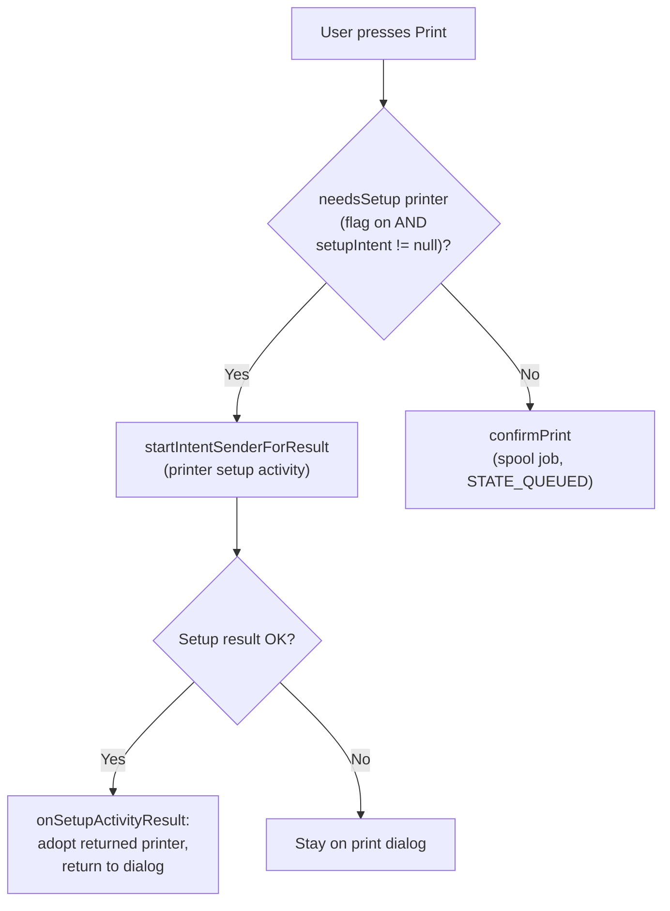

成功的设置结果不会直接暂存任务。`onSetupActivityResult()` 只采纳设置
Activity 返回的打印机。这可能是另一台打印机——以防用户在设置过程中
选择了不同的打印机。该方法随后根据该打印机的能力更新打印属性，并返回
对话框。然后用户再次按下打印，由于打印机不再需要设置，暂存器会落入
`confirmPrint()`。

---

## 63.24 打印遥测（Android 17）

Android 17 为打印暂存器添加了结构化的 statsd 指标，以便平台可以衡量
打印结果、发现和 UI 参与度。所有日志记录都由
`com.android.printspooler.flags.printing_telemetry` 标志控制：

```text
# frameworks/base/packages/PrintSpooler/flags/flags.aconfig
flag {
  name: "printing_telemetry"
  namespace: "printing"
  description: "Metrics tracking final print job status, printer discovery, printer capabilities, and major UI actions."
}
```

### 63.24.1 statsd 原子

这些原子位于一个专门的扩展文件中，并由 `printspooler` 模块发出：

```text
# frameworks/proto_logging/stats/atoms/printing/printing_extension_atoms.proto
FrameworkPrintJob              (1071) - final job state + attributes
FrameworkPrinterDiscovery      (1072) - discovered printer + capabilities
FrameworkMainPrintUiLaunched   (1073) - print dialog opened
FrameworkAdvancedOptionsUiLaunched (1074) - advanced options opened
```

`FrameworkPrintJob` 携带以下字段：

- 终态（已完成 / 已失败 / 已取消）
- 颜色模式、介质尺寸以及水平/垂直 DPI
- 方向、双面模式和文档类型
- 输出是否保存为 PDF
- 页数和打印服务 UID

`FrameworkPrinterDiscovery` 记录发现服务的 UID 以及打印机支持的颜色
模式、介质尺寸和双面模式。另外四个 `Bips*` 原子（1075-1078）来自内置
打印服务（`builtinprintservice`），而不是暂存器。

### 63.24.2 事件记录在哪里

当任务达到暂存器的最终状态时，`PrintSpoolerService.logPrintJobFinalState()`
会发出一个 `FrameworkPrintJob`。它解析打印服务的 UID，读取可选的属性
（`PrintAttributes`）和文档信息（`PrintDocumentInfo`），并将它们交给
一个异步日志记录器：

```java
// frameworks/base/packages/PrintSpooler/src/com/android/printspooler/model/PrintSpoolerService.java
private void logPrintJobFinalState(PrinterId printerId, PrintJobInfo printJob) {
    if (!Flags.printingTelemetry()) {
        return;
    }
    // ... resolve serviceUId, read PrintAttributes + PrintDocumentInfo ...
    StatsAsyncLogger.INSTANCE.PrintJob(serviceUId, state, colorMode, size,
            resolution, duplexMode, docType, savedPdf, pageCount);
}
```

proto 注释指明了每个原子的确切源文件。`FrameworkPrintJob` 记录自
`PrintSpoolerService.java`。`FrameworkPrinterDiscovery` 记录自
`PrinterDiscoverySession.java`。两个 UI 启动原子记录自
`PrintActivity.java`。为支持这些原子，Android 17 添加了日志记录器使用
的小访问器，包括从 `PrintAttributes` 和 `PrintDocumentInfo` 读取的介质
尺寸和文档类型查找。

---

## 63.25 暂存器不再随处预装（Android 17）

早期版本假定 `com.android.printspooler` 存在于每个用户中。Android 17
将预装改为明确的 `install-in-user-type` 允许列表。暂存器仅随列出的用户
类型（完整用户以及克隆、受管和私密配置文件）一起提供。它不会为每个用户
无条件提供。

```xml
<!-- build/make/target/product/sysconfig/preinstalled-packages-platform-handheld-system.xml -->
<install-in-user-type package="com.android.printspooler">
    <install-in user-type="FULL" />
    <install-in user-type="android.os.usertype.profile.CLONE" />
    <install-in user-type="android.os.usertype.profile.MANAGED" />
    <install-in user-type="android.os.usertype.profile.PRIVATE" />
</install-in-user-type>
```

由于暂存器现在可能在某个用户中不存在，与之交互的代码必须容忍这种
情况。`dumpsys print` 路径就是一个明显的例子。旧的实现会对每个用户
状态调用 `RemotePrintSpooler.dump()`。当暂存器包未安装时，该调用会失
败。Android 17 添加了一个安装检查，短路转储：

```java
// frameworks/base/services/print/java/com/android/server/print/RemotePrintSpooler.java
public void dump(@NonNull DualDumpOutputStream dumpStream) {
    synchronized (mLock) {
        if (!isInstalled()) {
            return;
        }
        // ... write is_destroyed / is_bound ...
    }
}

private boolean isInstalled() {
    try {
        mContext.createPackageContextAsUser(PRINT_SPOOLER_PACKAGE_NAME, 0, mUserHandle);
        return true;
    } catch (PackageManager.NameNotFoundException e) {
        return false;
    } catch (Exception e) {
        Slog.e(LOG_TAG, "Failed to check if print spooler is installed", e);
        return false;
    }
}
```

`isInstalled()` 通过 `createPackageContextAsUser()` 在代理自己的
`mUserHandle` 上探测暂存器包。当它返回 false 时，该用户的转储会被跳过，
因此 `adb shell dumpsys print` 在部分用户没有暂存器的设备上也能成功。

---

## 动手实践

使用运行 Android 17 的设备或模拟器来观察打印框架的实际运行。

1. **检查实时打印状态。** 打开任何支持打印的应用（Chrome、Files、
   Photos），发起一次打印，然后转储框架状态：

   ```bash
   adb shell dumpsys print
   adb shell dumpsys print --proto > print_state.pb
   ```

   注意按用户的 `UserState` 部分、已安装和活动的打印服务，以及任何
   缓存的打印任务。在具有次要用户的设备上，确认该命令不会失败。即使
   暂存器在某些用户中可能不存在（第 63.25 节），这一点仍然成立。

2. **观察禁用服务模型。** 列出打印服务，然后在设置中切换一个，并重新
   读取实际持久化该选择的 secure 设置：

   ```bash
   adb shell settings get secure disabled_print_services
   ```

   在设置中禁用一个服务。观察以冒号分隔列表中的 `ComponentName`。
   *启用*设置保持为空（第 63.8.2 节）。

3. **跟踪打印任务的生命周期。** 跟踪一个任务从 `STATE_CREATED` 到
   `STATE_QUEUED` 再到终态的过程。框架类将详细日志控制在编译时
   `DEBUG = false` 常量上（第 63.21.2 节）。因此 `setprop log.tag.*`
   没有帮助。相反，在任务推进时轮询 `dumpsys print`。观察缓存任务的
   状态字段变化。还要观察无条件到达 logcat 的消息：

   ```bash
   adb shell dumpsys print | grep -A3 "print jobs"
   adb logcat | grep -i print
   ```

   在自构建镜像上，将 `UserState.java` 和 `RemotePrintSpooler.java`
   中的 `DEBUG` 翻转为 `true`，以记录每个状态转换。

4. **切换新标志。** 检查 Android 17 打印标志及其状态：

   ```bash
   adb shell device_config get printing android.print.flags.enable_setup_activity
   adb shell device_config get printing com.android.printspooler.flags.printing_telemetry
   ```

   aconfig 标志的 `DeviceConfig` 键以其 aconfig 包为限定前缀
   （`android.print.flags` 和 `com.android.printspooler.flags`）。在
   较新的构建上，`adb shell aflags list | grep printing` 会显示两个
   标志及其当前状态。

   在开启 `printing_telemetry` 的情况下，完成一次打印并确认记录了
   `FrameworkPrintJob` 原子（第 63.24 节）。

5. **实现一个最小打印服务。** 构建一个 `PrintService` 子类，在
   `onCreatePrinterDiscoverySession()` 中报告一个虚假的打印机，并在
   `onPrintJobQueued()` 中完成任务。使用
   `PrinterInfo.Builder.setSetupIntent()` 附加设置 intent。观察打印
   对话框在任务被允许之前被设置阻塞（第 63.23 节）。

---

## 总结

Android 的打印框架是一个结构良好的系统，建立在四个层次之上。这些层次
分别是客户端 API（`PrintManager`）、系统服务（带有按用户 `UserState`
的 `PrintManagerService`）、打印暂存器进程（`com.android.printspooler`）
以及可插拔的打印服务（`PrintService`）。

应用与打印框架之间的 `PrintDocumentAdapter` 契约确保内容可以根据不同的
打印属性重新布局，而框架始终请求 PDF 输出。七状态的打印任务生命周期
（`CREATED` -> `QUEUED` -> `STARTED` -> `COMPLETED`/`FAILED`/`CANCELED`，
`BLOCKED` 作为中间状态）提供了对打印进度的细粒度跟踪。

打印机发现通过 `PrinterDiscoverySession` 处理，它支持惰性能力加载和实时
打印机状态跟踪。基于会话的设计确保打印服务只在系统需要时才执行开销较
大的网络发现。

暂存器和打印服务代理（`RemotePrintSpooler` 和 `RemotePrintService`）处理
跨进程通信的复杂性，包括绑定生命周期、超时、崩溃恢复和延迟命令排队。
多用户架构确保用户之间的完全隔离，同时共享底层的框架基础设施。

Android 17 对其中几个层次进行了完善。打印服务现在可以发布按打印机的
设置 Activity（`enable_setup_activity`），暂存器会启动它来阻止打印，
直到用户完成设置。

新的遥测层（`printing_telemetry`）为任务结果、打印机发现和打印对话框参
与度发出结构化的 statsd 原子。持久化的服务状态继续在
`Settings.Secure.DISABLED_PRINT_SERVICES` 中跟踪*禁用*集，旧版启用列表
设置仅作为一次性迁移输入保留。暂存器不再在每个用户上预装。因此，诸如
`dumpsys print` 之类的框架代码现在通过安装检查来保护对暂存器的访问。
此外，当对话框 Activity 无法解析时，`PrintManager.print()` 会返回
`null`，而不是抛出 `ActivityNotFoundException`。
