# 第 40 章：安全机制

Android 的安全架构是在消费设备规模上部署的最全面、最分层的防御体系之一。从引导加载程序到内核、系统服务以及应用框架，每个组件都参与到多层次的“纵深防御”策略之中。本章涵盖每个主要子系统——SELinux 强制访问控制、验证启动、硬件支持的密钥存储以及 Trusty TEE。它还涵盖生物识别认证、应用沙箱、加密以及网络安全。每一步都直接阅读实际的 AOSP 源代码。

---

## 40.1  Android 安全模型

### 40.1.1  设计原则

Android 的安全模型建立在四项基本原则之上：

1. **应用沙箱** —— 每个应用都以自己的 Linux UID 运行在自己的进程中，并拥有自己的私有数据目录。
2. **最小权限** —— 应用启动时几乎没有权限，必须显式地请求它们。用户或系统策略逐个授予（或拒绝）这些权限。
3. **纵深防御** —— 任何单一机制都不会被单独信任。内核沙箱、SELinux MAC、seccomp-BPF 以及用户空间权限检查各自充当独立的层。
4. **默认安全** —— 新功能发布时处于锁定状态，必须显式地放宽。

### 40.1.2  分层防御概览

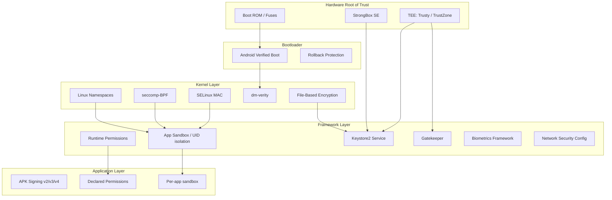

### 40.1.3  应用签名

每个 APK 在安装之前都必须签名。Android 支持多种签名方案：

| 方案 | 引入版本 | 工作原理 |
|--------|-----------|--------------|
| v1 (JAR) | Android 1.0 | 通过 `META-INF/` 对各个 ZIP 条目进行签名 |
| v2 | Android 7.0 | 将整个 APK 作为一个二进制块进行签名 |
| v3 | Android 9 | 在 v2 的基础上扩展了密钥轮换支持 |
| v3.1 | Android 13 | 添加了 rotation-min-sdk-version |
| v4 | Android 11 | 生成独立的 `.idsig` 文件，用于增量安装 |

签名确立了开发者的身份。包管理器将其用于：

- **升级验证** —— 更新必须使用与已安装包相同的密钥签名。
- **共享 UID** —— 用相同密钥签名的两个包可以请求相同的 Linux UID 并共享数据。
- **签名权限** —— 某些权限只能授予使用平台密钥签名的包。

### 40.1.4  权限模型

Android 为权限定义了三个保护级别：

- **normal** —— 在安装时自动授予（例如 `INTERNET`）。
- **dangerous** —— 需要在运行时获得用户的显式同意（例如 `CAMERA`、`READ_CONTACTS`）。
- **signature** —— 仅授予使用与声明该权限的应用相同的证书签名的应用程序，或平台签名的应用程序。

权限强制执行发生在多个层：

1. **框架检查** —— Java/Kotlin 代码中的 `Context.checkPermission()`。
2. **Binder 服务检查** —— 服务检查调用方的 UID 和 PID。
3. **内核级检查** —— 即使框架检查被绕过，SELinux 和 Linux DAC 也能阻止未授权访问。

### 40.1.5  从硬件到应用的信任链

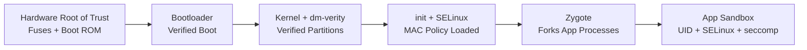

信任链始于不可修改的硬件（SoC 引导 ROM 中的熔丝公钥）。它贯穿每个层，直到到达应用程序。如果这条链中的任何一环被破坏，设备都能检测到。然后，设备可以根据策略作出响应：拒绝启动、显示警告或擦除数据。

### 40.1.6  安全边界定义

理解 Android 安全需要清晰定义信任边界：

| 边界 | 内部（受信任） | 外部（不受信任） |
|----------|------------------|---------------------|
| 硬件信任根 | 熔丝密钥、引导 ROM | 所有软件 |
| TEE 边界 | Trusty 内核 + TAs | Linux 内核、Android 框架 |
| 内核边界 | 内核代码、已加载的模块 | 所有用户空间进程 |
| 系统服务边界 | system_server、特权守护进程 | 应用、不受信任的代码 |
| 应用沙箱边界 | 应用自己的进程和数据 | 其他应用、系统内部 |

每个边界都由不同的机制强制执行：

- 硬件信任根：物理熔丝、一次性可编程存储器。
- TEE 边界：ARM TrustZone 硬件（TZASC、EL3 上的安全监视器）。
- 内核边界：CPU 特权环（EL0 与 EL1）、页表隔离。
- 系统服务边界：SELinux 类型强制 + Linux DAC。
- 应用沙箱：UID 隔离 + SELinux + seccomp-BPF + 挂载命名空间。

### 40.1.7  威胁模型

Android 的安全模型考虑以下威胁主体：

1. **恶意应用** —— 试图窃取其他应用数据、提升权限，或在卸载后仍然驻留的应用。
2. **网络攻击者** —— 能够观察和修改网络流量的对手（例如在公共 WiFi 上）。
3. **物理攻击者** —— 能够物理接触设备的对手（被盗手机、取证检查）。
4. **供应链攻击者** —— 试图向操作系统镜像或引导加载程序中注入恶意代码。
5. **内部威胁** —— 被攻陷的供应商代码或以提升的权限运行的 HAL。

每个安全子系统都针对特定的威胁主体：

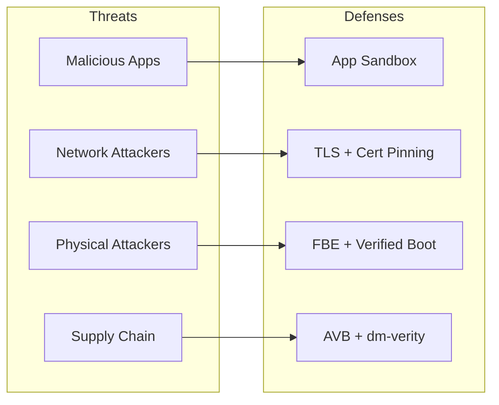

### 40.1.8  多用户安全

Android 支持在单台设备上运行多个用户。每个用户都会获得：

- 唯一的 `userId`（0、10、11……）。
- 独立的加密存储（每个用户的 CE 和 DE 密钥）。
- 独立的已安装应用，具有按用户分配的 UID（appId + userId * 100000）。
- 独立的锁屏凭据。
- SELinux 中的 MLS（多级安全）类别，用于防止跨用户数据访问，即使在同一应用内部也是如此。

SELinux MLS 类别基于用户 ID 分配。这在 MAC 层创建了内核强制的用户间隔离。（加密层面的隔离来自按用户分配的 FBE 密钥，见 40.8 节。）

### 40.1.9  工作资料安全

Android 的工作资料（受管资料）将多用户安全扩展到企业用例：

- 工作应用以独立的用户 ID 运行（例如用户 10）。
- 独立的加密密钥保护工作数据。
- IT 管理员可以远程擦除工作资料，而不会影响个人数据。
- 跨资料的数据共享由设备策略控制器控制。
- 工作资料应用与个人应用并排显示，但处于沙箱隔离中。

---

## 40.2  SELinux

SELinux（Security-Enhanced Linux）在 Android 上提供强制访问控制（MAC）。与传统的自主访问控制（DAC）不同——在 DAC 中由文件所有者控制权限——SELinux 强制执行集中式策略，即使是 root 进程也无法绕过。

### 40.2.1  Android 上的 SELinux 架构

自 Android 5.0 起，Android 就以 enforcing 模式发布 SELinux。策略在构建时从以下目录下的源文件编译而来：

```
system/sepolicy/
```

目录结构（16 个子目录）包括：

| 目录 | 用途 |
|-----------|---------|
| `public/` | 供应商策略可见的类型和属性定义 |
| `private/` | 平台私有策略（allow、neverallow 规则） |
| `vendor/` | 供应商 HAL 策略 |
| `contexts/` | 构建胶水代码和 `file_contexts` 测试数据（实际的上下文文件位于 `private/` 下；见 40.2.13） |
| `docs/` | 策略编写文档（neverallows.md、style_guide.md 等） |
| `mac_permissions/` | 用于应用签名的 MAC 权限 XML |
| `build/` | 构建系统集成 |
| `compat/` | 平台版本之间的兼容性映射 |
| `tools/` | 策略分析工具 |
| `tests/` | 与 CTS 兼容的策略测试 |
| `apex/` | 针对 APEX 的策略 |
| `prebuilts/` | 用于 API 级别兼容性的预构建策略 |
| `reqd_mask/` | 必需的策略掩码 |
| `flagging/` | 由功能标志门控的策略 |
| `microdroid/` | 针对 pVM microdroid 的策略 |
| `treble_sepolicy_tests_for_release/` | Treble 兼容性测试 |

### 40.2.2  类型强制（TE）

SELinux 类型强制是核心机制。每个进程都被分配一个**域**（类型），每个对象（文件、套接字、binder 等）都被分配一个**类型**。只有存在显式的 `allow` 规则时才会授予访问权限。

基本的规则语法是：

```
allow source_domain target_type:object_class permissions;
```

例如，以下是所有由 zygote 启动的应用的基础策略，来自 `system/sepolicy/public/app.te`：

```te
###
### Domain for all zygote spawned apps
###
### This file is the base policy for all zygote spawned apps.
### Other policy files, such as isolated_app.te, untrusted_app.te, etc
### extend from this policy. Only policies which should apply to ALL
### zygote spawned apps should be added here.
###
type appdomain_tmpfs, file_type;
```

注意这段设计注释：`public/` 只包含类型和属性定义，从不包含 `allow` 或 `neverallow` 语句。这些语句放在 `private/` 中。

### 40.2.3  域与属性

属性是类型的集合。它们允许编写一次应用于多个域的规则。来自 `system/sepolicy/public/attributes`：

```te
# All types used for devices.
attribute dev_type;

# All types used for processes.
attribute domain;

# All types used for filesystems.
attribute fs_type;

# All types used for files that can exist on a labeled fs.
attribute file_type;

# All types used for domain entry points.
attribute exec_type;

# All types used for /data files.
attribute data_file_type;

# All types used for app private data files in seapp_contexts.
attribute app_data_file_type;
```

`domain` 属性至关重要——它应用于每个进程类型。`private/domain.te` 中的规则适用于系统中的每个进程：

```te
# Rules for all domains.

# Allow reaping by init.
allow domain init:process sigchld;

# Intra-domain accesses.
allow domain self:process {
    fork
    sigchld
    sigkill
    sigstop
    signull
    signal
    getsched
    setsched
    getsession
    getpgid
    getcap
    setcap
    getattr
    setrlimit
};
allow domain self:fd use;
allow domain proc:dir r_dir_perms;
```

### 40.2.4  类型转换

当进程执行一个新的二进制文件时，SELinux 可以自动将其转换到新的域。`init` 就是通过这种方式在正确的域中启动守护进程的：

```te
# When init runs /system/bin/vold, transition to vold domain
domain_auto_trans(init, vold_exec, vold)
```

`domain_auto_trans` 宏展开为：

```te
type_transition init vold_exec:process vold;
allow init vold:process transition;
allow vold vold_exec:file { read getattr map execute entrypoint };
```

### 40.2.5  通过 seapp_contexts 进行应用域分配

文件 `system/sepolicy/private/seapp_contexts` 基于应用的属性将应用程序映射到 SELinux 域：

```
# Input selectors:
#       isSystemServer (boolean)
#       isEphemeralApp (boolean)
#       user (string)
#       seinfo (string)
#       name (string)
#       isPrivApp (boolean)
#       minTargetSdkVersion (unsigned integer)
#       fromRunAs (boolean)
```

示例映射：

| 选择器 | 域 |
|----------|--------|
| `isSystemServer=true` | `system_server_startup` |
| `user=system seinfo=platform` | `system_app` |
| `user=_app minTargetSdkVersion=37` | `untrusted_app` |
| `user=_app minTargetSdkVersion=34` | `untrusted_app_34` |
| `user=_app minTargetSdkVersion=32` | `untrusted_app_32` |
| `user=_app minTargetSdkVersion=30` | `untrusted_app_30` |
| `user=_app minTargetSdkVersion=29` | `untrusted_app_29` |
| `user=_isolated` | `isolated_app` |

带版本号的域（`untrusted_app_25`、`untrusted_app_27` 等）允许对较旧的应用逐步施加更严格的限制，同时保持向后兼容。targetSdkVersion 较新的应用获得最严格的规则。

### 40.2.6  Neverallow 规则

Neverallow 规则是编译时断言。它们不会生成运行时策略，而是阻止任何人（包括供应商策略作者）编写违反既定不变量的规则。如果策略变更违反了某条 neverallow，构建就会失败。

以下来自 `system/sepolicy/private/app_neverallows.te` 的代表性 neverallow 规则：

```te
define(`all_untrusted_apps',`{
  ephemeral_app
  isolated_app
  isolated_app_all
  isolated_compute_app
  mediaprovider
  mediaprovider_app
  untrusted_app
  untrusted_app_25
  untrusted_app_27
  untrusted_app_29
  untrusted_app_30
  untrusted_app_all
}')

# Receive or send uevent messages.
neverallow all_untrusted_apps domain:netlink_kobject_uevent_socket *;

# Do not allow untrusted apps to register services.
neverallow all_untrusted_apps service_manager_type:service_manager add;

# Do not allow untrusted apps to use VendorBinder
neverallow all_untrusted_apps vndbinder_device:chr_file *;

# Do not allow untrusted apps to connect to the property service
neverallow { all_untrusted_apps -mediaprovider } property_socket:sock_file write;
neverallow { all_untrusted_apps -mediaprovider } init:unix_stream_socket connectto;
neverallow { all_untrusted_apps -mediaprovider } property_type:property_service set;

# Block calling execve() on files in an apps home directory.
# This is a W^X violation.  For compatibility, allow for targetApi <= 28.
neverallow {
  all_untrusted_apps
  -untrusted_app_25
  -untrusted_app_27
  -runas_app
} { app_data_file privapp_data_file }:file execute_no_trans;
```

针对不受信任应用的 neverallow 规则的主要类别：

1. **不允许注册服务** —— 应用无法向 servicemanager 添加服务。
2. **不允许访问 VendorBinder** —— 应用无法直接与供应商 HAL 通信。
3. **不允许修改属性** —— 应用无法设置系统属性。
4. **不允许访问内核接口** —— 不允许 uevent 套接字、不允许写入 sysfs、不允许读取 debugfs、不允许访问 /proc 中的敏感文件。
5. **不允许违反 W^X** —— targetSdk >= 29 的应用无法在其主目录中执行文件。
6. **不允许硬链接** —— 防止 installd 删除绕过。
7. **受限的套接字类型** —— 仅允许 TCP/UDP/VSOCK，不允许 raw/netlink。

### 40.2.7  HAL Neverallow

HAL 服务器也面临限制。来自 `system/sepolicy/private/hal_neverallows.te`：

```te
# only HALs responsible for network hardware should have privileged
# network capabilities
neverallow {
  halserverdomain
  -hal_bluetooth_server
  -hal_wifi_server
  -hal_wifi_hostapd_server
  -hal_wifi_supplicant_server
  -hal_telephony_server
  -hal_uwb_server
  ...
} self:global_capability_class_set { net_admin net_raw };
```

这确保了被攻陷的音频或摄像头 HAL 无法获得网络能力。

### 40.2.8  供应商 Sepolicy 拆分（Treble）

Project Treble 引入了平台与供应商 sepolicy 之间的拆分。这一拆分使平台和供应商能够独立更新：

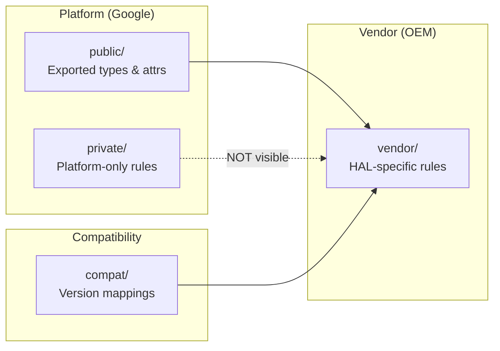

拆分的规则：

1. **public/** 中的类型和属性是 API 表面——供应商策略可以引用它们。
2. **private/** 中的类型和规则对供应商策略不可见。供应商策略不能使用针对私有类型的 `allow` 规则。
3. **compat/** 包含在平台版本之间将旧类型名称转换为新类型名称的映射文件。
4. **vendor/** 包含特定于供应商 HAL 实现的策略。

供应商 sepolicy 目录包含如下文件：

```
vendor/
  file.te
  file_contexts
  hal_atrace_default.te
  hal_audio_default.te
  hal_bluetooth_default.te
  hal_camera_default.te
  hal_fingerprint_default.te
  hal_gatekeeper_default.te
  hal_keymint_default.te
  ...
```

### 40.2.9  全局域规则

文件 `private/domain.te` 包含适用于系统中每个进程的规则。它是最重要的策略文件之一（数百行）。来自 `system/sepolicy/private/domain.te` 的代表性规则：

```te
# Root fs.
allow domain tmpfs:dir { getattr search };
allow domain rootfs:dir search;
allow domain rootfs:lnk_file { read getattr };

# Device accesses.
allow domain device:dir search;
allow domain dev_type:lnk_file r_file_perms;
allow domain null_device:chr_file rw_file_perms;
allow domain zero_device:chr_file rw_file_perms;

# /dev/binder can be accessed by ... everyone! :)
allow { domain -hwservicemanager -vndservicemanager }
    binder_device:chr_file rw_file_perms;

# Restrict binder ioctls to an allowlist.
allowxperm domain binder_device:chr_file
    ioctl { unpriv_binder_ioctls };

# /dev/binderfs needs to be accessed by everyone too!
allow domain binderfs:dir { getattr search };
allow domain binderfs_features:dir search;
allow domain binderfs_features:file r_file_perms;

# Global access to cacerts, seccomp_policy, system libs
allow domain system_seccomp_policy_file:file r_file_perms;
allow domain system_security_cacerts_file:file r_file_perms;
allow domain system_linker_exec:file { execute read open getattr map };
allow domain system_lib_file:file { execute read open getattr map };
```

注意即使是全局规则也经过精心界定范围。Binder 访问是通用的（它是 IPC 的骨干），但允许的 ioctl 被限制为一组非特权集合。`hwservicemanager` 和 `vndservicemanager` 被明确排除在访问标准 binder 设备之外，因为它们使用自己的设备（`hwbinder_device`、`vndbinder_device`）。

### 40.2.10  应用域策略（private/app.te）

文件 `system/sepolicy/private/app.te` 定义了适用于所有由 zygote 启动的应用进程的规则。关键的访问类别：

**Keystore 访问：**
```te
allow { appdomain -isolated_app_all -ephemeral_app -sdk_sandbox_all }
    keystore:keystore2_key { delete use get_info grant rebind update };

use_keystore({ appdomain -isolated_app_all -ephemeral_app -sdk_sandbox_all })
```

**应用沙箱文件访问：**
```te
# App sandbox file accesses.
allow { appdomain -isolated_app_all -mlstrustedsubject -sdk_sandbox_all } {
  app_data_file
  privapp_data_file
}:dir create_dir_perms;
allow { appdomain -isolated_app_all -mlstrustedsubject -sdk_sandbox_all } {
  app_data_file
  privapp_data_file
}:file create_file_perms;
```

**Binder IPC：**
```te
# Use the Binder.
binder_use(appdomain)
# Perform binder IPC to binder services.
binder_call(appdomain, binderservicedomain)
# Perform binder IPC to other apps.
binder_call(appdomain, appdomain)
# Perform binder IPC to ephemeral apps.
binder_call(appdomain, ephemeral_app)
```

**app.te 中的 Neverallow 规则**（摘自约 65 条 neverallow 规则）：

```te
# Superuser capabilities.
neverallow { appdomain -bluetooth -network_stack -nfc }
    self:capability_class_set *;

# Block device access.
neverallow appdomain {dev_type -apex_dm_device}:blk_file { read write };

# ptrace access to non-app domains.
neverallow appdomain { domain -appdomain }:process ptrace;

# The Android security model guarantees the confidentiality and
# integrity of application data and execution state. Ptrace bypasses
# those confidentiality guarantees.
neverallow {
  domain
  -appdomain
  -crash_dump
} appdomain:process ptrace;

# Write to rootfs.
neverallow appdomain rootfs:dir_file_class_set
    { create write setattr relabelfrom relabelto append unlink link rename };

# Write to /system.
neverallow appdomain system_file_type:dir_file_class_set
    { create write setattr relabelfrom relabelto append unlink link rename };

# Write to system-owned parts of /data.
neverallow appdomain system_data_file:dir_file_class_set
    { create write setattr relabelfrom relabelto append unlink link rename };

# Transition to a non-app domain (prevent domain escalation).
# (userdebug/eng builds also exclude su from the source set.)
neverallow { appdomain -shell }
    { domain -appdomain -crash_dump -rs -virtualizationmanager_domain }:process
    { transition };

# Sensitive app domains are not allowed to execute from /data
# to prevent persistence attacks.
neverallow {
  bluetooth
  isolated_app_all
  nfc
  radio
  shared_relro
  sdk_sandbox_all
  system_app
} {
  data_file_type
  -apex_art_data_file
  -dalvikcache_data_file
  -system_data_file
  -apk_data_file
}:file no_x_file_perms;

# Don't allow apps access to character devices.
neverallow appdomain {
    audio_device
    camera_device
    dm_device
    radio_device
    rpmsg_device
}:chr_file { read write };

# Apps cannot access proc/net tcp/udp tables.
neverallow { appdomain -shell } proc_net_tcp_udp:file *;
```

这些 neverallow 规则共同确保一件事。即使框架缺陷使某条代码路径可以被触发，内核级的 MAC 策略也会阻止该操作。

### 40.2.11  策略编译与加载

SELinux 策略在构建时编译，并在启动早期由 `init` 加载。构建过程：

1. **m4 预处理** —— 展开 `domain_auto_trans`、`app_domain`、`net_domain` 等宏。
2. **策略编译** —— `checkpolicy` 将 `.te` 文件编译为二进制策略。
3. **上下文编译** —— `sefcontext_compile` 将 `file_contexts` 编译为二进制格式。
4. **CIL 编译** —— 自 Android 8.0 起，策略被编译为 CIL（通用中间语言），以支持平台/供应商拆分。
5. **策略验证** —— `sepolicy_tests` 和 neverallow 检查作为构建时断言运行。
6. **加载** —— `init` 通过 `/sys/fs/selinux/load` 从 `/system/etc/selinux/` 加载编译后的策略。

拆分策略的加载流程：

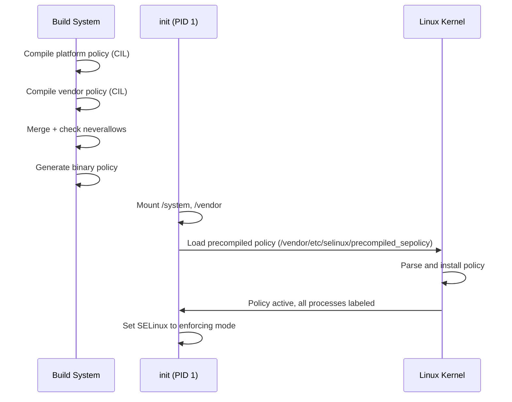

### 40.2.12  使用 audit2allow

当 SELinux 阻止某个操作时，它会生成一条审计日志（即“拒绝”）。`audit2allow` 工具将这些拒绝转换为候选的 allow 规则：

```bash
# Capture denials from the device
adb shell dmesg | grep 'avc:  denied' > denials.txt

# Generate allow rules
audit2allow -i denials.txt

# Generate a loadable policy module
audit2allow -i denials.txt -M my_module
```

示例拒绝及生成的规则：

```
# Denial:
avc:  denied  { read } for  pid=1234 comm="my_daemon"
  name="config.xml" dev="sda1" ino=5678
  scontext=u:r:my_daemon:s0 tcontext=u:object_r:system_file:s0
  tclass=file permissive=0

# audit2allow output:
allow my_daemon system_file:file read;
```

然而，盲目地应用 `audit2allow` 的输出是危险的。正确的做法通常是为目标文件创建一个更具体的类型，而不是授予对 `system_file` 的广泛访问权限。

### 40.2.13  SELinux 上下文文件

多个上下文文件将文件系统路径、属性和服务映射到 SELinux 标签：

| 文件 | 用途 |
|------|---------|
| `file_contexts` | 将文件系统路径映射到文件类型 |
| `property_contexts` | 将系统属性映射到类型 |
| `service_contexts` | 将 binder 服务映射到类型 |
| `hwservice_contexts` | 将 HIDL 硬件服务映射到类型 |
| `seapp_contexts` | 将应用映射到域和数据类型 |
| `mac_permissions.xml` | 将应用签名映射到 seinfo 标签 |

### 40.2.14  常用调试技巧

在开发新的系统服务或 HAL 时，SELinux 拒绝很常见。以下是系统化的方法：

**步骤 1：识别拒绝**
```
avc:  denied  { write } for  pid=2456 comm="my_service"
  path="/data/misc/my_service/config"
  scontext=u:r:my_service:s0
  tcontext=u:object_r:system_data_file:s0
  tclass=file permissive=0
```

**步骤 2：分析拒绝的各个组成部分**

- `source`：`my_service`（试图访问的进程）
- `target`：`system_data_file`（正在被访问的对象）
- `class`：`file`（对象的类型）
- `permission`：`write`（尝试执行的操作）

**步骤 3：确定正确的修复方法**

错误的方法（过于宽泛）：
```te
# BAD: Grants access to all system_data_file
allow my_service system_data_file:file write;
```

正确的方法（创建特定类型）：
```te
# In file.te:
type my_service_data_file, file_type, data_file_type;

# In file_contexts:
/data/misc/my_service(/.*)? u:object_r:my_service_data_file:s0

# In my_service.te:
allow my_service my_service_data_file:file create_file_perms;
allow my_service my_service_data_file:dir create_dir_perms;
```

**步骤 4：通过 neverallow 检查进行验证**

在编写策略后，重新构建并检查是否违反了任何 neverallow 规则。

### 40.2.15  用于用户隔离的 SELinux MLS/MCS

Android 使用 MLS（多级安全）类别来隔离用户和应用。每个应用进程根据其用户 ID 和应用 ID 接收类别：

```
u:r:untrusted_app:s0:c42,c256,c512,c768
```

`c42,c256,c512,c768` 是从 UID 派生的 MLS 类别。两个进程只有在它们的类别兼容时才能访问彼此的文件。这在以下之间提供了内核级隔离：

- 不同的 Android 用户（用户 0 与用户 10）。
- 同一用户内的不同应用。
- 工作资料应用与个人应用之间。

类别的分配由 `seapp_contexts` 控制：

```
# levelFrom=all determines the level from both UID and user ID.
# levelFrom=user determines the level from the user ID.
# levelFrom=app determines the level from the process UID.
```

---

## 40.3  验证启动（AVB）

Android 验证启动（AVB）确保所有被执行的代码都来自可信来源，而不是来自攻击者或损坏。实现位于：

```
external/avb/
```

### 40.3.1  AVB 架构

验证启动过程建立了从硬件熔丝到每个分区的信任链：

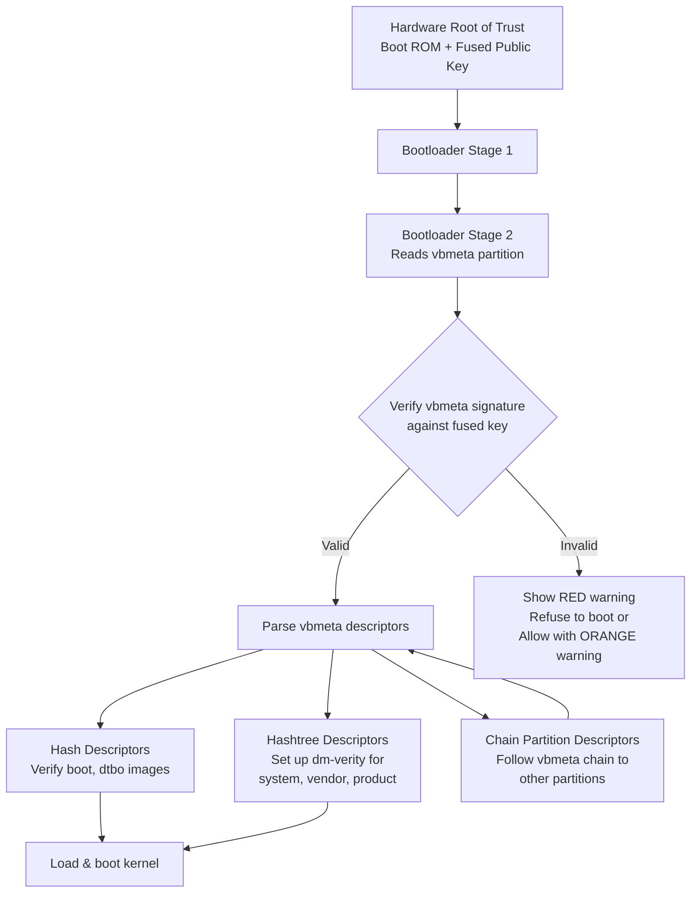

### 40.3.2  vbmeta 镜像格式

vbmeta 镜像是核心数据结构。来自 `external/avb/libavb/avb_vbmeta_image.h`：

```c
/* Size of the vbmeta image header. */
#define AVB_VBMETA_IMAGE_HEADER_SIZE 256

/* Magic for the vbmeta image header. */
#define AVB_MAGIC "AVB0"
#define AVB_MAGIC_LEN 4
```

该镜像由三个块组成：

```
+-----------------------------------------+
| Header data - fixed size (256 bytes)    |
+-----------------------------------------+
| Authentication data - variable size     |
+-----------------------------------------+
| Auxiliary data - variable size          |
+-----------------------------------------+
```

源码中的头部结构：

```c
typedef struct AvbVBMetaImageHeader {
  /*   0: Four bytes equal to "AVB0" (AVB_MAGIC). */
  uint8_t magic[AVB_MAGIC_LEN];

  /*   4: The major version of libavb required for this header. */
  uint32_t required_libavb_version_major;
  /*   8: The minor version of libavb required for this header. */
  uint32_t required_libavb_version_minor;

  /*  12: The size of the signature block. */
  uint64_t authentication_data_block_size;
  /*  20: The size of the auxiliary data block. */
  uint64_t auxiliary_data_block_size;

  /*  28: The verification algorithm used. */
  uint32_t algorithm_type;

  /*  32: Offset into the "Authentication data" block of hash data. */
  uint64_t hash_offset;
  /*  40: Length of the hash data. */
  uint64_t hash_size;

  /*  48: Offset into the "Authentication data" block of signature data. */
  uint64_t signature_offset;
  /*  56: Length of the signature data. */
  uint64_t signature_size;

  /*  64: Offset into the "Auxiliary data" block of public key data. */
  uint64_t public_key_offset;
  /*  72: Length of the public key data. */
  uint64_t public_key_size;

  /* 112: The rollback index for rollback protection. */
  uint64_t rollback_index;

  /* 120: Flags from the AvbVBMetaImageFlags enumeration. */
  uint32_t flags;

  /* 124: The location of the rollback index. */
  uint32_t rollback_index_location;

  /* 128: The release string from avbtool. */
  uint8_t release_string[AVB_RELEASE_STRING_SIZE];

  /* 176: Padding to ensure struct is size 256 bytes. */
  uint8_t reserved[80];
} AVB_ATTR_PACKED AvbVBMetaImageHeader;
```

### 40.3.3  验证结果代码

验证会产生若干结果之一，这些结果定义在同一个头文件中：

```c
typedef enum {
  AVB_VBMETA_VERIFY_RESULT_OK,
  AVB_VBMETA_VERIFY_RESULT_OK_NOT_SIGNED,
  AVB_VBMETA_VERIFY_RESULT_INVALID_VBMETA_HEADER,
  AVB_VBMETA_VERIFY_RESULT_UNSUPPORTED_VERSION,
  AVB_VBMETA_VERIFY_RESULT_HASH_MISMATCH,
  AVB_VBMETA_VERIFY_RESULT_SIGNATURE_MISMATCH,
} AvbVBMetaVerifyResult;
```

引导加载程序还必须验证嵌入的公钥是否与已知的可信密钥匹配。正如源码注释所强调的：

> 非常重要：即使返回了 `AVB_VBMETA_VERIFY_RESULT_OK`，你仍然需要检查镜像中嵌入的公钥是否与已知密钥匹配！

### 40.3.4  槽位验证

验证完整槽位的高层 API 是 `avb_slot_verify()`，来自 `external/avb/libavb/avb_slot_verify.h`：

```c
AvbSlotVerifyResult avb_slot_verify(
    AvbOps* ops,
    const char* const* requested_partitions,
    const char* ab_suffix,
    AvbSlotVerifyFlags flags,
    AvbHashtreeErrorMode hashtree_error_mode,
    AvbSlotVerifyData** out_data);
```

结果代码表明任何失败的性质：

```c
typedef enum {
  AVB_SLOT_VERIFY_RESULT_OK,
  AVB_SLOT_VERIFY_RESULT_ERROR_OOM,
  AVB_SLOT_VERIFY_RESULT_ERROR_IO,
  AVB_SLOT_VERIFY_RESULT_ERROR_VERIFICATION,
  AVB_SLOT_VERIFY_RESULT_ERROR_ROLLBACK_INDEX,
  AVB_SLOT_VERIFY_RESULT_ERROR_PUBLIC_KEY_REJECTED,
  AVB_SLOT_VERIFY_RESULT_ERROR_INVALID_METADATA,
  AVB_SLOT_VERIFY_RESULT_ERROR_UNSUPPORTED_VERSION,
  AVB_SLOT_VERIFY_RESULT_ERROR_INVALID_ARGUMENT
} AvbSlotVerifyResult;
```

位于 `external/avb/libavb/avb_slot_verify.c` 的实现定义了关键常量（已加载分区的上限位于公共头文件 `external/avb/libavb/avb_slot_verify.h` 中）：

```c
/* From avb_slot_verify.h: maximum number of partitions that can be
 * loaded with avb_slot_verify(). */
#define AVB_MAX_NUMBER_OF_LOADED_PARTITIONS 32

/* From avb_slot_verify.c: maximum number of vbmeta images that can be
 * loaded. */
#define MAX_NUMBER_OF_VBMETA_IMAGES 32

/* Maximum size of a vbmeta image - 64 KiB. */
#define VBMETA_MAX_SIZE (64 * 1024)
```

### 40.3.5  链式分区描述符

大型系统将 vbmeta 分散在多个分区中。链式分区描述符指向另一个分区的 vbmeta，从而创建一棵验证树。来自 `external/avb/libavb/avb_chain_partition_descriptor.h`：

```c
typedef struct AvbChainPartitionDescriptor {
  AvbDescriptor parent_descriptor;
  uint32_t rollback_index_location;
  uint32_t partition_name_len;
  uint32_t public_key_len;
  uint32_t flags;
  uint8_t reserved[60];
} AVB_ATTR_PACKED AvbChainPartitionDescriptor;
```

例如，这使得 `vendor_boot` 分区可以拥有自己的签名密钥和回滚索引，而独立于主 vbmeta。

### 40.3.6  回滚保护

每个 vbmeta 镜像都包含一个 `rollback_index`——一个单调递增的计数器。引导加载程序将可接受的最小回滚索引存储在防篡改存储中（通常是 RPMB 或基于熔丝的存储）。如果攻击者试图刷入较旧的（存在漏洞的）镜像：

1. 旧镜像的回滚索引低于已存储的值。
2. `avb_slot_verify()` 返回 `AVB_SLOT_VERIFY_RESULT_ERROR_ROLLBACK_INDEX`。
3. 引导加载程序拒绝启动该镜像。

最多有 32 个回滚索引位置：

```c
#define AVB_MAX_NUMBER_OF_ROLLBACK_INDEX_LOCATIONS 32
```

### 40.3.7  AVB 页脚

对于同时包含镜像数据和 vbmeta 的分区，vbmeta 被附加在镜像之后。位于分区最末尾的页脚指向它。来自 `external/avb/libavb/avb_footer.h`：

```c
#define AVB_FOOTER_MAGIC "AVBf"
#define AVB_FOOTER_SIZE 64

typedef struct AvbFooter {
  uint8_t magic[AVB_FOOTER_MAGIC_LEN];
  uint32_t version_major;
  uint32_t version_minor;
  uint64_t original_image_size;
  uint64_t vbmeta_offset;
  uint64_t vbmeta_size;
  uint8_t reserved[28];
} AVB_ATTR_PACKED AvbFooter;
```

### 40.3.8  用于运行时保护的 dm-verity

如果没有运行时完整性检查，验证启动就不完整。对于只读分区（system、vendor、product），AVB 会设置 **dm-verity**。这是一个 Linux device-mapper 目标，它在读取时针对 Merkle 树哈希验证每个磁盘块。

hashtree 错误模式决定了检测到损坏时会发生什么：

```c
typedef enum {
  AVB_HASHTREE_ERROR_MODE_RESTART_AND_INVALIDATE,
  AVB_HASHTREE_ERROR_MODE_RESTART,
  AVB_HASHTREE_ERROR_MODE_EIO,
  AVB_HASHTREE_ERROR_MODE_LOGGING,
  AVB_HASHTREE_ERROR_MODE_MANAGED_RESTART_AND_EIO,
  AVB_HASHTREE_ERROR_MODE_PANIC
} AvbHashtreeErrorMode;
```

在生产环境中，通常使用 `RESTART_AND_INVALIDATE`：设备使被损坏的槽位失效并重启，如果可用则回退到另一个 A/B 槽位。

### 40.3.9  已锁定与已解锁的引导加载程序

| 状态 | 行为 |
|-------|----------|
| **已锁定** | 只有使用 OEM 密钥签名的镜像才能启动。验证失败 = 不启动。 |
| **已解锁** | 验证仍会运行，但允许失败。设置 `ALLOW_VERIFICATION_ERROR` 标志。显示 ORANGE 警告屏幕。 |

```c
typedef enum {
  AVB_SLOT_VERIFY_FLAGS_NONE = 0,
  AVB_SLOT_VERIFY_FLAGS_ALLOW_VERIFICATION_ERROR = (1 << 0),
  AVB_SLOT_VERIFY_FLAGS_RESTART_CAUSED_BY_HASHTREE_CORRUPTION = (1 << 1),
  AVB_SLOT_VERIFY_FLAGS_NO_VBMETA_PARTITION = (1 << 2),
} AvbSlotVerifyFlags;
```

当设备被解锁时：

1. 所有用户数据都会被擦除（恢复出厂设置）。
2. 引导加载程序在每次启动时都会显示警告。
3. 证明证书包含已解锁状态，因此依赖方（银行、企业 MDM）知道该设备可能已被攻陷。

### 40.3.10  验证实现

`avb_slot_verify.c` 中的实际验证逻辑遵循一种精心的加载和检查每个分区的模式：

```c
// From external/avb/libavb/avb_slot_verify.c

static inline bool result_should_continue(AvbSlotVerifyResult result) {
  switch (result) {
    case AVB_SLOT_VERIFY_RESULT_ERROR_OOM:
    case AVB_SLOT_VERIFY_RESULT_ERROR_IO:
    case AVB_SLOT_VERIFY_RESULT_ERROR_INVALID_METADATA:
    case AVB_SLOT_VERIFY_RESULT_ERROR_UNSUPPORTED_VERSION:
    case AVB_SLOT_VERIFY_RESULT_ERROR_INVALID_ARGUMENT:
      return false;

    case AVB_SLOT_VERIFY_RESULT_OK:
    case AVB_SLOT_VERIFY_RESULT_ERROR_VERIFICATION:
    case AVB_SLOT_VERIFY_RESULT_ERROR_ROLLBACK_INDEX:
    case AVB_SLOT_VERIFY_RESULT_ERROR_PUBLIC_KEY_REJECTED:
      return true;
  }
  return false;
}
```

当设置了 `ALLOW_VERIFICATION_ERROR`（已解锁的引导加载程序）时，此函数确定验证是否应该继续。致命错误（OOM、IO、元数据损坏）总是中止，但允许与验证相关的错误继续，以便已解锁的设备仍能启动。

每个分区的验证流程：

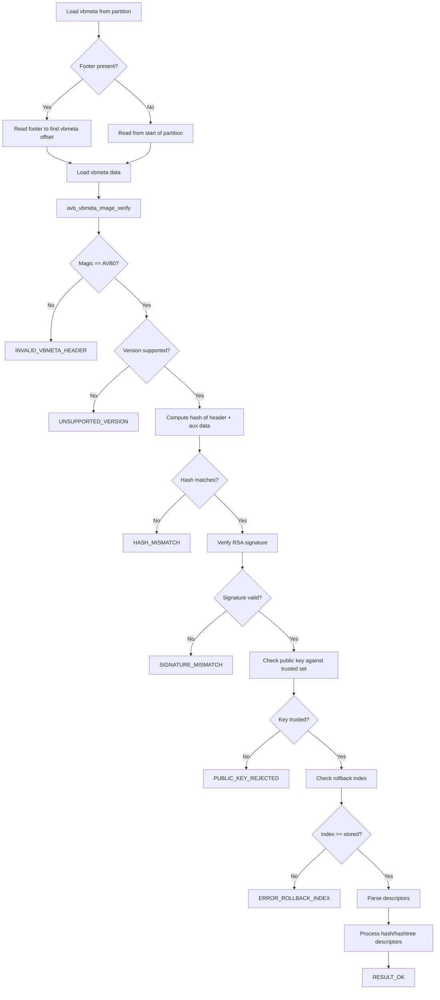

### 40.3.11  描述符类型

AVB 使用多种描述符类型来描述分区：

| 描述符 | 用途 |
|-----------|---------|
| **Hash** | 存储整个分区的哈希（boot、dtbo） |
| **Hashtree** | 存储 Merkle 树的根哈希（system、vendor） |
| **Kernel Cmdline** | 向内核命令行添加参数 |
| **Chain Partition** | 指向另一个分区的 vbmeta |
| **Property** | 存储键值对 |

哈希描述符用于小型分区，其整个镜像可以在使用前完成验证。Hashtree 描述符用于需要逐块验证（dm-verity）的大型分区。

### 40.3.12  dm-verity Merkle 树

dm-verity 的 Merkle 树结构如下：

```
                    Root Hash (stored in vbmeta)
                    /                          \
            Hash(L1[0])                   Hash(L1[1])
           /          \                  /          \
    Hash(L0[0])  Hash(L0[1])    Hash(L0[2])  Hash(L0[3])
      |             |              |             |
   Block 0       Block 1       Block 2       Block 3
   (4096 B)      (4096 B)      (4096 B)      (4096 B)
```

当从磁盘读取任意块时：

1. 计算该块的哈希（SHA-256）。
2. 根据其在哈希树中的条目验证该哈希。
3. 根据其父节点验证哈希树条目。
4. 这一链路一直向上延伸到根哈希。
5. 根哈希在启动期间已被 AVB 验证。

如果任意块被篡改，就会检测到哈希不匹配，已配置的错误模式决定响应方式（重启、EIO、日志记录、panic）。

### 40.3.13  avbtool 命令参考

位于 `external/avb/avbtool.py` 的 `avbtool.py` 脚本提供了构建时工具：

| 命令 | 用途 |
|---------|---------|
| `make_vbmeta_image` | 创建独立的 vbmeta 镜像 |
| `add_hash_footer` | 向分区镜像添加哈希页脚 |
| `add_hashtree_footer` | 向分区镜像添加 hashtree 页脚 |
| `erase_footer` | 移除 AVB 页脚 |
| `info_image` | 显示镜像的 AVB 信息 |
| `extract_public_key` | 从私钥中提取公钥 |
| `calculate_vbmeta_digest` | 计算 vbmeta 镜像的摘要 |
| `resize_image` | 调整分区镜像的大小 |
| `set_ab_metadata` | 设置 A/B 元数据 |

### 40.3.14  内核命令行参数

AVB 设置多个 `androidboot.vbmeta.*` 内核命令行参数：

- `androidboot.veritymode`：`enforcing`、`eio`、`disabled` 或 `logging`
- `androidboot.vbmeta.device_state`：`locked` 或 `unlocked`
- `androidboot.vbmeta.hash_alg`、`size`、`digest`：vbmeta 链的完整性
- `androidboot.vbmeta.invalidate_on_error`：restart-and-invalidate 模式下为 `yes`
- `androidboot.vbmeta.avb_version`：AVB 库版本（例如 "1.0"）
- `androidboot.vbmeta.device`：vbmeta 分区的 PARTUUID
- `androidboot.vbmeta.public_key_digest`：签名公钥的 SHA-256
- `androidboot.veritymode.managed`：如果使用 managed restart-and-EIO，则为 `yes`

来自源码文档：

```
androidboot.veritymode: This is set to 'disabled' if the
AVB_VBMETA_IMAGE_FLAGS_HASHTREE_DISABLED flag is set in top-level
vbmeta struct. Otherwise it is set to 'enforcing' if the
passed-in hashtree error mode is AVB_HASHTREE_ERROR_MODE_RESTART
or AVB_HASHTREE_ERROR_MODE_RESTART_AND_INVALIDATE, 'eio' if it's
set to AVB_HASHTREE_ERROR_MODE_EIO, and 'logging' if it's set to
AVB_HASHTREE_ERROR_MODE_LOGGING.
```

这些参数由 `init` 进程和 Android 框架使用，以确定设备的完整性状态并相应调整行为。

### 40.3.15  Managed Verity 模式状态机

`MANAGED_RESTART_AND_EIO` 错误模式实现了一个状态机：

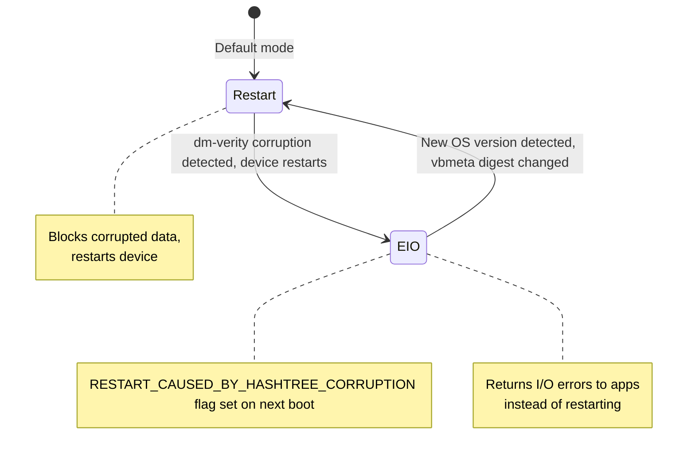

这种设计避免了启动循环：如果损坏持续存在，设备会切换到 EIO 模式（向应用返回错误），而不是不断重启。设备会显示 RED 警告屏幕以告知用户。

### 40.3.16  与 A/B 更新的集成

AVB 与 A/B 更新系统紧密协作：

1. 当前槽位（例如槽位 A）被验证并启动。
2. 在 A 运行期间，将 OTA 更新应用到槽位 B。
3. 更新后，引导加载程序将活动槽位切换到 B。
4. AVB 验证槽位 B 的 vbmeta 和所有分区。
5. 如果验证成功，槽位 B 成为新的默认槽位。
6. 如果验证失败，引导加载程序回退到槽位 A。
7. 成功启动后，可能会更新回滚索引，以防止回滚到旧版本。

---

## 40.4  Keystore 与 KeyMint

### 40.4.1  概述

Android Keystore 系统提供硬件支持的加密密钥存储和操作。其实现经历了几代演进：

| 代次 | 接口 | 起始版本 |
|-----------|-----------|-------|
| Keymaster 0.x | C HAL | Android 4.3 |
| Keymaster 1.0 | C HAL（`keymaster1.h`） | Android 6.0 |
| Keymaster 2.0 | C HAL（`keymaster2.h`） | Android 7.0 |
| Keymaster 3.0 | HIDL 3.0 | Android 8.0 |
| Keymaster 4.0 | HIDL 4.0 | Android 9 |
| **KeyMint 1.0** | **AIDL** | **Android 12** |
| KeyMint 2.0 | AIDL | Android 13 |
| KeyMint 3.0 | AIDL | Android 14 |

从 Keymaster 到 KeyMint 的过渡从 HIDL 转向 AIDL，并在证明、密钥升级和远程配置方面引入了改进。

### 40.4.2  Keystore2 架构

Keystore 2.0 服务在 `system/security/keystore2/` 下用 Rust 实现。主库（`src/lib.rs`）公开了以下模块：

```rust
//! This crate implements the Android Keystore 2.0 service.

pub mod apc;
pub mod async_task;
pub mod authorization;
pub mod boot_level_keys;
pub mod database;
pub mod ec_crypto;
pub mod enforcements;
pub mod entropy;
pub mod error;
pub mod globals;
pub mod id_rotation;
pub mod key_parameter;
pub mod legacy_blob;
pub mod legacy_importer;
pub mod maintenance;
pub mod metrics;
pub mod metrics_store;
pub mod operation;
pub mod permission;
pub mod raw_device;
pub mod remote_provisioning;
pub mod security_level;
pub mod security_level_manager;
pub mod service;
pub mod shared_secret_negotiation;
pub mod utils;

mod attestation_key_utils;
mod audit_log;
mod gc;
mod km_compat;
mod super_key;
mod sw_keyblob;
mod watchdog_helper;
```

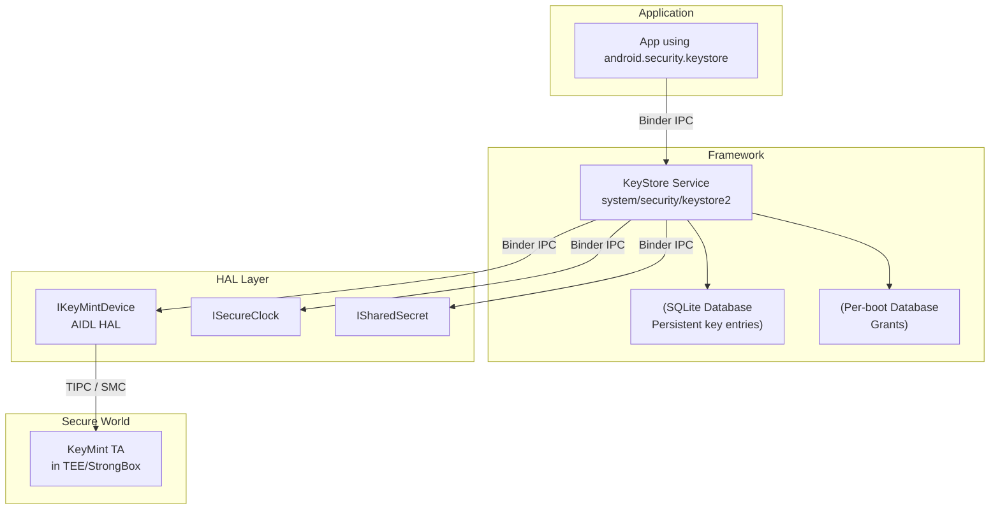

### 40.4.3  安全级别

Keystore2 支持多个安全级别。`system/security/keystore2/src/security_level.rs` 中的 `KeystoreSecurityLevel` 结构体：

```rust
/// Implementation of the IKeystoreSecurityLevel Interface.
pub struct KeystoreSecurityLevel {
    security_level: SecurityLevel,
    keymint: Strong<dyn IKeyMintDevice>,
    hw_info: KeyMintHardwareInfo,
    km_uuid: Uuid,
    operation_db: OperationDb,
    rem_prov_state: RemProvState,
    id_rotation_state: IdRotationState,
}
```

三个安全级别分别是：

| 级别 | 描述 |
|-------|-------------|
| `SOFTWARE` | 密钥以软件方式存储（TEE 不可用） |
| `TRUSTED_ENVIRONMENT` | 密钥位于 TEE 中（ARM TrustZone 等） |
| `STRONGBOX` | 密钥位于专用安全元件中 |

### 40.4.4  数据库模块

数据库设计记录在 `system/security/keystore2/src/database.rs` 中：

```rust
//! This is the Keystore 2.0 database module.
//! The database module provides a connection to the backing SQLite store.
//! We have two databases one for persistent key blob storage and one for
//! items that have a per boot life cycle.
//!
//! ## Persistent database
//! The persistent database has tables for key blobs. They are organized
//! as follows:
//! The `keyentry` table is the primary table for key entries. It is
//! accompanied by two tables for blobs and parameters.
//! Each key entry occupies exactly one row in the `keyentry` table and
//! zero or more rows in the tables `blobentry` and `keyparameter`.
//!
//! ## Per boot database
//! The per boot database stores items with a per boot lifecycle.
//! Currently, there is only the `grant` table in this database.
//! Grants are references to a key that can be used to access a key by
//! clients that don't own that key.
```

### 40.4.5  通过 SELinux 进行访问控制

Keystore2 使用 SELinux 进行细粒度访问控制。权限模块（`system/security/keystore2/src/permission.rs`）定义了 `keystore2_key` SELinux 类：

```rust
implement_class!(
    /// KeyPerm provides a convenient abstraction from the SELinux class
    /// `keystore2_key`.
    #[selinux(class_name = keystore2_key)]
    pub enum KeyPerm {
        /// Checked when convert_storage_key_to_ephemeral is called.
        #[selinux(name = convert_storage_key_to_ephemeral)]
        ConvertStorageKeyToEphemeral = ...,
        /// Checked when the caller tries to delete a key.
        #[selinux(name = delete)]
        Delete = ...,
        /// Checked when the caller tries to use a unique id.
        #[selinux(name = gen_unique_id)]
        GenUniqueId = ...,
        /// Checked when the caller tries to load a key.
        #[selinux(name = get_info)]
        GetInfo = ...,
        /// Checked when the caller attempts to grant a key to another uid.
        #[selinux(name = grant)]
        Grant = ...,
        /// Checked when the caller attempts to use Domain::BLOB.
        #[selinux(name = manage_blob)]
        ManageBlob = ...,
    }
);
```

这意味着每个密钥操作都会根据调用者的 SELinux 上下文进行检查，而不仅仅是其 UID。进程必须同时拥有正确的 UID（或有效的授权）以及正确的 SELinux 权限。

### 40.4.6  Enforcements 模块

enforcements 模块（`system/security/keystore2/src/enforcements.rs`）处理密钥操作的身份验证要求。密钥使用可能需要：

- **用户身份验证** —— 密钥使用前需要最近一次解锁（PIN、图案、密码或生物识别）。
- **逐操作身份验证** —— 用户必须在每次单独的加密操作中进行身份验证。
- **基于超时的身份验证** —— 身份验证在指定的时间窗口内有效。
- **启动级密钥** —— 在特定启动阶段完成后变得无法访问的密钥。

```rust
#[derive(Debug)]
enum AuthRequestState {
    /// An outstanding per operation authorization request.
    OpAuth,
    /// An outstanding request for a timestamp token.
    TimeStamp(Mutex<Receiver<Result<TimeStampToken, Error>>>),
}

#[derive(Debug)]
struct AuthRequest {
    state: AuthRequestState,
    /// This need to be set to Some to fulfill an AuthRequestState::OpAuth.
    hat: Mutex<Option<HardwareAuthToken>>,
}
```

### 40.4.7  密钥证明

密钥证明向远程方证明某个密钥是在安全硬件内部生成的。证明链由以下部分组成：

1. **证明证书** —— 由 TEE 的证明密钥签名，包含密钥的属性（算法、用途、身份验证要求）。
2. **中间证书** —— 将 TEE 的密钥链接到根。
3. **根证书** —— Google 硬件证明根或制造商的根。

证明包含设备的验证启动状态（`locked`/`unlocked`）和操作系统版本，使依赖方能够做出信任决策。

### 40.4.8  操作生命周期

Keystore2 以明确定义的生命周期管理加密操作。来自 `system/security/keystore2/src/operation.rs`：

```rust
//! Operations implement the API calls update, finish, and abort.
//! Additionally, an operation can be dropped and pruned. The former
//! happens if the client deletes a binder to the operation object.
//! An existing operation may get pruned when running out of operation
//! slots and a new operation takes precedence.
//!
//! ## Operation Lifecycle
//! An operation gets created when the client calls
//! `IKeystoreSecurityLevel::create`.
//! It may receive zero or more update request. The lifecycle ends when:
//!  * `update` yields an error.
//!  * `finish` is called.
//!  * `abort` is called.
//!  * The operation gets dropped.
//!  * The operation gets pruned.
```

操作修剪策略对于 TEE 资源有限的设备很重要。当请求新操作但所有槽位都已满时：

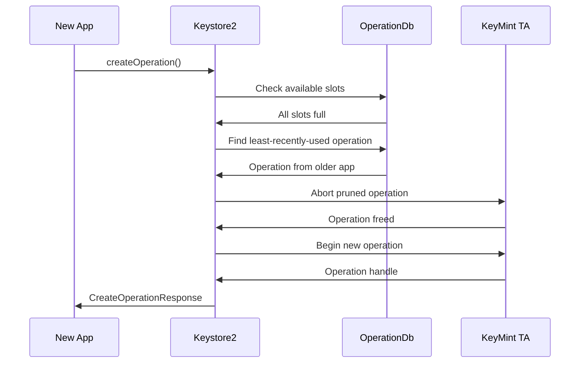

### 40.4.9  Super Key 与用户身份验证

super key 模块（`system/security/keystore2/src/super_key.rs`）管理用于保护按用户 Keystore 数据的密钥。存在几种类型的 super encryption：

```rust
/// Encryption algorithm used by a particular type of superencryption key
pub enum SuperEncryptionAlgorithm {
    /// Symmetric encryption with AES-256-GCM
    Aes256Gcm,
    /// Asymmetric encryption with ECDH P-521
    EcdhP521,
}

/// Specify which keys should be wiped given a particular user's UserSuperKeys
pub enum WipeKeyOption {
    /// Wipe unlocked_device_required_symmetric/private and biometric_unlock keys
    PlaintextAndBiometric,
    /// Wipe only unlocked_device_required_symmetric/private keys
    PlaintextOnly,
}
```

生物识别解锁的超时时间经过精心调整：

```rust
/// Allow up to 15 seconds between the user unlocking using a biometric, and
/// the auth token being used to unlock in
/// [`SuperKeyManager::try_unlock_user_with_biometric`].
/// This seems short enough for security purposes, while long enough that even
/// the very slowest device will present the auth token in time.
const BIOMETRIC_AUTH_TIMEOUT_S: i32 = 15; // seconds
```

### 40.4.10  密钥垃圾回收

密钥垃圾回收器（`system/security/keystore2/src/gc.rs`）处理密钥材料的安全删除：

```rust
//! This module implements the key garbage collector.
//! The key garbage collector has one public function `notify_gc()`.
//! This will create a thread on demand which will query the database
//! for unreferenced key entries, optionally dispose of sensitive key
//! material appropriately, and then delete the key entry from the
//! database.
```

当密钥被删除时：

1. 数据库条目被标记为删除。
2. GC 线程被唤醒。
3. 如果密钥具有硬件支持的 blob，则调用 HAL 将其从 TEE 中删除。
4. 数据库条目及所有关联的 blob 都会被移除。
5. 底层存储块会被覆写（安全丢弃）。

### 40.4.11  远程密钥配置（RKP）

从 Android 12 开始，设备支持远程密钥配置。密钥不再在工厂中烧录，而是在设备通过完整性检查后由 Google 后端进行配置。相关模块为：

```
system/security/keystore2/src/remote_provisioning.rs
system/security/keystore2/rkpd_client/
```

优势：

- 消除了工厂密钥注入基础设施。
- 支持大规模的密钥轮换与吊销。
- 减小密钥泄露的影响范围。

Keystore2 在 `RemProvState::get_rkpd_attestation_key_and_certs`（`system/security/keystore2/src/remote_provisioning.rs`）中决定是否通过 RKP 路由证明。仅对绑定到应用域的非对称密钥（`is_asymmetric_key`）尝试 RKP，并且仅当设备上实际启用了 RKP 时才如此。为 Android 17 落地的加固细节见 40.10.5 节。

上述 Keystore2 逻辑只是消费者。与 RKP 后端通信、生成证书签名请求以及缓存已签名密钥的工作属于接下来描述的一个独立主线模块。

#### 40.4.11.1  RKPD 主线模块

配置守护进程是 `com.android.rkpd` APEX，定义于 `packages/modules/RemoteKeyProvisioning`。APEX 清单（`apex/manifest.json`）将其命名为 `com.android.rkpd`，有效负载是 `app/` 下的 `rkpdapp` Android 应用程序（`com.android.rkpdapp`，在 `app/sysconfig/preinstalled-packages-com.android.rkpdapp.xml` 中注册为预装）。将守护进程打包为 APEX 捆绑的应用，使配置逻辑及其服务器协议能够通过网络发布更新，而无需完整的系统 OTA。

该守护进程分为三个部分：

| 部分 | 位置 | 角色 |
|-------|----------|------|
| `rkpdapp` | `app/src/com/android/rkpdapp/` | 配置应用：服务器协议、CSR 生成、密钥数据库 |
| system-server shim | `system-server/src/android/security/rkp/service/` | `RegistrationProxy` / `RemotelyProvisionedKey`，Keystore2 及其他调用方绑定的进程内 API |
| registration util | `util/src/com/android/rkpdapp/` | `RkpRegistrationCheck`，用于检查配置状态的命令行工具 |

存在 shim 是因为 `rkpdapp` 本身无法托管系统服务，并且需要 system_server 不被允许执行的网络访问。正如 `system-server/README.md` 所解释的，system_server 托管一个可见服务，并将每个调用代理转发给 `rkpdapp` 进程，由后者完成网络工作。该应用在 `app/AndroidManifest.xml` 中公开了两个组件。第一个是 `RemoteProvisioningService`，通过 `com.android.rkpdapp.IRemoteProvisioning` action 绑定。第二个是 `PeriodicProvisioner`，它是一个 WorkManager `Worker`（`app/src/com/android/rkpdapp/provisioner/PeriodicProvisioner.java`），按计划补充密钥池。

当调用者请求注册时，`RemoteProvisioningService.getRegistration`（`app/src/com/android/rkpdapp/service/RemoteProvisioningService.java`）首先在未配置 provisioning URL（`Settings.getDefaultUrl` 为空）时拒绝请求。它还将 binder 限制为 system UID 和自身。然后它通过 `ServiceManagerInterface` 解析指定的 `IRemotelyProvisionedComponent`，并返回由 `RegistrationBinder` 支持的 `IRegistration`。

#### 40.4.11.2  配置往返流程

`Provisioner.provisionKeys`（`app/src/com/android/rkpdapp/provisioner/Provisioner.java`）驱动端到端流程。它与两个协作者配合。`SystemInterface` 封装 KeyMint 的 `IRemotelyProvisionedComponent` HAL。`ServerInterface` 与 RKP 后端进行 HTTP 通信（`app/src/com/android/rkpdapp/interfaces/`）。

HAL 端生成原始材料。`SystemInterface.generateKey` 调用 `IRemotelyProvisionedComponent.generateEcdsaP256KeyPair`，返回一个 `MacedPublicKey`（由主机永远看不到的设备私钥对公钥进行 MAC 后的公钥）。然后，将一批这样的密钥传给 `SystemInterface.generateCsr`。它调用 `generateCertificateRequestV2`（v3 HAL 路径）或旧的 `generateCertificateRequest` 加上 `DeviceInfo` / `ProtectedData`（v1）。结果是一份 CBOR 证书签名请求。

服务器端运行在 `ServerInterface` 中定义的两个 HTTP 操作中：

1. `fetchGeek` 对 `:fetchEekChain` 发起 GET，获取 Google 端点加密密钥链（GEEK）和挑战。CSR 正是加密到 GEEK 链的，从而将请求绑定到真正的后端。
2. `requestSignedCertificates` 将 CSR POST 到 `:signCertificates`，后端为每个配置的密钥返回一条 X.509 证书链。

`Provisioner` 将已签名的密钥存储在 Room 数据库中（`app/src/com/android/rkpdapp/database/`，`ProvisionedKeyDao` / `ProvisionedKey`）。密钥以所属的 `IRemotelyProvisionedComponent` 和过期时间为键。这使得 Keystore2 稍后可以从池中取出一个预先证明的密钥，而无需进行一次新的网络往返。`WidevineProvisioner` 为 Widevine DRM 组件复用了相同的机制。

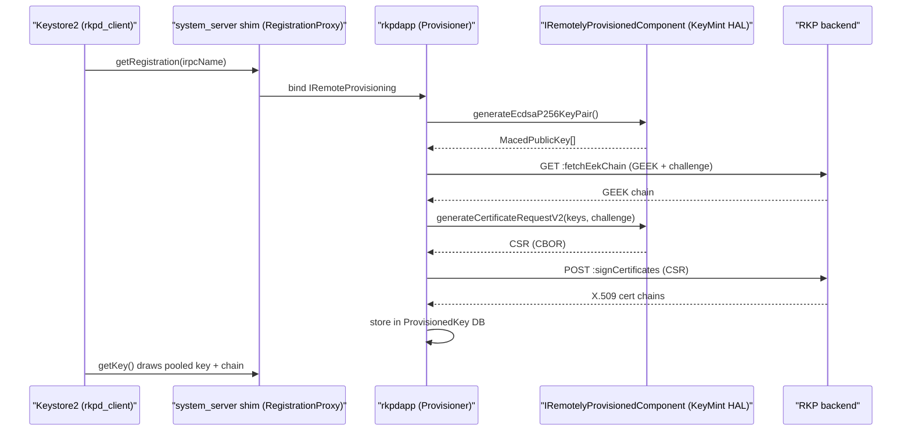

行为由 `flags/rkpd_flags.aconfig`（`com.android.rkpd.flags`）中的 aconfig 标志门控，包括 `enable_feedback_loop`（通过 `ConfirmCertificates` 将证书使用情况回传给服务器）、`report_device_reset` 和 `enable_widevine_multiple_round_trips`。可能重写所返回链路的后处理是独立的。Keystore2 端的门控与并发上限也是独立的。40.10.5 和 40.10.6 节将介绍它们。

### 40.4.12  KeyMint AIDL 接口

KeyMint HAL 在 `hardware/interfaces/security/keymint/aidl/` 下以 AIDL 定义。关键的 AIDL 文件包括：

| 文件 | 用途 |
|------|---------|
| `IKeyMintDevice.aidl` | 主设备接口（generateKey、importKey、begin） |
| `IKeyMintOperation.aidl` | 按操作划分的接口（update、finish、abort） |
| `SecurityLevel.aidl` | TEE、StrongBox、Software 级别 |
| `Algorithm.aidl` | RSA、EC、ML_DSA、AES、HMAC、3DES |
| `MlDsaVariant.aidl` | 后量子 ML-DSA-65 / ML-DSA-87 选择器（Android 17） |
| `KeyCharacteristics.aidl` | generateKey 返回的密钥属性 |
| `KeyCreationResult.aidl` | 密钥 blob + 属性 + 证书 |
| `HardwareAuthToken.aidl` | 身份验证令牌结构 |
| `Tag.aidl` | 密钥参数标签（PURPOSE、ALGORITHM、KEY_SIZE、ML_DSA_VARIANT 等） |
| `ErrorCode.aidl` | 详细错误代码（包括 UNSUPPORTED_ML_DSA_VARIANT） |

`Algorithm.aidl` 在 Android 17 中新增了 `ML_DSA = 4` 值，将第一个后量子密钥类型引入 HAL；完整内容见 40.10 节。

`IKeyMintDevice` 接口定义了以下核心操作：

```
interface IKeyMintDevice {
    KeyMintHardwareInfo getHardwareInfo();
    void addRngEntropy(in byte[] data);
    KeyCreationResult generateKey(in KeyParameter[] keyParams,
                                  in AttestationKey attestationKey);
    KeyCreationResult importKey(in KeyParameter[] keyParams,
                                in KeyFormat keyFormat,
                                in byte[] keyData,
                                in AttestationKey attestationKey);
    KeyCreationResult importWrappedKey(in byte[] wrappedKeyData,
                                       in byte[] wrappingKeyBlob,
                                       in byte[] maskingKey, ...);
    byte[] upgradeKey(in byte[] keyBlobToUpgrade,
                      in KeyParameter[] upgradeParams);
    void deleteKey(in byte[] keyBlob);
    void deleteAllKeys();
    void destroyAttestationIds();
    BeginResult begin(in KeyPurpose purpose,
                      in byte[] keyBlob,
                      in KeyParameter[] params,
                      in HardwareAuthToken authToken);
    void deviceLocked(in boolean passwordOnly,
                      in @nullable TimeStampToken timestampToken);
    void earlyBootEnded();
    ...
}
```

`deviceLocked` 在 `hardware/interfaces/security/keymint/aidl/android/hardware/security/keymint/IKeyMintDevice.aidl` 中被标记为 `@deprecated`：注释指出该方法“由于设计限制从未被使用”，因此实现应返回 `ErrorCode::UNIMPLEMENTED`。因此 `TimeStampToken` 参数在这里是遗留的。Android 17 中经过身份验证的时间戳实际来源见 40.10.3 节。

### 40.4.13  Keystore2 授权流程

密钥操作的授权流程涉及多项检查：

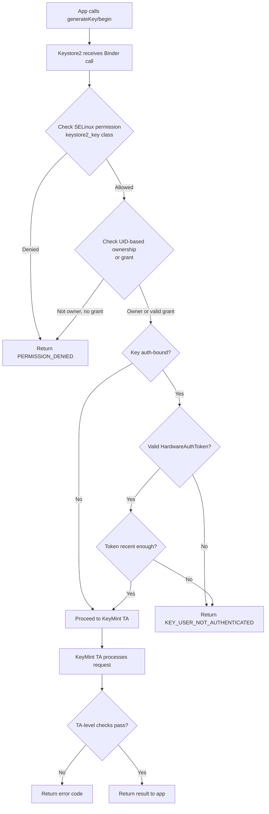

这种多层授权确保了：

- SELinux 即使在 root 下也能阻止未授权访问。
- UID 检查可防止跨应用的密钥访问。
- 身份验证绑定要求最近进行的用户身份验证。
- TEE 独立于框架执行自己的验证。

### 40.4.14  密钥导入与包装

Keystore2 支持将现有密钥导入硬件：

- **明文导入**：密钥材料被发送到 TEE，TEE 用设备绑定密钥对其进行包装。原始明文密钥在传输过程中短暂存在。
- **包装导入**：密钥在离开源之前由传输密钥包装。TEE 在内部将其解包，因此明文密钥永远不会存在于安全硬件之外。这用于批量密钥配置。

### 40.4.15  StrongBox

StrongBox 是一个专用安全元件（SE），提供最高安全级别。与共享主 CPU 的 TEE 不同，StrongBox 使用一个独立的处理器，它拥有自己的：

- CPU
- 安全存储
- 真随机数发生器
- 防篡改机制
- 独立时钟

StrongBox 支持 KeyMint 算法的一个子集。自 Android 9 引入以来它一直是可选的。CDD 强烈推荐但并不要求。没有安全元件的设备只公开 `SOFTWARE` 和 `TRUSTED_ENVIRONMENT` 安全级别。

---

## 40.5  TEE：Trusty

### 40.5.1  概述

Trusty 是 Google 开源的可信执行环境（TEE）操作系统。它在 ARM TrustZone 安全世界中与 Android 并行运行（或在其他架构上进行类似隔离）。源码树为：

```
trusty/
  kernel/       - Trusty kernel (Little Kernel based)
  user/         - Userspace TAs (Trusted Applications)
  device/       - Device-specific configurations
  hardware/     - Hardware abstraction
  host/         - Host-side tools
  vendor/       - Vendor TAs
```

与 Trusty 通信的 Android 侧集成位于：

```
system/core/trusty/
  keymint/          - KeyMint HAL backed by Trusty
  keymaster/        - Legacy Keymaster HAL backed by Trusty
  gatekeeper/       - Gatekeeper HAL backed by Trusty
  storage/          - Secure storage proxy
  secretkeeper/     - SecretKeeper HAL for pVM secrets
  confirmationui/   - Protected Confirmation UI
  metrics/          - TEE metrics reporting
  libtrusty/        - IPC library for talking to Trusty
  libtrusty-rs/     - Rust bindings for libtrusty
```

### 40.5.2  TrustZone 架构

ARM TrustZone 将 SoC 划分为两个世界：

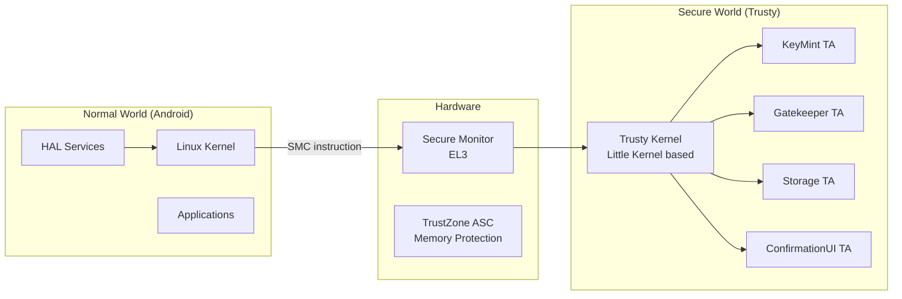

TrustZone 的关键特性：

- **硬件强制隔离** —— 普通世界在物理上无法访问安全世界内存。TrustZone 地址空间控制器（TZASC）会阻止普通世界对所有安全内存区域的总线事务。
- **SMC（安全监视器调用）** —— 这是从普通世界进入安全世界的唯一入口。这是一条特权 ARM 指令，它会陷入 EL3（安全监视器），然后由其分派到 Trusty 内核。
- **独立的地址空间** —— Trusty 拥有自己的页表，与 Linux 分离。

### 40.5.3  SMC 通信路径

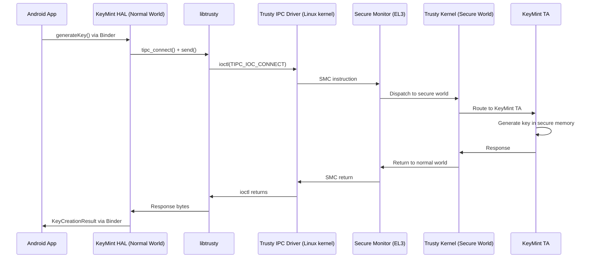

### 40.5.4  libtrusty —— IPC 库

libtrusty 库（`system/core/trusty/libtrusty/trusty.c`）提供了用于连接 Trusty TA 的普通世界接口。它支持两种传输机制：

1. **通过内核驱动的 TIPC** —— 使用 `/dev/trusty-ipc-dev0` 和 ioctl 调用。
2. **通过 VSOCK 的 TIPC** —— 用于 Trusty 运行在独立虚拟机中的虚拟机环境。

```c
static bool use_socket_connection = false;

static int tipc_vsock_connect(const char* type_cid_port_str,
                              const char* srv_name) {
    // Parse "STREAM:cid:port" or "SEQPACKET:cid:port"
    int fd = socket(AF_VSOCK, socket_type, 0);
    // Connect to the Trusty VM...
}
```

### 40.5.5  Trusty 中的 KeyMint HAL

Trusty KeyMint HAL（`system/core/trusty/keymint/src/keymint_hal_main.rs`）用 Rust 实现。它通过 TIPC 连接到 Trusty KeyMint TA：

```rust
const TRUSTY_KEYMINT_RUST_SERVICE_NAME: &str = "com.android.trusty.keymint";

impl SerializedChannel for TipcChannel {
    const MAX_SIZE: usize = 4000;
    fn execute(&mut self, serialized_req: &[u8]) -> binder::Result<Vec<u8>> {
        self.0.send(serialized_req).map_err(|e| { ... })?;
        let mut expect_more_msgs = true;
        let mut full_rsp = Vec::new();
        while expect_more_msgs {
            let mut recv_buf = Vec::new();
            self.0.recv(&mut recv_buf).map_err(|e| { ... })?;
            let current_rsp_content;
            (expect_more_msgs, current_rsp_content) = extract_rsp(&recv_buf)?;
            full_rsp.extend_from_slice(current_rsp_content);
        }
        Ok(full_rsp)
    }
}
```

主函数连接到 TA 并注册所有 HAL 服务：

```rust
fn inner_main() -> Result<(), HalServiceError> {
    // Create connection to the TA
    let connection =
        trusty::TipcChannel::connect(args.dev.as_str(),
                                     TRUSTY_KEYMINT_RUST_SERVICE_NAME)
            .map_err(|e| { ... })?;
    let tipc_channel = Arc::new(Mutex::new(TipcChannel(connection)));

    register_binder_services(&tipc_channel, ALL_HALS, SERVICE_INSTANCE)?;

    // Send the HAL service information to the TA
    send_hal_info(tipc_channel.lock().unwrap().deref_mut())?;

    binder::ProcessState::join_thread_pool();
    Ok(())
}
```

支撑 Keymaster 回滚状态等计数器的防篡改存储由访问控制的 NVRAM HAL 建模。AOSP 在 `system/nvram/` 下发布了一个*参考*实现。其中，`core/` 是可移植的参考逻辑。一个用户空间的“fake” HAL 实现了完整的 API 表面以作演示。正如其 README 所述，它不满足真实部署的持久性和防篡改要求。生产设备会用 RPMB 或 TEE 等硬件来支撑这些 NVRAM 空间。

### 40.5.6  Confirmation UI

受保护确认（Confirmation UI）向用户显示一个可信提示，恶意软件无法伪造。Trusty 实现位于 `system/core/trusty/confirmationui/`。

```cpp
class TrustyConfirmationUI : public BnConfirmationUI {
  public:
    ::ndk::ScopedAStatus
    promptUserConfirmation(
        const shared_ptr<IConfirmationResultCallback>& resultCB,
        const vector<uint8_t>& promptText,
        const vector<uint8_t>& extraData,
        const string& locale,
        const vector<UIOption>& uiOptions) override;

    ::ndk::ScopedAStatus
    deliverSecureInputEvent(
        const HardwareAuthToken& secureInputToken) override;

    ::ndk::ScopedAStatus abort() override;
};
```

安全世界中的 TA 直接（或通过安全显示路径）控制显示。这确保了普通世界的操作系统无法修改用户看到的内容。TA 对用户的确认进行签名。结果是一个 `HardwareAuthToken`，它在密码学上证明了用户同意了所显示的内容。

实际的屏幕提示由一个小巧、依赖轻量的 C++ 渲染引擎 libteeui（`system/teeui/libteeui/`）绘制。它使用捆绑的 FreeType 构建（`libft2.nodep`）将确认布局（文本标签、按钮和字体）栅格化。这使得渲染器能够在资源受限的安全世界内运行，而不依赖普通世界的 UI 工具包。Trusty ConfirmationUI HAL 链接了该库的 `libteeui_hal_support` 变体（参见 `system/core/trusty/confirmationui/Android.bp` 中的 `static_libs`）。该变体提供了围绕核心渲染器的消息格式化和安全输入粘合层。

### 40.5.7  SecretKeeper

SecretKeeper HAL（`system/core/trusty/secretkeeper/`）管理受保护虚拟机（pVM）的机密。它确保绑定到特定虚拟机身份的机密只会释放给经过身份验证的虚拟机，从而支持 Android 虚拟化框架的安全模型。

### 40.5.8  Trusty 构建与配置

Trusty 设备配置位于 `trusty/device/` 和 `trusty/vendor/`。Android 侧的构建集成由 `system/core/trusty/` 中的 makefile 处理：

- `trusty-base.mk` —— 基础 Trusty 配置
- `trusty-storage-cf.mk` —— Cuttlefish（模拟器）存储配置
- `trusty-storage.mk` —— 生产环境存储配置
- `trusty-test.mk` —— 测试配置

两个 KeyMint makefile，即 `trusty-keymint.mk`（KeyMint HAL 构建规则）和 `trusty-keymint-apex.mk`（KeyMint 的 APEX 打包），位于 `system/core/trusty/keymint/`，并由 `trusty-base.mk` 继承。

### 40.5.9  Trusty 内核架构

Trusty 内核基于 Little Kernel（LK），这是一个为资源受限环境设计的小型实时操作系统。关键特性：

- **微内核设计** —— 最小的内核，包含 IPC、调度和内存管理。TA 作为用户空间进程运行。
- **基于能力的安全** —— TA 在构建时请求能力（存储访问、加密硬件等）。
- **不允许动态加载** —— 所有 TA 都在启动时从已签名的镜像加载。不允许运行时代码加载。
- **小 TCB** —— 可信计算基比 Linux 小得多，从而减小了攻击面。

### 40.5.10  Trusty 与其他 TEE

Android 支持多种 TEE 实现：

| TEE | 提供方 | 关键特性 |
|-----|----------|---------------|
| **Trusty** | Google（开源） | 基于 LK，参考实现 |
| **OP-TEE** | Linaro（开源） | Linux 风格 API，广泛用于单板计算机 |
| **QSEE** | 高通（专有） | 用于骁龙 SoC |
| **Kinibi** | Trustonic（专有） | 用于三星 Exynos、联发科 |
| **iTrustee** | 华为（专有） | 用于麒麟 SoC |

Android HAL 接口（KeyMint、Gatekeeper 等）与 TEE 无关。HAL 实现负责在 Android AIDL 接口与特定 TEE 的原生 API 之间进行转换。这就是为什么专门针对 Trusty 存在 `system/core/trusty/keymint/`，而其他 TEE 供应商提供自己的 HAL 实现。

### 40.5.11  TIPC 协议

Trusty IPC（TIPC）是一种基于消息的协议：

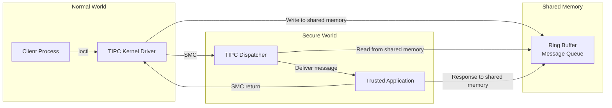

TIPC 通道具有以下特性：

- 最大消息大小为 4000 字节（如 KeyMint HAL 中所示）。
- 超过此限制的消息会被拆分并重新组装。
- 通道由 Trusty 内核进行身份验证，该内核知道普通世界调用者的身份。

### 40.5.12  安全存储

Trusty 存储代理（`system/core/trusty/storage/`）为 TA 提供持久存储。安全世界通常无法直接访问文件系统。因此，代理运行在普通世界中，并通过安全协议为来自 TA 的存储请求提供服务：

```
Normal World                    Secure World
+------------------+            +------------------+
| Storage Proxy    |<-- TIPC -->| Storage TA       |
| (runs as daemon) |            | (in Trusty)      |
| Writes to        |            | Encrypts data    |
| /data/vendor/ss  |            | with TA-bound key|
+------------------+            +------------------+
```

数据在跨越到普通世界进行持久化之前，由 TA 进行加密和完整性保护。

### 40.5.13  面向 Android 桌面形态的 Trusty

Android 17 新增了一个面向“Android Desktop”设备类别的 Trusty 构建：Android 作为桌面操作系统在 PC 级别的 arm64 和 x86_64 硬件上运行。这是 TEE 中的一个形态信号。它与桌面*窗口管理*（自由多窗口、desk、窗口装饰）是分开的。窗口管理位于 WindowManager 和 WMShell 中，第 22 章和第 23 章会介绍。Android 17 在此新增的是针对该硬件的安全世界初始化，而非任何窗口管理代码。

设备配置位于 `trusty/device/desktop/`（版权 2024）。公共包含文件 `trusty/device/desktop/common/desktop-inc.mk` 的标题为“Configurations common to Trusty builds for Android Desktop”，两个项目树用于构建目标：`trusty/device/desktop/arm64/desktop-arm64/` 和 `trusty/device/desktop/x86_64/desktop-x86_64/`。x86_64 树附带基础项目 makefile 以及 `_ext_boot` 和 `-test` 变体（例如 `project/desktop-x86_64.mk`）。arm64 树在它们之上增加了一个 `-test-debug` 变体（外加一个 `qemu-` test-debug 项目）。用于这些目标的 LK 内核平台粘合代码是 `trusty/kernel/platform/desktop/` 下的 Rust 代码。

桌面 Trusty 镜像经过签名并打包为 Trusty VM，而不是烧录进 TrustZone 安全世界。为此，Android 17 的发布工具将签名工具重命名为 `ResignTrustyVM`。根据 `trusty/vendor/google/aosp/scripts/Android.bp`，桌面 Trusty VM 安装在 `vm/trusty_vm` 下。

该目标的可信应用集中在 `trusty/user/desktop/app/` 下。这一集合就是桌面设备所需的安全栈：

- `gsc_svc` 是 Google 安全芯片（Titan 级安全芯片）的服务。
- `pinweaver` 负责知识因子限流。
- `finger_guard` 保护指纹注册与匹配。
- `keymint_provisioning` 和 `keymint_strongbox` 提供 KeyMint 及其 StrongBox 安全级别。
- `secretkeeper` 和 `weaver` 提供 40.5.7 和 40.14 节所介绍的机密存储原语。
- `hwbcc`、`hwkey` 和 `vm_rkp` 为虚拟机提供启动证书、硬件密钥和远程密钥配置支持。

`gsc_svc` 应用提供 `IGsc` AIDL 接口（`android.system.desktop.security.gsc.IGsc`，位于 `trusty/user/desktop/interface/gscd/`）。它的唯一一个方法 `transmit(byte[])` 将序列化的 TPM 2.0 命令转发给 GSC 固件并返回响应。其他桌面 AIDL 接口与其并列位于 `trusty/user/desktop/interface/` 下（`pinweaver`、`finger_guard`、`boot_params`、`keymint_provisioning`）。`trusty/user/desktop/lib/` 下的支持库为它们提供支撑，例如 `gsc_svc_client`、`tpm_commands`、`keymint_access_policy` 和 `secretkeeper_secure_store`。

---

## 40.6  Gatekeeper 与生物识别

### 40.6.1  Gatekeeper —— PIN/图案/密码验证

Gatekeeper 在 TEE 中验证用户的知识因子（PIN、图案或密码）。Trusty 实现位于 `system/core/trusty/gatekeeper/`：

```cpp
class TrustyGateKeeperDevice : public BnGatekeeper {
  public:
    ::ndk::ScopedAStatus enroll(
        int32_t uid,
        const std::vector<uint8_t>& currentPasswordHandle,
        const std::vector<uint8_t>& currentPassword,
        const std::vector<uint8_t>& desiredPassword,
        GatekeeperEnrollResponse* _aidl_return) override;

    ::ndk::ScopedAStatus verify(
        int32_t uid,
        int64_t challenge,
        const std::vector<uint8_t>& enrolledPasswordHandle,
        const std::vector<uint8_t>& providedPassword,
        GatekeeperVerifyResponse* _aidl_return) override;

    ::ndk::ScopedAStatus deleteAllUsers() override;
    ::ndk::ScopedAStatus deleteUser(int32_t uid) override;
};
```

流程如下：

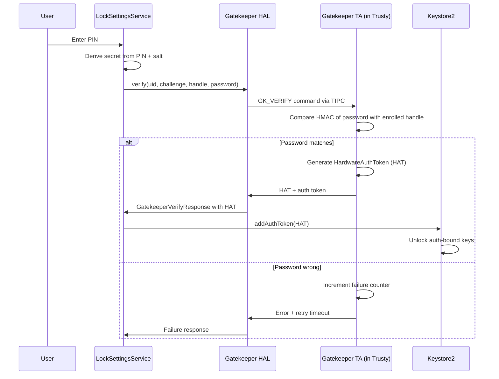

关键安全特性：

- **在硬件中进行限流** —— 参考实现（`system/gatekeeper/gatekeeper.cpp`）通过一个以失败计数器为索引的固定超时表来强制实施。前 5 次失败没有延迟。之后延迟分别为 1 分钟、5、15、30 和 90 分钟。然后是 4、12 和 36 小时、4 天，依此类推，直至数年。这是表查找，而非倍增退避。普通世界无法绕过这一点。
- **按用户隔离** —— 每个用户都有自己注册的句柄，与合成密码保护器状态一起存储在 `/data/system_de/<userId>/spblob/` 中。
- **挑战绑定** —— 验证挑战可防止重放攻击。

### 40.6.2  注册

在注册过程中，TEE：

1. 接收新密码（或其派生值）。
2. 使用硬件绑定密钥生成 HMAC。
3. 返回一个“密码句柄”——HMAC 加上元数据。
4. 框架存储句柄；原始密码永远不会被持久化。

对于密码更改，必须先验证旧密码（以防止具有物理访问权限的攻击者简单地注册一个新密码）。

### 40.6.3  生物识别框架

Android 通过 `hardware/interfaces/biometrics/` 中的 HAL 接口支持多种生物识别模态：

```
hardware/interfaces/biometrics/
  common/         - Shared types (ICancellationSignal, OperationContext)
  fingerprint/    - Fingerprint HAL
    aidl/         - AIDL interface definitions
    2.1/          - Legacy HIDL 2.1
    2.2/          - Legacy HIDL 2.2
    2.3/          - Legacy HIDL 2.3
  face/           - Face HAL
    aidl/         - AIDL interface definitions
    1.0/          - Legacy HIDL 1.0
```

### 40.6.4  指纹 HAL

AIDL 指纹接口（`IFingerprint.aidl`）简洁且基于会话：

```java
@VintfStability
interface IFingerprint {
    SensorProps[] getSensorProps();

    ISession createSession(in int sensorId, in int userId,
                           in ISessionCallback cb);
}
```

`ISession` 接口定义了所有操作：

```java
@VintfStability
interface ISession {
    void generateChallenge();
    void revokeChallenge(in long challenge);
    ICancellationSignal enroll(in HardwareAuthToken hat);
    ICancellationSignal authenticate(in long operationId);
    ICancellationSignal detectInteraction();
    void enumerateEnrollments();
    void removeEnrollments(in int[] enrollmentIds);
    void getAuthenticatorId();
    void invalidateAuthenticatorId();
    void resetLockout(in HardwareAuthToken hat);
    void close();

    // For under-display sensors
    void onPointerDown(in int pointerId, in int x, in int y,
                       in float minor, in float major);
    void onPointerUp(in int pointerId);
    void onUiReady();
}
```

支持的传感器类型：

| 类型 | 描述 |
|------|-------------|
| `REAR` | 位于背面的电容式传感器 |
| `UNDER_DISPLAY_ULTRASONIC` | 位于显示屏下方的超声波传感器 |
| `UNDER_DISPLAY_OPTICAL` | 位于显示屏下方的光学传感器 |
| `POWER_BUTTON` | 集成在电源键中 |

### 40.6.5  传感器强度级别

生物识别传感器按强度分类：

| 强度 | 描述 | 能解锁 Keystore 密钥吗？ |
|----------|-------------|--------------------------|
| `CONVENIENCE` | 可被伪造；仅用于 UX 便利 | 否 |
| `WEAK` | 较难伪造，但无加密保证 | 否 |
| `STRONG` | 满足 CDD 要求；可生成 HAT | 是 |

只有 `STRONG` 传感器才能生成可用于解锁 Keystore 中身份验证绑定密钥的 `HardwareAuthToken`。

### 40.6.6  HardwareAuthToken（HAT）流程

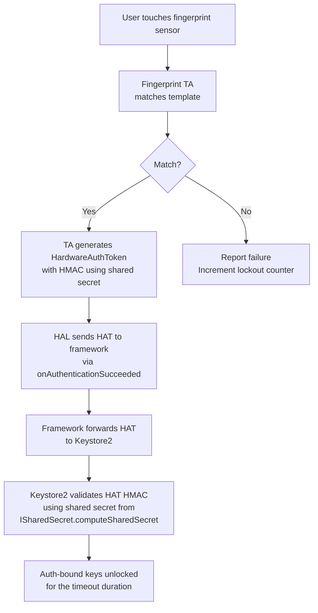

用于验证 HAT 的 HMAC 密钥通过 `ISharedSecret` 接口建立。在那里，所有 TEE 组件（KeyMint、Gatekeeper、Biometrics）在启动时商定一个共享密钥。

### 40.6.7  锁定策略

生物识别框架实施严格的锁定：

- 在 5 次失败的身份验证尝试后：30 秒的定时锁定。
- 在持续失败后：锁定时长增加。
- 在累计 20 次失败后：永久锁定（需要 PIN/图案/密码）。
- 锁定在重启后依然有效（存储在 TA 的安全存储中）。

来自 `ISession.aidl`：

```
Note that lockout states MUST persist after device reboots, HAL crashes, etc.

See the Android CDD section 7.3.10 for the full set of lockout and
rate-limiting requirements.
```

### 40.6.8  面部识别

面部 HAL（`hardware/interfaces/biometrics/face/aidl/`）遵循与指纹 HAL 类似的模式，但支持面部特有的功能：

- 注册类型：`DEFAULT` 与 `ACCESSIBILITY`（面向无法正常转动头部的用户）。
- 多个注册阶段：HAL 引导用户完成头部运动。
- 主动与被动传感：一些实现使用红外泛光照明器，另一些使用结构化光深度相机。

### 40.6.9  身份验证流程对比


所有三种身份验证方法都产生相同的输出：一个 Keystore2 可以验证的 `HardwareAuthToken`。这种统一设计意味着身份验证绑定密钥不需要知道使用了哪种身份验证方法——它们只需要一个有效的令牌。

### 40.6.10  共享密钥协商

启动时，所有与身份验证相关的 TA（KeyMint、Gatekeeper、Fingerprint、Face）通过 `ISharedSecret` 接口协商一个共享 HMAC 密钥：

1. 每个 TA 生成一个随机 nonce 并贡献它。
2. `ISharedSecret.computeSharedSecret()` 方法将所有 nonce 组合起来。
3. 所有 TA 使用 KDF 派生出相同的 HMAC 密钥。
4. 该密钥用于对 HardwareAuthToken 进行签名和验证。

如果任何 TA 被攻陷，它都无法伪造其他 TA 会接受的令牌，因为共享密钥依赖于所有 TA 的贡献。

### 40.6.11  生物识别提示

Android 的 `BiometricPrompt` API 为生物识别身份验证提供了统一的 UI。它处理：

- 选择可用的最佳生物识别模态。
- 显示一致的、由系统控制的 UI。
- 在生物识别失败时回退到 PIN/图案/密码。
- 跨模态管理锁定状态。
- 返回一个用于硬件绑定身份验证的 `CryptoObject`。

BiometricPrompt 流程：

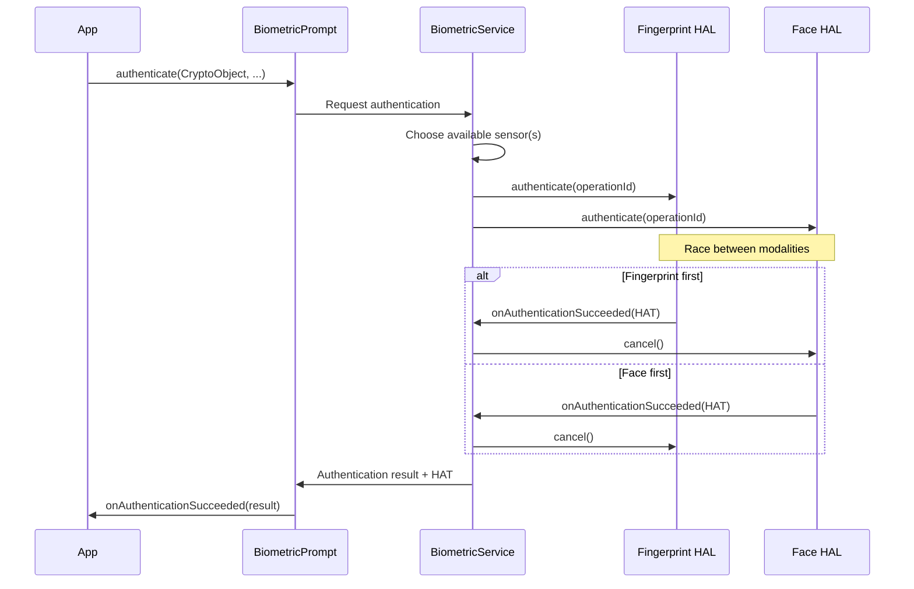

---

## 40.7  应用沙箱

### 40.7.1  按应用分配 UID 的隔离

每个已安装的应用都会获得一个唯一的 Linux UID。该 UID 在安装时由包管理器分配，且永远不会改变。UID 构成了沙箱的基础：

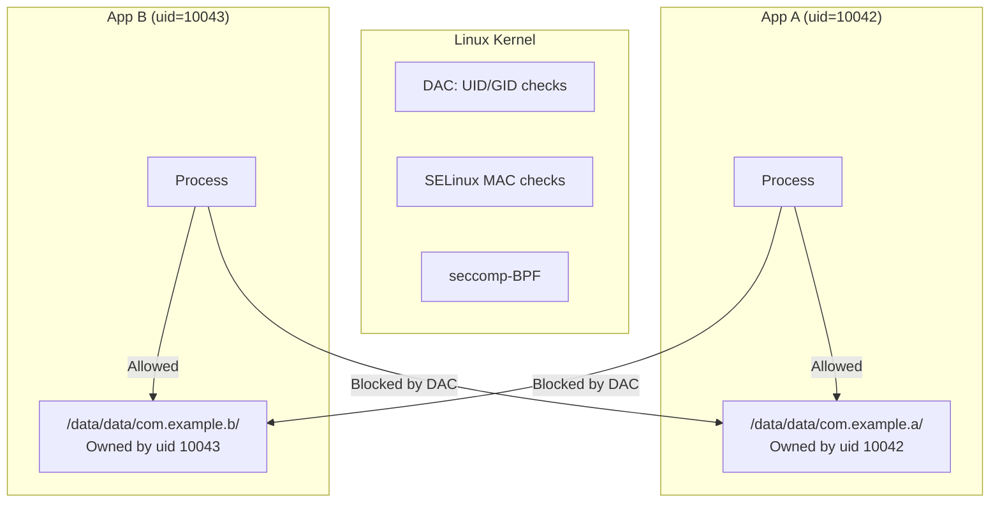

应用数据目录以 `0700` 权限创建，并由应用的 UID 拥有，因此其他（非 root）进程无法读写它。

### 40.7.2  应用的 SELinux 域

应用根据其 `targetSdkVersion` 和其他属性运行在类型特定的 SELinux 域中。域分配由 `seapp_contexts` 驱动：

```
# From system/sepolicy/private/seapp_contexts

# System server
isSystemServer=true domain=system_server_startup

# Apps with targetSdkVersion >= 37
user=_app minTargetSdkVersion=37 domain=untrusted_app type=app_data_file levelFrom=all

# Apps with targetSdkVersion 34-36 / 32-33
user=_app minTargetSdkVersion=34 domain=untrusted_app_34 ...
user=_app minTargetSdkVersion=32 domain=untrusted_app_32 ...

# Apps with targetSdkVersion 30-31
user=_app minTargetSdkVersion=30 domain=untrusted_app_30 ...

# Isolated processes
user=_isolated domain=isolated_app ...
```

不受信任的应用域（`system/sepolicy/private/untrusted_app.te`）：

```te
###
### Untrusted apps.
###
### This file defines the rules for untrusted apps running with
### targetSdkVersion >= 37.
###

typeattribute untrusted_app coredomain;

app_domain(untrusted_app)
untrusted_app_domain(untrusted_app)
net_domain(untrusted_app)
bluetooth_domain(untrusted_app)
```

### 40.7.3  隔离进程

`isolated_app` 域受到的限制最严格：

```te
typeattribute isolated_app coredomain;

app_domain(isolated_app)
isolated_app_domain(isolated_app)
```

隔离进程：

- 无法直接访问网络（没有 `net_domain`）。
- 默认情况下无法访问任何内容提供程序或服务。
- 除了通过文件描述符显式传递给它们的文件外，无法读写任何文件。
- 每次运行都使用唯一的 UID（从保留范围内分配）。

来自 `system/sepolicy/private/isolated_app.te` 和 `system/sepolicy/private/isolated_app_all.te`（后者针对所有隔离应用域共享的 `isolated_app_all` 属性）：

```te
# isolated_app.te:
# Allow access to network sockets received over IPC.
# New socket creation is not permitted.
allow isolated_app { ephemeral_app priv_app_all untrusted_app_all }:{
    tcp_socket udp_socket
} { rw_socket_perms_no_ioctl };

# isolated_app_all.te:
# b/32896414: Allow accessing sdcard file descriptors passed to
# isolated_apps by other processes. Open should never be allowed.
allow isolated_app_all { sdcard_type fuse media_rw_data_file }:file {
    read write append getattr lock map
};
```

### 40.7.4  seccomp-BPF 过滤

Android 对应用进程应用 seccomp-BPF（带 Berkeley Packet Filter 的安全计算模式）。这限制了应用可以发出哪些系统调用，甚至在咨询 SELinux 之前就生效。

seccomp 过滤器由 Zygote 在进程特化期间应用。为应用拦截的系统调用（来自 `bionic/libc/SECCOMP_BLOCKLIST_APP.TXT`）包括：

| 类别 | 示例 |
|----------|---------|
| **UID/GID 变更** | `setuid`、`setgid`、`setreuid`、`setresgid`、`setgroups`、`setfsuid` |
| **内核模块加载** | `init_module`、`delete_module` |
| **时钟操纵** | `adjtimex`、`clock_adjtime`、`clock_settime`、`settimeofday` |
| **挂载操作** | `mount`、`umount2`、`chroot` |
| **交换分区管理** | `swapon`、`swapoff` |
| **进程记账 / 日志** | `acct`、`syslog` |
| **主机身份** | `setdomainname`、`sethostname` |
| **重启** | `reboot` |

值得注意的是，`ptrace`、`unshare` 和 `setns` 并未被应用 seccomp 过滤器拦截。它们位于生成的允许列表中（`bionic/libc/SYSCALLS.TXT`）。相反，SELinux neverallow 规则禁止对其他域进行跟踪（Yama 则限制同一域内的跟踪）。

被拦截的系统调用会触发 `SECCOMP_RET_TRAP`，将 `SIGSYS` 发送给调用线程——通常是致命的，崩溃信息通过 debuggerd 路由。生成的过滤器从不返回 errno。

### 40.7.5  命名空间隔离

从 Android 10 开始，应用进程使用 Linux 挂载命名空间来进一步限制它们对文件系统的视图：

- 每个应用都有自己的挂载命名空间。
- FUSE 挂载的外部存储以按应用划分的视图呈现。
- `/proc/net` 被过滤，以向目标为 Android 10+ 的应用隐藏网络信息。

### 40.7.6  Zygote 特化

Zygote 是所有应用进程的父进程。当应用启动时，Zygote 会 fork，然后“特化”子进程：

```mermaid
sequenceDiagram
    participant AM as ActivityManager
    participant Zygote
    participant Child as App Process

    AM->>Zygote: Fork request (via socket)
    Zygote->>Child: fork()
    Note over Child: Child process created
    Child->>Child: Drop capability bounding set
    Child->>Child: Set up mount namespace / emulated storage
    Child->>Child: setgroups(supplementary_groups)
    Child->>Child: setresgid(app_gid)
    Child->>Child: Apply seccomp-BPF filter
    Child->>Child: setresuid(app_uid)
    Child->>Child: Set capabilities
    Child->>Child: Set SELinux context (selinux_android_setcontext)
    Child->>Child: Close Zygote socket
    Child->>Child: Load application code
```

在特化过程中（按照 `frameworks/base/core/jni/com_android_internal_os_Zygote.cpp` 中 `SpecializeCommon` 执行的顺序）：

1. **丢弃能力边界集**，并设置好具有应用模拟存储视图的**挂载命名空间**。
2. **补充组** —— 根据权限执行 `setgroups`（例如 INTERNET 权限对应 `inet` 组，存储访问对应 `media_rw`），然后将 `setresgid` 设置为应用的 GID。
3. **应用 seccomp 过滤器** —— 刻意安排在 UID 变更*之前*，因为安装过滤器需要进程即将失去的一项能力。
4. **设置 UID** —— 通过 `setresuid` 设置为分配给应用的 UID。
5. **设置能力** —— 通常应用进程不会保留任何能力。
6. **SELinux 域转换** —— `selinux_android_setcontext` 将进程从 `zygote` 移动到相应的应用域（例如 `untrusted_app`）。
7. **关闭 Zygote 服务端套接字** —— 子进程关闭继承的 Zygote 服务端套接字，因此它无法再接受或服务进一步的 fork 请求。

### 40.7.7  权限到组的映射

`INTERNET` 权限仍体现在组成员资格中：获得该权限后，应用进程会获得 `inet` 补充组（GID 3003），通过 `frameworks/base/data/etc/platform.xml` 分配。然而，强制执行不再依赖已移除的旧 `CONFIG_ANDROID_PARANOID_NETWORK` 内核补丁。`packages/modules/Connectivity/bpf/progs/netd.c` 中的 `inet_create` eBPF cgroup 程序根据按应用 ID 划分的权限映射（`BPF_PERMISSION_INTERNET`）来决定是否允许创建套接字。与权限相关的组：

| 组 | GID | 权限 |
|-------|-----|-----------|
| `inet` | 3003 | 创建网络套接字 |
| `net_raw` | 3004 | 创建原始套接字（ping） |
| `sdcard_rw` | 1015 | 写入外部存储 |
| `media_rw` | 1023 | 写入媒体存储 |

### 40.7.8  详细的 seccomp-BPF 策略

seccomp-BPF 过滤器按架构定义。对于 ARM64，该策略会拦截危险的系统调用，同时允许正常应用操作所需的数百个系统调用。过滤器结构：

```mermaid
flowchart TD
    A[Syscall from app process] --> B{syscall number in allowlist?}
    B -->|Yes| C[Allow syscall to proceed]
    B -->|No| D{syscall number in blocklist?}
    D -->|Yes| E[Return EPERM or SIGSYS]
    D -->|No| F{Architecture-specific handling}
    F --> G[Default: allow or block based on policy]
```

seccomp 策略定义是 `bionic/libc/` 下的文本文件：

```
bionic/libc/SYSCALLS.TXT
bionic/libc/SECCOMP_ALLOWLIST_COMMON.TXT
bionic/libc/SECCOMP_ALLOWLIST_APP.TXT
bionic/libc/SECCOMP_BLOCKLIST_COMMON.TXT
bionic/libc/SECCOMP_BLOCKLIST_APP.TXT
```

`bionic/libc/seccomp/` 目录保存了生成的过滤器以及用于安装它们的 `seccomp_policy.cpp` 运行时。

被拦截系统调用的示例及其安全理由：

| 系统调用 | 拦截理由 |
|---------|----------------------|
| `init_module` | 加载内核模块将导致彻底失守 |
| `delete_module` | 卸载安全模块 |
| `mount` | 挂载新的文件系统可能绕过沙箱 |
| `umount2` | 卸载可能暴露原始块设备 |
| `chroot` | 操纵文件系统根目录 |
| `reboot` | 拒绝服务 |
| `swapon/swapoff` | 操纵系统资源 |
| `settimeofday` | 时钟操纵会影响身份验证令牌 |
| `setuid`/`setgid` 系列 | 在特化后更改 ID |
| `acct` | 进程记账控制 |
| `syslog` | 读取内核日志会泄露数据 |
| `kexec_load` | 加载新内核（完全不在 `SYSCALLS.TXT` 中） |

注意，`ptrace`、`unshare`、`setns` 和 `pivot_root` *不在*应用的 seccomp 拦截列表中。`pivot_root` 甚至明确被列入了 boot 的允许列表。因此对这些的限制来自 SELinux 和其他机制，而非 seccomp。

### 40.7.9  进程级隔离细节

每个应用进程都具有以下隔离属性：

**文件描述符表**：从 Zygote fork 而来，但清除了敏感的 FD。Zygote 套接字 FD 在 fork 后立即关闭。

**信号处理**：应用只能向同一应用（相同 UID）中的进程发送信号，SIGCHLD（父进程通知）和 signal 0（存在性测试）除外。

**内存保护**：应用进程具有 ASLR（地址空间布局随机化）、栈金丝雀，以及针对代码段的仅执行内存。

**资源限制**：调用 `setrlimit` 来限制：

- 文件描述符的最大数量
- 栈的最大大小
- 虚拟内存的最大大小
- 核心转储大小（通常为零）

### 40.7.10  基于 Intent 的通信安全

应用主要通过 Intent 进行通信，并由 `system_server` 中介。对 Intent 投递的安全检查：

1. **权限检查** —— 如果接收方声明了某权限，发送方必须持有它。
2. **导出检查** —— 未导出的组件不能被外部应用作为目标。
3. **SELinux 检查** —— binder_call 权限必须允许该 IPC。
4. **应用可见性** —— Android 11+ 依据清单中的 `<queries>` 声明限制哪些应用可以看到彼此。

### 40.7.11  Content Provider 安全

Content Provider 有自己的访问控制：

```xml
<provider
    android:name=".MyProvider"
    android:authorities="com.example.provider"
    android:exported="true"
    android:readPermission="com.example.READ"
    android:writePermission="com.example.WRITE">
    <path-permission
        android:path="/sensitive"
        android:readPermission="com.example.READ_SENSITIVE" />
</provider>
```

- `exported=false`（自 targetSdk >= 17 起是 provider 的默认值）：只有同一应用可以访问它。（TargetSdk 31 是带有 intent filter 的组件必须显式指定 `android:exported` 的时候，但这并不改变 provider 的默认值。）
- `readPermission` / `writePermission`：独立的读和写权限。
- `<path-permission>`：按路径划分的权限，用于细粒度控制。
- URI 授权：针对特定 URI 的临时一次性权限。

### 40.7.12  SDK 沙箱

Android 13 引入了 SDK 沙箱，这是一个独立的进程，用于在与宿主应用隔离的情况下运行广告和分析 SDK：

```
user=_sdksandbox domain=sdk_sandbox_34 type=sdk_sandbox_data_file levelFrom=all
```

（`sdk_sandbox` 是诸如 `sdk_sandbox_34` 这类带版本号的沙箱域所携带的属性。）

SDK 沙箱使用自己的 UID 和 SELinux 域运行，从而防止 SDK 访问宿主应用的数据或其他敏感的系统资源。

SDK 沙箱架构：

```mermaid
graph TB
    subgraph "App Process (uid=10042)"
        App[App Code]
        SDK_Client[SDK Client API]
    end

    subgraph "SDK Sandbox Process (uid=20042)"
        SDK_Runtime[SDK Runtime]
        AdSDK[Ad SDK Code]
        AnalyticsSDK[Analytics SDK]
    end

    subgraph "System"
        SS["SdkSandboxManager<br/>in system_server"]
    end

    App --> SDK_Client
    SDK_Client -->|Binder IPC| SS
    SS -->|Manages lifecycle| SDK_Runtime
    SDK_Runtime --> AdSDK
    SDK_Runtime --> AnalyticsSDK
    AdSDK -.->|Cannot access| App
```

SDK 沙箱的主要限制：

- 无法访问宿主应用的文件或共享首选项。
- 受限的网络访问。
- 无法读取设备标识符。
- 无法访问位置信息。
- 使用自己独立的存储区域运行。

### 40.7.13  应用克隆与工作资料安全

Android 通过多用户框架支持应用克隆（运行同一应用的两个实例）。每个克隆：

- 在不同的用户空间中获得唯一的 UID。
- 拥有自己加密的 CE/DE 存储。
- 通过 SELinux MLS 类别隔离。
- 无法访问另一个克隆的数据。

### 40.7.14  WebView 隔离

WebView 内容在隔离的渲染器进程中运行：

```te
# WebView renderers use isolated_app domain
typeattribute isolated_app coredomain;
app_domain(isolated_app)
isolated_app_domain(isolated_app)
```

WebView 进程：

- 以 `isolated_app` 身份运行，并采用最严格的 SELinux 策略。
- 无法打开文件（只能使用传入的文件描述符）。
- 无法创建网络连接（只能使用传入的套接字）。
- 无法访问父应用的数据目录。
- 在 WebView 销毁时被终止。

这确保了被攻陷的渲染器（例如通过浏览器漏洞利用）对设备具有最小的访问权限。

---

## 40.8  加密

### 40.8.1  基于文件的加密（FBE）

FBE 于 Android 7.0 引入，并自 Android 10 起成为强制要求，它用不同的密钥加密不同的文件，使每个用户的数据都能被独立加密。实现位于 `system/vold/FsCrypt.cpp`。

FBE 使用内核原生的文件系统加密（fscrypt）支持：

```cpp
// system/vold/FsCrypt.cpp
#include <fscrypt/fscrypt.h>
#include <libdm/dm.h>
```

来自 `system/vold/FsCrypt.h` 的关键函数：

```cpp
bool fscrypt_initialize_systemwide_keys();
bool fscrypt_init_user0();
bool fscrypt_create_user_keys(userid_t user_id, bool ephemeral);
bool fscrypt_destroy_user_keys(userid_t user_id);
bool fscrypt_set_ce_key_protection(userid_t user_id,
                                   const std::vector<uint8_t>& secret);
bool fscrypt_unlock_ce_storage(userid_t user_id,
                               const std::vector<uint8_t>& secret);
bool fscrypt_lock_ce_storage(userid_t user_id);
bool fscrypt_prepare_user_storage(const std::string& volume_uuid,
                                  userid_t user_id, int flags);
```

### 40.8.2  FBE 密钥类别

FBE 为每个用户使用两类加密密钥：

```mermaid
graph TB
    subgraph "Device Encrypted (DE)"
        DE_Key["DE Key<br/>Available at boot"]
        DE_Data["/data/system_de/<userId>/<br/>/data/misc_de/<userId>/<br/>/data/vendor_de/<userId>/"]
    end

    subgraph "Credential Encrypted (CE)"
        CE_Key["CE Key<br/>Available after first unlock"]
        CE_Data["/data/system_ce/<userId>/<br/>/data/misc_ce/<userId>/<br/>/data/vendor_ce/<userId>/<br/>/data/data/ (user 0)"]
    end

    subgraph "Key Storage"
        KS["/data/misc/vold/user_keys/<br/>ce/<userId>/<br/>de/<userId>/"]
    end

    DE_Key --> DE_Data
    CE_Key --> CE_Data
    KS --> DE_Key
    KS --> CE_Key
```

| 密钥类别 | 解锁时机 | 保护对象 |
|-----------|--------------|----------|
| **DE（设备加密）** | 设备启动时 | 闹钟、电话、无障碍设置 |
| **CE（凭据加密）** | 用户输入凭据时 | 应用数据、联系人、消息 |

这一设计实现了 Direct Boot：设备可以在用户输入凭据之前启动并运行基本服务（闹钟、电话）。

### 40.8.3  FBE 密钥路径结构

加密密钥在 `/data/misc/vold/user_keys/` 下的目录层次结构中组织。来自 `system/vold/FsCrypt.cpp`：

```cpp
const std::string device_key_dir =
    std::string() + DATA_MNT_POINT + fscrypt_unencrypted_folder;
const std::string device_key_path = device_key_dir + "/key";

const std::string user_key_dir =
    std::string() + DATA_MNT_POINT + "/misc/vold/user_keys";

const std::string systemwide_volume_key_dir =
    std::string() + DATA_MNT_POINT + "/misc/vold/volume_keys";
```

密钥目录布局：

```
/data/misc/vold/user_keys/
  ce/
    0/          # User 0 CE keys
      current/  # Currently active CE key
    10/         # User 10 CE keys
  de/
    0/          # User 0 DE keys
    10/         # User 10 DE keys
```

用于密钥路径解析的辅助函数：

```cpp
static std::string get_de_key_path(userid_t user_id) {
    return StringPrintf("%s/de/%d", user_key_dir.c_str(), user_id);
}

static std::string get_ce_key_directory_path(userid_t user_id) {
    return StringPrintf("%s/ce/%d", user_key_dir.c_str(), user_id);
}
```

内部状态跟踪使用映射来管理已安装的加密策略：

```cpp
// The currently installed CE and DE keys for each user.
// Protected by VolumeManager::mCryptLock.
struct UserPolicies {
    EncryptionPolicy internal;
    std::map<std::string, EncryptionPolicy> adoptable;
};

std::map<userid_t, UserPolicies> s_ce_policies;
std::map<userid_t, UserPolicies> s_de_policies;
```

### 40.8.4  密钥派生与存储

来自 `system/vold/KeyStorage.cpp`：

```cpp
const KeyAuthentication kEmptyAuthentication{""};

// AES_KEY_BYTES = 32 is defined in system/vold/Keystore.h
static constexpr size_t GCM_NONCE_BYTES = 12;
static constexpr size_t GCM_MAC_BYTES = 16;
static constexpr size_t SECDISCARDABLE_BYTES = 1 << 14;

static const char* kHashPrefix_secdiscardable =
    "Android secdiscardable SHA512";
static const char* kHashPrefix_keygen =
    "Android key wrapping key generation SHA512";
```

密钥存储机制：

1. 生成一个随机的 256 位加密密钥。
2. 使用以下来源派生的密钥对密钥进行包装：
   - 用户凭据（针对 CE 密钥）
   - Keystore 中硬件绑定的密钥（绑定到设备）
   - 一个“secdiscardable”随机文件（16 KiB），在密钥不再需要时会被安全删除
3. 包装后的密钥存储在 `/data/misc/vold/user_keys/` 中。

### 40.8.5  加密密钥生命周期

```mermaid
stateDiagram-v2
    [*] --> Created: fscrypt_create_user_keys
    Created --> DE_Active: Device boots, DE key installed to kernel
    DE_Active --> CE_Active: User enters credential, fscrypt_unlock_ce_storage
    CE_Active --> CE_Locked: Device locks, fscrypt_lock_ce_storage
    CE_Locked --> CE_Active: User re-enters credential
    CE_Active --> Destroyed: User removed, fscrypt_destroy_user_keys
    DE_Active --> Destroyed: User removed
    Destroyed --> [*]
```

密钥安装过程使用内核的 fscrypt API：

1. 从存储中取出原始密钥（或硬件包装的密钥）。
2. 使用 `FS_IOC_ADD_ENCRYPTION_KEY` 将密钥安装到内核的 fscrypt keyring 中。
3. 内核返回一个密钥标识符。
4. 使用 `FS_IOC_SET_ENCRYPTION_POLICY` 将标识符设置为目录的加密策略。
5. 内核透明地加密/解密文件内容。

### 40.8.6  元数据加密

元数据加密保护 FBE 以明文形式留下的文件系统元数据——目录结构、文件大小、权限和时间戳。文件名本身已由 fscrypt 加密。实现位于 `system/vold/MetadataCrypt.cpp`：

```cpp
// Parsed from metadata options
// (KeyType is android::fscrypt::KeyType)
struct CryptoOptions {
    struct CryptoType cipher = invalid_crypto_type;
    bool use_legacy_options_format = false;
    bool set_dun = true;
    KeyType key_type = KeyType::kRaw;
};

// The first entry in this table is the default crypto type.
constexpr CryptoType supported_crypto_types[] = {aes_256_xts, adiantum};
```

元数据加密使用 `dm-default-key`，这是一个 device-mapper 目标，它用单个密钥透明地加密写入底层块设备的所有数据。该密钥在启动时可用（不绑定凭据），并在设备关机时保护静态数据。

支持的加密算法：

| 加密算法 | 性能 | 安全性 |
|--------|------------|----------|
| **AES-256-XTS** | 硬件加速下速度快 | 标准选择 |
| **Adiantum** | 无硬件加速下速度快 | 适用于没有 AES 指令的低端设备 |

### 40.8.7  全磁盘加密（FDE）——已弃用

FDE 是 FBE 之前的加密模型（Android 5.0-6.0）。它使用从用户凭据派生的单个密钥加密整个 `/data` 分区。FDE 存在显著的可用性问题：

- 在用户输入凭据之前，设备无法启动可用的服务。
- 没有 Direct Boot：在解锁之前，闹钟、电话和无障碍服务均不可用。
- 单个密钥泄露会暴露所有数据。

FDE 已弃用，在搭载 Android 10+ 的新设备上不再受支持。

### 40.8.8  硬件包装的密钥

对于具有内联加密引擎的设备（在现代 SoC 上很常见），密钥可以“硬件包装”：

1. 密钥在内联加密引擎内部生成。
2. 只有密钥的加密（“包装”）版本会暴露给软件。
3. 内联加密引擎在 I/O 期间内部解包密钥。

这意味着即使内核被攻陷也无法提取原始加密密钥。在元数据加密中，此功能通过将 `CryptoOptions::key_type` 字段设为 `KeyType::kHwWrapped`（或 `kHwWrappedV0`）来选择，这映射到 dm-default-key 的 `wrappedkey_v0` 选项。

### 40.8.9  dm-default-key 实现

元数据加密使用 `dm-default-key` device-mapper 目标。来自 `system/vold/MetadataCrypt.cpp`，设置过程包括：

```cpp
static bool create_crypto_blk_dev(
    const std::string& dm_name,
    const std::string& blk_device,
    const KeyBuffer& key,
    const CryptoOptions& options,
    std::string* crypto_blkdev,
    uint64_t* nr_sec,
    bool is_userdata)
{
    if (!get_number_of_sectors(blk_device, nr_sec)) return false;
    // dm-default-key uses 4096-byte sectors
    *nr_sec &= ~7;

    KeyBuffer module_key;
    if (!prepareKeyForUse(key, options.key_type, &module_key)) return false;
    // ... set up dm-default-key target ...
}
```

`prepareKeyForUse`（声明于 `system/vold/KeyUtil.h`）处理硬件包装的情况：当 `options.key_type` 为 `KeyType::kHwWrapped` 或 `kHwWrappedV0` 时，设置还会将 dm-default-key 的 `wrappedkey_v0` 选项传递给内核。

元数据加密层位于文件系统和块设备之间：

```
Filesystem (ext4/f2fs)
        |
   dm-default-key (metadata encryption, AES-256-XTS)
        |
   Raw block device (/dev/block/by-name/userdata)
```

### 40.8.10  Secdiscardable 机制

一个独特的安全特性是“secdiscardable”文件：

```cpp
static constexpr size_t SECDISCARDABLE_BYTES = 1 << 14;  // 16384 bytes

static const char* kHashPrefix_secdiscardable =
    "Android secdiscardable SHA512";
```

这个 16 KiB 的随机文件与每个密钥一起存储。其哈希值被混入密钥派生中。当密钥需要被永久销毁时：

1. 使用 `BLKSECDISCARD` ioctl 安全擦除 secdiscardable 文件（并带有零覆写回退），或在 f2fs 上使用 `F2FS_IOC_SEC_TRIM_FILE`。
2. 即使加密的密钥 blob 以某种方式被恢复，丢失 secdiscardable 也会使其变得无用。
3. 在闪存存储上，DISCARD 命令会指示闪存控制器擦除物理块，使恢复极其困难。

这提供了针对已删除密钥的取证恢复的防御。

### 40.8.11  使用用户凭据保护 CE 密钥

当用户设置凭据（PIN、图案、密码）时，CE 密钥会由从凭据派生的密钥保护。保护流程：

```mermaid
sequenceDiagram
    participant User
    participant LS as LockSettingsService
    participant GK as Gatekeeper
    participant Vold
    participant KS as Keystore

    User->>LS: Set new PIN "1234"
    LS->>GK: enroll(password_derived_secret)
    GK->>LS: Password handle
    LS->>LS: Store handle in /data/system/gatekeeper.pattern.key
    LS->>KS: Create synthetic password (SP)
    Note over KS: SP = random 256-bit value
    KS->>KS: Encrypt SP with credential-derived key
    KS->>KS: Store encrypted SP
    LS->>Vold: fscrypt_set_ce_key_protection(userId, SP)
    Vold->>Vold: Re-wrap CE key with SP
    Note over Vold: CE key now requires SP to unlock
```

解锁时：

```mermaid
sequenceDiagram
    participant User
    participant LS as LockSettingsService
    participant GK as Gatekeeper
    participant Vold

    User->>LS: Enter PIN "1234"
    LS->>GK: verify(password_derived_secret)
    GK->>LS: HardwareAuthToken
    LS->>LS: Use token + credential to decrypt SP
    LS->>Vold: fscrypt_unlock_ce_storage(userId, SP)
    Vold->>Vold: Unwrap CE key using SP
    Vold->>Vold: Install CE key to kernel fscrypt keyring
    Note over Vold: CE storage now accessible
```

### 40.8.12  加密架构图

```mermaid
graph TB
    subgraph "At Rest (Power Off)"
        Disk["/data partition<br/>Everything encrypted"]
    end

    subgraph "After Boot (Before Unlock)"
        MD["Metadata Encryption<br/>dm-default-key active"]
        DE_Unlocked["DE keys available<br/>DE storage readable"]
        CE_Locked["CE keys locked<br/>CE storage inaccessible"]
    end

    subgraph "After User Unlock"
        CE_Unlocked["CE keys unlocked<br/>All user data accessible"]
    end

    Disk -->|Boot| MD
    MD --> DE_Unlocked
    MD --> CE_Locked
    CE_Locked -->|User enters credential| CE_Unlocked
```

### 40.8.13  SecureBox 与可恢复密钥库

上述加密子系统（FBE、元数据加密、dm-default-key）保护*设备上的静态数据*。Android 还需要保护离开设备的密钥。最重要的情形是用户受锁屏保护的密钥。它们被备份到远程保险库，以便日后在新设备上恢复。位于 `frameworks/base/libs/securebox/` 的“SecureBox”库提供了可恢复密钥库用来端到端包装这些密钥的加密原语。

本小节将逐步介绍 SecureBox v2 的线路格式、它为何采用这样的结构，以及 `RecoverableKeyStoreManager` 如何使用它。

#### SecureBox 是什么

`com.android.security.SecureBox` 是一个紧凑、无依赖的 Java 类，它在 NIST P-256 椭圆曲线、AES-128-GCM 和 HKDF-SHA-256 上实现了经过认证的公钥 + 共享密钥混合加密方案。它公开了恰好五个公共方法：

```java
// Source: frameworks/base/libs/securebox/src/com/android/security/SecureBox.java:142
public static KeyPair genKeyPair() throws NoSuchAlgorithmException;
public static byte[]  encrypt(@Nullable PublicKey theirPublicKey,
                              @Nullable byte[] sharedSecret,
                              @Nullable byte[] header,
                              @Nullable byte[] payload);
public static byte[]  decrypt(@Nullable PrivateKey ourPrivateKey,
                              @Nullable byte[] sharedSecret,
                              @Nullable byte[] header,
                              byte[] encryptedPayload);
public static byte[]  encodePublicKey(PublicKey publicKey);
public static PublicKey decodePublicKey(byte[] keyBytes);
```

签名编码了设计契约：

- 调用者可以使用接收方的**公钥**、使用**共享密钥**，或同时使用**两者**（在这种情况下两者都是解密所必需的）进行加密。两者中至少有一个必须非 null。
- `header` 经过认证但未加密。它以明文传输，但 GCM 标签将其绑定到负载。任何修改都会导致解密失败，并抛出 `AEADBadTagException`。
- `payload` 是加密的主体。任一输入都可以是 null/空。

该库构建为一个普通的 `java_library`，没有 `static_libs`。除了 `@hide` 注解和 `ArrayUtils.concat` 辅助函数外，它没有任何 Android 依赖。这是一个有意的选择，以便相同的代码可以作为一个自包含的密码学单元进行审查。

#### SecureBox v2 线路格式

`encrypt(...)` 的输出是一个字节数组，布局如下：

```
+--------+----------------+--------+----------------------------+
|        |                |        |                            |
| VERSION| sender pubKey  | nonce  |  AES-GCM(ciphertext || tag)|
| 2 B    | 65 B (DH only) | 12 B   |  variable                  |
|        |                |        |                            |
+--------+----------------+--------+----------------------------+
```

- **VERSION** 是常量 `0x02 0x00`——小端序的 2（即 SecureBox v2 中的“v2”）。
- **sender pubKey** *仅*存在于公钥路径中（`theirPublicKey != null`）。发送者在每次 `encrypt(...)` 调用时生成一个新的临时 P-256 密钥对。它针对接收方的公钥执行 ECDH。然后它以非压缩点形式（`0x04 || X (32 B) || Y (32 B)`，`EC_PUBLIC_KEY_LEN_BYTES = 65`）发出自己的公钥。
- **nonce** 是每次调用生成的 12 个全新随机字节（`SecureRandom`）。
- **AES-GCM body** 是 AES-128-GCM 密文，并附加了 16 字节认证标签（标准 JCE GCM 布局）。

HKDF info 字符串因模式而异：

```java
// Source: frameworks/base/libs/securebox/src/com/android/security/SecureBox.java:77
private static final byte[] HKDF_INFO_WITH_PUBLIC_KEY =
        "P256 HKDF-SHA-256 AES-128-GCM".getBytes(StandardCharsets.UTF_8);
private static final byte[] HKDF_INFO_WITHOUT_PUBLIC_KEY =
        "SHARED HKDF-SHA-256 AES-128-GCM".getBytes(StandardCharsets.UTF_8);
```

这两种不同的 info 字符串让同一个库能够明确地同时覆盖 ECDH 和纯共享密钥两种情形。派生出的 AES 密钥与其派生模式绑定。因此，即使密钥材料发生碰撞，在一种模式下加密的负载也无法在另一种模式下解密。

完整的密钥派生链为：

1. `dhSecret = ECDH(senderPrivate, recipientPublic)`（在纯共享密钥模式下为空）
2. `keyingMaterial = dhSecret || sharedSecret`
3. `prk = HMAC-SHA-256(salt = "SECUREBOX" || 0x02 0x00, ikm = keyingMaterial)`
4. `K = HMAC-SHA-256(prk, info || 0x01)` 的前 16 字节（一个 HKDF 块）
5. 使用 `K`、`nonce`，AAD = `header` 进行 AES-128-GCM

这是教科书式的 HKDF 构造；唯一属于 Android 特有的部分是 `"SECUREBOX" || 0x02 0x00` 盐和 API-37 稳定不变的 info 字符串。

```mermaid
flowchart LR
    subgraph Encrypt["encrypt(theirPub, sharedSecret, header, payload)"]
        EphGen["genKeyPair → senderPriv, senderPub"]
        ECDH["dhSecret = ECDH(senderPriv, theirPub)"]
        Concat["keyingMaterial = dhSecret || sharedSecret"]
        HKDF["HKDF-SHA-256(salt='SECUREBOX'||0x02 0x00,<br/>info='P256 HKDF-SHA-256 AES-128-GCM',<br/>ikm=keyingMaterial) → K (16 B)"]
        Nonce["genRandomNonce → 12 B"]
        GCM["AES-128-GCM-Encrypt(K, nonce, aad=header, pt=payload)"]
        Out["VERSION (2) || senderPub (65) || nonce (12) || ciphertext"]
        EphGen --> ECDH --> Concat --> HKDF --> GCM --> Out
        Nonce --> GCM
    end
```

#### 解码时的曲线验证

`SecureBox` 自带其 P-256 参数（静态初始化器中的标准 NIST p、a、b、G、n 常量）。它不信任 JCE 来解析这些参数。原因在于 `decodePublicKey(...)` 会验证接收到的点确实位于曲线上：

```java
// Source: frameworks/base/libs/securebox/src/com/android/security/SecureBox.java:430
private static void validateEcPoint(BigInteger x, BigInteger y) throws InvalidKeyException {
    if (x.compareTo(EC_PARAM_P) >= 0
            || y.compareTo(EC_PARAM_P) >= 0
            || x.signum() == -1
            || y.signum() == -1) {
        throw new InvalidKeyException("Point lies outside of the expected curve");
    }
    // Points on the curve satisfy y^2 = x^3 + ax + b (mod p)
    BigInteger lhs = y.modPow(BIG_INT_02, EC_PARAM_P);
    BigInteger rhs = x.modPow(BIG_INT_02, EC_PARAM_P)
            .add(EC_PARAM_A).mod(EC_PARAM_P)
            .multiply(x).add(EC_PARAM_B).mod(EC_PARAM_P);
    if (!lhs.equals(rhs)) {
        throw new InvalidKeyException("Point lies outside of the expected curve");
    }
}
```

这可以阻止 invalid-curve 攻击。控制 `encryptedPayload` 的攻击者无法夹带一个位于更弱曲线上的恶意“公钥”。然后攻击者就无法利用由此产生的 ECDH 泄露来恢复接收方的私钥。该检查符合 IETF / NIST SP 800-56A 的公钥验证指南，并在密钥被交给 `KeyAgreement` 之前执行。

编码形式也是刻意选择的：非压缩点 `0x04 || X || Y`，固定 65 字节，`arraycopy` 会小心处理二进制补码符号位的前导零（第 386-398 行）。正是这种定宽编码，使得 `RecoverableKeyStoreManager` 稍后能够将其持久化到交给恢复服务的“vault params”blob 中。

#### 可恢复密钥库如何使用它

主要消费者是位于 `frameworks/base/services/core/java/com/android/server/locksettings/recoverablekeystore/` 的 LockSettings 可恢复密钥库实现：

| 文件 | SecureBox 的用途 |
|------|-------------------|
| `RecoverableKeyStoreManager.java` | 处理 `RecoveryController` AIDL 的顶层服务；使用 SecureBox 针对恢复代理的公钥端到端包装会话密钥。 |
| `KeySyncUtils.java` | 使用 SecureBox 结合用户由 LSKF 派生的共享密钥，计算本地存储的“应用密钥 + 按用户恢复密钥”的加密快照。 |
| `storage/RemoteLockscreenValidationSessionStorage.java` | 维护保护远程解锁会话的临时 SecureBox 密钥对（在“查找我的设备”流程中使用）。 |

高层恢复流程：

1. 在*源*设备上，用户通过“设置”选择启用云密钥库备份。系统从锁屏凭据（以 Gatekeeper 为锚）派生出恢复密钥，然后使用 `SecureBox.encrypt(theirPublicKey = recoveryServicePublicKey, sharedSecret = recoverySalt, ...)` 为所选的恢复代理包装用户的应用密钥。
2. 包装后的 blob 经由恢复代理（例如 Google 的与账户绑定的云服务）传输。云服务会存储它但无法读取它——只有持有对应 `recoveryServicePrivateKey` 以及用户派生的 `sharedSecret` 的接收方设备才能对其执行 `SecureBox.decrypt(...)`。
3. 在*目标*设备上，针对云端下发的挑战重新输入锁屏凭据。成功后，系统取出包装后的 blob 并对其执行 `decrypt(...)`。这会用用户的可恢复密钥重新填充密钥库。

`header` 参数用于将每个 blob 绑定到其上下文（恢复代理 ID、vault 版本、目标槽位）。对该上下文的任何篡改都会使 GCM 标签失效并导致恢复失败——这正是恢复协议所需要的特性。

#### 远程锁屏验证变体

`com.android.settings.password.RemoteLockscreenValidationFragment`（位于 `packages/apps/Settings/`）对一个不同的流程使用了相同的 SecureBox 原语：在“查找我的设备”流程中进行*远程*解锁确认。在这里，由 `system_server` 生成临时 P-256 密钥对——`RemoteLockscreenValidationSessionStorage` 调用 `SecureBox.genKeyPair()` 并分发公钥。随后 Settings 的 `encryptDeviceCredentialGuess` 调用 `SecureBox.decodePublicKey`，然后对凭据猜测调用 `SecureBox.encrypt`。这里使用的是公钥路径，共享密钥为 null。`RecoverableKeyStoreManager` 使用会话的私钥执行匹配的 `SecureBox.decrypt`。

正是这第二个消费者使得 `SecureBox` 将仅 ECDH 模式作为一等 API 路径公开，而不是坚持要求共享密钥。

#### 为什么使用独立库而不是 JCE Provider

SecureBox 本可以作为 JCE `Cipher` provider 发布，但它刻意没有这样做：

- 线路格式是单一固定形状，带有显式版本字节——作为封闭原语比作为可配置算法更容易审计。
- 该库被 `system_server`（LockSettings）和一个应用（Settings）消费。将其打包为没有 Android 框架依赖的 `java_library`，意味着在两种上下文中使用相同的已编译类文件，没有 provider 安装差异。
- 该实现必须运行在每一台支持可恢复密钥库的 Android 设备上。该库不使用 provider。因此即使活动的 JCE provider 被替换或限制（例如不允许通用 GCM 模式的 FIPS 模式构建），代码也能正常工作。

因此，`SecureBox` 是一个小巧、自包含、刻意保持平淡的构建块——这种平淡正是其安全性的论据。v2 格式自该文件加入以来从未改变（2017 年版权页眉）。因此，消费者代码可以在整个支持可恢复密钥库的设备群中依赖稳定的线路形状。

---

## 40.9  网络安全

### 40.9.1  网络安全配置

网络安全配置系统允许应用以声明式 XML 格式声明其网络安全偏好。实现位于：

```
frameworks/base/packages/NetworkSecurityConfig/platform/src/android/security/net/config/
```

主类 `NetworkSecurityConfig.java` 管理：

```java
public final class NetworkSecurityConfig {
    public static final boolean DEFAULT_CLEARTEXT_TRAFFIC_PERMITTED = true;
    public static final boolean DEFAULT_HSTS_ENFORCED = false;

    private final boolean mCleartextTrafficPermitted;
    private final boolean mHstsEnforced;
    private final boolean mCertificateTransparencyVerificationRequired;
    private final PinSet mPins;
    private final List<CertificatesEntryRef> mCertificatesEntryRefs;
    private Set<TrustAnchor> mAnchors;
}
```

实现中的关键源文件：

| 文件 | 用途 |
|------|---------|
| `NetworkSecurityConfig.java` | 核心配置类 |
| `XmlConfigSource.java` | 从 AndroidManifest 解析 XML 配置 |
| `ManifestConfigSource.java` | 读取清单中的配置引用 |
| `NetworkSecurityTrustManager.java` | 具有配置感知能力的 TLS 信任管理器 |
| `RootTrustManager.java` | 路由到按域配置的根信任管理器 |
| `Pin.java` / `PinSet.java` | 证书固定支持 |
| `Domain.java` | 按域配置的域匹配 |
| `SystemCertificateSource.java` | 系统 CA 证书提供方 |
| `UserCertificateSource.java` | 用户安装的 CA 证书提供方 |

### 40.9.2  XML 配置格式

应用在 `res/xml/network_security_config.xml` 中声明其网络安全策略：

```xml
<?xml version="1.0" encoding="utf-8"?>
<network-security-config>
    <!-- Base config applied to all connections -->
    <base-config cleartextTrafficPermitted="false">
        <trust-anchors>
            <certificates src="system" />
        </trust-anchors>
    </base-config>

    <!-- Per-domain overrides -->
    <domain-config>
        <domain includeSubdomains="true">api.example.com</domain>
        <pin-set expiration="2025-01-01">
            <pin digest="SHA-256">7HIpactkIAq2Y49orFOOQKurWxmmSFZhBCoQYcRhJ3Y=</pin>
            <!-- Backup pin -->
            <pin digest="SHA-256">fwza0LRMXouZHRC8Ei+4PyuldPDcf3UKgO/04cDM1oE=</pin>
        </pin-set>
        <trust-anchors>
            <certificates src="system" />
        </trust-anchors>
    </domain-config>

    <!-- Debug overrides (only in debuggable builds) -->
    <debug-overrides>
        <trust-anchors>
            <certificates src="user" />
        </trust-anchors>
    </debug-overrides>
</network-security-config>
```

### 40.9.3  明文流量限制

Android 逐步限制明文（非 TLS）HTTP 流量：

| targetSdkVersion | 默认明文 | 行为 |
|-----------------|-------------------|----------|
| &lt;= 23 | 允许 | 无限制 |
| 24-27 | 允许 | 可通过配置选择退出 |
| >= 28 | **被阻止** | 必须显式选择启用明文 |

当明文流量被阻止时，`HttpURLConnection` 和 OkHttp 会拒绝建立 HTTP 连接，系统会记录一条警告。

### 40.9.4  证书固定

证书固定将一个域绑定到特定公钥，即使 CA 被攻陷也能防止中间人攻击：

```mermaid
flowchart TD
    A[App connects to api.example.com] --> B[TLS handshake]
    B --> C[Server presents certificate chain]
    C --> D{Chain valid per system CAs?}
    D -->|No| E[Connection rejected]
    D -->|Yes| F{Pin-set configured?}
    F -->|No| G[Connection allowed]
    F -->|Yes| H{"Any cert in chain<br/>matches a pin?"}
    H -->|Yes| G
    H -->|No| I["Connection rejected<br/>Pin mismatch"]
```

Pin 集具有强烈推荐（但并非平台强制）的特性：

- **过期日期** —— `expiration` 属性是可选的（如果省略，pin 永远不会过期）。然而，过期日期可确保错误的 pin 不会永久破坏应用的连通性。
- **备份 pin** —— 解析器不强制最低 pin 数量。然而，强烈建议至少使用两个 pin（一个当前、一个备份），以便支持密钥轮换。

### 40.9.5  证书透明度

证书透明度（CT）验证对目标 SDK 级别在 Baklava *之后*的应用默认启用。也就是说，按照兼容性变更 `@EnabledAfter` 的语义，targetSdk 37 / Android 17：

```java
@ChangeId
@EnabledAfter(targetSdkVersion = Build.VERSION_CODES.BAKLAVA)
static final long DEFAULT_ENABLE_CERTIFICATE_TRANSPARENCY = 407952621L;
```

CT 确保 CA 签发的证书被公开记录，使 CA 更难在不被发现的情况下签发欺诈性证书。

### 40.9.6  信任锚配置

网络安全配置支持三种证书来源：

| 来源 | 描述 |
|--------|-------------|
| `system` | 系统 CA 存储（`/system/etc/security/cacerts/`） |
| `user` | 用户安装的证书 |
| `@raw/my_ca` | 应用捆绑的 CA 证书 |

对于目标为 Android 7.0+ 的应用，用户安装的 CA 默认不被信任。这可以防止企业或家长控制代理悄悄拦截应用流量。

### 40.9.7  网络安全架构

```mermaid
graph TB
    subgraph "Application"
        App[App Code]
        NSC[network_security_config.xml]
    end

    subgraph "Framework"
        ASP[ApplicationConfig]
        ManifestSrc[ManifestConfigSource]
        XmlSrc[XmlConfigSource]
        RTM[RootTrustManager]
        NSTM[NetworkSecurityTrustManager]
    end

    subgraph "Platform"
        SysCA["System CA Store<br/>/system/etc/security/cacerts/"]
        UserCA["User CA Store<br/>/data/misc/user/0/cacerts-added/"]
        Conscrypt[Conscrypt TLS Provider]
    end

    App --> NSC
    NSC --> ManifestSrc
    ManifestSrc --> XmlSrc
    XmlSrc --> ASP
    ASP --> RTM
    RTM --> NSTM
    NSTM --> Conscrypt
    Conscrypt --> SysCA
    Conscrypt --> UserCA
```

### 40.9.8  XmlConfigSource 解析器

`XmlConfigSource.java` 解析应用的网络安全配置 XML。解析过程处理嵌套结构：

```xml
<network-security-config>
    <!-- Global defaults -->
    <base-config>
        <trust-anchors>
            <certificates src="system" />
        </trust-anchors>
    </base-config>

    <!-- Per-domain overrides (most specific wins) -->
    <domain-config>
        <domain includeSubdomains="true">example.com</domain>
        <trust-anchors>
            <certificates src="system" />
            <certificates src="@raw/custom_ca" />
        </trust-anchors>
    </domain-config>

    <!-- Nested domain configs for sub-paths -->
    <domain-config>
        <domain includeSubdomains="true">example.com</domain>
        <domain-config>
            <domain>api.example.com</domain>
            <pin-set>
                <pin digest="SHA-256">...</pin>
            </pin-set>
        </domain-config>
    </domain-config>
</network-security-config>
```

域匹配遵循最具体匹配规则：`api.example.com` 会匹配带有 pinning 的嵌套配置，而 `www.example.com` 会匹配带有自定义 CA 的父配置。

### 40.9.9  证书透明度细节

证书透明度通过要求 TLS 证书在被接受之前记录到可公开审计的 CT 日志中来工作。验证流程：

```mermaid
flowchart TD
    A[TLS Handshake] --> B[Server presents certificate]
    B --> C["Extract SCTs<br/>Signed Certificate Timestamps"]
    C --> D{SCTs present?}
    D -->|No| E{CT required?}
    E -->|Yes| F[Connection rejected]
    E -->|No| G[Continue without CT]
    D -->|Yes| H["Verify SCT signatures<br/>against known CT logs"]
    H --> I{Signatures valid?}
    I -->|No| F
    I -->|Yes| J{"Enough SCTs?<br/>Minimum depends on cert lifetime"}
    J -->|No| F
    J -->|Yes| K[Connection accepted]
```

SCT（签名证书时间戳）可以通过三种机制传递：

1. **TLS 扩展** —— 服务器在 TLS 握手中包含 SCT。
2. **OCSP stapling** —— SCT 嵌入在 OCSP 响应中。
3. **X.509 扩展** —— SCT 嵌入在证书本身中。

### 40.9.10  HTTPS 强制演进

Android 逐步收紧了 HTTPS 要求：

| Android 版本 | 变更 |
|----------------|--------|
| 6.0 | 引入 `usesCleartextTraffic` 清单属性 |
| 7.0 | 引入网络安全配置；用户 CA 默认不被信任 |
| 9.0 | 对 targetSdk >= 28，`cleartextTrafficPermitted` 默认为 false |
| 10 | 默认启用 TLS 1.3 |
| 14 | 对 targetSdk >= 34 仅信任系统 CA |
| 17 (Cinnamon Bun) | 对 targetSdk >= 37 默认启用证书透明度；`usesCleartextTraffic` 清单标志被弃用并对 targetSdk >= 37 忽略（见 ch35 §35.8.10） |

### 40.9.11  DNS over TLS / DNS over HTTPS

Android 9+ 支持私有 DNS（DNS over TLS，端口 853）。Android 13+ 增加了 DNS over HTTPS（DoH）。这些机制可以防止网络观察者看到明文 DNS 查询。实现位于 `DnsResolver` 模块（一个可更新的 Mainline 模块），与应用级的网络安全配置是分开的。

私有 DNS 模式：

| 模式 | 行为 |
|------|----------|
| **Off** | 标准 DNS（明文 UDP 端口 53） |
| **Automatic** | 尝试 DoT，回退到标准 DNS |
| **Private DNS provider** | 始终使用 DoT 连接到指定主机名，如果不可用则失败 |

自动模式的发现过程如下：

1. 尝试与网络提供的 DNS 服务器在端口 853 上建立 TLS 连接。
2. 如果服务器支持 DoT 且其证书有效，则使用 DoT。
3. 否则，回退到标准 DNS。

### 40.9.12  VPN 安全集成

Android 的 VPN 框架与安全模型集成：

- VPN 应用的 `VpnService` 必须声明 `android:permission="android.permission.BIND_VPN_SERVICE"`。该签名级权限由系统持有，因此只有系统才能绑定该服务（应用本身并不持有它）。
- VPN 流量通过 TUN 接口路由。
- VPN 应用可以看到所有 DNS 查询和网络流量，但：
  - 它运行在 `untrusted_app` SELinux 域中。
  - 它无法访问其他应用的文件或进程。
  - 它无法超越网络观察提升权限。
- 始终开启的 VPN 可以配置为在 VPN 断开时阻止所有流量。

### 40.9.13  系统服务的网络安全

系统服务具有不同的网络安全属性：

```te
# From private/app_neverallows.te - apps cannot access certain network interfaces
neverallow all_untrusted_apps domain:netlink_kobject_uevent_socket *;
neverallow all_untrusted_apps domain:netlink_socket *;

# Restricted socket ioctls
neverallowxperm all_untrusted_apps domain:{
    icmp_socket rawip_socket tcp_socket udp_socket
} ioctl priv_sock_ioctls;
```

这确保了即使应用攻陷了网络栈，它也无法使用特权网络操作，例如原始套接字、ICMP 操纵或 netlink 配置。

---

## 40.10  Android 17 安全更新

Android 17 同时在三个方向上推进硬件支持的安全栈。它为 KeyMint 添加了第一个后量子密钥算法。它把安全时钟接口整合进了 KeyMint 可信应用内部。它还让整个 KeyMint/Gatekeeper 信任域运行在受保护虚拟机中，并通过 `IAccessor` 访问。Keystore2 还增加了一个可选的证明证书后处理钩子，以及一组远程密钥配置安全限制。本节将这些变更整合到上述架构中。

（Android 17 引入的、无关的进程内原生沙箱在“轻量级故障隔离沙箱”一章中单独介绍。本章只指出 KeyMint 和 Gatekeeper 不受其影响。）

### 40.10.1  ML-DSA 后量子密钥

此次最重要的密码学变更是 ML-DSA（模块格数字签名算法，FIPS 204），即 CRYSTALS-Dilithium 的标准化形式。它是通过 KeyMint HAL 公开的第一个后量子签名方案。HAL 在 `hardware/interfaces/security/keymint/aidl/android/hardware/security/keymint/Algorithm.aidl` 中将其添加为新的顶层算法：

```aidl
enum Algorithm {
    RSA = 1,
    // 2 removed, do not reuse.
    EC = 3,
    ML_DSA = 4,
    AES = 32,
    TRIPLE_DES = 33,
    HMAC = 128,
}
```

支持两套参数集，通过 `MlDsaVariant.aidl` 选择：

```aidl
enum MlDsaVariant {
    // ML-DSA-44 is not supported.
    ML_DSA_65 = 1,
    ML_DSA_87 = 2,
}
```

ML-DSA 参数集不像 RSA 和 EC 那样由单个密钥大小整数来描述。因此，变体由一个新标签携带，而不是 `Tag::KEY_SIZE`。`Tag.aidl` 定义了 `ML_DSA_VARIANT = TagType.ENUM | 11`，`KeyParameterValue.aidl` 增加了一个匹配的 `MlDsaVariant mlDsaVariant` 分支。`hardware/interfaces/security/keymint/aidl/android/hardware/security/keymint/IKeyMintDevice.aidl` 中的契约明确了这些规则：

- 生成 ML-DSA 密钥时必须提供 `Tag::ML_DSA_VARIANT`（否则 `generateKey` 会返回在 `ErrorCode.aidl` 中定义为 `-87` 的 `ErrorCode::UNSUPPORTED_ML_DSA_VARIANT`）。
- 不传入 `KEY_SIZE`。
- TEE 实现必须同时支持 ML-DSA-65 和 ML-DSA-87。
- StrongBox 完全不支持 ML-DSA。
- 仅允许 `SIGN` 或 `ATTEST_KEY` 这两种用途（不能同时使用）。
- 唯一的摘要是 `Digest::NONE`。

变体也会记录在证明记录中。`KeyCreationResult.aidl` 中记录的 `AuthorizationList` 模式以 `mlDsaVariant [11] EXPLICIT INTEGER OPTIONAL` 的形式携带它，这是新标签的 ASN.1 对应物。

参考 KeyMint TA 在 `system/keymint/common/src/crypto/mldsa.rs` 中实现了该算法。公钥编码为 `SubjectPublicKeyInfo`，其 `AlgorithmIdentifier` OID 对 ML-DSA-65 为 `2.16.840.1.101.3.4.3.18`，对 ML-DSA-87 为 `2.16.840.1.101.3.4.3.19`（RFC 9881），参数为空。

Android 17 之后 KeyMint 算法分类体系如下。

```mermaid
flowchart TD
    A["Algorithm.aidl"] --> B["Asymmetric"]
    A --> C["Symmetric block"]
    A --> D["MAC"]
    B --> B1["RSA = 1"]
    B --> B2["EC = 3"]
    B --> B3["ML_DSA = 4 (post-quantum, Android 17)"]
    C --> C1["AES = 32"]
    C --> C2["TRIPLE_DES = 33"]
    D --> D1["HMAC = 128"]
    B3 --> E["MlDsaVariant.aidl"]
    E --> E1["ML_DSA_65 = 1"]
    E --> E2["ML_DSA_87 = 2"]
```

### 40.10.2  ML-DSA 种子导入

ML-DSA 私钥完全由 32 字节的种子决定。大的扩展密钥（ML-DSA-65 为 4032 字节，ML-DSA-87 为 4896 字节）由其派生。因此，Android 17 允许以种子形式而非扩展 blob 形式导入密钥。`system/keymint/common/src/crypto/mldsa.rs` 定义了 `SEED_SIZE = 32`，并将密钥存储为种子本身：

```rust
pub enum Key {
    MlDsa65([u8; SEED_SIZE]),
    MlDsa87([u8; SEED_SIZE]),
}
```

`import_raw_key` 接受一个裸的 32 字节种子加一个变体，而 `import_pkcs8_key` 接受 RFC 9881 第 6 节定义的 PKCS#8 形式。该 PKCS#8 结构具有 seed / expandedKey / both 的 `CHOICE`；实现仅支持 seed 选项。

种子具有固定的 32 字节长度。因此代码跳过完整的 ASN.1 解析。取而代之的是，它匹配一个 22 字节的 DER 前缀（SEQUENCE、版本、算法 OID 以及上下文标记的种子包装器），随后是种子字节。任何其他长度或前缀都会被以 `InvalidArgument` 拒绝。Keystore2 在服务端对此进行了镜像：ML-DSA 私钥的不安全（软件）导入期望 PKCS#8 种子格式。

### 40.10.3  时间戳接口并入 KeyMint HAL

经过认证的时间戳由 `hardware/interfaces/security/secureclock/aidl/` 中的 `ISecureClock` 定义，用于限制 `HardwareAuthToken` 的新鲜度。在 Android 17 中，安全时钟功能由 KeyMint 可信应用本身提供，而不是由独立的 timestamp 服务提供。`system/keymint/ta/src/lib.rs` 中的 KeyMint TA 分派循环直接处理 `SecureClockGenerateTimeStamp` 请求，调用 `system/keymint/ta/src/clock.rs` 中的 `generate_timestamp`：

```rust
pub fn generate_timestamp(&self, challenge: i64) -> Result<TimeStampToken, Error> {
    if let Some(clock) = &self.imp.clock {
        let mut ret =
            TimeStampToken { challenge, timestamp: clock.now().into(), mac: Vec::new() };
        let mac_input = self.dev.keys.timestamp_token_mac_input(&ret)?;
        ret.mac = self.device_hmac(&mac_input)?;
        Ok(ret)
    } else {
        Err(km_err!(Unimplemented, "no clock available"))
    }
}
```

KeyMint 和安全时钟现在共享同一个 `device_hmac` 共享密钥。因此，单个可信应用即可同时签发和验证时间戳令牌。这消除了对独立 `hal_timestamp_service` 的需求。SELinux 策略已相应更新。`system/sepolicy/private/hal_keymint.te` 不再附加单独的 timestamp 服务属性。文档中的模型是“keymint HAL 同时服务 timestamp 接口”。

这一变更也解释了 40.4.12 节中提到的弃用。`IKeyMintDevice.aidl` 中的 `deviceLocked` 方法仍然接受一个 `TimeStampToken` 参数。但它被标记为 `@deprecated`，并且其参数被注释为“N/A due to the deprecation”。因此，符合规范的实现会返回 `ErrorCode::UNIMPLEMENTED`，并且从不在那里消费该令牌。

### 40.10.4  受保护虚拟机中的 KeyMint、Gatekeeper 和 RKP

Android 17 将受保护虚拟机（Microdroid）模型扩展到了硬件支持的安全 HAL。KeyMint、Gatekeeper、SecureClock、SharedSecret 和 Remotely Provisioned Component 接口可以托管在安全虚拟机中，并通过 `android.os.IAccessor` 代理访问。安全虚拟机取代了直接向 `servicemanager` 注册的供应商服务。`servicemanager` 将客户端可见的名称解析为一个 `IAccessor`，由其将 binder 流量转发到虚拟机中。

`system/sepolicy/private/service.te` 为每个 accessor 定义了专门的 SELinux 类型，以便策略能够将虚拟机内的服务与主机注册的服务区分开来：

```
type accessor_trusty_keymint_comm_service, service_manager_type;
type accessor_trusty_gatekeeper_service, service_manager_type;
type accessor_trusty_hwcrypto_sharedsecret_service, service_manager_type;
type accessor_trusty_keymint_provisioning_service, service_manager_type;
type accessor_trusty_keymint_provisioning_thal_service, service_manager_type;
type accessor_trusty_keymint_remotelyprovisionedcomponent_service, service_manager_type;
type accessor_trusty_keymint_secureclock_service, service_manager_type;
```

`system/sepolicy/private/service_contexts` 将这些带 `IAccessor` 命名空间的名称绑定到那些类型，例如：

```
android.os.IAccessor/ICommService/security_vm_keymint              u:object_r:accessor_trusty_keymint_comm_service:s0
android.os.IAccessor/IGatekeeper/security_vm_gatekeeper            u:object_r:accessor_trusty_gatekeeper_service:s0
android.os.IAccessor/IRemotelyProvisionedComponent/security_vm_keymint u:object_r:accessor_trusty_keymint_remotelyprovisionedcomponent_service:s0
android.os.IAccessor/ISecureClock/security_vm_keymint             u:object_r:accessor_trusty_keymint_secureclock_service:s0
android.os.IAccessor/IProvisioning/security_vm_keymint            u:object_r:accessor_trusty_keymint_provisioning_thal_service:s0
```

系统侧 KeyMint HAL 在 `system/sepolicy/private/hal_keymint_system.te` 中被授予对其 accessor 的 `find` 权限。keymint-in-vm 策略中还添加了按接口划分的 accessor 权限（“keymint-in-vm: Add permissions for IRemotelyProvisionedComponent accessor”，以及 `ISecureClock`、`IProvisioning`、`ISharedSecret` 和 `IGatekeeper` 的对应内容）。因此，整个信任根 HAL 界面都可以隔离在受保护虚拟机内。框架仍通过普通的 binder 名称与它通信。

实现这一点的 accessor 间接层如下图所示。

```mermaid
flowchart LR
    KS["Keystore2 / system_server"] --> SM["servicemanager"]
    SM --> ACC["IAccessor proxy<br/>(accessor_trusty_keymint_*)"]
    ACC --> VM["Security VM (Microdroid)"]
    VM --> KM["KeyMint TA"]
    VM --> RKP["IRemotelyProvisionedComponent"]
    VM --> SC["ISecureClock"]
    VM --> GK["IGatekeeper"]
```

### 40.10.5  远程密钥配置加固

Android 17 中的几项 RKP 变更收紧了 Keystore2 访问配置守护进程（RKPD）的时机和方式：

- **RKP 由 hostname 属性门控。**
  `system/security/keystore2/src/remote_provisioning.rs` 中的 `RemProvState::is_rkp_enabled` 现在仅在 `remote_provisioning.hostname` 被设置为非空值时才将 RKP 视为已启用。在未配置 hostname 的仅 RKP 设备上，密钥生成会以 `ResponseCode::OUT_OF_KEYS_PERMANENT_ERROR` 失败。它不会静默回退。这能及早暴露配置错误，并且不会发放未经证明的密钥。

- **ML-DSA 在 RKP 中算作非对称算法。**
  `is_asymmetric_key` 匹配 `Algorithm::RSA`、`Algorithm::EC`，现在还包括 `Algorithm::ML_DSA`，因此后量子密钥会通过与经典非对称密钥相同的远程证明路径流动。

- **限制并发的 RKPD 调用。**
  `system/security/keystore2/rkpd_client/src/lib.rs` 定义了 `RKP_MAX_CONCURRENT_OPERATIONS = 15`，并用 `ConcurrentOperation` RAII 计数器保护每次调用。超出上限的调用会返回 `TooManyConcurrentOperations`。这可以防止这些调用在网络往返期间饿死系统其余的线程。

```mermaid
flowchart TD
    A["generateKey (asymmetric, app domain)"] --> B{"is_rkp_enabled()<br/>hostname set?"}
    B -->|No, RKP-only| C["OUT_OF_KEYS_PERMANENT_ERROR"]
    B -->|No, hybrid| D["Fall back to factory key"]
    B -->|Yes| E{"under concurrency cap?"}
    E -->|No| F["TooManyConcurrentOperations"]
    E -->|Yes| G["Fetch key + cert chain from RKPD"]
```

### 40.10.6  证明证书后处理

Keystore2 增加了一个可选钩子，用于在 KeyMint 生成 RKP 证明证书链之后对其进行重写。当系统属性 `remote_provisioning.use_cert_processor` 为 true 时，`system/security/keystore2/src/security_level.rs` 中的 `KeystoreSecurityLevel::generate_key` 会将新生成的链通过 `process_certificate_chain`（`system/security/keystore2/postprocessor_client/src/lib.rs`）路由，而不是存储原始链。该辅助函数会连接到延迟启动的 binder 服务 `rkp_cert_processor.service`，超时时间为 5 秒。如果连接超时，一个 `AtomicBool` 会锁定该失败。因此，后处理器在下一次重启之前不会被重试。至关重要的是，任何失败都会回退到原始证书链，因此后处理永远不会阻塞密钥生成。

后处理器服务本身位于 `packages/services/DroidfoodAttestationFixer`。它构建一个 Rust 二进制文件 `rkp_cert_processor`，该文件注册一个延迟加载的 AIDL 服务，实现 `IKeystoreCertificatePostProcessor`（定义于 `system/security/keystore2/aidl/android/security/postprocessor/`）。其在 `packages/services/DroidfoodAttestationFixer/src/lib.rs` 中的 `processKeystoreCertificates` 实现会对叶子证书和剩余链进行 base64 编码。它通过一个小的 `libcurl` 桥接器将它们发送到后端，并返回被覆盖的链。在任何解码或服务器错误时，它都会回退到原始链。

一个标志控制整个包。其 `droidfood_attestation_flags.aconfig` 声明了 `droidfood_attestation_bringup`（`android.security.postprocessor` 包中的一个 `is_fixed_read_only` 标志）。该服务安装到 `system_ext`，并在 `packages/services/DroidfoodAttestationFixer/droidfoodattestation.rc` 中以 `disabled` / `oneshot` 方式启动。因此，它仅在为 Droidfood（内部 dogfood）程序显式启用时才会运行。

后处理流程及其故障安全回退如下图所示。

```mermaid
flowchart TD
    A["generate_key produces RKP chain"] --> B{"use_cert_processor property?"}
    B -->|No| C["Store raw concatenated chain"]
    B -->|Yes| D["process_certificate_chain"]
    D --> E{"connect to rkp_cert_processor.service<br/>within 5s?"}
    E -->|No| F["Latch failure, use original chain"]
    E -->|Yes| G["processKeystoreCertificates over libcurl"]
    G --> H{"server returned valid chain?"}
    H -->|No| F
    H -->|Yes| I["Replace leaf + remaining chain"]
```

### 40.10.7  通过 JCA 实现的 HPKE 混合公钥加密

混合公钥加密（HPKE，RFC 9180）将 KEM（密钥封装）、KDF 和 AEAD 组合成一个方案。发送者将一个新鲜的对称密钥封装到接收者的公钥中，并使用它来密封消息。因此接收者只需要自己的私钥即可打开消息。BoringSSL 实现 HPKE 已有一段时间，Conscrypt 也在内部将其公开。Android 17 将其提升为 `android.crypto.hpke` 下的公共 API，并由 `com.android.libcore.hpke_public_api` aconfig 标志（`libcore/libcore.aconfig`）门控。

公共接口位于 libcore 的 `libcore/luni/src/main/java/android/crypto/hpke/`。应用并不与 JCA `Cipher` 交互。相反，入口点是 `Hpke`。它通过 JCA Provider 机制在自定义服务类型 `ConscryptHpke` 下解析实现：

```java
// app code
Hpke hpke = Hpke.getInstance(
        "DHKEM_X25519_HKDF_SHA256/HKDF_SHA256/AES_128_GCM");
Sender sender = new Sender.Builder(hpke, recipientPublicKey).build();
byte[] enc = sender.getEncapsulated();   // send to recipient
byte[] ct  = sender.seal(plaintext, aad);
```

套件名称是一个 `KEM/KDF/AEAD` 三元组。三个组件以 `AlgorithmParameterSpec` 子类命名。每个都是 `java.security.spec.NamedParameterSpec`：`KemParameterSpec`（例如 `DHKEM_X25519_HKDF_SHA256`）、`KdfParameterSpec`（`HKDF_SHA256`）和 `AeadParameterSpec`。其常量包括 `AeadParameterSpec.AES_128_GCM`、`AES_256_GCM` 和 `CHACHA20POLY1305`。

面向 provider 的契约是 `HpkeSpi`（`libcore/luni/src/main/java/android/crypto/hpke/HpkeSpi.java`），即密码 provider 为实现 HPKE 而实现的 Service-Provider-Interface。其方法映射 RFC 的操作：

```java
void engineInitSender(PublicKey recipientKey, byte[] info,
        PrivateKey senderKey, byte[] psk, byte[] psk_id);
void engineInitRecipient(byte[] encapsulated, PrivateKey recipientKey,
        byte[] info, PublicKey senderKey, byte[] psk, byte[] psk_id);
byte[] engineSeal(byte[] plaintext, byte[] aad);
byte[] engineOpen(byte[] ciphertext, byte[] aad);
byte[] engineExport(int length, byte[] context);
byte[] getEncapsulated();
```

Conscrypt 在其 provider 中注册实现。`OpenSSLProvider`（`external/conscrypt/repackaged/common/src/main/java/com/android/org/conscrypt/OpenSSLProvider.java`）为每个支持的 KEM/KDF/AEAD 三元组放入一个 `ConscryptHpke.<suite>` 条目。当该公共接口在平台上存在时，它会选择桥接到 `android.crypto.hpke.HpkeSpi` 的适配器类：

```java
String baseClass = classExists("android.crypto.hpke.HpkeSpi")
        ? PREFIX + "AndroidHpkeSpi" : PREFIX + "HpkeImpl";
put("ConscryptHpke.DHKEM_X25519_HKDF_SHA256/HKDF_SHA256/AES_128_GCM",
        baseClass + "$X25519_AES_128");
```

`AndroidHpkeSpi`（`external/conscrypt/repackaged/platform/src/main/java/com/android/org/conscrypt/AndroidHpkeSpi.java`）将公共 `HpkeSpi` 适配到 Conscrypt 的内部 SPI，而 `HpkeImpl`（`.../common/src/main/java/com/android/org/conscrypt/HpkeImpl.java`）通过 `NativeCrypto.EVP_HPKE_CTX_*` 驱动 BoringSSL。因此 `Hpke.getInstance()` -> `Provider.getService("ConscryptHpke", suite)` -> `AndroidHpkeSpi` -> `HpkeImpl` -> BoringSSL。当前实现支持基础的 HPKE 模式；PSK 和认证模式尚未接入。

### 40.10.8  锁屏限流重命名与恢复短链接

`frameworks/base` 中落地了两个较小的锁屏变更。首先，报告主认证被限流时长的方法有了新名称。`LockPatternUtils#getLockoutAttemptDeadline(int)` 更名为 `getLockoutEndTime(int)`。它现在返回 `java.time.Duration`，而不是原始的截止时间戳。

该值是自启动以来用户可以再次尝试 PIN、图案或密码的时间。当没有锁定生效时，它为 `Duration.ZERO`（`frameworks/base/core/java/com/android/internal/widget/LockPatternUtils.java`，第 1187-1197 行）。该结果通过 `PropertyInvalidatedCache` 提供，并由锁屏设置 binder 接口上的 `ParcelDuration getLockoutEndTime(int userId)` 支持（`ILockSettings.aidl`，第 76 行）。

其次，新的字符串资源 `config_lockscreenLockoutShortlink`（默认 `g.co/android/unlock`）为锁屏解锁界面提供了一个恢复 URL。锁屏界面在设备被锁定时显示该 URL（`frameworks/base/core/res/res/values/config.xml`，第 1552 行，其 `java-symbol` 位于 `symbols.xml`）。当设置 `android.security.Flags.lockscreenTimeoutShortlink` aconfig 标志时，SystemUI 会将其替换到锁定界面消息中（`frameworks/base/packages/SystemUI/src/com/android/systemui/bouncer/shared/model/BouncerMessageStrings.kt`）。因此，忘记凭据的用户会被引导到账户恢复流程，而不仅仅是被告知等待。

### 40.10.9  SELinux memfd 类兼容性

Android 17 期望 SELinux 策略将匿名内存文件描述符视为独立的对象类。内核和 `libsepol` 带有策略能力 `memfd_class`（`external/selinux/libsepol/src/polcaps.c` 中的 `POLICYDB_CAP_MEMFD_CLASS`）。启用后，内核会以 `memfd_file` 类标记 `memfd_create()` 描述符。它不会将它们归并到通用的 `file` 类中。

AOSP 的用户空间策略已经定义了该类（`system/sepolicy/private/security_classes` 中的 `class memfd_file`）。它在整个策略中依赖这个类。`domain.te` 授予每个域对其自身描述符的 `memfd_file` 访问权限，并锁定对其他描述符的 `ioctl`。Media、sensor、allocator 和 zygote 域跨 IPC 传递 `memfd_file` 描述符（`system/sepolicy/private/domain.te`、`app.te`、`mediaserver.te`）。

这些 allow 规则显式指定了 `memfd_file` 类。因此，内核未启用 `memfd_class` 能力的设备会看到这些描述符被标记为 `file`。`memfd_file` 规则永远不会匹配，受影响的 IPC 也会被拒绝。因此，设备必须启用 `memfd_class` 策略能力并支持 `memfd_file` 类，以便按原样应用随附的策略。

### 40.10.10  按应用划分的 Keystore 密钥上限（API 37）

Android 17 对单个应用（UID）可以持有多少 Keystore 密钥设定了上限，因此失控或滥用的密钥创建不会使 keystore 数据库膨胀。`keystore2` 为每个应用强制执行一个回退上限，并对目标为 API 37 的应用强制执行更严格的上限：

```rust
// system/security/keystore2/src/security_level.rs
/// The fallback limit on the number of keys per app. All apps must stay within this limit.
const DEFAULT_PER_UID_KEY_LIMIT: i32 = 200_000;   // line 79
const API_37_PER_UID_KEY_LIMIT: i32 = 50_000;     // line 82
```

该检查由 `keystore2` 的 aconfig 标志 `limit_keys_per_uid`（`security_level.rs:563`）门控。当该标志开启时，目标为 Android 17 的应用一旦其密钥数量达到 `API_37_PER_UID_KEY_LIMIT`（第 584 行的比较），密钥生成就会失败。调用者会看到 Keystore 错误。目标低于该版本的应用保留更宽松的 200,000 回退上限。

`keystore2` 还跟踪按 UID 划分的密钥计数以用于诊断。`dumpsys` 通过 `KEYS_PER_UID_MAX_UIDS` / `KEYS_PER_UID_MIN_KEY_COUNT`（`system/security/keystore2/src/maintenance.rs:436`-440）打印问题最严重的应用。因此 OEM 可以在强制执行生效之前发现接近上限的应用。

---

## 40.11  安全态势与版本演进

本节从各个子系统退后一步。它展示了 Android 如何通过可更新组件和补丁级别保持其安全性与时俱进。它还展示了攻击面减少的漫长轨迹，最终汇聚为上述 Android 17 特性。

### 40.11.1  安全更新与 Mainline 模块

从 Android 10 开始，安全关键组件可以通过 Project Mainline 独立于完整的操作系统更新进行更新：

| 模块 | 安全角色 |
|--------|-------------|
| **Conscrypt** | TLS 实现（证书验证、加密套件） |
| **DNS Resolver** | 私有 DNS（DoT/DoH） |
| **Media Codecs** | 防止基于媒体的漏洞利用 |
| **Networking** | 网络栈安全补丁 |
| **Permission Controller** | 权限管理与隐私 |
| **DocumentsUI** | 防止文件管理器漏洞利用 |
| **tethering** | 热点/网络共享安全 |

这些模块作为 APEX 包通过 Play Store 更新，使 Google 能够在无需等待 OEM/运营商批准的情况下推送安全修复。

### 40.11.2  月度安全补丁级别

Android 使用两个安全补丁级别：

1. **Platform SPL**（`ro.build.version.security_patch`）：Android 框架、系统库和核心的补丁。
2. **Vendor SPL**（`ro.vendor.build.security_patch`）：供应商组件、HAL 和内核的补丁。

两者都是日期（例如 `2026-03-05`）。CTS 会验证设备的补丁级别与其声称的安全补丁相匹配。

Keystore 证明证书包含补丁级别，使依赖方可以在信任设备之前要求最低补丁级别。

### 40.11.3  随时间推移的攻击面减少

每个 Android 版本都会减少攻击面：

| 版本 | 关键安全改进 |
|---------|-------------------------|
| 5.0 | SELinux enforcing、FDE |
| 6.0 | 运行时权限、验证启动 v1 |
| 7.0 | FBE、网络安全配置、验证启动 v2（AVB） |
| 8.0 | Treble HAL 隔离、对所有应用使用 seccomp |
| 9.0 | StrongBox、BiometricPrompt、默认关闭明文 |
| 10 | 作用域存储、FBE 强制、按应用划分的挂载命名空间 |
| 11 | 强制作用域存储、一次性权限 |
| 12 | KeyMint AIDL、远程密钥配置 |
| 13 | SDK 沙箱、照片选择器 |
| 14 | Credential Manager、改进的 passkey 支持 |
| 15 | 按应用划分的语言、更严格的 intent 限制 |
| 16 | Advanced Protection 模式、Identity Credential 成熟化 |
| 17 | ML-DSA 后量子密钥、受保护虚拟机中的 KeyMint/Gatekeeper、RKP 加固 |

### 40.11.4  安全架构原则

从代码中浮现出若干贯穿全局的原则：

1. **没有单点故障** —— 每个安全机制的设计都使其在其他机制被绕过时仍然有用。即使 DAC 权限错误，SELinux 也会阻止访问。即使文件系统权限被绕过，加密也能保护数据。即使攻击者拥有 root 权限，验证启动也能检测到篡改。
2. **以硬件为锚的信任** —— 最敏感的操作（密钥存储、身份验证验证、启动验证）都锚定在软件无法修改的硬件中。TEE、StrongBox 和引导 ROM 熔丝提供了任何程度的软件攻陷都无法违背的保证。
3. **最小权限原则** —— 每个组件都以所需的最小权限运行。应用启动时没有任何权限。HAL 被限制在其特定的域内。即使是系统服务也受到 SELinux neverallow 规则的限制。
4. **具有独立层的纵深防御** —— 沙箱由 UID 隔离、SELinux、seccomp 和挂载命名空间共同强制执行。攻击者必须同时绕过所有这些机制。
5. **渐进式收紧** —— 每个 Android 版本都会收紧针对新 SDK 级别应用的限制，同时为较旧的应用保持向后兼容。这在带版本号的 untrusted_app 域和网络安全配置默认值中可见。
6. **开源验证** —— 所有安全关键代码（SELinux 策略、AVB、Keystore2、生物识别 HAL）都是开源的，可以进行独立审计和验证。

### 40.11.5  AOSP 中的安全测试

AOSP 包含大量的安全测试：

| 测试套件 | 路径 | 测试 |
|-----------|------|-------|
| SELinux CTS | `system/sepolicy/tests/` | Neverallow 验证、上下文正确性 |
| Keystore VTS | `hardware/interfaces/security/keymint/aidl/vts/` | HAL 一致性 |
| ML-DSA VTS | `hardware/interfaces/security/keymint/aidl/vts/functional/MlDsaTest.cpp` | 后量子密钥一致性 |
| Biometric VTS | `hardware/interfaces/biometrics/fingerprint/aidl/vts/` | HAL 一致性 |
| AVB tests | `external/avb/test/` | 镜像验证、签名 |
| Keystore2 单元测试 | `system/security/keystore2/src/*/tests.rs` | Rust 单元测试 |
| Treble sepolicy 测试 | `system/sepolicy/treble_sepolicy_tests_for_release/` | 供应商隔离 |

运行 SELinux 测试：

```bash
# Build the sepolicy tests
mmm system/sepolicy/tests

# Run treble sepolicy tests
python3 system/sepolicy/tests/treble_sepolicy_tests.py \
    -b <base_pub_policy> \
    -o <old_pub_policy> \
    -m <mapping_file>
```

运行 Keystore2 测试：

```bash
# Rust unit tests
cd system/security/keystore2
atest keystore2_test
```

如需更深入的背景，请使用这些来源。Android 安全公告跟踪每月补丁和 CVE。Android CDD 列出了强制性的安全要求。树内 README（`external/avb/README.md`、`system/sepolicy/README.md` 以及 `system/security/keystore2/` 下的 Keystore2 设计说明）记录了每个子系统。

---

## 40.12  AuthGraph：安全组件之间的认证密钥交换

上述几个子系统在两个安全域之间建立一条加密且相互认证的通道。这些域不共享 binder 传输。一个例子是受保护虚拟机中的客户端与 TEE 中的 SecretKeeper 服务。AuthGraph 就是引导该通道的协议。它是一个带 AIDL 契约的认证密钥交换（AKE）协议，契约为 `IAuthGraphKeyExchange`（`hardware/interfaces/security/authgraph/aidl/android/hardware/security/authgraph/IAuthGraphKeyExchange.aidl`），并且在 `system/authgraph/` 下有约 7.5K 行的 Rust 参考实现。

### 40.12.1  AuthGraph 提供什么

AuthGraph 协商一对对称会话密钥，每个方向一个。两方是 P1（*源*，通常是客户端）和 P2（*汇*，通常是服务）。如 AIDL 头文件所述，每一方必须已经持有两样东西。第一是**持久身份**，即一个签名密钥，其公钥部分承载在自签名或 DICE 证书链中。第二是**按启动的密钥**，即一个生命周期为一次启动的内存中对称密钥。

输出是两个 256 位 AES 密钥加上一个共享的 `session_id`。此后，双方都可以交换加密的、抗重放的消息。

两个设计选择在整个协议中反复出现。首先，派生出的密钥绝不会以明文形式返回。它们被包装在*arc* 中。arc 是一个在持有者的按启动密钥下加密的 CBOR/COSE blob。其受保护的头部记录了对等方身份、会话 ID，以及身份验证是否已完成。arc 既将密钥对普通世界隐藏，又使一方在调用之间保持近乎无状态。

其次，相互身份验证与密钥材料绑定。每一方都用其持久签名密钥对 `session_id`（两个 nonce 的 HMAC）进行签名。对等方根据对等方身份中的证书链验证该签名。因此，无法产生有效签名的中间人会被拒绝。

### 40.12.2  四方法握手

该接口定义了四个方法。三个在握手期间运行——P1 上的 `create` 和 `finish`，P2 上的 `init`——而 `authenticationComplete` 让 P2 在看到 P1 的签名后带外地完成。共享密钥本身是在 NIST 曲线 P-256 上的临时 ECDH 协商。每一方生成一个新的 P-256 密钥对和一个 16 字节的 nonce。Diffie-Hellman 结果 `Z` 会经过 HKDF 以派生出会话密钥。

```mermaid
sequenceDiagram
    participant P1 as "P1 source (client)"
    participant P2 as "P2 sink (service)"
    P1->>P1: "create(): ephemeral P-256 key + nonce"
    P1->>P2: "init(peerPubKey, peerId, peerNonce, peerVersion)"
    Note over P2: "ECDH -> Z, HKDF -> 2 session keys + MAC key,<br/>compute session_id, sign it"
    P2-->>P1: "KeInitResult (P2 pubkey, nonce, shared-key arcs, session_id, signature)"
    P1->>P1: "finish(): ECDH -> Z, derive keys, verify P2 signature, sign session_id"
    P1-->>P2: "authenticationComplete(P1 signature, sharedKeys)"
    Note over P2: "verify P1 signature, mark arcs authentication_complete = true"
```

该流程逐步遵循 AIDL 文档：

1. **`create()`** 在 P1 上运行。它产生一个 `SessionInitiationInfo`。其中保存了一个临时 P-256 公钥、一个 16 字节的 nonce、P1 的持久身份，以及 P1 支持的最高协议（AIDL）版本。对应的私钥在 P1 的按启动密钥下被密封在一个 arc 中。
2. **`init(peerPubKey, peerId, peerNonce, peerVersion)`** 在 P2 上运行。P2 生成自己的临时 P-256 密钥对和 nonce。它计算 ECDH 密钥 `Z`。然后它派生一个加密密钥，以 CBOR `salt_input` 的 SHA-256 摘要作为 HKDF 盐。该输入绑定了两个版本、两个公钥、两个 nonce 和两个证书链。

   从该密钥它派生出两个 AES-256 密钥，上下文分别为 `b"KE_ENCRYPTION_KEY_SOURCE_TO_SINK"` 和 `b"KE_ENCRYPTION_KEY_SINK_TO_SOURCE"`。它还派生出一个 HMAC 密钥（`b"KE_HMAC_KEY"`）。它对两个 nonce 进行 HMAC 以形成 `session_id`，并用其身份密钥对其签名。它将所有内容作为 `KeInitResult` 返回。两个会话密钥作为标记 `authentication_complete = false` 的 arc 交回。

3. **`finish(peerPubKey, peerId, peerSignature, peerNonce, peerVersion, ownKey)`** 回到 P1 上运行。P1 重复相同的 ECDH/HKDF 派生，重新计算 `session_id`，并验证 P2 在其上的签名（失败时返回 `INVALID_SIGNATURE`）。成功后，P1 将自己的两个会话密钥副本重新包装为标记 `authentication_complete = true` 的 arc，并用其身份对 `session_id` 签名。
4. **`authenticationComplete(peerSignature, sharedKeys)`** 在 P2 上运行。P2 从 `finish` 取得 P1 的签名。它针对共享密钥 arc 中记录的 `session_id` 验证该签名。然后它将自己的 arc 翻转为 `authentication_complete = true`。这完成了相互身份验证。

版本协商是内置的。P2 返回一个不超过 P1 所通告版本的协商版本。`finish` 会以 `INCOMPATIBLE_PROTOCOL_VERSION` 拒绝高于 P1 在 `create` 中提供的 `peerVersion`。

### 40.12.3  参考实现

`system/authgraph/` 下的 Rust crate 对协议进行了分解，使 TEE 供应商可以在换入自己的原语的同时复用协议逻辑：

- `system/authgraph/core/` 包含与密码学无关的协议引擎。`system/authgraph/core/src/keyexchange.rs` 实现了 `create`/`init`/`finish`/`authenticationComplete` 状态机。它还定义了上面所示的 HKDF 上下文字符串。`arc.rs` 处理 arc 密封，`key.rs` 处理密钥和身份类型。`traits.rs` 包含后端必须提供的 `Device`、`EcDh`、`Hkdf` 和 `Sha256` 抽象。该 crate 是 `#![no_std]`，因此可以在安全世界的 TA 内运行。
- `system/authgraph/boringssl/` 提供这些密码学 trait 的默认 BoringSSL 后端实现；合作伙伴可以用自己的 AES-GCM、ECDH 和 RNG 替换。
- `system/authgraph/hal/` 是将引擎公开为 `IAuthGraphKeyExchange` binder 服务的粘合层，负责在 AIDL 类型与内部 `authgraph_core` 类型之间转换。
- `system/authgraph/wire/` 定义在各 crate 之间共享的 CBOR 线路类型和错误代码。

### 40.12.4  谁使用 AuthGraph

AuthGraph 不由应用直接调用；它支撑着那些需要通往不同安全域通道的高层安全服务：

- **SecretKeeper。** 40.5.7 节介绍的 SecretKeeper HAL 将 pVM 机密存储在更高特权域中，因此其请求/响应 CBOR 协议必须加密。`ISecretkeeper.aidl`（`hardware/interfaces/security/secretkeeper/aidl/android/hardware/security/secretkeeper/ISecretkeeper.aidl`）导入了 `IAuthGraphKeyExchange` 并公开了 `getAuthGraphKe()`。pVM 客户端充当 P1，SecretKeeper 充当 P2。由此产生的会话密钥保护后续的每条 SecretManagement 消息。其位于 `system/secretkeeper/` 下的参考实现正是为这一步复用了 `system/authgraph/` 的 crate。
- **SEE AuthMgr。** 安全执行环境授权管理器 `IAuthMgrAuthorization`（`hardware/interfaces/security/see/authmgr/aidl/android/hardware/security/see/authmgr/IAuthMgrAuthorization.aidl`）在 pVM 客户端可以访问托管在 TEE 中的可信 HAL 之前对其进行认证和授权。这是 40.10.4 节中介绍的虚拟机内信任根模型。它*不*运行 AuthGraph AKE 握手。

    相反，它通过基于 DICE 的挑战-响应将 AuthMgr 前端（在 pVM 中）认证到 AuthMgr 后端（在 TEE 中）。`initAuthentication` 返回一个 32 字节的挑战。`completeAuthentication` 针对存储的 DICE 策略验证前端在 `SignedConnectionRequest`（其中绑定了该挑战）上的签名。它还验证前端的 DICE 证书链并强制执行回滚保护。

    它从 AuthGraph 复用的是 DICE 证书链和密钥*类型*。这些是诸如 `CertChain`、`DiceChainEntry`、`EcSignKey`、`EcVerifyKey`、`InstanceIdentifier` 和 `Policy` 等 `authgraph_core::key` 条目，以及 `EcDsa`/`Rng` trait。它不使用 AuthGraph 的 create/init/finish 密钥交换、共享密钥派生或会话上下文。

这两个消费者以不同的方式使用 AuthGraph。SecretKeeper 运行完整的、可插拔供应商、支持 DICE 的 AKE。借助它，两个互不信任的 Android 安全域可以在没有共享传输或预共享密钥的情况下协商出会话密钥。SEE AuthMgr 仅为自己的基于 DICE 的身份验证协议借用 AuthGraph 的 DICE 证书链和密钥类型。

## 40.13  external/keyattestation：依赖方验证器库

40.4.7 节介绍了密钥证明的*生产者*一侧。密钥在安全硬件内部生成。KeyMint 发出一个证书链，其叶子证书带有一个 `KeyDescription` 扩展。该扩展描述了密钥的属性以及设备的验证启动状态。

然后，依赖方必须*验证*该链。服务器、企业注册后端或其他应用会将该链验证回一个可信根。它解析证明扩展并决定是否信任该密钥。历史上，每个验证器都会重新实现该逻辑，而且往往不够完善。

`external/keyattestation` 是该验证器一侧在 AOSP 中的归属。它是一个小型 Kotlin 库（名为 `keyattestation` 的 `java_library`，声明于 `external/keyattestation/Android.bp`）。它代表依赖方解析并验证 Android 密钥证明证书链。入口点是 `Verifier` 类（`external/keyattestation/src/main/kotlin/Verifier.kt`）。调用者用三个来源构造它：一组信任锚、一组被吊销的证书序列号和一个时间源。它公开了一个单一的 `verify(chain)` 方法：

```kotlin
val verifier = Verifier(
  { setOf(TrustAnchor(rootCertificate, null)) },  // trust anchors
  { setOf<String>() },                            // revoked serials
  { Instant.now() },                              // time source
)
val result = verifier.verify(certificateChain)
```

`verify` 返回一个密封的 `VerificationResult`。结果是 `Success`，或者是几种失败状态之一（`PathValidationFailure`、`ChainParsingFailure`、`ChallengeMismatch`、`ExtensionParsingFailure`、`ExtensionConstraintViolation`）。成功结果携带被证明的公钥、挑战、安全级别、验证启动状态和设备身份。除了普通的路径验证之外，验证还强制实施特定于证明的不变量。密钥的 `origin` 必须是 `GENERATED`，证明安全级别必须等于 KeyMint 安全级别。

两个设计选择塑造了这个库。第一个是验证器。验证通过一个自定义 JCA provider 运行，而不是使用标准的 PKIX 验证器。

`KeyAttestationProvider`（`external/keyattestation/src/main/kotlin/provider/KeyAttestationProvider.kt`）注册了一个名为 `"KeyAttestation"` 的 `CertPathValidator` 算法，由 `KeyAttestationCertPathValidator`（`external/keyattestation/src/main/kotlin/provider/KeyAttestationCertPathValidator.kt`）支持。该类的存在是因为较旧的设备发出的链不完全符合 RFC 5280。JDK 内置的 `PKIXCertPathValidator` 无法验证这些链。自定义验证器有意对它们更加宽容。

吊销由 `PKIXRevocationChecker` 的子类 `RevocationChecker`（`external/keyattestation/src/main/kotlin/provider/RevocationChecker.kt`）处理，该检查器会使任何十六进制序列号出现在调用方提供的已吊销集合中的证书失败。

另一个选择是该库省略了什么。它只发布了验证逻辑和一组知名根（`external/keyattestation/roots.json`）。调用者必须获取实时吊销列表（来自 Android 证明状态端点）并提供信任锚。这使得该库不依赖任何网络和策略假设。

这是 KeyMint 生产者路径的验证器对应物。KeyMint 在 TEE 或 StrongBox 内铸造该链。依赖方链接 `keyattestation` 来检查该链。该模块对 `frameworks/base/core/java` 和供应商子包可见（根据其 `Android.bp` 的 `visibility` 列表）。因此，多个调用方共享一个实现，而不是各自编写自己的实现。

## 40.14  Weaver：抗限流的机密槽

Gatekeeper（40.6.1 节）在 TEE 内部验证知识因子并对猜测进行限流。Weaver 是支撑该限流、并将凭据与基于文件的加密绑定在一起的存储原语。它提供一个固定的*槽*数组，每个槽保存一个键值对，其中值只有在出示正确的键时才能读回。锁屏流程将合成密码派生的机密存储为 Weaver 值。从用户凭据派生的机密就是键。因此，加密密钥材料只有在出示凭据且按槽限流允许时才会被释放。

HAL 契约位于 `hardware/interfaces/weaver/aidl/android/hardware/weaver/IWeaver.aidl`。它刻意设计得很小。`getConfig()` 报告槽数量以及键/值大小（建议至少 64 个槽和 16 字节的键/值）。`write()` 幂等地覆盖一个槽。`read(slotId, key)` 返回一个 `WeaverReadResponse`，其 `WeaverReadStatus` 为 `OK`（带有该值）、`INCORRECT_KEY`、`THROTTLE` 或 `FAILED`。`getTimeout(slotId)` 报告剩余的限流时间。

AIDL 明确规定了实现必须遵守的限流规则。限流是按槽进行的。失败计数必须在重启后持久保存。

被限流的读取必须不泄露任何内容，并且不得改变失败计数。键比较必须是常数时间的。有一条规则很容易被忽略。失败计数必须在检查键*之前*递增，并且只有在成功时才重置为零。因此，攻击者无法在不计入尝试的情况下测试一个键。

`system/weaver` 是实现该契约的 Rust *参考 TA 和 HAL 服务*（它并不是 HAL 接口本身，后者位于 `hardware/interfaces/weaver`）。核心逻辑是 `system/weaver/ta/src/lib.rs` 中的 `WeaverTa`，它运行在安全环境中，并处理由 `system/weaver/hal/src/lib.rs` 中的 HAL 服务转发的 CBOR 编码请求。每个 `Slot` 存储其 `slot_key`、`slot_value`、一个 `failure_counter` 和一个 `last_checked_timestamp`。

限流策略是该文件中的 `TIMEOUT_TABLE`。0-4 次失败不产生延迟。然后超时时间急剧增长：5 次失败时为 1 分钟，接着是 5/15/30/90 分钟，然后是小时、天，最终是年。一旦该表耗尽，进一步的尝试会返回 `i64::MAX` 的超时。

槽必须在启动之间以及不受信任的恢复出厂设置之间持久化（值被清空）。因此，限流无法通过重启来重置。这是 40.6.1 节为 Gatekeeper 描述的 TEE 内限流的硬件支持对应物。

```mermaid
flowchart TD
    LS["LockSettingsService<br/>(normal world)"] -->|"read(slotId, key)"| HAL["Weaver HAL service<br/>(system/weaver/hal)"]
    HAL -->|"CBOR request"| TA["WeaverTa<br/>(system/weaver/ta, secure env)"]
    TA -->|"check throttle, then<br/>compare key constant-time"| SLOT["Persistent slot<br/>(key, value, failure_counter)"]
    SLOT -->|"OK + value, or<br/>INCORRECT_KEY / THROTTLE + timeout"| HAL
    HAL -->|"WeaverReadResponse"| LS
```

契约最新的新增内容是 `warmUp()`，这是 Weaver AIDL v3（在 `hardware/interfaces/weaver/aidl` 中，而非 `system/weaver` 中）新增的一个 `oneway` 提示。它表明在几秒内很可能会发生一次读取或写入（例如当用户开始输入 PIN 时）。安全硬件处于低功耗状态的实现可以随后开始异步地进入就绪状态。这会降低即将到来的凭据检查的延迟。

该提示纯粹是建议性的。读取和写入在没有先前 `warmUp()` 的情况下也必须能正常工作。没有对应的冷却调用：实现会在空闲超时后重新进入低功耗状态，建议为五秒。该方法在不适用的地方可以是一个空操作。

## 40.15  Keystore 证书后处理器

40.4.7 节描述了 Keystore 为硬件支持密钥返回的证明证书链。40.13 节介绍了 `external/keyattestation`，即依赖方用于验证该链的库。Android 17 在*签发*侧增加了一个钩子。在 Keystore 组装好该链之后，它可以将链交给一个注册的服务，由该服务返回一个替换链。平台部分是一个 AIDL 契约加一个服务查找。实际的后处理交给在固定名称下注册的任何服务。

该契约是 `IKeystoreCertificatePostProcessor`，位于 `android.security.postprocessor` 包中（`system/security/keystore2/aidl/android/security/postprocessor/IKeystoreCertificatePostProcessor.aidl`）。它有一个方法 `processKeystoreCertificates(in CertificateChain)`。该方法接收一个 `CertificateChain` 并返回一个替换的 `CertificateChain`。这样的链是 `leafCertificate` 加上连接的 DER 编码中间证书和根的 `remainingChain`。实现服务从生成的 `BnKeystoreCertificatePostProcessor` 派生。

Keystore 确实会调用这个钩子，但只在一条狭窄的路径上，并且只在运行时标志设置时才会调用。该调用位于 `system/security/keystore2/src/security_level.rs` 中处理使用 RKP 配置的证明密钥（`AttestationKeyInfo::RkpdProvisioned`）证明的密钥的分支中。该分支会检查系统属性 `remote_provisioning.use_cert_processor`（默认 `false`）。

当该属性设置时，该分支会调用 `postprocessor_client` 辅助 crate（`system/security/keystore2/postprocessor_client/src/lib.rs`）中的 `process_certificate_chain`。它这样做，而不是仅仅将 RKP 链附加到结果中。Keystore 不会在启动时或常见的证明路径上绑定后处理器。它只在这一点按名称查找后处理器，并且只在标志背后进行。

辅助 crate 中发生查找。`process_certificate_chain` 将叶子证书和剩余证书打包成一个 `CertificateChain`。然后它调用 `binder::wait_for_interface("rkp_cert_processor.service")` 来找到注册的后处理器，并在其上调用 `processKeystoreCertificates`。服务名称是硬编码的。查找在工作线程上运行，超时时间为 5 秒。

结果是故障开放的。成功后，返回的链会替换原始链。在任何错误（超时、缺少服务或特定于服务的错误）时，辅助函数会记录一条警告并回退到原始的 Keystore 链。

超时会锁定一个进程级标志，因此 Keystore 会停止重试查找，直到下一次重启。因此，该钩子是一个已注册服务的契约，Keystore 按名称查询它，而不是一连串后处理器或调用方提供的回调。

```mermaid
flowchart TD
    GEN["generate_key<br/>(RkpdProvisioned branch,<br/>security_level.rs)"] -->|"remote_provisioning.use_cert_processor set?"| CHECK{"flag on?"}
    CHECK -->|"no"| APPEND["append RKP chain to result<br/>(original behavior)"]
    CHECK -->|"yes"| HELPER["process_certificate_chain<br/>(postprocessor_client)"]
    HELPER -->|"wait_for_interface<br/>(rkp_cert_processor.service)"| SVC["registered post-processor<br/>(BnKeystoreCertificatePostProcessor)"]
    SVC -->|"processKeystoreCertificates<br/>(CertificateChain)"| HELPER
    HELPER -->|"success: replacement chain"| RESULT["result.certificateChain"]
    HELPER -->|"timeout / error: fall back"| RESULT
```

### 40.15.1  DroidfoodAttestationFixer：由标志门控的参考消费者

AOSP 发布了该钩子的一个消费者 `packages/services/DroidfoodAttestationFixer`，它是一个构建二进制文件 `rkp_cert_processor` 的 Rust 服务。它用于 factory 配置的证明链需要修正的 dogfood 和测试设备，而不是用于生产。`main.rs` 使用 `binder::register_lazy_service("rkp_cert_processor.service", ...)` 在预期名称下注册实现。因此，当 Keystore 查找该服务时，它会按需启动。

`lib.rs` 实现了 `processKeystoreCertificates`。它对现有的叶子证书和链进行 base64 编码，并通过一个小的基于 libcurl 的 C++ 客户端（`src/curl`）将它们 POST 到服务器。然后它返回服务器的替换链。在解码或服务器错误时，它会返回一个特定于服务的错误，从而使 Keystore 保留原始链。

构建将其接线为 `system_ext` 组件（`Android.bp`）。`rust_binary` 为 `system_ext_specific`。其 init 脚本 `droidfoodattestation.rc` 安装一个运行 `/system_ext/bin/rkp_cert_processor` 的服务，并声明 `interface aidl rkp_cert_processor.service`。该服务为 `oneshot` 且为 `disabled`（由服务管理器延迟启动，而不是在启动时启动）。一个 aconfig 标志控制整个包：`android.security.postprocessor.droidfood_attestation_bringup`（`droidfood_attestation_flags.aconfig`，命名空间 `hardware_backed_security`，bug 361877215）。该标志声明为 `is_fixed_read_only`，因此它在构建时固定，并位于 `system_ext` 容器中。

该标志控制包的发布。`remote_provisioning.use_cert_processor` 属性控制 Keystore 是否尝试查找。DroidfoodAttestationFixer 是后处理器契约的一个参考实现。可复用的平台新增内容是 `IKeystoreCertificatePostProcessor` AIDL 以及 Keystore 中的命名服务查找，任何供应商服务都可以改为实现它。

## 40.16  动手实践

本节提供用于探索 Android 安全子系统的动手练习。

### 练习 40.1：检查 SELinux 策略

构建 sepolicy 并检查其内容：

```bash
# In the AOSP source tree
cd system/sepolicy

# List all types defined in public policy
grep '^type ' public/*.te | sort

# Count neverallow rules
grep -c 'neverallow' private/*.te

# View the domain assigned to a specific app
grep 'untrusted_app' private/seapp_contexts
```

在运行中的设备上：

```bash
# Check SELinux mode
adb shell getenforce

# View the SELinux context of a running process
adb shell ps -eZ | grep com.example.myapp

# View recent SELinux denials
adb shell dmesg | grep 'avc:  denied'

# Check file contexts
adb shell ls -Z /data/data/com.example.myapp/
```

### 练习 40.2：检查验证启动状态

```bash
# Check the verified boot state from userspace
adb shell getprop ro.boot.verifiedbootstate
# Output: green (locked, verified), yellow (locked, custom key),
#         orange (unlocked), red (verification failure)

# View the vbmeta digest
adb shell getprop ro.boot.vbmeta.digest

# Check device lock state
adb shell getprop ro.boot.vbmeta.device_state

# Examine AVB metadata on a partition image
avbtool info_image --image boot.img
```

### 练习 40.3：探索 Keystore 密钥

```bash
# Generate a test key
# (In an Android app)
val keyGen = KeyPairGenerator.getInstance(
    KeyProperties.KEY_ALGORITHM_EC, "AndroidKeyStore")
keyGen.initialize(
    KeyGenParameterSpec.Builder("test_key",
        KeyProperties.PURPOSE_SIGN)
        .setDigests(KeyProperties.DIGEST_SHA256)
        .build())
val keyPair = keyGen.generateKeyPair()

# Dump keystore2 state (keystore2 has no cmd shell interface;
# its dump is served by the maintenance service)
adb shell dumpsys android.security.maintenance
```

### 练习 40.4：验证应用沙箱隔离

```bash
# Check the UID of a running app
adb shell ps -o USER,PID,NAME | grep com.example

# Try to access another app's data (should fail)
adb shell run-as com.example.app1 ls /data/data/com.example.app2/
# Output: ls: /data/data/com.example.app2/: Permission denied

# View seccomp filter status
adb shell cat /proc/<pid>/status | grep Seccomp
# Output: Seccomp:  2  (2 = filter mode)

# View the SELinux domain
adb shell cat /proc/<pid>/attr/current
# Output: u:r:untrusted_app:s0:c42,c256,c512,c768
```

### 练习 40.5：检查加密状态

```bash
# Check FBE status
adb shell getprop ro.crypto.state
# Output: encrypted

# Check which encryption type is in use
adb shell getprop ro.crypto.type
# Output: file

# List DE and CE directories
adb shell ls /data/system_de/0/
adb shell ls /data/system_ce/0/

# Check dm-default-key (metadata encryption)
adb shell dmctl table userdata
```

### 练习 40.6：测试网络安全配置

创建一个带有网络安全配置的测试应用：

```xml
<!-- res/xml/network_security_config.xml -->
<network-security-config>
    <base-config cleartextTrafficPermitted="false" />
    <domain-config>
        <domain>httpbin.org</domain>
        <pin-set>
            <pin digest="SHA-256">
                AAAAAAAAAAAAAAAAAAAAAAAAAAAAAAAAAAAAAAAAAA=
            </pin>
        </pin-set>
    </domain-config>
</network-security-config>
```

```xml
<!-- AndroidManifest.xml -->
<application
    android:networkSecurityConfig="@xml/network_security_config"
    ... >
```

然后测试：

```bash
# HTTP connection should fail (cleartext blocked)
# HTTPS to httpbin.org should fail (pin mismatch)
# HTTPS to other hosts should succeed
```

### 练习 40.7：检查 Trusty 服务

```bash
# On a Trusty-enabled device, check for the Trusty IPC device
adb shell ls -la /dev/trusty-ipc-dev0

# View running Trusty HAL services
adb shell dumpsys -l | grep -i trusty

# Check KeyMint HAL instance
adb shell service check android.hardware.security.keymint.IKeyMintDevice/default

# View Gatekeeper HAL
adb shell service check android.hardware.gatekeeper.IGatekeeper/default
```

### 练习 40.8：审计 SELinux 策略变更

练习 audit2allow 工作流：

```bash
# 1. Capture denials
adb shell dmesg | grep 'avc:  denied' > /tmp/denials.txt

# 2. Generate candidate allow rules
audit2allow -i /tmp/denials.txt

# 3. NEVER blindly apply! Instead:
#    - Determine if the access is legitimate
#    - If so, create a specific type for the target
#    - Write a minimal allow rule
#    - Add appropriate neverallow tests

# 4. Rebuild sepolicy
cd system/sepolicy
mmm .
```

### 练习 40.9：追踪一次密钥生成穿过整个栈

使用系统跟踪来追踪从应用到 TEE 的密钥生成：

```bash
# Enable tracing
adb shell atrace --async_start -b 65536 aidl hal

# In your app: generate a KeyStore key

# Collect trace
adb shell atrace --async_stop -z > /tmp/trace.html

# Or use perfetto for more detailed tracing
adb shell perfetto --txt -c - <<EOF
buffers { size_kb: 65536 }
data_sources {
    config {
        name: "android.gpu.memory"
    }
}
data_sources {
    config {
        name: "android.surfaceflinger.frametimeline"
    }
}
duration_ms: 10000
EOF
```

### 练习 40.10：构建并刷写自定义 AVB 密钥

仅用于开发目的，在已解锁的设备上：

```bash
# Generate a new RSA 4096 key pair
openssl genrsa -out custom_key.pem 4096

# Extract the public key for embedding
avbtool extract_public_key --key custom_key.pem --output custom_key.bin

# Sign a boot image
avbtool add_hash_footer \
    --image boot.img \
    --partition_size $((64 * 1024 * 1024)) \
    --partition_name boot \
    --key custom_key.pem \
    --algorithm SHA256_RSA4096

# Sign the vbmeta image
avbtool make_vbmeta_image \
    --output vbmeta.img \
    --key custom_key.pem \
    --algorithm SHA256_RSA4096 \
    --include_descriptors_from_image boot.img

# Flash (requires unlocked bootloader)
fastboot flash vbmeta vbmeta.img
fastboot flash boot boot.img
```

### 练习 40.11：为新守护进程编写自定义 SELinux 策略

本练习逐步介绍为一个名为 `my_daemon` 的假设性新系统守护进程从头创建 SELinux 策略。

**步骤 1：创建类型定义**（`system/sepolicy/public/my_daemon.te`）：
```te
# Type for the my_daemon process
type my_daemon, domain;

# Type for the executable
type my_daemon_exec, exec_type, file_type, system_file_type;
```

**步骤 2：创建私有策略**（`system/sepolicy/private/my_daemon.te`）：
```te
# Domain transition from init
init_daemon_domain(my_daemon)

# Allow access to its own data directory
type my_daemon_data_file, file_type, data_file_type;
allow my_daemon my_daemon_data_file:dir create_dir_perms;
allow my_daemon my_daemon_data_file:file create_file_perms;

# Allow binder communication with system_server
binder_use(my_daemon)
binder_call(my_daemon, system_server)

# Allow reading system properties
get_prop(my_daemon, system_prop)

# Allow network access (if needed)
net_domain(my_daemon)
```

**步骤 3：添加 file_contexts**：
```
/system/bin/my_daemon  u:object_r:my_daemon_exec:s0
/data/misc/my_daemon(/.*)? u:object_r:my_daemon_data_file:s0
```

**步骤 4：添加 service_contexts**（如果注册了 binder 服务）：
```
my_daemon_service  u:object_r:my_daemon_service:s0
```

**步骤 5：构建并验证**：
```bash
mmm system/sepolicy
# Check for neverallow violations
# Deploy and test
```

### 练习 40.12：分析身份验证流程

追踪从屏幕解锁到密钥可用的完整流程：

```bash
# Enable verbose Keystore logging
adb shell setprop log.tag.keystore2 VERBOSE

# Monitor the authentication flow
adb logcat -s keystore2:* GateKeeper:* Fingerprint:*

# Lock and unlock the device, then search for:
# - GateKeeper: verify() calls
# - HardwareAuthToken generation
# - Keystore2: addAuthToken() calls
# - Super key unlocking
```

### 练习 40.13：测量安全面

量化与安全相关的代码：

```bash
# Count SELinux rules
grep -c 'allow ' system/sepolicy/private/*.te
grep -c 'neverallow' system/sepolicy/private/*.te

# Count Keystore2 source lines
wc -l system/security/keystore2/src/*.rs

# List all AIDL security interfaces
find hardware/interfaces/security -name "*.aidl" | wc -l
find hardware/interfaces/biometrics -name "*.aidl" | wc -l

# Count AVB source lines
wc -l external/avb/libavb/*.c external/avb/libavb/*.h
```

### 练习 40.14：在真实设备上检查验证启动

```bash
# Dump the full vbmeta information
adb pull /dev/block/by-name/vbmeta vbmeta.img
avbtool info_image --image vbmeta.img

# The output will show:
# - Algorithm: SHA256_RSA4096 (or similar)
# - Rollback index: <value>
# - Release string: "avbtool ..."
# - Descriptors:
#   - Hash descriptor for boot
#   - Hashtree descriptor for system
#   - Chain partition descriptor for vendor

# Check the dm-verity status at runtime
adb shell cat /proc/device-mapper/verity/status
# Or on newer kernels:
adb shell dmctl status system
```

### 练习 40.15：探索硬件支持的密钥属性

```java
// In an Android app, generate a key and inspect its properties
KeyGenParameterSpec spec = new KeyGenParameterSpec.Builder(
    "test_hwbound_key",
    KeyProperties.PURPOSE_SIGN | KeyProperties.PURPOSE_VERIFY)
    .setDigests(KeyProperties.DIGEST_SHA256)
    .setAlgorithmParameterSpec(new ECGenParameterSpec("secp256r1"))
    .setIsStrongBoxBacked(true)  // Request StrongBox
    .setUserAuthenticationRequired(true)
    .setUserAuthenticationValidityDurationSeconds(30)
    .setAttestationChallenge("my_challenge".getBytes())
    .build();

KeyPairGenerator kpg = KeyPairGenerator.getInstance(
    KeyProperties.KEY_ALGORITHM_EC, "AndroidKeyStore");
kpg.initialize(spec);
KeyPair kp = kpg.generateKeyPair();

// Inspect the attestation certificate chain
KeyStore ks = KeyStore.getInstance("AndroidKeyStore");
ks.load(null);
Certificate[] chain = ks.getCertificateChain("test_hwbound_key");
// chain[0] = attestation cert (contains key properties in extension)
// chain[1..n] = intermediate + root certs

// Parse the attestation extension (OID 1.3.6.1.4.1.11129.2.1.17)
// to read:
// - Security level (TEE or StrongBox)
// - Verified boot state
// - OS version and patch level
// - Key properties (algorithm, purpose, auth requirements)
```

---

## 总结

Android 的安全性不是一个单一特性，而是一组相互交织的机制，即使相邻层被攻陷，每一层也能提供防御：

| 层 | 机制 | 防护对象 |
|-------|-----------|-----------------|
| 硬件 | 信任根、TEE、StrongBox | 物理攻击、密钥提取 |
| 启动 | AVB、dm-verity | 操作系统篡改、回滚攻击 |
| 内核 | SELinux、seccomp、命名空间 | 权限提升、策略绕过 |
| 存储 | FBE、元数据加密 | 从关机设备窃取数据 |
| 框架 | Keystore2、权限、应用沙箱 | 应用间攻击、未授权访问 |
| 网络 | NSC、证书固定、CT | 中间人攻击、流量拦截 |
| 用户认证 | Gatekeeper、生物识别 | 未授权的物理访问 |

关键洞察是，这些层并不是相互替代的——它们是**累积的**。攻击者必须同时击败所有层才能完全攻陷一台设备。每一层都假设其下方的层可能被部分攻陷，并提供独立的保护。Android 17 将同样的哲学扩展到了新的领域。后量子签名用于防范未来的密码学破解。将信任根 HAL 移入受保护虚拟机会缩小能够触及它们的主机攻击面。

### 关键源文件参考

| 路径 | 组件 | 语言 |
|------|-----------|---------|
| `system/sepolicy/` | SELinux 策略 | SELinux TE |
| `system/sepolicy/public/` | 导出的类型和属性 | SELinux TE |
| `system/sepolicy/private/` | 平台私有策略 | SELinux TE |
| `system/sepolicy/vendor/` | 供应商 HAL 策略 | SELinux TE |
| `external/avb/` | Android 验证启动 | C |
| `external/avb/libavb/` | AVB 核心库 | C |
| `external/avb/avbtool.py` | AVB 构建工具 | Python |
| `system/security/keystore2/` | Keystore2 服务 | Rust |
| `system/security/keystore2/src/` | Keystore2 核心模块 | Rust |
| `system/security/keystore2/aidl/` | Keystore2 AIDL 接口 | AIDL |
| `system/core/trusty/` | Trusty HAL 集成 | Rust/C++ |
| `system/core/trusty/keymint/` | Trusty 的 KeyMint HAL | Rust |
| `system/core/trusty/gatekeeper/` | Trusty 的 Gatekeeper HAL | C++ |
| `system/core/trusty/confirmationui/` | Trusty 的 Confirmation UI | C++ |
| `system/core/trusty/secretkeeper/` | SecretKeeper HAL | Rust |
| `system/core/trusty/confirmationui/` | Trusty ConfirmationUI HAL（链接 libteeui） | C++ |
| `system/teeui/libteeui/` | 受保护确认渲染引擎 | C++ |
| `system/nvram/` | 访问控制的 NVRAM 参考 HAL | C++ |
| `hardware/interfaces/security/authgraph/aidl/` | AuthGraph AKE HAL 接口 | AIDL |
| `system/authgraph/` | AuthGraph AKE 参考实现 | Rust |
| `system/authgraph/core/src/keyexchange.rs` | AuthGraph 握手状态机 | Rust |
| `system/secretkeeper/` | SecretKeeper 参考实现 | Rust |
| `hardware/interfaces/security/see/authmgr/aidl/` | SEE AuthMgr 授权 HAL | AIDL |
| `system/core/trusty/libtrusty/` | Trusty 的 IPC 库 | C |
| `trusty/` | Trusty TEE 操作系统 | C |
| `trusty/kernel/` | Trusty 内核（Little Kernel） | C |
| `trusty/user/` | Trusty 用户空间 TA | C |
| `system/vold/` | 卷守护进程（加密） | C++ |
| `system/vold/FsCrypt.cpp` | 基于文件的加密 | C++ |
| `system/vold/MetadataCrypt.cpp` | 元数据加密 | C++ |
| `system/vold/KeyStorage.cpp` | 密钥存储与包装 | C++ |
| `hardware/interfaces/biometrics/` | 生物识别 HAL | AIDL/C++ |
| `hardware/interfaces/biometrics/fingerprint/aidl/` | 指纹 HAL | AIDL |
| `hardware/interfaces/biometrics/face/aidl/` | 面部 HAL | AIDL |
| `hardware/interfaces/security/keymint/aidl/` | KeyMint HAL | AIDL |
| `system/keymint/common/src/crypto/mldsa.rs` | ML-DSA 后量子密钥（Android 17） | Rust |
| `system/keymint/ta/src/clock.rs` | 由 KeyMint 托管的安全时钟 | Rust |
| `system/security/keystore2/src/remote_provisioning.rs` | RKP 路由与门控 | Rust |
| `system/security/keystore2/postprocessor_client/` | 证明证书后处理客户端 | Rust |
| `packages/services/DroidfoodAttestationFixer/` | RKP 证书后处理服务 | Rust/C++ |
| `frameworks/base/packages/NetworkSecurityConfig/` | 网络安全 | Java |
