# 第 17 章：传感器

Android 搭载了所有通用操作系统中最为完整的传感器框架之一。从旋转屏幕的加速度计，到在耳机中将音频空间化的头部追踪器，同一套架构将数据经由**三个定义清晰的层**进行传递。它们是 Java/Kotlin 应用 API（`SensorManager`）、原生系统服务（`SensorService`）以及供应商 HAL（`ISensors`）。本章追踪每一个事件，从其在传感器硬件中的起源，经由 HAL，进入服务，再向上到达应用程序。它指明了每一步在 AOSP 中实现所在的精确源文件。

---

## 17.1 传感器架构概览

### 17.1.1 三层堆栈

传感器子系统遵循整个 AOSP 中随处可见的同一套分层方法。从上到下，各层为：

1. **框架层（Java）** -- `android.hardware.SensorManager` 及其相关类。
   应用程序调用 `registerListener()`，在选定的 `Handler` 线程上接收周期性的 `SensorEvent` 对象。

2. **系统服务层（C++）** -- `SensorService`，这是一个原生 `BinderService`，
   运行在 `system_server` 的 sensor-service 线程内（而不是运行在
   `system_server` JVM 内）。它管理连接、虚拟传感器、融合、电源策略以及事件路由。

3. **HAL 层（AIDL / HIDL）** -- 供应商提供的 `ISensors` 实现，
   负责与实际的传感器硬件通信。现代设备使用 AIDL 接口；较旧的设备使用
   HIDL 1.0 / 2.0 / 2.1。

### 17.1.2 端到端数据路径

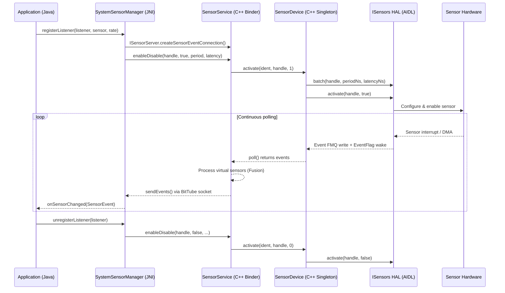

### 17.1.3 关键抽象

| 概念 | 类 | 文件 |
|---------|-------|------|
| 传感器元数据 | `Sensor` / `SensorInfo` | `sensor/Sensor.h`, `SensorInfo.aidl` |
| 硬件传感器包装器 | `HardwareSensor` | `SensorInterface.h` |
| 虚拟（融合）传感器 | `VirtualSensor` | `SensorInterface.h` |
| 运行时传感器 | `RuntimeSensor` | `SensorInterface.h` |
| 每客户端连接 | `SensorEventConnection` | `SensorEventConnection.h` |
| 直连通道连接 | `SensorDirectConnection` | `SensorDirectConnection.h` |
| HAL 抽象 | `ISensorHalWrapper` | `ISensorHalWrapper.h` |
| AIDL HAL 包装器 | `AidlSensorHalWrapper` | `AidlSensorHalWrapper.h` |
| 传感器融合 | `SensorFusion` / `Fusion` | `SensorFusion.h`, `Fusion.h` |
| HAL 设备单例 | `SensorDevice` | `SensorDevice.h` |

### 17.1.4 组件图

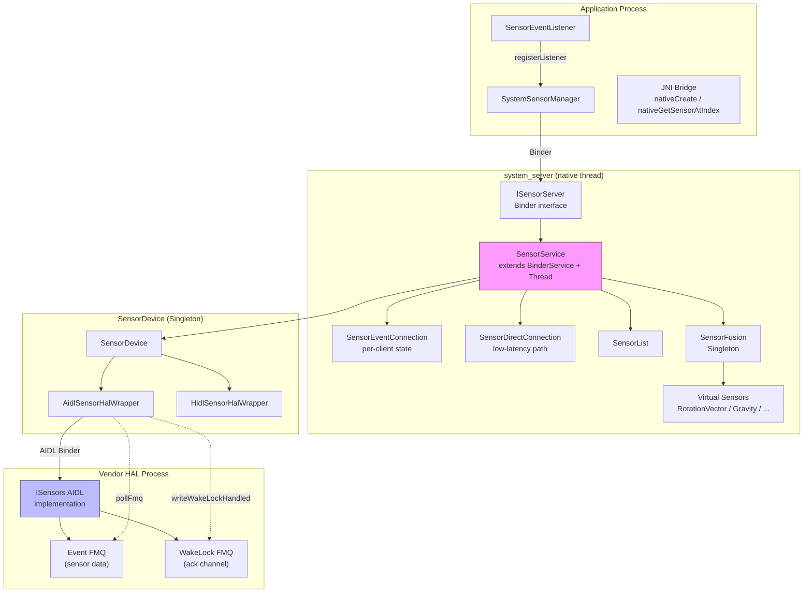

---

## 17.2 SensorService -- 原生系统服务

`SensorService` 是传感器子系统的核心。它既是
`BinderService`（因此它以 `"sensorservice"` 之名向 `servicemanager` 发布自己），
又是 `Thread`（因此它拥有自己的轮询循环）。

```
Source file: frameworks/native/services/sensorservice/SensorService.cpp
Header:      frameworks/native/services/sensorservice/SensorService.h
Entry point: frameworks/native/services/sensorservice/main_sensorservice.cpp
```

### 17.2.1 启动：`onFirstRef()`

当 `SensorService` 第一次被引用时（通常在 system-server 启动期间），
`onFirstRef()` 执行完整的初始化序列：

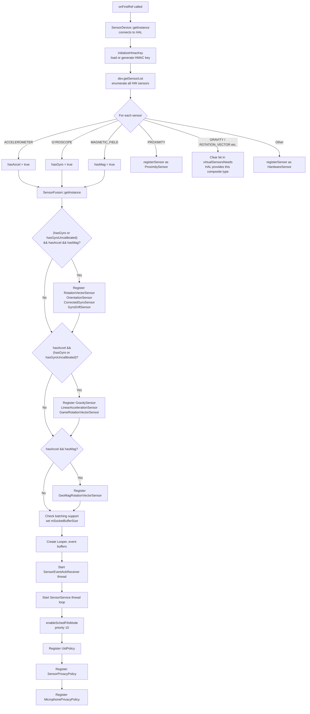

来自源码的关键实现细节：

**传感器注册。** HAL 中的每个硬件传感器都被包装在一个
`HardwareSensor` 对象中（接近传感器除外，它使用 `ProximitySensor`
来进行活动状态跟踪）。调用链如下：

```cpp
// SensorService.cpp onFirstRef(), line ~365
registerSensor(std::make_shared<HardwareSensor>(list[i]));
```

`registerSensor()` 将传感器添加到 `SensorList` 并创建一个
`RecentEventLogger`：

```cpp
// SensorService.cpp, line ~538
bool SensorService::registerSensor(std::shared_ptr<SensorInterface> s,
                                   bool isDebug, bool isVirtual, int deviceId) {
    const int handle = s->getSensor().getHandle();
    const int type = s->getSensor().getType();
    if (mSensors.add(handle, std::move(s), isDebug, isVirtual, deviceId)) {
        mRecentEvent.emplace(handle, new SensorServiceUtil::RecentEventLogger(type));
        return true;
    } else {
        LOG_FATAL("Failed to register sensor with handle %d", handle);
        return false;
    }
}
```

**虚拟传感器门控。** `virtualSensorsNeeds` 位掩码跟踪框架仍需要在软件中合成哪些
复合传感器类型。它最初设置了每一个复合位（重力、线性加速度、旋转矢量、
地磁旋转矢量、游戏旋转矢量）。当 HAL 报告原生支持某种类型时，枚举循环会
*清除*该位：`virtualSensorsNeeds &= ~(1<<list[i].type);`，随后注册时会读回该位。
如果 HAL 原生提供 `SENSOR_TYPE_GRAVITY`（例如通过传感器集线器），`SensorService`
仍然会构造并注册自己的 `GravitySensor`。它传入 `isDebug = true`，因此软件副本不会
出现在常规传感器列表中，只有 HAL 的传感器对用户可见：

```cpp
// SensorService.cpp onFirstRef(), line ~390
bool needGravitySensor = (virtualSensorsNeeds & (1<<SENSOR_TYPE_GRAVITY)) != 0;
registerVirtualSensor(std::make_shared<GravitySensor>(list, count),
                      /* isDebug= */ !needGravitySensor);
```

同样的模式也适用于旋转矢量/方向、线性加速度、游戏旋转矢量以及地磁旋转矢量。
编译期标志 `IGNORE_HARDWARE_FUSION`（默认值为 `false`）可以强制对所有复合类型
使用软件融合。

**套接字缓冲区大小。** 如果任何传感器报告了非零的 `fifoMaxEventCount`，
套接字缓冲区就会被扩大到 `MAX_SOCKET_BUFFER_SIZE_BATCHED`（100 KB），
从而支持每次写入大约 1,000 个事件的批量。该值会被钳制到内核的 `wmem_max`。

### 17.2.2 主线程循环：`threadLoop()`

`SensorService` 继承自 `Thread`，其 `threadLoop()` 是关键的数据路径。
它以 `SCHED_FIFO` 优先级 10 运行，以最小化抖动。

```
Source: SensorService.cpp, line ~1174
```

循环结构如下：

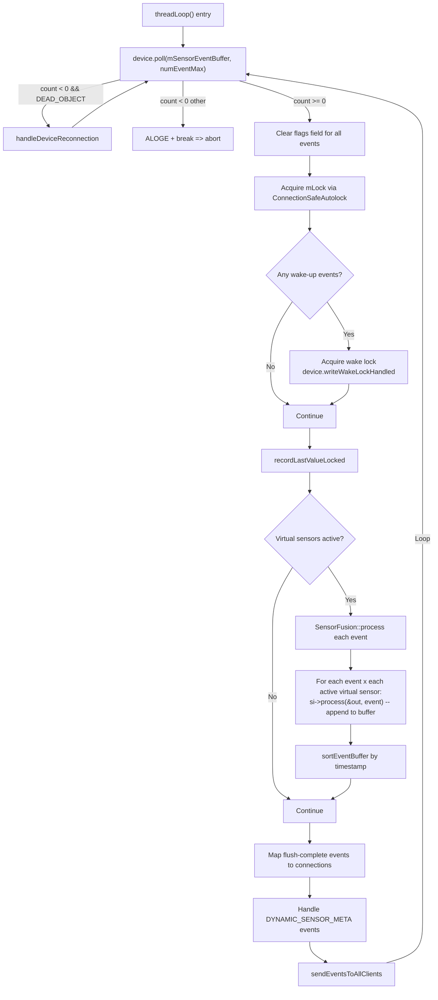

**虚拟传感器处理。** 对于每个原始硬件事件，每个活动虚拟传感器的 `process()`
方法都会被调用。如果它产生一个输出事件，该事件就会被追加到缓冲区。缓冲区大小按
`MAX_RECEIVE_BUFFER_EVENT_COUNT / (1 + virtualSensorCount)` 计算，以确保为最坏情况
预留空间，即每个虚拟传感器在每个输入事件上都触发。

**唤醒锁协议。** 当 `poll()` 返回来自唤醒传感器的事件时，`SensorService` 会获取
`"SensorService_wakelock"` 部分唤醒锁。它会一直持有该锁，直到所有 `SensorEventConnection`
实例都确认收到（通过 `SensorEventAckReceiver` 线程）。`Looper` 上的 5 秒超时可防止
永久性的唤醒锁泄漏。

### 17.2.3 事件分发：`sendEventsToAllClients()`

```cpp
// SensorService.cpp, line ~1112
void SensorService::sendEventsToAllClients(
    const std::vector<sp<SensorEventConnection>>& activeConnections,
    ssize_t count) {
   bool needsWakeLock = false;
   for (const sp<SensorEventConnection>& connection : activeConnections) {
       connection->sendEvents(mSensorEventBuffer, count, mSensorEventScratch,
                              mMapFlushEventsToConnections);
       needsWakeLock |= connection->needsWakeLock();
       if (connection->hasOneShotSensors()) {
           cleanupAutoDisabledSensorLocked(connection, mSensorEventBuffer, count);
       }
   }
   if (mWakeLockAcquired && !needsWakeLock) {
        setWakeLockAcquiredLocked(false);
   }
}
```

每个 `SensorEventConnection` 将全局缓冲区过滤为仅包含其已注册的传感器，
然后写入其 `BitTube` 套接字。在过滤期间，`mSensorEventScratch` 缓冲区用作临时存储。

### 17.2.4 SensorEventConnection -- 每客户端状态

每个在 Java 中调用 `SensorManager.registerListener()` 的客户端，
都会在原生代码中获得一个对应的 `SensorEventConnection`。

```
Source: frameworks/native/services/sensorservice/SensorEventConnection.h
```

关键字段：

| 字段 | 用途 |
|-------|---------|
| `mChannel` (`BitTube`) | 用于事件投递的 Unix 套接字对 |
| `mSensorInfo` | 传感器句柄到 `SensorConnectionRecord` 的映射（待处理的刷新事件、首次刷新标志、使用情况统计） |
| `mEventCache` | 套接字已满时用于暂存事件的缓冲区 |
| `mWakeLockRefCount` | 未确认的唤醒事件数量 |
| `mUid` | 所属应用程序的 UID |
| `mTargetSdk` | 用于速率限制策略 |

`sendEvents()` 方法是热路径。它：

1. 将全局事件缓冲区过滤为该连接已注册的传感器。
2. 在开头前置任何待处理的刷新完成事件。
3. 用 `WAKE_UP_SENSOR_EVENT_NEEDS_ACK` 精确标记每个数据包中的一个唤醒事件。
4. 通过 `SOCK_SEQPACKET` 写入 `BitTube`。
5. 如果写入失败（套接字已满），则缓存事件以便稍后投递。

### 17.2.5 SensorDirectConnection -- 低延迟路径

对于延迟关键的应用程序（游戏、VR），`SensorDirectConnection` 完全绕过
`BitTube` 套接字。事件由 HAL 直接写入共享内存区域（ashmem 或 gralloc）。

```
Source: frameworks/native/services/sensorservice/SensorDirectConnection.h
```

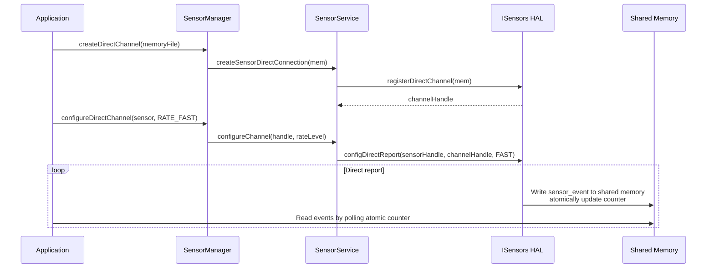

直连通道事件使用固定的 104 字节格式（`DIRECT_REPORT_SENSOR_EVENT_TOTAL_LENGTH`），
并带有一个原子计数器，应用程序通过轮询该计数器来检测新数据。一旦通道配置完成，
这种方式就完全避免了系统调用开销。

### 17.2.6 工作模式

`SensorService` 支持五种工作模式，可通过 `dumpsys` 进行控制：

| 模式 | 值 | 用途 |
|------|-------|---------|
| `NORMAL` | 0 | 标准运行 |
| `DATA_INJECTION` | 1 | 接受注入的数据以测试算法 |
| `RESTRICTED` | 2 | 只有白名单内的软件包可以使用传感器（CTS） |
| `REPLAY_DATA_INJECTION` | 3 | 注入的数据投递给所有应用 |
| `HAL_BYPASS_REPLAY_DATA_INJECTION` | 4 | 注入的数据缓冲在 SensorDevice 中 |

模式切换通过以下命令完成：
```shell
# Enter RESTRICTED mode (CTS testing)
adb shell dumpsys sensorservice restrict .cts.

# Enter DATA_INJECTION mode
adb shell dumpsys sensorservice data_injection .xts.

# Return to NORMAL
adb shell dumpsys sensorservice enable
```

### 17.2.7 传感器隐私与 UID 策略

`SensorService` 实施两种正交的访问控制机制：

**UID 策略**（`UidPolicy`）：通过 `IUidObserver` 跟踪每个 UID 处于 `ACTIVE` 还是
`IDLE` 状态。空闲的 UID（后台应用）不会收到传感器事件。当某个 UID 切换到活动状态时，
事件投递会透明地恢复。

**传感器隐私**（`SensorPrivacyPolicy`）：一个系统级开关，用于对所有应用禁用所有传感器。
启用后，所有直连通道都会停止，所有传感器订阅都会被暂停，新的注册也会被拒绝。
一个独立的 `MicrophonePrivacyPolicy` 处理麦克风开关，它将运动传感器的速率限制为
200 Hz（5 毫秒周期），以防止声学侧信道攻击。

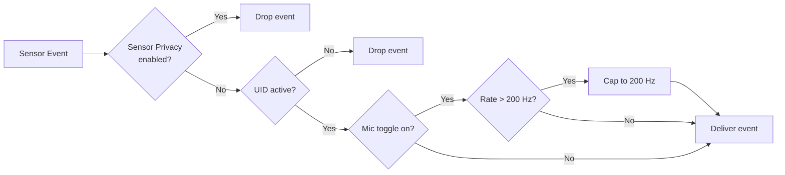

### 17.2.8 面向隐私的速率限制

目标为 Android S 及更高版本、且缺少 `HIGH_SAMPLING_RATE_SENSORS`
权限的应用，其速率被限制为 200 Hz（`SENSOR_SERVICE_CAPPED_SAMPLING_PERIOD_NS`
= 5,000,000 ns）。对于直连通道，上限为 `SENSOR_DIRECT_RATE_NORMAL`
（最高 110 Hz）。

```
Source: SensorService.h, lines ~67-74
#define SENSOR_SERVICE_CAPPED_SAMPLING_PERIOD_NS (5 * 1000 * 1000)
#define SENSOR_SERVICE_CAPPED_SAMPLING_RATE_LEVEL SENSOR_DIRECT_RATE_NORMAL
```

---

## 17.3 传感器 HAL -- 供应商接口

### 17.3.1 ISensors AIDL 接口

现代设备实现 AIDL Sensors HAL，定义于：

```
hardware/interfaces/sensors/aidl/android/hardware/sensors/ISensors.aidl
```

该接口暴露了以下核心操作：

| 方法 | 用途 |
|--------|---------|
| `getSensorsList()` | 枚举所有静态传感器 |
| `initialize(eventQueueDescriptor, wakeLockDescriptor, callback)` | 设置 FMQ 和回调 |
| `activate(sensorHandle, enabled)` | 启用/禁用传感器 |
| `batch(sensorHandle, samplingPeriodNs, maxReportLatencyNs)` | 配置速率与批量 |
| `flush(sensorHandle)` | 触发 FIFO 刷新 |
| `injectSensorData(event)` | 注入数据用于测试 |
| `registerDirectChannel(mem)` | 注册共享内存通道 |
| `unregisterDirectChannel(channelHandle)` | 注销通道 |
| `configDirectReport(sensorHandle, channelHandle, rate)` | 配置直接上报 |
| `setOperationMode(mode)` | 切换 NORMAL / DATA_INJECTION |

### 17.3.2 快速消息队列（FMQ）

AIDL HAL 使用两个 FMQ（快速消息队列）进行零拷贝、无锁的数据传输：

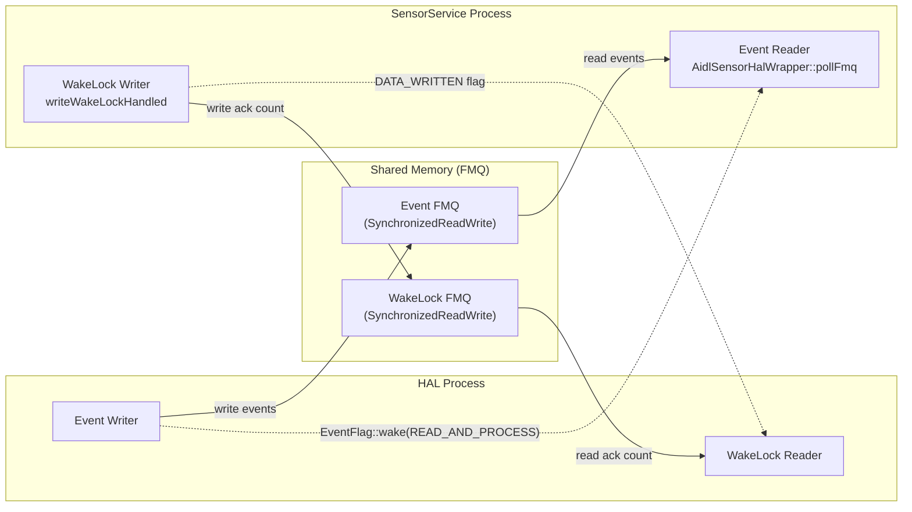

**事件 FMQ**：HAL 将 `Event` 对象（传感器数据）写入该队列。写入之后，
它使用 `EventFlag::wake()` 并传入
`EVENT_QUEUE_FLAG_BITS_READ_AND_PROCESS` 来唤醒框架。

**唤醒锁 FMQ**：框架写入用于唤醒事件的确认计数。HAL 读取这些计数，
以确定何时可以安全地释放其 `"SensorsHAL_WAKEUP"` 唤醒锁。如果框架无响应，
`WAKE_LOCK_TIMEOUT_SECONDS`（1 秒）的超时可防止唤醒锁泄漏。

### 17.3.3 SensorInfo -- 描述传感器

每个传感器都由一个 `SensorInfo` parcelable 来描述：

```
Source: hardware/interfaces/sensors/aidl/android/hardware/sensors/SensorInfo.aidl
```

| 字段 | 类型 | 描述 |
|-------|------|-------------|
| `sensorHandle` | `int` | 该传感器的唯一标识符 |
| `name` | `String` | 人类可读的名称 |
| `vendor` | `String` | 硬件供应商 |
| `version` | `int` | 驱动 + 硬件版本 |
| `type` | `SensorType` | 传感器类型枚举 |
| `typeAsString` | `String` | OEM 类型标识符（例如 `com.google.glass.onheaddetector`） |
| `maxRange` | `float` | SI 单位下的最大值 |
| `resolution` | `float` | 可检测的最小变化 |
| `power` | `float` | 功耗（mA） |
| `minDelayUs` | `int` | 最小采样周期（连续）或 0/-1 |
| `fifoReservedEventCount` | `int` | 为该传感器保证的 FIFO 槽位 |
| `fifoMaxEventCount` | `int` | 最大 FIFO 槽位（可能共享） |
| `requiredPermission` | `String` | 访问所需的权限 |
| `maxDelayUs` | `int` | 最大采样周期 |
| `flags` | `int` | `SENSOR_FLAG_BITS_*` 的位掩码 |

`flags` 字段编码了：

| 标志 | 位 | 含义 |
|------|--------|---------|
| `WAKE_UP` | 0 | 传感器将 AP 从挂起状态唤醒 |
| `CONTINUOUS_MODE` | 1-3 = 0 | 以固定速率上报 |
| `ON_CHANGE_MODE` | 1-3 = 2 | 仅在值变化时上报 |
| `ONE_SHOT_MODE` | 1-3 = 4 | 触发一次后自动禁用 |
| `SPECIAL_REPORTING_MODE` | 1-3 = 6 | 自定义上报逻辑 |
| `DATA_INJECTION` | 4 | 支持数据注入模式 |
| `DYNAMIC_SENSOR` | 5 | 传感器为动态连接 |
| `ADDITIONAL_INFO` | 6 | 支持附加信息帧 |
| `DIRECT_CHANNEL_ASHMEM` | 10 | 支持 ashmem 直连通道 |
| `DIRECT_CHANNEL_GRALLOC` | 11 | 支持 gralloc 直连通道 |
| `MASK_DIRECT_REPORT` / `SHIFT_DIRECT_REPORT` | 7-9 | 最大直接上报速率等级（掩码 `0x380`，位移 `7`） |

### 17.3.4 SensorDevice -- 框架侧 HAL 代理

`SensorDevice` 是一个 `Singleton`，负责包装 HAL 连接并管理每个传感器的激活状态。

```
Source: frameworks/native/services/sensorservice/SensorDevice.h
        frameworks/native/services/sensorservice/SensorDevice.cpp
```

它为每个传感器句柄维护一个 `Info` 结构：

```cpp
struct Info {
    BatchParams bestBatchParams;
    KeyedVector<void*, BatchParams> batchParams;  // per-client params
    bool isActive = false;
};
```

当多个客户端为同一个传感器请求不同速率时，`selectBatchParams()` 会计算出最优参数：

- **采样周期**：所有客户端请求中的最小值。
- **批量延迟**：所有客户端批量延迟中的最小值，同时考虑
  表观批量周期为 `max(mTBatch, mTSample)`。

这确保了轮询最快的客户端获得其请求的速率，而批量模式的客户端仍能接收数据。

### 17.3.5 AIDL 与 HIDL 包装器

`SensorDevice` 使用 `ISensorHalWrapper` 抽象来同时支持 AIDL 和 HIDL HAL：

```
ISensorHalWrapper (abstract)
  |-- AidlSensorHalWrapper  (AIDL ISensors via FMQ)
  |-- HidlSensorHalWrapper  (HIDL ISensors 1.0/2.0/2.1)
```

AIDL 包装器（`AidlSensorHalWrapper`）使用 FMQ 进行事件传输。
它的 `pollFmq()` 方法在 `EventFlag` 上阻塞，直到 HAL 发出新数据信号，
然后将事件从 FMQ 复制到调用者的缓冲区。

HIDL 包装器仅对 HIDL 1.0 HAL 使用遗留的阻塞式 `poll()` HAL 调用。
对于 HIDL 2.0/2.1，它也通过自己的 `pollFmq()` 使用 FMQ 传输，并使用
`supportsMessageQueues()` 在两条路径之间进行选择。

```
Source: frameworks/native/services/sensorservice/AidlSensorHalWrapper.h
        frameworks/native/services/sensorservice/HidlSensorHalWrapper.h
```

### 17.3.6 动态传感器

动态传感器是可以在运行时连接和断开的传感器——例如蓝牙心率监测器或
USB 传感器模块。

```
Source: hardware/interfaces/sensors/aidl/android/hardware/sensors/ISensorsCallback.aidl
```

HAL 通过 `ISensorsCallback` 接口将动态传感器的变化通知给框架：

```aidl
interface ISensorsCallback {
    void onDynamicSensorsConnected(in SensorInfo[] sensorInfos);
    void onDynamicSensorsDisconnected(in int[] sensorHandles);
}
```

在框架侧，`SensorService::threadLoop()` 会在轮询缓冲区中监视
`SENSOR_TYPE_DYNAMIC_SENSOR_META` 事件：

```cpp
if (mSensorEventBuffer[i].type == SENSOR_TYPE_DYNAMIC_SENSOR_META) {
    if (mSensorEventBuffer[i].dynamic_sensor_meta.connected) {
        // Register new dynamic sensor
        auto si = std::make_shared<HardwareSensor>(s, uuid);
        device.handleDynamicSensorConnection(handle, true);
        registerDynamicSensorLocked(std::move(si));
    } else {
        // Disconnect and notify clients
        disconnectDynamicSensor(handle, activeConnections);
    }
}
```

动态传感器句柄由一个专用范围生成，绝不能与静态传感器句柄冲突：

```
DYNAMIC_SENSOR_MASK flag set in sensor_t.flags
Handle must be unique until reboot
```

### 17.3.7 直连通道

直连通道完全绕过 `SensorService` 的事件循环，为传感器数据提供最低延迟的路径。
不过，只有事件数据路径绕过了 `SensorService`。通道的建立和速率配置仍然经过它。
应用的 `SensorDirectChannel` 调用进入 `SensorService`，后者的
`SensorDirectConnection` 通过 `SensorDevice` 在 HAL 上调用
`registerDirectChannel` / `configDirectReport`。

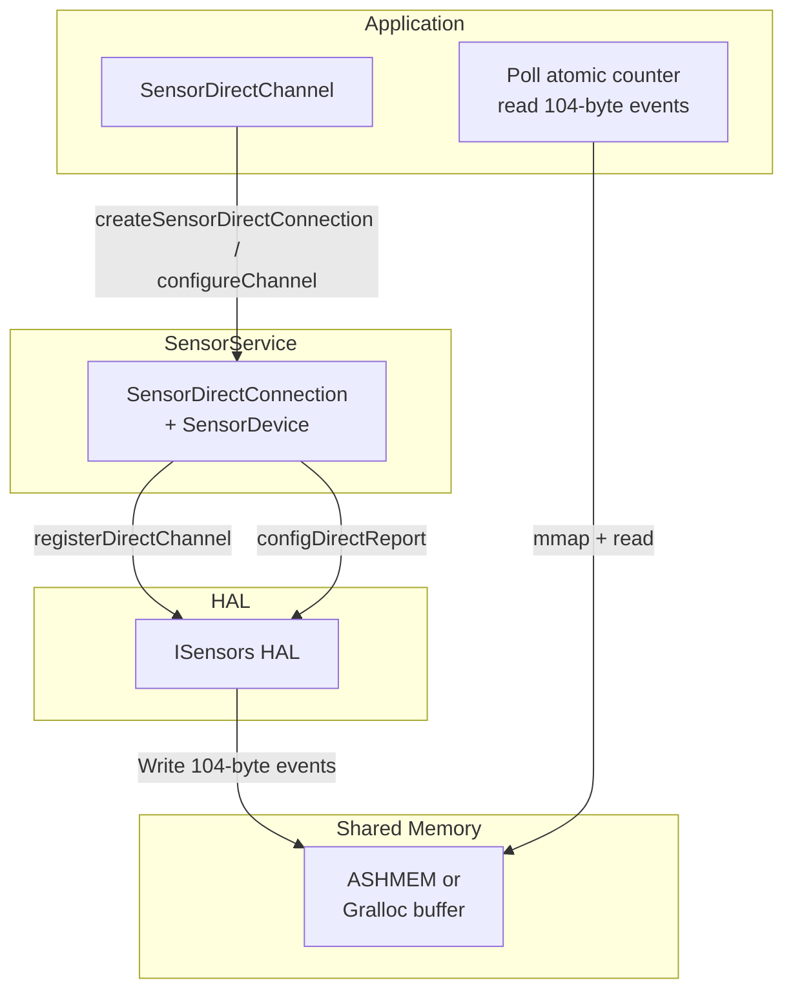

每个直连通道事件具有如下 104 字节布局：

| 偏移 | 类型 | 字段 |
|--------|------|-------|
| 0x00 | `int32_t` | 大小（恒为 104） |
| 0x04 | `int32_t` | 传感器上报令牌 |
| 0x08 | `int32_t` | 传感器类型 |
| 0x0C | `uint32_t` | 原子计数器 |
| 0x10 | `int64_t` | 时间戳 |
| 0x18 | `float[16]` | 传感器数据 |
| 0x58 | `int32_t[4]` | 保留（为零） |

直连通道的速率等级：

| 等级 | 枚举 | 标称速率 | 允许范围 |
|-------|------|-------------|---------------|
| `STOP` | 0 | 0 Hz | -- |
| `NORMAL` | 1 | ~50 Hz | 28--110 Hz |
| `FAST` | 2 | ~200 Hz | 110--440 Hz |
| `VERY_FAST` | 3 | ~800 Hz | 440--1760 Hz |

### 17.3.8 传感器 Multi-HAL

对于拥有来自多个供应商传感器的设备（例如一个主传感器集线器
外加一个独立的气压计芯片），AOSP 提供了 **Sensors Multi-HAL**
框架：

```
Source: hardware/interfaces/sensors/aidl/default/multihal/
        hardware/interfaces/sensors/common/default/2.X/multihal/
```

Multi-HAL 充当一个代理，将多个子 HAL 聚合在单一的 `ISensors` 接口之后。
它：

1. 发现并加载子 HAL 共享库。
2. 合并传感器列表，确保句柄唯一。
3. 将 `activate`/`batch`/`flush` 调用路由到相应的子 HAL。
4. 将所有子 HAL 的事件多路复用到单个 FMQ 上。

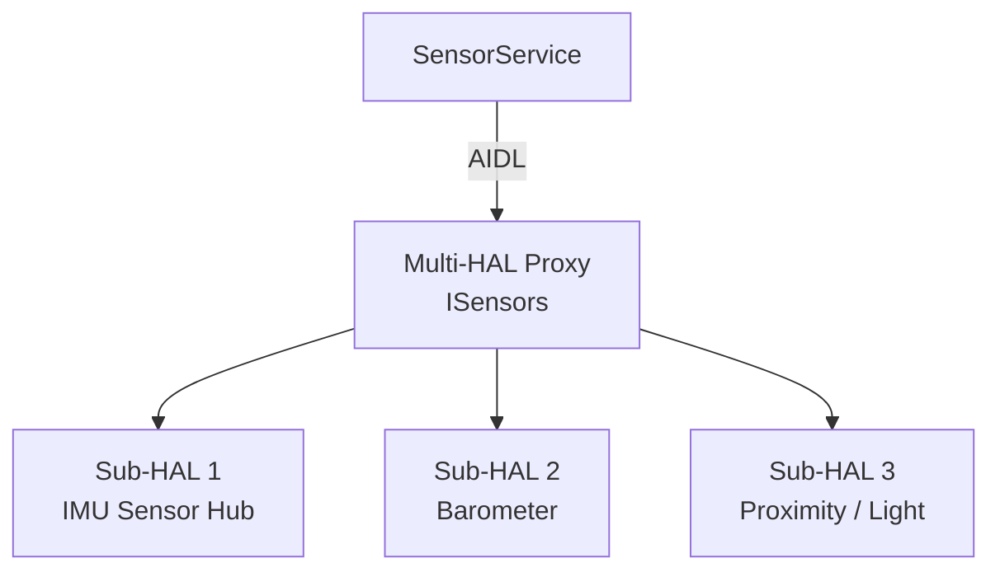

---

## 17.4 传感器融合

传感器融合结合来自多个物理传感器的原始数据，以产生更高质量的复合测量结果。
AOSP 在软件中实现融合，作为 HAL 未原生提供复合传感器类型的回退方案。

### 17.4.1 SensorFusion 单例

```
Source: frameworks/native/services/sensorservice/SensorFusion.h
        frameworks/native/services/sensorservice/SensorFusion.cpp
```

`SensorFusion` 是一个进程级 `Singleton`，拥有三个 `Fusion` 实例：

| 模式 | 枚举 | 输入 | 输出 |
|------|------|--------|--------|
| 9 轴 | `FUSION_9AXIS` | 加速度计 + 陀螺仪 + 磁力计 | 完整旋转矢量 |
| 无磁力计 | `FUSION_NOMAG` | 加速度计 + 陀螺仪 | 游戏旋转矢量（无航向） |
| 无陀螺仪 | `FUSION_NOGYRO` | 加速度计 + 磁力计 | 地磁旋转矢量 |

构造函数负责选择硬件传感器：

```cpp
// SensorFusion.cpp, constructor
// Only use non-wakeup sensors, and always pick the first one
if (list[i].type == SENSOR_TYPE_ACCELEROMETER) mAcc = Sensor(list + i);
if (list[i].type == SENSOR_TYPE_MAGNETIC_FIELD) mMag = Sensor(list + i);
if (list[i].type == SENSOR_TYPE_GYROSCOPE) mGyro = Sensor(list + i);
if (list[i].type == SENSOR_TYPE_GYROSCOPE_UNCALIBRATED)
    uncalibratedGyro = Sensor(list + i);

// Prefer uncalibrated gyroscope for fusion
if (uncalibratedGyro.getType() == SENSOR_TYPE_GYROSCOPE_UNCALIBRATED)
    mGyro = uncalibratedGyro;
```

融合速率默认为 200 Hz，可通过系统属性
`sensors.aosp_low_power_sensor_fusion.maximum_rate` 进行配置（可穿戴设备
通常使用 100 Hz 以节省电量）。

### 17.4.2 融合算法（扩展卡尔曼滤波）

核心算法位于 `Fusion.cpp` 中：

```
Source: frameworks/native/services/sensorservice/Fusion.h
        frameworks/native/services/sensorservice/Fusion.cpp
```

它实现了**扩展卡尔曼滤波（EKF）**，包括：

- **状态向量**：修正罗德里格斯参数（方向四元数 `x0`）
  以及估计的陀螺仪偏差（`x1`）。
- **预测步骤**（`handleGyro`）：积分陀螺仪数据以预测下一方向。
- **校正步骤**（`handleAcc`、`handleMag`）：使用加速度计和
  磁力计测量值来校正漂移。

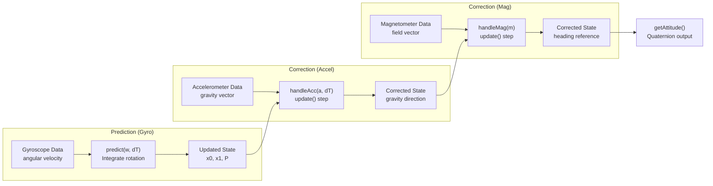

滤波器参数为：

```cpp
// Fusion.cpp
static const float DEFAULT_GYRO_VAR = 1e-7;       // (rad/s)^2 / Hz
static const float DEFAULT_GYRO_BIAS_VAR = 1e-12;  // (rad/s)^2 / s
static const float DEFAULT_ACC_STDEV  = 0.015f;    // m/s^2
static const float DEFAULT_MAG_STDEV  = 0.1f;      // uT

// Geomagnetic (no-gyro) mode uses relaxed parameters
static const float GEOMAG_GYRO_VAR = 1e-4;
static const float GEOMAG_ACC_STDEV  = 0.05f;
```

安全保护措施：

- **自由落体检测**：当 `|a| < 0.1 * NOMINAL_GRAVITY` 时跳过加速度计更新，
  以避免除以零。
- **磁场校验**：当场强幅值超出 [10, 100] uT 范围时拒绝更新，这表示存在局部磁干扰。
- **陀螺仪速率估计**：`SensorFusion::process()` 中的低通滤波器
  （`alpha = 1 / (1 + dT)`）（SensorFusion.cpp，约第 93 行）
  跟踪实际的陀螺仪采样速率，用于诊断。

### 17.4.3 虚拟传感器实现

每个虚拟传感器包装 `SensorFusion`，并将四元数输出转换为该传感器类型
所期望的格式。

**RotationVectorSensor**（9 轴融合）：

```
Source: frameworks/native/services/sensorservice/RotationVectorSensor.h
```

产生一个带有估计航向精度的四元数 `[x, y, z, w]`。
使用 `FUSION_9AXIS` 模式（加速度计 + 陀螺仪 + 磁力计）。

**GameRotationVectorSensor**（无磁力计融合）：

与 `RotationVectorSensor` 相同，但使用 `FUSION_NOMAG` 模式。其结果没有绝对
航向参考，但不受磁干扰影响，因此非常适合游戏。

**GeoMagRotationVectorSensor**（无陀螺仪融合）：

使用 `FUSION_NOGYRO` 模式。质量较低但功耗更低，适合没有陀螺仪的设备。

**GravitySensor**：

```
Source: frameworks/native/services/sensorservice/GravitySensor.h
```

从融合输出中提取重力分量。使用旋转矩阵来确定设备坐标系中重力的方向。

**LinearAccelerationSensor**：

```
Source: frameworks/native/services/sensorservice/LinearAccelerationSensor.h
```

通过内部委托给 `GravitySensor` 来计算
`linear_acceleration = raw_acceleration - gravity`。

**CorrectedGyroSensor**：

应用融合估计出的陀螺仪偏差，以产生经过漂移校正的陀螺仪输出
（注册为调试传感器）。

**OrientationSensor**：

将旋转矢量转换为欧拉角（方位角、俯仰角、滚转角）。

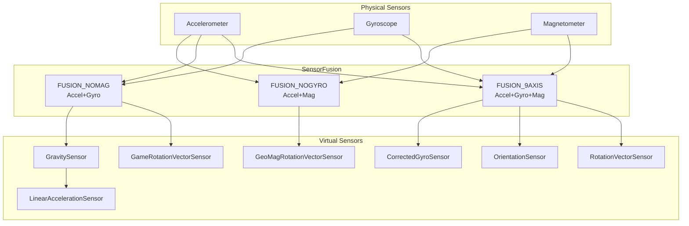

---

## 17.5 传感器类型目录

完整的 `SensorType` 取值集合定义于：

```
Source: hardware/interfaces/sensors/aidl/android/hardware/sensors/SensorType.aidl
```

### 17.5.1 运动传感器

| 类型 | ID | 上报模式 | 单位 | 描述 |
|------|----|---------------|-------|-------------|
| `ACCELEROMETER` | 1 | 连续 | m/s^2 | 测量 X、Y、Z 轴上减去重力后的加速度 |
| `ACCELEROMETER_UNCALIBRATED` | 35 | 连续 | m/s^2 | 原始加速度，偏差单独上报 |
| `GYROSCOPE` | 4 | 连续 | rad/s | 围绕 X、Y、Z 轴的角速度 |
| `GYROSCOPE_UNCALIBRATED` | 16 | 连续 | rad/s | 原始角速度，漂移单独上报 |
| `ACCELEROMETER_LIMITED_AXES` | 38 | 连续 | m/s^2 | 支持少于 3 个轴的加速度计（汽车） |
| `GYROSCOPE_LIMITED_AXES` | 39 | 连续 | rad/s | 支持少于 3 个轴的陀螺仪（汽车） |
| `ACCELEROMETER_LIMITED_AXES_UNCALIBRATED` | 40 | 连续 | m/s^2 | 未校准的限轴加速度计 |
| `GYROSCOPE_LIMITED_AXES_UNCALIBRATED` | 41 | 连续 | rad/s | 未校准的限轴陀螺仪 |
| `SIGNIFICANT_MOTION` | 17 | 单次触发 | 1.0 | 在显著运动时触发一次，然后自动禁用 |
| `STEP_DETECTOR` | 18 | 特殊 | 1.0 | 每走一步触发一次 |
| `STEP_COUNTER` | 19 | 变化时 | 计数 | 自上次重启以来的累计步数 |
| `MOTION_DETECT` | 30 | 单次触发 | 1.0 | 当设备处于运动状态时触发 |
| `STATIONARY_DETECT` | 29 | 单次触发 | 1.0 | 当设备处于静止状态时触发 |

### 17.5.2 位置/方向传感器

| 类型 | ID | 上报模式 | 单位 | 描述 |
|------|----|---------------|-------|-------------|
| `MAGNETIC_FIELD` | 2 | 连续 | uT | X、Y、Z 轴上的地磁场 |
| `MAGNETIC_FIELD_UNCALIBRATED` | 14 | 连续 | uT | 带有硬铁偏差的原始磁场 |
| `ORIENTATION` | 3 | 连续 | 度 | 方位角、俯仰角、滚转角（已弃用，请使用旋转矢量） |
| `ROTATION_VECTOR` | 11 | 连续 | 四元数 | 设备相对于东北天坐标系的方向 |
| `GAME_ROTATION_VECTOR` | 15 | 连续 | 四元数 | 类似旋转矢量，但没有磁力计 |
| `GEOMAGNETIC_ROTATION_VECTOR` | 20 | 连续 | 四元数 | 类似旋转矢量，但没有陀螺仪 |
| `GRAVITY` | 9 | 连续 | m/s^2 | 重力的方向与大小 |
| `LINEAR_ACCELERATION` | 10 | 连续 | m/s^2 | 不含重力分量的加速度 |
| `POSE_6DOF` | 28 | 连续 | 矩阵 | 完整 6-DOF 位姿（位置 + 方向） |
| `DEVICE_ORIENTATION` | 27 | 变化时 | 0-3 | 以 90 度为增量的设备方向 |
| `HINGE_ANGLE` | 36 | 变化时 | 度 | 可折叠设备的铰链开合角度 |
| `HEADING` | 42 | 连续 | 度 | 相对于真北的方向（汽车） |

### 17.5.3 环境传感器

| 类型 | ID | 上报模式 | 单位 | 描述 |
|------|----|---------------|-------|-------------|
| `LIGHT` | 5 | 变化时 | lux | 环境光强度 |
| `PRESSURE` | 6 | 连续 | hPa | 大气压力（气压计） |
| `PROXIMITY` | 8 | 变化时 | cm | 到最近物体的距离 |
| `RELATIVE_HUMIDITY` | 12 | 变化时 | % | 环境相对湿度 |
| `AMBIENT_TEMPERATURE` | 13 | 变化时 | degC | 环境室温 |
| `MOISTURE_INTRUSION` | 43 | 变化时 | 0/1 | 机箱内持续性湿气检测 |

### 17.5.4 身体传感器

| 类型 | ID | 上报模式 | 单位 | 描述 |
|------|----|---------------|-------|-------------|
| `HEART_RATE` | 21 | 变化时 | bpm | 当前心率（需要权限） |
| `HEART_BEAT` | 31 | 连续 | 置信度 | QRS 波群峰值检测 |
| `LOW_LATENCY_OFFBODY_DETECT` | 34 | 变化时 | 0/1 | 可穿戴设备的佩戴/离体检测 |

### 17.5.5 手势/交互传感器

| 类型 | ID | 上报模式 | 描述 |
|------|----|---------------|-------------|
| `TILT_DETECTOR` | 22 | 特殊 | 在 35 度重力变化时触发 |
| `WAKE_GESTURE` | 23 | 单次触发 | 在供应商定义的手势上唤醒设备 |
| `GLANCE_GESTURE` | 24 | 单次触发 | 短暂点亮屏幕以显示通知 |
| `PICK_UP_GESTURE` | 25 | 单次触发 | 设备从表面被拿起 |
| `WRIST_TILT_GESTURE` | 26 | 特殊 | 可穿戴设备的手腕倾斜（始终为唤醒传感器） |

### 17.5.6 元数据/系统传感器

| 类型 | ID | 描述 |
|------|----|-------------|
| `META_DATA` | 0 | 内部刷新完成信号 |
| `DYNAMIC_SENSOR_META` | 32 | 动态传感器连接/断开通知 |
| `ADDITIONAL_INFO` | 33 | 带外校准与诊断数据 |

### 17.5.7 Head Tracker 传感器

| 类型 | ID | 上报模式 | 描述 |
|------|----|---------------|-------------|
| `HEAD_TRACKER` | 37 | 连续 | 用于空间音频的头部方向 |

该类型将在 17.8 节详细讨论。

### 17.5.8 上报模式

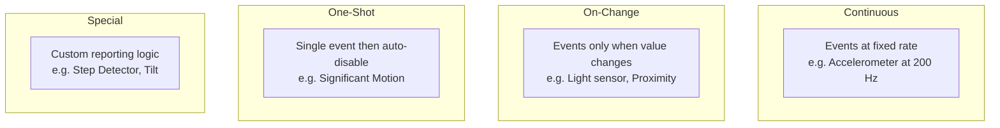

---

## 17.6 SensorManager Java API

### 17.6.1 类层次结构

```
Source: frameworks/base/core/java/android/hardware/SensorManager.java
        frameworks/base/core/java/android/hardware/SystemSensorManager.java
        frameworks/base/core/java/android/hardware/Sensor.java
        frameworks/base/core/java/android/hardware/SensorEvent.java
        frameworks/base/core/java/android/hardware/SensorEventListener.java
```

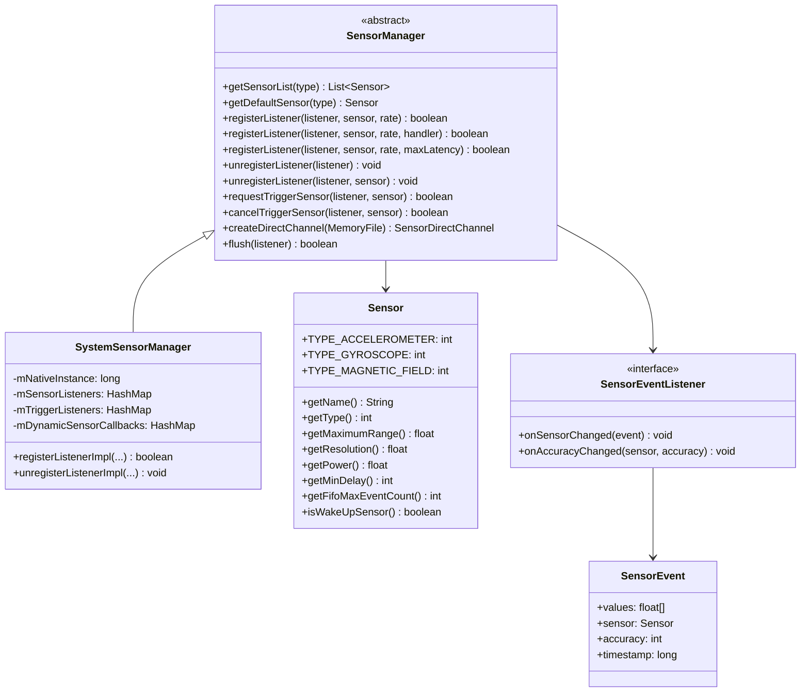

### 17.6.2 注册监听器

标准用法模式：

```java
SensorManager sensorManager = (SensorManager) getSystemService(SENSOR_SERVICE);
Sensor accelerometer = sensorManager.getDefaultSensor(Sensor.TYPE_ACCELEROMETER);

// Register with a specific rate
sensorManager.registerListener(this, accelerometer,
        SensorManager.SENSOR_DELAY_GAME);  // ~20ms period
```

`samplingPeriodUs` 参数接受预定义的常量或自定义的微秒值：

| 常量 | 值 | 有效周期 | 近似速率 |
|----------|-------|-----------------|------------------|
| `SENSOR_DELAY_FASTEST` | 0 | 0 us | 最大硬件速率 |
| `SENSOR_DELAY_GAME` | 1 | 20,000 us | 50 Hz |
| `SENSOR_DELAY_UI` | 2 | 66,667 us | ~15 Hz |
| `SENSOR_DELAY_NORMAL` | 3 | 200,000 us | 5 Hz |

这些常量本身就是 0--3 的小整数；`SensorManager.getDelay()` 会在请求到达
`SensorService` 之前将它们映射为上面所示的微秒周期。

带有 `maxReportLatencyUs` 的重载启用批量：

```java
// Register with batching: 50 Hz sampling, up to 5s of batching
sensorManager.registerListener(this, accelerometer,
        20_000,      // samplingPeriodUs = 20ms
        5_000_000);  // maxReportLatencyUs = 5 seconds
```

### 17.6.3 事件投递流水线

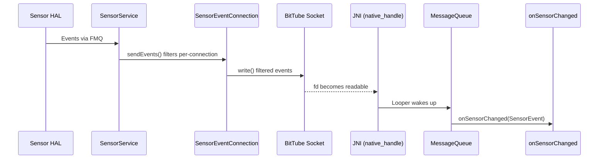

在 Java 侧，`SystemSensorManager` 会为每个已注册的监听器创建一个
`SensorEventQueue`（不要与 HAL 侧的 FMQ 混淆）。该队列由一个 `BitTube`
文件描述符支撑，原生代码会将其添加到目标线程的 `Looper` 中。
`frameworks/base/core/jni/android_hardware_SensorManager.cpp` 中的
`Receiver` 通过 `android_os_MessageQueue_getMessageQueue()` 获取原生的
`MessageQueue`。然后它在 BitTube fd 上调用 `Looper::addFd()`。Java 的
`MessageQueue.addOnFileDescriptorEventListener` API 并未参与。
当事件到达时，Looper 会唤醒线程并投递这些事件。

### 17.6.4 批量与 FIFO

批量允许传感器在硬件中缓存事件并以突发方式投递，从而显著降低功耗：

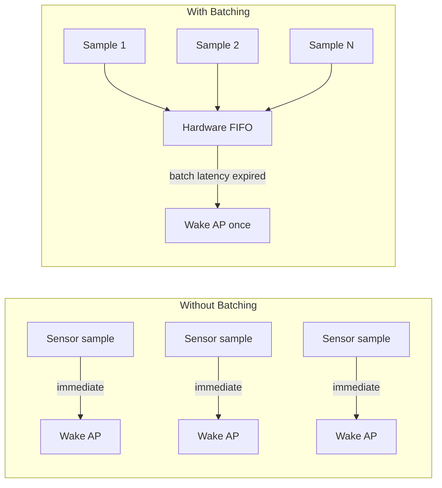

控制批量的 `SensorInfo` 中的关键字段：

- `fifoReservedEventCount`：共享 FIFO 中为该传感器保证的事件数。
- `fifoMaxEventCount`：FIFO 的总容量（可能与其他传感器共享）。
- `batch()` 中的 `maxReportLatencyNs`：事件在投递前可被持有的最大时长。

当 `maxReportLatencyNs = 0` 时，事件以实时方式投递（连续模式）。
当 `maxReportLatencyNs > 0` 时，HAL 最多缓存该时长的事件。

`flush()` 操作会强制立即投递所有已缓存的事件，随后是一个 `FLUSH_COMPLETE`
元事件。

### 17.6.5 触发传感器

像 `SIGNIFICANT_MOTION` 这样的单次触发传感器使用不同的 API：

```java
TriggerEventListener triggerListener = new TriggerEventListener() {
    @Override
    public void onTrigger(TriggerEvent event) {
        // Sensor auto-disables after triggering
        // Must re-request if you want another trigger
    }
};

sensorManager.requestTriggerSensor(triggerListener,
    sensorManager.getDefaultSensor(Sensor.TYPE_SIGNIFICANT_MOTION));
```

### 17.6.6 动态传感器发现

应用程序可以发现在运行时连接的传感器：

```java
sensorManager.registerDynamicSensorCallback(new DynamicSensorCallback() {
    @Override
    public void onDynamicSensorConnected(Sensor sensor) {
        // New sensor available -- register listener
    }

    @Override
    public void onDynamicSensorDisconnected(Sensor sensor) {
        // Sensor removed
    }
});
```

### 17.6.7 速率限制与权限

自 Android 12（S）起，应用必须声明 `HIGH_SAMPLING_RATE_SENSORS` 才能以
高于 200 Hz 的速率访问传感器：

```xml
<uses-permission android:name="android.permission.HIGH_SAMPLING_RATE_SENSORS" />
```

如果没有该权限，`SensorService` 会静默地将采样周期限制为 5 毫秒（200 Hz）。
对于直连通道，速率被限制为 `RATE_NORMAL`（~50 Hz）。

`SystemSensorManager` 中的限制检查：

```java
private static final int CAPPED_SAMPLING_PERIOD_US = 5000;
private static final int CAPPED_SAMPLING_RATE_LEVEL = SensorDirectChannel.RATE_NORMAL;
```

---

## 17.7 传感器电源管理

### 17.7.1 唤醒型与非唤醒型传感器

每种传感器类型都可以有两种变体：

| 变体 | `SENSOR_FLAG_BITS_WAKE_UP` | 行为 |
|---------|---------------------------|-----------|
| **唤醒型** | 置位 | 事件阻止 AP 进入挂起状态 |
| **非唤醒型** | 清除 | AP 挂起时事件可能丢失 |

接近传感器是最常见的唤醒型传感器——当用户在通话时将手机靠近耳边，
它会唤醒设备。

### 17.7.2 唤醒锁协议

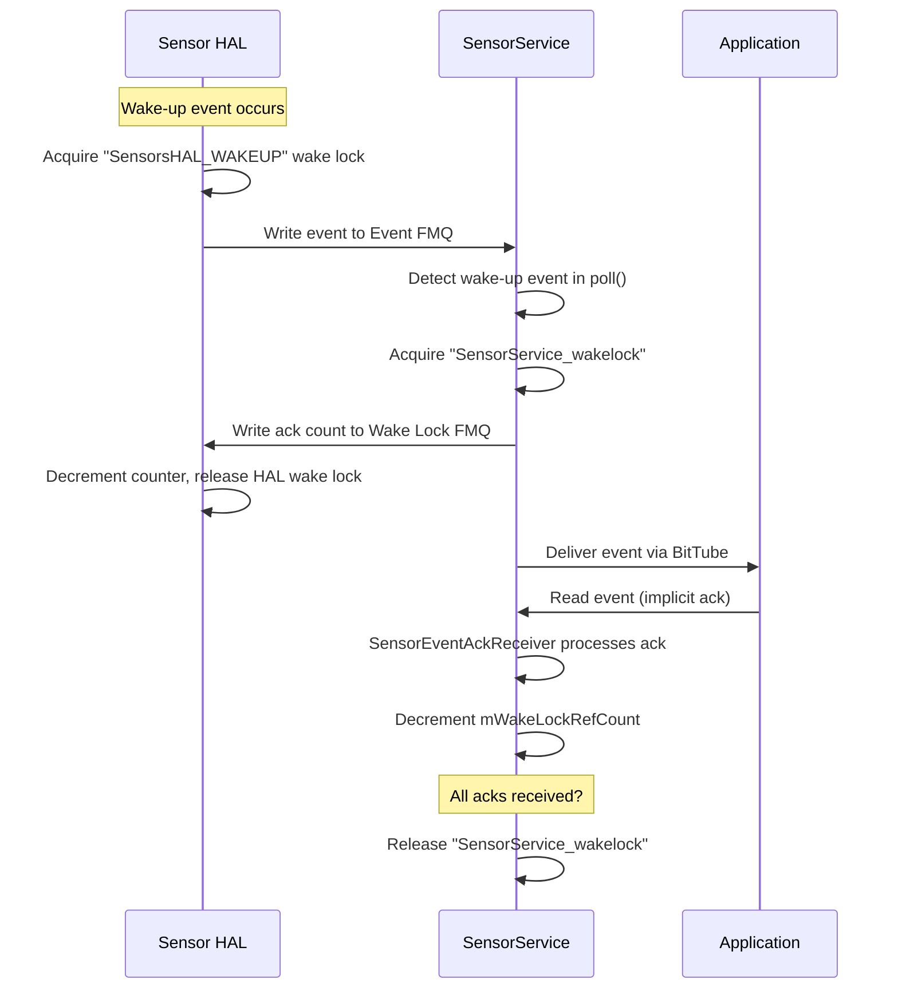

唤醒锁链确保从唤醒型传感器触发的那一刻起，直到应用程序读取事件为止，
设备始终保持唤醒状态：

1. **HAL** 在写入事件 FMQ 之前获取 `"SensorsHAL_WAKEUP"`。
2. **SensorService** 在从 `poll()` 读取到唤醒事件时获取
   `"SensorService_wakelock"`。
3. **SensorService** 将唤醒事件计数写入 Wake Lock FMQ，
   使 HAL 可以释放其锁。
4. **SensorEventConnection** 在 `mWakeLockRefCount` 中跟踪未确认的事件。
5. 当应用读取事件时，`SensorEventAckReceiver` 检测到确认
   并递减引用计数。
6. 当所有连接的引用计数都归零时，`SensorService` 释放其唤醒锁。

5 秒超时可防止应用未能读取事件时发生唤醒锁泄漏。
`setWakeLockAcquiredLocked()` 本身只负责获取或释放内核唤醒锁并唤醒 Looper。
超时逻辑位于确认接收线程中。每当唤醒锁被持有时，该线程会以 5000 毫秒的截止时间
进行轮询。如果没有任何确认及时到来，它会丢弃每个连接的引用计数：

```cpp
// SensorService.cpp, line ~1420
bool SensorService::SensorEventAckReceiver::threadLoop() {
    sp<Looper> looper = mService->getLooper();
    do {
        bool wakeLockAcquired = mService->isWakeLockAcquired();
        int timeout = -1;
        if (wakeLockAcquired) timeout = 5000;
        int ret = looper->pollOnce(timeout);
        if (ret == ALOOPER_POLL_TIMEOUT) {
           mService->resetAllWakeLockRefCounts();
        }
    } while(!Thread::exitPending());
    // ...
}
```

HAL 有自己的 1 秒超时：

```aidl
// ISensors.aidl
const int WAKE_LOCK_TIMEOUT_SECONDS = 1;
```

### 17.7.3 用于省电的批量

主要的省电机制是批量。当 `maxBatchReportLatency` 非零时，
传感器硬件可以缓存事件，并仅在 FIFO 满或延迟到期时唤醒 AP。

省电来自于允许 AP 在批量投递之间进入挂起模式：

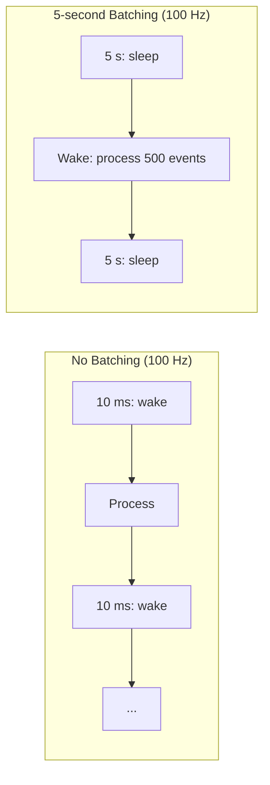

对于 100 Hz 且 5 秒批量的传感器：

- **不批量**：AP 每秒唤醒 100 次。
- **批量**：AP 每 5 秒唤醒一次。

### 17.7.4 FIFO 共享与批量参数合并

当多个应用为同一个传感器请求不同的批量参数时，
`SensorDevice::Info::selectBatchParams()` 会计算出最优设置：

```cpp
// SensorDevice.h
void merge(const BatchParams& other) {
    mTSample = std::min(mTSample, other.mTSample);
    mTBatch = std::min(mTBatch, std::max(other.mTBatch, other.mTSample));
}
```

这确保了：

- 采样周期是所有请求中的最小值（最快的客户端胜出）。
- 批量延迟是所有客户端有效延迟中的最小值。

### 17.7.5 后台传感器节流

当应用的 UID 切换到 `IDLE` 状态（后台）时，`SensorDevice` 会通过
`DisabledReason::DISABLED_REASON_UID_IDLE` 禁用其传感器订阅。
这可以防止后台应用让传感器保持活动状态而耗尽电池。

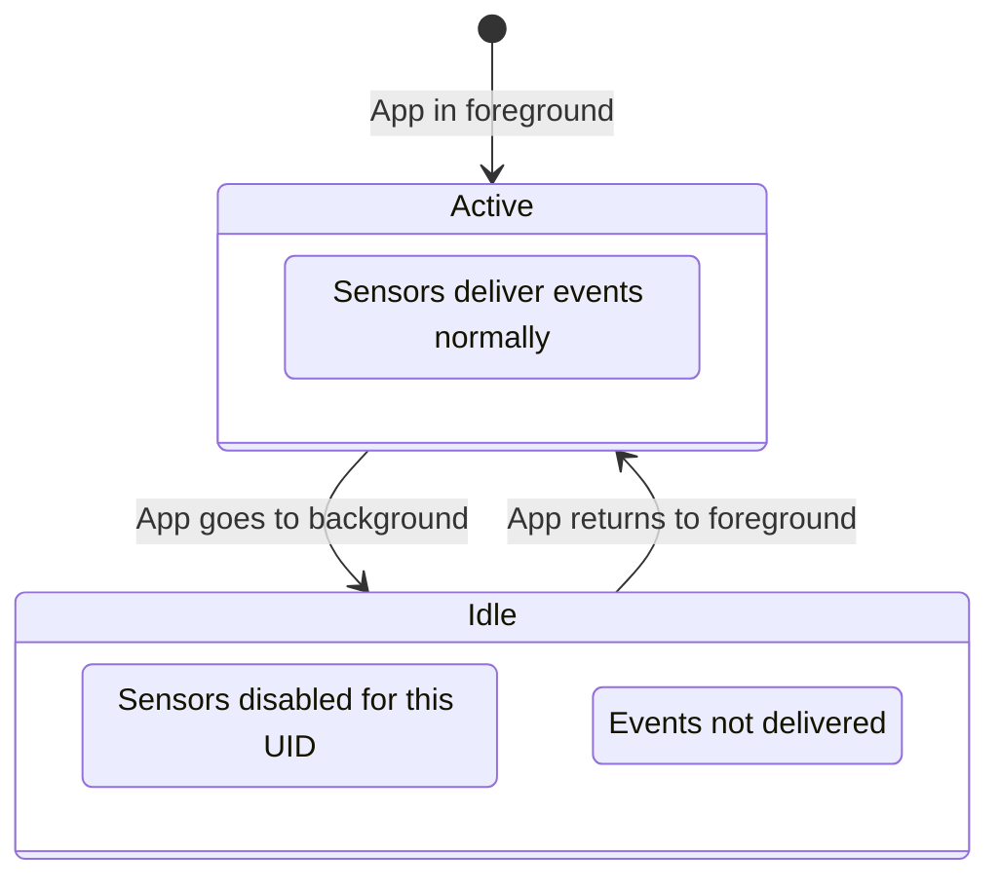

### 17.7.6 传感器隐私开关

系统级传感器隐私开关（`SensorPrivacyPolicy`）会全局禁用所有传感器。
当激活时：

1. 所有活动的传感器都被停用。
2. 所有直连通道都被停止。
3. 所有待处理的刷新连接都被清除。
4. 新的注册会被拒绝。

当停用时，先前活动的传感器会被重新启用。

---

## 17.8 Head Tracker 传感器与空间音频

### 17.8.1 HEAD_TRACKER 传感器类型

`HEAD_TRACKER` 传感器类型（ID 37）是为耳机中的空间音频引入的。
它测量用户头部相对于一个任意（缓慢漂移）参考系的方向。

```
Source: hardware/interfaces/sensors/aidl/android/hardware/sensors/SensorType.aidl
        (SensorType::HEAD_TRACKER = 37)
```

Head tracker 使用一个**以头部为中心的坐标系**，它不同于标准的 Android
传感器坐标系：

| 轴 | 方向 | 描述 |
|------|-----------|-------------|
| X | 右耳 | 正方向 = 右 |
| Y | 鼻子 | 正方向 = 向前 |
| Z | 头顶 | 正方向 = 上 |
| X/Y 平面 | 水平 | 头部直立时名义上与地面平行 |

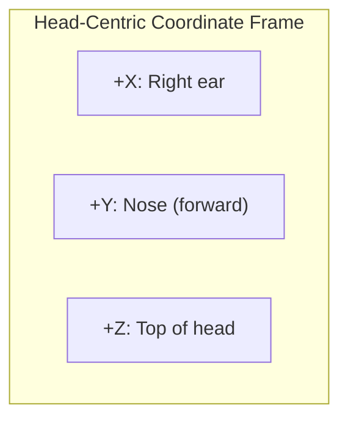

### 17.8.2 事件负载

`HeadTracker` 负载包含六个浮点数和一个不连续计数器：

| 字段 | 类型 | 描述 |
|-------|------|-------------|
| `rx`, `ry`, `rz` | float | 欧拉旋转矢量（方向），弧度 |
| `vx`, `vy`, `vz` | float | 角速度，rad/s（不支持时为 0） |
| `discontinuityCount` | int | 在滤波状态重置时递增 |

与 `ROTATION_VECTOR` 不同，该旋转矢量格式是**欧拉矢量**（轴角），而不是四元数。
其幅值表示以弧度为单位的旋转角度（范围 [0, pi]），方向为旋转轴。

### 17.8.3 与空间音频的集成

头部追踪会馈入**第 15 章（音频系统）**中描述的空间音频流水线。
数据流如下：

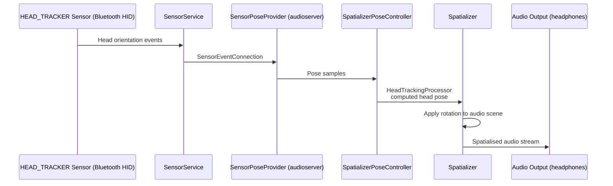

事件流在 **audioserver** 内部被消费，而不是 system_server。
`SensorPoseProvider`（`frameworks/av/media/libheadtracking`）通过
`SensorEventConnection` 订阅 head tracker。它将数据馈入
`SpatializerPoseController`
（`frameworks/av/services/audiopolicy/service`），后者驱动
`HeadTrackingProcessor`。system_server 中的 `AudioService` 仅选择并启用
头部追踪传感器；它不承载事件。

当 head tracker 传感器通过蓝牙 HID 以**动态传感器**的形式暴露时，
`DynamicSensorInfo::uuid` 字段会被设置为 HID 持久唯一 ID。这让音频框架能够将
该传感器与正确的音频设备关联起来。

### 17.8.4 访问限制

Head tracker 数据被认为是隐私敏感的，因为它可能泄露用户的物理运动。
`SensorService` 对访问进行限制：

- 默认情况下，`mHtRestricted = true` 将 head tracker 的访问限制为系统
  进程（UID = system 或 audioserver）。
- 用于测试时，可以通过 `SensorService` 的 shell 命令接口解除限制
  （在 `SensorService::shellCommand()` 中处理，需要 `MANAGE_SENSORS`
  权限——注意是 `cmd`，而不是 `dumpsys`）：

```shell
adb shell cmd sensorservice unrestrict-ht
# To re-restrict:
adb shell cmd sensorservice restrict-ht
```

### 17.8.5 运行时传感器

一个相关机制是**运行时传感器**——一种以编程方式注册的传感器，而不是在启动时
从 HAL 中发现的传感器。运行时传感器使用专用范围内的句柄值：

```aidl
// ISensors.aidl
const int RUNTIME_SENSORS_HANDLE_BASE = 0x5F000000;
const int RUNTIME_SENSORS_HANDLE_END  = 0x5FFFFFFF;
```

`RuntimeSensor` 类将 `activate()` 和 `batch()` 调用转发给
`RuntimeSensorCallback`。运行时传感器仅由 `system_server` 注册，
代表 **VirtualDeviceManager** 注册。`SensorManagerInternal.RuntimeSensorCallback`
的唯一实现者是
`frameworks/base/services/companion/java/com/android/server/companion/virtual/SensorController.java`
中的 `RuntimeSensorCallbackWrapper`。它支撑虚拟设备的传感器。
蓝牙和 USB head tracker *不是*运行时传感器——它们通过 HID 以
**动态传感器**的形式暴露（17.3.6 节）：

```cpp
// SensorInterface.h
class RuntimeSensor : public BaseSensor {
    // ...
    sp<SensorCallback> mCallback;  // Notified on enable/disable/rate change
};
```

注册通过 `SensorService::registerRuntimeSensor()` 完成，
后者从运行时范围分配一个句柄并创建 `RuntimeSensor` 包装器。

---

## 17.9 汽车与可穿戴传感器扩展

### 17.9.1 限轴 IMU 传感器（汽车）

汽车设备可能将 IMU 传感器安装在并非全部三个轴都能提供有意义数据的位置。
AOSP 为此定义了四种限轴传感器类型：

| 类型 | ID | 基于 |
|------|----|----------|
| `ACCELEROMETER_LIMITED_AXES` | 38 | `ACCELEROMETER` |
| `GYROSCOPE_LIMITED_AXES` | 39 | `GYROSCOPE` |
| `ACCELEROMETER_LIMITED_AXES_UNCALIBRATED` | 40 | `ACCELEROMETER_UNCALIBRATED` |
| `GYROSCOPE_LIMITED_AXES_UNCALIBRATED` | 41 | `GYROSCOPE_UNCALIBRATED` |

每个事件都包含测量值和一组指示哪些轴有效的“支持”标志：

```aidl
// Event.aidl -> LimitedAxesImu
parcelable LimitedAxesImu {
    float x;            // Value (0 if unsupported)
    float y;
    float z;
    float xSupported;   // 1.0 = supported, 0.0 = not
    float ySupported;
    float zSupported;
}
```

`SensorService` 会在汽车设备上自动创建 `LimitedAxesImuSensor` 虚拟传感器：

```cpp
// SensorService.cpp onFirstRef()
if (isAutomotive()) {
    if (hasAccel) {
        registerVirtualSensor(
            std::make_shared<LimitedAxesImuSensor>(
                list, count, SENSOR_TYPE_ACCELEROMETER));
    }
    // ... similar for gyroscope, uncalibrated variants
}
```

`isAutomotive()` 检查会查询 `PackageManagerNative` 以获取
`android.hardware.type.automotive` 系统特性。

```
Source: frameworks/native/services/sensorservice/LimitedAxesImuSensor.h
        frameworks/native/services/sensorservice/LimitedAxesImuSensor.cpp
```

### 17.9.2 航向传感器（汽车）

`HEADING` 传感器类型（ID 42）提供车辆相对于真北的指向方向：

```aidl
parcelable Heading {
    float heading;    // degrees [0, 360)
    float accuracy;   // 68% confidence interval in degrees
}
```

这对于汽车显示屏上的导航应用特别有用，因为在那种外形下，传统的旋转矢量传感器
不太有意义。

### 17.9.3 可穿戴设备专用传感器

几种传感器类型主要是为可穿戴设备设计的：

**手腕倾斜手势**（`WRIST_TILT_GESTURE`，ID 26）：当用户抬起手腕看表时触发。
必须实现为唤醒型传感器。

**低延迟离体检测**（`LOW_LATENCY_OFFBODY_DETECT`，ID 34）：
检测可穿戴设备是否在用户身上。必须在 1 秒内检测到佩戴到离体的切换，
并在 3 秒内检测到离体到佩戴的切换。

**心率**（`HEART_RATE`，ID 21）：返回每分钟心跳次数。对于该类型，
`Sensor::Sensor()` 会无条件地将所需权限设置为 `SENSOR_PERMISSION_READ_HEART_RATE`
（`"android.permission.health.READ_HEART_RATE"`），并通过
`AppOpsManager::permissionToOpCode()` 查找匹配的 app-op。较旧的
`SENSOR_PERMISSION_BODY_SENSORS`（`"android.permission.BODY_SENSORS"`）
已被弃用：仍声明该权限的 HAL 传感器会被接受，但会记录
`"Sensor %s using deprecated Body Sensor permission"`。

### 17.9.4 可穿戴设备融合速率调优

可穿戴设备可以通过降低传感器融合速率来减少融合功耗：

```shell
# In device.mk for a wearable:
PRODUCT_PROPERTY_OVERRIDES += \
    sensors.aosp_low_power_sensor_fusion.maximum_rate=100
```

这会在融合期间将陀螺仪采样从 200 Hz 降至 100 Hz，使 IMU 功耗大约减半。

---

## 17.10 传感器坐标系

### 17.10.1 标准 Android 传感器坐标系

对于大多数传感器类型，Android 使用一个相对于设备默认方向
（手机通常为竖屏，平板通常为横屏）的右手坐标系：

```mermaid
graph TB
    subgraph "Device Default Orientation (Portrait)"
        Y["+Y: Up (toward top edge)"]
        X["+X: Right (toward right edge)"]
        Z["+Z: Out of screen (toward user)"]
    end
```

| 轴 | 方向 |
|------|-----------|
| X | 正方向指向屏幕右边缘 |
| Y | 正方向指向屏幕上边缘 |
| Z | 正方向指向屏幕外（朝向用户） |

该坐标系**固定在设备上**，而不是固定在显示旋转上。
当屏幕旋转时，传感器轴不会改变。

### 17.10.2 东北天坐标系

旋转矢量和地磁旋转矢量表达相对于**东北天（ENU）**坐标系的方向：

| 轴 | 方向 |
|------|-----------|
| X | 东 |
| Y | 北（磁北或真北） |
| Z | 上（与重力相反） |

### 17.10.3 以头部为中心的坐标系

`HEAD_TRACKER` 传感器使用一个以用户头部为中心的不同坐标系
（见 17.8.1 节）。对于空间音频处理而言，这个坐标系是很自然的，
因为音频场景是相对于听者头部定义的。

### 17.10.4 四元数约定

AOSP 旋转矢量使用**哈密顿四元数约定**，其中四元数
`q = [x, y, z, w]` 表示围绕单位轴 `[ax, ay, az]` 旋转角度 `theta`，即：

```
x = ax * sin(theta/2)
y = ay * sin(theta/2)
z = az * sin(theta/2)
w = cos(theta/2)
```

`RotationVectorSensor` 直接从融合滤波器输出这个四元数：

```cpp
// RotationVectorSensor.cpp, line ~50
const vec4_t q(mSensorFusion.getAttitude(mMode));
outEvent->data[0] = q.x;
outEvent->data[1] = q.y;
outEvent->data[2] = q.z;
outEvent->data[3] = q.w;
```

---

## 17.11 传感器校准与附加信息

### 17.11.1 校准型与未校准型传感器

三种传感器类型同时具有校准型和未校准型变体：

| 校准型 | 未校准型 | 移除的校准 |
|-----------|-------------|-------------------|
| `ACCELEROMETER` | `ACCELEROMETER_UNCALIBRATED` | 出厂偏差 |
| `GYROSCOPE` | `GYROSCOPE_UNCALIBRATED` | 漂移补偿 |
| `MAGNETIC_FIELD` | `MAGNETIC_FIELD_UNCALIBRATED` | 硬铁偏移 |

未校准传感器在上报原始测量值的同时上报估计偏差值。其关系为：

```
calibrated_value = uncalibrated_value - bias
```

`Uncal` 负载同时携带两者：

```aidl
parcelable Uncal {
    float x, y, z;           // Uncalibrated measurement
    float xBias, yBias, zBias;  // Estimated bias
}
```

实现自己传感器融合的应用（例如 AR 框架）通常更偏好未校准数据，
以避免重复校正带来的伪影。

### 17.11.2 ADDITIONAL_INFO 事件

传感器可以通过 `ADDITIONAL_INFO` 事件上报带外元数据。这些帧携带诸如以下信息：

- 内部温度
- 采样速率精度
- 传感器位置（相对于设备坐标系的旋转和平移）
- 自定义供应商数据

附加信息以一串帧的形式投递：

1. `AINFO_BEGIN` 帧（报告开始）
2. 一个或多个数据帧
3. `AINFO_END` 帧（报告结束）

报告由 `activate()` 或 `flush()` 调用触发。对于随时间变化的参数，
它们也可以周期性地更新（建议速率：低于传感器事件速率的 1/1000）。

### 17.11.3 基于 HMAC 的传感器 ID

动态传感器需要唯一且稳定的标识符。`SensorService` 使用带有持久密钥的
HMAC-SHA256 来生成它们：

```cpp
// SensorService.cpp
#define SENSOR_SERVICE_HMAC_KEY_FILE  "/data/system/sensor_service/hmac_key"
```

HMAC 密钥在首次启动时生成并持久化。每个动态传感器的 UUID 都会被 HMAC 处理，
以产生一个稳定、保护隐私的 ID，它能在进程重启后存活，但不是原始 UUID。

---

## 17.12 传感器测试与调试

### 17.12.1 CTS 传感器测试

兼容性测试套件包含大量的传感器测试：

```
Source: cts/tests/sensor/src/android/hardware/cts/
```

这些测试验证：

- 传感器的存在与属性
- 事件投递速率与抖动
- 批量行为与刷新正确性
- 唤醒型传感器的唤醒锁协议
- 直连通道操作
- 速率限制的执行
- 数据注入模式

### 17.12.2 VTS 传感器测试

供应商测试套件测试用于验证 HAL 实现：

```
Source: hardware/interfaces/sensors/aidl/vts/
```

这些测试直接调用 AIDL ISensors 接口，验证 FMQ 操作、事件格式、
动态传感器回调以及直连通道支持。

### 17.12.3 Dumpsys 输出格式

`dumpsys sensorservice` 的输出结构如下：

```
Captured at: HH:MM:SS.mmm
Sensor Device:
  <HAL device information>
Sensor List:
  <for each sensor: name, vendor, version, handle, type, range, resolution, power, minDelay, fifo, flags>
Fusion States:
  9-axis fusion enabled/disabled (N clients), gyro-rate=XXX Hz, q=<x,y,z,w>, b=<bx,by,bz>
  game fusion(no mag) ...
  geomag fusion (no gyro) ...
Recent Sensor events:
  <sensor name>: <last N events with timestamps>
Active sensors:
  <name> (handle=0xNN, connections=N)
Socket Buffer size = NNN events
WakeLock Status: acquired / not held
Mode: NORMAL / RESTRICTED / DATA_INJECTION
Sensor Privacy: enabled / disabled
N open event connections
N open direct connections
Previous Registrations:
  <chronological list of register/unregister operations>
```

### 17.12.4 基于 Proto 的转储

用于程序化分析时，`SensorService` 支持 protobuf 格式的输出：

```shell
adb shell dumpsys sensorservice --proto > sensor_dump.pb
```

proto schema 定义于：
```
Source: frameworks/base/core/proto/android/service/sensor_service.proto
```

### 17.12.5 常见调试场景

**问题：传感器事件未投递。**
检查：

1. 传感器是否在 dumpsys 传感器列表中？
2. 它是否在“Active sensors”部分？
3. 传感器隐私是否已启用？
4. 应用 UID 是否处于活动状态（非空闲）？
5. 应用是否被限速到低于其预期速率？

**问题：传感器导致高耗电。**
检查：

1. 在 dumpsys 中查找拥有活动传感器连接的后台应用。
2. 检查唤醒锁状态——持续的唤醒锁表明唤醒型传感器事件未被确认。
3. 验证在适当之处是否使用了批量。

**问题：传感器融合质量差。**
检查：

1. 检查 dumpsys 中的融合状态——陀螺仪速率是否合理？
2. 检查四元数幅值是否接近 1.0（应恰好为 1.0）。
3. 查看陀螺仪偏差矢量——较大的值表明存在校准问题。
4. 验证磁力计未受到干扰（靠近强磁铁或金属）。

---

## 17.13 传感器事件数据结构

### 17.13.1 原生 sensors_event_t

传感器事件的核心 C 结构是 `sensors_event_t`，定义在硬件头文件中：

```c
typedef struct sensors_event_t {
    int32_t version;     // sizeof(sensors_event_t)
    int32_t sensor;      // sensor handle
    int32_t type;        // sensor type
    int32_t reserved0;
    int64_t timestamp;   // nanoseconds (elapsedRealtimeNano)
    union {
        float data[16];
        sensors_vec_t acceleration;  // TYPE_ACCELEROMETER
        sensors_vec_t magnetic;      // TYPE_MAGNETIC_FIELD
        sensors_vec_t orientation;   // TYPE_ORIENTATION
        sensors_vec_t gyro;          // TYPE_GYROSCOPE
        float temperature;           // TYPE_TEMPERATURE (deprecated)
        float distance;              // TYPE_PROXIMITY
        float light;                 // TYPE_LIGHT
        float pressure;              // TYPE_PRESSURE
        float relative_humidity;     // TYPE_RELATIVE_HUMIDITY
        meta_data_event_t meta_data;
        dynamic_sensor_meta_event_t dynamic_sensor_meta;
        additional_info_event_t additional_info;
        heart_rate_event_t heart_rate;
        head_tracker_event_t head_tracker;
    };
    uint32_t flags;      // internal flags
    uint32_t reserved1[3];
} sensors_event_t;
```

### 17.13.2 Java SensorEvent

在 Java 侧，`SensorEvent` 是一个简单的容器：

```java
public class SensorEvent {
    public float[] values;     // Sensor-specific data
    public Sensor sensor;      // Source sensor
    public int accuracy;       // SensorManager.SENSOR_STATUS_*
    public long timestamp;     // nanoseconds (elapsedRealtimeNano)
}
```

`values` 数组的大小和解释随传感器类型而变化。
例如，加速度计事件的 `values[0..2]` = (x, y, z)，单位为 m/s^2，
而旋转矢量事件的 `values[0..4]` = (x, y, z, w, accuracy)。

### 17.13.3 AIDL 事件 Parcelable

HAL 侧的事件使用类型化联合体来保证类型安全：

```aidl
parcelable Event {
    long timestamp;
    int sensorHandle;
    SensorType sensorType;
    EventPayload payload;
}
```

`EventPayload` 联合体根据 `sensorType` 进行区分，为传感器数据提供强类型访问。
`Vec3` 用于加速度计，`Vec4` 用于游戏旋转矢量，`Uncal` 用于未校准传感器，
`HeadTracker` 用于头部追踪，依此类推。

---

## 17.14 传感器 HAL 实现指南

### 17.14.1 默认参考实现

AOSP 在以下位置提供了参考 HAL 实现：

```
Source: hardware/interfaces/sensors/aidl/default/Sensors.cpp
        hardware/interfaces/sensors/aidl/default/include/sensors-impl/Sensors.h
```

该实现展示了核心模式：

1. **`getSensorsList()`**：返回所有支持传感器的 `SensorInfo` 向量。
2. **`initialize()`**：设置 Event 和 Wake Lock FMQ，保存回调引用，
   并启动一个唤醒锁监控线程。
3. **`activate()`**：启用/禁用单个传感器。
4. **`batch()`**：配置采样速率。
5. **`flush()`**：触发一个 `FLUSH_COMPLETE` 事件。

### 17.14.2 事件写入模式

典型的 HAL 按如下方式将事件写入 FMQ：

```cpp
// After collecting sensor data:
Event event;
event.sensorHandle = handle;
event.sensorType = SensorType::ACCELEROMETER;
event.timestamp = android::elapsedRealtimeNano();
event.payload.set<EventPayload::Tag::vec3>({x, y, z, status});

// Write to FMQ
if (mEventQueue->write(&event, 1)) {
    mEventQueueFlag->wake(
        ISensors::EVENT_QUEUE_FLAG_BITS_READ_AND_PROCESS);
}
```

### 17.14.3 Multi-HAL 集成

对于拥有来自多个供应商芯片集传感器的设备，Multi-HAL 框架
（`HalProxyAidl`）聚合子 HAL：

```
Source: hardware/interfaces/sensors/aidl/default/multihal/HalProxyAidl.cpp
```

每个子 HAL 实现一个简化的接口，并作为共享库加载。代理处理：

- 句柄重映射（确保跨子 HAL 的唯一性）
- 来自多个来源的事件合并
- 生命周期管理（子 HAL 的连接/断开）

---

## 17.15 Android 17 传感器变更

Android 17 对上述架构增加了两项值得注意的变更。
第一项是 `SensorService` 侧的一种机制，用于停止向*已冻结*进程流式传输事件。
第二项是 Context Hub Runtime Environment（CHRE）的一个**数据流**设施。
它让 nanoapp 可以通过共享内存推送高吞吐流，而不是离散的事件消息。
这两个变更都由特性标志控制，因此前面各节描述的遗留路径仍然是回退方案。

### 17.15.1 针对冻结客户端挂起事件

框架可以*冻结*在后台被缓存的应用。内核冻结器（`cgroup freezer`）随后会完全停止
调度它们的线程。冻结的应用无法排空其传感器套接字。因此在 Android 17 之前，
`SensorService` 会不断填充每连接的 `BitTube`，直到它积压为止。
这浪费了缓冲区内存。对于唤醒型传感器，它还会在服务等待一个永远不会到来的确认时
持有服务唤醒锁。

Android 17 增加了一条显式的冻结状态路径，由
`suspend_sensor_event_delivery_on_frozen_pid` 标志保护：

```
Source: frameworks/base/core/java/android/hardware/flags/sensor_service.aconfig
        frameworks/native/services/sensorservice/SensorService.cpp (line ~1956)
        frameworks/native/services/sensorservice/SensorService.h (line ~348)
```

当该标志启用时，每个 `SystemSensorManager` 在首次构造时都会向服务注册一个
轻量级监听器 binder：

```
Source: frameworks/base/core/java/android/hardware/SystemSensorManager.java (line ~153)
        frameworks/native/libs/sensor/include/android/hardware/sensor/ISensorClientListener.aidl
```

`ISensorClientListener` 刻意设计为**空接口**——它不定义任何方法。
它的唯一目的是给 `SensorService` 提供一个代表客户端进程的 binder 对象，
以便服务可以观察该进程的生命周期：

```aidl
// ISensorClientListener.aidl
interface ISensorClientListener {
    // This is an empty listener that creates a binder proxy object for sensor
    // service to query the status of each system sensor manager.
}
```

Java 侧通过 `nativeRegisterClientListener()` 将其接好，后者调用 `libsensor` 中的
`SensorManager::registerClientListener()`，最终落到
`SensorService::registerClientListener()`：

```
Source: frameworks/base/core/jni/android_hardware_SensorManager.cpp (nativeRegisterClientListener)
        frameworks/native/libs/sensor/include/sensor/ISensorServer.h (line ~62)
        frameworks/native/services/sensorservice/SensorService.cpp (line ~1978)
```

对于每个已注册的监听器，`SensorService` 都会创建一个 `ClientStateRecipient`，
它既是 `IBinder::DeathRecipient`，又是
`IBinder::FrozenStateChangeCallback`，然后通过 `linkToDeath()` 和
`addFrozenStateChangeCallback()` 将其附加：

```cpp
// SensorService.cpp registerClientListener(), line ~1998
sp<ClientStateRecipient> recipient = new ClientStateRecipient(this, listener, pid, uid);
sp<IBinder> binder = IInterface::asBinder(listener);
binder->linkToDeath(recipient);
binder->addFrozenStateChangeCallback(recipient);
mBinderStateRecipients[listener] = recipient;
```

当客户端的冻结状态发生变化时，binder 会调用
`ClientStateRecipient::onStateChanged()`。该接收者在 `mFrozenStateLock` 下
对状态切换进行去抖。如果没有该锁，两个 binder 线程可能都观察到一个未变化的值
并投递重复的消息。然后接收者通过 `FrozenStateChangeHandler` 将变化转发给
服务的 `Looper`：

```
Source: frameworks/native/services/sensorservice/SensorService.cpp (line ~1934)
        frameworks/native/services/sensorservice/SensorService.h (FrozenStateChangeHandler, line ~366)
```

该处理程序运行 `onClientFrozenStateChange()`，它会遍历活动的连接，
并切换属于受影响 PID 的每个 `SensorEventConnection` 上的冻结标志：

```cpp
// SensorService.cpp onClientFrozenStateChange(), line ~1956
SensorDevice& dev(SensorDevice::getInstance());
ConnectionSafeAutolock connLock = mConnectionHolder.lock(mLock);
for (const sp<SensorEventConnection>& conn : connLock.getActiveConnections()) {
    if (conn->getPid() == pid) {
        dev.setFrozenStateForConnection(conn.get(), isFrozen);
    }
}
```

`SensorDevice::setFrozenStateForConnection()` 记录该状态，以便设备层在该连接
身份冻结期间停止向其投递事件，并在解冻后恢复：

```
Source: frameworks/native/services/sensorservice/SensorDevice.h (line ~108)
```

```mermaid
sequenceDiagram
    participant FW as ActivityManager (freezer)
    participant BD as Binder Driver
    participant CSR as ClientStateRecipient
    participant SS as SensorService Looper
    participant SD as SensorDevice

    FW->>BD: Freeze client PID (cgroup freezer)
    BD->>CSR: onStateChanged(FROZEN)
    CSR->>CSR: Debounce under mFrozenStateLock
    CSR->>SS: post FrozenStateChangeHandler
    SS->>SS: onClientFrozenStateChange(pid, true)
    SS->>SD: setFrozenStateForConnection(conn, true)
    Note over SD: Stop delivering events to this connection
    FW->>BD: Thaw client PID
    BD->>CSR: onStateChanged(UNFROZEN)
    CSR->>SS: post FrozenStateChangeHandler
    SS->>SD: setFrozenStateForConnection(conn, false)
    Note over SD: Resume event delivery
```

如果客户端在注册期间死亡，`binderDied()`（以及 `onClientDied()`）会调用
`unregisterClientListener()`，后者移除接收者并分离死亡回调和冻结状态回调。
当该标志关闭时，此路径中的每个入口点都是空操作。
这些函数返回 `INVALID_OPERATION` / `UNKNOWN_TRANSACTION`。
因此，尚未翻转该标志的设备保留了 17 之前的行为。

### 17.15.2 CHRE 数据流：端点之间的高吞吐流

Context Hub Runtime Environment（CHRE）在低功耗协处理器（传感器集线器）上运行
传感器处理 *nanoapp*，使应用处理器可以保持睡眠。历史上，CHRE 端点通过向对等方
发送离散的*消息*来移动数据。Android 17 引入了**数据流**：一种专为一个源向多个
汇提供最小拷贝数据而构建的共享内存流式传输原语。

```
Source: system/chre/chre_api/include/chre_api/chre/data_flow.h (@since v1.12)
        system/chre/core/include/chre/core/data_flow_manager.h
        system/chre/core/data_flow_manager.cc
        system/chre/data_flow/
```

数据流由源的消息集线器 ID 加上数据流 ID 唯一标识。源 nanoapp 创建该流，
并将元素推送到其中。汇 nanoapp（或其他集线器上的端点，或应用处理器上的端点）
附加进来，从同一个后备内存中读取元素，并释放它们。由于负载存放在共享区域中，
数据不会在每一跳都被复制——只有小型的索引和元数据更新跨越边界。

```mermaid
sequenceDiagram
    participant SRC as Source Nanoapp
    participant DFM as DataFlowManager (CHRE core)
    participant SHM as Shared Data Region
    participant SNK as Sink Nanoapp

    SRC->>DFM: chreDataFlowCreateAsync(...)
    DFM-->>SRC: CHRE_EVENT_DATA_FLOW_CREATED (dataFlowId, size)
    SNK->>DFM: request sink via endpoint messaging
    DFM-->>SRC: sink-create request
    SRC->>DFM: create sink, configure policy
    DFM-->>SNK: CHRE_EVENT_DATA_FLOW_SINK_CREATED
    SNK->>DFM: chreDataFlowSinkEnable()
    loop Streaming
        SRC->>SHM: write element (no copy)
        DFM-->>SNK: CHRE_EVENT_DATA_FLOW_ALERT
        SNK->>SHM: read + release element
    end
    SRC->>DFM: destroy flow (or on unload)
    DFM-->>SNK: CHRE_EVENT_DATA_FLOW_STOPPED
```

每个汇都配置一个**策略**，用于控制它何时被唤醒，这是对功耗敏感的传感器流
进行批处理的关键。`chreDataFlowSinkPolicy` 将*新数据告警策略*与*覆盖策略*
结合起来：

```
Source: system/chre/chre_api/include/chre_api/chre/data_flow.h
        (chreDataFlowSinkNewDataAlertPolicy, chreDataFlowSinkOverwritePolicy)
```

| 告警策略 | 值 | 何时告警汇 |
|--------------|-------|--------------------------|
| `NEVER` | 0 | 从不；汇自行轮询该流 |
| `OPPORTUNISTIC` | 1 | 当系统认为唤醒代价低廉时（使用低水位线） |
| `HIGH_WATER_MARK` | 2 | 当流达到配置的高水位线时 |
| `PERIODIC` | 3 | 按配置的毫秒周期 |
| `STREAMING` | 4 | 每次写入时（平台可合并或限流） |

覆盖策略要么是 `ALLOWED`，要么是 `DISALLOWED`。对于前者，源可以覆盖慢速汇尚未
读取的数据。对于后者，源会阻塞，而不是丢弃未读数据。这些策略结合起来，可以让一个
高速率的加速度计源用同一个缓冲区为两个汇提供数据。一个例子是一个机会性唤醒的
手势汇和一个流式记录汇。每个汇都以自己的节奏排空数据。

在框架侧，Context Hub HAL 在其 AIDL 版本 5 中增加了共享内存管道。
一个 `SharedDataRegion` parcelable 描述了一块共享内存（一个可映射的文件描述符、
大小以及所需的 Android 权限）。这块内存支撑一个或多个数据流。供应商必须使用
`/system/chre/data_flow:contexthub_data_flow` 库，而不是自行实现对该布局的访问：

```
Source: hardware/interfaces/contexthub/aidl/android/hardware/contexthub/SharedDataRegion.aidl
        hardware/interfaces/contexthub/aidl/android/hardware/contexthub/DataFlowAlertFds.aidl
        hardware/interfaces/contexthub/aidl/android/hardware/contexthub/IEndpointCommunication.aidl
```

共享区域是一组 `@FixedSize` 结构。这种布局让 32 位和 64 位核心，
以及基于不同库版本构建的端点，能够解释相同的字节。所有引用都是相对于区域基址
的字节偏移量，绝不是原始指针：

```mermaid
graph TB
    subgraph "SharedDataRegion (mmaped FD)"
        META["DataFlowMetadata<br/>version, elementConfig,<br/>blockListEpoch"]
        SRC["DataFlowSourceMetadata<br/>writeIndex, tailBlockOffsetBytes"]
        SNKM["DataFlowSinkMetadata<br/>readIndex, sourceFlags/sinkFlags"]
        BLK["DataFlowBlockHeader + data<br/>(linked block list)"]
    end
    META --> SRC
    META --> SNKM
    META --> BLK
    SRC -.->|writeIndex| BLK
    SNKM -.->|readIndex| BLK
```

源推进 `DataFlowSourceMetadata` 中的原子 `writeIndex`。每个汇推进其
`DataFlowSinkMetadata` 中的自己的原子 `readIndex`。两者之间的距离就是汇落后多远。

一个拆分的
`sourceFlags`/`sinkFlags` 对（每个都是一个 16 位值加上一个计数器）模拟单个
源集合标志。即使跨多个核心，汇也可以原子地“清除”此标志，而在这些核心上真正的
读-改-写不会是一致的。源使用它来发出诸如 `BLOCKING`、`OVERWRITE`、`FINISHED`
和 `DISCONNECTED` 等异常状态信号。当源覆盖慢速汇时，一个 `DataFlowAlertFds`
记录会携带用于通知受影响端点的唤醒文件描述符和非唤醒文件描述符。

CHRE 的 `DataFlowManager`（仅在定义了 `CHRE_DATA_FLOW_SUPPORT_ENABLED` 时构建）
在协处理器上拥有该状态。它按需分配块，构建消费者策略，并通过消息路由器路由告警。
数据流是向 nanoapp 和主机流式传输传感器批量的基础。与逐消息路径相比，
它们需要的唤醒和拷贝要少得多。它们与 `SensorService` 用于标准应用传感器 API 的
`ISensors` FMQ 路径并行存在，而不是取代它。

---

## 17.16 动手实践 -- 传感器实操练习

### 17.16.1 列出设备上的所有传感器

```shell
adb shell dumpsys sensorservice
```

这会转储：

- 完整的传感器列表（名称、句柄、类型、范围、分辨率、功耗、FIFO）
- 融合状态（9 轴、无磁力计、无陀螺仪）
- 每个传感器的最近事件
- 活动的传感器与连接
- 工作模式与隐私状态
- 最近的注册历史

### 17.16.2 实时监控传感器事件

直接使用 `sensorservice`：

```shell
# List all sensors
adb shell dumpsys sensorservice

# Exercise the sensor stack with the native test binary
# (userdebug/eng builds; registers for accelerometer events, takes no arguments)
adb shell test-sensorservice
```

或者使用一个简单的应用：

```java
// Minimal sensor monitor
SensorManager sm = (SensorManager) getSystemService(SENSOR_SERVICE);
for (Sensor s : sm.getSensorList(Sensor.TYPE_ALL)) {
    Log.i("Sensors", String.format("%-40s type=%2d range=%.1f power=%.2f mA",
            s.getName(), s.getType(), s.getMaximumRange(), s.getPower()));
}

Sensor accel = sm.getDefaultSensor(Sensor.TYPE_ACCELEROMETER);
sm.registerListener(new SensorEventListener() {
    @Override
    public void onSensorChanged(SensorEvent event) {
        Log.i("Accel", String.format("x=%.3f y=%.3f z=%.3f",
                event.values[0], event.values[1], event.values[2]));
    }
    @Override
    public void onAccuracyChanged(Sensor sensor, int accuracy) {}
}, accel, SensorManager.SENSOR_DELAY_GAME);
```

### 17.16.3 检查批量行为

```java
// Request 100 Hz with 10-second batching
Sensor accel = sm.getDefaultSensor(Sensor.TYPE_ACCELEROMETER);
sm.registerListener(listener, accel,
        10_000,       // 10 ms = 100 Hz
        10_000_000);  // 10 second max latency

// Force flush of batched events
sm.flush(listener);
// onFlushCompleted() will be called after all batched events are delivered
```

### 17.16.4 使用直连通道

```java
// Create shared memory
MemoryFile memFile = new MemoryFile("sensor_direct", 4096);
SensorDirectChannel channel = sm.createDirectChannel(memFile);

// Configure accelerometer at RATE_FAST (~200 Hz)
Sensor accel = sm.getDefaultSensor(Sensor.TYPE_ACCELEROMETER);
int reportToken = channel.configure(accel, SensorDirectChannel.RATE_FAST);

// Read events from shared memory (poll atomic counter at offset 0x0C)
// Each event is 104 bytes
ByteBuffer buffer = memFile.getInputStream()...;
// Parse events using the direct report format

// Stop and close
channel.configure(accel, SensorDirectChannel.RATE_STOP);
channel.close();
```

### 17.16.5 注入测试数据

```shell
# Enable data injection mode
adb shell dumpsys sensorservice data_injection com.example.test

# From a test app with matching package name:
# Use SensorManager.injectSensorData() to inject events
```

```java
// In test code: the app's package must match the one passed to
// "dumpsys sensorservice data_injection", and sm.initDataInjection(true)
// must have succeeded first (there is no dedicated permission)
sm.registerListener(listener, accel, SensorManager.SENSOR_DELAY_FASTEST);

SensorEvent fakeEvent = ... ; // construct with desired values
sm.injectSensorData(accel, fakeEvent.values, fakeEvent.accuracy,
        fakeEvent.timestamp);
```

### 17.16.6 追踪传感器性能

```shell
# Sensor event tracing is emitted under ATRACE_TAG_SYSTEM_SERVER
# (see SensorEventQueue.cpp), so enable the "ss" category
adb shell atrace --async_start -b 8000 ss binder_driver power

# ... exercise sensors ...

adb shell atrace --async_stop -o /data/local/tmp/sensors.trace
adb pull /data/local/tmp/sensors.trace
# Open in Perfetto UI: ui.perfetto.dev
```

### 17.16.7 监控功耗影响

```shell
# Battery historian can show wake lock durations
adb shell dumpsys batterystats --reset
# Exercise sensors for a period
adb bugreport > bugreport.zip
# Upload to Battery Historian: bathist.cs.android.com
```

检查哪些传感器处于活动状态以及它们的功耗：

```shell
adb shell dumpsys sensorservice | grep "Active sensors"
```

### 17.16.8 查看传感器融合状态

```shell
adb shell dumpsys sensorservice | grep -A5 "Fusion States"
```

这会为每种融合模式显示：

- 它是否启用
- 活动客户端的数量
- 估计的陀螺仪速率
- 当前姿态四元数（x, y, z, w）及其幅值
- 估计的陀螺仪偏差矢量

### 17.16.9 测试动态传感器

如果你有一个蓝牙传感器（例如一个带头部追踪的耳机）：

```java
sm.registerDynamicSensorCallback(new DynamicSensorCallback() {
    @Override
    public void onDynamicSensorConnected(Sensor sensor) {
        Log.i("Dynamic", "Connected: " + sensor.getName() +
                " type=" + sensor.getType());
        if (sensor.getType() == Sensor.TYPE_HEAD_TRACKER) {
            sm.registerListener(htListener, sensor,
                    SensorManager.SENSOR_DELAY_FASTEST);
        }
    }
});
```

### 17.16.10 探索源码

以下是在 AOSP 源码树中进一步阅读的路线图：

| 区域 | 路径 |
|------|------|
| SensorService 主程序 | `frameworks/native/services/sensorservice/SensorService.cpp` |
| 传感器融合核心 | `frameworks/native/services/sensorservice/Fusion.cpp` |
| 虚拟传感器 | `frameworks/native/services/sensorservice/RotationVectorSensor.cpp`, `GravitySensor.cpp`, etc. |
| 传感器 HAL AIDL | `hardware/interfaces/sensors/aidl/android/hardware/sensors/` |
| 默认 HAL 实现 | `hardware/interfaces/sensors/aidl/default/Sensors.cpp` |
| Multi-HAL | `hardware/interfaces/sensors/aidl/default/multihal/` |
| Java SensorManager | `frameworks/base/core/java/android/hardware/SensorManager.java` |
| SystemSensorManager | `frameworks/base/core/java/android/hardware/SystemSensorManager.java` |
| 传感器 JNI | `frameworks/base/core/jni/android_hardware_SensorManager.cpp` |
| CTS 测试 | `cts/tests/sensor/src/android/hardware/cts/` |
| VTS 测试 | `hardware/interfaces/sensors/aidl/vts/` |

---

## 总结

Android 传感器框架是一个分层的流水线，为正确性和效率而设计：

1. **HAL**（`ISensors` AIDL）是供应商提供的接口，负责与硬件通信。
   它使用快速消息队列进行零拷贝事件传输，并支持批量、直连通道、动态传感器
   和数据注入等功能。

2. **SensorService** 是原生系统服务，管理所有传感器连接的生命周期。
   它专用的 `SCHED_FIFO` 轮询线程从 HAL 读取事件，将其送入传感器融合，
   并将它们分发到每客户端的 `BitTube` 套接字。它实施速率限制、传感器隐私、
   基于 UID 的访问控制以及唤醒锁管理。

3. **SensorFusion** 以三种模式（9 轴、无磁力计、无陀螺仪）实现扩展卡尔曼滤波。
   它从原始加速度计、陀螺仪和磁力计数据中产生旋转矢量、重力和线性加速度等
   虚拟传感器。

4. **Java API**（`SensorManager`）提供面向应用的接口，用于传感器发现、注册、
   批量配置、触发传感器、直连通道和动态传感器回调。

5. **电源管理**贯穿整个堆栈：批量减少了 AP 唤醒，唤醒锁协议确保事件在挂起期间
   不会丢失，UID 策略对后台应用进行节流。

6. **头部追踪**（`HEAD_TRACKER`）通过蓝牙动态传感器实现耳机中的空间音频，
   将数据馈入音频 Spatializer。

7. **Android 17** 增加了一条冻结客户端路径，使 `SensorService` 停止向框架已冻结的
   进程流式传输事件。这些进程通过空的 `ISensorClientListener` binder 和 binder
   冻结状态回调进行注册。它还引入了 CHRE **数据流**——一种共享内存流式传输原语。
   它以最小的拷贝和每汇唤醒策略，在 nanoapp 与主机之间移动高吞吐传感器数据。

贯穿始终的关键设计原则是：传感器数据流经一条单一的、经过充分审计的路径。
这条路径从硬件开始，经过 HAL，经过 `SensorService`，然后输出到应用程序。
服务层实施电源策略和访问控制。
