# 第 50 章：设置应用

设置应用是配置 Android 设备的主要用户界面。它看起来像是一个单一的单体应用。实际上，它是一个经过精心分层的系统，由 Activity、Fragment、偏好设置控制器（preference controller）、内容提供器（content provider）和搜索索引器组成。这些部件协同工作，以可发现、可搜索和可扩展的方式呈现数百个可配置选项。
本章剖析 `packages/apps/Settings/` 及其配套服务 `frameworks/base/packages/SettingsProvider/` 的架构。它追踪从主页仪表盘（dashboard）到支撑 `Settings.System`、`Settings.Secure` 和 `Settings.Global` 的持久化键值存储的每一层。

---

## 50.1 设置应用架构

### 50.1.1 目录布局

设置应用的源码树位于 `packages/apps/Settings/` 下。其顶层包含常见的 Android 项目文件：

```
packages/apps/Settings/
  Android.bp              # Soong build definition
  AndroidManifest.xml     # 200+ activity declarations
  res/                    # Layouts, drawables, XML preference screens
  res-export/             # Resources exported to other modules
  res-product/            # Product-overlay resources
  src/                    # Java/Kotlin sources
  tests/                  # Robolectric and instrumentation tests
  proguard.flags          # R8 keep rules
```

`src/com/android/settings/` 目录按功能包组织，这些功能包与用户看到的应用顶层类别相对应：

| 包 | 用途 |
|---------|---------|
| `homepage/` | 主页 activity、TopLevelSettings、上下文卡片 |
| `dashboard/` | DashboardFragment、CategoryManager、磁贴注入 |
| `core/` | SettingsBaseActivity、BasePreferenceController、SubSettingLauncher |
| `development/` | 开发者选项 —— 100+ 个偏好设置控制器 |
| `search/` | 搜索索引基础设施 |
| `network/` | Wi-Fi、移动数据、网络共享（Tethering） |
| `connecteddevice/` | 蓝牙、NFC、USB |
| `display/` | 亮度、深色主题、显示大小 |
| `sound/` | 音量、铃声、请勿打扰（Do-Not-Disturb） |
| `security/` | 屏幕锁定、加密、生物识别 |
| `privacy/` | 权限管理器、安全中心 |
| `fuelgauge/` | 电池统计与省电模式 |
| `applications/` | 应用信息、默认应用、特殊访问 |
| `system/` | 语言、日期/时间、重置 |
| `deviceinfo/` | 关于手机、版本号、IMEI |
| `accessibility/` | TalkBack、放大、字幕 |
| `accounts/` | 账户同步、添加账户 |
| `notification/` | 通知渠道、DND 模式 |
| `privatespace/` | 私人空间设置与管理 |
| `supervision/` | 监督仪表盘、PIN 管理、内容过滤器 |
| `appfunctions/` | 设备状态 AppFunction 服务，将设置暴露给设备端代理 |
| `activityembedding/` | 面向大屏幕的双栏布局 |
| `widget/` | 自定义偏好设置控件 |
| `slices/` | 设置 Slices 提供器 |
| `overlay/` | 用于 OEM 定制的 FeatureFactory |
| `spa/` | 设置页面架构（基于 Compose 的 UI，早于 Catalyst） |

在 Android 17 中，第四种呈现层加入了 activity/fragment、仪表盘磁贴和 SPA Compose 栈。它是 **Catalyst**，一种用 `@ProvidePreferenceScreen` 注解的声明式 `*Screen.kt` 偏好设置模型。大约已有 230 个屏幕迁移到了该模型。同样的元数据还支撑了新的 AppFunctions“设备状态”界面，使设备端代理能够读取并操作设置（§50.14）。

设置应用的源码树总共包含超过 1,000 个 Java/Kotlin 文件——这使设置应用成为 AOSP 中最大的应用之一。

### 50.1.2 类层次结构概览

下图展示了从 Android 框架的 `FragmentActivity` 到具体设置页面的继承链。两个示例分别是 `TopLevelSettings`（主页）和 `DevelopmentSettingsDashboardFragment`（开发者选项）：

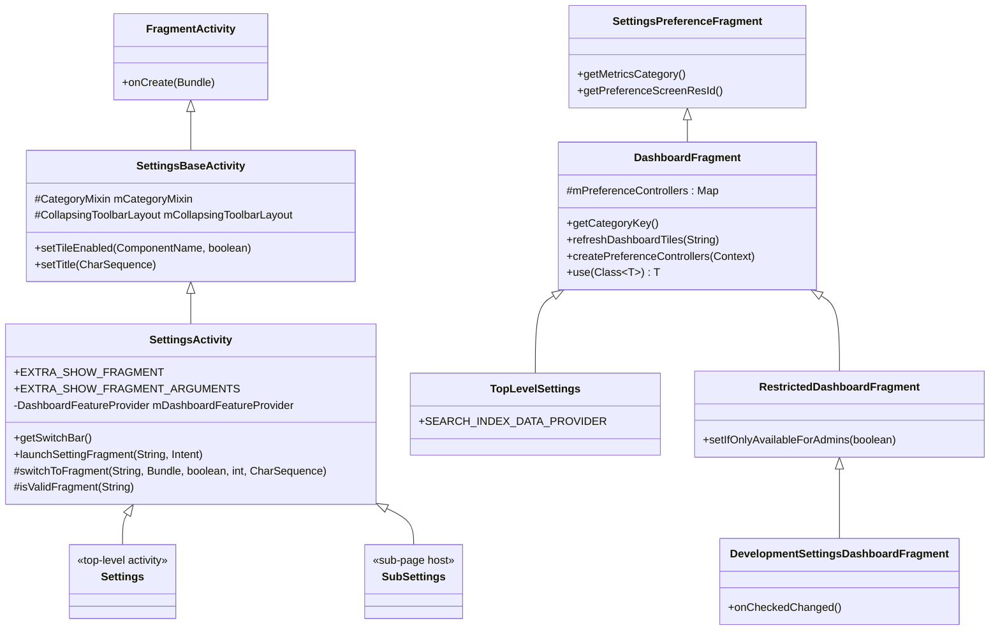

**源文件**：`packages/apps/Settings/src/com/android/settings/SettingsActivity.java`

### 50.1.3 SettingsBaseActivity —— 基础

设置应用中的每个页面（主页除外）都由 `SettingsBaseActivity` 的一个子类承载。这个类定义在
`packages/apps/Settings/src/com/android/settings/core/SettingsBaseActivity.java`，
在 `onCreate()` 期间执行多项关键的初始化任务：

1. **边到边布局**：调用 `Utils.setupEdgeToEdge(this)` 以启用沉浸式窗口内边距（insets）。

2. **工具栏填充**：根据当前主题选择表现力的 Material 3 折叠工具栏或传统的折叠工具栏：

    ```java
    // SettingsBaseActivity.java
    int resId = SettingsThemeHelper.isExpressiveTheme(getApplicationContext())
            ? EXPRESSIVE_LAYOUT_ID : COLLAPSING_LAYOUT_ID;
    super.setContentView(resId);
    ```

3. **CategoryMixin**：初始化 `CategoryMixin`，它在整个 activity 生命周期中管理仪表盘类别变更通知。

4. **覆盖层保护**：将 `HideNonSystemOverlayMixin` 添加到生命周期，以阻止非系统覆盖层截取敏感设置。

5. **磁贴启用/禁用**：暴露 `setTileEnabled(ComponentName, boolean)`，用于根据硬件能力动态显示/隐藏功能磁贴。

### 50.1.4 SettingsActivity —— Fragment 宿主

`SettingsActivity` 继承自 `SettingsBaseActivity`，是所有设置 fragment 的容器 activity。它的主要职责包括：

**通过 Intent extra 进行 Fragment 路由**：

```java
// SettingsActivity.java, lines 98-111
public static final String EXTRA_SHOW_FRAGMENT = ":settings:show_fragment";
public static final String EXTRA_SHOW_FRAGMENT_ARGUMENTS = ":settings:show_fragment_args";
public static final String EXTRA_FRAGMENT_ARG_KEY = ":settings:fragment_args_key";
```

当另一个应用（或设置应用本身）启动某个特定的设置页面时，它会将全限定的 fragment 类名放入 `EXTRA_SHOW_FRAGMENT`。
`SettingsActivity` 随后根据 `SettingsGateway.ENTRY_FRAGMENTS` 中的允许列表验证该 fragment，并实例化它：

```java
// SettingsActivity.java
void launchSettingFragment(String initialFragmentName, Intent intent) {
    if (initialFragmentName != null) {
        // ...
        switchToFragment(initialFragmentName, initialArguments, true,
                mInitialTitleResId, mInitialTitle);
    } else {
        switchToFragment(TopLevelSettings.class.getName(), null, false,
                mInitialTitleResId, mInitialTitle);
    }
}
```

**安全验证** —— `isValidFragment()` 方法对照 `SettingsGateway.ENTRY_FRAGMENTS` 数组检查 fragment 名称：

```java
// SettingsActivity.java
protected boolean isValidFragment(String fragmentName) {
    for (int i = 0; i < SettingsGateway.ENTRY_FRAGMENTS.length; i++) {
        if (SettingsGateway.ENTRY_FRAGMENTS[i].equals(fragmentName)) return true;
    }
    return false;
}
```

这是 Android 4.4 (KitKat) 中引入的一项安全措施，用于防止恶意应用通过 intent extra 注入任意 fragment。

**源文件**：`packages/apps/Settings/src/com/android/settings/core/gateway/SettingsGateway.java`

`SettingsGateway.ENTRY_FRAGMENTS` 数组包含超过 150 个 fragment 类名——即所有被允许托管在 `SettingsActivity` 内的 fragment。

### 50.1.5 Settings.java 存根类

文件 `packages/apps/Settings/src/com/android/settings/Settings.java`
包含一种非同寻常的模式：它定义了超过 150 个公共静态内部类，每个都继承 `SettingsActivity`，且类体为空：

```java
// Settings.java
public static class BluetoothSettingsActivity extends SettingsActivity { /* empty */ }
public static class WifiSettingsActivity extends SettingsActivity { /* empty */ }
public static class DevelopmentSettingsActivity extends SettingsActivity { /* empty */ }
public static class DisplaySettingsActivity extends SettingsActivity { /* empty */ }
// ... 150+ more
```

每个内部类都在 `AndroidManifest.xml` 中声明为一个独立的 `<activity>`，并带有指定要显示哪个 fragment 的元数据。
这种模式使每个设置页面可以拥有自己的 `Intent` action 和 `ComponentName`，同时共享同一个 activity 实现。
`SettingsActivity` 中的 `getStartingFragmentClass()` 方法从元数据解析出 fragment 类：

```java
// SettingsActivity.java
private void getMetaData() {
    ActivityInfo ai = getPackageManager().getActivityInfo(getComponentName(),
            PackageManager.GET_META_DATA);
    if (ai == null || ai.metaData == null) return;
    mFragmentClass = ai.metaData.getString(META_DATA_KEY_FRAGMENT_CLASS);
    mHighlightMenuKey = ai.metaData.getString(META_DATA_KEY_HIGHLIGHT_MENU_KEY);
}
```

`Settings.java` 中的一些内部类包含非平凡的逻辑。
例如，`SecurityDashboardActivity` 在安全中心启用时会重定向到 SafetyCenter，
而 `MobileNetworkActivity` 则处理 SIM 订阅的 intent 转换。

### 50.1.6 SettingsPreferenceFragment 与 PreferenceController

`SettingsPreferenceFragment` 是所有显示 `PreferenceScreen` 的 fragment 的基类。它提供：

- 通过 `getMetricsCategory()` 上报指标
- 通过 `getHelpResource()` 支持帮助链接
- 对深链偏好设置的高亮支持

偏好设置控制器模式是管理单个设置项的主要机制。每个控制器：

1. 继承 `BasePreferenceController`（用于 XML 声明的控制器）或
   `AbstractPreferenceController`（用于代码声明的控制器）

2. 通过 `getAvailabilityStatus()` 声明**可用性状态**
3. 通过 `updateState(Preference)` 管理状态更新
4. 通过 `handlePreferenceTreeClick(Preference)` 处理点击事件

```java
// BasePreferenceController.java -- availability constants
public static final int AVAILABLE = 0;
public static final int AVAILABLE_UNSEARCHABLE = 1;
public static final int CONDITIONALLY_UNAVAILABLE = 2;
public static final int UNSUPPORTED_ON_DEVICE = 3;
public static final int DISABLED_FOR_USER = 4;
public static final int DISABLED_DEPENDENT_SETTING = 5;
```

控制器可以在 XML 中通过 `settings:controller` 属性声明：

```xml
<SwitchPreferenceCompat
    android:key="wifi_calling"
    android:title="@string/wifi_calling_title"
    settings:controller="com.android.settings.network.telephony.WifiCallingPreferenceController"/>
```

在 fragment 创建时，`PreferenceControllerListHelper.getPreferenceControllersFromXml()`
解析 XML 并通过反射实例化每个控制器。

### 50.1.7 SubSettingLauncher

设置页面不再创建原始 intent，而是使用 `SubSettingLauncher` 导航到子页面。这个构建器类在创建 intent 之前设置 fragment 名称、参数、指标类别、标题和用户句柄：

```java
new SubSettingLauncher(getContext())
    .setDestination(AdbWirelessDebuggingFragment.class.getName())
    .setSourceMetricsCategory(SettingsEnums.SETTINGS_ADB_WIRELESS)
    .launch();
```

### 50.1.8 生命周期流程

加载设置页面的完整生命周期如下：

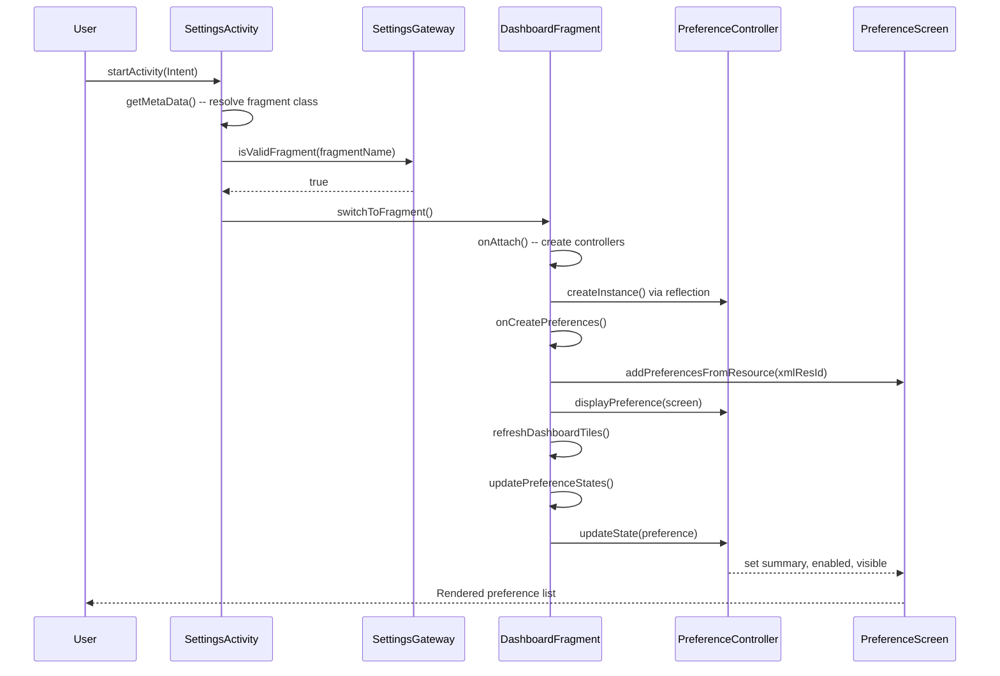

---

## 50.2 仪表盘与类别

### 50.2.1 什么是仪表盘？

在设置应用的术语中，“仪表盘”（dashboard）是一个 `PreferenceScreen`，它组合了两个来源的偏好设置项：

1. **静态偏好设置** —— 定义在 XML 资源文件中（例如，
   `res/xml/top_level_settings.xml`）。

2. **动态磁贴** —— 在运行时从声明了匹配的 `<intent-filter>` 类别的其他应用或系统组件注入。

`DashboardFragment` 是负责编排这种合并的抽象基类。

**源文件**：`packages/apps/Settings/src/com/android/settings/dashboard/DashboardFragment.java`

### 50.2.2 DashboardFragment 内部实现

`DashboardFragment` 类继承 `SettingsPreferenceFragment` 并实现了多个接口：

```java
public abstract class DashboardFragment extends SettingsPreferenceFragment
        implements CategoryListener, Indexable,
        PreferenceGroup.OnExpandButtonClickListener,
        BasePreferenceController.UiBlockListener {
```

其核心数据结构是：

| 字段 | 类型 | 用途 |
|-------|------|---------|
| `mPreferenceControllers` | `Map<Class, List<AbstractPreferenceController>>` | 所有控制器，按类索引 |
| `mControllers` | `List<AbstractPreferenceController>` | 所有控制器的扁平列表 |
| `mDashboardTilePrefKeys` | `ArrayMap<String, List<DynamicDataObserver>>` | 注入磁贴的键及其数据观察者 |
| `mBlockerController` | `UiBlockerController` | 协调异步 UI 阻塞控制器 |

关键生命周期方法：

**`onAttach(Context)`** —— 从两个来源创建偏好设置控制器：

```java
// DashboardFragment.java
@Override
public void onAttach(Context context) {
    super.onAttach(context);
    // Load controllers from code (subclass override)
    final List<AbstractPreferenceController> controllersFromCode =
            createPreferenceControllers(context);
    // Load controllers from XML definition
    final List<BasePreferenceController> controllersFromXml =
            PreferenceControllerListHelper.getPreferenceControllersFromXml(
                context, getPreferenceScreenResId());
    // Filter duplicates
    final List<BasePreferenceController> uniqueControllerFromXml =
            PreferenceControllerListHelper.filterControllers(
                controllersFromXml, controllersFromCode);
    // Wire up with lifecycle
    uniqueControllerFromXml.forEach(controller -> {
        if (controller instanceof LifecycleObserver) {
            lifecycle.addObserver((LifecycleObserver) controller);
        }
    });
}
```

**`onCreatePreferences()`** —— 填充 XML 偏好设置界面并执行初始显示：

```java
@Override
public void onCreatePreferences(Bundle savedInstanceState, String rootKey) {
    checkUiBlocker(mControllers);
    refreshAllPreferences(getLogTag());
}
```

**`refreshDashboardTiles()`** —— 向 `DashboardFeatureProvider` 查询匹配 fragment 类别键的磁贴，
并在 `PreferenceScreen` 上添加、更新或移除它们。

### 50.2.3 类别键与注册表

每个仪表盘 fragment 都通过 `DashboardFragmentRegistry.PARENT_TO_CATEGORY_KEY_MAP` 关联到一个**类别键**：

```java
// DashboardFragmentRegistry.java
static {
    PARENT_TO_CATEGORY_KEY_MAP = new ArrayMap<>();
    PARENT_TO_CATEGORY_KEY_MAP.put(
        TopLevelSettings.class.getName(), CategoryKey.CATEGORY_HOMEPAGE);
    PARENT_TO_CATEGORY_KEY_MAP.put(
        NetworkDashboardFragment.class.getName(), CategoryKey.CATEGORY_NETWORK);
    PARENT_TO_CATEGORY_KEY_MAP.put(
        ConnectedDeviceDashboardFragment.class.getName(), CategoryKey.CATEGORY_CONNECT);
    PARENT_TO_CATEGORY_KEY_MAP.put(
        DevelopmentSettingsDashboardFragment.class.getName(),
        CategoryKey.CATEGORY_SYSTEM_DEVELOPMENT);
    // ... 30+ mappings
}
```

**源文件**：`packages/apps/Settings/src/com/android/settings/dashboard/DashboardFragmentRegistry.java`

设置主页的完整类别键集合包括：

| 类别键 | 宿主 Fragment | 仪表盘页面 |
|-------------|---------------|----------------|
| `CATEGORY_HOMEPAGE` | `TopLevelSettings` | 设置主界面 |
| `CATEGORY_NETWORK` | `NetworkDashboardFragment` | 网络和互联网 |
| `CATEGORY_CONNECT` | `ConnectedDeviceDashboardFragment` | 已连接的设备 |
| `CATEGORY_APPS` | `AppDashboardFragment` | 应用 |
| `CATEGORY_BATTERY` | `PowerUsageSummary` | 电池 |
| `CATEGORY_DISPLAY` | `DisplaySettings` | 显示 |
| `CATEGORY_SOUND` | `SoundSettings` | 声音和振动 |
| `CATEGORY_STORAGE` | `StorageDashboardFragment` | 存储 |
| `CATEGORY_SECURITY` | `SecuritySettings` | 安全 |
| `CATEGORY_ACCOUNT` | `AccountDashboardFragment` | 密码与账户 |
| `CATEGORY_SYSTEM` | `SystemDashboardFragment` | 系统 |
| `CATEGORY_SYSTEM_DEVELOPMENT` | `DevelopmentSettingsDashboardFragment` | 开发者选项 |
| `CATEGORY_PRIVACY` | `PrivacyDashboardFragment` | 隐私 |
| `CATEGORY_NOTIFICATIONS` | `ConfigureNotificationSettings` | 通知 |
| `CATEGORY_EMERGENCY` | `EmergencyDashboardFragment` | 紧急 |

反向映射（`CATEGORY_KEY_TO_PARENT_MAP`）使搜索系统能够确定哪个 fragment 托管给定的类别。

### 50.2.4 磁贴注入机制

第三方应用和系统组件可以通过在其清单中声明带有适当 `<intent-filter>` 的 `<activity>`，
来向任何仪表盘注入磁贴：

```xml
<activity android:name=".MySettingsActivity">
    <intent-filter>
        <action android:name="com.android.settings.action.EXTRA_SETTINGS"/>
        <category android:name="com.android.settings.category.ia.homepage"/>
    </intent-filter>
    <meta-data
        android:name="com.android.settings.title"
        android:resource="@string/my_tile_title"/>
    <meta-data
        android:name="com.android.settings.summary"
        android:resource="@string/my_tile_summary"/>
    <meta-data
        android:name="com.android.settings.icon"
        android:resource="@drawable/ic_my_tile"/>
</activity>
```

注入流程：

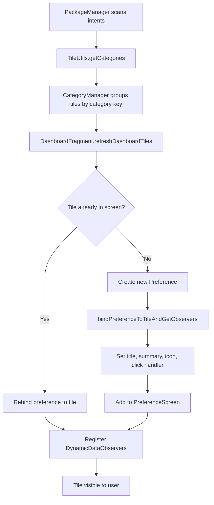

### 50.2.5 DashboardFeatureProviderImpl

`DashboardFeatureProviderImpl` 类（源文件：
`packages/apps/Settings/src/com/android/settings/dashboard/DashboardFeatureProviderImpl.java`）
提供了磁贴管理的具体实现。它的关键方法是 `bindPreferenceToTileAndGetObservers()`，该方法：

1. 从磁贴设置偏好设置键
2. 绑定标题（静态的，或通过内容 URI 动态获取）
3. 绑定摘要（静态的，或通过内容 URI 动态获取）
4. 如果磁贴声明了开关 URI，则绑定开关状态
5. 绑定图标（静态的、来自内容 URI 的，或来自原始图标提供器）
6. 设置用于导航或 profile 选择的点击处理程序

动态内容通过注册 `DynamicDataObserver` 实例来获取，这些实例监视内容 URI。
当底层数据发生变化时，观察者会触发后台获取并将结果发布到主线程：

```java
// DashboardFeatureProviderImpl.java
private void refreshSummary(Uri uri, Preference preference, DynamicDataObserver observer) {
    ThreadUtils.postOnBackgroundThread(() -> {
        final Map<String, IContentProvider> providerMap = new ArrayMap<>();
        final String summaryFromUri = TileUtils.getTextFromUri(
                mContext, uri, providerMap, META_DATA_PREFERENCE_SUMMARY);
        if (!TextUtils.equals(summaryFromUri, preference.getSummary())) {
            observer.post(() -> preference.setSummary(summaryFromUri));
        }
    });
}
```

### 50.2.6 主页：TopLevelSettings

顶层设置界面由继承自 `DashboardFragment` 的 `TopLevelSettings` 显示。
其 XML 布局定义在 `packages/apps/Settings/res/xml/top_level_settings.xml`。

主页按 `PreferenceCategory` 分组组织：

| 类别 | 磁贴 |
|----------|-------|
| 账户 | 注入的用户账户磁贴 |
| 连接 | 网络和互联网、已连接的设备 |
| 个性化 | 应用、通知、声音、显示、壁纸、优先模式、Communal |
| 系统信息 | 存储、电池、系统、关于设备 |
| 安全与隐私 | 安全中心、安全、隐私、位置、账户、紧急 |
| 支持 | 无障碍、提示与支持 |

每个磁贴都是一个带有 `settings:controller` 和 `settings:highlightableMenuKey`（用于双栏高亮）的 `HomepagePreference` 控件：

```xml
<com.android.settings.widget.HomepagePreference
    android:fragment="com.android.settings.network.NetworkDashboardFragment"
    android:icon="@drawable/ic_settings_wireless_filled"
    android:key="top_level_network"
    android:title="@string/network_dashboard_title"
    android:summary="@string/summary_placeholder"
    settings:highlightableMenuKey="@string/menu_key_network"
    settings:controller="com.android.settings.network.TopLevelNetworkEntryPreferenceController"/>
```

### 50.2.7 条件磁贴可见性

`SettingsActivity.doUpdateTilesList()` 根据硬件能力和用户状态动态启用或禁用磁贴：

```java
// SettingsActivity.java
private void doUpdateTilesList() {
    PackageManager pm = getPackageManager();
    final boolean isAdmin = um.isAdminUser();

    somethingChanged = setTileEnabled(changedList,
            new ComponentName(packageName, WifiSettingsActivity.class.getName()),
            pm.hasSystemFeature(PackageManager.FEATURE_WIFI), isAdmin)
            || somethingChanged;

    somethingChanged = setTileEnabled(changedList,
            new ComponentName(packageName,
                Settings.BluetoothSettingsActivity.class.getName()),
            pm.hasSystemFeature(PackageManager.FEATURE_BLUETOOTH), isAdmin)
            || somethingChanged;

    somethingChanged = setTileEnabled(changedList,
            new ComponentName(packageName,
                Settings.PowerUsageSummaryActivity.class.getName()),
            mBatteryPresent, isAdmin)
            || somethingChanged;
    // ...
}
```

对于受限（非管理员）用户，只有 `SettingsGateway.SETTINGS_FOR_RESTRICTED` 中列出的 fragment 仍然可以访问。

---

## 50.3 开发者选项

### 50.3.1 连点 7 次的彩蛋

开发者选项默认是隐藏的。要显示它们，用户必须在“关于手机”界面中连点
“Build number”（版本号）偏好设置 7 次。这在 `BuildNumberPreferenceController` 中实现：

**源文件**：`packages/apps/Settings/src/com/android/settings/deviceinfo/BuildNumberPreferenceController.java`

```java
// BuildNumberPreferenceController.java
static final int TAPS_TO_BE_A_DEVELOPER = 7;

@Override
public void onStart() {
    mDevHitCountdown = DevelopmentSettingsEnabler.isDevelopmentSettingsEnabled(mContext)
            ? -1 : TAPS_TO_BE_A_DEVELOPER;
}

@Override
public boolean handlePreferenceTreeClick(Preference preference) {
    if (mDevHitCountdown > 0) {
        mDevHitCountdown--;
        if (mDevHitCountdown == 0 && !mProcessingLastDevHit) {
            mDevHitCountdown++;
            // Confirm device credentials before enabling
            mProcessingLastDevHit = builder
                    .setRequestCode(REQUEST_CONFIRM_PASSWORD_FOR_DEV_PREF)
                    .setTitle(title)
                    .show();
            if (!mProcessingLastDevHit) {
                enableDevelopmentSettings();
            }
        } else if (mDevHitCountdown > 0
                && mDevHitCountdown < (TAPS_TO_BE_A_DEVELOPER - 2)) {
            mDevHitToast = Toast.makeText(mContext,
                    StringUtil.getIcuPluralsString(mContext, mDevHitCountdown,
                            R.string.show_dev_countdown),
                    Toast.LENGTH_SHORT);
            mDevHitToast.show();
        }
    }
    return true;
}
```

解锁流程包含几个安全关卡：

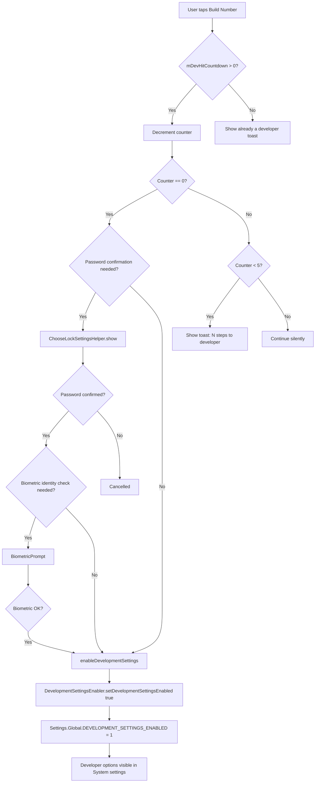

启用后，该方法会写入 `Settings.Global.DEVELOPMENT_SETTINGS_ENABLED`：

```java
// BuildNumberPreferenceController.java
private void enableDevelopmentSettings() {
    mDevHitCountdown = 0;
    DevelopmentSettingsEnabler.setDevelopmentSettingsEnabled(mContext, true);
    mDevHitToast = Toast.makeText(mContext, R.string.show_dev_on, Toast.LENGTH_LONG);
    mDevHitToast.show();
    FeatureFactory.getFeatureFactory().getSearchFeatureProvider()
            .sendPreIndexIntent(mContext);
}
```

### 50.3.2 DevelopmentSettingsDashboardFragment

主要的开发者选项 fragment 位于
`packages/apps/Settings/src/com/android/settings/development/DevelopmentSettingsDashboardFragment.java`。

它继承 `RestrictedDashboardFragment`（该类增加了管理员用户门控），并实现了一长串对话框宿主接口：

```java
@SearchIndexable(forTarget = SearchIndexable.ALL & ~SearchIndexable.ARC)
public class DevelopmentSettingsDashboardFragment extends RestrictedDashboardFragment
        implements OnCheckedChangeListener, OemUnlockDialogHost, AdbDialogHost,
        AdbClearKeysDialogHost, LogPersistDialogHost,
        NfcRebootDialog.OnNfcRebootDialogConfirmedListener {
```

该 fragment 在屏幕顶部管理一个主**总开关**（`SettingsMainSwitchBar`）。
打开它时会显示启用警告对话框。关闭它时要么立即禁用，要么在蓝牙硬件卸载设置已被更改时
显示需要重启的对话框。

### 50.3.3 开发者选项类别

开发者选项页面包含超过 100 个单独的偏好设置，由
`packages/apps/Settings/src/com/android/settings/development/` 下专门的
`PreferenceController` 类管理。

以下是最重要选项的分类概览：

#### 调试

| 控制器 | 设置 | 效果 |
|-----------|---------|--------|
| `AdbPreferenceController` | USB 调试 | 启用通过 USB 进行开发所需的 `adbd` |
| `AdbWirelessDebuggingPreferenceController` | 无线调试 | 通过 Wi-Fi 进行 ADB，需要配对 |
| `ClearAdbKeysPreferenceController` | 撤销 USB 调试授权 | 清空已授权 RSA 密钥的白名单 |
| `MockLocationAppPreferenceController` | 选择模拟位置应用 | 允许某个应用注入虚假的 GPS 数据 |
| `WaitForDebuggerPreferenceController` | 等待调试器 | 暂停应用启动，直到 JDWP 调试器连接 |
| `SelectDebugAppPreferenceController` | 选择调试应用 | 指定要调试的应用 |
| `VerifyAppsOverUsbPreferenceController` | 通过 USB 验证应用 | 扫描侧载应用以保障安全 |
| `StrictModePreferenceController` | 启用严格模式 | 在主线程违规时使屏幕闪烁 |
| `BugReportPreferenceController` | 发送 bug 报告 | 触发 `dumpstate` |

#### 绘制 / GPU

| 控制器 | 设置 | 效果 |
|-----------|---------|--------|
| `ShowLayoutBoundsPreferenceController` | 显示布局边界 | 绘制裁剪边界、外边距、内边距 |
| `ShowKeyPressesPreferenceController` | 显示按键 | 高亮键盘交互 |
| `DebugGpuOverdrawPreferenceController` | 调试 GPU 过度绘制 | 用颜色区分重叠的绘制 |
| `ProfileGpuRenderingPreferenceController` | 性能分析 GPU 渲染 | 显示每帧的条形图 |
| `ForceMSAAPreferenceController` | 强制 4x MSAA | 在 OpenGL ES 2.0 应用中抗锯齿 |
| `HardwareLayersUpdatesPreferenceController` | 显示硬件层更新 | 硬件层更新时绿色闪烁 |
| `HardwareOverlaysPreferenceController` | 禁用硬件叠加层 | 强制使用 GPU 合成 |
| `GpuViewUpdatesPreferenceController` | 显示 GPU 视图更新 | 窗口重绘时闪烁 |
| `ShowSurfaceUpdatesPreferenceController` | 显示 surface 更新 | SurfaceFlinger 叠加层 |

#### 动画

| 控制器 | 设置 | 效果 |
|-----------|---------|--------|
| `WindowAnimationScalePreferenceController` | 窗口动画缩放 | 0.5x - 10x 或禁用 |
| `TransitionAnimationScalePreferenceController` | 过渡动画缩放 | 0.5x - 10x 或禁用 |
| `AnimatorDurationScalePreferenceController` | 动画器时长缩放 | 0.5x - 10x 或禁用 |

这三个设置分别写入 `Settings.Global.WINDOW_ANIMATION_SCALE`、
`Settings.Global.TRANSITION_ANIMATION_SCALE` 和
`Settings.Global.ANIMATOR_DURATION_SCALE`。

#### 网络

| 控制器 | 设置 | 效果 |
|-----------|---------|--------|
| `MobileDataAlwaysOnPreferenceController` | 移动数据始终开启 | 在 Wi-Fi 激活时保持移动数据开启 |
| `TetheringHardwareAccelPreferenceController` | 网络共享硬件加速 | 启用或禁用硬件 NAT |
| `WifiVerboseLoggingPreferenceController` | Wi-Fi 详细日志 | 提高 Wi-Fi 日志级别 |
| `WifiScanThrottlingPreferenceController` | Wi-Fi 扫描节流 | 限制后台扫描 |

#### 系统

| 控制器 | 设置 | 效果 |
|-----------|---------|--------|
| `StayAwakePreferenceController` | 保持唤醒 | 充电时屏幕永不休眠 |
| `OemUnlockPreferenceController` | OEM 解锁 | 允许解锁 bootloader |
| `LocalTerminalPreferenceController` | Linux 终端 | 启用嵌入式终端 |
| `KeepActivitiesPreferenceController` | 不保留 activity | 离开时销毁每个 activity |
| `BackgroundProcessLimitPreferenceController` | 后台进程限制 | 0-4 或标准限制 |
| `LogdSizePreferenceController` | 日志缓冲区大小 | 关闭、64K、256K、1M、4M 或 8M（每个日志缓冲区） |

#### 蓝牙

| 控制器 | 设置 | 效果 |
|-----------|---------|--------|
| `BluetoothCodecListPreferenceController` | 蓝牙音频编解码器 | SBC、AAC、aptX、LDAC |
| `BluetoothSampleRateDialogPreferenceController` | 采样率 | 44.1 / 48 / 88.2 / 96 kHz |
| `BluetoothBitPerSampleDialogPreferenceController` | 每采样位数 | 16 / 24 / 32 |
| `BluetoothA2dpHwOffloadPreferenceController` | 禁用 BT A2DP 硬件卸载 | 强制软件编码 |
| `BluetoothLeAudioHwOffloadPreferenceController` | 禁用 BT LE audio 硬件卸载 | 对 LE audio 强制使用软件 |
| `BluetoothSnoopLogPreferenceController` | 启用蓝牙 HCI 嗅探日志 | 完整 / 过滤 / 禁用 |

### 50.3.4 开发者选项的门控方式

开发者选项由 `Settings.Global.DEVELOPMENT_SETTINGS_ENABLED` 全局门控。
该 fragment 在启动时检查此项：

```java
// DevelopmentSettingsDashboardFragment.java
@Override
public void onCreate(Bundle icicle) {
    super.onCreate(icicle);
    if (!um.isAdminUser()) {
        Toast.makeText(context, R.string.dev_settings_available_to_admin_only_warning,
                Toast.LENGTH_SHORT).show();
        finish();
    } else if (!DevelopmentSettingsEnabler.isDevelopmentSettingsEnabled(context)) {
        Toast.makeText(context, R.string.dev_settings_disabled_warning,
                Toast.LENGTH_SHORT).show();
        finish();
    }
}
```

此外，该 fragment 还在设置 URI 上注册了一个 `ContentObserver`，
以检测外部更改（例如 `adb shell settings put global
development_settings_enabled 0`），并在需要时自动禁用：

```java
// DevelopmentSettingsDashboardFragment.java
private final ContentObserver mDeveloperSettingsObserver = new ContentObserver(...) {
    @Override
    public void onChange(boolean selfChange, Uri uri) {
        final boolean developmentEnabledState =
                DevelopmentSettingsEnabler.isDevelopmentSettingsEnabled(activity);
        final boolean switchState = mSwitchBar.isChecked();
        if (developmentEnabledState != switchState) {
            if (!developmentEnabledState) {
                disableDeveloperOptions();
                activity.runOnUiThread(() -> finishFragment());
            }
        }
    }
};
```

### 50.3.5 SystemProperties 集成

许多开发者选项会同时写入 `Settings.Global` / `Settings.Secure` 和
`SystemProperties`。该 fragment 注册了一个系统属性变更回调：

```java
SystemProperties.addChangeCallback(mSystemPropertiesChanged);
```

当某个系统属性发生变化时，该回调会在 UI 线程上触发 `updatePreferenceStates()`，
以刷新所有偏好设置的摘要和状态。

在打开或关闭开发者选项之后，该 fragment 会调用
`SystemPropPoker.getInstance().poke()`，以通知所有系统服务属性已发生变化。

### 50.3.6 桌面体验开发者开关

Android 17 将最初仅作为标志位实验的连接显示 / 桌面窗口化工作，
提升为一等公民级别的开发者开关。这些控制器位于它们自己的子包中，
`packages/apps/Settings/src/com/android/settings/development/desktopexperience/`，
并与 `DevelopmentSettingsDashboardFragment.buildPreferenceControllers()` 中的
其他窗口管理控制器一起注册：

```java
// DevelopmentSettingsDashboardFragment.java
controllers.add(new FreeformWindowsPreferenceController(context, fragment));
controllers.add(new DesktopModePreferenceController(context, fragment));
controllers.add(new DesktopModeSecondaryDisplayPreferenceController(context, fragment));
controllers.add(new DesktopExperiencePreferenceController(context, fragment));
```

每个控制器都写入一个 `Settings.Global` 开发键：

| 控制器 | 写入的全局键 | 效果 |
|-----------|--------------------|--------|
| `FreeformWindowsPreferenceController` | `DEVELOPMENT_ENABLE_FREEFORM_WINDOWS_SUPPORT` | 旧版自由窗口覆盖 |
| `DesktopModePreferenceController` | `DEVELOPMENT_OVERRIDE_DESKTOP_MODE_FEATURES` | 在内建显示屏上强制桌面窗口化 |
| `DesktopModeSecondaryDisplayPreferenceController` | `DEVELOPMENT_FORCE_DESKTOP_MODE_ON_EXTERNAL_DISPLAYS` | 在连接的外接显示屏上强制桌面模式 |
| `DesktopExperiencePreferenceController` | `DEVELOPMENT_OVERRIDE_DESKTOP_EXPERIENCE_FEATURES` | 对捆绑的桌面体验功能集的总开关覆盖 |

两个较新的覆盖开关并不使用普通的开/关整数。它们存储的是
`android.window.DesktopModeFlags.ToggleOverride` 值 —— `OVERRIDE_UNSET`、
`OVERRIDE_OFF` 或 `OVERRIDE_ON`。因此该开关可以把“保持构建默认值不变”表达为一个
与显式强制开启或关闭该功能不同的独立状态。`DesktopExperiencePreferenceController` 读取
`DesktopState`（来自 `com.android.wm.shell.shared.desktopmode`），以判断该开关是否适用。
桌面功能集的变更需要重新初始化窗口管理状态。因此该控制器实现了
`RebootConfirmationDialogHost`，并在值发生变化后提示重启。

---

## 50.4 设置提供器（Settings Provider）

### 50.4.1 概述

`SettingsProvider` 是一个 `ContentProvider`，充当所有系统设置的持久化存储后端。
它是在启动期间最先初始化的提供器之一，运行在 `system_server` 进程中。

**源文件**：`frameworks/base/packages/SettingsProvider/src/com/android/providers/settings/SettingsProvider.java`

正如源码文档所述：

> 这是一个发布系统设置的 content provider。
> 它可以通过 content provider API 或自定义调用命令来访问。
> 后者稍快一些，是访问平台设置的首选方式。

### 50.4.2 三个命名空间

设置分为三个命名空间，每个都有不同的访问控制和作用域：

| 命名空间 | 类 | 作用域 | 权限 | 示例 |
|-----------|-------|-------|------------|----------|
| **System** | `Settings.System` | 每用户、每设备 | `WRITE_SETTINGS`（app-op 特殊访问） | 铃声音量、屏幕亮度、字体大小 |
| **Secure** | `Settings.Secure` | 每用户、每设备 | 签名级 | 位置模式、无障碍服务、默认输入法 |
| **Global** | `Settings.Global` | 所有用户、全设备 | 签名级 | 飞行模式、开发者选项已启用、ADB 已启用 |

还有两个额外的内部命名空间：

| 命名空间 | 用途 |
|-----------|---------|
| `SSAID` | 每个应用的唯一 ID（`Settings.Secure.ANDROID_ID`） |
| `Config` | `DeviceConfig` 标志（功能标志、服务器推送的实验） |

该提供器为每个命名空间定义了表常量：

```java
// SettingsProvider.java
public static final String TABLE_SYSTEM = "system";
public static final String TABLE_SECURE = "secure";
public static final String TABLE_GLOBAL = "global";
public static final String TABLE_SSAID = "ssaid";
public static final String TABLE_CONFIG = "config";
```

### 50.4.3 存储机制

尽管有遗留的表名，设置**并不是**存储在 SQLite 中的。现代 Android 使用
`SettingsState`，它把每个命名空间存储为一个 XML 文件：

```
/data/system/users/<userId>/settings_system.xml
/data/system/users/<userId>/settings_secure.xml
/data/system/users/0/settings_global.xml
```

每个设置都是一个键值对，存储形式如下：

```xml
<setting id="42" name="screen_brightness" value="128"
    package="com.android.settings" defaultValue="128"
    defaultSysSet="true" tag="" />
```

设置在提供器创建时同步加载，在变更时异步持久化。关键设置（如 `DEVICE_PROVISIONED`）
会同步持久化：

```java
// SettingsProvider.java
private static final Set<String> CRITICAL_GLOBAL_SETTINGS = new ArraySet<>();
static {
    CRITICAL_GLOBAL_SETTINGS.add(Settings.Global.DEVICE_PROVISIONED);
}

private static final Set<String> CRITICAL_SECURE_SETTINGS = new ArraySet<>();
static {
    CRITICAL_SECURE_SETTINGS.add(Settings.Secure.USER_SETUP_COMPLETE);
}
```

### 50.4.4 call 方法 API

虽然 `SettingsProvider` 实现了标准的 `ContentProvider` query/insert 接口，
但首选的访问路径是 `call()` 方法，它避免了游标开销。`call()` 方法按方法字符串进行分发：

```java
// SettingsProvider.java
@Override
public Bundle call(String method, String name, Bundle args) {
    switch (method) {
        case Settings.CALL_METHOD_GET_GLOBAL -> {
            Setting setting = getGlobalSetting(name);
            return packageValueForCallResult(...);
        }
        case Settings.CALL_METHOD_GET_SECURE -> {
            Setting setting = getSecureSetting(name, requestingUserId, callingDeviceId);
            return packageValueForCallResult(...);
        }
        case Settings.CALL_METHOD_GET_SYSTEM -> {
            Setting setting = getSystemSetting(name, requestingUserId, callingDeviceId);
            return packageValueForCallResult(...);
        }
        case Settings.CALL_METHOD_PUT_GLOBAL -> {
            insertGlobalSetting(name, value, tag, makeDefault, requestingUserId, ...);
        }
        case Settings.CALL_METHOD_PUT_SECURE -> {
            insertSecureSetting(name, value, tag, makeDefault, requestingUserId, ...);
        }
        case Settings.CALL_METHOD_PUT_SYSTEM -> {
            insertSystemSetting(name, value, requestingUserId, overrideableByRestore);
        }
        // DELETE, RESET, LIST methods...
    }
}
```

### 50.4.5 设置迁移

设置会在 Android 各版本之间在命名空间之间移动。该提供器维护了跟踪这些迁移的静态集合：

```java
// SettingsProvider.java
static final Set<String> sSecureMovedToGlobalSettings = new ArraySet<>();
static {
    Settings.Secure.getMovedToGlobalSettings(sSecureMovedToGlobalSettings);
}

static final Set<String> sSystemMovedToGlobalSettings = new ArraySet<>();
static {
    Settings.System.getMovedToGlobalSettings(sSystemMovedToGlobalSettings);
}

static final Set<String> sSystemMovedToSecureSettings = new ArraySet<>();
static {
    Settings.System.getMovedToSecureSettings(sSystemMovedToSecureSettings);
}
```

当客户端查询已迁移到 `Settings.Global` 的某个键的 `Settings.System` 时，
该提供器会透明地重定向该查询。

### 50.4.6 ContentObserver 模式

`Settings` API 通过 `ContentObserver` 提供变更通知机制。任何组件都可以注册以监视某个特定设置：

```java
// Registering a content observer
ContentResolver cr = context.getContentResolver();
Uri uri = Settings.System.getUriFor(Settings.System.SCREEN_BRIGHTNESS);
cr.registerContentObserver(uri, false, new ContentObserver(handler) {
    @Override
    public void onChange(boolean selfChange) {
        int brightness = Settings.System.getInt(cr,
            Settings.System.SCREEN_BRIGHTNESS, 128);
        // React to brightness change
    }
});
```

通知流程：

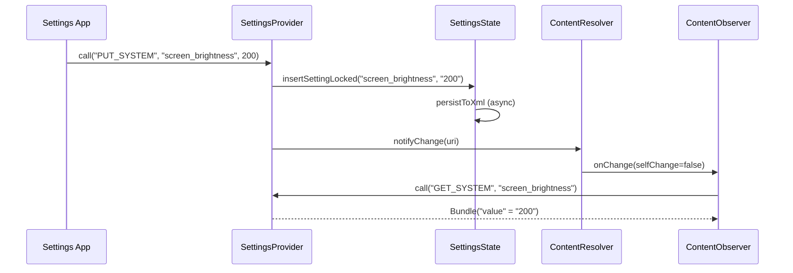

### 50.4.7 验证

`Settings.System` 的值使用 `Validator` 类的框架进行验证，以防止应用写入无效数据：

```java
// SettingsProvider uses SystemSettingsValidators
import android.provider.settings.validators.SystemSettingsValidators;
import android.provider.settings.validators.Validator;
```

例如，`SCREEN_BRIGHTNESS` 会经过验证，以确保其落在硬件支持的范围内。
`Settings.Global` 和 `Settings.Secure` 不经过验证，因为它们只能由特权调用方写入。

### 50.4.8 每用户和每设备设置

`Settings.System` 和 `Settings.Secure` 是每用户的：每个 Android 用户资料都有自己的一套值。
`Settings.Global` 是全设备范围的，存储在用户 0 下。

从 Android 14 开始，设置还支持每个虚拟设备的作用域。当从虚拟设备上下文查询某个设置时，
该提供器会首先检查设备特定的覆盖值，再回退到默认设备：

```java
// SettingsProvider.java, call() method
case Settings.CALL_METHOD_GET_SECURE -> {
    Setting setting = getSecureSetting(name, requestingUserId, callingDeviceId);
    if (callingDeviceId != Context.DEVICE_ID_DEFAULT
            && (setting == null || setting.isNull())) {
        setting = getSecureSetting(name, requestingUserId, Context.DEVICE_ID_DEFAULT);
    }
    return packageValueForCallResult(...);
}
```

### 50.4.9 常用设置参考

最常用的设置的速查表：

| 命名空间 | 键 | 类型 | 描述 |
|-----------|-----|------|-------------|
| System | `screen_brightness` | int | 手动亮度（0-255） |
| System | `screen_brightness_mode` | int | 0=手动，1=自动 |
| System | `font_scale` | float | 显示字体缩放因子 |
| System | `ringtone` | string | 默认铃声 URI |
| Secure | `android_id` | string | 每应用唯一设备 ID |
| Secure | `enabled_accessibility_services` | string | 以冒号分隔的无障碍服务列表 |
| Secure | `location_mode` | int | 位置访问模式 |
| Secure | `default_input_method` | string | 当前 IME 的组件名 |
| Global | `airplane_mode_on` | int | 0=关闭，1=开启 |
| Global | `development_settings_enabled` | int | 0=隐藏，1=显示 |
| Global | `adb_enabled` | int | 0=禁用，1=启用 |
| Global | `window_animation_scale` | float | 窗口动画速度倍率 |
| Global | `transition_animation_scale` | float | Activity 过渡速度倍率 |
| Global | `animator_duration_scale` | float | ValueAnimator 速度倍率 |
| Global | `device_provisioned` | int | 0=设置向导待完成，1=已完成配置 |

---

## 50.5 搜索与索引

### 50.5.1 为什么设置搜索很复杂

设置应用包含数百个分散在数十个 fragment 中的单独偏好设置。要使所有这些内容都可被搜索，
需要一个能够做到以下几点的索引系统：

1. 解析每个 XML 偏好设置界面，提取标题、摘要和键
2. 从以编程方式创建的偏好设置中收集原始数据
3. 索引来自第三方应用的注入磁贴
4. 跟踪当前不可用的偏好设置（不可索引的键）
5. 将这些数据提供给设置智能（Settings Intelligence）应用，用于排序和显示

### 50.5.2 @SearchIndexable 注解

每个参与搜索的 fragment 都带有 `@SearchIndexable` 注解：

```java
@SearchIndexable
public class MyDeviceInfoFragment extends DashboardFragment { ... }

@SearchIndexable(forTarget = SearchIndexable.ALL & ~SearchIndexable.ARC)
public class DevelopmentSettingsDashboardFragment extends RestrictedDashboardFragment { ... }
```

该注解在编译时由设置搜索注解处理器处理，该处理器会生成所有可索引类的注册表。

### 50.5.3 BaseSearchIndexProvider

每个可索引的 fragment 都声明一个 `public static final BaseSearchIndexProvider
SEARCH_INDEX_DATA_PROVIDER` 字段。该提供器实现了
`Indexable.SearchIndexProvider` 接口：

**源文件**：`packages/apps/Settings/src/com/android/settings/search/BaseSearchIndexProvider.java`

该提供器提供三种类型的数据：

**XML 资源** —— 要解析的偏好设置界面 XML 文件：

```java
@Override
public List<SearchIndexableResource> getXmlResourcesToIndex(Context context, boolean enabled) {
    if (mXmlRes != 0) {
        final SearchIndexableResource sir = new SearchIndexableResource(context);
        sir.xmlResId = mXmlRes;
        return Arrays.asList(sir);
    }
    return null;
}
```

**原始数据** —— 以编程方式生成的搜索条目：

```java
@Override
public List<SearchIndexableRaw> getRawDataToIndex(Context context, boolean enabled) {
    final List<SearchIndexableRaw> raws = new ArrayList<>();
    final List<AbstractPreferenceController> controllers = getPreferenceControllers(context);
    for (AbstractPreferenceController controller : controllers) {
        if (controller instanceof BasePreferenceController) {
            ((BasePreferenceController) controller).updateRawDataToIndex(raws);
        }
    }
    return raws;
}
```

**不可索引的键** —— 要从搜索结果中排除的键：

```java
@Override
@CallSuper
public List<String> getNonIndexableKeys(Context context) {
    final List<String> nonIndexableKeys = new ArrayList<>();
    if (!isPageSearchEnabled(context)) {
        nonIndexableKeys.addAll(getNonIndexableKeysFromXml(context, true));
        return nonIndexableKeys;
    }
    nonIndexableKeys.addAll(getNonIndexableKeysFromXml(context, false));
    updateNonIndexableKeysFromControllers(context, nonIndexableKeys);
    return nonIndexableKeys;
}
```

不可索引键机制会把当前不可用的偏好设置从搜索结果中排除。例如，当开发者模式关闭时的
USB 调试选项。这由每个控制器的 `getAvailabilityStatus()` 驱动：

```java
// BasePreferenceController.java
public void updateNonIndexableKeys(List<String> keys) {
    final String key = getPreferenceKey();
    if (!keys.contains(key) && !isAvailableForSearch()) {
        keys.add(key);
    }
}
```

### 50.5.4 SettingsSearchIndexablesProvider

`SettingsSearchIndexablesProvider` 是一个 `ContentProvider`，设置智能应用通过查询它来构建搜索索引。

**源文件**：`packages/apps/Settings/src/com/android/settings/search/SettingsSearchIndexablesProvider.java`

它实现了 `SearchIndexablesContract` 协议，通过基于游标的查询提供四类数据：

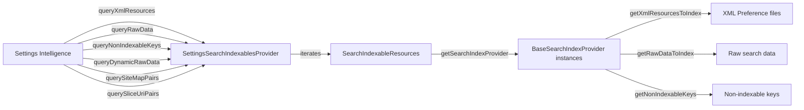

该提供器还会构建一个**站点地图** —— fragment 之间的父子关系 ——
以便设置智能可以在搜索结果中显示面包屑路径：

```java
// SettingsSearchIndexablesProvider.java
@Override
public Cursor querySiteMapPairs() {
    final MatrixCursor cursor = new MatrixCursor(SITE_MAP_COLUMNS);
    final List<DashboardCategory> categories =
            FeatureFactory.getFeatureFactory()
                .getDashboardFeatureProvider().getAllCategories();
    for (DashboardCategory category : categories) {
        final String parentClass = CATEGORY_KEY_TO_PARENT_MAP.get(category.key);
        for (Tile tile : category.getTiles()) {
            String childClass = tile.getMetaData().getString(
                    SettingsActivity.META_DATA_KEY_FRAGMENT_CLASS);
            cursor.newRow()
                    .add(SiteMapColumns.PARENT_CLASS, parentClass)
                    .add(SiteMapColumns.CHILD_CLASS, childClass);
        }
    }
    return cursor;
}
```

### 50.5.5 注入索引

通过仪表盘系统注入的第三方磁贴也是可搜索的。`getInjectionIndexableRawData()` 方法遍历所有类别，
并为每个符合条件的磁贴创建 `SearchIndexableRaw` 条目：

```java
// SettingsSearchIndexablesProvider.java
List<SearchIndexableRaw> getInjectionIndexableRawData(Context context) {
    for (DashboardCategory category : dashboardFeatureProvider.getAllCategories()) {
        for (Tile tile : category.getTiles()) {
            if (!isEligibleForIndexing(currentPackageName, tile)) {
                continue;
            }
            final SearchIndexableRaw raw = new SearchIndexableRaw(context);
            raw.title = tile.getTitle(context).toString();
            raw.key = dashboardFeatureProvider.getDashboardKeyForTile(tile);
            raw.summaryOn = tile.getSummary(context).toString();
            raw.className = CATEGORY_KEY_TO_PARENT_MAP.get(tile.getCategory());
            rawList.add(raw);
        }
    }
    return rawList;
}
```

`isEligibleForIndexing()` 方法会跳过设置应用自己的 activity 磁贴（它们通过自己的 fragment 进行索引），
并尊重 `isSearchable()` 标志。

### 50.5.6 动态原始数据

某些搜索结果需要在查询时而不是索引时生成。`queryDynamicRawData()` 方法会调用每个提供器的
`getDynamicRawDataToIndex()`：

```java
// BaseSearchIndexProvider.java
@Override
@CallSuper
public List<SearchIndexableRaw> getDynamicRawDataToIndex(Context context, boolean enabled) {
    final List<SearchIndexableRaw> dynamicRaws = new ArrayList<>();
    if (!isPageSearchEnabled(context)) {
        return dynamicRaws;
    }
    final List<AbstractPreferenceController> controllers = getPreferenceControllers(context);
    for (AbstractPreferenceController controller : controllers) {
        if (controller instanceof BasePreferenceController) {
            ((BasePreferenceController) controller).updateDynamicRawDataToIndex(dynamicRaws);
        }
    }
    return dynamicRaws;
}
```

这用于标题或摘要会动态变化的偏好设置（例如当前的 Wi-Fi 网络名称）。

### 50.5.7 SearchFeatureProvider

`SearchFeatureProvider` 接口连接了设置应用和设置智能：

**源文件**：`packages/apps/Settings/src/com/android/settings/search/SearchFeatureProvider.java`

它提供：

- `getSearchIndexableResources()` —— 返回编译时生成的注册表
- `getSettingsIntelligencePkgName()` —— 返回搜索应用的包名
- `initSearchToolbar()` —— 在主页上初始化搜索栏
- `buildSearchIntent()` —— 创建用于启动搜索界面的 intent
- `sendPreIndexIntent()` —— 设置应用调用的一个钩子（例如在启用开发者选项之后），
  让 OEM 构建可以开始预索引。AOSP 默认实现是一个空的无操作

搜索栏在主页上初始化，并触发到设置智能搜索 activity 的过渡：

```java
// SearchFeatureProvider.java
default void initSearchToolbar(@NonNull FragmentActivity activity, @Nullable View toolbar,
        int pageId) {
    // ...
    final Intent intent = buildSearchIntent(context, pageId)
            .addFlags(Intent.FLAG_ACTIVITY_CLEAR_TOP);
    toolbar.setOnClickListener(tb -> startSearchActivity(context, activity, pageId, intent));
    toolbar.setHandwritingDelegatorCallback(
            () -> startSearchActivity(context, activity, pageId, intent));
}
```

### 50.5.8 端到端搜索流程

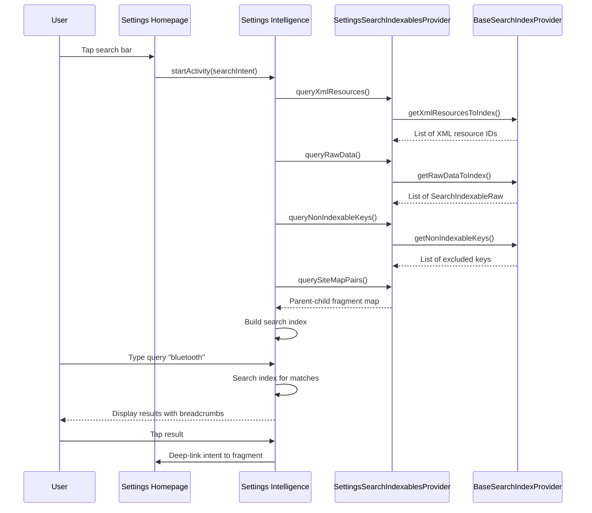

### 50.5.9 SettingsIntelligence 应用

以上所有内容描述的都是契约的“设置”一侧：注解、提供器和设置应用导出的键。*消费者*
是另一个独立的 APK，`packages/apps/SettingsIntelligence`，包名为
`com.android.settings.intelligence`。它拥有搜索界面、搜索索引数据库和建议后端。
因此设置应用本身并不附带搜索索引，也不附带建议排序逻辑。

该应用持有 `READ_SEARCH_INDEXABLES` 权限，并查询每个响应
`android.content.action.SEARCH_INDEXABLES_PROVIDER` intent 的提供器，而不只限于设置提供器。
任何系统应用都可以发布 `SearchIndexablesProvider`，其偏好设置也可以从设置搜索栏中被搜索到。

**搜索索引。** `IndexDatabaseHelper`（在 `search/indexing/` 中）打开一个名为
`search_index.db` 的 SQLite 数据库，其主表 `prefs_index` 是一个用于全文匹配的 FTS4 虚拟表。
`site_map` 表也是 FTS4；`meta_index`（索引元数据行）和 `saved_queries` 是普通表：

**源文件**：`packages/apps/SettingsIntelligence/src/com/android/settings/intelligence/search/indexing/IndexDatabaseHelper.java`

```java
// IndexDatabaseHelper.java
private static final String DATABASE_NAME = "search_index.db";
private static final int DATABASE_VERSION = 121;

interface Tables {
    String TABLE_PREFS_INDEX = "prefs_index";    // FTS4 virtual table
    String TABLE_SITE_MAP = "site_map";          // FTS4: parent/child breadcrumbs
    String TABLE_META_INDEX = "meta_index";      // build fingerprint, locale
    String TABLE_SAVED_QUERIES = "saved_queries";
}
```

当元数据行显示构建指纹或语言环境已过期时，`DatabaseIndexingManager` 会重建索引。
它调用 `PreIndexDataCollector` 来遍历已注册的提供器，通过 `IndexDataConverter` 转换每一行，
并将结果写入 `prefs_index`。重建是由搜索界面触发的，而不是通过广播触发：打开搜索会调用
`SearchFeatureProviderImpl.updateIndexAsync()`（来自 `SearchFragment`），该方法再移交给
`DatabaseIndexingManager.indexDatabase()`。仅当 `IndexDatabaseHelper.isFullIndex()`
报告存储的构建指纹或语言环境不再匹配时，该方法才执行完整的重新索引；否则它会应用增量更新。

**查询路径。** `SearchActivity` 承载 `SearchFragment`，后者将每次按键分发给
`SearchResultAggregator`。该聚合器把查询并行扇出到多个 `SearchQueryTask` 实现。
`DatabaseResultTask` 针对 `prefs_index` 运行 FTS4 匹配。
`InstalledAppResultTask`、`InputDeviceResultTask` 和 `AccessibilityServiceResultTask`
则添加不在静态索引中的结果。结果在显示前会进行合并、去重和排序。

`SavedQueryController` 把最近的查询记录到 `saved_queries` 表中，以便空搜索界面可以显示最近的搜索。

**建议后端。** 同一个 APK 导出了一个 `SuggestionService`，在
`BIND_SETTINGS_SUGGESTIONS_SERVICE` 权限下绑定。它继承框架类
`android.service.settings.suggestions.SuggestionService`，因此 SystemUI 和设置主页的建议卡片都会调用它：

**源文件**：`packages/apps/SettingsIntelligence/src/com/android/settings/intelligence/suggestions/SuggestionService.java`

```java
public class SuggestionService extends
        android.service.settings.suggestions.SuggestionService {
    @Override
    public List<Suggestion> onGetSuggestions() { /* ... */ }
    @Override
    public void onSuggestionDismissed(Suggestion suggestion) { /* ... */ }
    @Override
    public void onSuggestionLaunched(Suggestion suggestion) { /* ... */ }
}
```

候选建议来自 `SuggestionParser`，并由 `suggestions/eligibility/` 中的 `*EligibilityChecker`
类过滤。`CandidateSuggestion` 在 `initIsEligible()` 中按顺序运行它们（提供器、连接、功能、
账户、已忽略、车载），并缓存结果；`isEligible()` 只是返回该缓存的标志。随后符合条件的候选
由 `SuggestionRanker` 排序。

排序器通过 `SuggestionFeaturizer` 将每个候选转换为特征向量，并用固定的权重线性函数为其打分。
该函数是若干特征的加权和（点积），例如某条建议是否被展示、被忽略或被点击，以及发生的时间。
权重是 `WEIGHTS` 映射中的常量。分数直接用作排序键。运行时不会应用 sigmoid。
源码注释指出，这些权重是通过训练一个二分类器在离线拟合得到的。

特征按建议持久化在 `SuggestionEventStore` 中，忽略和启动操作会通过 `onSuggestionDismissed` 和
`onSuggestionLaunched` 反馈回来，因此被忽略的建议不会再重新出现。

---

## 50.6 主题与界面

### 50.6.1 设置应用中的 Material Design

设置应用经历了多个设计语言的演进：

- **Holo**（Android 4.x）：带偏好设置列表的深色 ActionBar
- **Material Design 1**（Android 5.x-8.x）：白色卡片、CollapsingToolbar
- **Material Design 2**（Android 9-11）：圆角、强调色
- **Material Design 3 / Material You**（Android 12+）：动态色彩、大标题
- **Expressive 设计**（Android 16+）：新的图标风格、增强的排版

当前主题在运行时选择：

```java
// SettingsBaseActivity.java
if (isToolbarEnabled() && !isAnySetupWizard) {
    int resId = SettingsThemeHelper.isExpressiveTheme(getApplicationContext())
            ? EXPRESSIVE_LAYOUT_ID : COLLAPSING_LAYOUT_ID;
    super.setContentView(resId);
}
```

对于子设置页面，主题根据上下文应用：

```java
// SettingsActivity.java
if (isSubSettings(intent) && !WizardManagerHelper.isAnySetupWizard(getIntent())) {
    int themeId = SettingsThemeHelper.isExpressiveTheme(this)
            ? R.style.Theme_SubSettings_Expressive : R.style.Theme_SubSettings;
    setTheme(themeId);
}
```

### 50.6.2 偏好设置控件

除了标准的 AndroidX `Preference` 库之外，设置应用还使用了几个自定义偏好设置控件：

| 控件 | 源文件 | 用途 |
|--------|--------|---------|
| `HomepagePreference` | `widget/HomepagePreference.java` | 带图标、标题、摘要的主页磁贴 |
| `SettingsMainSwitchBar` | `widget/SettingsMainSwitchBar.java` | 页面级主开关（例如 Wi-Fi、开发者选项） |
| `PrimarySwitchPreference` | `settingslib/` | 右侧带有独立开关的偏好设置 |
| `SummaryPreference` | `SummaryPreference.java` | 带有主/次文本和图表的偏好设置 |
| `RestrictedSwitchPreference` | `RestrictedSwitchPreference` | 显示管理员限制信息的开关 |
| `LayoutPreference` | `settingslib/` | 在偏好设置行内包裹自定义布局 |
| `SelectorWithWidgetPreference` | `settingslib/` | 单选按钮偏好设置 |
| `CustomListPreference` | `CustomListPreference.java` | 带自定义对话框的列表偏好设置 |

### 50.6.3 折叠工具栏

主页和子页面都使用折叠工具栏。工具栏在滚动到顶部时显示大标题。滚动时它会折叠进 ActionBar。

工具栏实现位于 `settingslib` 中：

```
frameworks/base/packages/SettingsLib/CollapsingToolbarBaseActivity/
    src/com/android/settingslib/collapsingtoolbar/
        CollapsingToolbarDelegate.java
        FloatingToolbarHandler.kt
```

`SettingsBaseActivity` 在 `onCreate()` 中初始化工具栏委托：

```java
// SettingsBaseActivity.java
mCollapsingToolbarLayout = findViewById(
    com.android.settingslib.collapsingtoolbar.R.id.collapsing_toolbar);
mAppBarLayout = findViewById(R.id.app_bar);
getToolbarDelegate().initCollapsingToolbar(mCollapsingToolbarLayout, mAppBarLayout);
```

### 50.6.4 大屏幕的双栏布局

在平板和折叠屏设备上，设置应用使用 **Activity Embedding** 来显示双栏布局。
主页列表在左侧，所选的设置页面在右侧。

与此相关的关键类位于 `packages/apps/Settings/src/com/android/settings/activityembedding/`：

| 文件 | 用途 |
|------|---------|
| `ActivityEmbeddingUtils.java` | 检查嵌入是否已启用且屏幕足够大 |
| `ActivityEmbeddingRulesController.java` | 为设置 activity 注册 `SplitPairRule` |
| `EmbeddedDeepLinkUtils.kt` | 在双栏模式下处理深链 |

`SettingsHomepageActivity` 检测双栏状态：

```java
// SettingsHomepageActivity.java
mIsEmbeddingActivityEnabled = ActivityEmbeddingUtils.isEmbeddingActivityEnabled(this);
```

当嵌入激活时，点击主页磁贴会在右栏显示子设置页面，同时让主页在左栏保持可见。
`TopLevelHighlightMixin` 会高亮左栏中被选中的磁贴。

嵌入规则使用 Jetpack WindowManager 库注册为 `SplitPairRule` 对象：

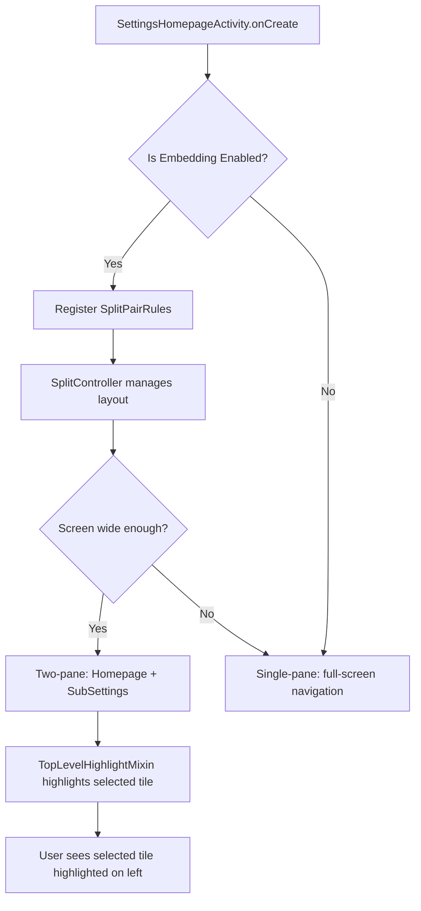

在双栏模式下，`SettingsActivity.shouldShowMultiPaneDeepLink()` 会检测深链 intent，
并通过主页跳板重定向它们。这确保两栏都可见。

### 50.6.5 主页图标配色方案

在 expressive 主题中，主页图标使用一种配色方案系统。每个磁贴都可以在其元数据中声明图标配色方案：

```java
// DashboardFeatureProviderImpl.java
@VisibleForTesting
enum ColorScheme {
    blue_variant(R.color.homepage_blue_variant_fg, R.color.homepage_blue_variant_bg),
    blue(R.color.homepage_blue_fg, R.color.homepage_blue_bg),
    pink(R.color.homepage_pink_fg, R.color.homepage_pink_bg),
    orange(R.color.homepage_orange_fg, R.color.homepage_orange_bg),
    yellow(R.color.homepage_yellow_fg, R.color.homepage_yellow_bg),
    green(R.color.homepage_green_fg, R.color.homepage_green_bg),
    grey(R.color.homepage_grey_fg, R.color.homepage_grey_bg),
    cyan(R.color.homepage_cyan_fg, R.color.homepage_cyan_bg),
    red(R.color.homepage_red_fg, R.color.homepage_red_bg),
    purple(R.color.homepage_purple_fg, R.color.homepage_purple_bg);
}
```

图标渲染为 `AdaptiveIcon`，前景被着色，背景用该方案的背景色填充。

### 50.6.6 设置向导集成

当设置应用在设置向导期间启动时，它会应用特殊主题和过渡效果：

```java
// SettingsBaseActivity.java
final boolean isAnySetupWizard = WizardManagerHelper.isAnySetupWizard(getIntent());
if (isAnySetupWizard) {
    TransitionHelper.applyForwardTransition(this);
    TransitionHelper.applyBackwardTransition(this);
    if (this instanceof SubSettings) {
        if (SettingsThemeHelper.isExpressiveTheme(this)) {
            setTheme(R.style.SettingsPreferenceTheme_SetupWizard_Expressive);
        } else {
            setTheme(R.style.SettingsPreferenceTheme_SetupWizard);
        }
        ThemeHelper.trySetSuwTheme(this);
    }
}
```

设置向导主题移除工具栏，添加滑动过渡，并使用 Google 的 SetupDesign 库以保持一致的观感。

### 50.6.7 边到边显示

现代 Android 设置应用使用边到边显示，内容延伸到系统栏后方。`SettingsBaseActivity` 中的
`Utils.setupEdgeToEdge()` 调用启用了此功能：

- 状态栏是透明的
- 导航栏是透明的
- 内容使用 `WindowInsetsCompat` 来设置内边距

### 50.6.8 圆角偏好设置适配器

在主页上，偏好设置使用 `RoundCornerPreferenceAdapter` 以圆角渲染：

```java
// TopLevelSettings.java
@Override
protected RecyclerView.Adapter onCreateAdapter(PreferenceScreen preferenceScreen) {
    if (mIsEmbeddingActivityEnabled && (getActivity() instanceof SettingsHomepageActivity)) {
        return mHighlightMixin.onCreateAdapter(this, preferenceScreen, mScrollNeeded);
    }
    return new RoundCornerPreferenceAdapter(preferenceScreen);
}
```

---

## 50.7 深入剖析：CategoryManager 与磁贴加载

### 50.7.1 作为单例的 CategoryManager

`CategoryManager` 是一个缓存所有仪表盘磁贴的单例。它是设置应用中磁贴数据的权威来源。

**源文件**：`packages/apps/Settings/src/com/android/settings/dashboard/CategoryManager.java`

```java
// CategoryManager.java
public static CategoryManager get(Context context) {
    if (sInstance == null) {
        sInstance = new CategoryManager(context);
    }
    return sInstance;
}
```

其核心数据结构：

| 字段 | 类型 | 用途 |
|-------|------|---------|
| `mTileByComponentCache` | `Map<Pair<String, String>, Tile>` | 包名+Activity 到 Tile 的映射 |
| `mCategoryByKeyMap` | `Map<String, DashboardCategory>` | 类别键到 DashboardCategory |
| `mCategories` | `List<DashboardCategory>` | 按顺序排列的所有类别 |
| `mInterestingConfigChanges` | `InterestingConfigChanges` | 检测语言环境/密度/主题变更 |

### 50.7.2 类别初始化流程

类别通过 `tryInitCategories()` 在首次访问时延迟初始化：

```java
// CategoryManager.java
private synchronized void tryInitCategories(Context context, boolean forceClearCache) {
    if (!WizardManagerHelper.isUserSetupComplete(context)) {
        return;  // Don't init during setup wizard
    }
    if (mCategories == null) {
        if (forceClearCache) {
            mTileByComponentCache.clear();
        }
        mCategoryByKeyMap.clear();
        mCategories = TileUtils.getCategories(context, mTileByComponentCache);
        for (DashboardCategory category : mCategories) {
            mCategoryByKeyMap.put(category.key, category);
        }
        backwardCompatCleanupForCategory(mTileByComponentCache, mCategoryByKeyMap);
        mergeSecurityPrivacyKeys(context, mTileByComponentCache, mCategoryByKeyMap);
        sortCategories(context, mCategoryByKeyMap);
        filterDuplicateTiles(mCategoryByKeyMap);
    }
}
```

`TileUtils.getCategories()` 向 `PackageManager` 查询所有具有
`com.android.settings.action.EXTRA_SETTINGS` action 的 activity，并按它们声明的类别进行分组。

### 50.7.3 后处理步骤

在原始磁贴加载完成后，`CategoryManager` 会应用几个后处理步骤：

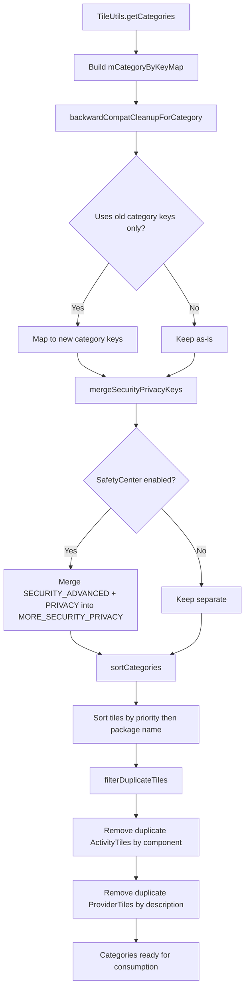

**向后兼容**：旧的类别键常量（Android P 之前）使用 `CategoryKey.KEY_COMPAT_MAP`
映射到当前键。

**安全/隐私合并**：当安全中心（SafetyCenter）启用时，来自
`CATEGORY_SECURITY_ADVANCED_SETTINGS` 和 `CATEGORY_PRIVACY` 的磁贴会被合并到
`CATEGORY_MORE_SECURITY_PRIVACY_SETTINGS`。

**去重**：指向同一组件的磁贴会被移除。对于 `ProviderTile` 实例，去重基于磁贴描述。

### 50.7.4 磁贴拒绝列表

`CategoryMixin`（由 `SettingsBaseActivity` 管理）维护着一个应被隐藏的组件的拒绝列表：

```java
// CategoryManager.java
public synchronized void updateCategoryFromDenylist(Set<ComponentName> tileDenylist) {
    for (int i = 0; i < mCategories.size(); i++) {
        DashboardCategory category = mCategories.get(i);
        for (int j = 0; j < category.getTilesCount(); j++) {
            Tile tile = category.getTile(j);
            if (tileDenylist.contains(tile.getIntent().getComponent())) {
                category.removeTile(j--);
            }
        }
    }
}
```

当硬件功能缺失时（例如没有 Wi-Fi 芯片、没有电池），
`SettingsActivity.doUpdateTilesList()` 会使用此方法。

---

## 50.8 深入剖析：SettingsPreferenceFragment

### 50.8.1 Fragment 基类

`SettingsPreferenceFragment` 是所有显示偏好设置列表的设置页面的基类。

**源文件**：`packages/apps/Settings/src/com/android/settings/SettingsPreferenceFragment.java`

```java
public abstract class SettingsPreferenceFragment extends InstrumentedPreferenceFragment
        implements DialogCreatable, HelpResourceProvider, Indexable {
```

它继承自 `InstrumentedPreferenceFragment`（该类提供指标/日志集成），并实现：

- `DialogCreatable` —— 托管具有稳定 ID 的对话框 fragment
- `HelpResourceProvider` —— 为溢出菜单提供帮助链接 URI
- `Indexable` —— 启用搜索索引

### 50.8.2 偏好设置高亮

当深链指向某个特定偏好设置时（例如从搜索结果中），
`SettingsPreferenceFragment` 使用 `HighlightablePreferenceGroupAdapter` 高亮它：

目标偏好设置键通过 `EXTRA_FRAGMENT_ARG_KEY` 传递：

```java
// SettingsActivity.java
public static final String EXTRA_FRAGMENT_ARG_KEY = ":settings:fragment_args_key";
```

该 fragment 读取此键，并在视图创建时滚动到匹配的偏好设置并将其高亮。

### 50.8.3 对话框管理

`SettingsPreferenceFragment` 提供了稳定的对话框托管机制。每个对话框由一个整数 ID 标识，
该 fragment 使用 `SettingsDialogFragment` 在配置更改之间管理对话框生命周期。

### 50.8.4 加载状态

对于异步加载数据的页面，`LoadingViewController` 会显示进度指示器，直到数据准备就绪。
这避免了先显示空屏幕、再突然弹出列表的刺眼效果。

### 50.8.5 RestrictedDashboardFragment

`RestrictedDashboardFragment` 增加了企业限制支持：

```java
// DevelopmentSettingsDashboardFragment.java
public DevelopmentSettingsDashboardFragment() {
    super(UserManager.DISALLOW_DEBUGGING_FEATURES);
}
```

当用户限制生效时，该 fragment 会显示管理员支持对话框或空状态消息，而不是偏好设置列表。

---

## 50.9 深入剖析：完整的开发者选项控制器列表

### 50.9.1 控制器注册

`DevelopmentSettingsDashboardFragment` 中的 `buildPreferenceControllers()` 方法创建超过
100 个控制器实例。以下是源代码中注册的控制器的一个有代表性的分类样本。
（少数冷门条目，例如 `HdcpCheckingPreferenceController` 和几个
`DefaultLaunchPreferenceController` 实例，已省略。）

**源文件**：`packages/apps/Settings/src/com/android/settings/development/DevelopmentSettingsDashboardFragment.java`（第 508-625 行）

#### 内存与诊断
- `MemoryUsagePreferenceController` —— 显示内存（RAM）使用情况
- `BugReportPreferenceController` —— 发送 bug 报告
- `BugReportHandlerPreferenceController` —— 选择 bug 报告处理应用
- `SystemServerHeapDumpPreferenceController` —— 转储 system_server 堆内存
- `DevelopmentMemtagPagePreferenceController` —— 内存标记（MTE）
- `AutomaticSystemServerHeapDumpPreferenceController` —— 低内存时自动转储堆内存

#### 安全与启动
- `OemUnlockPreferenceController` —— 启用 OEM bootloader 解锁
- `Enable16kPagesPreferenceController` —— 启用 16K 页大小（实验性）
- `LocalBackupPasswordPreferenceController` —— 桌面备份密码

#### 调试工具
- `AdbPreferenceController` —— USB 调试
- `ClearAdbKeysPreferenceController` —— 撤销 USB 调试授权
- `AdbWirelessDebuggingPreferenceController` —— 无线调试（通过 Wi-Fi 的 ADB）
- `AdbAuthorizationTimeoutPreferenceController` —— ADB 认证超时
- `LocalTerminalPreferenceController` —— 启用本地终端应用
- `LinuxTerminalPreferenceController` —— Linux 终端（Crostini 风格）
- `BugReportInPowerPreferenceController` —— 电源菜单中的 bug 报告
- `MockLocationAppPreferenceController` —— 模拟位置提供器
- `MockModemPreferenceController` —— 用于电话测试的模拟调制解调器
- `DebugViewAttributesPreferenceController` —— 视图属性检查
- `SelectDebugAppPreferenceController` —— 选择要调试的应用
- `WaitForDebuggerPreferenceController` —— 等待调试器连接
- `EnableGpuDebugLayersPreferenceController` —— GPU 调试层支持
- `GraphicsDriverEnableAngleAsSystemDriverController` —— 使用 ANGLE 作为系统 GPU 驱动
- `VerifyAppsOverUsbPreferenceController` —— 验证侧载应用
- `ArtVerifierPreferenceController` —— ART 字节码验证

#### 显示与渲染
- `PictureColorModePreferenceController` —— 广色域
- `WebViewAppPreferenceController` —— 选择 WebView 实现
- `WebViewDevUiPreferenceController` —— WebView 开发者工具
- `CoolColorTemperaturePreferenceController` —— 冷色温
- `ForcePeakRefreshRatePreferenceController` —— 强制最高刷新率
- `ShowTapsPreferenceController` —— 屏幕点击的视觉反馈
- `PointerLocationPreferenceController` —— 带有指针坐标的覆盖层
- `ShowKeyPressesPreferenceController` —— 按键的视觉反馈
- `TouchpadVisualizerPreferenceController` —— 触控板输入可视化器
- `ShowSurfaceUpdatesPreferenceController` —— surface 更新时闪烁
- `ShowLayoutBoundsPreferenceController` —— 绘制布局边界
- `ShowHdrSdrRatioPreferenceController` —— 显示 HDR/SDR 亮度比
- `ShowRefreshRatePreferenceController` —— 带有当前刷新率的覆盖层
- `RtlLayoutPreferenceController` —— 强制 RTL 布局方向
- `EmulateDisplayCutoutPreferenceController` —— 模拟显示屏挖孔
- `TransparentNavigationBarPreferenceController` —— 透明导航栏
- `SecondaryDisplayPreferenceController` —— 模拟副显示屏

#### 动画
- `WindowAnimationScalePreferenceController` —— 窗口动画速度
- `TransitionAnimationScalePreferenceController` —— Activity 过渡速度
- `AnimatorDurationScalePreferenceController` —— 动画器时长倍率

#### GPU 性能分析
- `GpuViewUpdatesPreferenceController` —— GPU 绘制时视图闪烁
- `HardwareLayersUpdatesPreferenceController` —— 硬件层闪烁
- `DebugGpuOverdrawPreferenceController` —— 用颜色区分过度绘制区域
- `DebugNonRectClipOperationsPreferenceController` —— 非矩形裁剪调试
- `ForceDarkPreferenceController` —— 对所有应用强制深色模式
- `ForceMSAAPreferenceController` —— 强制 4x MSAA 抗锯齿
- `HardwareOverlaysPreferenceController` —— 禁用硬件叠加层
- `SimulateColorSpacePreferenceController` —— 色盲模拟
- `ProfileGpuRenderingPreferenceController` —— GPU 渲染条形图性能分析
- `GameDefaultFrameRatePreferenceController` —— 默认游戏帧率

#### 网络
- `WifiDisplayCertificationPreferenceController` —— Wi-Fi Display 认证模式
- `WifiVerboseLoggingPreferenceController` —— 详细的 Wi-Fi 日志
- `WifiScanThrottlingPreferenceController` —— Wi-Fi 扫描节流
- `WifiNonPersistentMacRandomizationPreferenceController` —— 非持久化 MAC
- `MobileDataAlwaysOnPreferenceController` —— 保持移动数据激活
- `TetheringHardwareAccelPreferenceController` —— 网络共享硬件加速
- `IngressRateLimitPreferenceController` —— 网络入口速率限制

#### 蓝牙

与上面的分组不同，蓝牙开发者控制器*并非*由
`DevelopmentSettingsDashboardFragment` 构建。它唯一的蓝牙条目是一个针对键
`bluetooth_development_settings` 的 `DefaultLaunchPreferenceController`，
用于启动一个专门的子页面。该子页面的 fragment，
`BluetoothDevelopmentSettingsFragment`
（`packages/apps/Settings/src/com/android/settings/development/bluetooth/BluetoothDevelopmentSettingsFragment.kt`），
有自己的 `buildPreferenceControllers()`，注册以下控制器：

- `BluetoothDeviceNoNamePreferenceController` —— 显示无名称设备
- `BluetoothAbsoluteVolumePreferenceController` —— 禁用绝对音量
- `BluetoothAvrcpVersionPreferenceController` —— AVRCP 版本
- `BluetoothMapVersionPreferenceController` —— MAP 版本
- `BluetoothLeAudioModePreferenceController` —— LE Audio 模式
- `BluetoothLeAudioDeviceDetailsPreferenceController` —— LE 设备信息
- `BluetoothLeAudioAllowListPreferenceController` —— LE 允许列表
- `BluetoothA2dpHwOffloadPreferenceController` —— 禁用 A2DP 硬件卸载
- `BluetoothLeAudioHwOffloadPreferenceController` —— 禁用 LE audio 硬件卸载
- `BluetoothMaxConnectedAudioDevicesPreferenceController` —— 最大已连接设备数
- `BluetoothSnoopLogPreferenceController` —— HCI 嗅探日志
- `BluetoothSnoopLogFilterProfileMapPreferenceController` —— 嗅探日志 MAP 过滤器
- `BluetoothSnoopLogFilterProfilePbapPreferenceController` —— 嗅探日志 PBAP 过滤器
- `BluetoothCodecListPreferenceController` —— 音频编解码器选择
- `BluetoothSampleRateDialogPreferenceController` —— 音频采样率
- `BluetoothBitPerSampleDialogPreferenceController` —— 音频位深
- `BluetoothQualityDialogPreferenceController` —— 音频质量
- `BluetoothChannelModeDialogPreferenceController` —— 音频声道模式
- `BluetoothHDAudioPreferenceController` —— HD Audio 开关
- `BluetoothStackLogPreferenceController` —— 蓝牙协议栈日志级别

#### NFC
- `NfcSnoopLogPreferenceController` —— NFC HCI 嗅探日志
- `NfcVerboseVendorLogPreferenceController` —— 详细的 NFC 供应商日志

#### 音频
- `UsbAudioRoutingPreferenceController` —— 禁用 USB 音频路由

#### 进程管理
- `StayAwakePreferenceController` —— 充电时保持屏幕开启
- `StrictModePreferenceController` —— 违规时 StrictMode 闪烁
- `KeepActivitiesPreferenceController` —— 离开时销毁 activity
- `BackgroundProcessLimitPreferenceController` —— 后台进程限制
- `CachedAppsFreezerPreferenceController` —— 冻结缓存的应用
- `ShowFirstCrashDialogPreferenceController` —— 首次崩溃时显示崩溃对话框
- `AppsNotRespondingPreferenceController` —— 为后台应用显示 ANR 对话框
- `NotificationChannelWarningsPreferenceController` —— 通道警告 Toast
- `PhantomProcessPreferenceController` —— 幽灵进程监控

#### 日志
- `LogdSizePreferenceController` —— 日志记录器缓冲区大小（64K - 8M）
- `LogPersistPreferenceController` —— 重启后保留日志
- `EnableVerboseVendorLoggingPreferenceController` —— 供应商详细日志
- `PrintVerboseLoggingController` —— 打印服务详细日志

#### 桌面与窗口化
- `ResizableActivityPreferenceController` —— 强制 activity 可调整大小
- `FreeformWindowsPreferenceController` —— 自由窗口支持
- `DesktopModePreferenceController` —— 桌面模式
- `DesktopModeSecondaryDisplayPreferenceController` —— 在副显示屏上的桌面
- `DesktopExperiencePreferenceController` —— 完整桌面体验
- `NonResizableMultiWindowPreferenceController` —— 多窗口中不可调整大小

#### 其他
- `AllowAppsOnExternalPreferenceController` —— 外部存储上的应用
- `ShortcutManagerThrottlingPreferenceController` —— 快捷方式速率限制
- `EnableGnssRawMeasFullTrackingPreferenceController` —— 原始 GNSS 测量
- `DefaultUsbConfigurationPreferenceController` —— 默认 USB 模式
- `OverlaySettingsPreferenceController` —— 覆盖层设置
- `StylusHandwritingPreferenceController` —— 触控笔手写
- `ForceEnableNotesRolePreferenceController` —— 强制 Notes 角色
- `GrammaticalGenderPreferenceController` —— 语法性别覆盖
- `SensitiveContentProtectionPreferenceController` —— 内容敏感度
- `SharedDataPreferenceController` —— 共享存储
- `DisableAutomaticUpdatesPreferenceController` —— 禁用 OTA 更新
- `SelectDSUPreferenceController` —— 动态系统更新
- `AutofillCategoryController` —— 自动填充设置
- `AutofillLoggingLevelPreferenceController` —— 自动填充调试日志
- `AutofillResetOptionsPreferenceController` —— 重置自动填充状态

### 50.9.2 启用/禁用回调

当总开关切换时，每个控制器都会收到一个回调：

```java
// DevelopmentSettingsDashboardFragment.java
private void enableDeveloperOptions() {
    DevelopmentSettingsEnabler.setDevelopmentSettingsEnabled(getContext(), true);
    for (AbstractPreferenceController controller : mPreferenceControllers) {
        if (controller instanceof DeveloperOptionsPreferenceController) {
            ((DeveloperOptionsPreferenceController) controller).onDeveloperOptionsEnabled();
        }
    }
}

private void disableDeveloperOptions() {
    DevelopmentSettingsEnabler.setDevelopmentSettingsEnabled(getContext(), false);
    final SystemPropPoker poker = SystemPropPoker.getInstance();
    poker.blockPokes();
    for (AbstractPreferenceController controller : mPreferenceControllers) {
        if (controller instanceof DeveloperOptionsPreferenceController) {
            ((DeveloperOptionsPreferenceController) controller).onDeveloperOptionsDisabled();
        }
    }
    poker.unblockPokes();
    poker.poke();
}
```

`SystemPropPoker.blockPokes()` / `unblockPokes()` / `poke()` 序列确保系统属性变更被批量处理，
并且所有服务都恰好收到一次通知。

---

## 50.10 深入剖析：SettingsProvider 内部实现

### 50.10.1 SettingsState 与 XML 持久化

每个命名空间（system、secure、global）都由一个 `SettingsState` 对象支撑，
该对象负责内存缓存和 XML 持久化。

**源文件**：`frameworks/base/packages/SettingsProvider/src/com/android/providers/settings/SettingsState.java`

主要特性：

- 设置以 `ArrayMap<String, Setting>` 形式存储，以便快速按键查找
- 写入会被批处理，并通过 `Handler` 消息异步持久化
- XML 文件使用带版本号的格式，并支持默认值
- 回退副本机制会为崩溃恢复创建 `.fallback` 文件
  （`FALLBACK_FILE_SUFFIX = ".fallback"`）

### 50.10.2 设置键与类型

每个设置条目内部包含：

| 字段 | 描述 |
|-------|-------------|
| `name` | 设置键（例如 "screen_brightness"） |
| `value` | 当前值，以字符串形式表示 |
| `defaultValue` | 默认值（用于重置操作） |
| `packageName` | 最后写入此设置的包 |
| `tag` | 用于选择性重置的可选标记 |
| `defaultFromSystem` | 该设置的默认值是否由系统设置 |
| `id` | 用于变更跟踪的自增生成 ID |

### 50.10.3 生成跟踪

SettingsProvider 使用生成跟踪机制来进行高效变更检测。计数器位于
`GenerationRegistry`
（`frameworks/base/packages/SettingsProvider/src/com/android/providers/settings/GenerationRegistry.java`），
提供器在每次变更时通过 `incrementGeneration()` 递增它。客户端可以在读取请求中传入一个生成号，
提供器会返回数据是否发生了变化：

```java
// In the call() method
return packageValueForCallResult(SETTINGS_TYPE_GLOBAL, name, requestingUserId,
        Context.DEVICE_ID_DEFAULT, setting, isTrackingGeneration(args));
```

`Settings` 框架类在客户端使用此机制维护本地缓存。如果生成号没有变化，
就直接使用缓存值而不进行 IPC —— 这使得设置读取极其快速。

### 50.10.4 广播通知

除了 `ContentObserver` 之外，某些设置变更还会触发全系统广播。例如，更改 `AIRPLANE_MODE_ON`
会触发 `ACTION_AIRPLANE_MODE_CHANGED` 广播，所有感兴趣的应用都会收到它。

### 50.10.5 权限模型

| 命名空间 | 读取 | 写入 |
|-----------|------|-------|
| `Settings.System` | 所有应用 | `WRITE_SETTINGS`（app-op“特殊应用访问”，通过设置 > 修改系统设置授予） |
| `Settings.Secure` | 所有应用（仅公开键） | 签名级或 `WRITE_SECURE_SETTINGS` |
| `Settings.Global` | 所有应用（仅公开键） | 签名级或 `WRITE_SECURE_SETTINGS` |
| `DeviceConfig` | 系统应用 | `WRITE_DEVICE_CONFIG`（签名） |

从 Android S 开始，对非公开设置的读取访问受到限制。
提供器维护 `sReadableSecureSettings`、`sReadableSystemSettings`
和 `sReadableGlobalSettings` 集合，以定义哪些键可以公开读取。

### 50.10.6 针对第三方应用的设置限制

为防止滥用，提供器限制了第三方应用可以向 `Settings.System` 添加的自定义设置数量：

- 面向 API 22（Lollipop MR1）或更低版本的应用在添加自定义设置时会收到警告

- 面向 API 23+ 的应用被禁止添加自定义系统设置

当某个包被卸载时，它添加的所有设置都会被自动删除。

---

## 50.11 深入剖析：FeatureFactory 扩展点

### 50.11.1 架构

`FeatureFactory` 是设置应用主要的 OEM 扩展机制。它是一个抽象 Kotlin 类，
为每个子系统（dashboard、search、metrics、security 等）暴露一个提供器：

**源文件**：`packages/apps/Settings/src/com/android/settings/overlay/FeatureFactory.kt`

OEM 会覆写它。OEM 对 Application 进行子类化，并从 `getFeatureFactory()` 返回自定义的
`FeatureFactory`。不涉及任何资源字符串或反射（见 50.11.3）。

### 50.11.2 可用的提供器

| 提供器接口 | 默认实现 | OEM 可定制 |
|-------------------|----------------------|-------------------|
| `DashboardFeatureProvider` | `DashboardFeatureProviderImpl` | 磁贴绑定、图标样式 |
| `SearchFeatureProvider` | `SearchFeatureProviderImpl` | 搜索智能集成 |
| `MetricsFeatureProvider` | `SettingsMetricsFeatureProvider` | 分析/日志后端 |
| `SupportFeatureProvider` | (null) | 帮助与反馈集成 |
| `SecurityFeatureProvider` | `SecurityFeatureProviderImpl` | 安全设置定制 |
| `EnterprisePrivacyFeatureProvider` | `EnterprisePrivacyFeatureProviderImpl` | MDM 控制 |
| `AccountFeatureProvider` | `AccountFeatureProviderImpl` | 账户管理 |

### 50.11.3 工厂是如何加载的

没有反射，也没有 `config_featureFactory` 资源。`FeatureFactory`
是一个抽象 Kotlin 类，其伴生对象持有单例和一个 `setFactory` setter；
`SettingsApplication` 在 `attachBaseContext` 中安装具体的工厂：

```kotlin
// overlay/FeatureFactory.kt
abstract class FeatureFactory {
    // ... abstract / open provider members ...
    companion object {
        private var _factory: FeatureFactory? = null

        @JvmStatic
        val featureFactory: FeatureFactory
            get() = _factory
                ?: throw UnsupportedOperationException("No feature factory configured")

        @JvmStatic
        fun setFactory(appContext: Context, factory: FeatureFactory) {
            _appContext = appContext
            _factory = factory
        }
    }
}
```

```java
// SettingsApplication.java
@Override
protected void attachBaseContext(Context base) {
    super.attachBaseContext(base);
    FeatureFactory.setFactory(this, getFeatureFactory());
}

@NonNull
protected FeatureFactory getFeatureFactory() {
    return new FeatureFactoryImpl();
}
```

要定制设置应用，OEM 需对 `SettingsApplication` 进行子类化，并覆写
`getFeatureFactory()` 以返回自己的 `FeatureFactoryImpl` 子类。被选中的实例就是应用中其他各处
`FeatureFactory.getFeatureFactory()` 所返回的实例。

---

## 50.12 深入剖析：Slices 集成

### 50.12.1 设置 Slices

设置应用将单个偏好设置暴露为 Android **Slices** —— 可以嵌入到其他应用
（如 Google 应用或快捷设置）中的远程 UI 片段。

`SettingsSliceProvider`（位于 `packages/apps/Settings/src/com/android/settings/slices/`）
将偏好设置键映射到 Slice URI：

```
content://com.android.settings.slices/action/<preference_key>
```

每个 `BasePreferenceController` 都可以声明它的 slice 类型：

```java
// BasePreferenceController.java
@Override
public Uri getSliceUri() {
    return new Uri.Builder()
            .scheme(ContentResolver.SCHEME_CONTENT)
            .authority(SettingsSliceProvider.SLICE_AUTHORITY)
            .appendPath(SettingsSlicesContract.PATH_SETTING_ACTION)
            .appendPath(getPreferenceKey())
            .build();
}
```

### 50.12.2 Slice 类型

| 类型 | 行为 |
|------|-----------|
| `INTENT` | 点击该 slice 会打开设置页面 |
| `SWITCH` | slice 内含一个内联切换开关 |
| `SLIDER` | slice 内含一个内联滑块 |

---

## 50.13 深入剖析：AndroidManifest

### 50.13.1 规模与权限

设置应用的 `AndroidManifest.xml` 是 AOSP 中最大的清单文件之一。它声明了：

- 超过 150 个 activity（每个设置页面一个）
- 多个内容提供器（search、slices、biometric）
- 服务（dump 服务、设置服务）
- 广播接收器（开机、语言环境变更、包变更）

该应用以 `android.uid.system` 共享 UID 运行，从而获得系统级访问权限：

```xml
<manifest xmlns:android="http://schemas.android.com/apk/res/android"
    package="com.android.settings"
    coreApp="true"
    android:sharedUserId="android.uid.system">
```

它声明了一整套权限，包括：

```xml
<uses-permission android:name="android.permission.WRITE_SETTINGS" />
<uses-permission android:name="android.permission.WRITE_SECURE_SETTINGS" />
<uses-permission android:name="android.permission.DEVICE_POWER" />
<uses-permission android:name="android.permission.CHANGE_CONFIGURATION" />
<uses-permission android:name="android.permission.BLUETOOTH_PRIVILEGED" />
<uses-permission android:name="android.permission.MASTER_CLEAR" />
<uses-permission android:name="android.permission.READ_PRIVILEGED_PHONE_STATE" />
<uses-permission android:name="android.permission.MANAGE_USB" />
<uses-permission android:name="android.permission.MANAGE_USERS" />
```

### 50.13.2 Activity 声明模式

每个设置页面 activity 的声明都带有将其映射到 fragment 和高亮菜单键的元数据：

```xml
<activity
    android:name=".Settings$DevelopmentSettingsActivity"
    android:label="@string/development_settings_title"
    android:exported="true">
    <intent-filter android:priority="1">
        <action android:name="android.settings.APPLICATION_DEVELOPMENT_SETTINGS"/>
        <category android:name="android.intent.category.DEFAULT"/>
    </intent-filter>
    <meta-data
        android:name="com.android.settings.FRAGMENT_CLASS"
        android:value="com.android.settings.development.DevelopmentSettingsDashboardFragment"/>
    <meta-data
        android:name="com.android.settings.HIGHLIGHT_MENU_KEY"
        android:value="@string/menu_key_system"/>
</activity>
```

这个模式意味着：

- 外部应用可以启动 `android.settings.APPLICATION_DEVELOPMENT_SETTINGS`
- `SettingsActivity` 读取 `FRAGMENT_CLASS` 元数据，以知道要显示哪个
  fragment

- `HIGHLIGHT_MENU_KEY` 告诉双栏布局要高亮哪个主页磁贴

### 50.13.3 清单中的磁贴注入

设置应用自己的顶层条目*并非*来自清单磁贴注入 —— 它们是在 `res/xml/top_level_settings.xml`
中静态声明的。基于清单的磁贴机制主要是*其他*应用注入条目的方式。不过设置应用也将其用于
自己的一个界面。备份设置 activity 使用 `IA_SETTINGS` action 将自己标记为一个动态磁贴：

```xml
<activity android:name=".backup.UserBackupSettingsActivity"
    ...>
    <!-- Mark the activity as a dynamic setting -->
    <intent-filter>
        <action android:name="com.android.settings.action.IA_SETTINGS" />
    </intent-filter>
    <!-- Tell Settings app which category it belongs to -->
    <meta-data android:name="com.android.settings.category"
               android:value="com.android.settings.category.ia.system" />
    <meta-data android:name="com.android.settings.icon"
               android:resource="@drawable/ic_settings_backup" />
    <meta-data android:name="com.android.settings.order" android:value="-60"/>
</activity>
```

`order` 元数据控制磁贴在类别内的位置。

---

## 50.14 深入剖析：Catalyst / 设置页面架构（SPA）

### 50.14.1 Catalyst 迁移

AOSP 正在将设置页面从传统的 `DashboardFragment` + XML 方式迁移到一个名为
**Catalyst** 的声明式架构上。Catalyst 是早期基于 Compose 的 SPA（设置页面架构）的继任者。
两者目前都在发行版中，但在 Android 17 中，正在进行的迁移是在 Catalyst 中进行的。

迁移由两个标志位控制。第一个是
`com.android.settings.flags.catalyst`（在 `SettingsApplication.onCreate()` 中检查的总开关）。
第二个是滚动发布的按季度更新的标志位，例如 `catalystMigration26q2`。只有当某个界面自己的特性标志
启用时，该界面才会通过 Catalyst 渲染。

旧界面使用 XML `PreferenceScreen` 加上一组命令式的 `BasePreferenceController` 子类。
Catalyst 则将界面声明为一个用 `@ProvidePreferenceScreen` 注解的单个 Kotlin 类。该类*描述*
它的偏好设置层次结构。它还为实现所需行为（可用性、摘要、索引、生命周期）实现了小型提供器接口。
到 Android 17 为止，整个源码树中大约有 230 个这样的 `*Screen.kt` 类。该模型带来：

- 类型安全的偏好设置定义，取代基于字符串键的 XML
- UI、搜索索引和应用功能“设备状态”界面（§50.14.8）的唯一声明式事实来源
- 通过 Kotlin DSL 以编程方式组合偏好设置
- 按界面的特性标志门控，以及增量的混合模式迁移

**关键源文件**：

| 文件 | 角色 |
|------|------|
| `packages/apps/Settings/src/com/android/settings/CatalystSettingsActivity.kt` | 承载 Catalyst 界面的 Activity + fragment |
| `frameworks/base/packages/SettingsLib/Metadata/src/com/android/settingslib/metadata/Annotations.kt` | `@ProvidePreferenceScreen` / `@ProvidePreferenceScreenOptions` |
| `frameworks/base/packages/SettingsLib/Metadata/src/com/android/settingslib/metadata/PreferenceScreenRegistry.kt` | 界面工厂的运行时注册表 |
| `frameworks/base/packages/SettingsLib/Metadata/processor/` | 生成收集器的注解处理器 |

### 50.14.2 CatalystSettingsActivity

`CatalystSettingsActivity` 是一个 Kotlin 类，它继承
`SettingsActivity`，并支持按键绑定到某个偏好设置界面：

```kotlin
// CatalystSettingsActivity.kt
open class CatalystSettingsActivity
@JvmOverloads
constructor(
    private val bindingScreenKey: String,
    private val fragmentClass: Class<out PreferenceFragment> = CatalystFragment::class.java,
) : SettingsActivity() {

    override fun isValidFragment(fragmentName: String?) = fragmentName == fragmentClass.name

    override fun getInitialFragmentName(intent: Intent?): String = fragmentClass.name

    override fun getInitialFragmentArguments(intent: Intent?): Bundle? =
        (super.getInitialFragmentArguments(intent) ?: Bundle()).apply {
            putString(EXTRA_BINDING_SCREEN_KEY, bindingScreenKey)
            putBundle(EXTRA_BINDING_SCREEN_ARGS,
                intent?.getBundleExtra(EXTRA_BINDING_SCREEN_ARGS))
        }
}
```

几个页面已经迁移到了 Catalyst：

```java
// Settings.java -- Catalyst activities
public static class FirmwareVersionActivity extends CatalystSettingsActivity {
    public FirmwareVersionActivity() {
        super(FirmwareVersionScreen.KEY);
    }
}

public static class ResetDashboardActivity extends CatalystSettingsActivity {
    public ResetDashboardActivity() {
        super(ResetDashboardScreen.KEY, ResetDashboardFragment.class);
    }
}

public static class VibrationSettingsActivity extends CatalystSettingsActivity {
    public VibrationSettingsActivity() {
        super(VibrationScreen.KEY, VibrationSettings.class);
    }
}
```

### 50.14.3 CatalystFragment

`CatalystFragment` 刻意继承 `DashboardFragment`，而不是更朴素的 `PreferenceFragment`，
以便注入磁贴和偏好设置高亮继续工作。它从 `getPreferenceScreenResId()` 返回 `0`（没有 XML），
并根据从 `PreferenceScreenRegistry` 解析出的界面创建器，以编程方式构建界面：

```kotlin
// CatalystSettingsActivity.kt
open class CatalystFragment : DashboardFragment() {
    override fun getPreferenceScreenResId() = 0  // No XML resource

    override fun getLogTag(): String = javaClass.simpleName

    override fun getMetricsCategory() =
        context?.let { getPreferenceScreenCreator(it) as? Instrumentable }?.metricsCategory
            ?: METRICS_CATEGORY_UNKNOWN

    override fun onCreatePreferences(savedInstanceState: Bundle?, rootKey: String?) {
        preferenceScreen = createPreferenceScreen()
        refreshDashboardTiles(logTag)
    }
}
```

### 50.14.4 混合模式

一个界面很少会一次性切换到 Catalyst。在**混合模式**下，偏好设置层次结构仍然从 XML 填充，
但偏好设置*元数据*（标题、摘要、索引）来自 Catalyst 的 `Screen`。
`DashboardFragment` 通过 `isCatalystEnabled()` 控制这一点。在混合模式下，它会丢弃任何其键
已被 Catalyst 层次结构占用的旧控制器。这样两层就不会同时尝试驱动同一个偏好设置：

```java
// DashboardFragment.java
private void removeControllersForHybridMode() {
    Set<String> keys = getPreferenceKeysInHierarchy();
    Iterator<AbstractPreferenceController> iterator = mControllers.iterator();
    while (iterator.hasNext()) {
        AbstractPreferenceController controller = iterator.next();
        String key = controller.getPreferenceKey();
        if (keys.contains(key)) {
            Log.i(TAG, "Remove preference controller for " + key);
            iterator.remove();
        }
    }
}
```

### 50.14.5 声明式界面模型

决定性的 17 版变化在于，界面现在是一个*数据声明*，而不是一个 XML 文件加一堆控制器。
Catalyst 界面是一个用 `@ProvidePreferenceScreen(KEY)` 注解的 Kotlin 类，它混入了它所需的
提供器接口。`DataSaverScreen` 是一个简洁而有代表性的示例
（此处做了简化——真实的类还覆写了 `purpose` 和 `tags(context)`，
并通过 `isIndexable` 来控制可用性）：

```kotlin
// datausage/DataSaverScreen.kt
@ProvidePreferenceScreen(DataSaverScreen.KEY)
open class DataSaverScreen(context: Context) :
    PreferenceScreenMixin,
    PreferenceAvailabilityProvider,
    PreferenceSummaryProvider,
    PreferenceIndexableProvider,
    PreferenceLifecycleProvider {

    override val key get() = KEY
    override val title get() = R.string.data_saver_title
    override val icon: Int get() = R.drawable.ic_settings_data_usage

    override fun isAvailable(context: Context) =
        context.resources.getBoolean(R.bool.config_show_data_saver)

    override fun getSummary(context: Context): CharSequence? = when {
        dataSaverStore.getBoolean(DATA_SAVER_KEY) == true ->
            context.getString(R.string.data_saver_on)
        else -> context.getString(R.string.data_saver_off)
    }

    override fun getPreferenceHierarchy(context: Context, coroutineScope: CoroutineScope) =
        preferenceHierarchy(context) { +DataSaverMainSwitchPreference() }

    override fun isFlagEnabled(context: Context) =
        Flags.catalystRestrictBackgroundParentEntry()

    companion object { const val KEY = "restrict_background_parent_entry" }
}
```

有几件事值得指出：

- **`preferenceHierarchy { }`** 是来自 `settingslib/metadata` 的 DSL；一元
  `+` 运算符将一个子偏好设置添加到界面。嵌套分组和子界面以同样的方式组合，
  因此整棵页面树就是一个表达式。
- **提供器接口是可选加入的。** 需要对数据变化做出反应的界面会添加
  `PreferenceLifecycleProvider` 并实现 `onCreate` / `onStart` / `onResume`。
  它接收一个 `PreferenceLifecycleContext`。该界面可以使用此上下文调用
  `notifyPreferenceChange(key)`，并仅重新渲染受影响的行。
  `PreferenceAvailabilityProvider`、`PreferenceSummaryProvider` 和
  `PreferenceIndexableProvider` 同样把过去属于控制器的方法
  （`isAvailable`、`getSummary`、搜索索引）折叠进界面类中。
- **`isFlagEnabled()`** 是按界面的迁移门控。在标志翻转之前，旧的 XML + 控制器路径渲染该页面；
  之后则由 Catalyst 接管。

### 50.14.6 从注解到运行时：处理器、收集器、注册表

`@ProvidePreferenceScreen` 具有 `SOURCE` 保留期，因此它永远不会作为元数据进入 APK。
取而代之的是，位于
`frameworks/base/packages/SettingsLib/Metadata/processor/` 下的一个注解处理器在构建时扫描
每个带注解的类。它会生成一个*收集器*。`SettingsApplication` 上的
`@ProvidePreferenceScreenOptions` 注解配置收集器的名称：

```java
// SettingsApplication.java
@ProvidePreferenceScreenOptions(
        codegenCollector = "com.android.settings/PreferenceScreenCollector/get")
public class SettingsApplication extends Application {
```

在进程启动时，`SettingsApplication.onCreate()` 只在总开关打开时才接通 Catalyst，
将生成的工厂映射交给全局的 `PreferenceScreenRegistry`：

```java
// SettingsApplication.java
if (Flags.catalyst()) {
    PreferenceScreenRegistry.INSTANCE.setPreferenceScreenMetadataFactories(
            preferenceScreenFactories()); // returns PreferenceScreenCollector.get()
    PreferenceScreenRegistry.INSTANCE.setPreferenceUiActionMetricsLogger(
            new SettingsMetricsLogger(this));
    PreferenceBindingFactory.setDefaultFactory(new SettingsPreferenceBindingFactory());
}
```

`PreferenceScreenRegistry`（位于 `settingslib/metadata` 中）是一个 `object` 单例，
持有 `preferenceScreenMetadataFactories: FixedArrayMap<String,
PreferenceScreenMetadataFactory>`，按界面键索引。当
`CatalystSettingsActivity` 以 `bindingScreenKey` 启动时，fragment 会在注册表中查找该工厂，
并构建 `PreferenceScreenMetadata`。然后它将 `preferenceHierarchy` 实例化为真实的
`Preference` 控件。

同一个注册表还负责回答某个界面是否*参数化*。此类界面的内容取决于参数
（某个特定的 SIM、应用或账户）。该界面声明 `parameterized = true` 并暴露一个
`parameters(...)` 流程。注册表会枚举该流程。

这就是端到端的 Catalyst 链：

#### 从构建时注解到渲染页面的 Catalyst 界面流水线

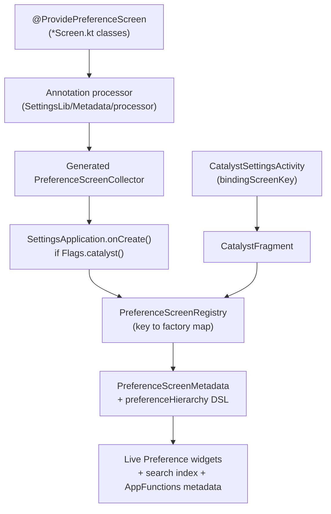

### 50.14.7 实例分析：监督仪表盘

Android 17 新增了一个顶层**监督（Supervision）**仪表盘
（`设置 > Supervision`），它基于 Catalyst 原生构建，整合了设备端的家长监督控制。
该功能包位于 `packages/apps/Settings/src/com/android/settings/supervision/`，
其入口页面由 `SupervisionDashboardScreen.kt` 声明：

```kotlin
// supervision/SupervisionDashboardScreen.kt
@ProvidePreferenceScreen(SupervisionDashboardScreen.KEY)
open class SupervisionDashboardScreen :
    PreferenceAvailabilityProvider,
    PreferenceScreenMixin,
    PreferenceLifecycleProvider,
    OnRoleHoldersChangedListener {
```

该界面把三个分组整合在一起。第一个是用于开/关监督的总开关。第二个是监督功能列表
（网页内容过滤器、应用商店过滤器，以及设备上的监督应用动态注入的功能）。
第三个是 PIN 管理的入口
（`supervision/credentialmanagement/SupervisionPinManagementScreen.kt`）。
它通过 `android.app.supervision.SupervisionManager` 与框架通信，并监视
`RoleManager.ROLE_SUPERVISION`，以便当监督应用发生变化时，
`onRoleHoldersChanged()` 会重建注入的功能列表。

一个标志位控制整个功能。`AndroidManifest.xml` 中的 activity 带有
`android:featureFlag="android.app.supervision.flags.enable_supervision_settings_screen"`。
该界面根据 `Flags.enableSupervisionSettingsUiUpdates()` 分支，以选择较旧的总开关布局
或较新的设置 PIN 流程。这个界面是 Catalyst 时代如何构建全新仪表盘的一个很好的模板。
它没有偏好设置 XML，也没有定制的控制器栈。它只有一个声明式的 `Screen` 类、
一个精简的 `CatalystFragment` 子类
（`SupervisionDashboardFragment`），以及清单中的一个
`CatalystSettingsActivity`。

### 50.14.8 API 优先：将设置暴露给设备端代理

声明式元数据的作用不止于绘制像素。它还是一个新的 **API 优先 / 应用功能（AppFunctions）** 界面
的事实来源，该界面让设备端代理能够读取并操作设置。相关管道位于
`packages/apps/Settings/src/com/android/settings/appfunctions/` 之下。在那里，
“设备状态”服务将每个 Catalyst 界面的元数据、当前值和可写性聚合成一份结构化文档。
代理可以查询这份文档并对其执行操作。

界面已经声明了它的标题、摘要、可用性和可索引状态。它还声明了（通过注册表中的
`PersistentPreference` / 读写许可）外部调用方是否可以更改某个值。因此应用功能层可以
在没有任何按设置定制的胶水代码的情况下暴露一个设置。

界面通过将某个偏好设置保持为不可写来将其排除在外。高敏感偏好设置会以
`writable = false` 上报，因此代理会被提前告知它们无法更改这些设置。
注册表带有 `defaultReadPermit` / `defaultWritePermit`
（`ReadWritePermit`），用于设定基线策略。读取默认被允许。
写入默认被禁止。随后按偏好设置的声明会细化该策略。

这就是为什么 Catalyst 迁移的意义超出了 UI 整洁性本身。每个迁移后的
`*Screen.kt` 都从同一份声明中同时产生一个渲染页面、一个搜索索引条目，
以及一项代理可寻址的能力。第 51 章将深入展开应用功能和设备端代理的故事。

---

## 50.15 深入剖析：测试设置应用

### 50.15.1 测试基础设施

设置应用在 `packages/apps/Settings/tests/` 下拥有一套全面的测试套件：

- **Robolectric 测试**：在宿主机 JVM 上运行的快速单元测试
- **插桩测试**：使用 AndroidX Test 的设备上测试
- **截图测试**：针对偏好设置布局的视觉回归测试

### 50.15.2 测试偏好设置控制器

每个 `BasePreferenceController` 都被设计为可独立测试：

```java
// Example test structure
@RunWith(RobolectricTestRunner.class)
public class WifiCallingPreferenceControllerTest {
    private Context mContext;
    private WifiCallingPreferenceController mController;

    @Before
    public void setUp() {
        mContext = RuntimeEnvironment.application;
        mController = new WifiCallingPreferenceController(mContext, "test_key");
    }

    @Test
    public void getAvailabilityStatus_wifiCallingSupported_returnsAvailable() {
        // Configure shadow PackageManager to report FEATURE_WIFI
        assertThat(mController.getAvailabilityStatus())
                .isEqualTo(BasePreferenceController.AVAILABLE);
    }
}
```

### 50.15.3 测试 DashboardFragment

`DashboardFragment` 提供了 `use()` 方法，使得检索和测试控制器变得容易：

```java
// In a fragment test
DevelopmentSettingsDashboardFragment fragment = new DevelopmentSettingsDashboardFragment();
AdbPreferenceController controller = fragment.use(AdbPreferenceController.class);
assertThat(controller).isNotNull();
```

### 50.15.4 测试搜索索引

可以通过检查以下内容来验证搜索系统：

1. 所有可索引的 fragment 都声明了 `SEARCH_INDEX_DATA_PROVIDER`
2. 不可索引的键与不可用的控制器相匹配
3. XML 资源可以无错误地解析

```bash
# Verify search indexing via adb
adb shell content query \
    --uri content://com.android.settings/settings/indexables_xml_res \
    --projection xmlResId,className
```

---

## 50.16 性能考量

### 50.16.1 延迟初始化控制器

偏好设置控制器在 `onAttach()` 期间通过反射实例化，对于拥有大量控制器的页面
（开发者选项有 100 多个）来说这可能代价高昂。设置应用通过以下方式缓解这一问题：

1. 使用 `AsyncTask` 进行磁贴列表更新
2. 为需要异步数据的控制器实现 `UiBlocker`
3. 对动态磁贴观察者使用带有 50ms 超时的 `CountDownLatch`

```java
// DashboardFragment.java
private static final long TIMEOUT_MILLIS = 50L;

private void awaitObserverLatch(CountDownLatch latch) {
    try {
        latch.await(TIMEOUT_MILLIS, TimeUnit.MILLISECONDS);
    } catch (InterruptedException e) {
        // Do nothing
    }
}
```

### 50.16.2 UI 阻塞器模式

某些偏好设置需要等待异步数据，之后才能确定其可见性。`UiBlocker` 接口标记了这些控制器：

```java
// BasePreferenceController.java
public interface UiBlocker {
}
```

`DashboardFragment` 中的 `UiBlockerController` 会隐藏所有偏好设置，直到每个
`UiBlocker` 控制器都报告完成。这避免了偏好设置逐个出现时布局不断变化的刺眼效果。

### 50.16.3 设置提供器缓存

`Settings` 框架类维护着一个按进程划分的设置值 LRU 缓存。
结合生成跟踪，大多数 `Settings.System.getInt()` 调用都不需要任何 IPC 即可完成。

### 50.16.4 偏好设置比较回调

`DashboardFragment` 在 `PreferenceManager` 上设置了一个 `SimplePreferenceComparisonCallback`，
以便在偏好设置列表发生变化时启用高效的 RecyclerView 动画：

```java
// DashboardFragment.java
@Override
public void onCreate(Bundle icicle) {
    super.onCreate(icicle);
    getPreferenceManager().setPreferenceComparisonCallback(
            new PreferenceManager.SimplePreferenceComparisonCallback());
}
```

---

## 50.17 深入剖析：用于双栏布局的 Activity Embedding

### 50.17.1 架构概览

在大屏设备（平板、折叠屏、ChromeOS）上，设置应用显示分屏布局：
左侧是主页列表，右侧是所选的子页面。这是使用 Jetpack WindowManager 库中的
**Activity Embedding** 实现的。

**源文件**：

- `packages/apps/Settings/src/com/android/settings/activityembedding/ActivityEmbeddingUtils.java`
- `packages/apps/Settings/src/com/android/settings/activityembedding/ActivityEmbeddingRulesController.java`

### 50.17.2 嵌入检测

`ActivityEmbeddingUtils.isEmbeddingActivityEnabled()` 检查设备和配置是否支持双栏嵌入：

- 屏幕必须足够宽（基于最小宽度）
- 特性标志必须已启用
- 设备不能处于设置向导中

这会在多个点进行检查：主页创建、fragment 过渡和深链处理。

### 50.17.3 分屏配对规则

`ActivityEmbeddingRulesController` 注册 `SplitPairRule` 对象，
这些对象定义了 activity 如何在分屏布局中配对：

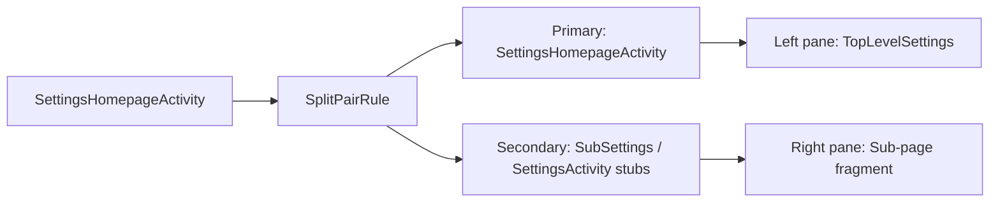

关键规则：

- 主页始终是主（左侧）activity
- 任何 `SubSettings` 或 `Settings.*Activity` 存根都会成为次（右侧）activity
- 设置 `clearTop`，以便导航到新的子页面时会替换右栏
- `finishSecondaryWithPrimary=true`，因此关闭主页会关闭所有内容

### 50.17.4 双栏模式下的深链处理

当设置应用收到深链 intent 时（例如来自通知或其他应用），
`SettingsActivity.shouldShowMultiPaneDeepLink()` 会决定是否以双栏模式显示它：

```java
// SettingsActivity.java
private boolean shouldShowMultiPaneDeepLink(Intent intent) {
    if (!ActivityEmbeddingUtils.isEmbeddingActivityEnabled(this)) {
        return false;
    }
    if (!isTaskRoot() && (intent.getFlags() & Intent.FLAG_ACTIVITY_NEW_TASK) == 0) {
        return false;
    }
    if (intent.getAction() == null) {
        return false;  // Not a deep link
    }
    if (isSubSettings(intent)) {
        return false;
    }
    return true;
}
```

如果需要双栏深链，`EmbeddedDeepLinkUtils.tryStartMultiPaneDeepLink()`
会通过主页 activity 跳板，以确保两栏都可见。

### 50.17.5 高亮 Mixin

`TopLevelHighlightMixin` 管理左栏中被选中磁贴的视觉高亮。
当某个子页面在右栏显示时，对应的主页磁贴会获得高亮背景：

```java
// TopLevelSettings.java
@Override
public boolean onPreferenceTreeClick(Preference preference) {
    if (isDuplicateClick(preference)) {
        return true;  // Prevent re-launching the same page
    }
    ActivityEmbeddingRulesController.registerSubSettingsPairRule(
            getContext(), true /* clearTop */);
    setHighlightPreferenceKey(preference.getKey());
    return super.onPreferenceTreeClick(preference);
}
```

高亮会适应配置更改（例如旋转）以及单栏和双栏模式之间的过渡。

### 50.17.6 SplitInfo 回调

主页 activity 通过 `SplitControllerCallbackAdapter` 监听分屏布局变化：

```java
// SettingsHomepageActivity.java
private SplitControllerCallbackAdapter mSplitControllerAdapter;
private SplitInfoCallback mCallback;
```

当分屏状态发生变化时（例如设备折叠/展开），回调会更新主页布局、图标可见性和高亮状态。

---

## 50.18 常用调试技术

### 50.18.1 检查设置值

```bash
# Read a specific setting
adb shell settings get system screen_brightness
adb shell settings get secure enabled_accessibility_services
adb shell settings get global development_settings_enabled

# Write a setting
adb shell settings put global development_settings_enabled 1

# List all settings in a namespace
adb shell settings list system
adb shell settings list secure
adb shell settings list global

# Delete a setting
adb shell settings delete system custom_setting_key
```

### 50.18.2 启动特定的设置页面

```bash
# Launch by action
adb shell am start -a android.settings.SETTINGS
adb shell am start -a android.settings.WIFI_SETTINGS
adb shell am start -a android.settings.BLUETOOTH_SETTINGS
adb shell am start -a android.settings.APPLICATION_DEVELOPMENT_SETTINGS
adb shell am start -a android.settings.DISPLAY_SETTINGS

# Launch by component
adb shell am start -n com.android.settings/.Settings\$DevelopmentSettingsActivity
adb shell am start -n com.android.settings/.Settings\$WifiSettingsActivity

# Launch a specific fragment
adb shell am start -n com.android.settings/.SubSettings \
    --es ":settings:show_fragment" \
    "com.android.settings.development.DevelopmentSettingsDashboardFragment"
```

### 50.18.3 调试磁贴注入

要查看加载了哪些磁贴及其类别：

```bash
# Dump the Settings app state
adb shell dumpsys activity providers com.android.settings

# Check which activities have the settings action
adb shell pm query-activities -a com.android.settings.action.EXTRA_SETTINGS
```

### 50.18.4 调试搜索索引

```bash
# There is no re-index broadcast receiver in AOSP. Re-indexing is driven from the
# search UI: SearchFragment calls updateIndexAsync(), which re-indexes when the
# stored build fingerprint or locale is stale. To force a rebuild, clear the index
# database so the next search opens with an empty/stale fingerprint, then launch
# Settings search.
adb shell pm clear com.android.settings.intelligence
adb shell am start -a com.android.settings.action.SETTINGS_SEARCH

# Query the search-indexables provider directly (requires the
# READ_SEARCH_INDEXABLES permission, so run as root)
adb shell content query \
    --uri content://com.android.settings/settings/indexables_xml_res
```

### 50.18.5 监视设置变更

`settings` shell 工具只支持 `get`、`put`、`delete`、`list` 和 `reset` —— 没有实时监视动词。
要观察变更，要么从测试应用注册一个 `ContentObserver`，要么对提供器状态的快照做差异比较：

```bash
# Snapshot the full SettingsProvider state, change something, diff again
adb shell dumpsys settings > before.txt
# ... make a change in the Settings UI ...
adb shell dumpsys settings > after.txt
diff before.txt after.txt
```

### 50.18.6 SettingsProvider Dump

```bash
# Dump complete SettingsProvider state
adb shell dumpsys settings

# This shows:
# - All global, secure, and system settings for each user
# - Generation numbers
# - Default values
# - Package ownership
```

---

## 50.19 深入剖析：设置向导库栈

50.6.6 节展示了设置应用注意到自己已在设置流程中启动，并据此重新设置主题。那个检查是一个契约的可见末端，
而该契约背后有一个库。在开箱设置期间，设备运行的并不是一个包揽一切的应用。
它运行的是一个由 activity 组成的*脚本* —— 选择语言、加入网络、恢复备份、登录、设置屏幕锁定。
其中许多步骤位于普通的系统应用（如设置应用）中。必须有某种东西让十几个由不同团队拥有的界面
看起来像同一个产品，并就“下一步”的含义达成一致。

这个东西就是源码树中的一个小型库栈。本节介绍它们提供了什么。共有三个库，
而且名字令人困惑地相似，因此本节还会展示某个给定应用实际上链接的是哪一个。

### 50.19.1 三个库，同一血脉

设置向导应用本身（拥有脚本和品牌的那个东西）不在 AOSP 中。*在* AOSP 中的是它发布的契约，
以及它的各个步骤被期望使用的控件工具包：

| 路径 | Java 包 | 角色 |
|---|---|---|
| `external/setupcompat` | `com.google.android.setupcompat` | 契约与外观：向导管理器 intent 协议、底部按钮栏、系统栏处理、合作伙伴配置 |
| `external/setupdesign` | `com.google.android.setupdesign` | 观感：Glif 布局家族、声明式条目层次结构、分隔线和插图 |
| `frameworks/opt/setupwizard` | `com.android.setupwizardlib` | 最初的 AOSP 库，已被上面两个取代 |

第三个条目是需要特别注意的，因为它的名字最显眼，却是最少被使用的。
`frameworks/opt/setupwizard` 是较旧的库；现代库栈位于 `external/` 之下，
并带有 `com.google.android` 包名。设置应用链接的是现代的那一对 ——
它的源码导入 `com.google.android.setupcompat.util.WizardManagerHelper`、
`com.google.android.setupcompat.template.FooterBarMixin` 和
`com.google.android.setupdesign.DividerItemDecoration`，
而不是 `com.android.setupwizardlib` 的对应物。

在当前的源码树中，这个旧版库只剩下两个树内使用者。
一个是 `frameworks/base/packages/SimAppDialog`。另一个是车载库
`frameworks/opt/car/setupwizard`。它自己的头文件将
`CarWizardManagerHelper` 描述为“源自
`com.android.setupwizardlib/WizardManagerHelper.java`”
（`frameworks/opt/car/setupwizard/library/main/src/com/android/car/setupwizardlib/util/CarWizardManagerHelper.java:23`）。
第 62 章介绍了该库所服务的车载设置流程。

这三个库共享同一种设计，因此阅读旧的那个并非白费功夫。下面的模板与 mixin 机制在两者中都有出现。
`GlifLayout`、`GlifListLayout`、`GlifPatternDrawable` 以及 `items/` 层次结构在两个包名下都存在。
当你跟随堆栈跟踪时，包前缀会告诉你处于哪一代。

### 50.19.2 向导管理器 Intent 契约

这个流程是一条 activity 链，而 `WizardManagerHelper`
（`external/setupcompat/main/java/com/google/android/setupcompat/util/WizardManagerHelper.java`）
就是将它们串起来的整个协议。一个步骤不知道接下来会发生什么。它通过请求下一个 intent 并启动它来结束：

```java
public static final String ACTION_NEXT = "com.android.wizard.NEXT";   // :54

public static Intent getNextIntent(Intent originalIntent, int resultCode) {  // :112
```

`getNextIntent` 构建一个携带原始 intent 的向导管理器 extra 以及结果代码的 `ACTION_NEXT` intent。
设置向导会监听该 action。它会查阅自己的脚本，并启动接下来的任何步骤。
该步骤对路由的唯一影响就是结果代码。`ResultCodes`
（`external/setupcompat/main/java/com/google/android/setupcompat/util/ResultCodes.java:24`）
在通常的 OK 和 CANCELED 之外，还为它提供了一小套词汇：`RESULT_SKIP`、
`RESULT_RETRY`、`RESULT_ACTIVITY_NOT_FOUND`、`RESULT_LIFECYCLE_NOT_MATCHED`、
`RESULT_FLOW_NOT_MATCHED`。

随之传递的 extra 会告诉某个步骤它正处在哪种运行中。
它们是 `EXTRA_WIZARD_BUNDLE` (:56)、`EXTRA_IS_FIRST_RUN` (:62)、`EXTRA_IS_DEFERRED_SETUP`
(:65)、`EXTRA_IS_PRE_DEFERRED_SETUP` (:68)、`EXTRA_IS_PORTAL_SETUP` (:71)、
`EXTRA_THEME` (:96) 和 `EXTRA_USE_IMMERSIVE_MODE` (:97)。在流程中启动另一个 activity 的
activity 应该通过 `copyWizardManagerExtras` (:146) 转发它们。如果它们被丢弃，
下一个屏幕就会失去它的主题和它对自身所处位置的感知。

该辅助类的两个谓词回答了一个远远超出设置范畴的问题，而且它们有 50.4 节表格化的设置键作为支撑：

```java
public static boolean isUserSetupComplete(Context context)   // :188
public static boolean isDeviceProvisioned(Context context)   // :203
```

这些方法读取 `Settings.Secure.user_setup_complete` 和
`Settings.Global.device_provisioned` (:99-100)。平台的其余部分大量行为都建立在这两个标志之上。
这就是为什么 50.6.6 节用 `isUserSetupComplete` 来保护初始化。在开箱设置中途启动其正常工作的系统应用
是一个 bug，而不是特性。

设置应用实际上调用的是 `isAnySetupWizard` (:264) 来决定它的主题。
该谓词比 `isSetupWizardIntent` (:175) 更宽泛。对于延迟设置和预延迟设置变体以及首次运行流程，
它都为真。因此，几周后从“完成设备设置”到达的屏幕仍然能正确地穿着打扮。

### 50.19.3 模板与 Mixin

布局侧解决的是一个不同的问题。不同团队编写各个步骤。
这些步骤必须共享一个页眉、一个图标、一个进度指示器和一个底部按钮栏。
它们必须在不共享基类 activity 的情况下做到这一点。这些库用组合而非继承来解决这个问题。

`TemplateLayout`
（`external/setupcompat/main/java/com/google/android/setupcompat/internal/TemplateLayout.java:45`）
是一个 `FrameLayout`，它会填充一个模板资源，在其中定位一个容器，然后把子视图重定向进该容器：

```java
@Override
public void addView(View child, int index, ViewGroup.LayoutParams params) {  // :131
  container.addView(child, index, params);
}
```

因此，一个 activity 可以把自己的内容写得就像它是整个屏幕一样，而模板会将其包裹在共享的外观中。
**Mixin** 提供该外观的行为。它们按类标记注册，并以同样的方式检索：

```java
protected <M extends Mixin> void registerMixin(Class<M> cls, M mixin)   // :98
public <M extends Mixin> M getMixin(Class<M> cls)                       // :126
```

`Mixin` 本身是一个没有方法的标记接口。该映射使用 `Class` 标记作为键，而不是具体类型，
因此替换可以生效。一个模板可以用基类标记注册一个子类。请求基类的调用方会得到专门化的行为。
它们并不知道它的存在。

一个应用看到的布局层次结构是
`GlifLayout` → `PartnerCustomizationLayout` → `TemplateLayout`
（`external/setupdesign/main/src/com/google/android/setupdesign/GlifLayout.java:111`，
`external/setupcompat/main/java/com/google/android/setupcompat/PartnerCustomizationLayout.java:62`），
这也是分工的方式：设计、OEM 定制、机制。
`GlifLayout` 的构造函数注册了设置屏幕可以预期的那一组 mixin
（`GlifLayout.java:174-188`）—— `HeaderMixin`、`DescriptionMixin`、`IconMixin`、
`ProfileMixin`、`ProgressBarMixin`、`IllustrationProgressMixin` 和
`RequireScrollMixin` 等。

有两个 mixin 需要仔细看看。`FooterBarMixin`
（`external/setupcompat/main/java/com/google/android/setupcompat/template/FooterBarMixin.java:83`）
拥有每个设置屏幕底部的主按钮和次按钮
（`setPrimaryButton` 在 :559，`setSecondaryButton` 在 :667）。这就是为什么不同应用拥有的屏幕上，
“下一步”和“跳过”会位于屏幕的同一位置。它们在每个屏幕上也拥有相同的样式。

`RequireScrollMixin`
（`external/setupdesign/main/src/com/google/android/setupdesign/template/RequireScrollMixin.java:47`）
是更有趣的一个，因为它编码的是一条要求而不是一种样式。它自己的文档说，它要求
“一个可滚动的容器……滚动到底部，确保用户看到折叠线以上和以下的所有内容”。
`requireScrollWithButton` (:191) 实现了这一点。在用户滚动过内容之前，
它把底部的主按钮变成一个“更多”的 affordance。

同意和法律屏幕正是为此而存在的理由。
它区分了被展示了条款的用户和有过阅读条款机会的用户。

### 50.19.4 合作伙伴配置

OEM 需要设置流程携带它们的品牌。为每台设备分叉这些库将无法维护。
`PartnerConfigHelper`
（`external/setupcompat/partnerconfig/java/com/google/android/setupcompat/partnerconfig/PartnerConfigHelper.java:54`）
反转了依赖关系：设备上的设置向导暴露一个内容提供器，而库去查询它。

```java
public static final String SUW_AUTHORITY = "com.google.android.setupwizard.partner";  // :58
static final String SUW_GET_PARTNER_CONFIG_METHOD = "getOverlayConfig";               // :60
```

该辅助类通过 `ContentResolver.call` 调用该方法，并缓存返回的 bundle。
`PartnerConfig` 枚举为各个调节项命名：
`CONFIG_STATUS_BAR_BACKGROUND`、`CONFIG_LIGHT_STATUS_BAR`、
`CONFIG_NAVIGATION_BAR_BG_COLOR`、`CONFIG_FOOTER_BAR_BG_COLOR`、
`CONFIG_FOOTER_BAR_MIN_HEIGHT` 等等。因此合作伙伴通过发布值来调整外观，而不是打补丁布局。
`PartnerCustomizationLayout` 位于 `GlifLayout` 和 `TemplateLayout` 之间。
这些值就是在此处应用的。

### 50.19.5 这对设置应用意味着什么

这两部分合在一起解释了 50.6.6 节中的代码。当设置应用作为设置步骤运行时，
它是别人流程中的客人。它必须看起来与周围的屏幕一致（因此有了 `ThemeHelper.trySetSuwTheme` 和
`SetupWizard` 主题变体）。它绝不能显示自己的工具栏或导航 affordance
（因此有了围绕工具栏设置和向上导航的 `isAnySetupWizard` 保护）。
它必须通过 `getNextIntent` 把控制权交回去。它不能简单地结束。

这也解释了为设置应用添加功能的人会遇到的一个约束。任何在启动时运行的代码，
在执行任何用户可见的操作之前，都必须询问设置是否已完成。
50.6.6 节引用的 `isUserSetupComplete` 检查并不是防御性编程。它是流程契约。
在设置期间，用户应该只看到向导放置在那里的屏幕。

---

## 50.20 关键源文件参考

为方便查阅，以下是本章讨论的所有关键源文件的汇总列表：

| 文件 | 用途 |
|------|---------|
| `packages/apps/Settings/src/com/android/settings/SettingsActivity.java` | Fragment 宿主 activity |
| `packages/apps/Settings/src/com/android/settings/Settings.java` | 150+ 个 activity 存根类 |
| `packages/apps/Settings/src/com/android/settings/core/SettingsBaseActivity.java` | 带有工具栏、CategoryMixin 的基类 activity |
| `packages/apps/Settings/src/com/android/settings/core/BasePreferenceController.java` | 偏好设置控制器基类 |
| `packages/apps/Settings/src/com/android/settings/core/gateway/SettingsGateway.java` | 用于安全的 fragment 允许列表 |
| `packages/apps/Settings/src/com/android/settings/dashboard/DashboardFragment.java` | 仪表盘 fragment 基类 |
| `packages/apps/Settings/src/com/android/settings/dashboard/DashboardFragmentRegistry.java` | 类别键到 fragment 的映射 |
| `packages/apps/Settings/src/com/android/settings/dashboard/DashboardFeatureProviderImpl.java` | 磁贴绑定实现 |
| `packages/apps/Settings/src/com/android/settings/dashboard/CategoryManager.java` | 磁贴缓存与加载器单例 |
| `packages/apps/Settings/src/com/android/settings/homepage/SettingsHomepageActivity.java` | 支持双栏的主页 activity |
| `packages/apps/Settings/src/com/android/settings/homepage/TopLevelSettings.java` | 主页仪表盘 fragment |
| `packages/apps/Settings/src/com/android/settings/development/DevelopmentSettingsDashboardFragment.java` | 开发者选项页面 |
| `packages/apps/Settings/src/com/android/settings/deviceinfo/BuildNumberPreferenceController.java` | 7 次点击彩蛋控制器 |
| `packages/apps/Settings/src/com/android/settings/search/BaseSearchIndexProvider.java` | 搜索索引数据提供器基类 |
| `packages/apps/Settings/src/com/android/settings/search/SettingsSearchIndexablesProvider.java` | 用于搜索索引的 ContentProvider |
| `packages/apps/Settings/src/com/android/settings/search/SearchFeatureProvider.java` | 搜索功能抽象 |
| `packages/apps/Settings/src/com/android/settings/SettingsPreferenceFragment.java` | 偏好设置 fragment 基类 |
| `packages/apps/Settings/src/com/android/settings/deviceinfo/aboutphone/MyDeviceInfoFragment.java` | 关于手机页面 |
| `packages/apps/Settings/src/com/android/settings/activityembedding/ActivityEmbeddingUtils.java` | 双栏检测 |
| `packages/apps/Settings/src/com/android/settings/CatalystSettingsActivity.kt` | Catalyst 界面宿主 activity + fragment |
| `packages/apps/Settings/src/com/android/settings/datausage/DataSaverScreen.kt` | 代表性的 `@ProvidePreferenceScreen` 示例 |
| `packages/apps/Settings/src/com/android/settings/supervision/SupervisionDashboardScreen.kt` | 监督仪表盘（Catalyst） |
| `packages/apps/Settings/src/com/android/settings/development/desktopexperience/DesktopExperiencePreferenceController.java` | 桌面体验开发者开关 |
| `frameworks/base/packages/SettingsLib/Metadata/src/com/android/settingslib/metadata/Annotations.kt` | `@ProvidePreferenceScreen` 注解 |
| `frameworks/base/packages/SettingsLib/Metadata/src/com/android/settingslib/metadata/PreferenceScreenRegistry.kt` | 运行时界面工厂注册表 |
| `packages/apps/Settings/res/xml/top_level_settings.xml` | 主页 XML 布局 |
| `frameworks/base/packages/SettingsProvider/src/com/android/providers/settings/SettingsProvider.java` | 设置内容提供器 |
| `frameworks/base/packages/SettingsProvider/src/com/android/providers/settings/SettingsState.java` | 按命名空间的设置存储 |
| `external/setupcompat/main/java/com/google/android/setupcompat/util/WizardManagerHelper.java` | 向导管理器 intent 契约：`ACTION_NEXT`、`getNextIntent`、设置状态谓词 |
| `external/setupcompat/main/java/com/google/android/setupcompat/util/ResultCodes.java` | 设置步骤可以返回的结果词汇（`RESULT_SKIP`、`RESULT_RETRY`，……） |
| `external/setupcompat/main/java/com/google/android/setupcompat/internal/TemplateLayout.java` | 模板容器与 `registerMixin`/`getMixin` 机制 |
| `external/setupcompat/main/java/com/google/android/setupcompat/PartnerCustomizationLayout.java` | 在模板与设计层之间应用合作伙伴配置 |
| `external/setupcompat/main/java/com/google/android/setupcompat/template/FooterBarMixin.java` | 共享的主/次底部按钮 |
| `external/setupcompat/partnerconfig/java/com/google/android/setupcompat/partnerconfig/PartnerConfigHelper.java` | 从设置向导的内容提供器读取 OEM 外观覆盖 |
| `external/setupdesign/main/src/com/google/android/setupdesign/GlifLayout.java` | Glif 屏幕模板及其注册的 mixin |
| `external/setupdesign/main/src/com/google/android/setupdesign/template/RequireScrollMixin.java` | 要求滚动到底部后才让主按钮生效 |
| `frameworks/opt/setupwizard/library/` | 旧版的 `com.android.setupwizardlib`，已被上面两个库取代 |

---

## 50.21 动手实践：添加自定义设置页面

本节完整演示如何为设置应用构建一个自定义设置页面。它从 XML 定义讲起，经过偏好设置控制器，
一直到搜索集成。

### 50.21.1 第 1 步：定义偏好设置 XML

创建一个新的 XML 偏好设置界面。在这个示例中，我们将构建一个带有开关和列表偏好设置的
“自定义实验室（Custom Lab）”页面：

```xml
<!-- res/xml/custom_lab_settings.xml -->
<?xml version="1.0" encoding="utf-8"?>
<PreferenceScreen
    xmlns:android="http://schemas.android.com/apk/res/android"
    xmlns:settings="http://schemas.android.com/apk/res-auto"
    android:title="@string/custom_lab_title">

    <SwitchPreferenceCompat
        android:key="custom_lab_feature_toggle"
        android:title="Enable Lab Feature"
        android:summary="Toggles the experimental lab feature"
        settings:controller="com.android.settings.development.CustomLabToggleController"/>

    <ListPreference
        android:key="custom_lab_mode"
        android:title="Lab Mode"
        android:summary="%s"
        android:entries="@array/custom_lab_mode_entries"
        android:entryValues="@array/custom_lab_mode_values"
        settings:controller="com.android.settings.development.CustomLabModeController"/>

    <Preference
        android:key="custom_lab_info"
        android:title="Lab Information"
        android:summary="Displays information about the custom lab"
        android:selectable="false"/>

</PreferenceScreen>
```

### 50.21.2 第 2 步：创建 DashboardFragment

创建一个继承 `DashboardFragment` 的新 fragment：

```java
// src/com/android/settings/development/CustomLabFragment.java
package com.android.settings.development;

import android.app.settings.SettingsEnums;
import android.content.Context;
import com.android.settings.R;
import com.android.settings.dashboard.DashboardFragment;
import com.android.settings.search.BaseSearchIndexProvider;
import com.android.settingslib.search.SearchIndexable;

@SearchIndexable
public class CustomLabFragment extends DashboardFragment {

    private static final String TAG = "CustomLabFragment";

    @Override
    protected int getPreferenceScreenResId() {
        return R.xml.custom_lab_settings;
    }

    @Override
    protected String getLogTag() {
        return TAG;
    }

    @Override
    public int getMetricsCategory() {
        return SettingsEnums.PAGE_UNKNOWN;  // Use a proper enum in production
    }

    public static final BaseSearchIndexProvider SEARCH_INDEX_DATA_PROVIDER =
            new BaseSearchIndexProvider(R.xml.custom_lab_settings);
}
```

### 50.21.3 第 3 步：创建偏好设置控制器

创建一个读取/写入设置的开关控制器：

```java
// src/com/android/settings/development/CustomLabToggleController.java
package com.android.settings.development;

import android.content.Context;
import android.provider.Settings;
import com.android.settings.core.TogglePreferenceController;

public class CustomLabToggleController extends TogglePreferenceController {

    private static final String SETTING_KEY = "custom_lab_feature_enabled";

    public CustomLabToggleController(Context context, String preferenceKey) {
        super(context, preferenceKey);
    }

    @Override
    public int getAvailabilityStatus() {
        return AVAILABLE;
    }

    @Override
    public boolean isChecked() {
        return Settings.System.getInt(mContext.getContentResolver(),
                SETTING_KEY, 0) == 1;
    }

    @Override
    public boolean setChecked(boolean isChecked) {
        return Settings.System.putInt(mContext.getContentResolver(),
                SETTING_KEY, isChecked ? 1 : 0);
    }

    @Override
    public int getSliceHighlightMenuRes() {
        return 0;  // Not used in Slices
    }
}
```

### 50.21.4 第 4 步：在 SettingsGateway 中注册

将 fragment 添加到 `SettingsGateway.java` 中的 `ENTRY_FRAGMENTS` 数组，
以便 `SettingsActivity` 会接受它：

```java
// SettingsGateway.java
public static final String[] ENTRY_FRAGMENTS = {
    // ... existing entries ...
    CustomLabFragment.class.getName(),
};
```

### 50.21.5 第 5 步：创建 Activity 存根

在 `Settings.java` 中添加一个内部类：

```java
// Settings.java
public static class CustomLabActivity extends SettingsActivity { /* empty */ }
```

### 50.21.6 第 6 步：在 AndroidManifest.xml 中声明

添加带有指向 fragment 的元数据的 activity 声明：

```xml
<activity
    android:name="Settings$CustomLabActivity"
    android:label="@string/custom_lab_title"
    android:exported="true">
    <intent-filter android:priority="1">
        <action android:name="android.settings.CUSTOM_LAB_SETTINGS"/>
        <category android:name="android.intent.category.DEFAULT"/>
    </intent-filter>
    <meta-data
        android:name="com.android.settings.FRAGMENT_CLASS"
        android:value="com.android.settings.development.CustomLabFragment"/>
    <meta-data
        android:name="com.android.settings.HIGHLIGHT_MENU_KEY"
        android:value="@string/menu_key_system"/>
</activity>
```

### 50.21.7 第 7 步：从系统设置添加链接

为了让新页面可以访问，在现有的 XML 界面中添加一个偏好设置
（例如 `res/xml/system_dashboard_fragment.xml`）：

```xml
<Preference
    android:key="custom_lab"
    android:title="@string/custom_lab_title"
    android:summary="@string/custom_lab_summary"
    android:fragment="com.android.settings.development.CustomLabFragment"/>
```

### 50.21.8 第 8 步：使其可被搜索

我们在第 2 步中添加的 `@SearchIndexable` 注解和 `SEARCH_INDEX_DATA_PROVIDER` 字段就足够了。
编译时注解处理器会将该 fragment 包含进搜索索引。

要验证，你可以查询索引：

```bash
adb shell content query \
  --uri content://com.android.settings/settings/indexables_xml_res \
  | grep custom_lab
```

### 50.21.9 完整生命周期图

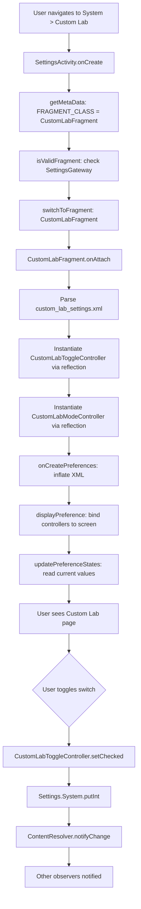

### 50.21.10 测试你的自定义页面

在模拟器上运行设置应用：

```bash
# Build and flash
m Settings -j$(nproc)
adb install -r $OUT/system_ext/priv-app/Settings/Settings.apk

# Launch the custom page directly
adb shell am start -n com.android.settings/.Settings\$CustomLabActivity

# Or via the action
adb shell am start -a android.settings.CUSTOM_LAB_SETTINGS

# Verify the setting is written
adb shell settings get system custom_lab_feature_enabled
```

你也可以测试搜索集成。打开设置应用，点击搜索栏，
并输入 "Lab"。如果搜索索引已被刷新，自定义偏好设置应该会出现
在结果中。

### 50.21.11 进阶：向主页添加磁贴

要将你的页面作为磁贴注入主页，请修改
`res/xml/top_level_settings.xml`，添加一个 `HomepagePreference`：

```xml
<com.android.settings.widget.HomepagePreference
    android:fragment="com.android.settings.development.CustomLabFragment"
    android:icon="@drawable/ic_custom_lab"
    android:key="top_level_custom_lab"
    android:order="50"
    android:title="@string/custom_lab_title"
    android:summary="@string/custom_lab_summary"
    settings:highlightableMenuKey="@string/menu_key_custom_lab"
    settings:controller="com.android.settings.development.CustomLabHomepageController"/>
```

并在 `DashboardFragmentRegistry` 中注册类别映射：

```java
PARENT_TO_CATEGORY_KEY_MAP.put(
    CustomLabFragment.class.getName(), "com.android.settings.category.custom_lab");
```

### 50.21.12 进阶：通过 FeatureFactory 进行 OEM 定制

OEM 无需分叉即可定制设置应用。它们提供一个自定义的
`FeatureFactory`。该工厂提供特定功能的提供器：

```
packages/apps/Settings/src/com/android/settings/overlay/FeatureFactory.kt
```

关键的扩展点包括：

| 提供器 | 用途 |
|----------|---------|
| `DashboardFeatureProvider` | 自定义磁贴绑定逻辑 |
| `SearchFeatureProvider` | 自定义搜索索引 |
| `MetricsFeatureProvider` | 自定义分析 |
| `SecurityFeatureProvider` | 自定义安全设置 |
| `SupportFeatureProvider` | 自定义支持/帮助集成 |
| `EnterprisePrivacyFeatureProvider` | MDM 集成 |

OEM 通过 `SettingsApplication` 的子类来安装它们的自定义工厂。
该子类覆写 `getFeatureFactory()` 以返回自定义的
`FeatureFactoryImpl`。然后在 `attachBaseContext` 期间，应用调用
`FeatureFactory.setFactory(this, getFeatureFactory())`：

```java
// In an OEM SettingsApplication subclass
@Override
protected FeatureFactory getFeatureFactory() {
    return new MyOemFeatureFactoryImpl();
}
```

---

## 总结

设置应用是 AOSP 中架构最丰富的应用之一。它的分层设计从 `SettingsBaseActivity` 基础，
经过 `DashboardFragment` 磁贴注入系统，一直到 `SettingsProvider` 键值存储。
这一设计展示了如何在 Android 的组件模型之上构建复杂的用户界面。这样的界面对 OEM
和第三方开发者保持了可扩展性。

关键要点：

1. **SettingsActivity** 是一个通用的 fragment 宿主，通过 `EXTRA_SHOW_FRAGMENT`
   路由到正确的页面，并通过 `SettingsGateway` 验证 fragment。

2. **DashboardFragment** 将静态 XML 偏好设置与从 `CategoryManager` 动态注入的磁贴合并。
   这使第三方和 OEM 能够集成设置。

3. **PreferenceControllers** 在单个可测试的类中封装了每个设置的逻辑 ——
   可用性、显示、点击处理、搜索索引和 Slice 支持。

4. **SettingsProvider** 将所有设置存储为 XML 键值文件，具有三个命名空间
   （`System`、`Secure`、`Global`），它们在作用域和权限级别上各不相同。
   `call()` API 是读取和写入的快速路径。

5. **搜索索引** 在构建时（注解处理）和运行时（动态原始数据、不可索引键过滤）运作，
   使每个偏好设置都能通过设置智能被发现。

6. **双栏布局** 通过 Activity Embedding，使设置应用能够使用 Jetpack WindowManager 库中的
   `SplitPairRule` 提供针对平板优化的体验。

7. **开发者选项** 由 7 次点击版本号彩蛋、凭据验证以及可选的生物识别身份检查把关。
   这是为公开强大的调试工具而设计的分层安全模型。

8. **CategoryManager** 是磁贴数据的权威单例。在磁贴到达 UI 之前，它会应用向后兼容的键映射、
   安全/隐私合并、排序和去重。

9. **FeatureFactory** 提供了一个清晰的 OEM 扩展机制。供应商无需分叉设置源码树，
   即可定制搜索、指标、支持和安全提供器。

10. **Slices** 将单个设置暴露为可远程嵌入的 UI
    组件。这让快捷设置和 Google 应用等系统界面能够内联显示设置控件。

11. **Catalyst** 是 XML + 控制器在 Android 17 中的声明式继任者。
    一个界面就是一个用 `@ProvidePreferenceScreen` 注解的单个 `*Screen.kt`
    类。它的 `preferenceHierarchy { }` 声明同时供给 UI、搜索索引和应用功能代理界面。
    一个构建时注解处理器将这些界面收集到 `PreferenceScreenRegistry` 中。每个界面都由迁移标志位
    控制。监督（Supervision）等新的仪表盘都是基于它原生构建的。

下一章将考察 AI、应用功能和计算机控制（Computer Control）。
它展示了 Android 如何将应用能力暴露给设备端 AI。它还展示了
Android 如何让代理代替用户驱动系统。
