# 第 2 章：源码与构建系统

Android 开源项目（AOSP）在数千个 Git 仓库中包含数亿行代码。构建它需要一套在过去十多年里不断演进的定制工具链。它最初是递归的 GNU Make，后来迁移到 Soong/Blueprint 元构建系统，最近又开始向 Bazel 迁移。本章将完整走一遍整个流水线。步骤包括：获取源码、了解构建系统的三个层次，以及配置一个产品。然后定义模块、生成镜像，并在模拟器上运行结果。

本章中的每个路径和代码片段都已对照 AOSP 的 `android17-release` 分支做过验证。当我们引用源码文件时，会给出其相对于树根的位置，以便你可以在自己的检出中对照阅读。

---

## 2.1 获取源码

### 2.1.1 前置条件与硬件要求

在获取 AOSP 之前，你的工作站需要满足一些基本要求：

| 资源 | 最低要求 | 推荐 |
|----------|---------|-------------|
| 磁盘空间（仅源码） | 250 GB | 400 GB（含一份构建产物） |
| 磁盘空间（含构建） | 400 GB | 600 GB+（强烈建议使用 SSD） |
| 内存 | 32 GB | 64 GB+ |
| CPU | 4 核 | 16+ 核（构建高度并行） |
| 操作系统 | Ubuntu 22.04+ / macOS（Intel 或 Apple Silicon） | Ubuntu 24.04 LTS |
| 文件系统 | 大小写敏感（Linux 上为 ext4） | ext4（Linux）或大小写敏感的 APFS 卷（macOS） |

构建系统要求使用大小写敏感的文件系统。在 Linux 上，ext4 原生就是大小写敏感的。然而在 macOS 上，APFS 卷默认是大小写*不*敏感的，因此你必须显式创建一个独立的卷（或磁盘镜像）用于检出。将其格式化为 "APFS (Case-sensitive)"。构建系统对此有防护：`build/soong/ui/build/build.go` 中的 `checkCaseSensitivity()` 会在源码树位于大小写不敏感的文件系统上时发出警告。使用 NTFS、HFS+ 或默认的 APFS（都是大小写不敏感的）会导致一些隐蔽的失败。

在 Debian/Ubuntu 主机上，你还需要安装以下软件包：

```bash
sudo apt-get install git-core gnupg flex bison build-essential \
  zip curl zlib1g-dev libc6-dev-i386 x11proto-core-dev \
  libx11-dev lib32z1-dev libgl1-mesa-dev libxml2-utils \
  xsltproc unzip fontconfig python3
```

### 2.1.2 `repo` 工具

AOSP 不是单个 Git 仓库。它是由 **`repo`** 工具缝合在一起的*数百*个 Git 仓库的集合。`repo` 是 Git 之上的一个 Python 包装器，负责管理：

- 同时获取并同步多个 Git 仓库
- 维护一个*清单（manifest）*文件，描述存在哪些仓库、位于哪些路径，以及它们应跟踪哪些分支/标签
- 为主题分支、上传代码评审到 Gerrit 以及其他多仓库工作流提供便捷命令

按如下方式安装 `repo`：

```bash
# Create a directory for the repo tool
mkdir -p ~/bin
export PATH=~/bin:$PATH

# Download the latest repo launcher
curl https://storage.googleapis.com/git-repo-downloads/repo > ~/bin/repo
chmod a+x ~/bin/repo
```

`repo` 启动器是一个小型引导脚本。首次使用时，它会从 `https://gerrit.googlesource.com/git-repo` 下载完整的 `repo` 实现。

**为什么不用单个 Git 仓库？** Git 对包含数百万个文件的仓库支持得很差。即使有 Git 高效的对象存储，在 AOSP 规模的单体仓库上，克隆、分支和状态检查也会变得极其缓慢。多仓库方式还带来了以下好处：

- **独立的项目历史：** 每个子系统（framework、内核、外部库）都有自己的提交历史，可以独立分支。
- **选择性检出：** 你可以只同步树中自己需要的部分。
- **访问控制：** 不同的仓库可以有不同的所有者和评审要求。
- **Fork 与变基：** 当 AOSP 导入上游项目（例如 BoringSSL、ICU、LLVM）时，将它们作为独立仓库维护会更干净。

你需要了解的关键 `repo` 子命令：

| 命令 | 用途 |
|---------|---------|
| `repo init` | 初始化一个新工作区 |
| `repo sync` | 获取并更新所有仓库 |
| `repo start` | 跨仓库启动一个新的主题分支 |
| `repo upload` | 上传变更以进行代码评审（Gerrit） |
| `repo status` | 显示所有仓库的工作树状态 |
| `repo diff` | 显示所有仓库的统一 diff |
| `repo forall` | 在每个仓库中运行命令 |
| `repo info` | 显示清单相关信息 |
| `repo manifest` | 输出解析后的清单 |
| `repo branches` | 显示现有主题分支 |
| `repo prune` | 删除已合并的主题分支 |

`repo forall` 的一些示例：

```bash
# Find all repositories that have uncommitted changes
repo forall -c 'git status --short' | grep -v "^$"

# Count total lines of code across all C/C++ files
repo forall -c 'find . -name "*.cpp" -o -name "*.c" -o -name "*.h" \
  | xargs wc -l 2>/dev/null' | tail -1

# Run git gc in every repository (compact storage)
repo forall -c 'git gc --auto'
```

### 2.1.3 初始化工作区：`repo init`

获取源码的第一步是初始化一个工作区目录：

```bash
mkdir aosp && cd aosp

# Initialize with a specific branch
repo init -u https://android.googlesource.com/platform/manifest \
  -b android17-release
```

`repo init` 的关键标志：

| 标志 | 用途 |
|------|---------|
| `-u URL` | 清单仓库 URL |
| `-b BRANCH` | 要检出的分支或标签 |
| `-m MANIFEST` | 仓库内的清单文件（默认：`default.xml`） |
| `--depth=N` | 浅克隆深度（节省磁盘/时间） |
| `--partial-clone` | 使用 Git 部分克隆（按需下载 blob） |
| `--clone-filter=blob:limit=10M` | 仅预先获取 10 MB 以下的 blob |
| `-g GROUP` | 只同步特定组中的项目 |
| `--repo-rev=REV` | 将 repo 工具本身固定到特定版本 |

`repo init` 之后，你的工作区中会创建 `.repo/` 目录：

```
aosp/
  .repo/
    manifests/          <-- The manifest Git repository
      default.xml       <-- The primary manifest file
      GLOBAL-PREUPLOAD.cfg
    manifests.git/      <-- Bare clone of the manifest repo
    manifest.xml        <-- Generated file that <include>s the active manifest
    repo/               <-- The repo tool's own source code
    project.list        <-- Cached list of project paths
    project-objects/    <-- Shared bare Git repos (if using --reference)
    projects/           <-- Bare Git repos for each project
```

### 2.1.4 清单文件

清单文件是"由哪些仓库构成源码树以及它们放在何处"的唯一事实来源。清单至关重要，因为它定义了整个源码树的*形态*。它说明了存在哪些项目、它们跟踪哪些分支，以及如何组织成目录。

当前位于 `.repo/manifests/default.xml` 的 AOSP 默认清单开头如下：

```xml
<?xml version="1.0" encoding="UTF-8"?>
<manifest>

  <remote  name="aosp"
           fetch=".."
           review="https://android-review.googlesource.com/" />
  <default revision="android17-release"
           remote="aosp"
           sync-j="4" />

  <superproject name="platform/superproject" remote="aosp" revision="android-latest-release"/>
  <contactinfo bugurl="go/repo-bug" />

  <!-- BEGIN open-source projects -->
  <project path="build/make" name="platform/build" groups="pdk,sysui-studio" >
    <linkfile src="CleanSpec.mk" dest="build/CleanSpec.mk" />
    <linkfile src="buildspec.mk.default" dest="build/buildspec.mk.default" />
    <linkfile src="core" dest="build/core" />
    <linkfile src="envsetup.sh" dest="build/envsetup.sh" />
    <linkfile src="target" dest="build/target" />
    <linkfile src="tools" dest="build/tools" />
  </project>
  <project path="build/blueprint" name="platform/build/blueprint"
           groups="pdk,tradefed" />
  <project path="build/soong" name="platform/build/soong"
           groups="pdk,tradefed,sysui-studio" >
    <linkfile src="root.bp" dest="Android.bp" />
    <linkfile src="bootstrap.bash" dest="bootstrap.bash" />
  </project>
  ...
</manifest>
```

**来源：** `.repo/manifests/default.xml`

清单的关键元素：

| 元素 | 用途 |
|---------|---------|
| `<remote>` | 定义一个 Git 服务器（名称、fetch URL、Gerrit 评审 URL） |
| `<default>` | 设置默认 revision、remote 和同步并行度 |
| `<project>` | 一个 Git 仓库：将 `name`（服务端）映射到 `path`（本地） |
| `<linkfile>` | 检出后创建符号链接（`build/make` 大量使用） |
| `<copyfile>` | 检出后复制一个文件 |
| `<superproject>` | 指向用于原子快照的 Git 超级项目 |
| `<include>` | 包含另一个清单片段 |
| `groups` | 将项目分配到组以便选择性同步 |

注意 `build/make` 的 `<linkfile>` 条目。它们在诸如 `build/envsetup.sh`、`build/core/` 和 `build/target/` 等顶层路径创建符号链接。这样遗留脚本就能在它们的历史位置找到它们。

同样值得注意：`build/soong` 项目创建了两个关键符号链接：

- `root.bp` 在树根变为 `Android.bp`（Soong 的入口点）
- `bootstrap.bash` 在树根变为 `bootstrap.bash`

清单还在 `<default>` 元素中定义了 `sync-j="4"`，意味着 `repo sync` 默认使用 4 个并行获取线程。你可以在命令行上用 `-j16` 或更高值覆盖它，以便在网络连接良好的情况下更快地同步。

#### 清单结构深入剖析

清单文件是层次化的。下面详细理解每个元素：

**`<remote>` 元素：**
```xml
<remote name="aosp"
        fetch=".."
        review="https://android-review.googlesource.com/" />
```

- `name`：一个标签，供 `<project>` 元素用来指示哪个服务器托管该仓库。
- `fetch`：获取时使用的基 URL。`".."` 的意思是"相对于清单 URL"，因此如果清单位于 `https://android.googlesource.com/platform/manifest`，那么 `".."` 就会解析为 `https://android.googlesource.com/`。
- `review`：Gerrit 代码评审服务器 URL。`repo upload` 用它来提交变更以供评审。

**`<default>` 元素：**
```xml
<default revision="android17-release"
         remote="aosp"
         sync-j="4" />
```

- `revision`：所有未指定自己的分支/标签的项目的默认值。
- `remote`：所有项目的默认 remote。
- `sync-j`：同步操作的默认并行度。

**`<project>` 元素：**
```xml
<project path="build/make" name="platform/build" groups="pdk,sysui-studio" >
    <linkfile src="envsetup.sh" dest="build/envsetup.sh" />
</project>
```

- `path`：该仓库在本地树中的检出位置。
- `name`：服务器上的仓库名称（附加到 remote 的 fetch URL 后面）。
- `groups`：逗号分隔的列表，列出该项目所属的组。
- `revision`：（可选）覆盖该项目的默认 revision。
- `clone-depth`：（可选）浅克隆深度。
- 子元素：`<linkfile>`、`<copyfile>`、`<annotation>`。

**`<superproject>` 元素：**
```xml
<superproject name="platform/superproject" remote="aosp"
              revision="android-latest-release"/>
```

这指向一个 Git 超级项目，它跟踪每个组成仓库在特定时间点的 SHA-1。它实现了整棵树的原子快照，这对于可重现构建和二分查找很有用。

#### 本地清单

你可以在不修改原始清单的情况下进行自定义，方法是在 `.repo/local_manifests/` 中创建**本地清单**文件。例如，要添加一个自定义项目：

```xml
<!-- .repo/local_manifests/my_projects.xml -->
<?xml version="1.0" encoding="UTF-8"?>
<manifest>
  <project path="vendor/mycompany"
           name="mycompany/vendor"
           remote="myremote"
           revision="main" />
  <remote name="myremote"
          fetch="https://github.com/mycompany/" />
</manifest>
```

要删除上游清单中定义的项目：

```xml
<manifest>
  <remove-project name="platform/external/some-project" />
</manifest>
```

当 OEM 或 SoC 厂商需要将自己的专有组件加入源码树，而又不想 fork 上游清单时，这尤其有用。

### 2.1.5 同步源码：`repo sync`

初始化完成后，获取所有源码：

```bash
# Full sync with 16 parallel threads
repo sync -j16
```

对于完整的 AOSP 检出，这大约会下载 100 GB 的 Git 数据（压缩后）。首次同步需要 1-3 小时，具体取决于网络速度。你可以用部分克隆显著减少这一时间：

```bash
# Partial clone: blobs are fetched on demand
repo init -u https://android.googlesource.com/platform/manifest \
  -b android17-release \
  --partial-clone \
  --clone-filter=blob:limit=10M

repo sync -c -j16 --no-tags
```

`repo sync` 的关键标志：

| 标志 | 用途 |
|------|---------|
| `-j N` | 并行获取任务的数量 |
| `-c` | 只获取当前分支（更快） |
| `--no-tags` | 跳过获取标签（节省时间/空间） |
| `--optimized-fetch` | 只获取发生变更的项目 |
| `--prune` | 删除过期分支 |
| `--fail-fast` | 在第一个错误后停止同步；默认情况下 repo 会继续，因此旧的 `-f`/`--force-broken` 标志现在就是默认行为，并且是一个空操作 |

### 2.1.6 部分同步与组

你并不总是需要整棵树。清单将项目分配到**组**中，你可以只同步特定的组：

```bash
# Sync only PDK (Platform Development Kit) projects
repo init -u https://android.googlesource.com/platform/manifest \
  -b android17-release \
  -g pdk

repo sync -j16
```

清单中可见的组包括 `pdk`、`tradefed`、`cts`、`device`、`vendor`，以及设备特定的组，如 `yukawa` 和 `hikey`。

你也可以同步单个项目：

```bash
# Sync only the frameworks/base repository
repo sync frameworks/base

# Sync multiple specific projects
repo sync frameworks/base packages/apps/Settings system/core
```

**组操作：**

```bash
# Sync everything EXCEPT device-specific projects
repo init ... -g default,-device

# Sync only PDK and tradefed groups
repo init ... -g pdk,tradefed

# List only the projects in a given group
repo list -g pdk

# List all projects regardless of manifest groups
repo list -g all
```

组系统同时支持包含和排除。特殊组 `default` 包含那些没有分配显式组的项目。在组名前加上 `-` 表示排除它。

**使用组节省磁盘空间：**

| 同步配置 | 大致大小 |
|-------------------|-----------------|
| 完整同步（所有组） | ~100 GB（Git 数据） |
| 仅 PDK（`-g pdk`） | ~60 GB |
| 仅最小构建系统 | ~20 GB |
| 部分克隆 + 仅当前分支 | ~30 GB |

### 2.1.7 使用主题分支

在多个仓库上开发时，`repo` 提供主题分支管理：

```bash
# Start a topic branch in specific projects
repo start my-feature frameworks/base packages/apps/Settings

# Start a topic branch in all projects
repo start my-feature --all

# Check the status of all topic branches
repo branches

# Upload changes for code review
repo upload

# Delete merged topic branches
repo prune
```

`repo upload` 命令会打包你本地的提交并推送到 Gerrit 进行代码评审。Gerrit 是 Google 的基于 Web 的代码评审工具，所有 AOSP 的贡献都通过 Gerrit 进行，地址为 `https://android-review.googlesource.com/`。

### 2.1.8 仓库布局

完整同步后，顶层目录结构如下所示：

```
aosp/
  Android.bp           <-- Symlink to build/soong/root.bp
  art/                 <-- Android Runtime (ART)
  bionic/              <-- C library, dynamic linker, libm
  bootable/            <-- Recovery, bootloader libraries
  build/               <-- Build system
    blueprint/         <-- Blueprint parser and framework
    make/              <-- Make-based build system (legacy + glue)
    soong/             <-- Soong build system (Go)
    pesto/             <-- Bazel experiments
    release/           <-- Release configuration
  cts/                 <-- Compatibility Test Suite
  dalvik/              <-- Dalvik (historical, mostly superseded by ART)
  development/         <-- Developer tools and samples
  device/              <-- Device-specific configuration
    generic/           <-- Emulator/reference targets (goldfish, arm64, x86_64, ...)
    google/            <-- Pixel and Google devices (incl. cuttlefish)
  external/            <-- Third-party open-source projects
  frameworks/          <-- Android framework
    base/              <-- Core framework (Java + native)
    native/            <-- SurfaceFlinger, Binder, etc.
  hardware/            <-- HAL definitions and implementations
  kernel/              <-- Kernel build configuration and prebuilts
  libcore/             <-- Core Java libraries (OpenJDK)
  libnativehelper/     <-- JNI helper library
  packages/            <-- System apps and services
    apps/              <-- Settings, Launcher, Camera, etc.
    modules/           <-- Mainline modules (APEX packages)
  prebuilts/           <-- Prebuilt compilers, SDKs, tools
  system/              <-- Low-level system components (init, adb, etc.)
  tools/               <-- Various development tools
  vendor/              <-- Vendor-specific code
```

根目录的 `Android.bp` 文件实际上是指向 `build/soong/` 的一个符号链接：

```
// build/soong/root.bp
// Soong finds all Android.bp and Blueprints files in the source tree,
// subdirs= and optional_subdirs= are obsolete and this file no longer
// needs a list of the top level directories that may contain Android.bp
// files.
```

**来源：** `build/soong/root.bp`

这个看似为空的文件很重要。它向 Soong 表明这是源码树的根。它还表明 Soong 应递归地发现其下方的所有 `Android.bp` 文件。

---

## 2.2 构建系统架构

### 2.2.1 历史演进

AOSP 构建系统经历了三代重大演进：

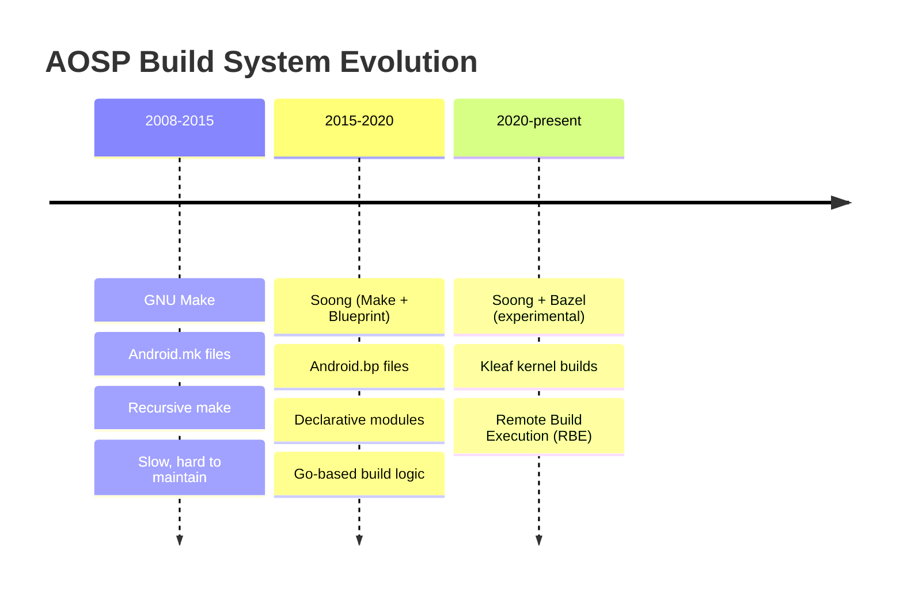

**第一代：GNU Make（2008-2015）。**
最初的 Android 构建系统是纯粹的 GNU Make。每个模块都在一个 `Android.mk` 文件中用 Make 变量和 include 指令来描述。一个典型的 Android.mk 文件看起来像这样：

```makefile
# Legacy Android.mk format (still supported but deprecated)
LOCAL_PATH := $(call my-dir)

include $(CLEAR_VARS)
LOCAL_MODULE := libexample
LOCAL_SRC_FILES := example.cpp
LOCAL_SHARED_LIBRARIES := liblog libutils
LOCAL_C_INCLUDES := $(LOCAL_PATH)/include
LOCAL_CFLAGS := -Wall -Werror
include $(BUILD_SHARED_LIBRARY)
```

这个系统能工作，但饱受 Make 众所周知的问题之苦：

- **增量构建缓慢：** Make 每次调用都必须重新评估整个依赖图，解析数以千计的 Makefile include。
- **脆弱的变量作用域：** Make 变量默认是全局的，当两个模块偶然共享了同一个变量名时，会导致隐蔽的 bug。
- **并行性困难：** 递归 Make 在目录边界上本质上是串行的。
- **没有依赖约束：** 任何 Makefile 都可以引用任何其他 Makefile 中的任何变量，使得模块边界无法被推理。
- **糟糕的错误消息：** 当深层嵌套的 include 链中出问题时，错误消息几乎无法解读。

在巅峰时期，基于 Make 的构建系统有超过 10,000 个 `Android.mk` 文件，甚至在开始编译之前就要花上几个小时来解析。

**第二代：Soong/Blueprint（2015 至今）。**
Google 引入了 Soong 作为替代方案，采用三层架构（下文详述）。现在模块用 `Android.bp` 文件以简单、声明式、类 JSON 的语法来声明。构建逻辑本身用 Go 编写。Make 仍然作为一层薄薄的胶水层存在，用于产品配置和镜像组装，但新模块应当始终在 `Android.bp` 中定义。

从 Make 到 Soong 的迁移是渐进的：`androidmk` 工具执行自动转换，两套系统并存。随着 Android 各版本的更迭，越来越多的模块已被转换。截至当前版本，绝大多数平台模块都使用 `Android.bp`。

Soong 背后的关键思想是**声明与逻辑的分离**。在 Make 中，构建文件格式*就是*编程语言——你在同一些文件里声明模块并编写构建逻辑。而在 Soong 中，`Android.bp` 文件是纯声明式的（没有条件分支、没有循环），所有构建逻辑都位于 Soong 二进制文件内的 Go 代码中。这使得 `Android.bp` 文件更加简单、更不容易出错。

**第三代：Bazel（2020 至今，实验性）。**
Google 一直在努力将构建迁移到 Bazel——他们内部 Blaze 构建系统的开源版本。剩余的工作通过 `build/pesto/` 目录跟踪。截至当前版本，Bazel 用于内核构建（Kleaf）和一些选择性实验，但平台构建仍然由 Soong 驱动。（早期的 `bp2build` 工具会把 `Android.bp` 文件转换成 Bazel 的 `BUILD` 文件，后来已从树中移除。）

迁移到 Bazel的动机包括：

- **构建密封性：** Bazel 对每个构建动作进行沙箱隔离，确保可重现性。
- **远程执行：** 构建动作可以分布到机器集群上执行。
- **内容寻址缓存：** 构建结果可以在开发者、CI 系统甚至不同分支之间共享。
- **可扩展性：** Bazel 为极其庞大的代码库而设计（Google 内部的单体仓库有数十亿行代码）。

然而，迁移像 AOSP 这样复杂的构建系统是一项多年的工作，在可预见的未来，Soong 仍将是主要的构建系统。

### 2.2.2 三层架构

现代 AOSP 构建系统由三层组成，每一层用不同的技术实现：

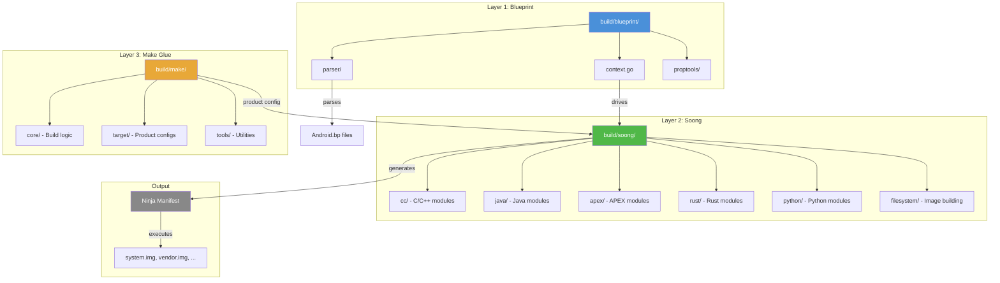

下面详细考察每一层。

### 2.2.3 第 1 层：Blueprint（`build/blueprint/`）

Blueprint 是元构建框架——一个 Go 库。它提供了解析模块定义文件、解析依赖关系、运行 mutator 以及生成 Ninja 构建规则的机制。Blueprint **并非 Android 专用**；它是一个通用工具。

`build/blueprint/` 中的 `doc.go` 文件描述了该框架：

```go
// Blueprint is a meta-build system that reads in Blueprints files that
// describe modules that need to be built, and produces a Ninja
// (https://ninja-build.org/) manifest describing the commands that need
// to be run and their dependencies.  Where most build systems use built-in
// rules or a domain-specific language to describe the logic how modules are
// converted to build rules, Blueprint delegates this to per-project build
// logic written in Go.
```

**来源：** `build/blueprint/doc.go`

Blueprint 的核心是 `context.go`（约 195 KB），它定义了 `Context` 结构体。这是中心状态对象。它通过四个阶段来编排整个构建过程：

```go
// A Context contains all the state needed to parse a set of Blueprints files
// and generate a Ninja file.  The process of generating a Ninja file proceeds
// through a series of four phases.  Each phase corresponds with a some methods
// on the Context object
//
//          Phase                            Methods
//       ------------      -------------------------------------------
//    1. Registration         RegisterModuleType, RegisterSingletonType
//
//    2. Parse                    ParseBlueprintsFiles, Parse
//
//    3. Generate            ResolveDependencies, PrepareBuildActions
//
//    4. Write                           WriteBuildFile
```

**来源：** `build/blueprint/context.go`，第 117-131 行

四个阶段的详情：

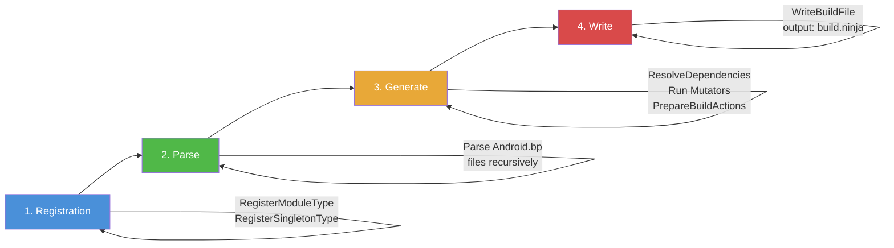

1. **注册（Registration）：** 模块类型（例如 `cc_binary`、`java_library`）和单例向 Context 注册。每个模块类型映射到一个 Go 工厂函数。

2. **解析（Parse）：** 树中所有的 `Android.bp` 文件都会被发现并解析。Blueprint 解析器读取类 JSON 语法，并使用反射填充 Go 结构体。

3. **生成（Generate）：** 模块之间的依赖关系被解析。*Mutator* 按注册顺序运行——它们可以自上而下或自下而上地访问模块，以传播信息或将模块拆分为变体（例如，每个目标架构一个变体）。然后每个模块生成其构建动作。

4. **写出（Write）：** 累积的构建动作被序列化为一个 Ninja 清单文件。

`build/blueprint/` 下的关键目录：

| 目录/文件 | 用途 |
|---------------|---------|
| `context.go` | 核心编排 |
| `parser/` | Blueprint 文件解析器 |
| `proptools/` | 属性反射与操作工具 |
| `pathtools/` | 文件路径工具与 glob 匹配 |
| `depset/` | 依赖集实现（类似 Bazel depset） |
| `bpfmt/` | Blueprint 文件格式化工具 |
| `bpmodify/` | 以编程方式修改 Blueprint 文件的工具 |
| `bootstrap/` | 自举逻辑 |
| `gobtools/` | 用于序列化的 Go 二进制工具 |
| `gotestmain/` | 测试 main 生成器 |
| `gotestrunner/` | 测试运行器工具 |
| `metrics/` | 构建指标与事件处理 |
| `incremental.go` | 增量构建支持 |
| `live_tracker.go` | 依赖项的实时文件跟踪 |

#### Blueprint Mutator

Mutator 是 Blueprint 中最重要的概念之一。Mutator 是一个访问模块并可以修改模块的函数。Mutator 用于：

- **变体创建：** 单个模块声明可以拆分为多个*变体*。例如，一个 `cc_library` 会被拆分为设备变体和宿主变体，并进一步拆分为架构变体（arm64、x86_64 等）。
- **依赖传播：** 来自一个模块的信息可以推送到它的依赖方（或反过来）。
- **属性默认值：** 默认值可以根据全局构建配置计算得出。

Mutator 按特定顺序运行：


1. **Pre-deps mutator** 在依赖关系解析之前运行。它们可以添加依赖或创建变体。
2. **依赖解析** 将依赖名称匹配到实际模块。
3. **Post-deps mutator** 在依赖关系解析之后运行。它们可以访问依赖信息。
4. **Final-deps mutator** 最后运行，用于后期修改。

例如，APEX 系统使用 post-deps mutator 为每个 APEX 中出现的库创建单独的变体：

```go
// From build/soong/apex/apex.go
func RegisterPostDepsMutators(ctx android.RegisterMutatorsContext) {
    ctx.BottomUp("apex_unique", apexUniqueVariationsMutator)
    ctx.BottomUp("mark_platform_availability", markPlatformAvailability)
    ctx.InfoBasedTransition("apex",
        android.NewGenericTransitionMutatorAdapter(&apexTransitionMutator{}))
}
```

**来源：** `build/soong/apex/apex.go`，第 66-71 行

#### Blueprint Provider

Provider 是 Blueprint 在模块之间传递信息的机制。当一个模块生成构建动作时，它可以设置*provider* 数据，供其依赖方读取。这比 Make 的全局变量更有结构：

```go
// Provider declaration (from build/soong/cc/cc.go)
var CcObjectInfoProvider = blueprint.NewProvider[CcObjectInfo]()

// Setting a provider (in the generating module)
android.SetProvider(ctx, CcObjectInfoProvider, CcObjectInfo{
    ObjFiles:   objFiles,
    TidyFiles:  tidyFiles,
    KytheFiles: kytheFiles,
})

// Reading a provider (in a dependent module)
if info, ok := android.OtherModuleProvider(ctx, dep, CcObjectInfoProvider); ok {
    // Use info.ObjFiles, etc.
}
```

### 2.2.4 第 2 层：Soong（`build/soong/`）

Soong 才是 Android 真正的构建系统。它构建在 Blueprint *之上*，注册 Android 特有的模块类型、mutator 和单例。`build/soong/` 目录包含 59 个子目录，按它们处理的模块类型或构建功能组织。

来自 `build/soong/README.md`：

```
Soong is one of the build systems used in Android, which is controlled
by files called Android.bp. There is also the legacy Make-based build
system that is controlled by files called Android.mk.

Android.bp file are JSON-like declarative descriptions of "modules" to
build; a "module" is the basic unit of building that Soong understands,
similarly to how "target" is the basic unit of building for Make.
```

**来源：** `build/soong/README.md`，第 1-8 行

构建逻辑有进一步的描述：

```
The build logic is written in Go using the blueprint framework.
Build logic receives module definitions parsed into Go structures
using reflection and produces build rules. The build rules are
collected by blueprint and written to a ninja build file.
```

**来源：** `build/soong/README.md`，第 610-614 行

`build/soong/` 的关键子目录：

| 目录 | 用途 | 关键文件 |
|-----------|---------|-----------|
| `cc/` | C/C++ 模块类型（`cc_binary`、`cc_library` 等） | `cc.go`、`library.go`、`binary.go` |
| `java/` | Java/Kotlin 模块类型（`java_library`、`android_app` 等） | `java.go`、`app.go`、`sdk_library.go` |
| `apex/` | APEX 模块类型（定义在 `apex.go` 中） | `apex.go`、`builder.go`、`key.go` |
| `rust/` | Rust 模块类型 | `rust.go`、`library.go` |
| `python/` | Python 模块类型 | `python.go` |
| `sh/` | Shell 脚本模块类型 | `sh_binary.go` |
| `genrule/` | 通用构建规则模块 | `genrule.go` |
| `android/` | Soong 核心框架（模块基类、架构处理） | `module.go`、`arch.go`、`paths.go` |
| `filesystem/` | 镜像文件构建 | `filesystem.go` |
| `ui/` | 构建 UI 与进度报告 | `build.go` |
| `cmd/` | 命令行入口点 | `soong_build/`、`soong_ui/` |
| `bpf/` | BPF 程序编译 | `bpf.go` |
| `sdk/` | SDK 快照生成 | `sdk.go` |
| `snapshot/` | 供应商快照管理 | `snapshot_base.go` |
| `linkerconfig/` | 链接器命名空间配置 | `linkerconfig.go` |
| `aconfig/` | 构建标志（aconfig）集成 | `aconfig_declarations.go`、`all_aconfig_declarations.go` |
| `bin/` | `m`、`mm`、`mmm` 等的 shell 脚本 | `m`、`mm`、`mmm` |
| `kernel/` | 内核相关的构建逻辑 | `prebuilt_kernel_modules.go` |

#### 在 Go 代码内部：模块注册

每个模块类型都通过一个 Go `init()` 函数向 Soong 注册。我们来看看三大模块族是如何注册自己的：

**C/C++ 模块**（`build/soong/cc/cc.go`）：

```go
// This file contains the module types for compiling C/C++ for Android,
// and converts the properties into the flags and filenames necessary to
// pass to the compiler.  The final creation of the rules is handled in
// builder.go
package cc
```

**来源：** `build/soong/cc/cc.go`，第 15-19 行

C/C++ 模块系统定义了大量用于跟踪编译状态的数据结构。例如，`LinkerInfo` 结构体捕获了所有的链接依赖：

```go
type LinkerInfo struct {
    WholeStaticLibs []string
    StaticLibs      []string  // modules to statically link
    SharedLibs      []string  // modules to dynamically link
    HeaderLibs      []string  // header-only dependencies
    SystemSharedLibs []string
    ...
}
```

**来源：** `build/soong/cc/cc.go`，第 81-99 行

`cc/` 目录包含 30 多个 Go 文件，每个文件处理 C/C++ 编译的不同方面：

| 文件 | 用途 |
|------|---------|
| `cc.go` | 核心模块类型与属性 |
| `builder.go` | Ninja 规则生成 |
| `binary.go` | `cc_binary` 实现 |
| `library.go` | `cc_library` 实现 |
| `sanitize.go` | ASan/TSan/UBSan 集成 |
| `ndk_sysroot.go` | NDK sysroot 管理 |
| `stl.go` | C++ STL 选择 |
| `cmake_snapshot.go` | CMake 项目生成 |
| `check.go` | 构建一致性检查 |

**Java 模块**（`build/soong/java/java.go`）：

```go
// This file contains the module types for compiling Java for Android,
// and converts the properties into the flags and filenames necessary
// to pass to the Module.  The final creation of the rules is handled
// in builder.go
package java

func registerJavaBuildComponents(ctx android.RegistrationContext) {
    ctx.RegisterModuleType("java_defaults", DefaultsFactory)
    ctx.RegisterModuleType("java_library", LibraryFactory)
    ctx.RegisterModuleType("java_library_static", LibraryStaticFactory)
    ctx.RegisterModuleType("java_library_host", LibraryHostFactory)
    ctx.RegisterModuleType("java_binary", BinaryFactory)
    ctx.RegisterModuleType("java_binary_host", BinaryHostFactory)
    ctx.RegisterModuleType("java_test", TestFactory)
    ctx.RegisterModuleType("java_test_helper_library", TestHelperLibraryFactory)
    ctx.RegisterModuleType("java_test_host", TestHostFactory)
    ctx.RegisterModuleType("java_test_import", JavaTestImportFactory)
    ctx.RegisterModuleType("java_import", ImportFactory)
    ctx.RegisterModuleType("java_import_host", ImportFactoryHost)
    ctx.RegisterModuleType("java_device_for_host", DeviceForHostFactory)
    ctx.RegisterModuleType("java_host_for_device", HostForDeviceFactory)
    ctx.RegisterModuleType("dex_import", DexImportFactory)
    ctx.RegisterModuleType("java_api_library", ApiLibraryFactory)
    ctx.RegisterModuleType("java_api_contribution", ApiContributionFactory)
    ...
}
```

**来源：** `build/soong/java/java.go`，第 50-70 行

**Genrule 模块**（`build/soong/genrule/genrule.go`）：

```go
// A genrule module takes a list of source files ("srcs" property), an
// optional list of tools ("tools" property), and a command line ("cmd"
// property), to generate output files ("out" property).
package genrule

func RegisterGenruleBuildComponents(ctx android.RegistrationContext) {
    ctx.RegisterModuleType("genrule_defaults", defaultsFactory)
    ctx.RegisterModuleType("gensrcs", GenSrcsFactory)
    ctx.RegisterModuleType("genrule", GenRuleFactory)
    ...
}
```

**来源：** `build/soong/genrule/genrule.go`，第 15-68 行

`genrule` 模块类型特别适用于代码生成、Protocol Buffer 编译和 AIDL 接口生成。它也适用于其他任何需要运行任意命令来生成源文件的场景。

#### Soong 构建流程内部

当 `soong_ui` 启动构建时，它会经历以下内部步骤：

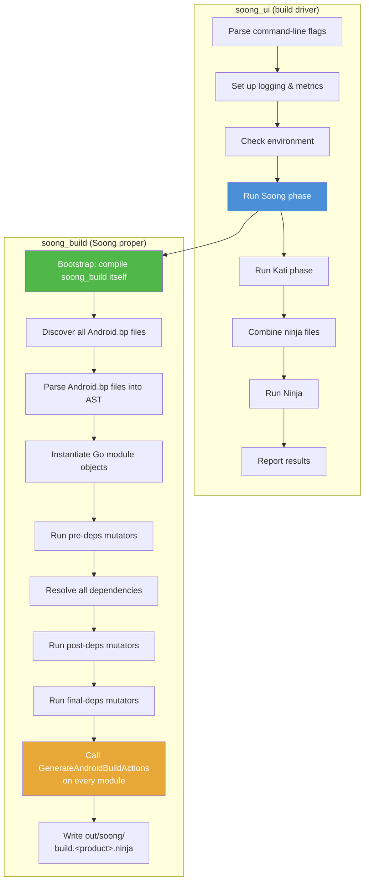

关键的一步是 **GenerateAndroidBuildActions**。这是每个模块类型都必须实现的方法。它检查模块的属性、解析其依赖，并发出 Ninja 构建规则（编译命令、链接命令、文件复制等）。

构建的入口点是 `build/soong/soong_ui.bash`：

```bash
#!/bin/bash -eu
source $(cd $(dirname $BASH_SOURCE) &> /dev/null && pwd)/../make/shell_utils.sh
require_top

# To track how long we took to startup.
case $(uname -s) in
  Darwin)
    export TRACE_BEGIN_SOONG=`$TOP/prebuilts/build-tools/path/darwin-x86/date +%s%3N`
    ;;
  *)
    export TRACE_BEGIN_SOONG=$(date +%s%N)
    ;;
esac

setup_cog_env_if_needed
set_network_file_system_type_env_var

# Save the current PWD for use in soong_ui
export ORIGINAL_PWD=${PWD}
export TOP=$(gettop)
source ${TOP}/build/soong/scripts/microfactory.bash

soong_build_go soong_ui android/soong/cmd/soong_ui
soong_build_go mk2rbc android/soong/mk2rbc/mk2rbc
soong_build_go rbcrun rbcrun/rbcrun
soong_build_go release-config android/soong/cmd/release_config/release_config

cd ${TOP}
exec "$(getoutdir)/soong_ui" "$@"
```

**来源：** `build/soong/soong_ui.bash`

这个脚本对基于 Go 的构建系统进行自举。首先它编译 `soong_ui`（构建驱动程序）和几个辅助工具。然后执行 `soong_ui`，由它编排整个构建过程。

### 2.2.5 第 3 层：Make 胶水层（`build/make/`）

虽然 Soong 处理模块编译，GNU Make（通过 Kati——一个为 Android 优化过的 Make 克隆）仍然扮演着重要角色：

- **产品配置：** `PRODUCT_*` 变量、`BoardConfig.mk` 和设备 makefile 仍然用 Make 编写。
- **镜像组装：** 将编译产物组合成分区镜像（`system.img`、`vendor.img` 等）的规则在 Make 中。
- **遗留模块：** 一些模块仍使用 `Android.mk`（尽管每发布一个新版本这种情况都在减少）。

`build/make/` 目录包含 26 个顶层条目：

| 目录/文件 | 用途 |
|---------------|---------|
| `core/` | 核心构建逻辑（include、规则、模块定义） |
| `target/` | 产品与主板配置文件 |
| `tools/` | 构建工具（releasetools、signapk 等） |
| `envsetup.sh` | Shell 环境设置脚本 |
| `common/` | 共享构建逻辑 |
| `packaging/` | 包组装规则 |
| `Changes.md` | 构建系统变更日志 |
| `shell_utils.sh` | Shell 工具函数 |

构建过程中各层之间的关系是：

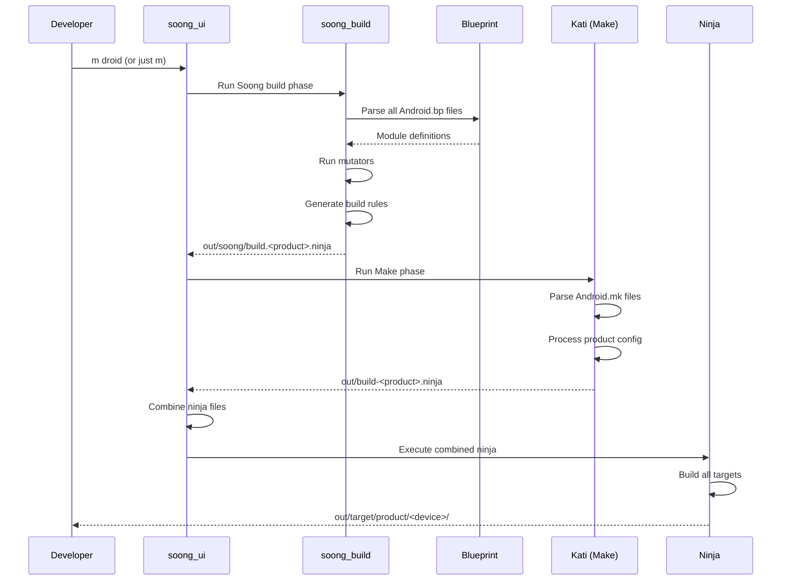

### 2.2.6 Soong README：模块定义

Soong README（`build/soong/README.md`）提供了 `Android.bp` 语法的权威参考。以下是它所记录的关键元素。

**模块结构：**

```
cc_binary {
    name: "gzip",
    srcs: ["src/test/minigzip.c"],
    shared_libs: ["libz"],
    stl: "none",
}
```

README 指出："每个模块都必须有一个 `name` 属性，并且其值在所有 Android.bp 文件中必须是唯一的。"

**来源：** `build/soong/README.md`，第 43-48 行

**变量：**

```
gzip_srcs = ["src/test/minigzip.c"],

cc_binary {
    name: "gzip",
    srcs: gzip_srcs,
    shared_libs: ["libz"],
    stl: "none",
}
```

"变量的作用域是其声明所在文件的剩余部分，以及任何子 Android.bp 文件。变量是不可变的，只有一个例外——它们可以通过 += 赋值追加，但只能在被引用之前这样做。"

**来源：** `build/soong/README.md`，第 76-91 行

**支持的类型：**

| 类型 | 语法 |
|------|--------|
| Bool | `true` 或 `false` |
| Integer | `42` |
| String | `"hello"` |
| List of strings | `["a", "b", "c"]` |
| Map | `{key1: "val", key2: ["val2"]}` |

**注释：** 同时支持 `/* */` 和 `//` 两种风格。

**Defaults 模块：**

```
cc_defaults {
    name: "gzip_defaults",
    shared_libs: ["libz"],
    stl: "none",
}

cc_binary {
    name: "gzip",
    defaults: ["gzip_defaults"],
    srcs: ["src/test/minigzip.c"],
}
```

**来源：** `build/soong/README.md`，第 126-142 行

Defaults 模块允许在多个模块定义之间共享属性，从而减少重复。

---

## 2.3 `envsetup.sh` 与 `lunch`

### 2.3.1 引入（source）`envsetup.sh`

每个 AOSP 构建会话都以引入环境设置脚本开始：

```bash
source build/envsetup.sh
```

该脚本位于 `build/make/envsetup.sh`，并通过清单的 `<linkfile>` 指令符号链接到顶层的 `build/envsetup.sh`。

脚本在加载时执行以下操作：

1. **定位树根**：使用 `_gettop_once` 函数：

```bash
function _gettop_once
{
    local TOPFILE=build/make/core/envsetup.mk
    if [ -n "$TOP" -a -f "$TOP/$TOPFILE" ] ; then
        # The following circumlocution ensures we remove symlinks from TOP.
        (cd "$TOP"; PWD= /bin/pwd)
    else
        if [ -f $TOPFILE ] ; then
            PWD= /bin/pwd
        else
            local HERE=$PWD
            local T=
            while [ \( ! \( -f $TOPFILE \) \) -a \( "$PWD" != "/" \) ]; do
                \cd ..
                T=`PWD= /bin/pwd -P`
            done
            \cd "$HERE"
            if [ -f "$T/$TOPFILE" ]; then
                echo "$T"
            fi
        fi
    fi
}
```

**来源：** `build/make/envsetup.sh`，第 22-47 行

该函数向上遍历目录树，寻找 `build/make/core/envsetup.mk` 作为哨兵文件。这是构建系统标识 AOSP 检出根目录的规范方式。

2. **引入 `shell_utils.sh`：** 导入常用的 shell 工具函数。

3. **设置全局路径**：通过 `set_global_paths()`：

```bash
function set_global_paths()
{
    ...
    ANDROID_GLOBAL_BUILD_PATHS=$T/build/soong/bin
    ANDROID_GLOBAL_BUILD_PATHS+=:$T/build/bazel/bin
    ANDROID_GLOBAL_BUILD_PATHS+=:$T/development/scripts
    ANDROID_GLOBAL_BUILD_PATHS+=:$T/prebuilts/devtools/tools

    # add kernel specific binaries
    if [ $(uname -s) = Linux ] ; then
        ANDROID_GLOBAL_BUILD_PATHS+=:$T/prebuilts/misc/linux-x86/dtc
        ANDROID_GLOBAL_BUILD_PATHS+=:$T/prebuilts/misc/linux-x86/libufdt
    fi
    ...
    export PATH=$ANDROID_GLOBAL_BUILD_PATHS:$PATH
}
```

**来源：** `build/make/envsetup.sh`，第 265-321 行

这会把构建工具、Bazel 二进制文件、模拟器预编译产物和设备树编译器（dtc）添加到 `PATH` 中。

4. **引入供应商设置脚本**：通过 `source_vendorsetup()`：

```bash
function source_vendorsetup() {
    unset VENDOR_PYTHONPATH
    local T="$(gettop)"
    local allowed=
    local vendorsetups=()

    # Find all relevant files in a single traversal to improve performance.
    while IFS= read -r f; do
        if [[ -z "$f" ]]; then continue; fi
        if [[ "$f" == *allowed-vendorsetup_sh-files ]]; then
            ...
            allowed="$T/$f"
        elif [[ "$f" == *vendorsetup.sh ]]; then
            vendorsetups+=("$f")
        fi
    done < <(cd "$T" && find -L device vendor product -maxdepth 4 \
        \( -name 'allowed-vendorsetup_sh-files' -o -name 'vendorsetup.sh' \) \
        2>/dev/null | sort)
    ...
    for f in "${vendorsetups[@]}"; do
        if [ -z "$allowed" ]; then
            echo "including $f"; . "$T/$f"
        ...
        fi
    done

    setup_cog_env_if_needed
}
```

**来源：** `build/make/envsetup.sh`，第 1067-1113 行

这会发现并执行 `device/`、`vendor/` 和 `product/` 目录下的 `vendorsetup.sh` 文件。当前的实现为了性能只做一次 `find` 遍历，并遵循可选的 `allowed-vendorsetup_sh-files` 允许列表；当该文件存在时，它限制哪些 `vendorsetup.sh` 文件会被引入。这些脚本通常会添加设备特定的 lunch 组合，或设置供应商特定的环境变量。

5. **添加 shell 补全**：通过 `addcompletions()` 为 `lunch`、`m`、`adb` 和 `fastboot` 等命令添加补全。

6. **可选地恢复之前的 lunch 选择**：如果设置了 `USE_LEFTOVERS=1`。

### 2.3.2 `envsetup.sh` 定义的关键函数

该脚本定义了许多在引入后可用的 shell 函数。以下是最重要的一些：

| 函数 | 用途 |
|----------|---------|
| `lunch` | 选择构建目标（产品、发布版本、变体） |
| `tapas` | 配置未打包的应用构建 |
| `banchan` | 配置未打包的 APEX 构建 |
| `croot` | `cd` 到树的顶部 |
| `gomod` | `cd` 到特定模块的目录 |
| `godir` | `cd` 到匹配某个模式的目录 |
| `adb` | 确保使用树中的 adb 的包装器 |
| `fastboot` | 确保使用树中的 fastboot 的包装器 |
| `make` | 重定向到 `soong_ui.bash --make-mode` |
| `printconfig` | 显示当前构建配置 |
| `leftovers` | 恢复之前的 lunch 选择 |

注意，`m`、`mm` 和 `mmm` *不是* `envsetup.sh` 定义的 shell 函数。它们是 `build/soong/bin/` 中的独立脚本，之所以可用，是因为 `set_global_paths()` 把该目录添加到了 `PATH` 的开头（见 2.5.1 节）。

`make` 函数值得注意——它会拦截系统的 `make` 命令：

```bash
function get_make_command()
{
    # If we're in the top of an Android tree, use soong_ui.bash instead of make
    if [ -f build/soong/soong_ui.bash ]; then
        # Always use the real make if -C is passed in
        for arg in "$@"; do
            if [[ $arg == -C* ]]; then
                echo command make
                return
            fi
        done
        echo build/soong/soong_ui.bash --make-mode
    else
        echo command make
    fi
}

function make()
{
    _wrap_build $(get_make_command "$@") "$@"
}
```

**来源：** `build/make/envsetup.sh`，第 1016-1036 行

这意味着在 AOSP 树中输入 `make` 实际上调用的是 `soong_ui.bash --make-mode`，而不是直接调用 GNU Make。

### 2.3.3 `lunch` 命令

`lunch` 是选择构建目标的关键命令。它设置三个基本变量：

| 变量 | 用途 | 示例 |
|----------|---------|---------|
| `TARGET_PRODUCT` | 为哪个设备/产品构建 | `aosp_arm64` |
| `TARGET_RELEASE` | 发布版本配置 | `trunk_staging` |
| `TARGET_BUILD_VARIANT` | 构建变体（eng/userdebug/user） | `eng` |

`lunch` 函数支持两种格式：

```bash
# New format (recommended): positional arguments
lunch aosp_arm64 trunk_staging eng

# Legacy format: dash-separated
lunch aosp_arm64-trunk_staging-eng
```

如果省略了发布版本和变体，它们分别默认为 `trunk_staging` 和 `eng`：

```bash
function lunch()
{
    ...
    # Handle the new format.
    if [[ -z $legacy ]]; then
        product=$1
        release=$2
        if [[ -z $release ]]; then
            release=trunk_staging
        fi
        variant=$3
        if [[ -z $variant ]]; then
            variant=eng
        fi
    fi

    # Validate the selection and set all the environment stuff
    _lunch_meat $product $release $variant
    ...
}
```

**来源：** `build/make/envsetup.sh`，第 535-581 行

`_lunch_meat` 函数承担主要工作：

```bash
function _lunch_meat()
{
    local product=$1
    local release=$2
    local variant=$3

    TARGET_PRODUCT=$product \
    TARGET_RELEASE=$release \
    TARGET_BUILD_VARIANT=$variant \
    TARGET_BUILD_APPS= \
    build_build_var_cache
    if [ $? -ne 0 ]
    then
        if [[ "$product" =~ .*_(eng|user|userdebug) ]]
        then
            echo "Did you mean -${product/*_/}? (dash instead of underscore)"
        fi
        return 1
    fi
    export TARGET_PRODUCT=$(_get_build_var_cached TARGET_PRODUCT)
    export TARGET_BUILD_VARIANT=$(_get_build_var_cached TARGET_BUILD_VARIANT)
    export TARGET_RELEASE=$release
    export TARGET_BUILD_TYPE=release
    export TARGET_BUILD_APPS=

    set_stuff_for_environment
    ...
}
```

**来源：** `build/make/envsetup.sh`，第 449-493 行

该函数：

1. 调用 `soong_ui.bash --dumpvars-mode` 来解析并缓存构建变量
2. 导出 `TARGET_PRODUCT`、`TARGET_BUILD_VARIANT`、`TARGET_RELEASE` 和 `TARGET_BUILD_TYPE`
3. 调用 `set_stuff_for_environment()`，它设置 `PATH`、`JAVA_HOME`、`ANDROID_PRODUCT_OUT` 及其他环境变量
4. 打印当前配置

### 2.3.4 构建变体

三种构建变体控制包含什么以及如何构建：

| 变体 | 描述 | `ro.debuggable` | `adb` | 优化 |
|---------|-------------|-----------------|-------|---------------|
| `user` | 生产构建。访问受限。 | `0` | 默认关闭 | 完整 |
| `userdebug` | 类似 user，但有 root 访问权限和调试工具。 | `1` | 开启 | 完整 |
| `eng` | 开发构建。额外工具，无优化。 | `1` | 开启 | 精简 |

变体用于选择安装哪些软件包。例如，仅 `eng` 的软件包包含 `strace` 等开发工具，而 `user` 构建会排除它们。

### 2.3.5 `envsetup.mk` 与 `config.mk`

在 `lunch` 设置好环境变量之后，构建系统的 Make 层通过 `build/make/core/envsetup.mk` 和 `build/make/core/config.mk` 读取它们。

`envsetup.mk` 建立基本的构建变量：

```makefile
# Variables we check:
#     HOST_BUILD_TYPE = { release debug }
#     TARGET_BUILD_TYPE = { release debug }
# and we output a bunch of variables, see the case statement at
# the bottom for the full list
#     OUT_DIR is also set to "out" if it's not already set.

# ...

# The product defaults to generic on hardware
ifeq ($(TARGET_PRODUCT),)
TARGET_PRODUCT := aosp_arm64
endif

# the variant -- the set of files that are included for a build
ifeq ($(strip $(TARGET_BUILD_VARIANT)),)
TARGET_BUILD_VARIANT := eng
endif
```

**来源：** `build/make/core/envsetup.mk`，第 1-85 行

它还检测主机配置：

```makefile
# HOST_OS
ifneq (,$(findstring Linux,$(UNAME)))
  HOST_OS := linux
endif
ifneq (,$(findstring Darwin,$(UNAME)))
  HOST_OS := darwin
endif

# HOST_ARCH
ifneq (,$(findstring x86_64,$(UNAME)))
  HOST_ARCH := x86_64
  HOST_2ND_ARCH := x86
  HOST_IS_64_BIT := true
endif
```

**来源：** `build/make/core/envsetup.mk`，第 122-183 行

并定义分区输出目录：

```makefile
TARGET_COPY_OUT_SYSTEM := system
TARGET_COPY_OUT_SYSTEM_DLKM := system_dlkm
TARGET_COPY_OUT_DATA := data
TARGET_COPY_OUT_VENDOR := $(_vendor_path_placeholder)
TARGET_COPY_OUT_PRODUCT := $(_product_path_placeholder)
TARGET_COPY_OUT_SYSTEM_EXT := $(_system_ext_path_placeholder)
TARGET_COPY_OUT_ODM := $(_odm_path_placeholder)
```

**来源：** `build/make/core/envsetup.mk`，第 254-289 行

`config.mk` 是顶层配置 include。它以一个防止直接调用的保护开头：

```makefile
ifndef KATI
$(warning Directly using config.mk from make is no longer supported.)
$(warning )
$(warning If you are just attempting to build, you probably need to re-source envsetup.sh:)
$(warning )
$(warning $$ source build/envsetup.sh)
$(error done)
endif

BUILD_SYSTEM :=$= build/make/core
BUILD_SYSTEM_COMMON :=$= build/make/common
```

**来源：** `build/make/core/config.mk`，第 1-22 行

`ifndef KATI` 保护告诉我们一个重要细节：基于 Make 的构建并不使用标准 GNU Make。它使用 **Kati**——一个兼容 Make 的工具，它更快，并且与 Android 的构建模式更兼容。Kati 最初是用 Go 做原型开发的，但随树发布的生产实现（`ckati`）是用 C++ 编写的。较新的 Rust 实现（`rkati`）也可以在 `prebuilts/build-tools/` 中找到。

### 2.3.6 Kati：Make 的替代品

Kati（旧树中位于 `build/kati/`，现在属于预编译产物）是 Google 的兼容 Make 的构建工具。它的创建是为了解决 GNU Make 在 Android 构建中的性能问题：

- **更快的解析：** Kati 解析 Makefile 比 GNU Make 快得多。
- **更好的缓存：** Kati 在多次调用之间缓存已解析的 Makefile 结果。
- **Ninja 生成：** Kati 不直接执行构建命令，而是生成一个 Ninja 清单，再由 Ninja 执行。
- **兼容性：** Kati 的目标是成为 GNU Make 的即插即用替代品，不过它有意不支持一些很少用到的 Make 特性。

在 AOSP 构建中，Kati 处理：

- 产品配置（`PRODUCT_*` 变量）
- 主板配置（`BOARD_*` 变量）
- 镜像组装规则
- 剩余的 `Android.mk` 模块

Kati 的输出是 `out/build-<TARGET_PRODUCT>.ninja`，它与 Soong 的 `out/soong/build.<TARGET_PRODUCT>.ninja`（纯 `out/soong/build.ninja` 名称仅在未设置产品时作为回退）合并。这两个文件合并为一个 `out/combined-<TARGET_PRODUCT>.ninja`，由 Ninja 执行。

### 2.3.7 构建变量如何流动

理解构建变量的流动对于调试构建配置问题至关重要：

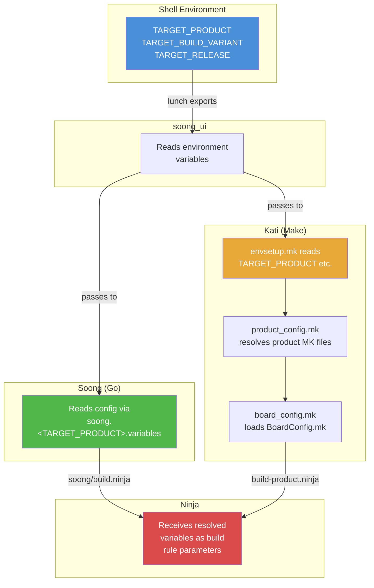

Make 层中的变量解析链是：

1. `build/make/core/config.mk` 是顶层入口点
2. 它 include `build/make/core/envsetup.mk`，后者从环境中读取 `TARGET_PRODUCT` 和 `TARGET_BUILD_VARIANT`
3. `envsetup.mk` include `product_config.mk`，后者查找并加载产品的 makefile（例如 `build/make/target/product/aosp_arm64.mk`）
4. 产品的 makefile 使用 `inherit-product` 引入基础配置
5. `board_config.mk` 定位并加载设备的 `BoardConfig.mk`
6. 所有解析后的变量随后可用于镜像组装，并通过 `soong.<TARGET_PRODUCT>.variables` 作为 Soong 的输入（例如对于 `aosp_cf_x86_64_phone-trunk_staging-userdebug` lunch 组合，为 `out/soong/soong.aosp_cf_x86_64_phone.variables`）

关键的变量解析发生在 `envsetup.mk` 中：

```makefile
# Read the product specs so we can get TARGET_DEVICE and other
# variables that we need in order to locate the output files.
include $(BUILD_SYSTEM)/product_config.mk

SDK_HOST_ARCH := x86
TARGET_OS := linux

# Some board configuration files use $(PRODUCT_OUT)
TARGET_OUT_ROOT := $(OUT_DIR)/target
TARGET_PRODUCT_OUT_ROOT := $(TARGET_OUT_ROOT)/product
PRODUCT_OUT := $(TARGET_PRODUCT_OUT_ROOT)/$(TARGET_DEVICE)

include $(BUILD_SYSTEM)/board_config.mk
```

**来源：** `build/make/core/envsetup.mk`，第 349-368 行

`PRODUCT_OUT`——目标设备所有构建产物的输出目录——就是在这里计算出来的。对于 `aosp_arm64`，它会解析为 `out/target/product/generic_arm64/`。

### 2.3.8 `tapas` 和 `banchan` 命令

除了 `lunch` 之外，`envsetup.sh` 还为未打包构建提供了两个专用命令：

**`tapas`——构建未打包的应用：**

```bash
# Build the Camera app for ARM64
tapas Camera arm64 eng

# Build multiple apps
tapas Camera Gallery arm64 userdebug
```

`tapas` 函数（`build/make/envsetup.sh`，第 674-743 行）配置未打包的应用构建。它将 `TARGET_BUILD_APPS` 设置为指定的应用名。这告诉构建系统只构建那些应用（及其依赖），而不是整个平台。

**`banchan`——构建未打包的 APEX：**

```bash
# Build the Wi-Fi APEX for ARM64
banchan com.android.wifi arm64 eng

# Build multiple APEXes
banchan com.android.wifi com.android.bt arm64 userdebug
```

`banchan` 函数（`build/make/envsetup.sh`，第 747-807 行）与 `tapas` 类似，但专门针对 APEX 模块。它使用 `module_arm64`（或相应的架构变体）作为产品，因为 APEX 在很大程度上与设备无关。

这两个命令适用于：

- 主线模块开发（开发某个特定的 APEX）
- 在 AOSP 树中进行应用开发
- 更快的构建（只构建你需要的东西）
- 测试单个模块的 CI/CD 流水线

### 2.3.9 `leftovers` 命令

`leftovers` 命令恢复你之前的 `lunch` 选择：

```bash
function leftovers()
{
    ...
    local dot_leftovers="$(getoutdir)/.leftovers"
    ...
    local product release variant
    IFS=" " read -r product release variant < "$dot_leftovers"
    echo "$INFO: Loading previous lunch: $product $release $variant"
    lunch $product $release $variant
}
```

**来源：** `build/make/envsetup.sh`，第 583-638 行

当你运行 `lunch` 时，它会把你的选择保存到 `out/.leftovers`。下次引入 `envsetup.sh` 时，你可以：

- 手动运行 `leftovers` 来恢复之前的选择
- 在你的 shell profile 中设置 `USE_LEFTOVERS=1` 以自动恢复

当你总是为同一个目标构建、又不想每次都输入完整的 lunch 命令时，这特别有用。

---

## 2.4 Android.bp 模块定义

### 2.4.1 Blueprint 语言

`Android.bp` 文件使用一种简单的、声明式的语法，有意避免条件语句和控制流。正如 Soong README 所解释的：

> "从设计上讲，Android.bp 文件非常简单。没有条件语句，也没有控制流语句——任何复杂度都由用 Go 编写的构建逻辑来处理。"

**来源：** `build/soong/README.md`，第 27-28 行

这一设计决策把复杂度推入了构建系统的 Go 代码中。在那里，它可以被妥善地测试和维护，而不是分散在数千个构建文件里。

### 2.4.2 模块类型

AOSP 定义了几十种模块类型。最常用的是：

**C/C++ 模块类型（定义在 `build/soong/cc/` 中）：**

| 模块类型 | 用途 |
|-------------|---------|
| `cc_binary` | 原生可执行文件 |
| `cc_library` | 原生共享库和/或静态库 |
| `cc_library_shared` | 仅共享库（.so） |
| `cc_library_static` | 仅静态库（.a） |
| `cc_library_headers` | 仅头文件库 |
| `cc_test` | 原生测试可执行文件（gtest） |
| `cc_benchmark` | 原生基准测试（google-benchmark） |
| `cc_defaults` | cc 模块的共享默认值 |
| `cc_prebuilt_binary` | 预编译的原生二进制文件 |
| `cc_prebuilt_library_shared` | 预编译的共享库 |

**Java/Kotlin 模块类型（定义在 `build/soong/java/` 中）：**

| 模块类型 | 用途 |
|-------------|---------|
| `java_library` | Java 库（.jar） |
| `java_library_static` | 静态 Java 库 |
| `android_library` | Android 库（aar） |
| `android_app` | Android 应用（APK） |
| `android_test` | Android 插桩测试 |
| `java_defaults` | Java 模块的共享默认值 |
| `java_sdk_library` | 带桩代码的 SDK 库 |

**其他重要的模块类型：**

| 模块类型 | 定义于 | 用途 |
|-------------|-----------|---------|
| `apex` | `build/soong/apex/` | APEX 模块包 |
| `apex_key` | `build/soong/apex/` | APEX 的签名密钥 |
| `rust_binary` | `build/soong/rust/` | Rust 可执行文件 |
| `rust_library` | `build/soong/rust/` | Rust 库 |
| `python_binary_host` | `build/soong/python/` | Python 宿主工具 |
| `sh_binary` | `build/soong/sh/` | Shell 脚本二进制文件 |
| `genrule` | `build/soong/genrule/` | 自定义构建规则 |
| `filegroup` | `build/soong/android/` | 一组源文件 |
| `prebuilt_etc` | `build/soong/etc/` | 安装到 /etc 的文件 |
| `bpf` | `build/soong/bpf/` | BPF 程序 |
| `cipd_package` | `build/soong/android/cipd/` | 获取并安装某个 CIPD 包版本（Android 17） |
| `android_filesystem_prebuilt` | `build/soong/filesystem/` | 将预构建的分区镜像封装为文件系统模块（Android 17） |

其中两种模块类型是 Android 17 中的新增内容。`cipd_package` 会把某个 CIPD（Chrome Infrastructure Package Deployment）包的特定版本安装到构建中，并通过一条支持沙箱的 export 规则来获取它：

```go
func RegisterCipdPackageComponents(ctx android.RegistrationContext) {
    ctx.RegisterModuleType("cipd_package", cipdPackageFactory)
}
```

**来源：** `build/soong/android/cipd/cipd_package.go`，第 37-39 行

`android_filesystem_prebuilt` 让构建可以消费一个已经构建好的分区镜像（erofs 或 ext4），把它当作一等文件系统模块。构建会解包该镜像，而不是从暂存的文件组装它：

```go
func RegisterPrebuiltFilesystemComponents(ctx android.RegistrationContext) {
    ctx.RegisterModuleType("android_filesystem_prebuilt", PrebuiltFilesystemFactory)
}
```

**来源：** `build/soong/filesystem/prebuilt.go`，第 27-28 行

你可以通过运行以下命令，生成一份完整的、最新的模块类型及其属性列表：

```bash
m soong_docs
# Output: $OUT_DIR/soong/docs/soong_build.html
```

### 2.4.3 `package` 模块

每个包含 `Android.bp` 文件的目录构成一个*包*。你可以用 `package` 模块控制包级别的设置：

```
package {
    default_team: "trendy_team_android_settings_app",
    default_applicable_licenses: ["packages_apps_Settings_license"],
}
```

**来源：** `packages/apps/Settings/Android.bp`，第 1-4 行

`package` 模块没有 `name` 属性——它的名字自动设置为其所在目录的路径。包级别的设置包括：

- `default_visibility`：控制其他包能看到该包中的哪些模块。
- `default_applicable_licenses`：指定适用于该包中所有模块的许可证。
- `default_team`：负责该包的团队（用于代码所有权跟踪）。

### 2.4.4 `license` 模块

AOSP 要求为所有模块声明许可证。`license` 模块类型声明许可条款：

```
license {
    name: "packages_apps_Settings_license",
    visibility: [":__subpackages__"],
    license_kinds: [
        "SPDX-license-identifier-Apache-2.0",
    ],
    license_text: [
        "NOTICE",
    ],
}
```

**来源：** `packages/apps/Settings/Android.bp`，第 8-17 行

这确保构建系统能够跟踪哪些许可证适用于每个二进制文件和库，从而支持自动化的合规性检查。

### 2.4.5 `filegroup` 模块

Filegroup 提供了一种为一组源文件命名的方式，以便它们可以被其他模块引用：

```
filegroup {
    name: "com.android.wifi-androidManifest",
    srcs: ["AndroidManifest.xml"],
}
```

**来源：** `packages/modules/Wifi/apex/Android.bp`，第 54-57 行

其他模块可以在其 `srcs` 或其他文件列表属性中使用 `:name` 语法引用这个 filegroup。

### 2.4.6 `genrule` 模块

`genrule` 模块类型运行任意命令来生成源文件：

```
genrule {
    name: "statslog-settings-java-gen",
    tools: ["stats-log-api-gen"],
    cmd: "$(location stats-log-api-gen) --java $(out) --module settings" +
        " --javaPackage com.android.settings.core.instrumentation" +
        " --javaClass SettingsStatsLog",
    out: ["com/android/settings/core/instrumentation/SettingsStatsLog.java"],
}
```

**来源：** `packages/apps/Settings/Android.bp`，第 24-30 行

关键的 genrule 属性：

- `tools`：命令使用的宿主工具（解析为其输出路径）
- `tool_files`：额外的工具输入文件
- `srcs`：输入源文件
- `cmd`：要运行的命令。特殊变量：
  - `$(location <tool>)`：工具二进制文件的路径
  - `$(in)`：所有输入文件
  - `$(out)`：所有输出文件
  - `$(genDir)`：输出目录
- `out`：输出文件列表（相对于 genDir）

`gensrcs` 变体对每个输入文件运行一次命令，这适用于批量转换。

### 2.4.7 演练：一个 C/C++ 模块

Soong README 包含了一个规范示例：

```
cc_binary {
    name: "gzip",
    srcs: ["src/test/minigzip.c"],
    shared_libs: ["libz"],
    stl: "none",
}
```

**来源：** `build/soong/README.md`，第 35-41 行

让我们考察 C/C++ 模块的常见属性：

```
cc_library_shared {
    name: "libexample",

    // Source files -- supports globs and path expansions
    srcs: [
        "src/*.cpp",
        ":generated_sources",  // Output of another module
    ],

    // Header search paths (relative to module directory)
    local_include_dirs: ["include"],
    export_include_dirs: ["include/public"],

    // Dependencies
    shared_libs: [          // Shared library dependencies
        "libbase",
        "liblog",
    ],
    static_libs: [          // Static library dependencies
        "libfoo_static",
    ],
    header_libs: [          // Header-only dependencies
        "libhardware_headers",
    ],

    // Compiler flags
    cflags: ["-Wall", "-Werror"],
    cppflags: ["-std=c++20"],

    // Architecture-specific configuration
    arch: {
        arm: {
            srcs: ["arm_specific.cpp"],
        },
        arm64: {
            cflags: ["-DARCH_ARM64"],
        },
        x86_64: {
            srcs: ["x86_specific.cpp"],
        },
    },

    // Target-specific (device vs. host)
    target: {
        android: {
            shared_libs: ["libcutils"],
        },
        host: {
            cflags: ["-DHOST_BUILD"],
        },
    },

    // Visibility control
    visibility: ["//frameworks/base:__subpackages__"],

    // APEX packaging
    apex_available: [
        "com.android.runtime",
        "//apex_available:platform",
    ],
}
```

`arch` 和 `target` 块就是 `Android.bp` 中实现条件的方式。它们不使用 `if/else` 语句，而是把属性嵌套在架构或目标选择器之下，构建系统会在构建时将它们与顶层属性合并。

### 2.4.8 演练：一个 Android 应用

下面是一个来自 Settings 应用的真实示例：

```
android_library {
    name: "Settings-core",
    defaults: [
        "SettingsLib-search-defaults",
        "SettingsLintDefaults",
        "SpaPrivilegedLib-defaults",
    ],

    srcs: [
        "src/**/*.java",
        "src/**/*.kt",
    ],
    exclude_srcs: [
        "src/com/android/settings/biometrics/fingerprint2/lib/**/*.kt",
    ],
    javac_shard_size: 50,
    use_resource_processor: true,
    resource_dirs: [
        "res",
        "res-export",
        "res-product",
    ],
    optional_uses_libs: ["com.android.extensions.appfunctions"],
    static_libs: [
        "androidx.compose.runtime_runtime-livedata",
        "androidx.lifecycle_lifecycle-livedata-ktx",
        "androidx.navigation_navigation-fragment-ktx",
        "gson",
        "guava",
        "BiometricsSharedLib",
        "SystemUIUnfoldLib",
        "WifiTrackerLib",
        ...
    ],
}
```

**来源：** `packages/apps/Settings/Android.bp`，第 47-100+ 行

关键观察：

- **`defaults`** 从多个 defaults 模块引入共享配置。
- **`srcs`** 使用 glob 模式（`**/*.java`）递归匹配所有 Java 和 Kotlin 文件。
- **`exclude_srcs`** 从 glob 结果中排除特定文件。
- **`javac_shard_size`** 通过把源码拆分为每组 50 个文件的分片来控制编译并行度。
- **`static_libs`** 列出被打包进输出的编译期依赖。
- **`use_resource_processor`** 让模块使用 ResourceProcessorBusyBox 工具而不是 aapt2 来生成其 `R.class` 文件。资源处理器生成的 `R` 类更小，只列出提供它们的包中的资源，从而加快构建速度（`build/soong/java/aar.go`）。

### 2.4.9 演练：一个 APEX 模块

下面是 Wi-Fi APEX 模块：

```
apex_defaults {
    name: "com.android.wifi-defaults",
    androidManifest: ":com.android.wifi-androidManifest",
    bootclasspath_fragments: ["com.android.wifi-bootclasspath-fragment"],
    systemserverclasspath_fragments: [
        "com.android.wifi-systemserverclasspath-fragment",
    ],
    compat_configs: ["wifi-compat-config"],
    prebuilts: [
        "cacerts_wfa",
        "mainline_supplicant_conf",
        "mainline_supplicant_rc",
    ],
    key: "com.android.wifi.key",
    certificate: ":com.android.wifi.certificate",
    apps: [
        "OsuLogin",
        "ServiceWifiResources",
        "WifiDialog",
    ],
    jni_libs: [
        "libservice-wifi-jni",
    ],
    defaults: ["r-launched-apex-module"],
    compressible: true,
}

apex {
    name: "com.android.wifi",
    defaults: ["com.android.wifi-defaults"],
    manifest: "apex_manifest.json",
}

apex_key {
    name: "com.android.wifi.key",
    public_key: "com.android.wifi.avbpubkey",
    private_key: "com.android.wifi.pem",
}
```

**来源：** `packages/modules/Wifi/apex/Android.bp`，第 21-79 行

这演示了 APEX 模式：

- `apex_defaults` 定义共享配置
- `apex` 是生成 `.apex` 文件的实际模块
- `apex_key` 提供签名密钥
- APEX 打包应用、JNI 库、预构建文件、bootclasspath 片段和兼容性配置

### 2.4.10 命名空间

对于模块名冲突可能发生的大型源码树，Soong 支持命名空间：

```
soong_namespace {
    imports: [
        "hardware/google/pixel",
        "device/google/gs201/powerstats",
    ],
}

cc_binary {
    name: "android.hardware.power.stats-service.pixel",
    defaults: ["powerstats_pixel_binary_defaults"],
    srcs: ["*.cpp"],
}
```

**来源：** `build/soong/README.md`，第 258-279 行

README 解释道："命名空间的名字就是其所在目录的路径。" 名字解析首先检查模块自己的命名空间，然后按顺序搜索导入的命名空间，最后回退到全局命名空间。

### 2.4.11 可见性控制

模块可见性控制哪些其他模块可以依赖给定模块：

```
cc_library {
    name: "libinternal",
    visibility: [
        "//frameworks/base:__subpackages__",
        "//packages/apps/Settings:__pkg__",
    ],
}
```

可见性系统支持几种模式：

| 模式 | 含义 |
|---------|---------|
| `["//visibility:public"]` | 任何人都可以使用该模块 |
| `["//visibility:private"]` | 仅同一个包 |
| `["//some/package:__pkg__"]` | 仅 `some/package` 中的模块 |
| `["//project:__subpackages__"]` | `project` 或其子包中的模块 |
| `[":__subpackages__"]` | 当前包子包的简写 |

**来源：** `build/soong/README.md`，第 308-374 行

### 2.4.12 条件与 select 语句

`Android.bp` 文件有意避免传统的条件语句。相反，Soong 提供了几种机制：

**架构选择器**（`arch` 属性）：

```
cc_library {
    ...
    arch: {
        arm: { srcs: ["arm.cpp"] },
        x86: { srcs: ["x86.cpp"] },
    },
}
```

**目标选择器**（`target` 属性）：

```
cc_library {
    ...
    target: {
        android: { shared_libs: ["libcutils"] },
        host: { cflags: ["-DHOST_BUILD"] },
    },
}
```

**Select 语句**（较新的机制）：

```
cc_library {
    ...
    srcs: select(arch(), {
        "arm64": ["arm64_impl.cpp"],
        "x86_64": ["x86_impl.cpp"],
        default: ["generic_impl.cpp"],
    }),
}
```

Soong README 推荐使用 select 语句，而不是较旧的 `soong_config_module_type` 机制：

> "Select 语句是支持条件的一种新机制，它更易于编写和维护，并且减少了样板代码。建议使用 select 语句而不是 soong_config_module_type。"

**来源：** `build/soong/README.md`，第 444-448 行

**Soong 配置变量**（用于供应商模块）：

```
soong_config_module_type {
    name: "acme_cc_defaults",
    module_type: "cc_defaults",
    config_namespace: "acme",
    variables: ["board"],
    bool_variables: ["feature"],
    properties: ["cflags", "srcs"],
}
```

这些变量从 `BoardConfig.mk` 中设置：

```makefile
$(call soong_config_set,acme,board,soc_a)
$(call soong_config_set,acme,feature,true)
```

**来源：** `build/soong/README.md`，第 452-568 行

### 2.4.13 `bpfmt` 格式化工具

Soong 内置了一个用于 `Android.bp` 文件的规范格式化工具：

```bash
# Recursively format all Android.bp files
bpfmt -w .
```

规范格式使用 4 空格缩进、多元素列表中每个元素后换行，并且始终包含结尾逗号。

### 2.4.14 将 `Android.mk` 转换为 `Android.bp`

`androidmk` 工具执行第一轮转换：

```bash
androidmk Android.mk > Android.bp
```

来自 README：

> "该工具会转换变量、模块、注释和一些条件语句，但任何自定义的 Makefile 规则、复杂条件或额外的 include 都必须手动转换。"

**来源：** `build/soong/README.md`，第 389-399 行

---

## 2.5 构建图

### 2.5.1 构建命令：`m`、`mm`、`mmm`

选择构建目标之后，你用 `m`、`mm` 或 `mmm` 命令触发构建。它们是 `build/soong/bin/` 中的 shell 脚本：

**`m`——从树顶构建：**

```bash
#!/bin/bash
source $(cd $(dirname $BASH_SOURCE) &> /dev/null && pwd)/../../make/shell_utils.sh
require_top
_wrap_build "$TOP/build/soong/soong_ui.bash" --build-mode --all-modules \
  --dir="$(pwd)" "$@"
exit $?
```

**来源：** `build/soong/bin/m`

**`mm`——构建当前目录中的模块：**

```bash
#!/bin/bash
source $(cd $(dirname $BASH_SOURCE) &> /dev/null && pwd)/../../make/shell_utils.sh
require_top
_wrap_build "$TOP/build/soong/soong_ui.bash" --build-mode --modules-in-a-dir \
  --dir="$(pwd)" "$@"
exit $?
```

**来源：** `build/soong/bin/mm`

**`mmm`——构建指定目录中的模块：**

```bash
#!/bin/bash
source $(cd $(dirname $BASH_SOURCE) &> /dev/null && pwd)/../../make/shell_utils.sh
require_top
_wrap_build "$TOP/build/soong/soong_ui.bash" --build-mode --modules-in-dirs \
  --dir="$(pwd)" "$@"
exit $?
```

**来源：** `build/soong/bin/mmm`

三个命令都委托给 `soong_ui.bash`，只是 `--build-mode` 标志不同。关键区别：

| 命令 | 范围 | 示例 |
|---------|-------|---------|
| `m` | 整棵树 | `m` 或 `m droid` 或 `m Settings` |
| `mm` | 仅当前目录 | `cd frameworks/base && mm` |
| `mmm` | 指定的目录 | `mmm packages/apps/Settings` |

你也可以向 `m` 传递特定的模块名：

```bash
# Build specific modules
m Settings framework-minus-apex services

# Build a specific image
m systemimage

# "droid" is the default target -- builds everything
m droid

# Build nothing (just run the build system setup)
m nothing
```

### 2.5.2 构建流水线

一次完整的构建经过几个阶段：

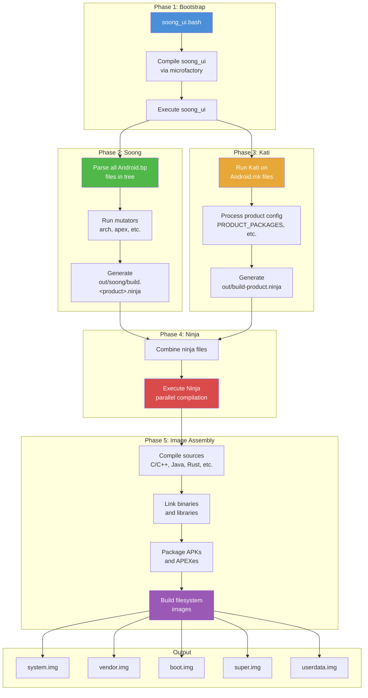

### 2.5.3 Ninja：底层构建执行器

Soong 和 Kati 实际上都不编译任何东西。它们是*构建图生成器*——它们生成 Ninja 格式的清单文件。然后一个底层的**构建执行器**读取该清单并完成实际工作。

历史上，这个执行器是 **Ninja**。从 Android 17 起，默认执行器是 **Siso**（见 2.5.7 节）。Siso 读取同样的 `.ninja` 清单，但增加了原生的远程执行和缓存支持。本节的讨论适用于两者共享的清单格式和图执行模型。

Ninja 由 Google 的 Evan Martin 专为 Chrome/Chromium 构建而创建。它只为一件事而设计：尽可能快地执行构建图。与 Make 不同，Ninja 不发现也不计算构建图——它期望一个预先计算好的 `.ninja` 文件，然后直接执行它。

Ninja 为速度而设计：

- 它读取一个描述所有构建边（规则及其依赖）的 `.ninja` 文件
- 它确定过时目标的最小集合（使用文件时间戳）
- 它并行执行构建命令，并遵循依赖顺序
- 它提供紧凑的实时进度显示
- 它的启动时间极快（即使大型构建也在亚秒级）

#### Ninja 文件格式

一个 Ninja 文件由规则和构建边组成：

```ninja
# Rule definition: how to compile a C file
rule cc
  command = clang -c $cflags -o $out $in
  description = CC $out

# Build edge: apply the rule to specific files
build out/obj/foo.o: cc src/foo.c
  cflags = -Wall -O2

# Another rule: linking
rule link
  command = clang -o $out $in $ldflags
  description = LINK $out

# Build edge: link object files into a binary
build out/bin/myapp: link out/obj/foo.o out/obj/bar.o
  ldflags = -lm
```

Soong 和 Kati 生成的 Ninja 文件极其庞大——完整 AOSP 构建的合并文件可能高达数百 MB。

合并后的 Ninja 文件生成于：
```
out/combined-<TARGET_PRODUCT>.ninja
```

你可以使用 Ninja 的内置工具检查构建图：

```bash
# Show all commands needed to build a target
prebuilts/build-tools/linux-x86/bin/ninja \
  -f out/combined-aosp_arm64.ninja \
  -t commands out/target/product/generic_arm64/system.img

# Show the dependency graph for a target
ninja -f out/combined-aosp_arm64.ninja -t graph libcutils > deps.dot

# Show build rules for a specific output
ninja -f out/combined-aosp_arm64.ninja -t query <output-file>
```

`envsetup.sh` 中的 `showcommands` 函数提供了一个便捷的包装：

```bash
# Show all commands Ninja would run
showcommands <target>
```

### 2.5.4 输出目录

所有构建产物都放在 `out/` 目录下（如果被覆盖，则是 `$OUT_DIR`）：

```
out/
  .module_paths/              <-- Module path cache
  soong/
    .intermediates/           <-- Soong intermediate outputs
    build.<product>.ninja     <-- Soong-generated ninja file
    docs/                     <-- Generated documentation
  target/
    product/
      <device>/               <-- Device-specific outputs
        android-info.txt      <-- Device metadata
        boot.img              <-- Kernel + ramdisk
        dtbo.img              <-- Device Tree Blob Overlay
        init_boot.img         <-- Init boot image (Android 13+)
        obj/                  <-- Native object files
        ramdisk.img           <-- Root filesystem ramdisk
        super.img             <-- Dynamic partitions container
        system/               <-- Staged system partition contents
        system.img            <-- System partition image
        userdata.img          <-- User data partition image
        vendor/               <-- Staged vendor partition contents
        vendor.img            <-- Vendor partition image
        vendor_boot.img       <-- Vendor boot image
        product.img           <-- Product partition image
        system_ext.img        <-- System extension partition image
        recovery.img          <-- Recovery image
        vbmeta.img            <-- Verified Boot metadata
        symbols/              <-- Unstripped binaries (for debugging)
        testcases/            <-- Test binaries
  host/
    linux-x86/                <-- Host tools built during the build
      bin/                    <-- Host binaries (adb, fastboot, etc.)
      testcases/              <-- Host test cases
  combined-<product>.ninja    <-- Combined ninja manifest
  build-<product>.ninja       <-- Kati-generated ninja manifest
  verbose.log.gz              <-- Build log (if enabled)
  error.log                   <-- Error log
  dist/                       <-- Distribution artifacts
```

`out/target/product/<device>/` 中的关键镜像：

| 镜像 | 用途 |
|-------|---------|
| `system.img` | 核心 Android 系统（framework、应用、库） |
| `vendor.img` | 硬件特定的 HAL 和固件 |
| `boot.img` | 内核 + 通用 ramdisk |
| `vendor_boot.img` | 供应商特定的 ramdisk |
| `init_boot.img` | 通用 ramdisk（Android 13+，GKI） |
| `super.img` | 动态分区容器（容纳 system、vendor、product 等） |
| `userdata.img` | 初始用户数据分区 |
| `product.img` | 产品特定的定制 |
| `system_ext.img` | 系统扩展（OEM 对系统分区的添加） |
| `recovery.img` | Recovery 模式镜像 |
| `vbmeta.img` | Android Verified Boot 元数据 |
| `dtbo.img` | 设备树 blob 覆盖 |

### 2.5.5 Soong 中间产物目录

`out/soong/.intermediates/` 目录是 Soong 存放中间构建产物的地方。每个模块都有自己的子目录，按模块在源码树中的路径组织：

```
out/soong/.intermediates/
  frameworks/base/
    framework-minus-apex/
      android_common/
        javac/          <-- Java compilation outputs
        dex/            <-- DEX conversion outputs
        combined/       <-- Combined JAR
  external/zlib/
    libz/
      android_arm64_armv8-a_shared/   <-- Device shared lib variant
        libz.so
      android_arm64_armv8-a_static/   <-- Device static lib variant
        libz.a
      linux_glibc_x86_64_shared/      <-- Host shared lib variant
        libz.so
  packages/apps/Settings/
    Settings/
      android_common/
        Settings.apk
```

目录结构反映了由 mutator 创建的**模块变体**。一个像 `libz` 这样的 `cc_library` 可能有许多变体：

- `android_arm64_armv8-a_shared`：设备 ARM64，共享库
- `android_arm64_armv8-a_static`：设备 ARM64，静态库
- `linux_glibc_x86_64_shared`：宿主 Linux x86_64，共享库
- 还可能更多，例如 sanitizer、APEX 变体等。

这个目录可能会变得非常大（完整构建超过 100 GB）。`m clean` 命令会删除整个 `out/` 目录。

### 2.5.6 动态分区与 `super.img`

现代 Android（10+）使用**动态分区**。单个 `super.img` 不再使用固定大小的独立分区，而是包含一个逻辑卷管理器。卷管理器动态地把空间分配给 system、vendor、product 和其他分区。这在 `BoardConfig.mk` 中配置：

```makefile
# From device/generic/goldfish/board/BoardConfigCommon.mk:

# emulator needs super.img
BOARD_BUILD_SUPER_IMAGE_BY_DEFAULT := true

# 8G + 8M
BOARD_SUPER_PARTITION_SIZE ?= 8598323200
BOARD_SUPER_PARTITION_GROUPS := emulator_dynamic_partitions

BOARD_EMULATOR_DYNAMIC_PARTITIONS_PARTITION_LIST := \
  system \
  system_dlkm \
  system_ext \
  product \
  vendor

# 8G
BOARD_EMULATOR_DYNAMIC_PARTITIONS_SIZE ?= 8589934592
```

**来源：** `device/generic/goldfish/board/BoardConfigCommon.mk`，第 44-72 行

### 2.5.7 Siso：Android 17 中的默认构建执行器

Android 17 将默认的底层构建执行器从 Ninja 改为了 **Siso**。Siso 是 Ninja 的即插即用替代品，由 Chromium 构建团队开发。它消费 Soong 和 Kati 生成的同样的 `.ninja` 清单，还增加了对远程执行、内容寻址缓存和基于 Starlark 的配置层的原生支持。选择逻辑位于 `soong_ui` 中：

`build/soong/ui/build/config.go` 中的默认执行器选择：

```go
// Which builder are we using?
type ninjaCommandType int

const (
    _ = iota
    NINJA_NINJA
    NINJA_N2
    NINJA_SISO
    NINJA_NINJAGO
)

var NINJA_DEFAULT ninjaCommandType = NINJA_SISO
```

**来源：** `build/soong/ui/build/config.go`，第 61-72 行

`soong_ui` 根据 `SOONG_NINJA` 环境变量选择执行器，当它未设置时回退到 `NINJA_DEFAULT`（Siso）：

```go
switch os.Getenv("SOONG_NINJA") {
case "ninja":
    ret.ninjaCommand = NINJA_NINJA
case "n2":
    ret.ninjaCommand = NINJA_N2
case "siso":
    ret.ninjaCommand = NINJA_SISO
case "ninjago":
    ret.ninjaCommand = NINJA_NINJAGO
default:
    ret.ninjaCommand = NINJA_DEFAULT
}
```

**来源：** `build/soong/ui/build/config.go`，第 328-339 行

因此 `SOONG_NINJA=ninja m` 可以退回经典的 Ninja，而未设置 `SOONG_NINJA` 现在意味着 Siso。（在某些 CI 构建机使用的较旧 macOS 版本上，`soong_ui` 仍会回退到 Ninja。）

Siso 二进制文件本身作为预编译产物检入在 `prebuilts/siso/` 下（每个宿主一个二进制：`prebuilts/siso/linux-x86/siso`、`prebuilts/siso/linux-arm64/siso`、`prebuilts/siso/darwin-x86/siso`），并通过 `prebuilts/siso/siso.versions` 中的 CIPD 版本固定。`soong_ui` 通过 `configImpl.SisoBin()` 解析该二进制：

```go
func (c *configImpl) SisoBin() string {
    // TODO(b/374176257): remove this once Siso is built from source.
    return filepath.Join("prebuilts/siso", c.HostPrebuiltTag(), "siso")
}
```

**来源：** `build/soong/ui/build/config.go`，第 2061-2064 行

运行 Siso 时，`soong_ui` 会让它指向一个 Starlark 配置树，该树描述了每个 Ninja 规则应如何处理远程执行。规范配置位于 `build/soong/siso_config/`（`main.star`，加上语言特定的 `clang.star`、`java.star` 和 `rust.star`）：

> "这个目录告诉 Siso 如何处理各种 Ninja 规则的 RBE。它为 AOSP 中受支持的项目提供了使用 RBE 所需的配置——无论是通过 `rewrapper`，还是使用 Siso 原生的 RBE 支持。"

**来源：** `build/soong/siso_config/README.md`，第 1-5 行

对日常构建来说，实际效果是 `m` 的行为与之前相同。执行器只是一个实现细节。本地的 Siso 构建可以透明地复用缓存的构建动作。当配置了远程后端时，它也可以把工作分发出去。旧的 Ninja 路径为此需要单独的 `rbesetup.sh` 仪式。Siso 不需要。

`soong_ui` 中的构建执行器选择流程：

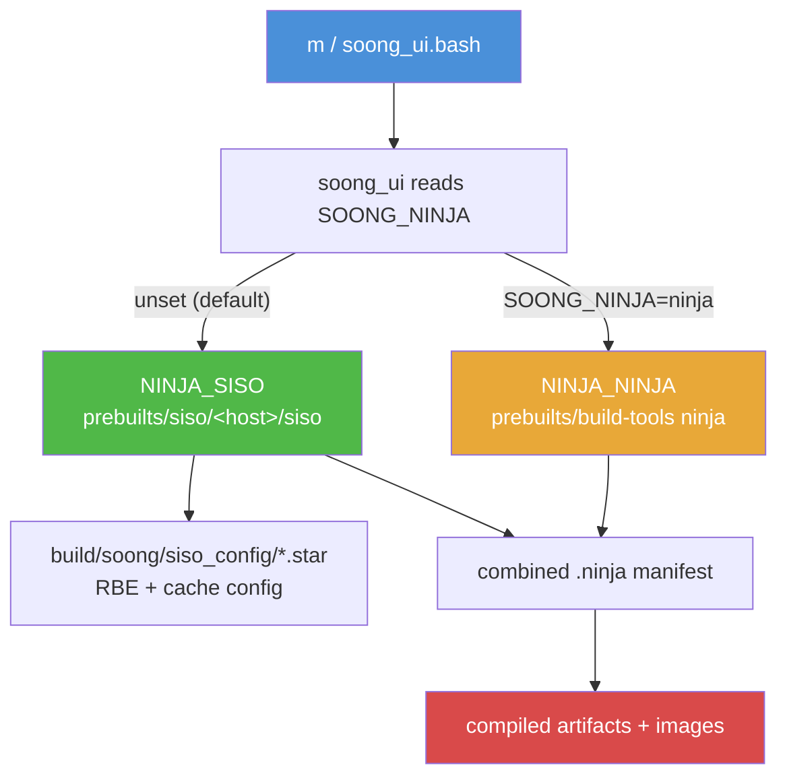

### 2.5.8 构建期间只读的源码树

Android 17 构建在源码树以只读方式挂载的情况下运行。`soong_ui` 在 `nsjail` 沙箱（`prebuilts/build-tools/linux-x86/bin/nsjail`）内执行构建，并默认以只读标志 bind-mount 源码目录。该标志来自 `SandboxConfig.SrcDirMountFlag()`。它返回 nsjail 的 `-R`（只读）bind。如果源码目录被显式设为可写，它则返回 `-B`（`build/soong/ui/build/sandbox_config.go`，第 31-37 行，用于 `build/soong/ui/build/sandbox_linux.go`）。

另外，Kati 以 `--werror_writable` 运行。因此在产品配置期间写入只读目录是一个硬错误，而不仅仅是警告（`build/soong/ui/build/kati.go`，第 145-146 行）。

其意图是构建只向 `out/` 下写入。有些步骤需要更新检入的文件，例如 `m update-api`。这些步骤先把生成的文件构建在 `out/` 下，然后在沙箱构建结束后，`soong_ui` 把它们复制回树中（`build/soong/ui/build/update_api.go`，第 25-30 行）。尝试在构建运行期间修改源码的构建会以文件系统错误失败。Ninja 能识别内核的"Read-only file system"消息并打印一条提示（`build/soong/ui/status/ninja.go`，第 326-330 行）：

1. 直接在 `out/` 下生成文件，它是可读写的（推荐）。
2. `BUILD_BROKEN_SRC_DIR_RW_ALLOWLIST := <path> ...` 使树的一部分可写（不鼓励）。
3. `BUILD_BROKEN_SRC_DIR_IS_WRITABLE := true` 使整棵树可写（强烈不鼓励）。

前两者通过 `BoardConfig`/`dumpvars` 接入 `SetSrcDirIsRO()` 和 `SetSrcDirRWAllowlist()`（`build/soong/ui/build/config.go`，第 807-808 行）。因此，确实需要在配置期间写入树中的设备可以退出该机制。代价是失去了干净检出的保证。

---

## 2.6 产品配置

### 2.6.1 产品配置层次结构

一个 AOSP 产品由一套层次化的 Make 文件定义。这些文件指定要安装哪些软件包、要设置哪些属性，以及如何配置主板硬件。层次结构从通用走向具体：

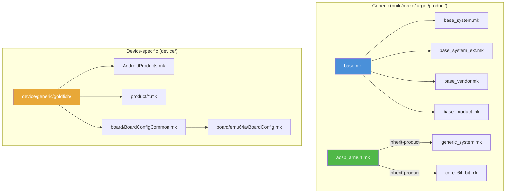

### 2.6.2 `inherit-product` 机制

`inherit-product` 函数是产品配置的骨干。它 include 另一个产品 makefile，并继承其全部变量设置：

```makefile
$(call inherit-product, $(SRC_TARGET_DIR)/product/core_64_bit.mk)
```

这类似于面向对象编程中的类继承。继承链可能很深——一个典型的产品 makefile 可能继承自 5-10 个其他 makefile，每个都添加或覆盖特定设置。

关于 `inherit-product` 的重要规则：

- 像 `PRODUCT_PACKAGES` 这样的变量是*追加*，而不是覆盖。
- 像 `PRODUCT_NAME` 这样的变量会被最后一次赋值*覆盖*。
- `inherit-product` 调用的顺序对覆盖行为很重要。
- `inherit-product-if-exists` 是一个变体，当文件不存在时静默跳过（适用于可选的供应商组件）。

继承模式遵循分层方法：

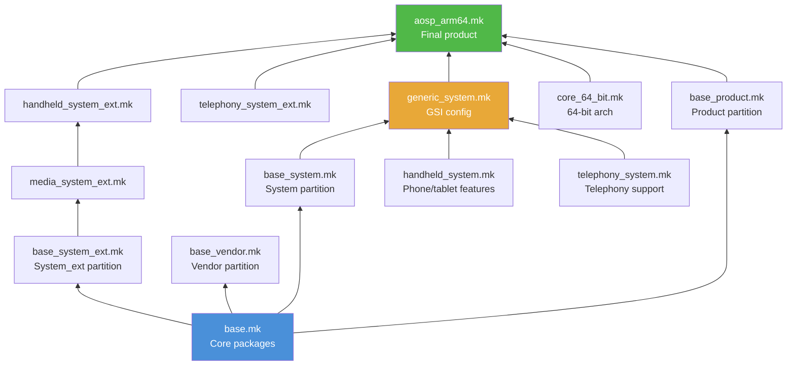

注意，`base_system_ext.mk` 只通过 `handheld_system_ext.mk` 到达产品，后者经由 `media_system_ext.mk` 间接继承它。`aosp_arm64.mk` 也直接继承 `telephony_system_ext.mk`，但该文件本身不继承任何东西——它只是向 `PRODUCT_PACKAGES` 追加内容。`generic_system.mk` 只引入系统分区的 makefile。`base_vendor.mk` 根本不在 `aosp_arm64.mk` 的继承链中；vendor 内容来自设备 makefile。

### 2.6.3 `build/make/target/product/` 中的产品 makefile

该目录包含真实设备产品继承的通用产品定义。关键文件：

| 文件 | 用途 |
|------|---------|
| `base.mk` | 继承所有基础分区 makefile |
| `base_system.mk` | 定义基础 system 软件包（PRODUCT_PACKAGES） |
| `base_system_ext.mk` | 定义基础 system_ext 软件包 |
| `base_vendor.mk` | 定义基础 vendor 软件包 |
| `base_product.mk` | 定义基础 product 软件包 |
| `core_64_bit.mk` | 启用 64 位架构支持 |
| `core_64_bit_only.mk` | 仅 64 位（不支持 32 位） |
| `generic_system.mk` | 通用系统镜像（GSI）配置 |
| `aosp_arm64.mk` | ARM64 的 AOSP 产品 |
| `aosp_x86_64.mk` | x86_64 的 AOSP 产品 |
| `aosp_riscv64.mk` | RISC-V 64 的 AOSP 产品 |

`base.mk` 文件是一个简单的聚合器：

```makefile
# This makefile is suitable to inherit by products that don't need to be
# split up by partition.
$(call inherit-product, $(SRC_TARGET_DIR)/product/base_system.mk)
$(call inherit-product, $(SRC_TARGET_DIR)/product/base_system_ext.mk)
$(call inherit-product, $(SRC_TARGET_DIR)/product/base_vendor.mk)
$(call inherit-product, $(SRC_TARGET_DIR)/product/base_product.mk)
```

**来源：** `build/make/target/product/base.mk`，第 17-23 行

`base_system.mk` 文件定义 PRODUCT_PACKAGES——安装到系统分区的软件包。这是一个很长的列表（数百个条目），包含 Android 的基本组件：

```makefile
# Base modules and settings for the system partition.
PRODUCT_PACKAGES += \
    abx \
    aconfigd-system \
    adbd_system_api \
    aflags \
    am \
    android.hidl.base-V1.0-java \
    android.hidl.manager-V1.0-java \
    android.system.suspend-service \
    android.test.base \
    android.test.mock \
    android.test.runner \
    apexd \
    ...
    com.android.adbd \
    com.android.adservices \
    com.android.appsearch \
    com.android.bt \
    com.android.conscrypt \
    com.android.i18n \
    com.android.media \
    com.android.media.swcodec \
    com.android.wifi \
    ...
    framework-graphics \
    framework-minus-apex \
    ...
```

**来源：** `build/make/target/product/base_system.mk`，第 18-100+ 行

注意，许多 APEX 模块（`com.android.wifi`、`com.android.media` 等）直接列在 `PRODUCT_PACKAGES` 中。它们被视为一等可安装软件包。

### 2.6.4 具体产品：`aosp_arm64`

`aosp_arm64.mk` 产品定义展示了所有部件如何组合在一起：

```makefile
# The system image of aosp_arm64-userdebug is a GSI for the devices with:
# - ARM 64 bits user space
# - 64 bits binder interface
# - system-as-root
# - VNDK enforcement
# - compatible property override enabled

#
# All components inherited here go to system image
#
$(call inherit-product, $(SRC_TARGET_DIR)/product/core_64_bit.mk)
$(call inherit-product, $(SRC_TARGET_DIR)/product/generic_system.mk)

# Enable mainline checking for exact this product name
ifeq (aosp_arm64,$(TARGET_PRODUCT))
PRODUCT_ENFORCE_ARTIFACT_PATH_REQUIREMENTS := relaxed
endif

#
# All components inherited here go to system_ext image
#
$(call inherit-product, $(SRC_TARGET_DIR)/product/handheld_system_ext.mk)
$(call inherit-product, $(SRC_TARGET_DIR)/product/telephony_system_ext.mk)

# pKVM
$(call inherit-product-if-exists, \
  packages/modules/Virtualization/apex/product_packages.mk)

#
# All components inherited here go to product image
#
$(call inherit-product, $(SRC_TARGET_DIR)/product/aosp_product.mk)

#
# All components inherited here go to vendor or vendor_boot image
#
$(call inherit-product, $(SRC_TARGET_DIR)/board/generic_arm64/device.mk)
AB_OTA_UPDATER := true
AB_OTA_PARTITIONS ?= system

#
# Special settings for GSI releasing
#
ifeq (aosp_arm64,$(TARGET_PRODUCT))
MODULE_BUILD_FROM_SOURCE ?= true
$(call inherit-product, $(SRC_TARGET_DIR)/product/gsi_release.mk)
PRODUCT_SOONG_DEFINED_SYSTEM_IMAGE := aosp_system_image
USE_SOONG_DEFINED_SYSTEM_IMAGE := true
endif

PRODUCT_NAME := aosp_arm64
PRODUCT_DEVICE := generic_arm64
PRODUCT_BRAND := Android
PRODUCT_MODEL := AOSP on ARM64
PRODUCT_NO_BIONIC_PAGE_SIZE_MACRO := true
```

**来源：** `build/make/target/product/aosp_arm64.mk`

需要注意的要点：

1. **按分区组织的继承：** 注释清楚地标明了每个被继承的 makefile 贡献给哪个分区（system、system_ext、product、vendor）。
2. **`inherit-product`：** `$(call inherit-product, ...)` 函数 include 另一个产品 makefile 并继承其变量设置。
3. **`PRODUCT_NAME`：** lunch 组合中使用的最终产品名。
4. **`PRODUCT_DEVICE`：** 设备名，它决定使用哪个 `BoardConfig.mk`。

### 2.6.5 关键 PRODUCT_* 变量

| 变量 | 用途 | 示例 |
|----------|---------|---------|
| `PRODUCT_NAME` | 产品名称 | `aosp_arm64` |
| `PRODUCT_DEVICE` | 设备名称（匹配 `device/<vendor>/<name>/`） | `generic_arm64` |
| `PRODUCT_BRAND` | 品牌字符串 | `Android` |
| `PRODUCT_MODEL` | 型号字符串 | `AOSP on ARM64` |
| `PRODUCT_PACKAGES` | 要安装的模块列表 | `Settings framework ...` |
| `PRODUCT_COPY_FILES` | 要复制进镜像的文件 | `src:dest` 对 |
| `PRODUCT_PROPERTY_OVERRIDES` | 要设置的系统属性 | `ro.foo=bar` |
| `PRODUCT_BOOT_JARS` | BOOTCLASSPATH 中的 Jar | `framework core-oj ...` |
| `PRODUCT_SOONG_NAMESPACES` | 暴露给 Make 的 Soong 命名空间 | `hardware/google/pixel` |
| `PRODUCT_ENFORCE_ARTIFACT_PATH_REQUIREMENTS` | 强制路径约定 | `relaxed` 或 `true` |
| `PRODUCT_MANIFEST_FILES` | 设备清单片段 | VINTF 清单路径 |

### 2.6.6 PRODUCT_COPY_FILES

`PRODUCT_COPY_FILES` 变量把文件从源码树复制到输出镜像中的特定路径：

```makefile
PRODUCT_COPY_FILES += \
    device/generic/goldfish/data/etc/config.ini:config.ini \
    device/generic/goldfish/display_settings.xml:$(TARGET_COPY_OUT_VENDOR)/etc/display_settings.xml \
    frameworks/native/data/etc/android.hardware.wifi.xml:$(TARGET_COPY_OUT_VENDOR)/etc/permissions/android.hardware.wifi.xml
```

格式是 `源:目标`，其中 `目标` 相对于 `PRODUCT_OUT`。`TARGET_COPY_OUT_*` 变量帮助把文件放到正确的分区中：

| 变量 | 展开为 | 分区 |
|----------|-----------|-----------|
| `TARGET_COPY_OUT_SYSTEM` | `system` | System |
| `TARGET_COPY_OUT_VENDOR` | `vendor` | Vendor |
| `TARGET_COPY_OUT_PRODUCT` | `product` | Product |
| `TARGET_COPY_OUT_SYSTEM_EXT` | `system_ext` | System Extension |
| `TARGET_COPY_OUT_ODM` | `odm` | ODM |

### 2.6.7 PRODUCT_PROPERTY_OVERRIDES

系统属性（`ro.*`、`persist.*` 等）通过产品配置来设置：

```makefile
PRODUCT_PROPERTY_OVERRIDES += \
    ro.hardware.egl=mesa \
    ro.opengles.version=196610 \
    debug.hwui.renderer=skiagl \
    persist.sys.dalvik.vm.lib.2=libart.so
```

这些最终会出现在设备上的多个 `build.prop` 或 `default.prop` 文件中。

### 2.6.8 发布配置

AOSP 构建系统有一套通过 `build/release/` 管理的发布配置机制。到 Android 17 时，该系统已发展为主要的配置层。不同的"发布"（例如 `trunk_staging`、`eng`、`userdebug`、`user`，以及带日期的 `mainline_2026_NN` 配置）可以控制特性标志和配置变体。产品 makefile 不为此改变。

发布版本作为 `lunch` 的第二个参数指定：

```bash
lunch aosp_arm64 trunk_staging eng
#                ^^^^^^^^^^^^^^^
#                release config
```

可用的发布配置是 `build/release/release_configs/` 下的 `*.textproto` 文件。在 `android17-release` 上，它们包括 `trunk_staging`、`eng`、`userdebug`、`user`，以及带日期的 `mainline_2026_01`...`mainline_2026_04` 主线配置。还包括按季度发布的设备配置（`ap2a`、`ap3a`、`ap4a`、`bp1a`...`bp4a`、`cp1a`、`cp2a`）。每个配置都很小——它只命名了它所引入的 aconfig 值集及其配置类型：

```
name: "trunk_staging"
aconfig_value_sets: "aconfig_value_set-platform_build_release-trunk_staging"
release_config_type: RELEASE_CONFIG
```

**来源：** `build/release/release_configs/trunk_staging.textproto`

发布范围限定的构建标志在 `build/release/` 下声明并赋值。例如，平台版本本身就是一个发布标志，而不是硬编码的 Make 变量。在 `trunk_staging` 上，它解析为 API 级别 37，代号 `Baklava`：

```
name:  "RELEASE_PLATFORM_SDK_VERSION"
value:  {
  string_value:  "37"
}
```

**来源：** `build/release/flag_values/trunk_staging/RELEASE_PLATFORM_SDK_VERSION.textproto`

`build/release/` 下的目录布局把声明和值分开：

| 路径 | 用途 |
|------|---------|
| `release_configs/*.textproto` | 每个发布配置一个文件（哪些值集 + 类型） |
| `flag_declarations/` | `RELEASE_*` 构建标志声明（名称、类型、默认值） |
| `flag_values/<release>/` | 每个发布的对这些标志的覆盖 |
| `aconfig/` | 接入发布配置的 aconfig 值集 |
| `build_config/*.scl` | Starlark 构建配置快照（例如最终确定的 API 级别） |
| `release_config_map.textproto` | 声明发布配置别名（例如 `aosp_current` -> `cp2a`）以及本目录的默认 aconfig 容器 |

发布配置由一个专门的 Go 工具 `release_config` 解析，`soong_ui.bash` 会与 `soong_ui` 一起对它进行自举：

```bash
soong_build_go release-config android/soong/cmd/release_config/release_config
```

**来源：** `build/soong/soong_ui.bash`

它的源码位于 `build/soong/cmd/release_config/`，该目录还附带用于查询和编辑标志值的 `build_flag` 命令。发布定稿时使用的 `finalize-platform`/`finalize-release-configs` 辅助工具（代号翻转为 `REL`，SDK 版本号被锁定）则单独位于 `build/make/tools/finalization/finalize-platform/` 下。

**来源：** `build/soong/cmd/release_config/release_config/main.go`

Android 从 Android 17 起发布的 **Canary** 发布渠道是发布流程上的变化，而不是构建系统的产物。它用一个持续更新的渠道取代了旧的开发者预览版。构建按滚动方式从 trunk 切出，并推送给可刷写的设备和模拟器。因此最新的开发中平台始终可用。测试人员不必等待有编号的预览版发布。

这些都不会表现为一个新的发布配置。`build/release/release_configs/` 中没有 `canary`（或 `next`）文件。该目录保存 `trunk_staging`、`eng`/`user`/`userdebug` 构建变体、带日期的 `mainline_2026_NN` 配置，以及按季度发布的设备配置（`ap2a`、`ap3a`、`bp1a` 等等）。

`CANARY` 这个词确实出现在两个无关的地方。一个是在 `build/soong/android/api_levels.go` 中映射到 API 级别 10000 的预览代号。另一个是 `cp2a` 发布配置的 `RELEASE_PLATFORM_VERSION_KNOWN_CODENAMES` 值列表（`trunk_staging` 列表到 `Baklava` 为止，不包含它）。两者都不是可以传给 `lunch` 的发布配置。

对于源码构建，工作中的 trunk 配置仍然是 `trunk_staging`。Canary 渠道是预编译的滚动镜像触达测试人员的方式。它叠加在第 3 章所述的同一 trunk-stable 模型之上。

### 2.6.9 设备配置：Goldfish（模拟器）

goldfish 模拟器设备定义在 `device/generic/goldfish/` 中。它的 `AndroidProducts.mk` 列出了可用的产品：

```makefile
PRODUCT_MAKEFILES := \
    $(LOCAL_DIR)/64bitonly/product/sdk_phone64_x86_64.mk \
    $(LOCAL_DIR)/64bitonly/product/sdk_phone16k_x86_64.mk \
    $(LOCAL_DIR)/64bitonly/product/sdk_phone64_x86_64_minigbm.mk \
    $(LOCAL_DIR)/64bitonly/product/sdk_phone64_x86_64_riscv64.mk \
    $(LOCAL_DIR)/64bitonly/product/sdk_tablet_arm64.mk \
    $(LOCAL_DIR)/64bitonly/product/sdk_tablet_x86_64.mk \
    $(LOCAL_DIR)/64bitonly/product/sdk_phone64_arm64.mk \
    $(LOCAL_DIR)/64bitonly/product/sdk_phone64_arm64_minigbm.mk \
    $(LOCAL_DIR)/64bitonly/product/sdk_phone16k_arm64.mk \
    $(LOCAL_DIR)/64bitonly/product/sdk_phone64_arm64_riscv64.mk \
    $(LOCAL_DIR)/64bitonly/product/sdk_slim_x86_64.mk \
    $(LOCAL_DIR)/64bitonly/product/sdk_slim_arm64.mk \
```

**来源：** `device/generic/goldfish/AndroidProducts.mk`

### 2.6.10 `BoardConfig.mk`

`BoardConfig.mk` 文件定义设备的硬件级配置。对于 goldfish ARM64 模拟器：

```makefile
# arm64 emulator specific definitions
TARGET_ARCH := arm64
TARGET_ARCH_VARIANT := armv8-a
TARGET_CPU_VARIANT := generic
TARGET_CPU_ABI := arm64-v8a

TARGET_2ND_ARCH_VARIANT := armv8-a
TARGET_2ND_CPU_VARIANT := generic

include device/generic/goldfish/board/BoardConfigCommon.mk

BOARD_BOOTIMAGE_PARTITION_SIZE := 0x02000000
BOARD_USERDATAIMAGE_PARTITION_SIZE := 576716800
```

**来源：** `device/generic/goldfish/board/emu64a/BoardConfig.mk`

所有 goldfish 变体共享的公共配置：

```makefile
include build/make/target/board/BoardConfigGsiCommon.mk

BOARD_VENDOR_SEPOLICY_DIRS += device/generic/goldfish/sepolicy/vendor
SYSTEM_EXT_PRIVATE_SEPOLICY_DIRS += \
  device/generic/goldfish/sepolicy/system_ext/private

TARGET_BOOTLOADER_BOARD_NAME := goldfish_$(TARGET_ARCH)

NUM_FRAMEBUFFER_SURFACE_BUFFERS := 3

# Build OpenGLES emulation guest and host libraries
BUILD_EMULATOR_OPENGL := true
BUILD_QEMU_IMAGES := true

# Build and enable the OpenGL ES View renderer
USE_OPENGL_RENDERER := true

# Emulator doesn't support sparse image format
TARGET_USERIMAGES_SPARSE_EXT_DISABLED := true

# emulator is Non-A/B device
AB_OTA_UPDATER := none
AB_OTA_PARTITIONS :=

# emulator needs super.img
BOARD_BUILD_SUPER_IMAGE_BY_DEFAULT := true

# 8G + 8M
BOARD_SUPER_PARTITION_SIZE ?= 8598323200
BOARD_SUPER_PARTITION_GROUPS := emulator_dynamic_partitions

BOARD_EMULATOR_DYNAMIC_PARTITIONS_PARTITION_LIST := \
  system \
  system_dlkm \
  system_ext \
  product \
  vendor

BOARD_SYSTEMIMAGE_FILE_SYSTEM_TYPE := $(EMULATOR_RO_PARTITION_FS)
BOARD_PRODUCTIMAGE_FILE_SYSTEM_TYPE := $(EMULATOR_RO_PARTITION_FS)
BOARD_SYSTEM_EXTIMAGE_FILE_SYSTEM_TYPE := $(EMULATOR_RO_PARTITION_FS)

BOARD_USES_SYSTEM_DLKMIMAGE := true
BOARD_SYSTEM_DLKMIMAGE_FILE_SYSTEM_TYPE := erofs

#vendor boot
BOARD_INCLUDE_DTB_IN_BOOTIMG := false
BOARD_BOOT_HEADER_VERSION := 4
BOARD_MKBOOTIMG_ARGS += --header_version $(BOARD_BOOT_HEADER_VERSION)
BOARD_VENDOR_BOOTIMAGE_PARTITION_SIZE := 0x06000000
BOARD_RAMDISK_USE_LZ4 := true
```

**来源：** `device/generic/goldfish/board/BoardConfigCommon.mk`

关键的 `BOARD_*` 变量：

| 变量 | 用途 |
|----------|---------|
| `TARGET_ARCH` | 主要架构（arm64、x86_64 等） |
| `TARGET_ARCH_VARIANT` | 架构变体（armv8-a 等） |
| `TARGET_CPU_VARIANT` | CPU 变体（generic、cortex-a53 等） |
| `TARGET_CPU_ABI` | CPU ABI 字符串（arm64-v8a、x86_64 等） |
| `BOARD_BOOTIMAGE_PARTITION_SIZE` | Boot 分区大小 |
| `BOARD_SUPER_PARTITION_SIZE` | Super 分区大小 |
| `BOARD_SUPER_PARTITION_GROUPS` | 动态分区组 |
| `BOARD_SYSTEMIMAGE_FILE_SYSTEM_TYPE` | 系统镜像文件系统（ext4、erofs） |
| `BOARD_BOOT_HEADER_VERSION` | Boot 镜像头版本 |
| `BOARD_VENDOR_SEPOLICY_DIRS` | Vendor SEPolicy 目录 |

### 2.6.11 产品配置流程

从 `lunch` 到配置完成的构建的完整流程：

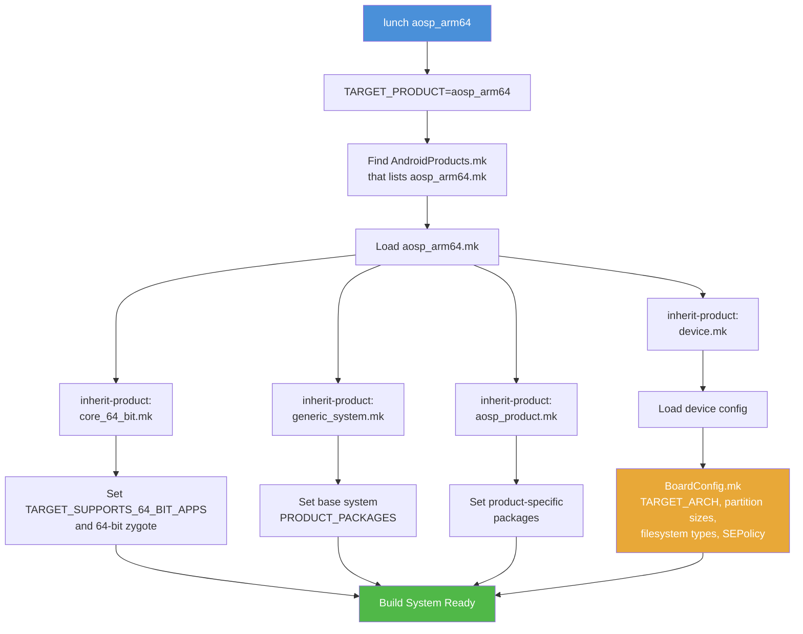

---

## 2.7 APEX：模块化系统组件

### 2.7.1 APEX 是什么？

APEX（Android Pony EXpress）是 Android 10 引入的一种容器格式，它允许系统组件独立于整个 OS 进行更新。在 APEX 之前，更新系统库或运行时需要完整的 OTA（空中下载）更新。有了 APEX，各个组件可以通过 Google Play Store 或类似机制进行更新。例如 ART 运行时、Wi-Fi 协议栈和 DNS 解析器。

APEX 文件是一种特殊类型的 Android 包，它包含：

- 原生共享库（`.so` 文件）
- 可执行文件
- Java 库（JAR）
- Android 应用（APK）
- 配置文件
- 描述该包的清单
- 用于 verified boot 集成的签名密钥

### 2.7.2 APEX 架构

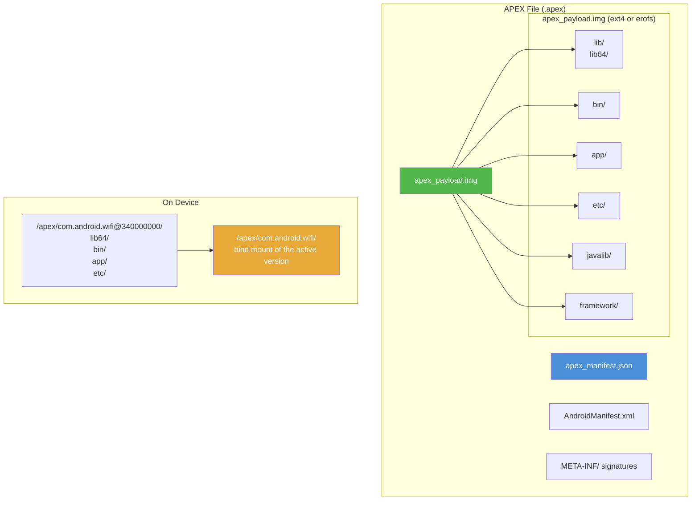

### 2.7.3 设备上的 APEX 生命周期

理解 APEX 在运行时如何工作有助于解释其构建时的要求：


1. 启动时，`apexd`（APEX 守护进程）扫描 APEX 文件。
2. 每个 APEX 文件的签名都用预安装的公钥验证。
3. 每个 APEX 内部的 `apex_payload.img` 被挂载为 loop 设备。
4. payload 挂载在 `/apex/<name>@<version>`，当前活动版本被 bind-mount 到 `/apex/<name>`。
5. APEX 中的库和二进制文件通过链接器配置对系统可用。

预安装的 APEX 位于 `/system/apex/`。当收到更新时（例如通过 Play Store），新的 APEX 存储在 `/data/apex/` 中，并在下次启动时激活。旧版本会保留用于回滚。

### 2.7.4 构建系统中的 APEX

APEX 构建逻辑位于 `build/soong/apex/`。主文件 `apex.go` 定义模块类型和构建逻辑：

```go
// package apex implements build rules for creating the APEX files which
// are container for lower-level system components.
// See https://source.android.com/devices/tech/ota/apex
package apex

func init() {
    registerApexBuildComponents(android.InitRegistrationContext)
}

func registerApexBuildComponents(ctx android.RegistrationContext) {
    ctx.RegisterModuleType("apex", BundleFactory)
    ctx.RegisterModuleType("apex_test", TestApexBundleFactory)
    ctx.RegisterModuleType("apex_vndk", vndkApexBundleFactory)
    ctx.RegisterModuleType("apex_defaults", DefaultsFactory)
    ctx.RegisterModuleType("prebuilt_apex", PrebuiltFactory)
    ctx.RegisterModuleType("override_apex", OverrideApexFactory)
    ctx.RegisterModuleType("apex_set", apexSetFactory)

    ctx.PreDepsMutators(RegisterPreDepsMutators)
    ctx.PostDepsMutators(RegisterPostDepsMutators)
}
```

**来源：** `build/soong/apex/apex.go`，第 45-60 行

`apexBundleProperties` 结构体定义了 APEX 模块可以声明的所有属性：

```go
type apexBundleProperties struct {
    // Json manifest file describing meta info of this APEX bundle.
    Manifest *string `android:"path"`

    // AndroidManifest.xml file used for the zip container
    AndroidManifest proptools.Configurable[string] `android:"path,..."`

    // Determines the file contexts file for setting security contexts
    File_contexts *string `android:"path"`

    // Canned fs config file for customizing file uid/gid/mod/capabilities
    Canned_fs_config proptools.Configurable[string] `android:"path,..."`

    ApexNativeDependencies

    Multilib apexMultilibProperties

    // List of runtime resource overlays (RROs)
    Rros []string

    // List of bootclasspath fragments
    Bootclasspath_fragments proptools.Configurable[[]string]

    // List of systemserverclasspath fragments
    Systemserverclasspath_fragments proptools.Configurable[[]string]

    // List of java libraries
    Java_libs []string

    // List of sh binaries
    Sh_binaries proptools.Configurable[[]string]

    // List of platform_compat_config files
    Compat_configs proptools.Configurable[[]string]
    ...
}
```

**来源：** `build/soong/apex/apex.go`，第 72-120 行

完整的 `apexBundleProperties` 结构体还包括控制 APEX 更新行为的属性：

```go
// Whether this APEX is considered updatable or not. When set to true,
// this will enforce additional rules for making sure that the APEX is
// truly updatable. To be updatable, min_sdk_version should be set as
// well. This will also disable the size optimizations like symlinking
// to the system libs. Default is true.
Updatable *bool

// Whether this APEX can use platform APIs or not. Can be set to true
// only when `updatable: false`. Default is false.
Platform_apis *bool

// Whether this APEX is installable to one of the partitions like
// system, vendor, etc. Default: true.
Installable *bool

// The type of filesystem to use. Either 'ext4', 'f2fs' or 'erofs'.
// Default 'ext4'.
Payload_fs_type *string
```

**来源：** `build/soong/apex/apex.go`，第 125-147 行

`ApexNativeDependencies` 结构体定义了什么内容进入 APEX 内部：

```go
type ApexNativeDependencies struct {
    // List of native libraries embedded inside this APEX.
    Native_shared_libs proptools.Configurable[[]string]

    // List of JNI libraries embedded inside this APEX.
    Jni_libs proptools.Configurable[[]string]

    // List of rust dyn libraries embedded inside this APEX.
    Rust_dyn_libs []string

    // List of native executables embedded inside this APEX.
    Binaries proptools.Configurable[[]string]

    // List of native tests embedded inside this APEX.
    Tests []string

    // List of filesystem images embedded inside this APEX bundle.
    Filesystems []string

    // List of prebuilt_etcs embedded inside this APEX bundle.
    Prebuilts proptools.Configurable[[]string]
}
```

**来源：** `build/soong/apex/apex.go`，第 188-209 行

注意 `proptools.Configurable[[]string]` 的使用。这种类型支持较新的 select 语句条件机制。依赖列表因此可以根据构建配置而变化。

### 2.7.5 声明 APEX 模块

下面是声明 APEX 的完整模式，以 Wi-Fi 模块为例：

```
// Step 1: Define the signing key
apex_key {
    name: "com.android.wifi.key",
    public_key: "com.android.wifi.avbpubkey",
    private_key: "com.android.wifi.pem",
}

// Step 2: Define the certificate
android_app_certificate {
    name: "com.android.wifi.certificate",
    certificate: "com.android.wifi",
}

// Step 3: Define defaults (optional, but recommended)
apex_defaults {
    name: "com.android.wifi-defaults",
    bootclasspath_fragments: ["com.android.wifi-bootclasspath-fragment"],
    systemserverclasspath_fragments: [
        "com.android.wifi-systemserverclasspath-fragment"
    ],
    key: "com.android.wifi.key",
    certificate: ":com.android.wifi.certificate",
    apps: ["OsuLogin", "ServiceWifiResources", "WifiDialog"],
    jni_libs: ["libservice-wifi-jni"],
    compressible: true,
}

// Step 4: Define the APEX itself
apex {
    name: "com.android.wifi",
    defaults: ["com.android.wifi-defaults"],
    manifest: "apex_manifest.json",
}
```

**来源：** `packages/modules/Wifi/apex/Android.bp`

### 2.7.6 模块如何声明 APEX 可用性

当一个库或二进制文件应当在某个 APEX 内可用时，它使用 `apex_available` 属性：

```
cc_library {
    name: "libwifi-jni",
    srcs: ["*.cpp"],
    shared_libs: ["liblog", "libbase"],

    // This library can be used in the wifi APEX and the platform
    apex_available: [
        "com.android.wifi",
        "//apex_available:platform",
    ],
}
```

特殊值 `//apex_available:platform` 意味着该模块也可以在任何 APEX 之外使用（即直接在系统分区上）。没有它，模块就仅限于在 APEX 内使用。

APEX 构建系统使用一个 *mutator* 为模块出现的每个 APEX 创建单独的构建变体。这确保了依赖关系按每个 APEX 被正确地隔离。

### 2.7.7 AOSP 中的关键 APEX 模块

许多核心 Android 组件以 APEX 模块的形式交付。其中大多数列在 `base_system.mk` 中。`runtime_libart.mk` 单独引入 ART APEX。它根据构建变体选择 `com.android.art` 或 `com.android.art.debug`：

| APEX 名称 | 组件 |
|-----------|-----------|
| `com.android.adbd` | Android Debug Bridge 守护进程 |
| `com.android.art` | Android Runtime (ART) |
| `com.android.bt` | 蓝牙协议栈 |
| `com.android.conscrypt` | TLS/SSL 提供者 |
| `com.android.i18n` | 国际化（ICU） |
| `com.android.media` | 媒体框架 |
| `com.android.media.swcodec` | 软件编解码器 |
| `com.android.mediaprovider` | 媒体存储 |
| `com.android.os.statsd` | 统计守护进程 |
| `com.android.permission` | 权限控制器 |
| `com.android.resolv` | DNS 解析器 |
| `com.android.sdkext` | SDK 扩展 |
| `com.android.tethering` | 网络共享与连接 |
| `com.android.wifi` | Wi-Fi 协议栈 |
| `com.android.neuralnetworks` | Neural Networks HAL |
| `com.android.virt` | 虚拟化框架 |

---

## 2.8 AOSP 中的 Bazel

### 2.8.1 为什么用 Bazel？

Bazel 是 Google 的开源构建系统，由其内部系统 Blaze 演化而来。与 Soong 相比，它有几个优势：

- **密封性：** 构建是沙箱化的、可重现的。
- **远程执行：** 构建动作可以分布到集群中。
- **缓存：** 构建结果可以在开发者和 CI 之间共享。
- **可扩展性：** 为包含数十亿行代码的仓库而设计。
- **语言支持：** 通过 Starlark 规则为多种语言提供一等支持。

Google 一直在努力把 AOSP 构建的一部分迁移到 Bazel，但这是一项渐进的、持续多年的工作。

### 2.8.2 当前状态

截至当前 AOSP 版本，Bazel 在平台构建中的角色是实验性的、有限的：

- **内核构建（Kleaf）：** 内核构建系统已迁移到 Bazel（见 2.9 节）。
- **选择性的外部项目：** 一些外部项目（如 Skia）在 Soong 定义之外还维护着 Bazel 构建文件。
- **构建实验：** `build/pesto/experiments/` 目录包含实验性的 Bazel 集成测试。

### 2.8.3 bp2build：一个已被移除的转换步骤

有几年时间里，迁移依赖一个叫做 `bp2build` 的工具，它位于 `build/soong/` 下，把 `Android.bp` 模块定义转换成 Bazel 的 `BUILD.bazel` 文件。它解析所有 `Android.bp` 文件（与 Soong 的方式相同）。它为每种有注册转换的模块类型生成等价的 Bazel 规则。它把 `BUILD.bazel` 文件写在 `Android.bp` 文件旁边。转换是可选择加入且渐进式的：只有显式启用的模块才会被转换。

一个典型的转换会把像这样的 `Android.bp` 模块：

```
cc_library {
    name: "libfoo",
    srcs: ["foo.cpp"],
    shared_libs: ["libbar"],
}
```

变成像这样生成的 `BUILD.bazel` 规则：

```python
cc_library_shared(
    name = "libfoo",
    srcs = ["foo.cpp"],
    dynamic_deps = [":libbar"],
)
```

`bp2build` 此后已从 AOSP 树中移除；`build/soong/bp2build/` 目录或功能性代码已不复存在。剩余的 Bazel 工作集中在 Kleaf（2.9 节）和 `build/pesto/` 实验上，而不是整棵树的 `Android.bp` 转换。

### 2.8.4 `build/pesto/` 目录

Bazel 集成实验位于 `build/pesto/`：

```
build/pesto/
  OWNERS
  experiments/
    prepare_bazel_test_env
```

该目录有意保持稀疏。主要的 Bazel 工作在内核构建系统（Kleaf）和各自维护自己 Bazel 构建文件的独立项目中。

### 2.8.5 使用 RBE 的构建性能

AOSP 已经通过 Soong 的 `remoteexec` 包（`build/soong/remoteexec/`）为一些构建动作支持 RBE。要启用 RBE：

```bash
# Source the RBE setup script
source build/make/rbesetup.sh

# Set RBE-specific environment variables
export USE_RBE=1
export RBE_service=...  # Your RBE endpoint (the key is case-sensitive)
export RBE_DIR=...      # RBE client directory

# Build with RBE
m -j200  # Higher parallelism since work is distributed
```

当配置好 RBE 并且有远程 worker 池可用时，构建时间可以大幅缩短：

| 构建类型 | 本地（16 核） | 使用 RBE（约 500 核） |
|-----------|------------------|----------------------|
| 完整干净构建 | 3-4 小时 | 30-45 分钟 |
| 增量（小改动） | 5-15 分钟 | 2-5 分钟 |
| 增量（framework） | 20-40 分钟 | 10-15 分钟 |

性能提升来自：

- 把编译分布到多台机器上
- 缓存编译结果（缓存命中 = 零成本）
- 减少 I/O 争用（远程机器有快速存储）

### 2.8.6 Skia 的 Bazel 构建

比较成熟的 Bazel 集成之一在 Skia 图形库（`external/skia/bazel/`）中。该目录包含一个完整的 Skia Bazel 构建系统，其中有如下文件：

```
external/skia/bazel/
  BUILD.bazel              <-- Top-level build file
  Makefile                 <-- Compatibility wrapper
  buildrc                  <-- Bazel configuration
  cipd_deps.bzl            <-- CIPD dependency definitions
  common_config_settings/  <-- Shared configuration
  cpp_modules.bzl          <-- C++ module definitions
  deps.json                <-- Dependency metadata
  deps_parser/             <-- Dependency parser tool
  device_specific_configs/ <-- Per-device configurations
  external/                <-- External dependency rules
  flags.bzl                <-- Build flag definitions
  gcs_mirror.bzl           <-- Google Cloud Storage mirror rules
```

这展示了同时支持 Soong 和 Bazel 的项目的模式。Soong 用于与 AOSP 构建集成。Bazel 用于独立开发或远程执行。

### 2.8.7 远程构建执行（RBE）

Bazel 的关键优势之一是支持远程构建执行（RBE）。AOSP 已经通过 Soong 的 `remoteexec` 包（`build/soong/remoteexec/`）为一些构建动作支持 RBE。`build/make/rbesetup.sh` 脚本帮助配置 RBE 凭据和端点。

RBE 的工作方式是：

1. 分析构建图，识别可以远程运行的动作
2. 把动作输入上传到内容寻址存储（CAS）
3. 在远程 worker 上执行动作
4. 下载输出（或从动作缓存中获取）

对于大型构建，RBE 可以把编译分布到数百台机器上，从而大幅缩短构建时间。

### 2.8.8 混合构建：被放弃的过渡

曾有一段时间，通往 Bazel 的计划路线经过**混合构建**。在这种设计中，Soong 和 Bazel 会构建不同的模块，并汇入同一个 Ninja 清单。`bp2build` 工具（2.8.3 节）生成 Bazel 部分所消费的 `BUILD.bazel` 文件。这次过渡已被放弃，`bp2build` 已被移除；下图记录了这一计划曾经的样子。

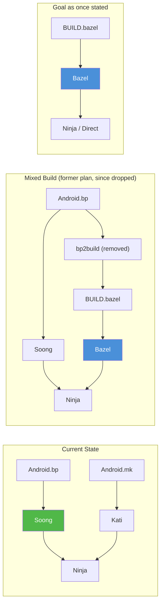

在那个设计中，一些模块将由 Soong 构建，另一些由 Bazel 构建，结果合并为单个 Ninja 清单。当前的构建纯粹由 Soong + Kati 驱动，整棵树的 `Android.bp` 到 Bazel 的转换已不复存在。

---

## 2.9 Kleaf——内核构建系统

### 2.9.1 概述

Kleaf 是 AOSP 基于 Bazel 的内核构建系统。与平台构建（使用 Soong）不同，内核构建已完全迁移到 Bazel。Kleaf 提供密封的、可重现的内核构建，并支持：

- 多种架构（ARM64、ARM、x86_64、i386、RISC-V 64）
- 通用内核镜像（GKI）架构
- 自定义和用户提供的工具链
- 远程构建执行
- 增量构建

### 2.9.2 工具链配置

Kleaf 的工具链配置位于 `prebuilts/clang/host/linux-x86/kleaf/`。关键文件有：

**`architecture_constants.bzl`** 定义了支持的架构：

```python
"""List of supported architectures by Kleaf."""

ArchInfo = provider(
    "An architecture for a clang toolchain.",
    fields = {
        "name": "a substring of the name of the toolchain.",
        "target_os": "OS of the target platform",
        "target_cpu": "CPU of the target platform",
        "target_libc": "libc of the target platform",
    },
)

SUPPORTED_ARCHITECTURES = [
    ArchInfo(
        name = "1_linux_musl_x86_64",
        target_os = "linux",
        target_cpu = "x86_64",
        target_libc = "musl",
    ),
    ArchInfo(
        name = "2_linux_x86_64",
        target_os = "linux",
        target_cpu = "x86_64",
        target_libc = "glibc",
    ),
    ArchInfo(
        name = "android_arm64",
        target_os = "android",
        target_cpu = "arm64",
        target_libc = None,
    ),
    ArchInfo(
        name = "android_arm",
        target_os = "android",
        target_cpu = "arm",
        target_libc = None,
    ),
    ArchInfo(
        name = "android_x86_64",
        target_os = "android",
        target_cpu = "x86_64",
        target_libc = None,
    ),
    ArchInfo(
        name = "android_i386",
        target_os = "android",
        target_cpu = "i386",
        target_libc = None,
    ),
    ArchInfo(
        name = "android_riscv64",
        target_os = "android",
        target_cpu = "riscv64",
        target_libc = None,
    ),
]
```

**来源：** `prebuilts/clang/host/linux-x86/kleaf/architecture_constants.bzl`

注意其中包含了 `riscv64`——这反映了 AOSP 对支持 RISC-V 架构的持续工作，该架构预计对 Android 设备会变得越来越重要。

**`clang_toolchain.bzl`** 定义了实际的 Clang 工具链规则：

```python
"""Defines a cc toolchain for kernel build, based on clang."""

load("@kernel_toolchain_info//:dict.bzl", "VARS")
load("@rules_cc//cc/toolchains:cc_toolchain.bzl", "cc_toolchain")
load(":clang_config.bzl", "clang_config")

_CC_TOOLCHAIN_TYPE = Label("@bazel_tools//tools/cpp:toolchain_type")

def _clang_toolchain_internal(
        name,
        clang_version,
        arch,
        clang_pkg,
        clang_all_binaries,
        clang_includes,
        linker_files = None,
        sysroot_label = None,
        sysroot_dir = None,
        ...):
    """Defines a cc toolchain for kernel build, based on clang.

    Args:
        name: name of the toolchain
        clang_version: value of `CLANG_VERSION`, e.g. `r475365b`.
        arch: an ArchInfo object to look up extra kwargs.
        ...
    """
```

**来源：** `prebuilts/clang/host/linux-x86/kleaf/clang_toolchain.bzl`，第 15-50 行

### 2.9.3 工具链解析

Kleaf 支持两种类型的工具链，正如其 README 所描述的：

1. **默认工具链：** 命名为 `{target_os}_{target_cpu}_clang_toolchain`，当未指定版本时，这些是回退工具链。

2. **用户工具链：** 通过 `--user_clang_toolchain` 标志提供，它们在开发或测试时覆盖默认值。

解析过程遵循 Bazel 的标准工具链解析：

```
For a build without any flags or transitions, Bazel uses
"single-platform builds" by default, so the target platform is
the same as the execution platform with two constraint values:
(linux, x86_64).

In Kleaf, if a target is built with --config=android_{cpu}, or
is wrapped in an android_filegroup with a given cpu, the target
platform has two constraint values (android, {cpu}).
```

**来源：** `prebuilts/clang/host/linux-x86/kleaf/README.md`，第 88-99 行

### 2.9.4 使用 Kleaf 构建内核

要使用 Kleaf 构建内核，你使用 Bazel 命令（通常由 `build/kernel/build.sh` 或 `tools/bazel` 脚本包装）：

```bash
# Build the GKI kernel for ARM64
tools/bazel run //common:kernel_aarch64_dist

# Build with a custom toolchain
tools/bazel run --user_clang_toolchain=/path/to/toolchain \
  //common:kernel_aarch64_dist

# Build kernel modules for a specific device
tools/bazel run //private/google-modules/soc/gs201:zuma_dist

# Build with debugging enabled
tools/bazel run //common:kernel_aarch64_debug_dist
```

Kleaf 构建系统定义了几个关键的 Bazel 规则：

| 规则 | 用途 |
|------|---------|
| `kernel_build` | 构建内核二进制文件 |
| `kernel_modules` | 构建内核模块（.ko 文件） |
| `kernel_images` | 构建 boot 镜像 |
| `kernel_modules_install` | 把模块安装到暂存目录 |
| `kernel_uapi_headers` | 生成用户空间 API 头文件 |
| `ddk_module` | 构建 Device Driver Kit 模块 |
| `android_filegroup` | 用 Android 平台注解对文件分组 |

#### Kleaf 构建配置

Kleaf 使用 Bazel 的配置系统来处理不同的构建变体：

```python
# Example from a kernel BUILD.bazel file
kernel_build(
    name = "kernel_aarch64",
    outs = [
        "Image",
        "Image.lz4",
        "System.map",
        "vmlinux",
        "vmlinux.symvers",
    ],
    build_config = "build.config.gki.aarch64",
    module_outs = [
        # GKI modules
        "drivers/block/virtio_blk.ko",
        "drivers/net/virtio_net.ko",
        "fs/erofs/erofs.ko",
        ...
    ],
)
```

`build_config` 文件指定内核配置选项（类似于传统的 `defconfig` 机制，但适配了 Bazel）。

### 2.9.5 与 GKI 的关系

**通用内核镜像（GKI）** 是 Android 用于跨设备标准化内核的方案。Kleaf 就是生成 GKI 内核的构建系统。

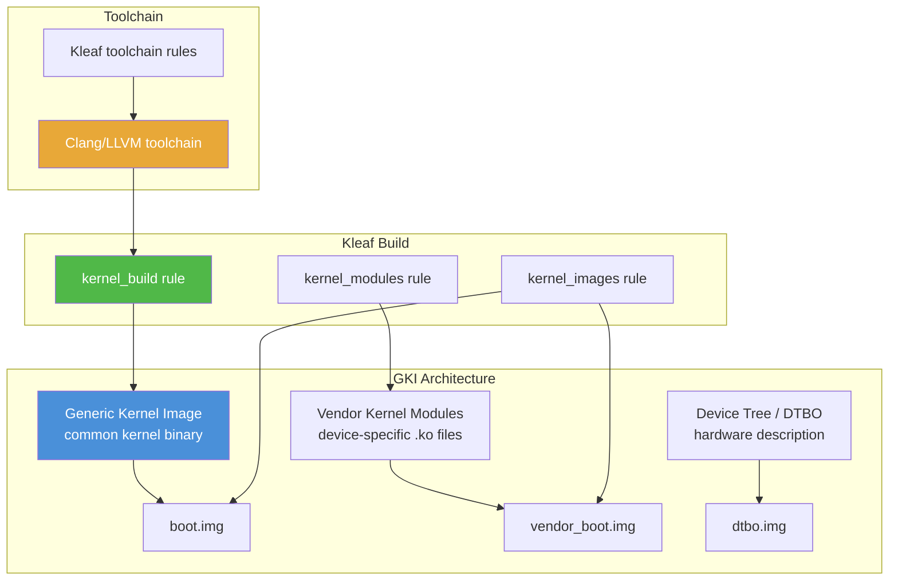

GKI 把内核分为：

- 一个**通用内核二进制文件**（由 Android Common Kernel 源码构建），在使用相同 Android 版本的所有设备上都是相同的
- **供应商内核模块**（`.ko` 文件），包含设备特定的驱动

Kleaf 构建这两个组件，其中通用内核是主要的 GKI 产物，供应商模块则为每个设备单独构建。

### 2.9.6 GKI 合规性与稳定性

GKI 架构对内核模块施加了严格的要求：

- **KMI（内核模块接口）稳定性：** 通用内核与供应商模块之间的接口在一个 GKI 版本内必须保持稳定。针对 GKI 6.1 编译的供应商模块必须能在任何 GKI 6.1 内核上工作。
- **符号列表：** GKI 内核导出一个定义好的符号集合，供应商模块可以使用。符号列表是版本控制的。
- **模块签名：** 所有 GKI 模块都必须用 GKI 签名密钥签名。
- **ABI 监控：** 自动化工具比较构建之间的内核 ABI，以检测破坏性变更。

Kleaf 将这些要求集成到它的构建规则中，自动检查 KMI 合规性并生成签名模块。

### 2.9.7 Kleaf 与传统内核构建

比较传统内核构建与 Kleaf：

| 方面 | 传统方式（`build/build.sh`） | Kleaf（Bazel） |
|--------|-------------------------------|---------------|
| 构建工具 | Shell 脚本 + Make | Bazel |
| 密封性 | 依赖宿主工具 | 完全密封 |
| 缓存 | 无（或手动） | 内置内容寻址 |
| 远程执行 | 无 | 有（通过 RBE） |
| 增量构建 | 有限 | 完整的 Bazel 增量 |
| 工具链管理 | 手动 | Bazel 工具链规则 |
| 可重现性 | 尽力而为 | 有保证 |
| 配置 | build.config 文件 | Bazel 配置 + build.config |
| 多设备支持 | 串行 | 并行 |

向 Kleaf 的迁移是 AOSP 最成功的 Bazel 集成之一，展示了 Bazel 密封构建模型的优势。

### 2.9.8 关键 Kleaf 文件

| 文件 | 用途 |
|------|---------|
| `BUILD.bazel` | 顶层工具链声明 |
| `clang_toolchain.bzl` | Clang 工具链规则定义 |
| `architecture_constants.bzl` | 支持的架构定义 |
| `clang_config.bzl` | Clang 配置（标志、特性） |
| `clang_toolchain_repository.bzl` | 用户工具链的仓库规则 |
| `common.bzl` | 公共工具 |
| `linux.bzl` | Linux 特定的配置 |
| `android.bzl` | Android 特定的配置 |
| `empty_toolchain.bzl` | 用于不支持平台的空操作工具链 |
| `template_BUILD.bazel` | 生成的 BUILD 文件的模板 |

---

## 2.10 高级主题

### 2.10.1 `soong.<TARGET_PRODUCT>.variables` 桥接

Soong 和 Kati 需要共享配置信息。Kati 写一个 JSON 文件，Soong 来读。路径以 `TARGET_PRODUCT` 为键（你 lunch 组合中的产品部分——对于 `lunch aosp_cf_x86_64_phone-trunk_staging-userdebug`，`TARGET_PRODUCT=aosp_cf_x86_64_phone`）：

```
out/soong/soong.<TARGET_PRODUCT>.variables
```

该路径在 `build/make/core/config.mk:1317` 中构造：

```makefile
SOONG_VARIABLES := $(SOONG_OUT_DIR)/soong.$(TARGET_PRODUCT)$(COVERAGE_SUFFIX).variables
```

对于上面的 `aosp_cf_x86_64_phone` lunch 组合，文件是 `out/soong/soong.aosp_cf_x86_64_phone.variables`。典型的内容如下：

```json
{
    "Platform_sdk_version": 37,
    "Platform_sdk_codename": "Baklava",
    "Platform_version_active_codenames": ["Baklava"],
    "DeviceName": "generic_arm64",
    "DeviceArch": "arm64",
    "DeviceArchVariant": "armv8-a",
    "DeviceCpuVariant": "generic",
    "DeviceSecondaryArch": "",
    "Aml_abis": true,
    "Eng": true,
    "Debuggable": true,
    ...
}
```

该文件把 Make 世界（产品配置所在之处）与 Go 世界（模块编译发生之处）桥接起来。当你在一个 `.mk` 文件中更改一个产品变量时，它会通过这个文件流动，从而影响 Soong 的行为。（只有在 `TARGET_PRODUCT` 未设置时，Soong 才回退到普通的 `out/soong/soong.variables`；经过 lunch 的构建总是会写入带产品后缀的文件。）

### 2.10.2 ABI 稳定性与 VNDK

Android 构建系统通过几种机制强制**ABI（应用二进制接口）稳定性**：

- **VNDK（供应商原生开发包）：** 一组系统库，供应商可以依赖它们，并保证 ABI 在 Android 各版本间的稳定性。
- **AIDL 接口：** 系统分区与供应商分区之间稳定的 IPC 接口。
- **HIDL 接口：** 硬件抽象层接口（遗留，正被 AIDL 取代）。
- **System SDK：** 面向供应商应用的稳定 Java API。

VNDK 本身在当前的 AOSP 中已被弃用。`vndk` 模块属性不能再在平台的 `cc_library` 上设置。它仅存在于自动生成的 `vndk_prebuilt_shared` 模块上，这些模块构成 `prebuilts/vndk/` 下冻结的 VNDK 快照。参见 `build/soong/cc/vndk.go` 中的 `VndkProperties`，它只被 `vndk_prebuilt_shared` 在 `build/soong/cc/vndk_prebuilt.go` 中嵌入。这些快照让较旧的供应商镜像能在较新的系统镜像上工作。

依赖规则仍然有效：供应商模块只能依赖稳定的接口和它们自己的私有库。构建系统会拒绝那些通过不稳定接口跨越 system/vendor 边界的依赖。

### 2.10.3 构建标志与特性门控

AOSP 使用 **aconfig**（Android Configuration）来管理特性标志：

```
// Flag declaration (in .aconfig file)
package: "com.android.settings.flags"

flag {
    name: "new_wifi_page"
    namespace: "settings_ui"
    description: "Enable the redesigned WiFi settings page"
    bug: "b/123456789"
}
```

aconfig 标志在*运行时*通过生成的标志访问器读取；它们的值由接入发布配置的 `aconfig_value_sets` 配置。

还有一种独立的、构建时的机制用于**发布构建标志**：在 `build/release/flag_declarations/` 下声明、在 `build/release/flag_values/` 下赋值的 `RELEASE_*` 标志。Android.bp 模块可以用 `release_flag` 在这些标志上做选择：

```
// Selecting on a release build flag in Android.bp
cc_library {
    name: "libwifi_settings",
    srcs: select(release_flag("RELEASE_NEW_WIFI_PAGE"), {
        true: ["new_wifi_page.cpp"],
        default: ["old_wifi_page.cpp"],
    }),
}
```

该机制允许同一棵源码树根据发布配置产生不同的构建，而不需要单独的分支。

### 2.10.4 构建系统指标

AOSP 构建系统收集关于构建性能的详细指标：

```bash
# Metrics are collected automatically on every build
m

# View build metrics (protobuf files under out/)
ls out/soong_metrics out/soong_build_metrics.pb
cat out/soong_build_metrics.pb | protoc --decode=...
```

关键指标包括：

- 总构建时间
- 每个阶段花费的时间（Soong、Kati、Ninja）
- 处理的模块数量
- 缓存命中率
- 内存使用峰值
- I/O 统计

这些指标对于识别构建性能瓶颈和跨版本跟踪改进非常有价值。

### 2.10.5 可重现构建

AOSP 努力实现可重现构建——给定相同的源码和构建环境，输出应当是相同的。这是通过以下方式实现的：

- **固定时间戳：** 构建产物使用确定性的时间戳，而不是当前时间。
- **排序的输入：** 文件列表和目录遍历都是排序过的，以消除依赖顺序的差异。
- **密封的工具链：** 预编译的编译器和工具都检入仓库。
- **沙箱化构建：** Soong 限制对声明的输入之外文件的访问。
- **BUILD_DATETIME_FILE：** 在所有构建规则中使用的固定构建时间戳。

可重现性的重要性在于：

- 安全审计（验证二进制文件与其源码匹配）
- CI/CD 缓存（相同的输入产生相同的输出）
- 监管合规（一些市场要求可重现构建）

### 2.10.6 构建系统内部：模块变体架构

构建系统最复杂的方面之一是模块变体管理。一个 `cc_library` 声明可以扩展为许多变体：

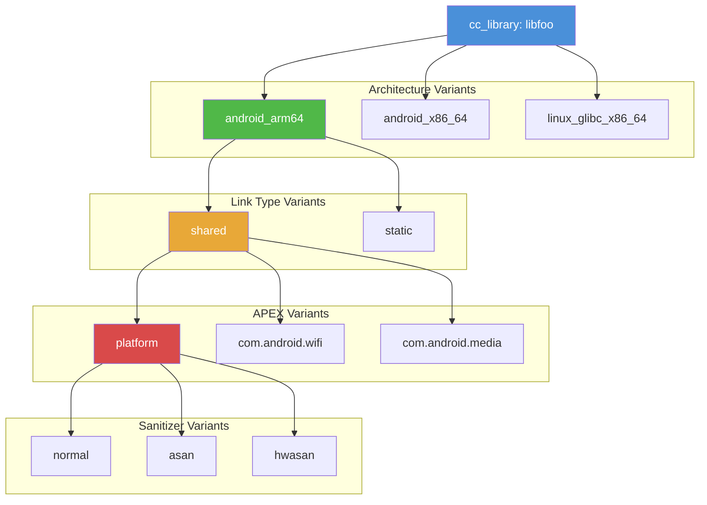

因此，一个 `cc_library` 可以扩展为几十个变体，每个变体产生自己的二进制文件。mutator 系统系统化地处理这种扩展：

1. **架构 mutator：** 为每个目标架构（arm64、x86_64 等）创建一个变体，外加宿主变体。
2. **链接类型 mutator：** 创建共享库和静态库变体。
3. **APEX mutator：** 为库出现的每个 APEX 创建一个变体，外加一个 platform 变体。
4. **Sanitizer mutator：** 创建 ASan、TSan、HWSan 等的变体。
5. **镜像 mutator：** 为不同的分区镜像创建变体。

这就是为什么 `out/soong/.intermediates/` 目录如此庞大——它包含了每个模块每个变体的独立构建产物。

### 2.10.7 Soong API 合规性数据库

Android 17 增加了一个构建范围的 **Soong API 数据库**，它捕获构建所分析的每个模块的结构化快照。每条记录都有模块类型、位置、安装和构建的文件、许可证元数据、团队归属，以及特定于语言的依赖列表。它被合规性和软件物料清单（SBOM）工具使用，而不是被编译本身使用。该逻辑位于 `build/soong/soong_api/`，注册为一个并行的 Soong 单例：

```go
func init() {
    android.RegisterParallelSingletonType("soong_api_db", soongApiSingletonFactory)
}
```

**来源：** `build/soong/soong_api/soong_api.go`，第 35-37 行

该单例遍历图中的每个模块代理，并为每个模块发出一条 `SoongApiModuleRecord`。记录携带身份、位置、目标/变体信息、状态和各语言的产物：

```go
func (c *soongApiSingleton) GenerateBuildActions(ctx android.SingletonContext) {
    var records []SoongApiModuleRecord

    ctx.VisitAllModuleProxies(func(m android.ModuleProxy) {
        commonInfo, ok := android.OtherModuleProvider(ctx, m,
            android.CommonModuleInfoProvider)
        if !ok {
            return
        }

        record := SoongApiModuleRecord{
            Name:          ctx.ModuleName(m),
            Type:          ctx.ModuleType(m),
            Path:          ctx.ModuleDir(m),
            Variant:       ctx.ModuleSubDir(m),
            IsPrimaryArch: ctx.IsPrimaryModule(m),
        }
        // ... fill license, team, test, and language metadata ...
        records = append(records, record)
    })

    // Export collected data to JSON, ZIP and DB
    c.exportRecords(ctx, records)
}
```

**来源：** `build/soong/soong_api/soong_api.go`，第 104-141 行

记录被写成 `soong_api.json`，打包为 `soong_api.zip`，并由 `soong_api_db_loader` 宿主工具加载到可查询的 `soong_api.db` 中。每条记录还保存 CIPD 来源信息（`CipdVersion`、`CipdPackageName`）。源自 `cipd_package` 模块（2.4.2 节）的预编译产物用它把上游包版本带入 SBOM 生成。

### 2.10.8 部分分析与按需变体

Soong 的分析阶段通常会在生成任何构建规则之前实例化树中*每个*模块的*每个*变体。这是干净的 `m nothing` 仍然需要可观时间的原因之一。Android 17 引入了两个相关的机制来缩减这项工作。

**部分分析** 允许你把分析图限制在一个命名的目标集合及其传递闭包上。`soong_ui` 读取 `SOONG_PARTIAL_ANALYSIS` 环境变量，并把它作为 `--partial-analysis-targets` 转发给 `soong_build`：

```go
if value, ok := ret.environ.Get("SOONG_PARTIAL_ANALYSIS"); ok {
    ret.partialAnalysisTargets = value
}
```

**来源：** `build/soong/ui/build/config.go`，第 367-369 行

Blueprint 随后对 mutator 进行排序，让一个 "pre-partial" 组在部分分析切换之前运行。切换之后，只有被请求的目标进入图中。`build/blueprint/context.go` 用 `mutatorIndexPartialAnalysis` 和 `partialAnalysisTargets` 跟踪这一点。

**按需变体** 改变的是变体*如何*被具体化。不是每个 mutator 都急切地把每个模块拆分为它所有可能的变体，模块组可以注册它*支持*的变体，然后在只有依赖边真正请求某个变体时才惰性创建它。Blueprint 为每个模块组记录那些支持但尚未创建的变体：

```go
// Additional variations supported by this module group that were not
// created by Split.
supportedVariantsOnDemand map[string]TransitionInfos

// Map of requested variation map to on-demand variants.
// Set to empty at the end of mutator.
cachedVariantsOnDemand map[string]*moduleInfo
```

**来源：** `build/blueprint/context.go`，第 407-413 行

当依赖请求一个未被急切拆分的变体时，Blueprint 尝试按需创建它。它重新运行相关的转换并缓存结果，因此重复请求的代价很低。当 Soong 无法预先知道消费者需要哪个变体时，仍然会强制急切的完全拆分。这尤其适用于 Soong+Make（Kati）组合构建，以及使用 `AllowMissingDependencies` 运行的构建。调用是 `SetSplitAllVariants(true)`：

```go
if configuration.Getenv("SOONG_SPLIT_ALL_VARIANTS") == "true" ||
    configuration.Getenv("RUN_BUILD_TESTS") == "true" ||
    cmdlineArgs.KatiEnabled ||
    configuration.AllowMissingDependencies() {
    ctx.SetSplitAllVariants(true)
}
```

**来源：** `build/soong/cmd/soong_build/main.go`，第 363-372 行

部分分析（图中模块更少）和按需变体（每个模块的变体更少）结合在一起，降低了专注构建的分析成本。这对开发者整天运行的增量、单模块工作流最为重要。

---

## 2.11 构建系统参考表

本节提供汇总的参考表，便于在开发期间快速查阅。

### 2.11.1 常用构建命令完整列表

| 命令 | 用途 | 示例 |
|---------|---------|---------|
| `source build/envsetup.sh` | 初始化构建环境 | 每个终端会话运行一次 |
| `lunch <target>` | 选择构建目标 | `lunch aosp_arm64` |
| `m` | 从树根构建 | `m` 或 `m droid` |
| `m <module>` | 构建特定模块 | `m Settings` |
| `m <image>` | 构建特定镜像 | `m systemimage` |
| `mm` | 构建当前目录 | `cd frameworks/base && mm` |
| `mmm <dir>` | 构建指定目录 | `mmm packages/apps/Settings` |
| `m clean` | 删除输出目录 | |
| `m nothing` | 只运行设置 | 用于检查配置 |
| `m soong_docs` | 生成模块文档 | 输出在 out/soong/docs/ |
| `m json-module-graph` | 生成模块图 | |
| `m module-info` | 生成模块索引 | |
| `atest <test>` | 运行测试 | `atest SettingsTests` |
| `croot` | cd 到树根 | |
| `gomod <module>` | cd 到模块源码 | `gomod Settings` |
| `pathmod <module>` | 打印模块路径 | `pathmod Settings` |
| `outmod <module>` | 打印模块输出路径 | `outmod Settings` |
| `allmod` | 列出所有模块 | |
| `refreshmod` | 刷新模块索引 | |
| `printconfig` | 显示构建配置 | |
| `get_build_var <var>` | 打印构建变量 | `get_build_var TARGET_PRODUCT` |
| `showcommands <target>` | 显示构建命令 | |
| `bpfmt -w .` | 格式化 Android.bp 文件 | |
| `androidmk Android.mk` | 将 mk 转换为 bp | |
| `tapas <app>` | 构建未打包应用 | `tapas Camera eng` |
| `banchan <apex>` | 构建未打包 APEX | `banchan com.android.wifi arm64` |

### 2.11.2 关键环境变量

| 变量 | 由谁设置 | 用途 |
|----------|--------|---------|
| `ANDROID_BUILD_TOP` | envsetup.sh | 源码树的根目录 |
| `TARGET_PRODUCT` | lunch | 产品名称（例如 `aosp_arm64`） |
| `TARGET_BUILD_VARIANT` | lunch | 构建变体（`eng`/`userdebug`/`user`） |
| `TARGET_RELEASE` | lunch | 发布配置 |
| `TARGET_BUILD_TYPE` | lunch | 始终为 `release` |
| `TARGET_BUILD_APPS` | tapas/banchan | 未打包应用/APEX 名称 |
| `ANDROID_PRODUCT_OUT` | lunch | 设备输出目录的路径 |
| `ANDROID_HOST_OUT` | lunch | 宿主工具输出的路径 |
| `TOP` | 用户（可选） | 由 `gettop`/`require_top` 使用的树根覆盖值 |
| `ANDROID_JAVA_HOME` | lunch | JDK 的路径 |
| `OUT_DIR` | 用户（可选） | 覆盖输出目录（默认：`out`） |
| `USE_CCACHE` | 用户（可选） | 启用 ccache（设为 `1` 启用） |
| `CCACHE_DIR` | 用户（可选） | ccache 目录位置 |
| `SOONG_DELVE` | 用户（可选） | soong_build 的调试端口 |
| `SOONG_UI_DELVE` | 用户（可选） | soong_ui 的调试端口 |
| `NINJA_STATUS` | 用户（可选） | 自定义 Ninja 状态格式 |

### 2.11.3 cc_library 常见 Android.bp 属性

| 属性 | 类型 | 用途 |
|----------|------|---------|
| `name` | string | 模块名（必须唯一） |
| `srcs` | 字符串列表 | 源文件（支持 glob） |
| `exclude_srcs` | 字符串列表 | 要从 srcs 中排除的文件 |
| `generated_sources` | 字符串列表 | 生成源码的模块 |
| `generated_headers` | 字符串列表 | 生成头文件的模块 |
| `cflags` | 字符串列表 | C/C++ 编译器标志 |
| `cppflags` | 字符串列表 | 仅 C++ 的编译器标志 |
| `conlyflags` | 字符串列表 | 仅 C 的编译器标志 |
| `asflags` | 字符串列表 | 汇编标志 |
| `ldflags` | 字符串列表 | 链接器标志 |
| `shared_libs` | 字符串列表 | 共享库依赖 |
| `static_libs` | 字符串列表 | 静态库依赖 |
| `whole_static_libs` | 字符串列表 | 整体包含的静态库 |
| `header_libs` | 字符串列表 | 仅头文件的依赖 |
| `runtime_libs` | 字符串列表 | 仅运行时的共享库 |
| `local_include_dirs` | 字符串列表 | 私有 include 路径 |
| `export_include_dirs` | 字符串列表 | 公开 include 路径 |
| `export_shared_lib_headers` | 字符串列表 | 传递性地导出头文件 |
| `stl` | string | C++ STL 选择 |
| `host_supported` | bool | 同时为宿主构建 |
| `device_supported` | bool | 为设备构建（默认：true） |
| `vendor` | bool | 安装到 vendor 分区 |
| `vendor_available` | bool | 对 vendor 模块可用 |
| `recovery_available` | bool | 在 recovery 中可用 |
| `apex_available` | 字符串列表 | 该模块可以进入的 APEX 模块 |
| `min_sdk_version` | string | 最低 SDK 版本 |
| `defaults` | 字符串列表 | 要继承的 defaults 模块 |
| `visibility` | 字符串列表 | 可见性规则 |
| `enabled` | bool | 模块是否启用 |
| `arch` | map | 架构特定的属性 |
| `target` | map | 目标特定的属性（android/host） |
| `multilib` | map | multilib 属性（lib32/lib64） |
| `sanitize` | map | Sanitizer 配置 |
| `strip` | map | Strip 配置 |
| `pack_relocations` | bool | 打包重定位（默认：true） |
| `allow_undefined_symbols` | bool | 允许未定义符号 |
| `nocrt` | bool | 不链接 C 运行时启动代码 |
| `no_libcrt` | bool | 不链接编译器运行时 |
| `stubs` | map | 生成用于版本管理的桩代码 |

`vndk` 属性不在此列表中。它位于 `VndkProperties`（`build/soong/cc/vndk.go`），只有 `vndk_prebuilt_shared`（`build/soong/cc/vndk_prebuilt.go`）会嵌入它。因此它不能再在平台的 `cc_library` 上设置。

### 2.11.4 android_app 常见 Android.bp 属性

| 属性 | 类型 | 用途 |
|----------|------|---------|
| `name` | string | 模块名 |
| `srcs` | 字符串列表 | Java/Kotlin 源文件 |
| `resource_dirs` | 字符串列表 | Android 资源目录 |
| `asset_dirs` | 字符串列表 | 资产目录 |
| `manifest` | string | AndroidManifest.xml 路径 |
| `static_libs` | 字符串列表 | 静态 Java 库依赖 |
| `libs` | 字符串列表 | 仅编译期的依赖 |
| `platform_apis` | bool | 使用平台（隐藏）API |
| `certificate` | string | 签名证书 |
| `privileged` | bool | 作为特权应用安装 |
| `overrides` | 字符串列表 | 该应用替换的应用 |
| `required` | 字符串列表 | 也必须安装的模块 |
| `dex_preopt` | map | DEX 预优化设置 |
| `optimize` | map | ProGuard/R8 优化 |
| `aaptflags` | 字符串列表 | 额外的 AAPT 标志 |
| `package_name` | string | 覆盖包名 |
| `sdk_version` | string | 构建所针对的 SDK 版本 |
| `min_sdk_version` | string | 最低 SDK 版本 |
| `target_sdk_version` | string | 目标 SDK 版本 |
| `uses_libs` | 字符串列表 | 共享库依赖 |
| `optional_uses_libs` | 字符串列表 | 可选共享库依赖 |
| `jni_libs` | 字符串列表 | JNI 原生库 |
| `use_resource_processor` | bool | 启用资源处理器 |
| `javac_shard_size` | int | 每个 javac 分片的文件数 |
| `errorprone` | map | Error-prone 检查器配置 |

### 2.11.5 目录结构快速参考

| 路径 | 内容 |
|------|----------|
| `art/` | Android Runtime（ART VM、dex2oat 等） |
| `bionic/` | C 库（libc、libm、libdl、linker） |
| `bootable/` | Recovery、bootloader 库 |
| `build/blueprint/` | Blueprint 元构建框架 |
| `build/make/` | 基于 Make 的构建系统和产品配置 |
| `build/soong/` | Soong 构建系统（Go） |
| `build/pesto/` | Bazel 集成实验 |
| `build/release/` | 发布配置（发布配置、标志声明/值） |
| `build/soong/soong_api/` | Soong API 合规性数据库单例（Android 17） |
| `build/soong/siso_config/` | 用于 RBE/缓存的 Siso Starlark 配置（Android 17） |
| `cts/` | 兼容性测试套件 |
| `prebuilts/siso/` | 预编译的 Siso 构建执行器二进制（Android 17 默认） |
| `dalvik/` | Dalvik VM（历史遗留） |
| `development/` | 开发者工具和示例 |
| `device/` | 设备配置 |
| `device/generic/goldfish/` | 模拟器（Goldfish）设备 |
| `device/google/cuttlefish/` | 虚拟设备（Cuttlefish） |
| `external/` | 第三方项目（约 550 个仓库） |
| `frameworks/base/` | 核心 Android framework |
| `frameworks/native/` | 原生 framework（SurfaceFlinger、Binder） |
| `frameworks/av/` | 音视频 framework |
| `hardware/interfaces/` | HIDL/AIDL HAL 定义 |
| `kernel/` | 内核构建配置和预编译产物 |
| `libcore/` | 核心 Java 库（基于 OpenJDK） |
| `packages/apps/` | 系统应用 |
| `packages/modules/` | 主线模块（APEX） |
| `packages/providers/` | 内容提供者 |
| `packages/services/` | 系统服务 |
| `prebuilts/` | 预编译工具（Clang、JDK、SDK 等） |
| `system/core/` | 核心系统工具（init、debuggerd、fastboot、libcutils、healthd）；adb 现在位于 `packages/modules/adb`，logcat 位于 `system/logging/logcat` |
| `system/extras/` | 额外的系统工具 |
| `system/sepolicy/` | SELinux 策略 |
| `tools/` | 开发工具 |
| `vendor/` | 供应商特定的代码 |

---

## 2.12 构建系统术语表

| 术语 | 定义 |
|------|-----------|
| **ABI** | 应用二进制接口。两个程序模块之间的二进制级接口，定义数据类型、大小、对齐、调用约定和系统调用号。 |
| **AIDL** | Android 接口定义语言。用于定义系统组件之间稳定的 IPC 接口。 |
| **Android.bp** | Soong 使用的 Blueprint 文件格式。用于定义构建模块的声明式、类 JSON 语法。 |
| **Android.mk** | 遗留的基于 Make 的模块定义格式。仍受支持，但正逐步被 Android.bp 取代。 |
| **APEX** | Android Pony EXpress。一种用于可独立更新的系统组件的容器格式。 |
| **Blueprint** | 支撑 Soong 的元构建框架。一个用于解析模块定义并生成 Ninja 清单的 Go 库。 |
| **BoardConfig.mk** | 定义架构、分区大小和硬件特性的设备级配置文件。 |
| **bp2build** | 一个已被移除的工具，在早期 Soong 到 Bazel 的迁移工作中用于把 Android.bp 文件转换为 Bazel BUILD 文件。 |
| **bpfmt** | Blueprint 文件格式化工具（类似于 Go 的 gofmt）。 |
| **Context** | Blueprint 中的核心状态对象，编排四个构建阶段。 |
| **Cuttlefish** | 一种适合云端的 Android 虚拟设备（Goldfish 模拟器的替代）。 |
| **Dynamic Partitions** | 一种逻辑卷系统，允许在单个 `super.img` 内灵活调整分区大小。 |
| **GKI** | 通用内核镜像。在相同 Android 版本的设备间共享的标准化内核二进制文件。 |
| **Goldfish** | 传统的 Android 模拟器设备，基于 QEMU。 |
| **GSI** | 通用系统镜像。一个应当在任何符合 Project Treble 的设备上工作的 system.img。 |
| **HIDL** | 硬件接口定义语言。正被 AIDL 取代的遗留 HAL 接口语言。 |
| **Kati** | 一个用 Go 编写的兼容 Make 的构建工具，AOSP 用它替代 GNU Make。 |
| **Kleaf** | 基于 Bazel 的内核构建系统。名字是 "kernel" 和 "leaf"（Bazel）的合成词。 |
| **KMI** | 内核模块接口。GKI 内核与供应商内核模块之间稳定的 ABI。 |
| **Mainline** | Android 项目，通过 Play Store 使用 APEX 和 APK 交付 OS 组件更新。 |
| **Manifest** | 定义构成 AOSP 源码树的 Git 仓库集合的 XML 文件。 |
| **Module** | Soong 中构建的基本单元。类似于 Make 或 Bazel 中的 "target"。 |
| **Mutator** | 一个 Blueprint 函数，访问模块以修改它们（例如创建架构变体）。 |
| **Ninja** | 一个快速的、底层的构建执行工具。Soong 和 Kati 生成 Ninja 清单；Ninja 执行它们。 |
| **PDK** | 平台开发包。AOSP 的一个子集，硬件合作伙伴用它进行早期设备 bring-up。 |
| **Provider** | Blueprint 在依赖图中的模块之间传递结构化数据的机制。 |
| **RBE** | 远程构建执行。把构建动作分布到集群中以加快构建速度。 |
| **repo** | 一个 Python 工具，使用清单文件管理多个 Git 仓库。 |
| **Siso** | 一个兼容 Ninja 的构建执行器，带原生的远程执行和缓存支持。Android 17 中的默认执行器（可通过 `SOONG_NINJA` 选择）。 |
| **Soong** | Android 的主要构建系统，构建在 Blueprint 之上。处理 Android.bp 文件。 |
| **soong_ui** | 构建系统的驱动程序/入口点。编排 Soong、Kati 和构建执行器（Siso 或 Ninja）。 |
| **super.img** | 动态分区的容器镜像。包含 system、vendor、product 等。 |
| **Treble** | Android 的一种架构，把 OS framework 与供应商特定的代码分开，从而支持更快的更新。 |
| **Variant** | 同一模块的多个构建之一（例如 arm64 共享、arm64 静态、x86_64 共享等）。 |
| **VNDK** | 供应商原生开发包。一组为供应商提供有保证的 ABI 稳定性的系统库。 |

---

## 2.13 延伸阅读

### 树内文档

这些文件在你的 AOSP 检出中可用，并提供权威的参考信息：

- **`build/soong/README.md`**——全面的 Soong 和 Android.bp 参考。涵盖模块语法、变量、条件、命名空间、可见性和调试。
- **`build/blueprint/doc.go`**——Blueprint 框架架构概览。解释元构建概念、四个构建阶段和 mutator 系统。
- **`build/make/Changes.md`**——构建系统变更的时间顺序日志、弃用的变量和迁移指南。
- **`build/make/README.md`**——Make 层文档和链接。
- **`build/soong/docs/best_practices.md`**——编写 Android.bp 文件的最佳实践，包括如何去除条件。
- **`build/soong/docs/selects.md`**——select 语句（新的条件机制）的详细文档。
- **`build/soong/docs/perf.md`**——构建性能优化指南。
- **`build/soong/docs/compdb.md`**——生成 compile_commands.json 以用于 IDE 集成（VSCode、CLion 等）。
- **`prebuilts/clang/host/linux-x86/kleaf/README.md`**——Kleaf 工具链文档，用于内核构建。

### 外部资源

- **Android 源码网站：** https://source.android.com/setup/build ——构建 AOSP 的官方入门指南。
- **Android 构建手册：** https://source.android.com/setup/build/building ——逐步的构建说明。
- **APEX 文档：** https://source.android.com/devices/tech/ota/apex ——官方 APEX 架构和开发指南。
- **GKI 文档：** https://source.android.com/devices/architecture/kernel/generic-kernel-image ——通用内核镜像架构。
- **Project Treble：** https://source.android.com/devices/architecture ——vendor/system 分区分离架构。
- **Repo 工具仓库：** https://gerrit.googlesource.com/git-repo/ ——repo 工具的源码和文档。
- **Ninja 构建系统：** https://ninja-build.org/ ——Ninja 的文档和设计理念。
- **Bazel 文档：** https://bazel.build/ ——全面的 Bazel 构建系统文档。
- **Gerrit 代码评审：** https://android-review.googlesource.com/ ——AOSP 代码评审平台。
- **Android CI：** https://ci.android.com/ ——显示最新构建状态的持续集成面板。
- **Android 代码搜索：** https://cs.android.com/ ——针对整个 AOSP 树的基于 Web 的代码搜索。

### 生成的文档

构建完成后，这些额外的资源可用：

```bash
# Module type reference (HTML)
m soong_docs
# Output: out/soong/docs/soong_build.html

# Module dependency graph (JSON)
m json-module-graph
# Output: out/soong/module-graph.json

# Module info database
m module-info
# Output: out/target/product/<device>/module-info.json

# Installed file list
# Output: out/target/product/<device>/installed-files.txt
```

---

## 2.14 试一试：为模拟器构建 AOSP

本节提供一份从源码构建 AOSP 并在 Android 模拟器上运行它的分步指南。这是获得可用的 AOSP 构建并开始做出修改的最快方式。

### 2.14.1 系统准备

**第 1 步：确保你已具备前置条件。**

你需要一台 Linux 机器（推荐 Ubuntu 22.04 LTS）。它必须至少有 32 GB 内存、400 GB 可用磁盘空间（强烈建议 SSD）和多核 CPU。

```bash
# Install required packages (Ubuntu/Debian)
sudo apt-get update
sudo apt-get install -y git-core gnupg flex bison build-essential \
  zip curl zlib1g-dev libc6-dev-i386 libncurses5 \
  lib32z1-dev libgl1-mesa-dev libxml2-utils xsltproc unzip \
  fontconfig python3 python3-pip openjdk-21-jdk

# Install repo
mkdir -p ~/bin
curl https://storage.googleapis.com/git-repo-downloads/repo > ~/bin/repo
chmod a+x ~/bin/repo
export PATH=~/bin:$PATH

# Configure git (required by repo)
git config --global user.name "Your Name"
git config --global user.email "you@example.com"
```

**第 2 步：创建工作目录。**

```bash
# Create the AOSP directory (needs 400+ GB of free space)
mkdir -p ~/aosp
cd ~/aosp
```

### 2.14.2 获取源码

**第 3 步：初始化 repo 工作区。**

```bash
# Initialize with the latest release branch
repo init -u https://android.googlesource.com/platform/manifest \
  -b android17-release

# For a faster initial sync, use partial clones:
# repo init -u https://android.googlesource.com/platform/manifest \
#   -b android17-release \
#   --partial-clone \
#   --clone-filter=blob:limit=10M
```

**第 4 步：同步源码。**

```bash
# Full sync -- this takes 1-3 hours on a good connection
repo sync -c -j$(nproc) --no-tags

# For subsequent syncs (much faster):
# repo sync -c -j$(nproc) --no-tags --optimized-fetch
```

### 2.14.3 设置构建环境

**第 5 步：引入 `envsetup.sh`。**

```bash
# Must be run from the root of the AOSP tree
source build/envsetup.sh
```

在纯 AOSP 检出中，这不会打印任何内容。envsetup.sh 会在 `device/`、`vendor/` 和 `product/` 中搜索 `vendorsetup.sh` 钩子。它找到的每一个都会打印一行 `including ...`，但 AOSP 已不再附带任何这样的钩子。无论如何，shell 函数（`lunch`、`m`、`mm` 等）都会被定义。

**第 6 步：用 `lunch` 选择构建目标。**

对于模拟器，使用以下目标之一：

```bash
# ARM64 emulator (recommended for Apple Silicon Macs or ARM servers)
lunch aosp_arm64-trunk_staging-eng

# x86_64 emulator (recommended for Intel/AMD hosts -- faster emulation)
lunch sdk_phone64_x86_64-trunk_staging-eng

# Shorthand (uses defaults: trunk_staging release, eng variant)
lunch aosp_arm64
```

输出会显示构建配置：

```
============================================
PLATFORM_VERSION_CODENAME=Baklava
PLATFORM_VERSION=Baklava
TARGET_PRODUCT=aosp_arm64
TARGET_BUILD_VARIANT=eng
TARGET_ARCH=arm64
TARGET_ARCH_VARIANT=armv8-a
TARGET_CPU_VARIANT=generic
HOST_OS=linux
HOST_OS_EXTRA=...
BUILD_ID=...
OUT_DIR=out
============================================
```

注意 `PLATFORM_VERSION` 显示的是代号，而不是数字：它只有在发布定稿时才会变成 `17`，届时代号会翻转为 `REL`。

### 2.14.4 构建

**第 7 步：开始构建。**

```bash
# Build everything (the "droid" target is the default)
m -j$(nproc)

# Or equivalently:
m droid -j$(nproc)
```

`-j` 标志控制并行度。在 16 核、64 GB 内存的机器上，首次构建大约需要 2-4 小时。后续的增量构建快得多（小改动只需几分钟）。

**构建进度**以紧凑格式显示：

```
[  1% 245/24532] //frameworks/base:framework-minus-apex
[  2% 489/24532] //external/protobuf:libprotobuf-java-nano
...
[ 99% 24500/24532] //build/make/target/product:system_image
[100% 24532/24532] Build completed successfully
```

**常见构建目标：**

| 目标 | 构建内容 |
|--------|----------------|
| `m` 或 `m droid` | 完整平台构建（所有镜像） |
| `m systemimage` | 仅系统镜像 |
| `m vendorimage` | 仅 vendor 镜像 |
| `m bootimage` | 仅 boot 镜像 |
| `m Settings` | 仅 Settings 应用模块 |
| `m framework-minus-apex` | 仅 framework JAR |
| `m nothing` | 只运行构建系统设置（不编译） |
| `m clean` | 删除整个 out/ 目录 |

**第 8 步：验证构建产物。**

```bash
ls out/target/product/generic_arm64/

# You should see:
# android-info.txt  boot.img  ramdisk.img  super.img
# system.img  userdata.img  vendor.img  vendor_boot.img
# ...
```

### 2.14.5 运行模拟器

**第 9 步：启动模拟器。**

```bash
# The emulator command is available after lunch
emulator
```

模拟器会：

1. 在 `$ANDROID_PRODUCT_OUT` 中找到构建好的镜像
2. 启动一个基于 QEMU 的虚拟机
3. 使用你刚构建的镜像启动 Android

有用的模拟器标志：

```bash
# Specify RAM size
emulator -memory 4096

# Disable GPU acceleration (if you have driver issues)
emulator -gpu swiftshader_indirect

# Use a specific skin/resolution
emulator -skin 1080x1920

# Enable verbose kernel logs
emulator -show-kernel

# Wipe user data (fresh start)
emulator -wipe-data

# Run headless (no GUI window)
emulator -no-window
```

### 2.14.6 修改与重新构建

**第 10 步：做一处修改并增量重新构建。**

从源码构建的强大之处在于可以修改任何东西。例如，要添加一个系统属性：

```bash
# Edit a file
vi frameworks/base/core/java/android/os/Build.java

# Rebuild just the affected module
m framework-minus-apex

# Or rebuild everything (Ninja will only rebuild what changed)
m
```

对于系统应用的修改：

```bash
# Edit Settings source
vi packages/apps/Settings/src/com/android/settings/Settings.java

# Rebuild just Settings
m Settings

# Push the rebuilt APK to a running emulator
adb install -r out/target/product/generic_arm64/system_ext/priv-app/Settings/Settings.apk

# Or reboot the emulator to pick up all changes
adb reboot
```

### 2.14.7 调试构建失败

由于代码库的规模，AOSP 中的构建失败可能令人望而生畏。以下是诊断常见问题的策略：

**缺少依赖：**
```
error: frameworks/base/core/java/android/os/Foo.java:5: error: cannot find symbol
  import com.android.internal.bar.Baz;
```

这通常意味着模块的 `Android.bp` 文件中缺少一个依赖。检查哪个模块提供了缺失的类：

```bash
# Search for the class definition
grep -rn "class Baz" frameworks/ --include="*.java"

# Or use the module index
allmod | grep -i baz
```

**Soong/Blueprint 解析错误：**
```
error: build/soong/cc/cc.go:123: module "libfoo": depends on "libbar" which
is not visible to this module
```

这是可见性错误。被依赖的模块需要把依赖方模块的包添加到它的 `visibility` 列表中。

**Ninja 执行错误：**
```
FAILED: out/soong/.intermediates/...
clang: error: ...
```

实际的编译器错误会在输出中。你可以直接重新运行失败的命令：

```bash
# Show the exact command that failed
showcommands <target> 2>&1 | grep FAILED -A 5
```

**构建期间内存不足：**

如果 Ninja 被 OOM killer 杀掉，降低并行度：

```bash
# Limit to 8 parallel jobs (instead of auto-detecting CPU count)
m -j8
```

**过期的构建产物：**

如果你怀疑构建缓存已损坏：

```bash
# Delete Soong intermediates for a specific module
rm -rf out/soong/.intermediates/frameworks/base/framework-minus-apex/

# Or delete all intermediates (forces full rebuild)
m clean

# Nuclear option: delete everything
rm -rf out/
```

### 2.14.8 调试 Soong 本身

Soong 提供了内置的调试支持，用于你需要理解或修改构建系统本身的时候。

**生成文档：**
```bash
m soong_docs
# Opens at: out/soong/docs/soong_build.html
```

这会为所有已注册的模块类型及其属性生成 HTML 文档。

**使用 Delve 调试：**

来自 `build/soong/README.md`：

```bash
# Debug soong_build (the main Soong binary)
SOONG_DELVE=5006 m nothing

# Debug only specific steps
SOONG_DELVE=2345 SOONG_DELVE_STEPS='build,modulegraph' m

# Debug soong_ui (the build driver)
SOONG_UI_DELVE=5006 m nothing
```

然后用调试器连接（例如 IntelliJ IDEA 或 `dlv connect :5006`）。

**查询模块图：**

```bash
# Generate the module graph
m json-module-graph

# Generate queryable module info
m module-info

# The output is at:
# out/target/product/<device>/module-info.json
```

`module-info.json` 文件包含关于构建中每个模块的机器可读信息，包括路径、依赖和安装位置。

### 2.14.9 使用 Cuttlefish 而非 Goldfish

虽然本章重点介绍了 Goldfish 模拟器（传统的 AOSP 模拟器），Google 还维护着 **Cuttlefish**——一个在适合云端的环境中运行的虚拟设备：

```bash
# Build for Cuttlefish
lunch aosp_cf_x86_64_phone trunk_staging eng
m

# Launch Cuttlefish (requires specific host setup)
launch_cvd
```

Cuttlefish 的优势：

- 作为真正的虚拟机运行（使用 KVM/crosvm）
- 更准确的硬件模拟
- 更适合 CI/CD 流水线
- 支持多个并发实例
- 可以在服务器上无头运行

Cuttlefish 的劣势：

- 需要更多的宿主设置
- 需要 KVM 支持
- 不像 Goldfish 模拟器那样广泛可用

### 2.14.10 有用的开发命令

在引入 `envsetup.sh` 并运行 `lunch` 之后，许多便捷命令都可用：

```bash
# Navigate the tree
croot                    # cd to tree root
gomod <module>          # cd to a module's directory
godir <pattern>         # cd to a directory matching a pattern

# Query the build system
get_build_var TARGET_PRODUCT     # Print a build variable
get_build_var PRODUCT_OUT        # Print the output directory
pathmod <module>                 # Print a module's source path
outmod <module>                  # Print a module's output path
allmod                           # List all modules
refreshmod                       # Refresh the module index

# Search the source tree
cgrep <pattern>         # Search C/C++ files
jgrep <pattern>         # Search Java files
resgrep <pattern>       # Search resource XML files
sgrep <pattern>         # Search all source files

# Debug and inspect
showcommands <target>   # Show Ninja commands for a target
aninja                  # Run Ninja directly with arguments
```

### 2.14.11 构建性能建议

1. **使用 SSD。** 构建会执行数百万次小型 I/O 操作。SSD 与 HDD 之间可能意味着 2-5 倍的速度差异。

2. **最大化内存。** 推荐 64 GB。只有 32 GB 时，你可能需要限制并行度（在 16 核机器上用 `-j8` 而不是 `-j$(nproc)`）。

3. **使用 `ccache`。** `ccache` 工具缓存编译结果：
   ```bash
   export USE_CCACHE=1
   export CCACHE_EXEC=/usr/bin/ccache
   export CCACHE_DIR=~/.ccache
   ccache -M 100G  # Set cache size
   ```

4. **使用单独的输出目录。** 如果你的源码在网络驱动器上，把输出放在本地 SSD 上：
   ```bash
   export OUT_DIR=/local/ssd/aosp-out
   ```

5. **考虑 `--skip-soong-tests`。** 在开发期间，你可以跳过测试生成：
   ```bash
   m --skip-soong-tests
   ```

6. **使用增量构建。** 首次完整构建后，后续构建只重新编译发生变更的模块。Ninja 在检测需要重新构建的内容方面非常高效。

7. **用 `mm` 进行专注开发。** 当你只开发单个模块时，`mm` 比 `m` 快得多。这是因为它让 Ninja 只构建 `MODULES-IN-<dir>` 目标（当前目录中的模块及其依赖），而不是 `droid`。Soong 和 Kati 的配置阶段仍然与 `m` 完全一样地运行。

### 2.14.12 增量开发工作流

对于日常开发，典型的工作流是：

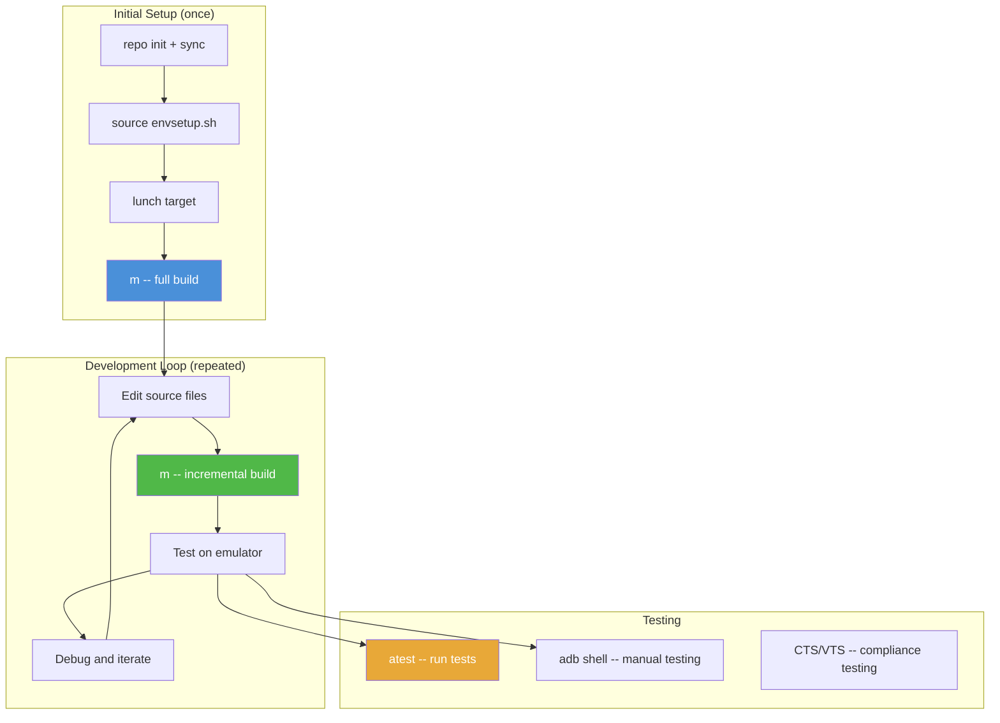

**`atest` 工具：**

`atest` 是 AOSP 的测试运行器，它能自动发现、构建并运行测试：

```bash
# Run all tests for a module
atest SettingsTests

# Run a specific test class
atest SettingsTests:com.android.settings.wifi.WifiSettingsTest

# Run tests with verbose output
atest -v FrameworksCoreTests

# List the testable modules of a given suite
atest --list-modules cts
```

**推送单个文件：**

为了快速迭代，你可以把单个文件推送到正在运行的设备上，而无需重新构建：

```bash
# Push a rebuilt shared library
adb push out/target/product/generic_arm64/system/lib64/libfoo.so /system/lib64/

# Push a rebuilt app
adb install -r out/target/product/generic_arm64/system_ext/priv-app/Settings/Settings.apk

# Restart the system server to pick up framework changes
adb shell stop && adb shell start

# Or reboot entirely
adb reboot
```

注意：直接推送文件只在 `eng` 或 `userdebug` 构建上有效，其中系统分区是可写的（或者你可以使用 `adb remount`）。

### 2.14.13 理解构建输出消息

构建期间，Soong 以紧凑格式打印进度。理解这些消息有助于诊断构建把时间花在哪里：

```
[ 47% 11523/24532] //frameworks/base:framework-minus-apex metalava ...
```

各字段是：

- `47%`——已完成的构建边百分比
- `11523/24532`——已完成的边 / 总边数
- `//frameworks/base:framework-minus-apex`——正在构建的模块
- `metalava`——正在运行的工具（metalava 是 API 文档工具）

如果构建似乎卡在某个百分比上，很可能是在等待一个长时间运行的动作完成。常见瓶颈包括：

- **D8/R8 dexing：** 把 Java 字节码转换为 DEX 格式
- **Metalava：** API 兼容性检查
- **链接大型二进制文件：** 尤其是 framework JAR
- **镜像构建：** 创建文件系统镜像

要查看构建把时间花在了什么上，请检查构建写在 `out/` 下的日志。`out/verbose.log.gz` 记录每个命令。`out/build.trace.gz` 是构建动作的 Chrome-tracing 时间线，你可以在 trace viewer 中打开它。

### 2.14.14 并行构建配置

AOSP 构建遵循几个并行度控制：

```bash
# Ninja parallelism (number of simultaneous build actions)
m -j$(nproc)              # Use all CPU cores (default)
m -j8                     # Limit to 8 parallel actions
m -j1                     # Sequential build (for debugging)

# Soong parallelism (internal to the build system setup)
# Controlled automatically based on available resources

# Java compilation sharding (in Android.bp)
android_library {
    name: "Settings-core",
    javac_shard_size: 50,  // Compile in shards of 50 files
}
```

最优的 `-j` 值取决于你的机器：

- 有 64+ GB 内存：使用 `-j$(nproc)` 或更高
- 有 32 GB 内存：使用 `-j$(( $(nproc) / 2 ))`
- 有 16 GB 内存：使用 `-j4` 到 `-j8`

内存往往是瓶颈，而不是 CPU。每个编译器实例可能使用 1-2 GB 内存，因此在 32 GB 内存下你可以安全地运行大约 16 个并行编译任务。

---

## 总结

本章涵盖了 AOSP 构建的完整生命周期，从获取源码到在模拟器上运行结果。以下是关键的要点：

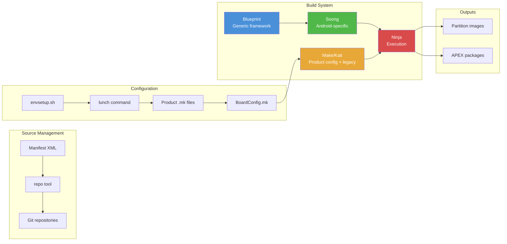

**需要记住的关键文件：**

| 文件 | 用途 |
|------|---------|
| `.repo/manifests/default.xml` | 定义所有仓库的清单 |
| `build/make/envsetup.sh` | Shell 环境设置 |
| `build/soong/soong_ui.bash` | 构建系统入口点 |
| `build/soong/README.md` | Soong/Android.bp 参考文档 |
| `build/blueprint/context.go` | Blueprint 核心 |
| `build/make/core/envsetup.mk` | 核心构建变量设置 |
| `build/make/core/config.mk` | 构建配置入口点 |
| `build/make/target/product/*.mk` | 通用产品定义 |
| `build/soong/apex/apex.go` | APEX 构建逻辑 |
| `prebuilts/clang/host/linux-x86/kleaf/` | 内核构建工具链规则 |

**构建系统做的三件事：**

1. **解析**数千个 `Android.bp` 和 `Android.mk` 文件，构建树中所有模块的依赖图。
2. **配置**构建，基于所选的产品、架构和变体，使用产品 makefile 和主板配置。
3. **执行**构建，通过 Ninja。Ninja 编排 C/C++、Java、Kotlin、Rust 和其他语言的并行编译。然后它把结果组装成可刷写的分区镜像。

下一章探讨 Android 的运行时架构。它展示了这些镜像在设备上启动时会发生什么，从 bootloader 经过 `init` 一直到完整运行的 Android 系统。
