# 第 34 章：存储

Android 的存储子系统已经从一个简单的 FAT32 SD 卡挂载点演变而来，发生了巨大的变化。如今它是一个多层架构：它管理分区、对每个文件强制加密、通过 FUSE 提供作用域访问控制，并通过面向文档的框架来抽象物理介质。本章从原始的分区布局一直审视到 Java 层面的存储访问框架（Storage Access Framework），考察每一层。本章通过逐行走读真实的 AOSP 源代码来完成这一考察。

---

## 34.1 存储架构

### 34.1.1 物理分区布局

Android 设备的持久化存储被划分为一组众所周知的分区。在出厂时自带动态分区的现代设备上，原始的 eMMC 或 UFS 存储被划分为数量较少的物理分区。一个较大的“超级”（super）分区通过 device-mapper 被细分为多个逻辑分区。

关键的分区如下：

| 分区      | 文件系统       | 用途               |
|-----------|----------------|--------------------|
| `boot`    |（原始镜像）    | 内核 + ramdisk     |
| `vendor_boot` |（原始镜像） | 厂商 ramdisk       |
| `init_boot` |（原始镜像）  | 通用 ramdisk（GKI）|
| `super`   |（device-mapper）| 逻辑分区的容器     |
| `system`  | ext4/erofs     | Android 框架、应用、库 |
| `vendor`  | ext4/erofs     | 厂商 HAL 与固件    |
| `product` | ext4/erofs     | OEM 定制           |
| `system_ext` | ext4/erofs    | 系统扩展           |
| `odm`     | ext4/erofs     | ODM 特定的覆盖层   |
| `userdata`| f2fs/ext4      | 用户数据、应用数据、媒体 |
| `metadata`| ext4           | 加密元数据、OTA 检查点 |
| `cache`   | ext4           | OTA 缓存（已基本弃用）|
| `misc`    |（原始）        | 引导加载程序通信   |
| `vbmeta`  |（原始）        | AVB 验证元数据     |

### 34.1.2 动态分区（super）

从 Android 10 开始，单一的分区表让位于动态分区。单个物理的 `super` 分区使用一种 Android 特有的元数据格式（`liblp`）进行格式化，该格式描述了由 device-mapper `linear` 目标支撑的逻辑分区。

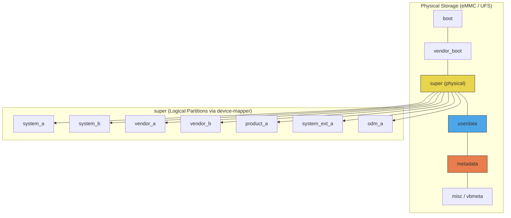

动态分区带来了若干优势：

1. **灵活的容量** -- 逻辑分区可以在 OTA 时调整大小，而无需对设备重新分区。
2. **A/B 支持** -- `super` 分区同时包含 A 槽位和 B 槽位，用于无缝更新。
3. **空间共享** -- 在更新期间，一个逻辑分区中未使用的空间可以被另一个分区回收。
4. **虚拟 A/B** -- 系统使用写时复制（COW）快照，以避免为两份完整的槽位副本而需要两倍的物理空间。

`liblp` 管理 `super` 分区的元数据。在 Android 17 中，文件系统管理代码从 `system/core` 中剥离出来，进入了专门的 `system/fs` 仓库。因此 `liblp` 现在位于 `system/fs/fs_mgr/liblp/`（与 `system/fs/fs_mgr/libdm/` 以及 `fs_mgr.cpp` 本身并列）。
分区布局在 `fstab` 文件中描述。vold 在启动时读取该文件：

```cpp
// system/vold/main.cpp (lines 235-294)
static int process_config(VolumeManager* vm, VoldConfigs* configs) {
    ATRACE_NAME("process_config");

    if (!ReadDefaultFstab(&fstab_default)) {
        PLOG(ERROR) << "Failed to open default fstab";
        return -1;
    }

    /* Loop through entries looking for ones that vold manages */
    configs->has_adoptable = false;
    configs->has_quota = false;
    configs->has_reserved = false;
    configs->has_compress = false;
    for (auto& entry : fstab_default) {
        if (entry.fs_mgr_flags.quota) {
            configs->has_quota = true;
        }
        if (entry.reserved_size > 0) {
            configs->has_reserved = true;
        }
        // ...
        if (entry.mount_point == "/data" && !entry.metadata_key_dir.empty()) {
            // Pre-populate userdata dm-devices
            android::vold::defaultkey_precreate_dm_device();
        }
        if (entry.fs_mgr_flags.vold_managed) {
            // ... create DiskSource for removable storage
            vm->addDiskSource(std::shared_ptr<VolumeManager::DiskSource>(
                new VolumeManager::DiskSource(sysPattern, nickname, flags)));
        }
    }
    return 0;
}
```

### 34.1.3 userdata 分区

`userdata` 分区（挂载于 `/data`）是所有用户生成的内容、应用私有数据以及媒体文件的存放之处。在基于闪存的设备上，它通常使用 f2fs（Flash-Friendly File System，闪存友好文件系统）格式化；在不支持 f2fs 的设备上则使用 ext4。

`/data` 目录结构遵循一个明确定义的布局：

```
/data/
  data/              -> App private CE data for user 0 (the real directory)
  user/0/            -> Bind mount of /data/data (a symlink in older releases)
  user_de/0/         -> DE (Device Encrypted) storage for user 0
  media/             -> Shared media (backing for /storage/emulated)
  media/0/           -> User 0's emulated external storage
  misc/              -> System misc data
  misc/vold/         -> Vold key material
  misc/vold/user_keys/  -> Per-user encryption keys
  system/            -> System databases
  system_ce/0/       -> System CE data per user
  system_de/0/       -> System DE data per user
  app/               -> Installed APKs
  local/tmp/         -> Temporary files
```

### 34.1.4 metadata 分区

`metadata` 分区存储用于 `userdata` 元数据加密的加密密钥、OTA 检查点状态以及 GSI（通用系统镜像）元数据。它在启动早期挂载于 `/metadata`，早于主文件系统可用的时间。

### 34.1.5 存储路径映射

应用通过若干众所周知的路径来访问存储：

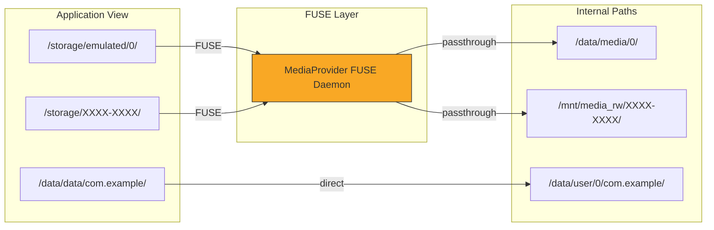

应用所看到的 `/storage/emulated/0/` 路径是一个由 `/data/media/0/` 支撑的 FUSE 挂载。FUSE 守护进程运行在 MediaProvider 进程内部。它会拦截每一次文件操作。在把操作委派给实际文件系统之前，它会应用权限检查、脱敏（redaction）以及转码。

---

## 34.2 vold（卷守护进程）

### 34.2.1 概述

`vold`（卷守护进程）是 Android 原生层面的存储管理器。它作为由 init 启动的特权守护进程运行，负责：

- 检测和管理物理磁盘（SD 卡、USB 驱动器）
- 创建、挂载、格式化和加密卷
- 管理每个用户的加密密钥（FBE）
- 为应用可见的存储建立 FUSE 挂载
- 处理 adoptable 存储（将外部介质作为内部存储）
- 向框架提供 Binder 接口（`IVold`）

入口点位于 `system/vold/main.cpp`：

```cpp
// system/vold/main.cpp (lines 66-165)
int main(int argc, char** argv) {
    // ...
    LOG(INFO) << "Vold 3.0 (the awakening) firing up";

    LOG(DEBUG) << "Detected support for:"
               << (android::vold::IsFilesystemSupported("ext4") ? " ext4" : "")
               << (android::vold::IsFilesystemSupported("f2fs") ? " f2fs" : "")
               << (android::vold::IsFilesystemSupported("vfat") ? " vfat" : "");

    VolumeManager* vm;
    NetlinkManager* nm;

    // ... SELinux, singletons ...

    if (!(vm = VolumeManager::Instance())) {
        LOG(ERROR) << "Unable to create VolumeManager";
        exit(1);
    }

    if (!(nm = NetlinkManager::Instance())) {
        LOG(ERROR) << "Unable to create NetlinkManager";
        exit(1);
    }

    if (vm->start()) {
        PLOG(ERROR) << "Unable to start VolumeManager";
        exit(1);
    }

    VoldConfigs configs = {};
    if (process_config(vm, &configs)) {
        PLOG(ERROR) << "Error reading configuration...";
    }

    // Start Binder services
    if (android::vold::VoldNativeService::start() != android::OK) {
        LOG(ERROR) << "Unable to start VoldNativeService";
        exit(1);
    }

    // Start Netlink listener for block device events
    if (nm->start()) {
        PLOG(ERROR) << "Unable to start NetlinkManager";
        exit(1);
    }

    // Coldboot: replay uevent for already-present devices
    coldboot("/sys/block");

    android::IPCThreadState::self()->joinThreadPool();
}
```

### 34.2.2 启动顺序

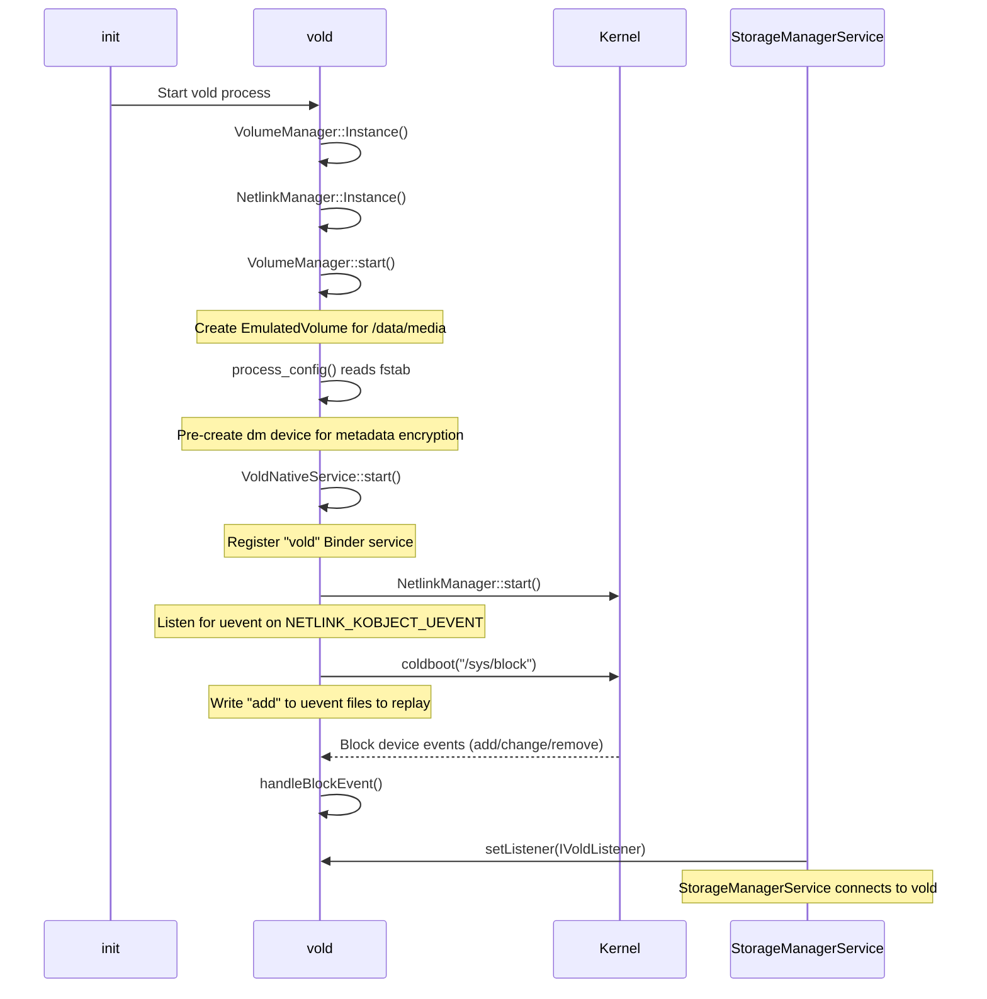

### 34.2.3 VolumeManager

`VolumeManager` 是跟踪所有磁盘、卷和用户的中央单例。它定义在 `system/vold/VolumeManager.h` 中：

```cpp
// system/vold/VolumeManager.h (lines 42-250)
class VolumeManager {
  private:
    static VolumeManager* sInstance;
    bool mDebug;

  public:
    void setListener(android::sp<android::os::IVoldListener> listener) {
        mListener = listener;
    }

    int start();
    void handleBlockEvent(NetlinkEvent* evt);

    class DiskSource {
      public:
        DiskSource(const std::string& sysPattern,
                   const std::string& nickname, int flags)
            : mSysPattern(sysPattern), mNickname(nickname), mFlags(flags) {}

        bool matches(const std::string& sysPath) {
            return !fnmatch(mSysPattern.c_str(), sysPath.c_str(), 0);
        }
        // ...
    };

    void addDiskSource(const std::shared_ptr<DiskSource>& diskSource);
    std::shared_ptr<android::vold::Disk> findDisk(const std::string& id);
    std::shared_ptr<android::vold::VolumeBase> findVolume(const std::string& id);

    int onUserAdded(userid_t userId, int userSerialNumber,
                    userid_t cloneParentUserId);
    int onUserRemoved(userid_t userId);
    int onUserStarted(userid_t userId);
    int onUserStopped(userid_t userId);

    int abortFuse();
    int reset();
    int shutdown();
    int unmountAll();

    int setupAppDir(const std::string& path, int32_t appUid,
                    bool fixupExistingOnly = false,
                    bool skipIfDirExists = false);

    int createObb(const std::string& path, int32_t ownerGid,
                  std::string* outVolId);
    int destroyObb(const std::string& volId);

  private:
    std::mutex mLock;
    std::mutex mCryptLock;

    android::sp<android::os::IVoldListener> mListener;

    std::list<std::shared_ptr<DiskSource>> mDiskSources;
    std::list<std::shared_ptr<android::vold::Disk>> mDisks;
    std::list<std::shared_ptr<android::vold::Disk>> mPendingDisks;
    std::list<std::shared_ptr<android::vold::VolumeBase>> mObbVolumes;
    std::list<std::shared_ptr<android::vold::VolumeBase>>
        mInternalEmulatedVolumes;

    std::unordered_map<userid_t, int> mAddedUsers;
    std::unordered_map<userid_t, userid_t> mSharedStorageUser;
    std::set<userid_t> mStartedUsers;
};
```

当调用 `VolumeManager::start()` 时，它会创建支撑 `/storage/emulated` 的内部模拟卷：

```cpp
// system/vold/VolumeManager.cpp (lines 175-198)
int VolumeManager::start() {
    ATRACE_NAME("VolumeManager::start");

    // Always start from a clean slate
    unmountAll();
    Loop::destroyAll();

    // Assume that we always have an emulated volume on internal
    // storage; the framework will decide if it should be mounted.
    CHECK(mInternalEmulatedVolumes.empty());

    auto vol = std::shared_ptr<android::vold::VolumeBase>(
            new android::vold::EmulatedVolume("/data/media", 0));
    vol->setMountUserId(0);
    vol->create();
    mInternalEmulatedVolumes.push_back(vol);

    // Consider creating a virtual disk
    updateVirtualDisk();

    return 0;
}
```

### 34.2.4 磁盘检测与分区读取

当内核通过 netlink uevent 报告一个新的块设备时，`NetlinkHandler` 会将其转发给 `VolumeManager::handleBlockEvent()`：

```cpp
// system/vold/NetlinkHandler.cpp (lines 36-48)
void NetlinkHandler::onEvent(NetlinkEvent* evt) {
    VolumeManager* vm = VolumeManager::Instance();
    const char* subsys = evt->getSubsystem();

    if (!subsys) {
        LOG(WARNING) << "No subsystem found in netlink event";
        return;
    }

    if (std::string(subsys) == "block") {
        vm->handleBlockEvent(evt);
    }
}
```

`handleBlockEvent` 方法把设备与 fstab 中注册的 `DiskSource` 模式进行匹配，然后创建一个 `Disk` 对象：

```cpp
// system/vold/VolumeManager.cpp (lines 200-254)
void VolumeManager::handleBlockEvent(NetlinkEvent* evt) {
    std::lock_guard<std::mutex> lock(mLock);

    std::string eventPath(evt->findParam("DEVPATH") ? ... : "");
    std::string devType(evt->findParam("DEVTYPE") ? ... : "");

    if (devType != "disk") return;

    int major = std::stoi(evt->findParam("MAJOR"));
    int minor = std::stoi(evt->findParam("MINOR"));
    dev_t device = makedev(major, minor);

    switch (evt->getAction()) {
        case NetlinkEvent::Action::kAdd: {
            for (const auto& source : mDiskSources) {
                if (source->matches(eventPath)) {
                    int flags = source->getFlags();
                    if (major == kMajorBlockMmc || IsVirtioBlkDevice(major)) {
                        flags |= android::vold::Disk::Flags::kSd;
                    } else {
                        flags |= android::vold::Disk::Flags::kUsb;
                    }
                    auto disk = new android::vold::Disk(
                        eventPath, device, source->getNickname(), flags);
                    handleDiskAdded(
                        std::shared_ptr<android::vold::Disk>(disk));
                    break;
                }
            }
            break;
        }
        case NetlinkEvent::Action::kChange: {
            handleDiskChanged(device);
            break;
        }
        case NetlinkEvent::Action::kRemove: {
            handleDiskRemoved(device);
            break;
        }
    }
}
```

### 34.2.5 Disk 类

`Disk`（定义于 `system/vold/model/Disk.h` 和 `Disk.cpp`）表示一个物理存储设备。它理解分区表，并创建相应的卷对象：

```cpp
// system/vold/model/Disk.h (lines 39-134)
class Disk {
  public:
    Disk(const std::string& eventPath, dev_t device,
         const std::string& nickname, int flags);

    enum Flags {
        kAdoptable     = 1 << 0,
        kDefaultPrimary = 1 << 1,
        kSd            = 1 << 2,
        kUsb           = 1 << 3,
        kEmmc          = 1 << 4,
        kStubInvisible = 1 << 5,
        kStubVisible   = 1 << 6,
    };

    status_t create();
    status_t destroy();
    status_t readMetadata();
    status_t readPartitions();

    status_t partitionPublic();
    status_t partitionPrivate();
    status_t partitionMixed(int8_t ratio);

  private:
    std::string mId;       // e.g., "disk:179,0"
    std::string mSysPath;  // e.g., "/sys/block/mmcblk1"
    std::string mDevPath;  // e.g., "/dev/block/vold/disk:179,0"
    dev_t mDevice;
    uint64_t mSize;
    std::string mLabel;    // Manufacturer label
    std::vector<std::shared_ptr<VolumeBase>> mVolumes;
    int mFlags;

    void createPublicVolume(dev_t device);
    void createPrivateVolume(dev_t device, const std::string& partGuid);
};
```

`readPartitions()` 方法使用 `sgdisk` 来解析 GPT/MBR 表：

```cpp
// system/vold/model/Disk.cpp (lines 323-430)
status_t Disk::readPartitions() {
    int maxMinors = getMaxMinors();
    destroyAllVolumes();

    std::vector<std::string> cmd;
    cmd.push_back(kSgdiskPath);
    cmd.push_back("--android-dump");
    cmd.push_back(mDevPath);

    std::vector<std::string> output;
    status_t res = ForkExecvp(cmd, &output);
    // ...

    Table table = Table::kUnknown;
    bool foundParts = false;
    for (const auto& line : output) {
        // Parse DISK/PART lines from sgdisk output
        if (*it == "PART") {
            // ...
            if (table == Table::kMbr) {
                switch (type) {
                    case 0x06:  // FAT16
                    case 0x0b:  // W95 FAT32
                    case 0x0c:  // W95 FAT32 (LBA)
                        createPublicVolume(partDevice);
                        break;
                }
            } else if (table == Table::kGpt) {
                if (EqualsIgnoreCase(typeGuid, kGptBasicData)) {
                    createPublicVolume(partDevice);
                } else if (EqualsIgnoreCase(typeGuid, kGptAndroidExpand)) {
                    createPrivateVolume(partDevice, partGuid);
                }
            }
        }
    }
}
```

GPT 类型 GUID 具有重要意义：

| GUID | 常量 | 用途 |
|------|----------|---------|
| `EBD0A0A2-B9E5-4433-87C0-68B6B72699C7` | `kGptBasicData` | 公共（FAT/exFAT）卷 |
| `19A710A2-B3CA-11E4-B026-10604B889DCF` | `kGptAndroidMeta` | Android 元数据分区 |
| `193D1EA4-B3CA-11E4-B075-10604B889DCF` | `kGptAndroidExpand` | Adoptable 存储（私有） |

### 34.2.6 卷的层次结构

所有卷都派生自 `VolumeBase`（定义于 `system/vold/model/VolumeBase.h`）：

```cpp
// system/vold/model/VolumeBase.h (lines 50-179)
class VolumeBase {
  public:
    enum class Type {
        kPublic = 0,
        kPrivate,
        kEmulated,
        kAsec,
        kObb,
        kStub,
    };

    enum MountFlags {
        kPrimary        = 1 << 0,
        kVisibleForRead = 1 << 1,
        kVisibleForWrite = 1 << 2,
    };

    enum class State {
        kUnmounted = 0,
        kChecking,
        kMounted,
        kMountedReadOnly,
        kFormatting,
        kEjecting,
        kUnmountable,
        kRemoved,
        kBadRemoval,
    };

    status_t create();
    status_t destroy();
    status_t mount();
    status_t unmount();
    status_t format(const std::string& fsType);

  protected:
    explicit VolumeBase(Type type);

    virtual status_t doMount() = 0;
    virtual status_t doUnmount() = 0;
};
```

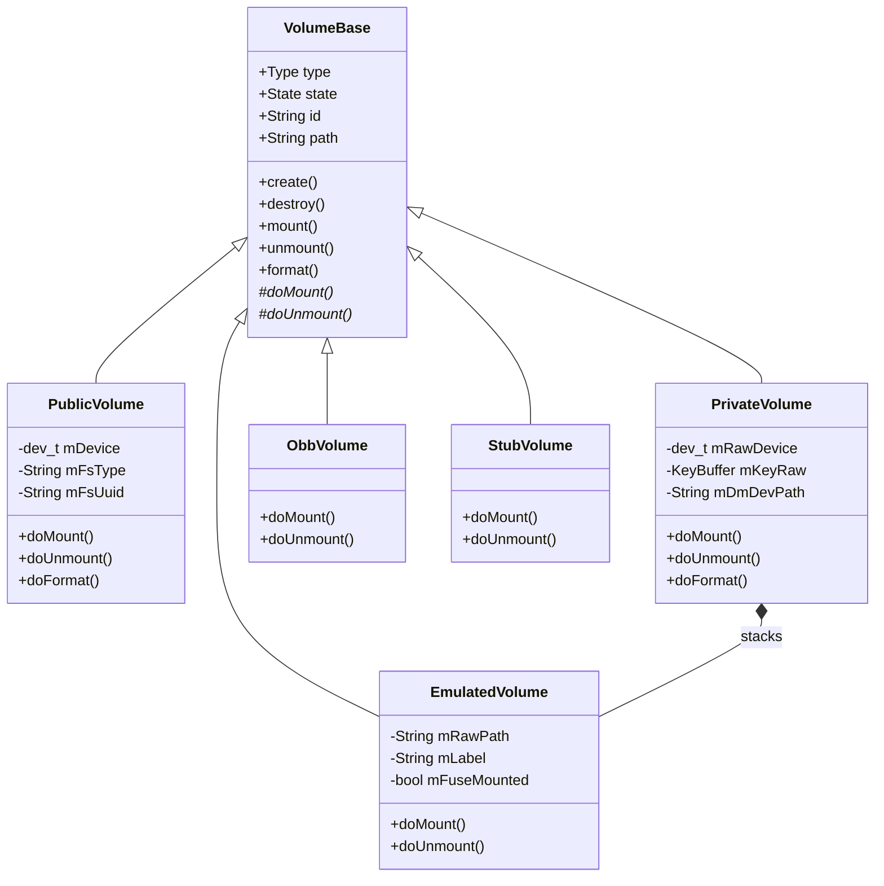

### 34.2.7 PublicVolume：可移动介质

`PublicVolume` 处理带有 FAT/exFAT 文件系统的 USB 驱动器和 SD 卡。它的挂载过程包括检查文件系统、挂载到一个原始路径，然后再建立 FUSE：

```cpp
// system/vold/model/PublicVolume.cpp (lines 110-292)
status_t PublicVolume::doMount() {
    bool isVisible = isVisibleForWrite();
    readMetadata();

    if (mFsType == "vfat" && vfat::IsSupported()) {
        if (vfat::Check(mDevPath)) {
            LOG(ERROR) << getId() << " failed filesystem check";
            return -EIO;
        }
    } else if (mFsType == "exfat" && exfat::IsSupported()) {
        if (exfat::Check(mDevPath)) {
            return -EIO;
        }
    }

    std::string stableName = getStableName();
    mRawPath = StringPrintf("/mnt/media_rw/%s", stableName.c_str());

    setInternalPath(mRawPath);
    if (isVisible) {
        setPath(StringPrintf("/storage/%s", stableName.c_str()));
    }

    // Mount the raw filesystem
    if (mFsType == "vfat") {
        vfat::Mount(mDevPath, mRawPath, false, false, false,
                    AID_ROOT, AID_MEDIA_RW, 0007, true);
    } else if (mFsType == "exfat") {
        exfat::Mount(mDevPath, mRawPath, AID_ROOT, AID_MEDIA_RW, 0007);
    }

    if (!isVisible) {
        return OK;  // No FUSE needed for invisible volumes
    }

    // Mount FUSE on top
    LOG(INFO) << "Mounting public fuse volume";
    android::base::unique_fd fd;
    int result = MountUserFuse(user_id, getInternalPath(),
                               stableName, &fd);
    mFuseMounted = true;

    auto callback = getMountCallback();
    if (callback) {
        bool is_ready = false;
        callback->onVolumeChecking(std::move(fd), getPath(),
                                   getInternalPath(), &is_ready);
    }

    ConfigureReadAheadForFuse(
        GetFuseMountPathForUser(user_id, stableName), 256u);
    ConfigureMaxDirtyRatioForFuse(
        GetFuseMountPathForUser(user_id, stableName), 40u);

    return OK;
}
```

格式化操作会根据设备容量在 vfat 和 exfat 之间进行选择：

```cpp
// system/vold/model/PublicVolume.cpp (lines 400-455)
status_t PublicVolume::doFormat(const std::string& fsType) {
    // ...
    // If both vfat & exfat are supported, use exfat for SDXC (>32GB)
    if (size > 32896LL * 1024 * 1024) {
        fsPick = EXFAT;
    } else {
        fsPick = VFAT;
    }

    if (WipeBlockDevice(mDevPath) != OK) {
        LOG(WARNING) << getId() << " failed to wipe";
    }

    if (fsPick == VFAT) {
        res = vfat::Format(mDevPath, 0);
    } else if (fsPick == EXFAT) {
        res = exfat::Format(mDevPath);
    }
    return res;
}
```

### 34.2.8 PrivateVolume：采用的存储

`PrivateVolume` 表示一个已被“采用”（adopted）为内部存储的存储设备。它使用每卷密钥进行加密，并以 ext4 或 f2fs 格式化：

```cpp
// system/vold/model/PrivateVolume.cpp (lines 51-97)
PrivateVolume::PrivateVolume(dev_t device, const KeyBuffer& keyRaw)
    : VolumeBase(Type::kPrivate), mRawDevice(device), mKeyRaw(keyRaw) {
    setId(StringPrintf("private:%u,%u", major(device), minor(device)));
    mRawDevPath = StringPrintf("/dev/block/vold/%s", getId().c_str());
}

status_t PrivateVolume::doCreate() {
    if (CreateDeviceNode(mRawDevPath, mRawDevice)) {
        return -EIO;
    }

    // Recover from stale dm mappings
    auto& dm = dm::DeviceMapper::Instance();
    dm.DeleteDeviceIfExists(getId());

    // Set up metadata encryption for the volume
    if (!setup_ext_volume(getId(), mRawDevPath, mKeyRaw, &mDmDevPath)) {
        LOG(ERROR) << getId() << " failed to setup metadata encryption";
        return -EIO;
    }

    return OK;
}
```

挂载时，`PrivateVolume` 会创建标准的 Android 目录结构，并在其上叠加一个 `EmulatedVolume`：

```cpp
// system/vold/model/PrivateVolume.cpp (lines 121-203)
status_t PrivateVolume::doMount() {
    readMetadata();
    mPath = StringPrintf("/mnt/expand/%s", mFsUuid.c_str());
    setPath(mPath);

    // Mount the encrypted filesystem
    if (mFsType == "ext4") {
        ext4::Check(mDmDevPath, mPath);
        ext4::Mount(mDmDevPath, mPath, false, false, true);
    } else if (mFsType == "f2fs") {
        f2fs::Check(mDmDevPath);
        f2fs::Mount(mDmDevPath, mPath);
    }

    // Create standard Android directories
    PrepareDir(mPath + "/app", 0771, AID_SYSTEM, AID_SYSTEM);
    PrepareDir(mPath + "/user", 0511, AID_SYSTEM, AID_SYSTEM);
    PrepareDir(mPath + "/user_de", 0511, AID_SYSTEM, AID_SYSTEM);
    PrepareDir(mPath + "/media", 0550, AID_MEDIA_RW, AID_MEDIA_RW);
    PrepareDir(mPath + "/media/0", 0770, AID_MEDIA_RW, AID_MEDIA_RW);
    // ...
    return OK;
}

void PrivateVolume::doPostMount() {
    auto vol_manager = VolumeManager::Instance();
    std::string mediaPath(mPath + "/media");

    // Create emulated volumes for all started users
    for (userid_t user : vol_manager->getStartedUsers()) {
        auto vol = std::shared_ptr<VolumeBase>(
            new EmulatedVolume(mediaPath, mRawDevice, mFsUuid, user));
        vol->setMountUserId(user);
        addVolume(vol);
        vol->create();
    }
}
```

### 34.2.9 EmulatedVolume：由 FUSE 支撑的共享存储

`EmulatedVolume`（位于 `system/vold/model/EmulatedVolume.cpp`）通过 FUSE 提供每个用户的共享存储视图：

```cpp
// system/vold/model/EmulatedVolume.cpp (lines 50-58)
EmulatedVolume::EmulatedVolume(const std::string& rawPath, int userId)
    : VolumeBase(Type::kEmulated) {
    setId(StringPrintf("emulated;%u", userId));
    mRawPath = rawPath;
    mLabel = "emulated";
    mFuseMounted = false;
    mUseSdcardFs = IsSdcardfsUsed();
}
```

模拟卷的挂载过程比较复杂，涉及可选的 sdcardfs、FUSE 挂载以及为共享存储所做的绑定挂载：

```cpp
// system/vold/model/EmulatedVolume.cpp (lines 356-516)
status_t EmulatedVolume::doMount() {
    std::string label = getLabel();
    bool isVisible = isVisibleForWrite();

    setInternalPath(mRawPath);
    setPath(StringPrintf("/storage/%s", label.c_str()));

    // Mount sdcardfs if still in use (legacy path)
    if (mUseSdcardFs && getMountUserId() == 0) {
        // Fork sdcardfs process...
    }

    if (isVisible) {
        // Prepare Android/ directories for bind mounting
        PrepareAndroidDirs(volumeRoot);

        // Mount FUSE filesystem
        res = MountUserFuse(user_id, getInternalPath(), label, &fd);
        mFuseMounted = true;

        // Notify MediaProvider via callback
        auto callback = getMountCallback();
        if (callback) {
            bool is_ready = false;
            callback->onVolumeChecking(std::move(fd), getPath(),
                                       getInternalPath(), &is_ready);
        }

        // Set up bind mounts for Android/data and Android/obb
        if (!IsFuseBpfEnabled()) {
            mountFuseBindMounts();
        }

        // Configure FUSE performance parameters
        ConfigureReadAheadForFuse(
            GetFuseMountPathForUser(user_id, label), 256u);

        // Give FUSE 40% max_ratio (instead of default 1%)
        // because we trust this FUSE filesystem
        ConfigureMaxDirtyRatioForFuse(
            GetFuseMountPathForUser(user_id, label), 40u);
    }

    return OK;
}
```

### 34.2.10 VoldNativeService：Binder API

`vold` 通过 `IVold` AIDL 接口暴露其功能，该接口实现于 `system/vold/VoldNativeService.h`：

```cpp
// system/vold/VoldNativeService.h (key methods)
class VoldNativeService : public BinderService<VoldNativeService>,
                          public os::BnVold {
  public:
    static char const* getServiceName() { return "vold"; }

    // Volume operations
    binder::Status mount(const std::string& volId, int32_t mountFlags,
                         int32_t mountUserId,
                         const sp<IVoldMountCallback>& callback);
    binder::Status unmount(const std::string& volId);
    binder::Status format(const std::string& volId,
                          const std::string& fsType);
    binder::Status partition(const std::string& diskId,
                             int32_t partitionType, int32_t ratio);

    // User lifecycle
    binder::Status onUserAdded(int32_t userId, int32_t userSerial,
                               int32_t sharesStorageWithUserId);
    binder::Status onUserStarted(int32_t userId);
    binder::Status onUserStopped(int32_t userId);

    // Encryption
    binder::Status fbeEnable();
    binder::Status initUser0();
    binder::Status mountFstab(const std::string& blkDevice,
                              const std::string& mountPoint, ...);
    binder::Status createUserStorageKeys(int32_t userId, bool ephemeral);
    binder::Status destroyUserStorageKeys(int32_t userId);
    binder::Status unlockCeStorage(int32_t userId,
                                   const std::vector<uint8_t>& secret);
    binder::Status lockCeStorage(int32_t userId);

    // Storage management
    binder::Status moveStorage(const std::string& fromVolId,
                               const std::string& toVolId, ...);
    binder::Status fstrim(int32_t fstrimFlags, ...);
    binder::Status runIdleMaint(bool needGC, ...);
};
```

### 34.2.11 文件系统支持

vold 通过 `system/vold/fs/` 中的模块支持多种文件系统：

| 模块 | 文件 | 支持的格式 |

|--------|------|-------------------|
| `Vfat` | `fs/Vfat.cpp` | FAT16, FAT32 |
| `Exfat` | `fs/Exfat.cpp` | exFAT |
| `Ext4` | `fs/Ext4.cpp` | ext4 |
| `F2fs` | `fs/F2fs.cpp` | f2fs |

每个模块都提供 `Check()`、`Mount()` 和 `Format()` 函数。内部存储格式化时的文件系统选择遵循一套启发式规则：

```cpp
// system/vold/model/PrivateVolume.cpp (lines 215-249)
status_t PrivateVolume::doFormat(const std::string& fsType) {
    std::string resolvedFsType = fsType;
    if (fsType == "auto") {
        // Prefer f2fs for flash-based (MMC, loop, virtio) devices
        if ((major(mRawDevice) == kMajorBlockMmc ||
             major(mRawDevice) == kMajorBlockHdd ||
             major(mRawDevice) == kMajorBlockLoop ||
             IsVirtioBlkDevice(major(mRawDevice))) &&
             f2fs::IsSupported()) {
            resolvedFsType = "f2fs";
        } else {
            resolvedFsType = "ext4";
        }
    }
    // ...
}
```

---

## 34.3 StorageManagerService

### 34.3.1 概述

`StorageManagerService`（位于 `frameworks/base/services/core/java/com/android/server/StorageManagerService.java`）是作为 Android 框架与 `vold` 之间中介的 Java 系统服务。它：

- 维护所有磁盘和卷的内存模型
- 向已注册的监听器广播存储事件
- 管理 OBB（Opaque Binary Blob，不透明二进制大对象）挂载
- 处理卷之间的存储迁移
- 强制存储权限并管理用户 CE/DE 密钥的解锁
- 通过 `ExternalStorageService` 控制 FUSE 会话的生命周期

### 34.3.2 服务注册

`StorageManagerService` 在系统服务器启动期间以 `"mount"` Binder 服务（旧名称）的形式发布：

```java
// frameworks/base/services/core/java/com/android/server/
//     StorageManagerService.java (lines 244-304)
public static class Lifecycle extends SystemService {
    private StorageManagerService mStorageManagerService;

    @Override
    public void onStart() {
        mStorageManagerService = new StorageManagerService(getContext());
        publishBinderService("mount", mStorageManagerService);
        mStorageManagerService.start();
    }

    @Override
    public void onBootPhase(int phase) {
        if (phase == PHASE_SYSTEM_SERVICES_READY) {
            mStorageManagerService.servicesReady();
        } else if (phase == PHASE_ACTIVITY_MANAGER_READY) {
            mStorageManagerService.systemReady();
        } else if (phase == PHASE_BOOT_COMPLETED) {
            mStorageManagerService.bootCompleted();
        }
    }

    @Override
    public void onUserUnlocking(@NonNull TargetUser user) {
        mStorageManagerService.onUserUnlocking(user.getUserIdentifier());
    }

    @Override
    public void onUserStopped(@NonNull TargetUser user) {
        mStorageManagerService.onUserStopped(user.getUserIdentifier());
    }
}
```

### 34.3.3 数据结构

该服务维护若干用于跟踪存储状态的关键数据结构：

```java
// StorageManagerService.java (lines 459-474)

/** Map from disk ID to disk */
@GuardedBy("mLock")
private ArrayMap<String, DiskInfo> mDisks = new ArrayMap<>();

/** Map from volume ID to disk */
@GuardedBy("mLock")
private final WatchedArrayMap<String, WatchedVolumeInfo> mVolumes =
    new WatchedArrayMap<>();

/** Map from UUID to record */
@GuardedBy("mLock")
private ArrayMap<String, VolumeRecord> mRecords = new ArrayMap<>();

@GuardedBy("mLock")
private String mPrimaryStorageUuid;
```

### 34.3.4 IVoldListener 回调

当 `StorageManagerService` 启动时，它会连接到 vold 并把自己注册为监听器。`IVoldListener` 回调接口接收关于磁盘和卷状态变更的通知：

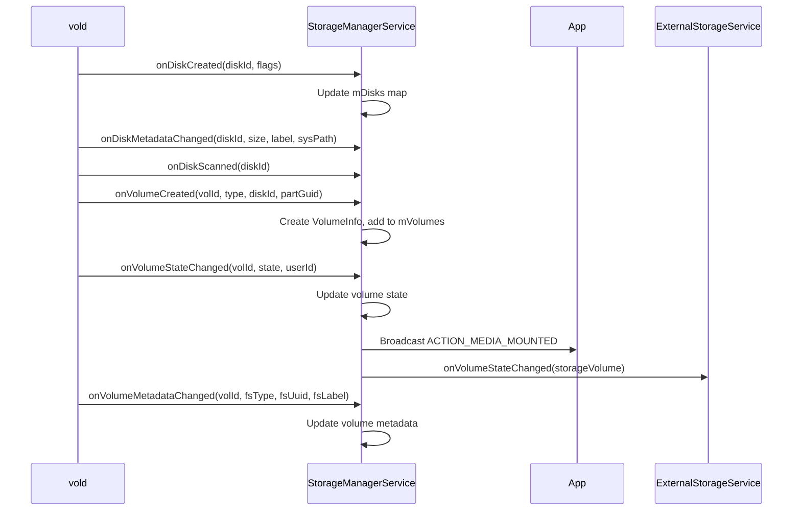

### 34.3.5 OBB 管理

`StorageManagerService` 管理 OBB（Opaque Binary Blob）文件，这是游戏和大型应用所使用的扩展文件。OBB 文件以回环设备（loopback device）的形式挂载：

```java
// StorageManagerService.java (OBB handling)
private static final Pattern OBB_FILE_PATH = Pattern.compile(
    "(?i)(^/storage/[^/]+/(?:([0-9]+)/)?Android/obb/)"
    + "([^/]+)/([^/]+\\.obb)");
```

OBB 管理通过 `IObbActionListener` 回调进行，并涉及通过 vold 创建回环设备：

```java
// Simplified OBB mount flow:
// 1. App calls StorageManager.mountObb(obbPath, key, listener)
// 2. StorageManagerService validates path and permissions
// 3. Calls vold.createObb(sourcePath, ownerGid)
// 4. vold creates loop device and mounts it
// 5. Listener receives MOUNTED callback
```

### 34.3.6 卷设置持久化

卷记录被持久化到 XML 中，以便在重启后仍能记住各个卷：

```java
// StorageManagerService.java (lines 324-340)
private static final String TAG_VOLUMES = "volumes";
private static final String ATTR_VERSION = "version";
private static final String ATTR_PRIMARY_STORAGE_UUID = "primaryStorageUuid";
private static final String TAG_VOLUME = "volume";
private static final String ATTR_TYPE = "type";
private static final String ATTR_FS_UUID = "fsUuid";
private static final String ATTR_PART_GUID = "partGuid";
private static final String ATTR_NICKNAME = "nickname";
private static final String ATTR_USER_FLAGS = "userFlags";
private static final String ATTR_CREATED_MILLIS = "createdMillis";
private static final String ATTR_LAST_SEEN_MILLIS = "lastSeenMillis";
private static final String ATTR_LAST_TRIM_MILLIS = "lastTrimMillis";
private static final String ATTR_LAST_BENCH_MILLIS = "lastBenchMillis";
```

### 34.3.7 CE/DE 密钥解锁协调

`StorageManagerService` 与 `vold` 协调进行加密密钥管理。它跟踪哪些用户已经解锁了其 CE（凭据加密）存储：

```java
// StorageManagerService.java (lines 411-450)
private static class WatchedUnlockedUsers {
    private int[] users = EmptyArray.INT;

    public void append(int userId) {
        users = ArrayUtils.appendInt(users, userId);
        invalidateIsUserUnlockedCache();
        StorageManager.invalidateVolumeListCache();
    }

    public void remove(int userId) {
        users = ArrayUtils.removeInt(users, userId);
        invalidateIsUserUnlockedCache();
        StorageManager.invalidateVolumeListCache();
    }
}

/** Set of users whose CE storage is unlocked. */
@GuardedBy("mLock")
private WatchedUnlockedUsers mCeUnlockedUsers = new WatchedUnlockedUsers();
```

### 34.3.8 智能空闲维护

该服务通过周期性的维护操作来管理存储健康：

```java
// StorageManagerService.java (lines 354-389)
// Smart idle maintenance defaults
private static final boolean DEFAULT_SMART_IDLE_MAINT_ENABLED = false;
private static final int DEFAULT_SMART_IDLE_MAINT_PERIOD = 60;  // minutes
private static final int DEFAULT_LIFETIME_PERCENT_THRESHOLD = 70;
private static final int DEFAULT_MIN_SEGMENTS_THRESHOLD = 512;
private static final float DEFAULT_DIRTY_RECLAIM_RATE = 0.5F;
private static final float DEFAULT_SEGMENT_RECLAIM_WEIGHT = 1.0F;
private static final float DEFAULT_LOW_BATTERY_LEVEL = 20F;
private static final boolean DEFAULT_CHARGING_REQUIRED = true;
```

这会在设备空闲期间触发 vold 的 `runIdleMaint()` 和 `fstrim()` 操作，以在闪存存储上维持文件系统的健康。

---

## 34.4 作用域存储（Scoped Storage）

### 34.4.1 作用域存储模型

作用域存储在 Android 10 中引入，并从 Android 11 起完全强制执行，从根本上改变了应用访问共享存储的方式。在旧模型下，任何拥有 `READ_EXTERNAL_STORAGE` 权限的应用都可以无限制地访问外部存储上的所有文件。新模型提供：

1. **沙箱化的应用目录** -- 应用可以自由地读取/写入其自己目录（`Android/data/<package>/` 和 `Android/media/<package>/`）中的文件，无需任何权限。
2. **基于 MediaStore 的访问** -- 应用通过 `MediaStore` 内容提供程序访问共享媒体文件（图片、视频、音频），该提供程序按类型强制实施权限。
3. **存储访问框架** -- 对于非媒体文件（文档、下载），应用必须使用存储访问框架并获得用户的明确同意。
4. **MANAGE_EXTERNAL_STORAGE** -- 面向文件管理器及类似需要广泛访问权限的应用的特权权限（需接受 Play Store 审核）。

### 34.4.2 权限模型

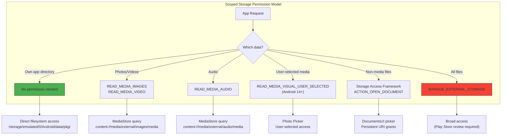

### 34.4.3 基于 FUSE 的强制执行

作用域存储模型通过运行在 MediaProvider 进程中的 FUSE 守护进程来强制执行。当应用打开外部存储上的文件时，请求会经过 FUSE，FUSE 再回调 MediaProvider 以检查权限：

```java
// packages/providers/MediaProvider/src/com/android/providers/media/
//     fuse/FuseDaemon.java (lines 40-97)
public final class FuseDaemon extends Thread {
    public static final String TAG = "FuseDaemonThread";
    private static final int POLL_INTERVAL_MS = 100;
    private static final int POLL_COUNT = 50;

    private final MediaProvider mMediaProvider;
    private final int mFuseDeviceFd;
    private final String mPath;

    /** Starts a FUSE session. Does not return until unmounted. */
    @Override
    public void run() {
        final long ptr;
        synchronized (mLock) {
            mPtr = native_new(mMediaProvider);
            ptr = mPtr;
        }

        Log.i(TAG, "Starting thread for " + getName() + " ...");
        native_start(ptr, mFuseDeviceFd, mPath, mUncachedMode,
                enableParallelFuseDirOps(),
                mSupportedTranscodingRelativePaths,
                mSupportedUncachedRelativePaths);  // Blocks
        Log.i(TAG, "Exiting thread for " + getName() + " ...");
        // ...
    }
}
```

### 34.4.4 MediaProvider 中的权限检查

`MediaProvider` 拥有一套详尽的权限检查系统，使用 `LocalCallingIdentity` 来跟踪每个调用方包可以访问的内容：

```java
// packages/providers/MediaProvider/src/com/android/providers/media/
//     LocalCallingIdentity.java (permission constants, grouped non-contiguous bits)
public static final int PERMISSION_IS_SELF = 1 << 0;
public static final int PERMISSION_IS_SHELL = 1 << 1;
public static final int PERMISSION_IS_MANAGER = 1 << 2;
public static final int PERMISSION_IS_DELEGATOR = 1 << 3;
public static final int PERMISSION_IS_DOCUMENTS_MANAGER = 1 << 4;

public static final int PERMISSION_IS_REDACTION_NEEDED = 1 << 8;
public static final int PERMISSION_IS_LEGACY_GRANTED = 1 << 9;
public static final int PERMISSION_IS_LEGACY_READ = 1 << 10;
public static final int PERMISSION_IS_LEGACY_WRITE = 1 << 11;

public static final int PERMISSION_READ_AUDIO = 1 << 16;
public static final int PERMISSION_READ_VIDEO = 1 << 17;
public static final int PERMISSION_READ_IMAGES = 1 << 18;
public static final int PERMISSION_WRITE_AUDIO = 1 << 19;
public static final int PERMISSION_WRITE_VIDEO = 1 << 20;
public static final int PERMISSION_WRITE_IMAGES = 1 << 21;

public static final int PERMISSION_IS_SYSTEM_GALLERY = 1 << 22;
public static final int PERMISSION_INSTALL_PACKAGES = 1 << 23;
public static final int PERMISSION_WRITE_EXTERNAL_STORAGE = 1 << 24;
public static final int PERMISSION_ACCESS_MTP = 1 << 26;
```

### 34.4.5 旧版模式

以低于 30（Android 11）的 SDK 版本为目标平台的应用，可以通过 `requestLegacyExternalStorage` 清单标志选择使用旧版存储行为。这一点通过 `OP_LEGACY_STORAGE` 应用操作（app op）来跟踪：

```java
// StorageManagerService.java
import static android.app.AppOpsManager.OP_LEGACY_STORAGE;
import static android.app.AppOpsManager.OP_MANAGE_EXTERNAL_STORAGE;
```

当旧版模式处于活动状态时，FUSE 守护进程会放宽其权限检查，以允许更宽泛的前作用域存储访问模式。

### 34.4.6 MANAGE_EXTERNAL_STORAGE

`MANAGE_EXTERNAL_STORAGE` 权限授予应用对所有共享存储的广泛读/写访问权限，类似于旧的 `WRITE_EXTERNAL_STORAGE` 行为。不过，它是一个特殊权限，满足以下特点：

1. 需要在设置中获得用户的明确同意
2. 需接受 Google Play 审核政策的约束
3. 通过 `OP_MANAGE_EXTERNAL_STORAGE` 应用操作来跟踪
4. 仍然不会授予对其他应用的 `Android/data/` 目录的访问权限

```java
// StorageManagerService.java imports
import static android.Manifest.permission.MANAGE_EXTERNAL_STORAGE;
import static android.app.AppOpsManager.OP_MANAGE_EXTERNAL_STORAGE;
```

---

## 34.5 FUSE 与 sdcardfs

### 34.5.1 历史背景：sdcardfs

在 Android 11 之前，外部存储权限的强制执行是通过 `sdcardfs`（一种在内核中实现的可堆叠文件系统）来完成的。sdcardfs 位于 VFS 层与底层的 ext4/f2fs 文件系统之间，根据调用方应用的 GID 即时转换所有权和权限。

sdcardfs 在性能方面表现良好，但存在明显的局限性：

- 无法执行逐文件的权限检查
- 无法实现内容脱敏（例如去除 EXIF 位置数据）
- 无法支持透明转码
- 需要内核修改，这使 GKI（通用内核镜像）变得复杂

一些旧代码路径仍然引用 sdcardfs：

```cpp
// system/vold/model/EmulatedVolume.cpp (line 48)
static const char* kSdcardFsPath = "/system/bin/sdcard";

// system/vold/model/PublicVolume.cpp (lines 56-57)
mUseSdcardFs = IsSdcardfsUsed();
```

### 34.5.2 MediaProvider FUSE 守护进程

从 Android 11 开始，sdcardfs 被一个运行在 MediaProvider 进程内的 FUSE 守护进程取代。这种方式把权限强制执行从内核移到了用户空间，从而能够实现：

- **逐文件的权限检查**，基于 MediaStore 元数据
- **内容脱敏**（去除 EXIF GPS 数据以保护隐私）
- **透明转码**（例如将 HEVC 转为 AVC 以提高兼容性）
- **GKI 兼容性**（无需自定义内核修改）

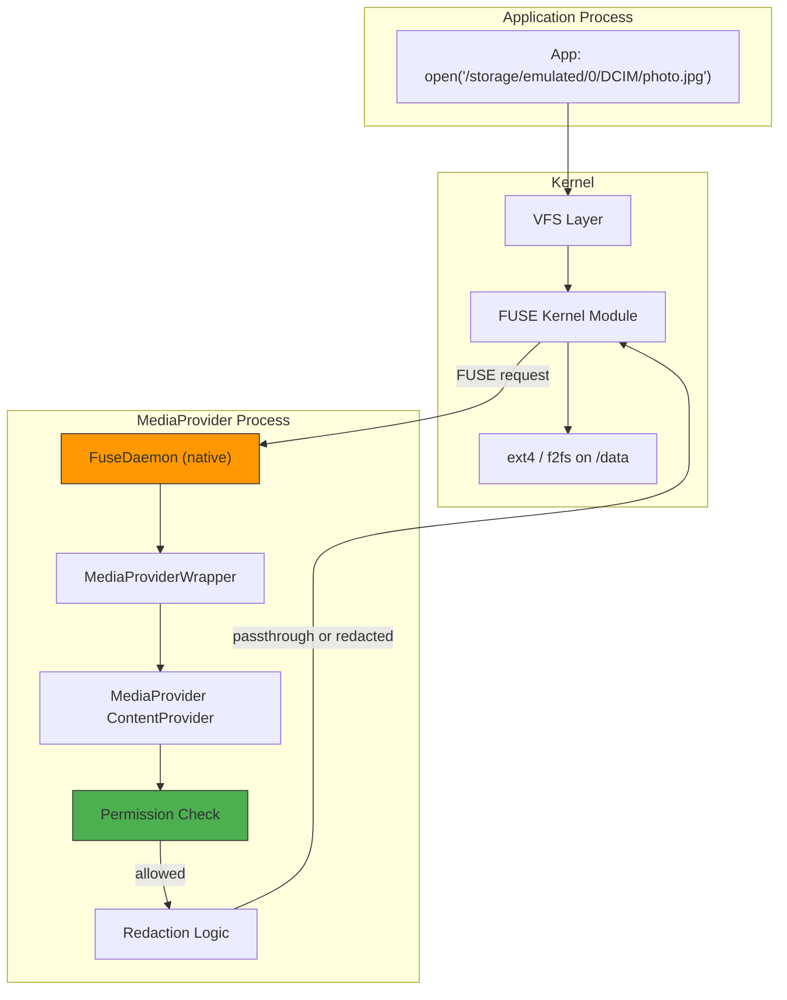

### 34.5.3 原生 FUSE 守护进程实现

原生 FUSE 守护进程位于 `packages/providers/MediaProvider/jni/`，是一个关键的性能敏感组件：

```cpp
// packages/providers/MediaProvider/jni/FuseDaemon.h (lines 34-153)
class FuseDaemon final {
  public:
    FuseDaemon(JNIEnv* env, jobject mediaProvider);

    void Start(android::base::unique_fd fd, const std::string& path,
               const bool uncached_mode,
               const bool enable_parallel_fuse_dir_ops,
               const std::vector<std::string>&
                   supported_transcoding_relative_paths,
               const std::vector<std::string>&
                   supported_uncached_relative_paths);

    bool IsStarted() const;
    bool ShouldOpenWithFuse(int fd, bool for_read,
                            const std::string& path);
    bool UsesFusePassthrough() const;
    void InvalidateFuseDentryCache(const std::string& path);
    std::unique_ptr<FdAccessResult> CheckFdAccess(int fd, uid_t uid) const;
    void InitializeDeviceId(const std::string& path);

  private:
    MediaProviderWrapper mp;
    std::atomic_bool active;
    struct ::fuse* fuse;
};
```

JNI 桥位于
`packages/providers/MediaProvider/jni/com_android_providers_media_FuseDaemon.cpp`，
原生 FUSE 实现则位于
`packages/providers/MediaProvider/jni/FuseDaemon.cpp`。

### 34.5.4 FUSE 直通（Passthrough）

基于 FUSE 的方案的一项关键优化是 FUSE 直通。对于不需要脱敏或转码的文件，FUSE 守护进程可以建立一条直通路径。借助这条路径，内核在后续的 I/O 操作中完全绕过 FUSE 守护进程。这恢复了从 sdcardfs 迁移到 FUSE 所损失的大部分性能：

```java
// packages/providers/MediaProvider/src/com/android/providers/media/
//     fuse/FuseDaemon.java (lines 180-188)
/**
 * Checks if the FuseDaemon uses the FUSE passthrough feature.
 */
public boolean usesFusePassthrough() {
    synchronized (mLock) {
        if (mPtr == 0) {
            Log.i(TAG, "usesFusePassthrough failed, FUSE daemon unavailable");
            return false;
        }
        return native_uses_fuse_passthrough(mPtr);
    }
}
```

### 34.5.5 ExternalStorageService 集成

`ExternalStorageServiceImpl` 类在 vold 的挂载回调与 FUSE 守护进程及 MediaProvider 之间架起桥梁：

```java
// packages/providers/MediaProvider/src/com/android/providers/media/
//     fuse/ExternalStorageServiceImpl.java (lines 51-189)
public final class ExternalStorageServiceImpl
        extends ExternalStorageService {

    @Override
    public void onStartSession(@NonNull String sessionId, int flag,
            @NonNull ParcelFileDescriptor deviceFd,
            @NonNull File upperFileSystemPath,
            @NonNull File lowerFileSystemPath) {

        MediaProvider mediaProvider = getMediaProvider();

        // Check for externally managed volumes
        boolean uncachedMode = false;
        if (SdkLevel.isAtLeastT()) {
            StorageVolume vol = getSystemService(StorageManager.class)
                    .getStorageVolume(upperFileSystemPath);
            if (vol != null && vol.isExternallyManaged()) {
                uncachedMode = true;
            }
        }

        FuseDaemon daemon = new FuseDaemon(mediaProvider, this, deviceFd,
                sessionId, upperFileSystemPath.getPath(), uncachedMode,
                supportedTranscodingRelativePaths,
                supportedUncachedRelativePaths);
        daemon.start();
        sFuseDaemons.put(sessionId, daemon);
    }

    @Override
    public void onVolumeStateChanged(@NonNull StorageVolume vol)
            throws IOException {
        MediaProvider mediaProvider = getMediaProvider();

        switch(vol.getState()) {
            case Environment.MEDIA_MOUNTED:
                MediaVolume volume = MediaVolume.fromStorageVolume(vol);
                mediaProvider.attachVolume(volume, false,
                    Environment.MEDIA_MOUNTED);
                MediaService.queueVolumeScan(
                    mediaProvider.getContext(), volume, REASON_MOUNTED);
                break;
            case Environment.MEDIA_UNMOUNTED:
            case Environment.MEDIA_EJECTING:
                mediaProvider.detachVolume(
                    MediaVolume.fromStorageVolume(vol));
                break;
        }
        mediaProvider.updateVolumes();
    }

    @Override
    public void onEndSession(@NonNull String sessionId) {
        FuseDaemon daemon = onExitSession(sessionId);
        if (daemon != null) {
            daemon.waitForExit();
        }
    }
}
```

### 34.5.6 FUSE 绑定挂载

模拟卷会为 `Android/data` 和 `Android/obb` 目录创建绑定挂载。这些挂载确保访问经由下层文件系统进行。这绕过了 FUSE，以提升对性能敏感的应用数据访问的速度：

```cpp
// system/vold/model/EmulatedVolume.cpp (lines 145-241)
status_t EmulatedVolume::mountFuseBindMounts() {
    std::string label = getLabel();
    int userId = getMountUserId();

    // Bind mount Android/data from lower fs to FUSE mount
    std::string androidDataSource =
        StringPrintf("%s/data", androidSource.c_str());
    std::string androidDataTarget(
        StringPrintf("/mnt/user/%d/%s/%d/Android/data",
            userId, label.c_str(), userId));
    doFuseBindMount(androidDataSource, androidDataTarget, pathsToUnmount);

    // Bind mount Android/obb from lower fs to FUSE mount
    std::string androidObbSource =
        StringPrintf("%s/obb", androidSource.c_str());
    std::string androidObbTarget(
        StringPrintf("/mnt/user/%d/%s/%d/Android/obb",
            userId, label.c_str(), userId));
    doFuseBindMount(androidObbSource, androidObbTarget, pathsToUnmount);

    // Handle shared storage between clone profiles
    // to prevent page cache inconsistency
    auto vol = getSharedStorageVolume(userId);
    if (vol != nullptr) {
        auto sharedVol = static_cast<EmulatedVolume*>(vol.get());
        sharedVol->bindMountVolume(*this, pathsToUnmount);
        bindMountVolume(*sharedVol, pathsToUnmount);
    }

    return OK;
}
```

### 34.5.7 FUSE BPF 优化

现代 Android 版本引入了 FUSE BPF。它将 BPF 程序挂接到 FUSE 操作上，以在内核中短路权限检查。这避免了常见操作往返用户空间守护进程的过程：

```cpp
// system/vold/model/EmulatedVolume.cpp (line 479)
if (!IsFuseBpfEnabled()) {
    // Only do bind-mounts when FUSE BPF is not available
    res = mountFuseBindMounts();
}
```

当启用 FUSE BPF 时，内核的 BPF 程序会直接处理绑定挂载语义，从而不再需要显式的绑定挂载。

---

## 34.6 MediaProvider

### 34.6.1 概述

`MediaProvider`（位于 `packages/providers/MediaProvider/`）是管理设备上所有媒体文件的内容提供程序。它充当：

1. `content://media/` URI 命名空间的支撑存储
2. 作用域存储的权限强制执行层
3. FUSE 守护进程的宿主进程
4. 索引新内容的媒体扫描器
5. 存储访问框架的文档提供程序

### 34.6.2 内容 URI 结构

MediaProvider 通过层次化的 URI 结构暴露媒体：

```
content://media/
    internal/           -> Internal storage
        audio/
            media/      -> All audio files
            albums/     -> Album aggregation
            artists/    -> Artist aggregation
            genres/     -> Genre aggregation
            playlists/  -> Playlists
        images/
            media/      -> All images
            thumbnails/ -> Image thumbnails
        video/
            media/      -> All videos
            thumbnails/ -> Video thumbnails
    external/           -> Primary external storage
        (same structure as internal)
    external_primary/   -> Explicitly primary volume
    <volume_name>/      -> Named volume (e.g., USB drive UUID)
```

### 34.6.3 数据库架构

MediaProvider 使用 SQLite 数据库来索引所有媒体文件。`DatabaseHelper` 类（位于 `packages/providers/MediaProvider/src/com/android/providers/media/DatabaseHelper.java`）管理该架构：

```java
// packages/providers/MediaProvider/src/com/android/providers/media/
//     DatabaseHelper.java
public class DatabaseHelper extends SQLiteOpenHelper {
    static final String INTERNAL_DATABASE_NAME = "internal.db";
    static final String EXTERNAL_DATABASE_NAME = "external.db";
    // ...
}
```

主表是 `files`，它存储所有已索引文件的元数据：

| 列 | 类型 | 说明 |
|--------|------|-------------|
| `_id` | INTEGER | 主键 |
| `_data` | TEXT | 文件的绝对路径 |
| `_display_name` | TEXT | 文件名 |
| `_size` | INTEGER | 文件大小（字节） |
| `mime_type` | TEXT | MIME 类型 |
| `media_type` | INTEGER | 0=文件，1=图片，2=音频，3=视频 |
| `title` | TEXT | 标题（来自元数据） |
| `date_added` | INTEGER | 文件被添加的时间（epoch 秒） |
| `date_modified` | INTEGER | 最后修改时间 |
| `datetaken` | INTEGER | 照片/视频拍摄的时间（`MediaColumns.DATE_TAKEN`） |
| `duration` | INTEGER | 时长（毫秒）（音频/视频） |
| `width` | INTEGER | 图片/视频宽度 |
| `height` | INTEGER | 图片/视频高度 |
| `orientation` | INTEGER | EXIF 方向 |
| `bucket_id` | TEXT | 父目录的哈希 |
| `bucket_display_name` | TEXT | 父目录名称 |
| `volume_name` | TEXT | 存储卷名称 |
| `owner_package_name` | TEXT | 创建该文件的包 |
| `is_pending` | INTEGER | 文件是否正在写入 |
| `is_trashed` | INTEGER | 文件是否在回收站中 |
| `is_favorite` | INTEGER | 文件是否被收藏 |

### 34.6.4 媒体扫描

`MediaScanner` 接口（位于 `packages/providers/MediaProvider/src/com/android/providers/media/scan/MediaScanner.java`）定义了扫描契约：

```java
// packages/providers/MediaProvider/src/com/android/providers/media/
//     scan/MediaScanner.java
public interface MediaScanner {
    int REASON_UNKNOWN = ...;
    int REASON_MOUNTED = ...;
    int REASON_DEMAND = ...;
    int REASON_IDLE = ...;

    void scanDirectory(@NonNull File dir, @ScanReason int reason);
    @Nullable Uri scanFile(@NonNull File file, @ScanReason int reason);
    void onDetachVolume(@NonNull MediaVolume volume);
    void onDirectoryDirty(@NonNull File file);
}
```

`ModernMediaScanner` 实现会遍历文件系统，使用 `ExifInterface` 和 `MediaMetadataRetriever` 从媒体文件中提取元数据，并插入/更新 `files` 表中的行。

在几种场景下会触发扫描：

| 触发条件 | 原因代码 | 时机 |
|---------|------------|------|
| 卷挂载 | `REASON_MOUNTED` | 当卷首次挂载时 |
| 显式请求 | `REASON_DEMAND` | 当应用调用 `MediaScannerConnection.scanFile()` 时 |
| 空闲维护 | `REASON_IDLE` | 在设备空闲期间 |
| 文件变更 |（FUSE 通知）| 当 FUSE 检测到对媒体文件的写入时 |

### 34.6.5 MediaProvider 中的卷管理

MediaProvider 通过 `MediaVolume` 类来跟踪存储卷，并响应卷状态变化来挂接/卸载它们：

```java
// ExternalStorageServiceImpl.java (lines 101-130)
@Override
public void onVolumeStateChanged(@NonNull StorageVolume vol)
        throws IOException {
    MediaProvider mediaProvider = getMediaProvider();

    switch(vol.getState()) {
        case Environment.MEDIA_MOUNTED:
            MediaVolume volume = MediaVolume.fromStorageVolume(vol);
            mediaProvider.attachVolume(volume, false,
                Environment.MEDIA_MOUNTED);
            // Queue a scan for the newly mounted volume
            MediaService.queueVolumeScan(
                mediaProvider.getContext(), volume, REASON_MOUNTED);
            break;
        case Environment.MEDIA_UNMOUNTED:
        case Environment.MEDIA_EJECTING:
        case Environment.MEDIA_REMOVED:
        case Environment.MEDIA_BAD_REMOVAL:
            mediaProvider.detachVolume(
                MediaVolume.fromStorageVolume(vol));
            break;
    }
    mediaProvider.updateVolumes();
}
```

### 34.6.6 MediaProvider 中的访问控制

`AccessChecker` 类实现了作用域存储的核心访问控制逻辑。贯穿 MediaProvider 使用的关键权限常量：

```java
// packages/providers/MediaProvider/src/com/android/providers/media/
//     LocalCallingIdentity.java (grouped non-contiguous bits)
public static final int PERMISSION_IS_SELF = 1 << 0;
public static final int PERMISSION_IS_SHELL = 1 << 1;
public static final int PERMISSION_IS_MANAGER = 1 << 2;

public static final int PERMISSION_IS_REDACTION_NEEDED = 1 << 8;
public static final int PERMISSION_IS_LEGACY_GRANTED = 1 << 9;
public static final int PERMISSION_IS_LEGACY_READ = 1 << 10;
public static final int PERMISSION_IS_LEGACY_WRITE = 1 << 11;

public static final int PERMISSION_READ_AUDIO = 1 << 16;
public static final int PERMISSION_READ_VIDEO = 1 << 17;
public static final int PERMISSION_READ_IMAGES = 1 << 18;

public static final int PERMISSION_IS_SYSTEM_GALLERY = 1 << 22;
public static final int PERMISSION_INSTALL_PACKAGES = 1 << 23;
public static final int PERMISSION_WRITE_EXTERNAL_STORAGE = 1 << 24;
public static final int PERMISSION_ACCESS_MTP = 1 << 26;
```

### 34.6.7 数据库备份与恢复

MediaProvider 使用基于 LevelDB 的备份系统来增强对数据库损坏的韧性，该系统通过 FUSE 守护进程来管理：

```java
// packages/providers/MediaProvider/src/com/android/providers/media/
//     fuse/FuseDaemon.java (lines 231-340)
public void setupVolumeDbBackup() throws IOException { ... }
public void setupPublicVolumeDbBackup(String volumeName) throws IOException { ... }
public void backupVolumeDbData(String volumeName, String key,
    String value) throws IOException { ... }
public String[] readBackedUpFilePaths(String volumeName,
    String lastReadValue, int limit) throws IOException { ... }
```

---

## 34.7 存储访问框架（SAF）

### 34.7.1 概述

存储访问框架（SAF）随 Android 4.4（API 19）引入。它为应用提供了一个统一的 API，用于浏览并访问任何文档提供程序中的文档。随着作用域存储的出现，它变得越来越重要，因为如今它已成为应用访问非媒体文件的主要方式。

### 34.7.2 架构

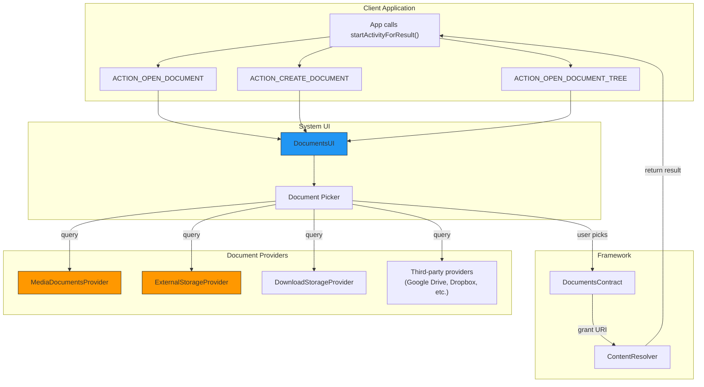

### 34.7.3 关键 Intent

| Intent | 用途 |
|--------|---------|
| `ACTION_OPEN_DOCUMENT` | 用户选择一个现有文件以读取/写入 |
| `ACTION_CREATE_DOCUMENT` | 用户创建一个新文件 |
| `ACTION_OPEN_DOCUMENT_TREE` | 用户选择一个完整目录子树 |

### 34.7.4 DocumentsProvider

文档提供程序继承 `android.provider.DocumentsProvider`，并实现一组标准方法：

```java
// Key methods a DocumentsProvider must implement:
public abstract class DocumentsProvider extends ContentProvider {
    // Return metadata about available roots
    public abstract Cursor queryRoots(String[] projection);

    // Return metadata about a specific document
    public abstract Cursor queryDocument(String documentId,
                                         String[] projection);

    // Return children of a document (directory)
    public abstract Cursor queryChildDocuments(String parentDocumentId,
                                               String[] projection,
                                               String sortOrder);

    // Open a document for reading/writing
    public abstract ParcelFileDescriptor openDocument(
        String documentId, String mode, CancellationSignal signal);
}
```

### 34.7.5 MediaDocumentsProvider

`MediaDocumentsProvider`（位于 `packages/providers/MediaProvider/src/com/android/providers/media/MediaDocumentsProvider.java`）通过 SAF 接口暴露 MediaStore 内容：

```java
// packages/providers/MediaProvider/src/com/android/providers/media/
//     MediaDocumentsProvider.java
public class MediaDocumentsProvider extends DocumentsProvider {
    // Imports referencing SAF contracts
    // ...

    // Provides root entries for:
    // - Images root
    // - Videos root
    // - Audio root
    // - Documents root

    // Maps between document IDs and MediaStore URIs
}
```

### 34.7.6 Tree URI 与持久授权

当应用使用 `ACTION_OPEN_DOCUMENT_TREE` 时，它会收到一个 tree URI，表示对整个目录子树的访问权限。此授权可以跨重启持久保留：

```java
// Client app code example:
Intent intent = new Intent(Intent.ACTION_OPEN_DOCUMENT_TREE);
startActivityForResult(intent, REQUEST_CODE);

// In onActivityResult:
Uri treeUri = resultData.getData();
// Persist the permission
getContentResolver().takePersistableUriPermission(
    treeUri,
    Intent.FLAG_GRANT_READ_URI_PERMISSION |
    Intent.FLAG_GRANT_WRITE_URI_PERMISSION);

// Use DocumentsContract to work with children
Uri childrenUri = DocumentsContract.buildChildDocumentsUriUsingTree(
    treeUri, DocumentsContract.getTreeDocumentId(treeUri));
```

### 34.7.7 虚拟文件

SAF 支持虚拟文件——那些没有直接字节流表示、但可以以替代 MIME 类型打开的文档。例如，一个 Google Sheets 文档没有原生的文件表示，但可以以 CSV 或 PDF 打开：

```java
// Document flag indicating virtual file support
Document.FLAG_VIRTUAL_DOCUMENT  // Document has no direct byte representation

// A provider advertises the convertible MIME types by overriding
// DocumentsProvider.getDocumentStreamTypes() and openTypedDocument()

// Client code for opening a virtual document
String[] mimeTypes = getContentResolver().getStreamTypes(uri, "*/*");
AssetFileDescriptor afd = getContentResolver().openTypedAssetFileDescriptor(
    uri, mimeTypes[0], null);
```

---

## 34.8 基于文件的加密（FBE）

### 34.8.1 概述

基于文件的加密（FBE）使用不同的密钥加密不同的文件，从而允许每个文件被独立解密。这与已被弃用的全磁盘加密（FDE）形成对比，后者使用单个密钥加密整个分区。

FBE 支持两种关键的存储类别：

- **设备加密（DE）** 存储：设备一启动即可用，甚至早于用户输入凭据。用于闹钟、无障碍服务以及其他支持 Direct Boot 的组件。
- **凭据加密（CE）** 存储：仅在用户完成身份验证（PIN、密码、图案或生物识别）后可用。用于大多数应用数据和用户内容。

### 34.8.2 密钥架构

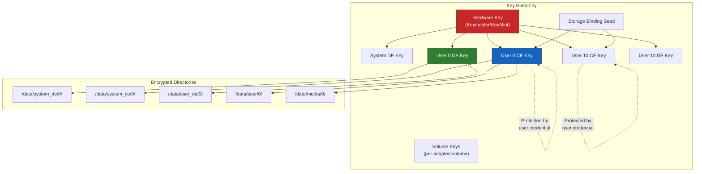

### 34.8.3 磁盘上的密钥存储

加密密钥存储在 `/data/misc/vold/user_keys/` 中，结构如下：

```cpp
// system/vold/FsCrypt.cpp (lines 80-96)
const std::string device_key_dir =
    std::string() + DATA_MNT_POINT + fscrypt_unencrypted_folder;
const std::string device_key_path = device_key_dir + "/key";

const std::string user_key_dir =
    std::string() + DATA_MNT_POINT + "/misc/vold/user_keys";

const std::string systemwide_volume_key_dir =
    std::string() + DATA_MNT_POINT + "/misc/vold/volume_keys";
```

磁盘上的布局：

```
/data/misc/vold/user_keys/
    ce/                     -> Credential Encrypted keys
        0/                  -> User 0
            current/        -> Current key directory
                keymaster_key_blob  -> Keystore-wrapped key
                encrypted_key       -> Encrypted key material
                secdiscardable      -> Key stretching material
        10/                 -> User 10
    de/                     -> Device Encrypted keys
        0/
        10/
```

### 34.8.4 FsCrypt 接口

FBE 系统通过 `FsCrypt.h` API 暴露出来：

```cpp
// system/vold/FsCrypt.h (lines 22-38)
bool fscrypt_initialize_systemwide_keys();

bool fscrypt_init_user0();
extern bool fscrypt_init_user0_done;
bool fscrypt_create_user_keys(userid_t user_id, bool ephemeral);
bool fscrypt_destroy_user_keys(userid_t user_id);
bool fscrypt_set_ce_key_protection(userid_t user_id,
    const std::vector<uint8_t>& secret);
void fscrypt_deferred_fixate_ce_keys();

std::vector<int> fscrypt_get_unlocked_users();
bool fscrypt_unlock_ce_storage(userid_t user_id,
    const std::vector<uint8_t>& secret);
bool fscrypt_lock_ce_storage(userid_t user_id);

bool fscrypt_prepare_user_storage(const std::string& volume_uuid,
    userid_t user_id, int flags);
bool fscrypt_destroy_user_storage(const std::string& volume_uuid,
    userid_t user_id, int flags);

bool fscrypt_destroy_volume_keys(const std::string& volume_uuid);
```

### 34.8.5 密钥创建

当创建一个新用户时，`fscrypt_create_user_keys()` 会生成 CE 和 DE 密钥：

```cpp
// system/vold/FsCrypt.cpp (simplified key creation)
static bool create_de_key(userid_t user_id, bool ephemeral) {
    KeyBuffer de_key;
    if (!generateStorageKey(makeGen(s_data_options), &de_key))
        return false;
    if (!ephemeral &&
        !android::vold::storeKeyAtomically(
            get_de_key_path(user_id), user_key_temp,
            kEmptyAuthentication, de_key))
        return false;
    EncryptionPolicy de_policy;
    if (!install_storage_key(
            DATA_MNT_POINT, s_data_options, de_key, &de_policy))
        return false;
    // ... store policy in s_de_policies ...
    return true;
}
```

`KeyGeneration` 结构体控制密钥的生成：

```cpp
// system/vold/FsCrypt.cpp (lines 133-139)
static KeyGeneration makeGen(const EncryptionOptions& options) {
    if (options.version == 0) {
        LOG(ERROR) << "EncryptionOptions not initialized";
        return android::vold::neverGen();
    }
    return KeyGeneration{FSCRYPT_MAX_KEY_SIZE, true, options.key_type};
}
```

### 34.8.6 CE 密钥解锁流程

当用户输入其凭据时，框架会通过 `StorageManagerService` 调用 `vold` 来解锁 CE 存储：

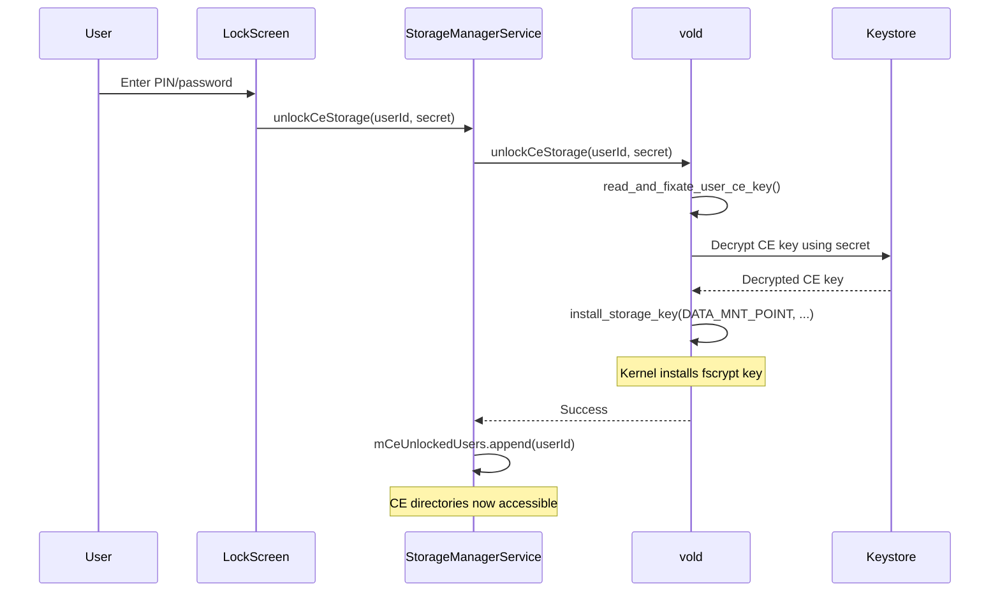

密钥读取过程会尝试多个密钥路径，以便在密钥轮换期间发生崩溃后恢复：

```cpp
// system/vold/FsCrypt.cpp (lines 219-235)
static bool read_and_fixate_user_ce_key(
        userid_t user_id,
        const android::vold::KeyAuthentication& auth,
        KeyBuffer* ce_key) {
    auto const directory_path = get_ce_key_directory_path(user_id);
    auto const paths = get_ce_key_paths(directory_path);
    for (auto const& ce_key_path : paths) {
        LOG(DEBUG) << "Trying user CE key " << ce_key_path;
        if (retrieveKey(ce_key_path, auth, ce_key)) {
            LOG(DEBUG) << "Successfully retrieved key";
            s_deferred_fixations.erase(directory_path);
            fixate_user_ce_key(directory_path, ce_key_path, paths);
            return true;
        }
    }
    LOG(ERROR) << "Failed to find working ce key for user " << user_id;
    return false;
}
```

### 34.8.7 加密选项

FBE 支持多种通过 fstab 配置的加密算法：

```cpp
// system/vold/FsCrypt.cpp (lines 315-335)
static bool init_data_file_encryption_options() {
    auto entry = GetEntryForMountPoint(&fstab_default, DATA_MNT_POINT);
    if (!ParseOptions(entry->encryption_options, &s_data_options)) {
        LOG(ERROR) << "Unable to parse encryption options for "
                   << DATA_MNT_POINT;
        return false;
    }
    if ((s_data_options.flags & FSCRYPT_POLICY_FLAG_IV_INO_LBLK_32) &&
        !DoesHardwareSupportOnly32DunBits(entry->blk_device)) {
        LOG(ERROR) << "emmc_optimized flag only allowed on hardware "
                      "limited to 32-bit DUNs";
        return false;
    }
    return true;
}
```

adoptable 存储卷的加密选项：

```cpp
// system/vold/FsCrypt.cpp (lines 355-376)
static bool get_volume_file_encryption_options(EncryptionOptions* options) {
    auto contents_mode = android::base::GetProperty(
        "ro.crypto.volume.contents_mode", "");
    auto first_api_level = GetFirstApiLevel();
    auto filenames_mode = android::base::GetProperty(
        "ro.crypto.volume.filenames_mode",
        first_api_level > __ANDROID_API_Q__ ? "" : "aes-256-heh");
    auto options_string = android::base::GetProperty(
        "ro.crypto.volume.options",
        contents_mode + ":" + filenames_mode);
    if (!ParseOptionsForApiLevel(first_api_level, options_string, options)) {
        LOG(ERROR) << "Unable to parse volume encryption options";
        return false;
    }
    return true;
}
```

### 34.8.8 目录准备

当 CE 存储被解锁时，vold 会使用适当的加密策略来准备目录结构：

```cpp
// system/vold/FsCrypt.cpp (lines 390-425)
static bool prepare_dir_with_policy(const std::string& dir, mode_t mode,
        uid_t uid, gid_t gid, const EncryptionPolicy& policy) {
    if (android::vold::pathExists(dir)) {
        if (!prepare_dir(dir, mode, uid, gid)) return false;
        if (IsFbeEnabled() && !EnsurePolicy(policy, dir)) return false;
    } else {
        // Create under temporary name, apply encryption policy,
        // then atomically rename to final name.
        const std::string tmp_dir = dir + ".new";
        if (android::vold::pathExists(tmp_dir)) {
            android::vold::DeleteDirContentsAndDir(tmp_dir);
        }
        if (!prepare_dir(tmp_dir, mode, uid, gid)) return false;
        if (IsFbeEnabled() && !EnsurePolicy(policy, tmp_dir)) return false;

        // Workaround for kernel bug with encrypted+casefolded rename
        android::vold::pathExists(tmp_dir + "/subdir");

        if (rename(tmp_dir.c_str(), dir.c_str()) != 0) {
            PLOG(ERROR) << "Failed to rename " << tmp_dir;
            return false;
        }
    }
    return true;
}
```

### 34.8.9 元数据加密

除了逐文件加密之外，Android 还支持对整个 `userdata` 分区进行元数据加密。它使用 `dm-default-key` 来加密文件系统元数据（目录结构、文件名、大小、权限）：

```cpp
// system/vold/MetadataCrypt.cpp (lines 61-66)
struct CryptoOptions {
    struct CryptoType cipher = invalid_crypto_type;
    bool use_legacy_options_format = false;
    bool set_dun = true;  // Non-legacy driver always sets DUN
    KeyType key_type = KeyType::kRaw;
};

static const std::string kDmNameUserdata = "userdata";

// Default encryption: AES-256-XTS; fallback: Adiantum
constexpr CryptoType supported_crypto_types[] = {
    aes_256_xts, adiantum
};
```

较早的版本在这里带有一个 `bool use_hw_wrapped_key` 标志。Android 17 用一个三值的 `KeyType` 枚举（`kRaw`、`kHwWrappedV0`、`kHwWrapped`）替换了它。基于文件的加密共享这个枚举（`system/extras/libfscrypt/include/fscrypt/fscrypt.h`）。这一相同的重构区分了最初的硬件包裹密钥格式（fstab 元数据加密选项中的 `wrappedkey_v0`）与较新的 `wrappedkey` 格式。Android 17 在 `MetadataCrypt.cpp` 的选项解析器中解析较新的格式。

元数据加密的设置会创建一个 `dm-default-key` 设备：

```cpp
// system/vold/MetadataCrypt.cpp (lines 156-217)
static bool create_crypto_blk_dev(const std::string& dm_name, const std::string& blk_device,
                                  const KeyBuffer& key, const CryptoOptions& options,
                                  std::string* crypto_blkdev, uint64_t* nr_sec, bool is_userdata) {
    if (!get_number_of_sectors(blk_device, nr_sec)) return false;
    *nr_sec &= ~7;  // Align to 4096-byte sectors

    KeyBuffer module_key;
    if (!prepareKeyForUse(key, options.key_type, &module_key)) return false;
    // ... StrToHex(module_key) ...

    auto target = std::make_unique<DmTargetDefaultKey>(
        0, *nr_sec, options.cipher.get_kernel_name(), hex_key, blk_device, 0);
    if (options.use_legacy_options_format) target->SetUseLegacyOptionsFormat();
    if (options.set_dun) target->SetSetDun();

    switch (options.key_type) {
        case KeyType::kRaw:
            break;
        case KeyType::kHwWrappedV0:
        case KeyType::kHwWrapped:
            // "wrappedkey_v0" works for both wrapped key versions for now.
            target->SetWrappedKeyV0();
            break;
    }

    DmTable table;
    table.AddTarget(std::move(target));

    auto& dm = DeviceMapper::Instance();
    if (dm_name == kDmNameUserdata &&
        dm.GetState(dm_name) == DmDeviceState::SUSPENDED) {
        dm.LoadTableAndActivate(dm_name, table);
        dm.WaitForDevice(dm_name, 20s, crypto_blkdev);
    } else {
        dm.CreateDevice(dm_name, table, crypto_blkdev, 5s);
    }

    if (is_userdata) {
        *crypto_blkdev = "/dev/block/mapper/" + dm_name;
    }
    return true;
}
```

Android 17 不再内联调用 `exportWrappedStorageKey()`。它改为通过共享的 `prepareKeyForUse()` 辅助函数（`system/vold/KeyUtil.h`）来路由密钥。对于原始密钥，该辅助函数原样返回长期密钥。对于硬件包裹密钥，它会用临时包裹密钥重新包裹该密钥。
随后对 `options.key_type` 的 `switch` 决定是否在 `dm-default-key` 目标上设置 `wrappedkey_v0` 标志。

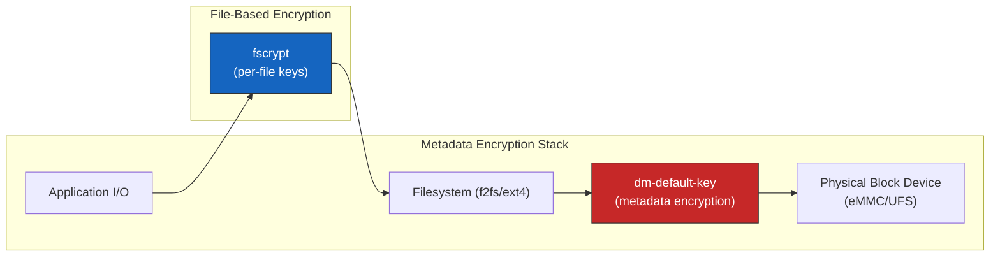

### 34.8.10 硬件包裹密钥

在支持内联加密引擎（ICE）的设备上，vold 可以使用硬件包裹密钥。这些密钥绝不会以明文形式离开硬件加密引擎。在 Android 17 中，逐密钥的管道逻辑被整合到 `prepareKeyForUse()` 之后，该函数声明于 `system/vold/KeyUtil.h`：

```cpp
// system/vold/KeyUtil.h (lines 47-53)
// Prepares a file-based or metadata encryption key for runtime use. Given a
// long-term, persistent key "lt_key", this sets "kernel_key" to the key that
// should be passed to the kernel to en/decrypt the storage. If it's a raw key,
// then this is just a copy of "lt_key". If it's a wrapped key, then "lt_key" is
// re-wrapped with the ephemeral wrapping key.
bool prepareKeyForUse(const KeyBuffer& lt_key, android::fscrypt::KeyType type,
                      KeyBuffer* kernel_key);
```

`generateStorageKey()` 和 `prepareKeyForUse()` 会根据 `KeyType` 进行分发，而在 Android 17 中，两种包裹格式会走不同的路径。旧的 `kHwWrappedV0` 格式仍经由 KeyMint。
`generateV0WrappedStorageKey()` 请求 Keystore 生成一个带有 `TAG_STORAGE_KEY` 标签的 AES 密钥。`prepareV0WrappedKeyForUse()` 调用 `Keystore::exportKey()`。该调用会在安全级别上调用 `convertStorageKeyToEphemeral()`，以用一个新的临时包裹密钥重新包裹长期 blob（`system/vold/Keystore.cpp`，第 153-179 行）。

较新的 `kHwWrapped` 格式完全放弃 KeyMint，转而使用 Linux 内核块设备 ioctl。`generateWrappedStorageKey()` 打开 userdata 块设备并发出 `BLKCRYPTOGENERATEKEY` 以生成长期密钥。
`prepareWrappedKeyForUse()` 发出 `BLKCRYPTOPREPAREKEY` 将其转换为临时密钥。内核会将该密钥编程到内联引擎中（`system/vold/KeyUtil.cpp`，第 81-199 行）。这是上游内核为硬件包裹的内联加密密钥所使用的同一条路径，因此不再需要 KeyMint 往返。两个 ioctl 都在主 userdata 块设备上操作，长期密钥上限为 `BLK_CRYPTO_MAX_HW_WRAPPED_KEY_SIZE`（截至内核 v6.17 为 128 字节）。

通过 `setKeyStorageBindingSeed()`，一个独立的绑定种子可以被混合到所有已存储的密钥中，该函数仍声明于 `system/vold/KeyStorage.h`：

```cpp
// system/vold/KeyStorage.h (line 67)
bool setKeyStorageBindingSeed(const std::vector<uint8_t>& seed);
```

---

## 34.9 Adoptable 存储

### 34.9.1 概述

Adoptable 存储允许外部存储设备（SD 卡、USB 驱动器）被“采用”为内部存储。当被采用时，该设备会被：

1. 使用 GPT 表重新分区
2. 用随机生成的密钥加密
3. 使用 ext4 或 f2fs 格式化
4. 像内部存储一样用于存储应用、应用数据和媒体

### 34.9.2 采用流程

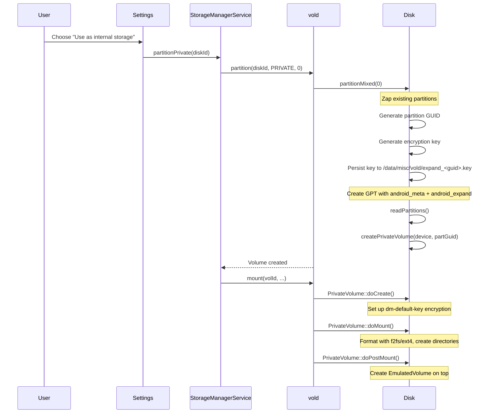

### 34.9.3 磁盘重新分区

`Disk::partitionMixed()` 方法处理实际的重新分区：

```cpp
// system/vold/model/Disk.cpp (lines 484-567)
status_t Disk::partitionMixed(int8_t ratio) {
    destroyAllVolumes();
    mJustPartitioned = true;

    // Nuke existing partition table
    std::vector<std::string> cmd;
    cmd.push_back(kSgdiskPath);
    cmd.push_back("--zap-all");
    cmd.push_back(mDevPath);
    ForkExecvp(cmd);

    // Generate partition GUID and encryption key
    std::string partGuidRaw;
    GenerateRandomUuid(partGuidRaw);

    KeyBuffer key;
    generate_volume_key(&key);

    std::string partGuid;
    StrToHex(partGuidRaw, partGuid);
    WriteStringToFile(keyRaw, BuildKeyPath(partGuid));

    // Build GPT table
    cmd.clear();
    cmd.push_back(kSgdiskPath);

    if (ratio > 0) {
        // Optional public partition (mixed mode)
        uint64_t splitMb = ((mSize / 100) * ratio) / 1024 / 1024;
        cmd.push_back(StringPrintf("--new=0:0:+%" PRId64 "M", splitMb));
        cmd.push_back(StringPrintf("--typecode=0:%s", kGptBasicData));
        cmd.push_back("--change-name=0:shared");
    }

    // Metadata partition (16MB)
    cmd.push_back("--new=0:0:+16M");
    cmd.push_back(StringPrintf("--typecode=0:%s", kGptAndroidMeta));
    cmd.push_back("--change-name=0:android_meta");

    // Private partition (rest of disk)
    cmd.push_back("--new=0:0:-0");
    cmd.push_back(StringPrintf("--typecode=0:%s", kGptAndroidExpand));
    cmd.push_back(StringPrintf("--partition-guid=0:%s", partGuid.c_str()));
    cmd.push_back("--change-name=0:android_expand");

    cmd.push_back(mDevPath);
    return ForkExecvp(cmd);
}
```

### 34.9.4 卷加密

当一个私有卷被创建时，它会根据设备的 API 级别，使用 `dm-default-key`（现代）或 `dm-crypt`（旧版）进行加密：

```cpp
// system/vold/model/VolumeEncryption.cpp (lines 32-91)
enum class VolumeMethod { kFailed, kCrypt, kDefaultKey };

static VolumeMethod lookup_volume_method() {
    auto first_api_level = android::base::GetUintProperty<uint64_t>(
        "ro.product.first_api_level", 0);
    auto method = android::base::GetProperty(
        "ro.crypto.volume.metadata.method", "default");
    if (method == "default") {
        return first_api_level > __ANDROID_API_Q__
            ? VolumeMethod::kDefaultKey
            : VolumeMethod::kCrypt;
    } else if (method == "dm-default-key") {
        return VolumeMethod::kDefaultKey;
    } else if (method == "dm-crypt") {
        if (first_api_level > __ANDROID_API_Q__) {
            LOG(ERROR) << "dm-crypt cannot be used, "
                       << "first_api_level = " << first_api_level;
            return VolumeMethod::kFailed;
        }
        return VolumeMethod::kCrypt;
    }
    return VolumeMethod::kFailed;
}

bool generate_volume_key(android::vold::KeyBuffer* key) {
    KeyGeneration gen;
    switch (volume_method()) {
        case VolumeMethod::kCrypt:
            gen = cryptfs_get_keygen();
            break;
        case VolumeMethod::kDefaultKey:
            if (!defaultkey_volume_keygen(&gen)) return false;
            break;
    }
    return generateStorageKey(gen, key);
}

bool setup_ext_volume(const std::string& label,
        const std::string& blk_device,
        const android::vold::KeyBuffer& key,
        std::string* out_crypto_blkdev) {
    switch (volume_method()) {
        case VolumeMethod::kCrypt:
            return cryptfs_setup_ext_volume(
                label.c_str(), blk_device.c_str(),
                key, out_crypto_blkdev) == 0;
        case VolumeMethod::kDefaultKey:
            return defaultkey_setup_ext_volume(
                label, blk_device, key, out_crypto_blkdev);
    }
}
```

### 34.9.5 数据迁移

当用户采用一个存储设备，或在卷之间移动数据时，vold 会使用 `cp` 和 `rm` 执行数据迁移：

```cpp
// system/vold/MoveStorage.cpp (lines 192-255)
static status_t moveStorageInternal(
        const std::shared_ptr<VolumeBase>& from,
        const std::shared_ptr<VolumeBase>& to,
        const android::sp<android::os::IVoldTaskListener>& listener) {

    // Step 1: tear down volumes, mount silently
    {
        std::lock_guard<std::mutex> lock(
            VolumeManager::Instance()->getLock());
        bringOffline(from);
        bringOffline(to);
    }

    fromPath = from->getInternalPath();
    toPath = to->getInternalPath();

    // Step 2: clean up stale data
    if (execRm(toPath, 10, 10, listener) != OK) goto fail;

    // Step 3: perform actual copy
    if (execCp(fromPath, toPath, 20, 60, listener) != OK) goto copy_fail;

    // Magic value 82 = copy finished
    notifyProgress(82, listener);
    {
        std::lock_guard<std::mutex> lock(
            VolumeManager::Instance()->getLock());
        bringOnline(from);
        bringOnline(to);
    }

    // Step 4: clean up old data
    if (execRm(fromPath, 85, 15, listener) != OK) goto fail;

    notifyProgress(kMoveSucceeded, listener);
    return OK;
}

void MoveStorage(const std::shared_ptr<VolumeBase>& from,
        const std::shared_ptr<VolumeBase>& to,
        const android::sp<android::os::IVoldTaskListener>& listener) {
    auto wl = android::wakelock::WakeLock::tryGet(kWakeLock);
    status_t res = moveStorageInternal(from, to, listener);
    if (listener) {
        listener->onFinished(res, extras);
    }
}
```

复制使用系统的 `cp` 命令，并保留时间戳、所有权和权限：

```cpp
// system/vold/MoveStorage.cpp (lines 124-148)
static status_t execCp(const std::string& fromPath,
        const std::string& toPath, ...) {
    std::vector<std::string> cmd;
    cmd.push_back(kCpPath);
    cmd.push_back("-p");  // preserve timestamps, ownership, permissions
    cmd.push_back("-R");  // recurse into subdirectories
    cmd.push_back("-P");  // do not follow symlinks
    cmd.push_back("-d");  // don't dereference symlinks
    pushBackContents(fromPath, cmd, 1);
    cmd.push_back(toPath.c_str());

    pid_t pid = ForkExecvpAsync(cmd);
    // Monitor progress by tracking free space changes...
}
```

### 34.9.6 弹出已采用的存储

当已采用的存储被弹出时，所有安装在其上的应用都会变得不可用。框架通过 `PackageManager` 跟踪哪些应用驻留在哪个卷上。如果设备被重新插入，存储在 `/data/misc/vold/expand_<guid>.key` 中的加密密钥会用于解密并重新挂载该卷。

### 34.9.7 忘记已采用的存储

当用户选择忘记已采用的存储时，加密密钥会被安全地删除：

```cpp
// system/vold/VolumeManager.h (line 109)
bool forgetPartition(const std::string& partGuid, const std::string& fsUuid);
```

这会使物理设备上的数据永久无法访问。

---

## 34.10 AOSP 中的 SQLite

SQLite 是 Android 数据存储核心的嵌入式关系型数据库引擎。每一台 Android 设备都运行着数以百计的 SQLite 数据库——从系统服务（联系人、电话、设置、下载、媒体）到应用创建的数据库。框架在原生的 SQLite C 库之上提供了一个分层的 Java API。该 API 增加了连接池、WAL 模式管理、预处理语句缓存以及自动的损坏恢复功能。

> **源根目录：**
> `frameworks/base/core/java/android/database/sqlite/`

### 34.10.1 架构

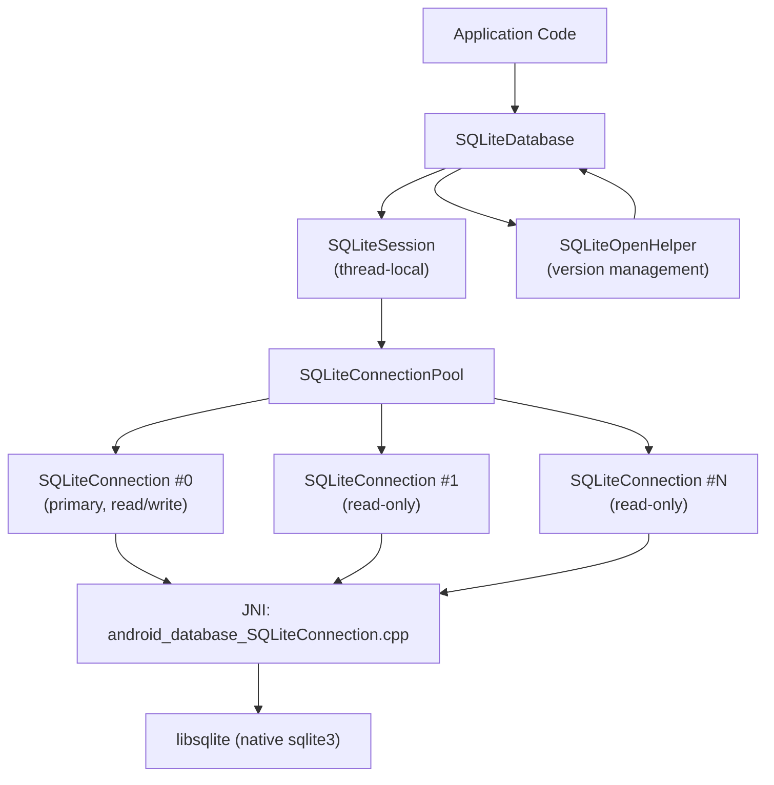

各层承担着不同的职责：

| 层 | 类 | 职责 |
|-------|-------|----------------|
| 面向用户的 API | `SQLiteDatabase` | 公共方法：`query()`、`insert()`、`execSQL()` |
| 会话管理 | `SQLiteSession` | 线程本地；获取/归还连接 |
| 连接池 | `SQLiteConnectionPool` | 管理原生连接池 |
| 连接 | `SQLiteConnection` | 封装单个原生 `sqlite3*` 句柄 |
| 版本辅助类 | `SQLiteOpenHelper` | 数据库创建、升级、降级 |
| 语句 | `SQLiteStatement` / `SQLiteQuery` | 预处理语句封装器 |

### 34.10.2 SQLiteDatabase 内部实现

`SQLiteDatabase` 是主要的入口点。其最重要的状态由单个 `mLock` 对象保护：

```java
// SQLiteDatabase.java, line 137
private final Object mLock = new Object();

// Thread-local sessions
private final ThreadLocal<SQLiteSession> mThreadSession = ThreadLocal
        .withInitial(this::createSession);

// Connection pool (null when closed)
private SQLiteConnectionPool mConnectionPoolLocked;
```

线程本地的 `SQLiteSession` 确保了每个线程都获得自己的数据库会话，而无需在调用方层面进行显式同步。

**打开标志**控制数据库的行为：

| 标志 | 值 | 效果 |
|------|-------|--------|
| `OPEN_READWRITE` | `0x00000000` | 读写访问（默认） |
| `OPEN_READONLY` | `0x00000001` | 只读访问 |
| `CREATE_IF_NECESSARY` | `0x10000000` | 若数据库文件缺失则创建 |
| `ENABLE_WRITE_AHEAD_LOGGING` | `0x20000000` | 在打开时启用 WAL |
| `NO_LOCALIZED_COLLATORS` | `0x00000010` | 跳过 LOCALIZED 排序规则 |
| `ENABLE_LEGACY_COMPATIBILITY_WAL` | `0x80000000` | 兼容旧版的 WAL 模式 |

**冲突解决**按操作指定：

| 常量 | 值 | 发生约束冲突时的行为 |
|----------|-------|----------------------------------|
| `CONFLICT_ROLLBACK` | 1 | 回滚整个事务 |
| `CONFLICT_ABORT` | 2 | 中止命令，保留之前的更改（默认） |
| `CONFLICT_FAIL` | 3 | 使命令失败，保留到目前为止的所有更改 |
| `CONFLICT_IGNORE` | 4 | 跳过冲突行，继续执行 |
| `CONFLICT_REPLACE` | 5 | 删除冲突行，然后插入/更新 |

### 34.10.3 预写式日志（WAL）

WAL 是 SQLite 在 Android 上最重要的性能特性。在没有 WAL 的情况下，读操作和写操作是互斥的——读会阻塞写，反之亦然。启用 WAL 后，多个读操作可以与单个写操作并发执行。

```java
// SQLiteDatabase.java, line 337-353
/**
 * The WAL journaling mode uses a write-ahead log instead of a rollback
 * journal to implement transactions. The WAL journaling mode is persistent;
 * after being set it stays in effect across multiple database connections
 * and after closing and reopening the database.
 */
public static final String JOURNAL_MODE_WAL = "WAL";
```

Android 支持六种日志模式：

| 模式 | 说明 | 使用场景 |
|------|-------------|----------|
| `WAL` | 预写式日志 | 大多数应用的默认模式（最佳并发性） |
| `PERSIST` | 覆盖日志头 | 底层存储优化 |
| `TRUNCATE` | 将日志截断为零 | 在某些文件系统上比 DELETE 更快 |
| `MEMORY` | 内存中的日志 | 最高速度，存在损坏风险 |
| `DELETE` | 提交后删除日志 | 传统模式 |
| `OFF` | 无日志 | 最高风险，最高速度 |

**兼容 WAL** 是 Android 为那些从未显式设置日志或同步模式的数据库开启 WAL 日志记录的方式。它使用一个可配置的同步模式（`SQLiteCompatibilityWalFlags.getWALSyncMode()`，默认为 `NORMAL`）。两个全局资源对磁盘开销进行了限制。`db_journal_size_limit` 将日志/WAL 上限设为 512KB。`db_wal_autocheckpoint` 每 100 页对 WAL 进行一次检查点——而不是在每次事务之后。这既提供了 WAL 的并发优势，又限制了磁盘空间开销，因此可以安全地作为默认设置。

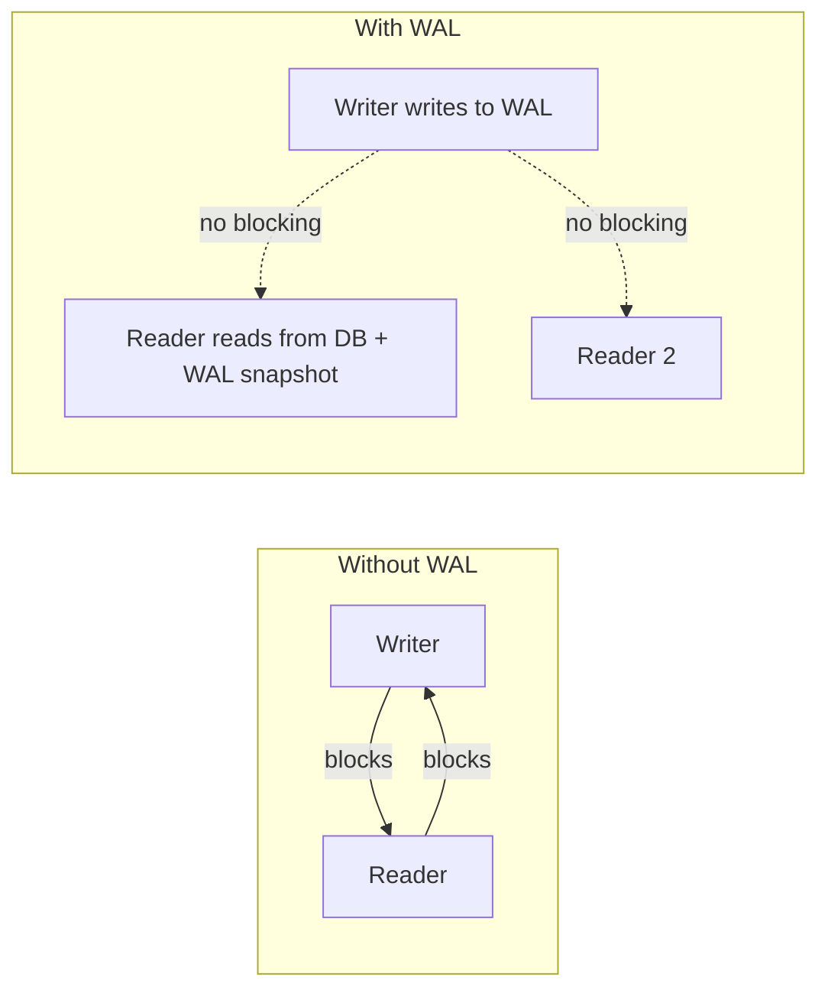

### 34.10.4 连接池

`SQLiteConnectionPool` 管理原生连接的池。该池有一个主（读写）连接和多个次级（只读）连接：

```java
// SQLiteConnectionPool.java, line 84-110
public final class SQLiteConnectionPool implements Closeable {
    private static final long CONNECTION_POOL_BUSY_MILLIS = 30 * 1000; // 30 seconds

    private int mMaxConnectionPoolSize;
    private SQLiteConnection mAvailablePrimaryConnection;
    private final ArrayList<SQLiteConnection> mAvailableNonPrimaryConnections;
    private final WeakHashMap<SQLiteConnection, AcquiredConnectionStatus> mAcquiredConnections;
}
```

连接生命周期：

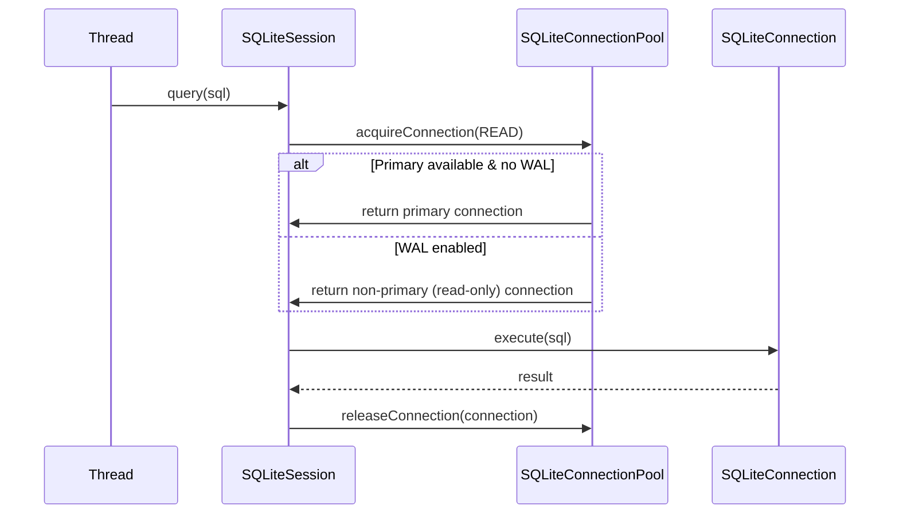

连接池通过 `WeakReference` 跟踪已获取的连接。如果某个连接发生泄漏（获取它的 `SQLiteSession` 被垃圾回收），连接池会通过弱引用检测到这一点。连接池随后会回收该连接并记录一条警告日志。

空闲连接由 `IdleConnectionHandler` 管理，它可以在一段可配置的超时之后关闭连接。这降低了资源受限设备上的内存压力。

### 34.10.5 SQLiteOpenHelper

`SQLiteOpenHelper` 提供了数据库版本管理的标准模式。它将数据库的创建/打开推迟到首次使用时：

```java
// SQLiteOpenHelper.java, line 55-60
public abstract class SQLiteOpenHelper implements AutoCloseable {
    private static final ConcurrentHashMap<String, Object> sDbLock =
            new ConcurrentHashMap<>();

    // Database is NOT opened in constructor -- only on first
    // getWritableDatabase() or getReadableDatabase()
}
```

**每个数据库文件一个锁。** `sDbLock` 这个 `ConcurrentHashMap` 确保在任何时刻只有一个线程可以打开/创建/升级给定的数据库文件。同一数据库文件的所有 `SQLiteOpenHelper` 实例共享同一个锁对象：

```java
// SQLiteOpenHelper.java, line 180-186
if (mName == null) {
    lock = new Object();          // In-memory DB gets unique lock
} else {
    lock = sDbLock.computeIfAbsent(mName, (String k) -> new Object());
}
mLock = lock;
```

升级生命周期：

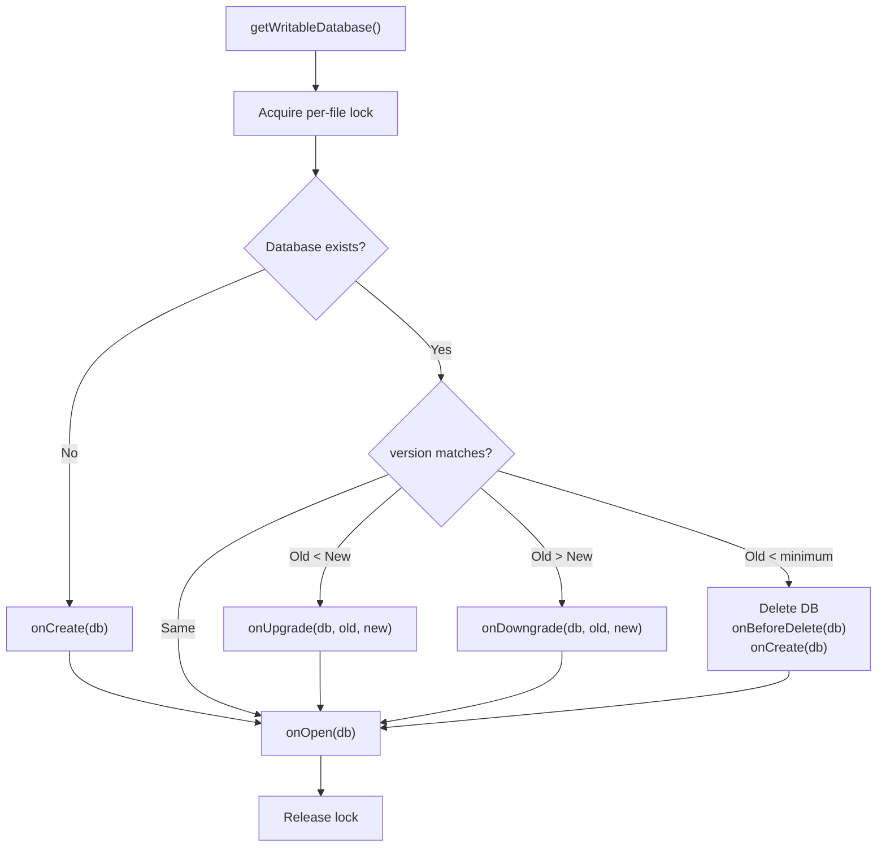

### 34.10.6 预处理语句缓存

每个 `SQLiteConnection` 都维护一个预处理语句的 LRU 缓存。默认缓存大小为 25 条语句，最多可配置到 `MAX_SQL_CACHE_SIZE`（100）：

```java
// SQLiteDatabase.java, line 319
public static final int MAX_SQL_CACHE_SIZE = 100;
```

每条预处理语句根据 SQL 的复杂程度会消耗 1KB-6KB。该缓存避免了重新解析和重新编译常用 SQL 的开销。当架构发生变化时（通过序列号检测到），缓存的语句会被作废。

### 34.10.7 错误处理与损坏恢复

`SQLiteDatabase` 提供了一个 `DatabaseErrorHandler` 回调，用于处理损坏事件。默认的处理程序（`DefaultDatabaseErrorHandler`）会删除数据库文件及所有关联文件（日志、WAL、共享内存）：

```
my-database.db       <-- main database file
my-database.db-wal   <-- WAL file
my-database.db-shm   <-- shared memory for WAL
my-database.db-journal  <-- rollback journal
```

该损坏事件还会以标签 `EVENT_DB_CORRUPT`（75004）记录到 `EventLog` 中，以便调试。

---

## 34.11 SharedPreferences

`SharedPreferences` 是 Android 最简单的持久化机制：一个由磁盘上的 XML 文件支撑的键值存储。尽管它表面上很简单，AOSP 实现（`SharedPreferencesImpl`）却涉及细致的并发控制、原子文件写入、内存代次跟踪，以及历史上饱受争议的 `apply()` 与 `commit()` 语义。

> **源文件：**
> `frameworks/base/core/java/android/app/SharedPreferencesImpl.java`

### 34.11.1 架构

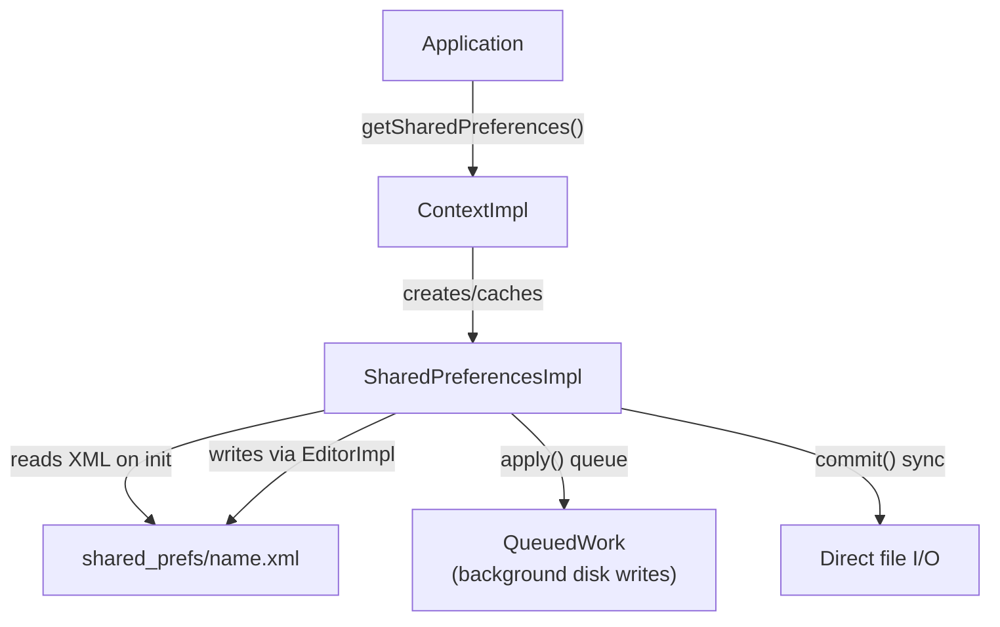

### 34.11.2 内存中的状态

所有偏好数据在首次访问时都会被加载到内存中的一个 `HashMap` 中：

```java
// SharedPreferencesImpl.java, line 64-125
final class SharedPreferencesImpl implements SharedPreferences {
    private final File mFile;
    private final File mBackupFile;
    private final Object mLock = new Object();
    private final Object mWritingToDiskLock = new Object();

    @GuardedBy("mLock")
    private Map<String, Object> mMap;

    @GuardedBy("mLock")
    private int mDiskWritesInFlight = 0;

    @GuardedBy("mLock")
    private boolean mLoaded = false;
}
```

从磁盘加载在一个专用的 `ThreadPoolExecutor` 上异步进行：

```java
// SharedPreferencesImpl.java, line 127-129
private static final ThreadPoolExecutor sLoadExecutor = new ThreadPoolExecutor(
        0, 1, 10L, TimeUnit.SECONDS, new LinkedBlockingQueue<Runnable>(),
        new SharedPreferencesThreadFactory());
```

所有的 `get*()` 方法都会调用 `awaitLoadedLocked()`，它会阻塞调用线程直到加载完成：

```java
// SharedPreferencesImpl.java, line 278-294
private void awaitLoadedLocked() {
    while (!mLoaded) {
        try {
            mLock.wait();    // blocks until loadFromDisk() calls notifyAll()
        } catch (InterruptedException unused) { }
    }
    if (mThrowable != null) {
        throw new IllegalStateException(mThrowable);
    }
}
```

### 34.11.3 EditorImpl：commit() 与 apply() 的对比

`EditorImpl` 在一个单独的 `mModified` HashMap 中累积更改：

```java
// SharedPreferencesImpl.java, line 413-420
public final class EditorImpl implements Editor {
    private final Object mEditorLock = new Object();
    @GuardedBy("mEditorLock")
    private final Map<String, Object> mModified = new HashMap<>();
    @GuardedBy("mEditorLock")
    private boolean mClear = false;
}
```

**锁顺序**至关重要，并且在源码中有文档说明：

> 先获取 `SharedPreferencesImpl.mLock`，再获取 `EditorImpl.mEditorLock`。
> 先获取 `mWritingToDiskLock`，再获取 `EditorImpl.mEditorLock`。

`commit()` 和 `apply()` 都会先调用 `commitToMemory()`，后者在同时持有这两个锁的情况下，把编辑器的更改合并到内存中的 `mMap`：

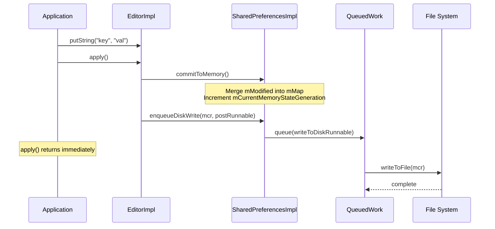

**`commit()`** 在调用线程上同步写入（阻塞）：

```java
// SharedPreferencesImpl.java, line 602-627
public boolean commit() {
    MemoryCommitResult mcr = commitToMemory();
    SharedPreferencesImpl.this.enqueueDiskWrite(
        mcr, null /* sync write on this thread okay */);
    mcr.writtenToDiskLatch.await();  // blocks until disk write completes
    return mcr.writeToDiskResult;
}
```

**`apply()`** 通过 `QueuedWork` 异步写入：

```java
// SharedPreferencesImpl.java, line 483-519
public void apply() {
    final MemoryCommitResult mcr = commitToMemory();
    QueuedWork.addFinisher(awaitCommit);    // register for Activity lifecycle
    SharedPreferencesImpl.this.enqueueDiskWrite(mcr, postWriteRunnable);
    notifyListeners(mcr);  // notify before disk write!
}
```

关键区别在于：`apply()` 会立即通知监听器（因为内存中的状态已经更新），并把磁盘写入排入队列。然而，`QueuedWork` 的 finisher 会在 `Activity.onStop()` 和 `Service.onStartCommand()` 期间被排空。这意味着待处理的 `apply()` 写入可能会在生命周期切换期间**阻塞主线程**。这是臭名昭著的 ANR 来源。

### 34.11.4 原子文件写入协议

写入磁盘的过程实现了一个原子重命名协议：

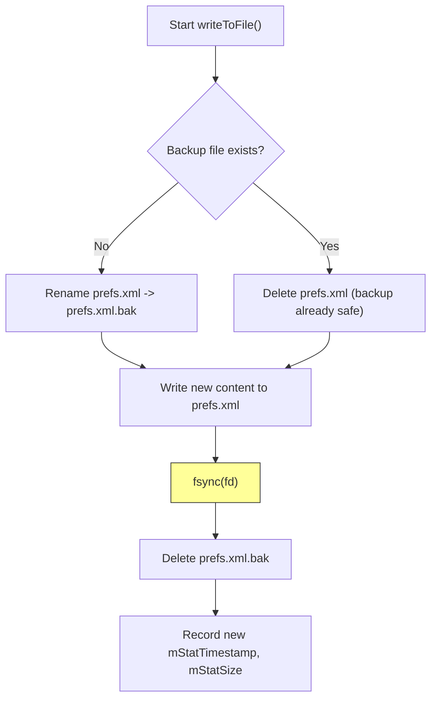

如果进程在步骤 C/D 与 G 之间崩溃，恢复会很简单。在下一次 `loadFromDisk()` 调用时，如果 `mBackupFile.exists()`，备份会被重命名回原文件：

```java
// SharedPreferencesImpl.java, line 153-161
private void loadFromDisk() {
    synchronized (mLock) {
        if (mBackupFile.exists()) {
            mFile.delete();
            mBackupFile.renameTo(mFile);
        }
    }
    // ... proceed to read mFile
}
```

### 34.11.5 基于代次的写入合并

该实现使用一个代次计数器来避免不必要的磁盘写入：

```java
// SharedPreferencesImpl.java, line 114-120
@GuardedBy("this")
private long mCurrentMemoryStateGeneration;

@GuardedBy("mWritingToDiskLock")
private long mDiskStateGeneration;
```

当 `apply()` 被快速多次调用时，每次调用都会递增 `mCurrentMemoryStateGeneration`。在 `writeToFile()` 中，如果正在写入的内存代次不是最新的，写入就会被跳过：

```java
// SharedPreferencesImpl.java, line 760-771
if (mDiskStateGeneration < mcr.memoryStateGeneration) {
    if (isFromSyncCommit) {
        needsWrite = true;
    } else {
        synchronized (mLock) {
            if (mCurrentMemoryStateGeneration == mcr.memoryStateGeneration) {
                needsWrite = true; // Only write the latest state
            }
        }
    }
}
```

这意味着三次快速的 `apply()` 调用最多只会产生一次包含全部三次更改的磁盘写入——这是一项显著的 I/O 优化。

### 34.11.6 跨进程限制

SharedPreferences 从未为跨进程访问而设计。`MODE_MULTI_PROCESS`（在 API 23 中已弃用）试图通过在读取前检查文件时间戳来支持它：

```java
// SharedPreferencesImpl.java, line 237-261
private boolean hasFileChangedUnexpectedly() {
    synchronized (mLock) {
        if (mDiskWritesInFlight > 0) {
            return false; // We caused it
        }
    }
    final StructStat stat = Os.stat(mFile.getPath());
    synchronized (mLock) {
        return !stat.st_mtim.equals(mStatTimestamp) || mStatSize != stat.st_size;
    }
}
```

这种方法本质上存在竞争条件——两个进程可能同时写入，只有一次写入会存活。对于跨进程的键值存储，Android 推荐使用 `ContentProvider` 支撑的方案或 Jetpack `DataStore`。

### 34.11.7 迁移到 DataStore

Jetpack DataStore 是推荐的 SharedPreferences 继任者。关键的改进有：

| 特性 | SharedPreferences | DataStore（Preferences） |
|---------|-------------------|------------------------|
| 线程安全 | 部分安全（读取会阻塞在加载上） | 完全异步，使用协程 |
| `apply()` 的 ANR 风险 | 是（onStop 中排空 QueuedWork） | 否（完全非阻塞） |
| 跨进程 | 损坏（`MODE_MULTI_PROCESS`） | 不支持（使用 Proto DataStore） |
| 类型安全 | 运行时强制转换 | 编译期（Proto DataStore） |
| 错误处理 | 静默损坏 | 基于 Flow 的错误传播 |
| 迁移 | 不适用 | `SharedPreferencesMigration` 辅助类 |

尽管 DataStore 是推荐的路径，SharedPreferences 仍然被大量使用——无数应用和许多系统组件仍将配置以 SharedPreferences XML 文件的形式持久化在 `/data/data/<package>/shared_prefs/` 下。（`Settings.Secure` 和 `Settings.Global` 命名空间并不在其中：SettingsProvider 通过 `SettingsState` 将它们持久化到 `/data/system/users/<userId>/settings_{global,secure,system}.xml`。）

---

## 34.12 vold 工具函数

`system/vold/Utils.h` 头文件提供了一组丰富的工具函数，在整个 vold 代码库中被使用。理解这些函数对于浏览存储代码至关重要：

```cpp
// system/vold/Utils.h (key declarations)

// App data isolation property
static const char* kVoldAppDataIsolationEnabled =
    "persist.sys.vold_app_data_isolation_enabled";

// Legacy sdcardfs property
static const char* kExternalStorageSdcardfs =
    "external_storage.sdcardfs.enabled";

// Timeouts for untrusted filesystem operations
static constexpr std::chrono::seconds kUntrustedFsckSleepTime(45);
static constexpr std::chrono::seconds kUntrustedMountSleepTime(20);

// SELinux contexts for different operations
extern char* sBlkidContext;           // For blkid on trusted devices
extern char* sBlkidUntrustedContext;  // For blkid on untrusted devices
extern char* sFsckContext;            // For fsck on trusted devices
extern char* sFsckUntrustedContext;   // For fsck on untrusted devices

// Get FUSE mount path for a specific user
std::string GetFuseMountPathForUser(userid_t user_id,
    const std::string& relative_upper_path);

// Device node management
status_t CreateDeviceNode(const std::string& path, dev_t dev);
status_t DestroyDeviceNode(const std::string& path);

// ACL and quota management for app directories
status_t SetDefaultAcl(const std::string& path, mode_t mode,
    uid_t uid, gid_t gid, std::vector<gid_t> additionalGids);
int SetQuotaInherit(const std::string& path);
int SetQuotaProjectId(const std::string& path, long projectId);
int PrepareAppDirFromRoot(const std::string& path,
    const std::string& root, int appUid, bool fixupExisting);

// Mount operations
status_t PrepareDir(const std::string& path, mode_t mode,
    uid_t uid, gid_t gid, unsigned int attrs = 0);
status_t ForceUnmount(const std::string& path);
status_t KillProcessesUsingPath(const std::string& path);
status_t BindMount(const std::string& source,
    const std::string& target);
status_t Symlink(const std::string& target,
    const std::string& linkpath);
status_t Unlink(const std::string& linkpath);
status_t CreateDir(const std::string& dir, mode_t mode);
```

这些工具函数封装了底层的 POSIX 操作，并带有适当的错误处理、SELinux 上下文管理和日志记录。

---

## 34.13 检查点支持

Android 的存储子系统支持文件系统检查点，用于安全的 OTA 更新。检查点系统定义在 `system/vold/Checkpoint.h` 中，它确保在 OTA 更新失败时可以回滚文件系统：

```cpp
// system/vold/Checkpoint.h
namespace android {
namespace vold {

android::binder::Status cp_supportsCheckpoint(bool& result);
android::binder::Status cp_supportsBlockCheckpoint(bool& result);
android::binder::Status cp_supportsFileCheckpoint(bool& result);

android::binder::Status cp_startCheckpoint(int retry);
android::binder::Status cp_commitChanges();
void cp_abortChanges(const std::string& message, bool retry);

bool cp_needsRollback();
bool cp_needsCheckpoint();
android::binder::Status cp_isCheckpointing(bool& result);

android::binder::Status cp_prepareCheckpoint();
android::binder::Status cp_restoreCheckpoint(
    const std::string& mountPoint, int count = 0);
android::binder::Status cp_markBootAttempt();

android::binder::Status cp_resetCheckpoint();
// ... cp_registerCheckpointListener() omitted
}  // namespace vold
}  // namespace android
```

Android 17 收紧了围绕这一状态的并发模型。`cp_isCheckpointing()` 返回一个 `binder::Status`。底层的 `isCheckpointing` 标志现在是 `GUARDED_BY(isCheckpointingLock)`，并带有 Clang 线程安全注解。这些注解让编译器强制要求调用者在读取该标志之前持有锁（`system/vold/Checkpoint.cpp`）。

同一版本还在 `vold.udc.enable_checkpoint.latency.ms` 系统属性中记录了提交时的重新挂载所花费的时间。当 `cp_commitChanges()` 结束检查点窗口时，它会用原始选项加上 `,discard,checkpoint=enable` 重新挂载每个 f2fs userdata 挂载点。这重新启用了正常的 f2fs 检查点。该提交还会对该重新挂载计时。

支持两种检查点机制：

1. **块级检查点** -- 使用 device-mapper 快照来跟踪块级更改。如果需要回滚，则丢弃该快照。

2. **文件级检查点** -- 使用 f2fs 原生检查点支持。f2fs 文件系统内置了对原子操作的支持，这些操作可以被提交或回滚。

OTA 更新期间的检查点流程：

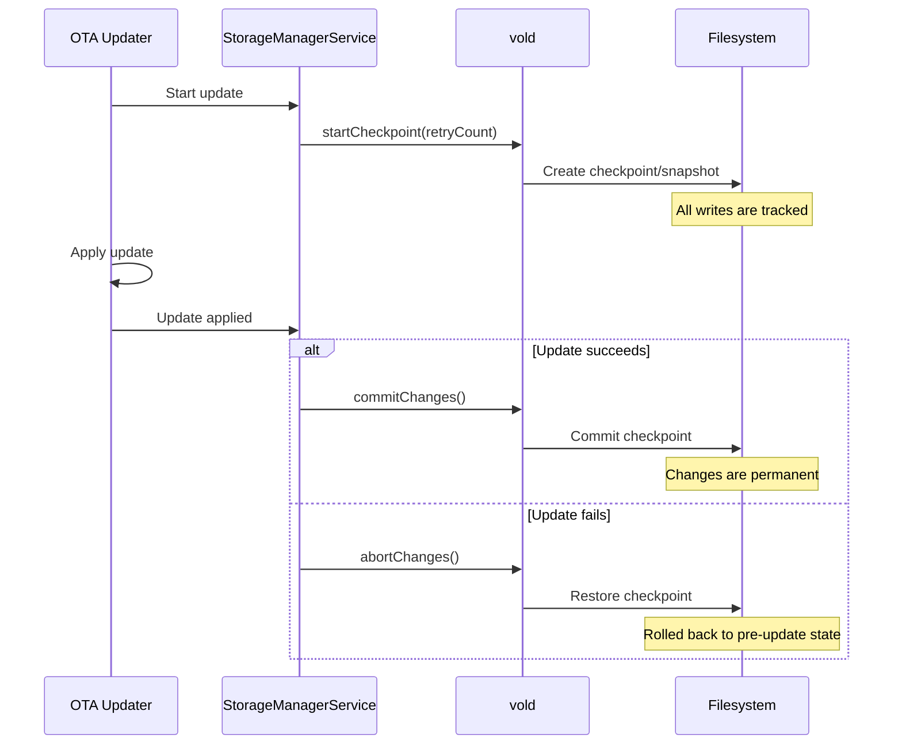

---

## 34.14 密钥生成与存储

### 34.14.1 KeyGeneration 结构体

`system/vold/KeyUtil.h` 中的 `KeyGeneration` 结构体控制加密密钥的生成方式：

```cpp
// system/vold/KeyUtil.h (lines 33-37)
struct KeyGeneration {
    size_t keysize;                       // Key size in bytes
    bool allow_gen;                       // Whether key generation is permitted
    android::fscrypt::KeyType key_type;   // Raw vs hardware-wrapped key
};

// Generate a storage key per the spec
bool generateStorageKey(const KeyGeneration& gen, KeyBuffer* key);

// Sentinel: returns a KeyGeneration that disallows generation
const KeyGeneration neverGen();

// Install a key to the kernel for fscrypt use
bool installKey(const std::string& mountpoint,
    const android::fscrypt::EncryptionOptions& options,
    const KeyBuffer& key,
    android::fscrypt::EncryptionPolicy* policy);

// Evict a key from the kernel
bool evictKey(const std::string& mountpoint,
    const android::fscrypt::EncryptionPolicy& policy);

// Retrieve an existing key or generate a new one
bool retrieveOrGenerateKey(const std::string& key_path,
    const std::string& tmp_path,
    const KeyAuthentication& key_authentication,
    const KeyGeneration& gen,
    KeyBuffer* key);
```

### 34.14.2 密钥身份验证

`KeyAuthentication` 类决定了密钥在解密时是否需要 Keystore 的交互：

```cpp
// system/vold/KeyStorage.h (lines 30-37)
class KeyAuthentication {
  public:
    KeyAuthentication(const std::string& s) : secret{s} {};

    // If secret is empty, uses Keystore for key protection
    bool usesKeystore() const { return secret.empty(); };

    const std::string secret;
};

extern const KeyAuthentication kEmptyAuthentication;
```

`kEmptyAuthentication` 常量用于那些由 Android Keystore（硬件支撑的密钥存储）而非用户机密来保护的密钥。这是 DE 密钥和系统级密钥的典型情形。

CE 密钥使用用户的凭据（通过 KDF 派生）作为其身份验证机密。因此只有在用户输入其 PIN、密码或图案后，它们才能被解密。

### 34.14.3 密钥生命周期

一个加密密钥的完整生命周期遵循如下模式：

```mermaid
stateDiagram-v2
    [*] --> Generated: generateStorageKey
    Generated --> StoredOnDisk: storeKeyAtomically
    StoredOnDisk --> RetrievedFromDisk: retrieveKey
    RetrievedFromDisk --> InstalledInKernel: installKey
    InstalledInKernel --> Active: Files can be accessed
    Active --> Evicted: evictKey
    Evicted --> RetrievedFromDisk: User unlocks again
    Active --> Destroyed: destroyKey
    Destroyed --> [*]
```

具体到 CE 密钥：

1. **生成**：当创建一个用户时，会生成一个随机的 CE 密钥
2. **存储**：该密钥使用用户的凭据加密，并存储在 `/data/misc/vold/user_keys/ce/<user_id>/current/` 中
3. **解锁**：当用户进行身份验证时，框架会把凭据派生的机密提供给 vold，由 vold 解密 CE 密钥
4. **安装**：解密后的密钥被安装到内核针对 `/data` 挂载点的 fscrypt 密钥环中
5. **活跃使用**：CE 加密目录中的所有文件都可以被读取/写入
6. **锁定**：当用户锁定设备时（如果启用了锁屏触发的锁定），该密钥会从内核中驱逐
7. **销毁**：当一个用户被移除时，该密钥会被安全销毁

### 34.14.4 Secdiscardable 文件

为了防御离线攻击，每个密钥目录都包含一个“secdiscardable”文件。这是一个填充了随机数据的大文件。密钥派生过程会包含该文件。如果该文件被安全删除（例如使用 `fstrim` 或 `BLKDISCARD`），即使获取了加密的密钥材料，该密钥也会永久无法恢复：

```cpp
// system/vold/KeyStorage.h (lines 41-42)
bool createSecdiscardable(const std::string& path, std::string* hash);
bool readSecdiscardable(const std::string& path, std::string* hash);
```

---

## 34.15 完整的存储启动流程

本节追踪设备启动期间完整的存储初始化过程，展示本章所述的所有组件如何协同工作。

### 34.15.1 早期启动（init 第一阶段）

```
1. Kernel starts, mounts initramfs
2. init first stage runs
3. init reads fstab from device tree or ramdisk
4. init mounts /metadata partition (needed for encryption keys)
5. init starts vold daemon
```

### 34.15.2 vold 初始化

```
6. vold::main() begins
7. VolumeManager::Instance() created (singleton)
8. NetlinkManager::Instance() created (singleton)
9. VolumeManager::start() called:
   a. unmountAll() -- clean slate
   b. Create EmulatedVolume for /data/media with user 0
   c. updateVirtualDisk() -- optional virtual disk
10. process_config() reads fstab:
    a. Check for quota, reserved, compress features
    b. Pre-create dm device for metadata encryption
    c. Register DiskSources for vold-managed entries
11. VoldNativeService::start() -- register Binder service
12. VendorVoldNativeService::try_start() -- vendor extension
13. NetlinkManager::start() -- listen for uevents
14. coldboot("/sys/block") -- replay uevent for existing devices
```

### 34.15.3 元数据加密与 /data 挂载

```
15. init calls vold.mountFstab() for /data
16. vold reads metadata encryption options from fstab
17. vold reads (or generates) metadata encryption key from /metadata
18. vold creates dm-default-key device for /data
19. vold mounts the encrypted /data partition
20. Property ro.crypto.metadata.enabled set to "true"
```

### 34.15.4 FBE 初始化（用户 0）

```
21. init calls vold.initUser0()
22. fscrypt_initialize_systemwide_keys():
    a. Read file encryption options from fstab
    b. Read (or generate) system-wide DE key
    c. Install DE key to kernel
23. fscrypt_init_user0():
    a. Create or read User 0 DE key
    b. Install User 0 DE key
    c. Prepare DE storage directories
    d. If device is LSKF-free, also unlock CE storage
```

### 34.15.5 框架启动

```
24. System server starts
25. StorageManagerService.Lifecycle.onStart():
    a. Create StorageManagerService
    b. Register as "mount" Binder service
    c. Connect to vold via IVold
    d. Set IVoldListener callback
26. StorageManagerService.servicesReady()
27. StorageManagerService.systemReady()
```

### 34.15.6 用户解锁

```
28. User enters PIN/password/pattern
29. LockSettingsService derives credential
30. StorageManagerService.unlockCeStorage(userId, secret)
31. vold.unlockCeStorage(userId, secret):
    a. Read CE key from disk
    b. Decrypt using provided secret
    c. Install CE key to kernel
32. mCeUnlockedUsers.append(userId)
33. CE directories become accessible
```

### 34.15.7 FUSE 会话启动

```
34. StorageManagerService detects CE unlock
35. Framework calls vold.mount() for emulated volume
36. EmulatedVolume::doMount():
    a. MountUserFuse() creates /dev/fuse and mounts at /mnt/user/<uid>
    b. IVoldMountCallback.onVolumeChecking() called
37. StorageSessionController starts ExternalStorageService session
38. ExternalStorageServiceImpl.onStartSession():
    a. Get MediaProvider instance
    b. Create FuseDaemon with FUSE device fd
    c. FuseDaemon.start() -- begins native FUSE loop
39. ExternalStorageServiceImpl.onVolumeStateChanged(MEDIA_MOUNTED):
    a. MediaProvider.attachVolume()
    b. MediaService.queueVolumeScan()
40. MediaScanner scans the newly mounted volume
41. Storage is fully operational for applications
```

```mermaid
graph TD
    subgraph "Boot Phase 1: Early Boot"
        A["init first stage"] --> B["Mount /metadata"]
        B --> C["Start vold"]
    end

    subgraph "Boot Phase 2: vold Init"
        C --> D["VolumeManager::start()"]
        D --> E["process_config()"]
        E --> F["VoldNativeService::start()"]
        F --> G["NetlinkManager::start()"]
        G --> H["coldboot()"]
    end

    subgraph "Boot Phase 3: /data Mount"
        H --> I["mountFstab(/data)"]
        I --> J["Metadata encryption setup"]
        J --> K["/data mounted"]
    end

    subgraph "Boot Phase 4: FBE"
        K --> L["fscrypt_init_user0()"]
        L --> M["DE keys installed"]
    end

    subgraph "Boot Phase 5: Framework"
        M --> N["StorageManagerService starts"]
        N --> O["Connect to vold"]
    end

    subgraph "Boot Phase 6: User Unlock"
        O --> P["User enters credential"]
        P --> Q["CE key unlocked"]
        Q --> R["FUSE session started"]
        R --> S["Media scan triggered"]
        S --> T["Storage fully operational"]
    end

    style J fill:#c62828,stroke:#333,color:#fff
    style Q fill:#1565c0,stroke:#333,color:#fff
    style R fill:#ff9800,stroke:#333
    style T fill:#4caf50,stroke:#333
```

---

## 34.16 存储相关的系统属性

以下系统属性控制 Android 设备上的存储行为：

| 属性 | 说明 | 典型值 |
|----------|-------------|---------------|
| `ro.crypto.state` | 当前加密状态 | `encrypted` |
| `ro.crypto.type` | 加密类型 | `file`（FBE） |
| `ro.crypto.metadata.enabled` | 元数据加密已启用 | `true` |
| `ro.crypto.volume.metadata.method` | 卷加密方法 | `default` |
| `ro.crypto.volume.contents_mode` | 卷内容加密模式 |（空 = 默认 XTS） |
| `ro.crypto.volume.filenames_mode` | 卷文件名加密模式 |（空 = 默认 CTS） |
| `ro.crypto.volume.options` | 组合的卷加密选项 | |
| `ro.crypto.dm_default_key.options_format.version` | dm-default-key 格式版本 | `2` |
| `vold.has_adoptable` | 设备支持 adoptable 存储 | `0` 或 `1` |
| `vold.has_quota` | 已启用文件系统配额 | `0` 或 `1` |
| `vold.has_reserved` | 已配置保留空间 | `0` 或 `1` |
| `vold.has_compress` | 已启用文件系统压缩 | `0` 或 `1` |
| `persist.sys.virtual_disk` | 启用虚拟磁盘（测试） | `false` |
| `persist.sys.vold_app_data_isolation_enabled` | 应用数据隔离 | `false` |
| `external_storage.sdcardfs.enabled` | 旧版 sdcardfs | `false` |
| `ro.fuse.bpf.enabled` | FUSE BPF 优化 | `true` |
| `ro.product.first_api_level` | 设备首次 API 级别 |（例如 `34`） |
| `persist.sys.zram_enabled` | 已启用 ZRAM | `1` |

---

## 34.17 用于存储的 Android ID 常量

存储操作使用大量 Android UID/GID 常量来进行权限管理：

| 常量 | 值 | 用途 |
|----------|-------|---------|
| `AID_ROOT` | 0 | Root 用户 |
| `AID_SYSTEM` | 1000 | 系统服务器 |
| `AID_MEDIA_RW` | 1023 | 媒体读/写组 |
| `AID_SDCARD_R` | 1028 | 外部存储读取 |
| `AID_SDCARD_RW` | 1015 | 外部存储读/写 |
| `AID_EXTERNAL_STORAGE` | 1077 | 外部存储守护进程 |
| `AID_EVERYBODY` | 9997 | 所有应用共享 |
| `AID_MEDIA_OBB` | 1059 | OBB 文件访问 |
| `AID_MEDIA_IMAGE` | 1057 | 图片文件访问 |
| `AID_MEDIA_VIDEO` | 1056 | 视频文件访问 |
| `AID_MEDIA_AUDIO` | 1055 | 音频文件访问 |

这些 GID 被权限强制执行系统所使用。当应用拥有某个特定的媒体权限时，它会被加入到相应的补充组中。FUSE 守护进程和（旧版的）sdcardfs 使用这些 GID 来控制文件访问。

---

## 34.18 存储调试技术

### 34.18.1 跟踪 FUSE 操作

启用 FUSE 跟踪以查看每一次文件系统操作：

```bash
# Enable verbose FUSE logging
adb shell setprop log.tag.FuseDaemonThread VERBOSE

# Watch FUSE operations
adb logcat -s FuseDaemonThread:V

# For native-level FUSE tracing (requires debug build)
adb shell setprop persist.sys.fuse.log 1
```

### 34.18.2 调试 vold

vold 通过系统属性和 logcat 提供丰富的调试功能：

```bash
# Enable vold debug mode
adb shell setprop vold.debug true

# Watch vold logs
adb logcat -s vold:* VolumeManager:* Disk:*

# Dump full vold state
adb shell dumpsys mount

# Check for encryption issues
adb logcat -s FsCrypt:* MetadataCrypt:* KeyStorage:*
```

### 34.18.3 分析存储性能

```bash
# Run vold's built-in benchmark (volume id from `sm list-volumes all`)
adb shell sm benchmark <volume_id>

# Monitor I/O patterns
adb shell cat /proc/diskstats

# Check f2fs GC status
adb shell cat /sys/fs/f2fs/*/gc_urgent

# Monitor write amplification
adb shell cat /sys/fs/f2fs/*/stat/written_kbytes

# Check fstrim status
adb logcat -s fstrim:*
```

### 34.18.4 检查挂载命名空间

Android 使用挂载命名空间来提供每个应用的存储视图：

```bash
# View mount namespaces for a process
adb shell ls -la /proc/<pid>/ns/mnt

# View mounts visible to a process
adb shell cat /proc/<pid>/mountinfo

# Compare mounts between processes
adb shell cat /proc/1/mountinfo > /tmp/init_mounts.txt
adb shell cat /proc/<app_pid>/mountinfo > /tmp/app_mounts.txt
diff /tmp/init_mounts.txt /tmp/app_mounts.txt
```

### 34.18.5 从存储问题中恢复

```bash
# Force unmount a volume (emergency) -- ids from `sm list-volumes all`;
# only `sm forget` accepts the literal "all"
adb shell sm unmount <volume_id>

# Re-run vold's volume discovery: restart the daemon (debug builds),
# or unmount/mount individual volumes
adb shell stop vold
adb shell start vold

# There is no property that forces an fsck on next boot: fs_mgr runs
# e2fsck/fsck.f2fs during fs_mgr_do_mount when the filesystem is marked
# dirty (system/fs/fs_mgr/fs_mgr.cpp)

# Clear media store cache (requires root)
adb root
adb shell rm /data/data/com.android.providers.media.module/databases/external.db
adb reboot
```

---

## 34.19 存储组件之间的相互作用

理解存储组件在常见操作期间如何交互，有助于开发者和系统工程师调试问题并优化性能。

### 34.19.1 文件写入流程（应用写入一张照片）

```mermaid
sequenceDiagram
    participant App
    participant FUSE as FUSE Daemon
    participant MP as MediaProvider
    participant FS as Lower Filesystem
    participant FBE as fscrypt

    App->>FUSE: write("/storage/emulated/0/DCIM/photo.jpg", data)
    FUSE->>MP: Check write permission
    MP->>MP: Verify app owns file or has permission
    MP-->>FUSE: Permission granted

    alt FUSE Passthrough Available
        FUSE->>FS: Direct passthrough write
        FS->>FBE: Encrypt file data
        FBE->>FS: Write encrypted blocks
    else No Passthrough
        FUSE->>FS: Write through FUSE handler
        FS->>FBE: Encrypt file data
        FBE->>FS: Write encrypted blocks
    end

    FUSE-->>App: Write complete

    Note over MP: Async: Trigger media scan
    MP->>MP: Extract EXIF metadata
    MP->>MP: Insert/update files table
    MP->>MP: Generate thumbnail
```

### 34.19.2 SD 卡插入流程

```mermaid
sequenceDiagram
    participant HW as Hardware
    participant Kernel
    participant NL as NetlinkHandler
    participant VM as VolumeManager
    participant Disk
    participant PV as PublicVolume
    participant SMS as StorageManagerService
    participant ESS as ExternalStorageService
    participant FD as FuseDaemon
    participant MP as MediaProvider

    HW->>Kernel: SD card inserted
    Kernel->>NL: uevent (block/add)
    NL->>VM: handleBlockEvent(add)
    VM->>VM: Match DiskSource pattern
    VM->>Disk: new Disk(eventPath, device)
    Disk->>Disk: create()
    Disk->>Disk: readMetadata()
    Note over Disk: Read vendor/manufacturer
    Disk->>Disk: readPartitions()
    Note over Disk: Run sgdisk --android-dump
    Disk->>PV: createPublicVolume(partDevice)
    PV->>PV: create()

    VM->>SMS: onVolumeCreated()
    SMS->>SMS: Add to mVolumes map

    SMS->>VM: mount(volId, flags, userId)
    PV->>PV: doMount()
    Note over PV: Check filesystem, mount raw, setup FUSE
    PV-->>SMS: Mount complete

    SMS->>ESS: onStartSession(sessionId, fd, paths)
    ESS->>FD: new FuseDaemon(...).start()
    Note over FD: Native FUSE loop begins

    ESS->>MP: onVolumeStateChanged(MOUNTED)
    MP->>MP: attachVolume()
    MP->>MP: queueVolumeScan()
    Note over MP: Media scanner indexes SD card content
```

### 34.19.3 用户资料创建

当创建一个新用户（例如工作资料）时，存储系统必须创建加密密钥并准备存储目录：

```
1. UserManagerService creates user
2. StorageManagerService's broadcast receiver handles ACTION_USER_ADDED
3. vold.onUserAdded(userId, userSerial, sharesStorageWithUserId)
   (the third argument is the profile group id for clone profiles, -1 otherwise)
4. fscrypt_create_user_keys(userId, ephemeral):
   a. Generate DE key, store on disk, install to kernel
   b. Generate CE key, store on disk (encrypted with default secret)
5. VolumeManager creates EmulatedVolume for new user
6. fscrypt_prepare_user_storage(uuid, userId, flags):
   a. Create /data/system_ce/<userId>/
   b. Create /data/system_de/<userId>/
   c. Create /data/misc_ce/<userId>/
   d. Create /data/misc_de/<userId>/
   e. Create /data/user/<userId>/
   f. Create /data/user_de/<userId>/
   g. Create /data/media/<userId>/
   h. Apply encryption policies to each directory
7. When user first unlocks:
   a. CE key decrypted and installed
   b. FUSE session started for the user
   c. Media scan triggered for user's storage
```

这一生命周期确保了每个用户的数据在密码学上与其他所有用户的数据相互隔离。即使用户共享同一物理存储介质，这一点也成立。

---

## 34.20 存储演进时间线

| Android 版本 | 关键的存储变更 |
|----------------|-------------------|
| 1.0-2.3 | FAT32 SD 卡，无加密 |
| 3.0 | 引入全磁盘加密（FDE）（可选） |
| 4.4 | 引入存储访问框架 |
| 5.0 | 新设备默认启用 FDE |
| 6.0 | Adoptable 存储，强制加密 |
| 7.0 | 引入基于文件的加密（FBE），Direct Boot |
| 8.0 | FUSE 中的 OBB，Treble 存储分离 |
| 9.0 | 面向以 Android 9+ 启动的新设备强制要求 FBE |
| 10 | 引入作用域存储（可选加入），元数据加密 |
| 11 | 强制执行作用域存储，FUSE 取代 sdcardfs |
| 12 | FUSE 直通，性能提升 |
| 13 | 照片选择器，按应用的媒体权限（READ_MEDIA_IMAGES 等） |
| 14 | READ_MEDIA_VISUAL_USER_SELECTED（部分媒体访问） |
| 15 | FUSE BPF，进一步的性能改进 |
| 16 | f2fs 使用内核页大小作为块大小；旧版 userdata 上的 project-quota 容忍 |
| 17 | `system/fs` 仓库拆分（fs_mgr/liblp/libdm 从 `system/core` 剥离）；通过 Rust 服务 `casefolding_remover` 对 `/data/media` 进行大小写折叠迁移；`KeyType` 枚举统一原始密钥与硬件包裹密钥的处理；`wrappedkey`（v2）元数据加密选项；`vold` 新增 `syncStorage()` 和 `setMaxLockElapsedTime()` |

这一时间线展示了从不受限制的文件系统访问，稳步迈向一种完全受中介、加密且保护隐私的存储架构。每一次重大变更都解决了一个真实世界中的安全或隐私问题，同时力求为现有应用保持向后兼容性。

---

## 34.21 深入剖析 —— VolumeManager 块事件处理

`VolumeManager::handleBlockEvent()` 方法是热插拔设备检测的核心。让我们准确追踪当插入一个 USB 驱动器时会发生什么。

### 34.21.1 Netlink 事件接收

内核通过 netlink 套接字发送一个 uevent。该事件包含若干键值对，包括：

```
ACTION=add
DEVPATH=/devices/platform/soc/xhci-hcd/usb1/1-1/1-1:1.0/host0/target0:0:0/0:0:0:0/block/sda
SUBSYSTEM=block
DEVTYPE=disk
MAJOR=8
MINOR=0
DEVNAME=sda
```

`NetlinkHandler` 接收此事件并检查子系统：

```cpp
// system/vold/NetlinkHandler.cpp
void NetlinkHandler::onEvent(NetlinkEvent* evt) {
    VolumeManager* vm = VolumeManager::Instance();
    const char* subsys = evt->getSubsystem();
    if (std::string(subsys) == "block") {
        vm->handleBlockEvent(evt);
    }
}
```

### 34.21.2 设备匹配

`handleBlockEvent()` 首先过滤掉分区事件（只关心 `DEVTYPE=disk` 的整块磁盘），然后把设备路径与已注册的 `DiskSource` 模式进行匹配：

```cpp
// system/vold/VolumeManager.cpp
if (devType != "disk") return;

for (const auto& source : mDiskSources) {
    if (source->matches(eventPath)) {
        // Determine if SD or USB based on major number
        int flags = source->getFlags();
        if (major == kMajorBlockMmc || IsVirtioBlkDevice(major)) {
            flags |= android::vold::Disk::Flags::kSd;
        } else {
            flags |= android::vold::Disk::Flags::kUsb;
        }
        auto disk = new android::vold::Disk(
            eventPath, device, source->getNickname(), flags);
        handleDiskAdded(std::shared_ptr<android::vold::Disk>(disk));
        break;
    }
}
```

`DiskSource` 模式来自标记为 `voldmanaged` 的 fstab 条目。该模式使用 `fnmatch()` 进行 glob 风格的匹配，因此像 `/devices/platform/*/usb*` 这样的模式会匹配任何 USB 设备。

### 34.21.3 安全闸门

在新检测到的磁盘被扫描之前，VolumeManager 会检查两个安全条件：

```cpp
// system/vold/VolumeManager.cpp
void VolumeManager::handleDiskAdded(
        const std::shared_ptr<android::vold::Disk>& disk) {
    bool userZeroStarted =
        mStartedUsers.find(0) != mStartedUsers.end();

    if (mSecureKeyguardShowing) {
        LOG(INFO) << "Found disk at " << disk->getEventPath()
                  << " but delaying scan due to secure keyguard";
        mPendingDisks.push_back(disk);
    } else if (!userZeroStarted) {
        LOG(INFO) << "Found disk at " << disk->getEventPath()
                  << " but delaying scan due to user zero "
                  << "not having started";
        mPendingDisks.push_back(disk);
    } else {
        // Safe to scan now
        disk->create();
        mDisks.push_back(disk);
    }
}
```

这防止了恶意 USB 设备在设备被锁定时被处理。一旦用户解锁设备，`createPendingDisksIfNeeded()` 会处理任何排队的磁盘。

### 34.21.4 磁盘元数据读取

`Disk::readMetadata()` 方法从 sysfs 读取设备信息，以确定制造商和标签：

```cpp
// system/vold/model/Disk.cpp
status_t Disk::readMetadata() {
    unsigned int majorId = major(mDevice);
    switch (majorId) {
        case kMajorBlockLoop:
            mLabel = "Virtual";
            break;
        case kMajorBlockScsiA: ... case kMajorBlockScsiP: {
            // Read vendor from sysfs
            std::string path(mSysPath + "/device/vendor");
            ReadFileToString(path, &tmp);
            mLabel = android::base::Trim(tmp);
            break;
        }
        case kMajorBlockMmc: {
            // Read manufacturer ID for SD cards
            std::string path(mSysPath + "/device/manfid");
            // Map to known manufacturer names
            switch (manfid) {
                case 0x000003: mLabel = "SanDisk"; break;
                case 0x00001b: mLabel = "Samsung"; break;
                case 0x000028: mLabel = "Lexar"; break;
                case 0x000074: mLabel = "Transcend"; break;
            }
            break;
        }
    }
    // Notify the framework
    auto listener = VolumeManager::Instance()->getListener();
    if (listener)
        listener->onDiskMetadataChanged(getId(), mSize, mLabel, mSysPath);
}
```

这种制造商检测在设置 UI 中提供了一个用户友好的标签，帮助用户识别他们正在管理哪张物理卡。

### 34.21.5 分区表解析

读取元数据后，`readPartitions()` 使用带 `--android-dump` 标志的 `sgdisk`，该标志产生一种机器可读的格式：

```
DISK mbr
PART 1 0c
```

或者对于 GPT：

```
DISK gpt
PART 1 EBD0A0A2-B9E5-4433-87C0-68B6B72699C7 A1B2C3D4-E5F6-...
```

Android 特有的 GUID 类型 `kGptAndroidMeta` 和 `kGptAndroidExpand` 用于识别由 adoptable 存储功能创建的分区。

### 34.21.6 卷创建

根据分区类型，会调用 `createPublicVolume()` 或 `createPrivateVolume()`：

- **公共卷**：对所有应用可访问（需权限），使用 FAT/exFAT 格式化，UUID 用作挂载路径的稳定名称。

- **私有卷**：加密，使用 ext4/f2fs 格式化，仅作为内部存储可访问。需要设备上存储的加密密钥存在。

---

## 34.22 深入剖析 —— MediaProvider 权限解析

### 34.22.1 FUSE 请求路径

当应用对 `/storage/emulated/0/` 执行文件系统操作时，请求会沿着这条详细路径：

1. **应用进程**：应用通过 libc 调用 `open()`、`read()`、`write()`、`stat()`、`readdir()` 等。

2. **内核 VFS**：VFS 层发现 `/storage/emulated/0/` 是一个 FUSE 挂载，并把请求路由到 FUSE 内核模块。

3. **FUSE 内核模块**：内核把请求打包成一个 FUSE 协议消息，并将其写入 `/dev/fuse` 设备。

4. **FuseDaemon（原生）**：MediaProvider JNI 层中的 `FuseDaemon.cpp` 代码从 `/dev/fuse` 读取 FUSE 请求并处理它。

5. **MediaProviderWrapper（JNI）**：对于需要权限检查的操作，原生代码通过 JNI 向上调用 `MediaProviderWrapper`，以查询 Java 的 `MediaProvider`。

6. **MediaProvider（Java）**：提供程序通过 `LocalCallingIdentity` 检查调用方应用的权限，并决定是否允许该操作。

7. **响应**：结果沿同一条路径流回：Java -> JNI -> 原生 FUSE 处理程序 -> `/dev/fuse` -> 内核 -> 应用。

### 34.22.2 权限类别

MediaProvider 中的 `AccessChecker` 类把调用方划分为几个访问层级：

```
Tier 1 - SELF: The MediaProvider process itself (uid matches)
   -> Full access to all files

Tier 2 - SHELL: ADB shell (uid == 2000)
   -> Full access (for debugging)

Tier 3 - MANAGER: Apps with MANAGE_EXTERNAL_STORAGE
   -> Access to all shared storage (except other apps' Android/data)

Tier 4 - SYSTEM_GALLERY: System gallery apps
   -> Read/write images and videos

Tier 5 - LEGACY: Apps with legacy storage granted
   -> Pre-scoped-storage behavior (broad access)

Tier 6 - MEDIA PERMISSIONS: Apps with specific media permissions
   -> READ_MEDIA_IMAGES: Can read images
   -> READ_MEDIA_VIDEO: Can read videos
   -> READ_MEDIA_AUDIO: Can read audio

Tier 7 - NO PERMISSIONS: Apps with no storage permissions
   -> Can only access their own app-specific directories
   -> Can access files they created via MediaStore
```

### 34.22.3 脱敏

当应用读取一个图像文件但缺少 `ACCESS_MEDIA_LOCATION` 权限时，FUSE 守护进程会对 EXIF GPS 数据进行实时脱敏。原生的 `RedactionInfo` 类（位于 `packages/providers/MediaProvider/jni/RedactionInfo.cpp`）维护需要被清零的字节范围：

```cpp
// packages/providers/MediaProvider/jni/RedactionInfo.cpp
// Redaction ranges are [offset, length] pairs that describe
// which portions of the file should be replaced with zeros
// during read operations.
```

这对应用是透明的——它照常读取文件，但位置数据在传输过程中已从 EXIF 头中被剥离。

### 34.22.4 转码

对于视频文件，FUSE 守护进程可以执行从 HEVC（H.265）到 AVC（H.264）的透明转码，以支持不支持 HEVC 的应用。转码的决定基于：

1. 应用在其清单中声明的媒体能力
2. 特定文件是否为 HEVC 格式
3. 文件路径是否匹配符合转码资格的目录

`FuseDaemon` 构造函数中的 `supportedTranscodingRelativePaths` 参数控制哪些目录有资格进行转码。

---

## 34.23 挂载命名空间架构

Android 使用 Linux 挂载命名空间为不同进程提供文件系统的不同视图。这对应用之间的存储隔离至关重要。

### 34.23.1 命名空间类型

```mermaid
graph TD
    subgraph "init namespace"
        A["/storage (empty)"]
        B["/mnt/user/0/emulated (FUSE)"]
        C["/data/media/0 (actual files)"]
    end

    subgraph "Zygote namespace"
        D["/storage/emulated/0 -> /mnt/user/0/emulated/0"]
    end

    subgraph "App A namespace (has READ_MEDIA_IMAGES)"
        E["/storage/emulated/0 (FUSE - filtered view)"]
        F["/storage/emulated/0/Android/data/com.app.a (direct)"]
    end

    subgraph "App B namespace (no permissions)"
        G["/storage/emulated/0 (FUSE - restricted view)"]
        H["/storage/emulated/0/Android/data/com.app.b (direct)"]
    end

    A --> D
    D --> E
    D --> G
    B --> E
    B --> G

    style E fill:#4caf50,stroke:#333
    style G fill:#f44336,stroke:#333
```

### 34.23.2 Zygote 派生与命名空间建立

当 Zygote 派生一个新的应用进程时，会发生以下挂载命名空间操作：

1. **克隆命名空间**：子进程获得 Zygote 挂载命名空间的一个副本
2. **绑定挂载存储**：`/mnt/user/<userId>/emulated/` 被绑定挂载到 `/storage/emulated/`
3. **应用特定目录**：应用的 `Android/data/<package>/` 目录获得一个直接（非 FUSE）的绑定挂载，以提升性能
4. **限制**：其他应用的 `Android/data/` 目录通过 tmpfs 挂载或其他隔离机制变得不可访问

这确保了：

- 所有经 FUSE 中介的访问都会经过 MediaProvider 的权限检查
- 应用特定目录绕过 FUSE 以提升性能
- 跨应用目录访问在挂载命名空间层面被阻止

### 34.23.3 REMOUNT_MODE 系统

`StorageManagerService` 通过重新挂载模式控制每个应用如何看到存储：

| 模式 | 说明 |
|------|-------------|
| `REMOUNT_MODE_NONE` (0) | 无外部存储访问 |
| `REMOUNT_MODE_DEFAULT` (1) | 标准的作用域存储访问 |
| `REMOUNT_MODE_INSTALLER` (2) | 额外的 OBB 写访问 |
| `REMOUNT_MODE_PASS_THROUGH` (3) | 直接的下层文件系统访问（仅限 MediaProvider） |
| `REMOUNT_MODE_ANDROID_WRITABLE` (4) | 对 `Android/` 的 data/obb 树的可写访问 |

MediaProvider 进程本身以 `REMOUNT_MODE_PASS_THROUGH` 运行，这意味着它可以不经过自己的 FUSE 守护进程而直接访问底层文件系统。这一点至关重要，因为 FUSE 守护进程运行在 MediaProvider 内部。如果 MediaProvider 自身的文件系统访问也必须经过它自己的 FUSE 守护进程，就会发生死锁。

---

## 34.24 错误处理与恢复

### 34.24.1 文件系统检查失败

当卷挂载期间文件系统检查失败时，vold 会把该卷报告为 `kUnmountable`：

```cpp
// PublicVolume::doMount()
if (mFsType == "vfat" && vfat::IsSupported()) {
    if (vfat::Check(mDevPath)) {
        LOG(ERROR) << getId() << " failed filesystem check";
        return -EIO;
    }
}
```

然后框架会向用户呈现格式化或弹出该卷的选项。

### 34.24.2 FUSE 守护进程崩溃

如果 FUSE 守护进程崩溃，所有待处理的文件系统操作都会向应用返回 `ENOTCONN`。恢复流程：

1. `vold` 检测到 FUSE 会话已结束
2. 调用 `ExternalStorageServiceImpl.onEndSession()`
3. 该卷被卸载并重新挂载
4. 启动一个新的 FUSE 会话
5. MediaProvider 重新扫描该卷

### 34.24.3 加密密钥丢失

如果 CE 加密密钥无法解密，该用户的 CE 存储将永久无法访问。一个例子是硬件强制限制的设备上密码尝试次数过多。系统通过以下方式处理：

1. 提供恢复出厂设置的选项
2. DE 存储保持可访问（Direct Boot 应用继续工作）
3. 可以生成一个新的 CE 密钥，但所有现有 CE 数据都会丢失

### 34.24.4 已采用存储的移除

当已采用的存储被意外移除时：

1. 该卷上安装的所有应用立即被终止
2. 这些应用在启动器中显示为“已停用”
3. 如果设备被重新插入，vold 会按分区 GUID 查找加密密钥并重新挂载该卷
4. 如果设备永久丢失，用户可以“忘记”它，这会删除加密密钥

### 34.24.5 OTA 检查点失败

如果 OTA 更新失败且检查点系统检测到损坏：

```cpp
// system/vold/Checkpoint.h
bool cp_needsRollback();
```

系统调用 `cp_restoreCheckpoint()` 以把文件系统恢复到其更新前的状态，并且设备重启进入上一个槽位。

---

## 34.25 性能考量

### 34.25.1 FUSE 开销

FUSE 架构为每一次文件系统操作增加了延迟，因为每次操作都需要：

1. 从应用到内核的一次上下文切换
2. 内核把请求打包成 FUSE 消息
3. 一次切换到 FUSE 守护进程进程的上下文切换
4. 处理（权限检查，可能的脱敏）
5. 一次切换回内核的上下文切换
6. 内核完成该操作

这一开销通过若干优化得到缓解：

- **FUSE 直通**：对于未脱敏的文件，内核在初始打开后会对后续 I/O 绕过守护进程
- **FUSE BPF**：挂接到 FUSE 的 BPF 程序直接在内核中处理常见的权限检查
- **绑定挂载**：应用特定目录（`Android/data/`、`Android/obb/`）通过对下层文件系统的绑定挂载完全绕过 FUSE
- **预读调优**：`ConfigureReadAheadForFuse()` 把 FUSE 挂载的预读设置为 256KB
- **脏页比例调优**：`ConfigureMaxDirtyRatioForFuse()` 把 max_ratio 设置为 40%（相比之下，不受信任的 FUSE 文件系统默认为 1%）

### 34.25.2 加密开销

在存储控制器内置了内联加密引擎（ICE）的现代设备上，可以以线路速率执行 AES-256-XTS 加密，且零 CPU 开销。对于不支持 ICE 的设备，Adiantum 密码提供了一个快速的软件替代方案：

```cpp
// system/vold/MetadataCrypt.cpp
constexpr CryptoType supported_crypto_types[] = {
    aes_256_xts, adiantum
};
```

带硬件加速的 AES-256-XTS 是首选方案。Adiantum 专为缺少 AES 指令的 ARM 处理器设备而设计，在提供相当安全性的同时具有更好的软件性能。

### 34.25.3 媒体扫描性能

`ModernMediaScanner` 实现为性能而设计：

- 增量扫描：只处理自上次扫描以来发生更改的文件
- 后台线程：扫描在后台线程上运行，以避免阻塞 UI
- 批量操作：数据库插入为提高效率而批量执行
- 脏目录跟踪：FUSE 守护进程在目录被修改时通知 MediaProvider，从而实现有针对性的重新扫描

### 34.25.4 f2fs 优化

对于在 userdata 分区上使用 f2fs 的设备，vold 管理若干 f2fs 特有的优化：

- **垃圾回收**：`runIdleMaint()` 在空闲期间触发 f2fs GC
- **fstrim**：周期性的 TRIM 操作释放未使用的块
- **压缩**：f2fs 透明压缩（LZO/LZ4）减少存储消耗
- **检查点**：f2fs 原生检查点支持实现高效的 OTA 回滚

---

## 34.26 Android 17 存储变更

Android 17 从三个方面重塑了存储子系统，这些方面的影响贯穿本章其余内容。首先，它把文件系统管理代码拆分到了一个新的顶级仓库中。其次，它增加了一个专门的服务，用于在不丢失数据的前提下迁移 `/data/media` 的大小写折叠状态。第三，它重构了 vold 描述原始密钥与硬件包裹密钥的方式。本节将这些变更以及较小的 vold API 新增内容汇总在一起。

### 34.26.1 system/fs 仓库拆分

在 Android 17 中，历史上位于 `system/core/fs_mgr` 之下的文件系统管理代码被剥离出来，进入了一个新的顶级仓库 `system/fs`。该新仓库包含两个子树：

- `system/fs/fs_mgr/` -- fstab 解析器和挂载逻辑（`fs_mgr.cpp`）。它还包含 `liblp`，即 34.1.2 中引入的 `super` 分区元数据库。它也包含 `libdm`，即元数据加密和 adoptable 存储所使用的 device-mapper 封装器。`adb remount` 所使用的 overlayfs 控制代码也在那里。
- `system/fs/casefolding_remover/` -- 一个全新的服务，详见下文。

对本章而言，这意味着任何对 `liblp`、`libdm` 或 `fs_mgr.cpp` 的引用现在都解析到 `system/fs/fs_mgr/` 之下，而不是 `system/core/fs_mgr/`。代码本身大体相同；这一迁移是一次项目重组，构建模块（`libfs_mgr`、`liblp`、`libdm`）保持其名称不变。

### 34.26.2 大小写折叠与 /data/media 必须迁移的原因

大小写折叠让目录能够在文件系统层以大小写不敏感的方式比较文件名。当设置了 `external_storage.casefold.enabled` 构建属性时，vold 会在模拟和已采用的介质存储上启用它。f2fs 路径会把 `-O casefold -C utf8` 传递给 `mkfs`。ext4 路径会添加 `casefold` 以及 `encoding=utf8`（`system/vold/fs/F2fs.cpp`、`system/vold/fs/Ext4.cpp`）。该标志也会通过 `FS_CASEFOLD_FL` 应用于已采用私有卷上的 `/data/media` 树（`system/vold/model/PrivateVolume.cpp`）。

复杂之处在于，大小写折叠标志（`FS_CASEFOLD_FL`）只能设置在**空**目录上。`/data/media` 在启动早期被创建，并且在首次启动后几乎从不为空。因此，在现有设备上翻转 `external_storage.casefold.enabled` 的决定时，无法简单地为现有目录重新设置标志。例如，这适用于跨 OTA 的情况，或通过 `persist.sys.casefold.enabled.override` 属性进行的情况。目录内容必须被移动到一个新建的、正确设置了标志的目录中。这一迁移正是新的 `casefolding_remover` 服务所执行的。

### 34.26.3 casefolding_remover 服务

`casefolding_remover` 是一个位于 `system/fs/casefolding_remover/` 中的新的 Rust `init` 服务。其构建模块声明于 `system/fs/casefolding_remover/Android.bp`（一个名为 `casefolding_remover` 的 `rust_binary`，外加一个 `aidl_interface` 和一个 `cc_library_static`），并通过 `system/fs/casefolding_remover/casefolding_remover.rc` 接入 init：

```
service casefolding_remover /system/bin/casefolding_remover
    user media_rw
    group media_rw
    capabilities DAC_OVERRIDE CHOWN
    class core
    oneshot
    disabled
```

它以 `media_rw`（`/data/media` 的所有者）身份运行。它持有 `DAC_OVERRIDE` 和 `CHOWN`，因此可以重新标记它所移动的目录。它是 `disabled` 的，因此 init 会显式地启动它，而不是在类启动时启动。

迁移逻辑位于 `system/fs/casefolding_remover/src/main.rs` 中。当服务启动时，`adjust_casefolding()` 会比较两个值。第一个是 `/data/media` 上实际的 `FS_CASEFOLD_FL`（通过 `FS_IOC_GETFLAGS` ioctl 读取）。第二个是来自 `external_storage.casefold.enabled` 以及 `persist.sys.casefold.enabled.override` 覆盖的期望状态。

如果二者已经匹配，则无需执行任何操作。如果 `/data/media` 恰好为空，它会直接用 `FS_IOC_SETFLAGS` 设置该标志。否则，它会执行一次原子目录交换：

1. 创建 `/data/media/temp`。把 `/data/media` 的 SELinux 标签、所有者、组和模式复制到它上面（`copy_directory_metadata()`）。然后把它重命名到 `/data/media_temp`。在那个现在为空的目录上设置期望的大小写折叠标志。
2. 在 `ro.casefolding.original_folder` 属性中记录原始数据的最终位置——启用时为 `/data/media/uncasefolded`，禁用时为 `/data/media/casefolded`——并把 `persist.sys.casefolding.status` 设置为 `Enabling` 或 `Disabling`。
3. 把原始的 `/data/media` 重命名为 `/data/media_temp/<(un)casefolded>`，然后把 `/data/media_temp` 重命名回 `/data/media`。`main.rs` 中的注释警告，在这两次重命名之间不得有任何程序运行。如果第一次成功而第二次失败，设备将无法启动。

交换完成后，`/data/media` 拥有正确的 SELinux 标签、所有者/组和大小写折叠标志，而原始（错误折叠的）内容存活在 `/data/media/(un)casefolded` 之下。随后该服务设置 `ro.casefolding.adjusted=1`，以便 init 继续执行。当有迁移待处理时，它会注册一个 binder 服务并加入线程池，而不是退出。

该迁移由一个单方法 AIDL 接口描述，即 `system/fs/casefolding_remover/android/os/casefoldingremover/ICasefoldingRemover.aidl`：

```aidl
package android.os.casefoldingremover;

interface ICasefoldingRemover {
	void moveFolder(String source, String dest);
}
```

数据之所以被惰性地、一次一个子树地移动，原因在于加密。`/data/media/<user_id>` 之下的每用户目录是 CE 加密的，因此在安装用户的 CE 密钥之前，其内容无法被移动。因此，vold 会在密钥可用时驱动实际的移动。

### 34.26.4 vold 如何驱动迁移

vold 链接了 `libcasefoldingremover` C++ 存根（`system/vold/Android.bp`），并通过一个小型辅助函数从 `FsCrypt.cpp` 调用该服务：

```cpp
// system/vold/FsCrypt.cpp (lines 578-586)
static void remove_casefolding_from_folder(std::string const& folder, std::string const& leaf) {
    std::string original_folder = android::base::GetProperty("ro.casefolding.original_folder", "");
    if (original_folder.empty()) return;

    original_folder = StringPrintf("%s/%s", original_folder.c_str(), leaf.c_str());
    interface_cast<ICasefoldingRemover>(
            defaultServiceManager()->waitForService(String16("android.os.casefoldingremover")))
            ->moveFolder(String16(original_folder.c_str()), String16(folder.c_str()));
}
```

如果没有迁移待处理，该属性为空，调用即为空操作。否则 `original_folder` 指向 `/data/media/(un)casefolded`，而 `leaf` 选择要移动的子树。vold 会在两个位置调用该辅助函数：

- 在准备用户 0 的特殊目录时处理 `/data/media/obb`，leaf 为 `"obb"`（`FsCrypt.cpp` 第 636 行）。`/data/media/obb` 使用设备策略加密，因此一旦设备加密存储就绪，就可以被移动。
- 针对每个用户的 `/data/media/<user_id>` 目录，leaf 为 `StringPrintf("%u", user_id)`。该调用发生在 `fscrypt_prepare_user_storage()` 期间应用 CE 策略之后（`FsCrypt.cpp` 第 1039 行），也就是说，一旦用户的 CE 密钥已安装。

在服务端，`move_folder()` 会验证源位于 `ro.casefolding.original_folder` 之下，而目标位于 `/data/media` 之下。然后它使用 `link_recursively()` 硬链接整个子树，该函数按目录保留 SELinux 标签和所有权。最后，它删除源。

由于两个目录位于同一文件系统上，硬链接可以在不重新复制文件内容的情况下移动数据。随着原始树逐渐变空，它会被修剪；当最后一个子树消失时，`persist.sys.casefolding.status` 翻转为 `Enabled` 或 `Disabled`。如果递归链接失败，该服务会回退到对该子树执行普通的 `rename`。这保留了错误的大小写折叠标志，但保留了数据。随后该服务记录 `Enabling failed` / `Disabling failed`。

```mermaid
sequenceDiagram
    participant init
    participant CR as "casefolding_remover (Rust)"
    participant vold
    participant FS as "/data/media"

    init->>CR: start service (oneshot)
    CR->>FS: get FS_CASEFOLD_FL on /data/media
    Note over CR: compare with external_storage.casefold.enabled + override
    alt already matches
        CR->>init: set ro.casefolding.adjusted=1 (no-op)
    else needs migration
        CR->>FS: rename /data/media -> /data/media_temp/(un)casefolded
        CR->>FS: rename /data/media_temp -> /data/media (new flag)
        CR->>CR: set ro.casefolding.original_folder + persist.sys.casefolding.status
        CR->>init: set ro.casefolding.adjusted=1
        CR->>CR: register android.os.casefoldingremover, join thread pool
        Note over vold,FS: later, as keys install
        vold->>CR: moveFolder(original/obb, /data/media/obb)
        vold->>CR: moveFolder(original/user_id, /data/media/user_id)
        CR->>FS: link_recursively + prune original tree
        CR->>CR: persist.sys.casefolding.status = Enabled/Disabled
    end
```

### 34.26.5 KeyType 重构

Android 17 用一个单一的 `KeyType` 枚举取代了分散在 vold 中的各种 `bool use_hw_wrapped_key` 标志，该枚举定义在 `system/extras/libfscrypt/include/fscrypt/fscrypt.h` 中加密选项的旁边：

```cpp
// system/extras/libfscrypt/include/fscrypt/fscrypt.h (lines 32-47)
enum class KeyType {
    kRaw,
    kHwWrappedV0,
    kHwWrapped,
};

struct EncryptionOptions {
    int version;
    int contents_mode;
    int filenames_mode;
    int flags;
    KeyType key_type;
    bool dusize_4k;

    // Ensure that "version" is not valid on creation and so must be explicitly set
    EncryptionOptions() : version(0) {}
};
```

这个单一的枚举现在贯穿 `KeyGeneration`（34.14.1）、元数据加密的 `CryptoOptions`（34.8.9）以及基于文件的加密。该枚举现在可以表达两种不同的硬件包裹格式。`kHwWrappedV0` 对应最初的 `wrappedkey_v0` fstab 元数据加密标志。`kHwWrapped` 对应由 `MetadataCrypt.cpp` 解析的新的 `wrappedkey` 标志。两者目前都用 `wrappedkey_v0` 来编程 `dm-default-key` 目标，但类型的区分使平台能够独立演进这两种格式。

这一重构的另一个可见部分是 `prepareKeyForUse()`（34.8.10）。它把“保持原始密钥不变，重新包裹硬件包裹密钥”集中化了。调用者不再需要基于布尔值分支。

### 34.26.6 新的 vold Binder 方法

有两个方法被添加到 vold Binder 接口（`system/vold/binder/android/os/IVold.aidl`）中：

- `syncStorage()` -- 对全局 `sync()` 系统调用的一个薄封装，被暴露出来以便框架能够按需强制刷新存储。它在 `system/vold/VoldNativeService.cpp` 中的实现不获取锁，因为 `sync()` 是全局的。
- `setMaxLockElapsedTime(int maxTime)` -- 让框架可以设定用户密钥锁定操作可能耗时的上限，该上限通过 f2fs sysfs 节点 `max_lock_elapsed_time` 呈现。`StorageManagerService.configureFilesystem()` 从 `storage_native_boot` DeviceConfig 命名空间读取 `max_lock_elapsed_time` 值（默认为 `DEFAULT_MAX_LOCK_ELAPSED_TIME = 500`），并调用 `mVold.setMaxLockElapsedTime(maxTime)`（`frameworks/base/services/core/java/com/android/server/StorageManagerService.java`）。

vold 还把它的随机密钥生成切换为 BoringSSL 的 `RAND_bytes()`，而不是直接读取 `/dev/urandom`，将随机性集中到 `RandUtils.cpp` 中。

### 34.26.7 照片选择器的搜索与分类网格

MediaProvider 中的 Kotlin 照片选择器在 Android 17 中获得了两个浏览界面。搜索功能（`packages/providers/MediaProvider/photopicker/src/com/android/photopicker/features/search/`）查询一个设备端的媒体 AppSearch 索引，在 `packages/providers/MediaProvider/src/com/android/providers/media/appsearch/AppSearchDbManager.java` 中上限为 `MAX_DOCUMENT_COUNT = 50000` 个文档。

一个特权应用也可以通过实现 `SearchMediaService` SPI（`packages/providers/MediaProvider/apex/framework/java/android/provider/SearchMediaService.java`）来提供云结果。其 `onSearchMedia()` 回调返回一个 `SearchMediaResultPage`。该 SPI 通过 `BIND_SEARCH_MEDIA_SERVICE` 权限绑定。分类网格功能（`packages/providers/MediaProvider/photopicker/src/com/android/photopicker/features/categorygrid/`）按提供程序 authority 浏览相册和分类，因此它可以列出跨卷的媒体集合，包括 SD 卡。一个独立的 `PhotoPickerSelectionParams`（`packages/providers/MediaProvider/photopicker/framework/java/android/widget/photopicker/PhotoPickerSelectionParams.java`）让嵌入式选择器的调用者能够按文件大小、视频时长、分辨率和 MIME 类型限制选择。

---

## 34.27 动手实践

本节提供了用于动手探索 Android 存储子系统的实践练习。

### 练习 34.1：查看分区布局

通过 ADB 连接一台设备并查看其分区结构：

```bash
# List all block devices
adb shell ls -la /dev/block/by-name/

# Show the super partition layout
adb shell ls -la /dev/block/mapper/

# Examine the fstab
adb shell cat /vendor/etc/fstab.*

# Show mounted filesystems
adb shell mount | grep -E "^/dev"

# Check for dynamic partitions
adb shell getprop ro.boot.dynamic_partitions
```

### 练习 34.2：探索 vold 状态

查看正在运行的 vold 守护进程及其状态：

```bash
# Check vold properties
adb shell getprop | grep vold

# Dump vold state
adb shell dumpsys mount

# List all volumes
adb shell sm list-volumes all

# List all disks
adb shell sm list-disks all

# Check FBE status
adb shell getprop ro.crypto.state
adb shell getprop ro.crypto.type

# Check metadata encryption
adb shell getprop ro.crypto.metadata.enabled
```

### 练习 34.3：作用域存储下的存储权限

创建一个测试，观察作用域存储的行为：

```bash
# Check what an app sees in /storage/emulated/0/
adb shell run-as com.example.app ls /storage/emulated/0/

# Check the app-specific directory (always accessible)
adb shell run-as com.example.app ls /storage/emulated/0/Android/data/com.example.app/

# Check that other apps' data directories are not accessible
adb shell run-as com.example.app ls /storage/emulated/0/Android/data/com.other.app/
# Expected: Permission denied

# Query MediaStore from the command line
adb shell content query --uri content://media/external/images/media/ \
    --projection _id:_display_name:_size --sort "_id DESC" --limit 5
```

### 练习 34.4：观察 FUSE 的实际运行

监控 FUSE 操作：

```bash
# Check FUSE mounts
adb shell mount | grep fuse

# Check the FUSE daemon process
adb shell ps -A | grep -i media | grep fuse

# Watch FUSE mount/unmount events
adb logcat -s FuseDaemonThread:* ExternalStorageServiceImpl:*

# Check if FUSE passthrough is in use
adb logcat | grep -i "passthrough"

# Check FUSE BPF status
adb shell getprop ro.fuse.bpf.enabled
```

### 练习 34.5：理解 FBE 密钥生命周期

观察 FBE 密钥管理过程：

```bash
# Check CE/DE directory structure
adb shell ls -la /data/misc/vold/user_keys/

# Watch key operations during user unlock
adb logcat -s vold:* FsCrypt:*

# Check which users have CE storage unlocked
adb shell dumpsys mount | grep -A5 "CE unlocked"

# AOSP ships no CLI for reading fscrypt policies (system/extras only has
# the libfscrypt library); observe them indirectly via vold/FsCrypt logs
# and `dumpsys mount`, or sideload the upstream fscryptctl tool
```

### 练习 34.6：模拟 Adoptable 存储

在模拟器中使用虚拟磁盘功能：

```bash
# Enable virtual disk (emulator only)
adb shell setprop persist.sys.virtual_disk true

# Wait for the virtual disk to appear
adb shell sm list-disks all

# Partition as private (adoptable)
adb shell sm partition <disk_id> private

# Check the new volume
adb shell sm list-volumes all

# Migrate data to the adopted volume (a PackageManager command, not sm)
adb shell pm move-primary-storage <volume_uuid>

# Monitor the migration progress
adb logcat -s MoveStorage:*

# Forget the partition
adb shell sm forget <volume_uuid>
```

### 练习 34.7：查看 MediaProvider 数据库

探索 MediaStore 数据库：

```bash
# Connect to the external database
adb shell sqlite3 /data/data/com.android.providers.media.module/databases/external.db

# Inside sqlite3:
.tables
.schema files
SELECT _id, _data, _display_name, mime_type, media_type, owner_package_name
    FROM files ORDER BY _id DESC LIMIT 10;
SELECT volume_name, COUNT(*) FROM files GROUP BY volume_name;
.quit
```

### 练习 34.8：使用存储访问框架

从命令行测试 SAF：

```bash
# List document roots
adb shell content query --uri content://com.android.externalstorage.documents/root/

# Query a specific root's documents
adb shell content query \
    --uri content://com.android.providers.media.documents/root/images_root/ \
    --projection root_id:title:available_bytes

# Use am to trigger the document picker
adb shell am start -a android.intent.action.OPEN_DOCUMENT \
    -t "*/*" -c android.intent.category.OPENABLE
```

### 练习 34.9：监控存储健康

检查存储健康指标：

```bash
# Storage lifetime estimates are not exposed as an `sm` subcommand; the
# value is surfaced to StorageManagerService via the IVold.getStorageLifeTime()
# binder call

# Run a storage benchmark
adb shell sm benchmark <volume_id>

# Trigger fstrim manually
adb shell sm fstrim

# Check idle maintenance logs
adb logcat -s IdleMaint:*

# Check write amplification (f2fs)
adb shell cat /sys/fs/f2fs/*/stat/written_kbytes
adb shell cat /sys/fs/f2fs/*/segment_info
```

### 练习 34.10：构建和修改 vold

从源码构建 vold 并查看构建配置：

```bash
# Navigate to the vold source
cd $AOSP_ROOT/system/vold

# Examine the build file
cat Android.bp | head -50

# Build vold
cd $AOSP_ROOT
source build/envsetup.sh
lunch <target>
m vold

# Push the modified vold (requires root, for testing only)
adb root
adb remount
adb push $OUT/system/bin/vold /system/bin/vold
adb reboot
```

---

## 总结

Android 的存储子系统是一个深度分层的架构，它在十多年间不断演进，以平衡性能、安全性和隐私：

1. 通过动态分区和 `super` 分区进行的**分区管理**，提供了灵活、可更新的存储布局。

2. **vold** 作为底层原生守护进程，管理着存储设备的完整生命周期。它从通过 netlink 事件的热插拔检测，一路延伸到磁盘分区、文件系统格式化、FUSE 挂载以及加密密钥管理。

3. **StorageManagerService** 在原生 vold 守护进程与 Java 框架之间架起桥梁，维护内存中的卷模型，协调 CE/DE 密钥解锁，并管理 OBB 挂载。

4. **作用域存储**从根本上重构了应用对共享存储的访问，用经由 FUSE 守护进程强制执行的、由 MediaStore 中介的访问，取代了宽泛的文件系统权限。

5. **FUSE** 取代了内核级的 sdcardfs，以实现逐文件权限检查、内容脱敏和转码——并通过 FUSE 直通和 FUSE BPF 恢复了性能开销。

6. **MediaProvider** 同时充当媒体元数据的内容提供程序和 FUSE 守护进程的宿主进程。它在一个进程中集成了媒体扫描、访问控制和文件系统呈现。

7. **存储访问框架**提供了一个面向文档的抽象，允许应用在获得用户明确同意的情况下访问来自任何提供程序的文件。

8. **基于文件的加密**使用逐文件密钥保护用户数据。这实现了 Direct Boot 体验，即关键服务在用户身份验证之前就能运行。敏感数据在静态时保持加密。

9. **Adoptable 存储**通过透明的加密和相同的卷管理基础设施，将内部存储扩展到外部设备。

本章的关键源文件如下：

| 组件 | 路径 |
|-----------|------|
| vold 入口点 | `system/vold/main.cpp` |
| VolumeManager | `system/vold/VolumeManager.cpp` |
| 磁盘检测 | `system/vold/model/Disk.cpp` |
| 卷基类 | `system/vold/model/VolumeBase.h` |
| 公共卷 | `system/vold/model/PublicVolume.cpp` |
| 私有卷 | `system/vold/model/PrivateVolume.cpp` |
| 模拟卷 | `system/vold/model/EmulatedVolume.cpp` |
| 卷加密 | `system/vold/model/VolumeEncryption.cpp` |
| FBE 实现 | `system/vold/FsCrypt.cpp` |
| 元数据加密 | `system/vold/MetadataCrypt.cpp` |
| 密钥存储 | `system/vold/KeyStorage.cpp` |
| 数据迁移 | `system/vold/MoveStorage.cpp` |
| Binder API | `system/vold/VoldNativeService.h` |
| Netlink 处理程序 | `system/vold/NetlinkHandler.cpp` |
| StorageManagerService | `frameworks/base/services/core/java/com/android/server/StorageManagerService.java` |
| FuseDaemon（Java） | `packages/providers/MediaProvider/src/com/android/providers/media/fuse/FuseDaemon.java` |
| FuseDaemon（原生） | `packages/providers/MediaProvider/jni/FuseDaemon.h` |
| ExternalStorageService | `packages/providers/MediaProvider/src/com/android/providers/media/fuse/ExternalStorageServiceImpl.java` |
| MediaProvider | `packages/providers/MediaProvider/src/com/android/providers/media/MediaProvider.java` |
| MediaDocumentsProvider | `packages/providers/MediaProvider/src/com/android/providers/media/MediaDocumentsProvider.java` |
| MediaScanner 接口 | `packages/providers/MediaProvider/src/com/android/providers/media/scan/MediaScanner.java` |
| DatabaseHelper | `packages/providers/MediaProvider/src/com/android/providers/media/DatabaseHelper.java` |
