# 第 6 章：系统属性

Android 的系统属性是一个设备级的键值存储，提供了进程之间传递配置数据的主要机制。启动早期，init 会设置 `ro.build.fingerprint`。之后，Java 应用读取 `persist.sys.locale` 来确定用户的语言环境。系统属性存在于 Android 栈的每一层。它们小、快、且受控制：

- **小。** 键在历史上最多 32 字节。对于可变属性，值最多 91 字节，外加一个 NUL 终止符。`PROP_VALUE_MAX` 为 92，包含终止符。
- **快。** 读取不需要 IPC。一次读取只是一次共享内存查找。
- **受控。** Init 通过 Unix 域套接字中介写入。SELinux 强制执行这些控制。

尽管表面上看很简单，系统属性实际上由多个部分组成：共享内存区域、trie 数据结构、SELinux 强制访问控制、protobuf 序列化的持久化存储，以及构建时的类型系统。本章用真实的 AOSP 源代码剖析每一层。它从 `bionic/libc/system_properties/` 中的 bionic 实现讲起，接着介绍 `system/core/init/property_service.cpp` 中的属性服务，最后到达 `frameworks/base/core/java/android/os/SystemProperties.java` 中的 Java API 以及 Soong 构建系统的 `sysprop_library` 模块类型。

---

## 6.1 属性架构

### 6.1.1 设计目标与约束

系统属性机制在设计时就有几个塑造其架构的硬性约束：

1. **无锁读取。** 任何进程都必须能够在不获取锁或执行 IPC 的情况下读取任何属性。这一点至关重要，因为属性读取发生在热路径上。例如每一次 `getprop` 调用、每一次对构建特性的 Java 反射，以及每一个检查调试标志的原生守护进程。

2. **单一写入者。** 只有 init 进程（PID 1）可以修改包含属性数据的共享内存区域。所有其他进程必须通过 Unix 域套接字向 init 发送请求。

3. **SELinux 强制。** 读取和写入都由 SELinux 控制。属性命名空间被划分为多个 SELinux 上下文，进程必须拥有相应的 `property_service { set }` 或 `file { read }` 权限。

4. **启动时不可变。** 以 `ro.`（只读）为前缀的属性在启动期间只能设置一次，之后在设备生命周期内不可变。

5. **持久化。** 以 `persist.` 为前缀的属性通过以 protobuf 序列化文件的形式写入 `/data/property/persistent_properties` 来在重启后保留。

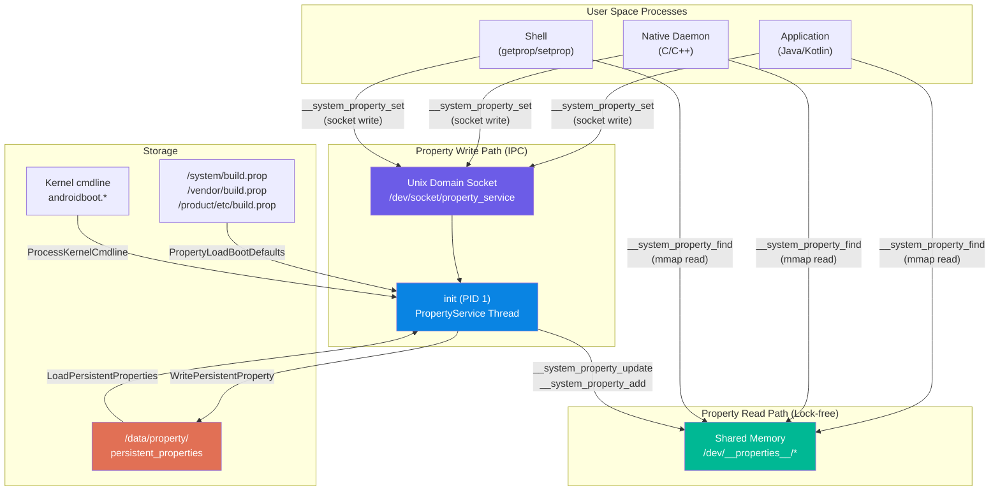

### 6.1.2 共享内存区域

系统属性机制的基础是一组位于 `/dev/__properties__/` 下的内存映射文件。该目录位于 `tmpfs` 文件系统上，意味着它完全驻留在 RAM 中。Init 在启动早期创建该目录：

```
// Source: system/core/init/property_service.cpp, PropertyInit()
void PropertyInit() {
    selinux_callback cb;
    cb.func_audit = PropertyAuditCallback;
    selinux_set_callback(SELINUX_CB_AUDIT, cb);

    mkdir("/dev/__properties__", S_IRWXU | S_IXGRP | S_IXOTH);
    CreateSerializedPropertyInfo();
    if (__system_property_area_init()) {
        LOG(FATAL) << "Failed to initialize property area";
    }
    if (!property_info_area.LoadDefaultPath()) {
        LOG(FATAL) << "Failed to load serialized property info file";
    }
    ...
}
```

函数 `__system_property_area_init()` 在 bionic 中实现，负责创建实际的内存映射文件。每个 SELinux 上下文在 `/dev/__properties__/` 下都有自己的文件，还有一个专门用于全局序列号的特殊文件。

每个属性区域的大小在 `bionic/libc/system_properties/prop_area.cpp` 中定义：

```c
// Source: bionic/libc/system_properties/prop_area.cpp
#ifdef LARGE_SYSTEM_PROPERTY_NODE
constexpr size_t PA_SIZE = 1024 * 1024;       // 1 MB
#else
constexpr size_t PA_SIZE = 128 * 1024;        // 128 KB
#endif
constexpr uint32_t PROP_AREA_MAGIC = 0x504f5250;  // "PROP" in little-endian
constexpr uint32_t PROP_AREA_VERSION = 0xfc6ed0ab;
```

每个属性区域文件都使用 `mmap()` 以 `MAP_SHARED` 方式创建，因此 init（写入者）和所有其他进程（读取者）看到的是相同的物理页：

```c
// Source: bionic/libc/system_properties/prop_area.cpp
prop_area* prop_area::map_prop_area_rw(const char* filename, const char* context,
                                       bool* fsetxattr_failed) {
    const int fd = open(filename, O_RDWR | O_CREAT | O_NOFOLLOW | O_CLOEXEC | O_EXCL, 0444);
    ...
    if (context) {
        if (fsetxattr(fd, XATTR_NAME_SELINUX, context, strlen(context) + 1, 0) != 0) {
            // SELinux context labeling for the property file
            ...
        }
    }

    if (ftruncate(fd, PA_SIZE) < 0) { ... }

    void* const memory_area = mmap(nullptr, pa_size_, PROT_READ | PROT_WRITE,
                                   MAP_SHARED, fd, 0);
    ...
    prop_area* pa = new (memory_area) prop_area(PROP_AREA_MAGIC, PROP_AREA_VERSION);
    close(fd);
    return pa;
}
```

注意，init 以 `O_RDWR` 打开文件并以 `PROT_READ | PROT_WRITE` 映射它，而所有其他进程以只读方式打开同一文件并以 `PROT_READ` 映射它：

```c
// Source: bionic/libc/system_properties/prop_area.cpp
prop_area* prop_area::map_prop_area(const char* filename) {
    int fd = open(filename, O_CLOEXEC | O_NOFOLLOW | O_RDONLY);
    ...
    prop_area* map_result = map_fd_ro(fd);
    ...
}
```

`map_fd_ro` 函数还验证所有权和权限：

```c
prop_area* prop_area::map_fd_ro(const int fd) {
    struct stat fd_stat;
    if (fstat(fd, &fd_stat) < 0) { return nullptr; }

    if ((fd_stat.st_uid != 0) || (fd_stat.st_gid != 0) ||
        ((fd_stat.st_mode & (S_IWGRP | S_IWOTH)) != 0) ||
        (fd_stat.st_size < static_cast<off_t>(sizeof(prop_area)))) {
        return nullptr;  // Refuse to map files not owned by root
    }
    ...
    void* const map_result = mmap(nullptr, pa_size_, PROT_READ, MAP_SHARED, fd, 0);
    ...
}
```

这一安全检查确保只有 root 拥有的、非组/世界可写的文件才会被接受为有效的属性区域。

### 6.1.3 prop_area 结构

`prop_area` 结构是每个内存映射属性文件的头部。它定义在 `bionic/libc/system_properties/include/system_properties/prop_area.h` 中：

```c
// Source: bionic/libc/system_properties/include/system_properties/prop_area.h
class prop_area {
 public:
    prop_area(const uint32_t magic, const uint32_t version)
        : magic_(magic), version_(version) {
        atomic_store_explicit(&serial_, 0u, memory_order_relaxed);
        memset(reserved_, 0, sizeof(reserved_));
        bytes_used_ = sizeof(prop_trie_node);
        // Reserve space for the "dirty backup area" right after the root node.
        // This area is PROP_VALUE_MAX bytes and is used for wait-free reads.
        bytes_used_ += __builtin_align_up(PROP_VALUE_MAX, sizeof(uint_least32_t));
    }

 private:
    uint32_t bytes_used_;
    atomic_uint_least32_t serial_;
    uint32_t magic_;
    uint32_t version_;
    uint32_t reserved_[28];
    char data_[0];           // Flexible array member: the actual trie data
};
```

内存中的布局为：

```
+---------------------+  offset 0
|   bytes_used_ (4B)  |
+---------------------+  offset 4
|   serial_ (4B)      |  Atomic; global change counter (serial area only)
+---------------------+  offset 8
|   magic_ (4B)       |  0x504f5250 ("PROP")
+---------------------+  offset 12
|   version_ (4B)     |  0xfc6ed0ab
+---------------------+  offset 16
|   reserved_[28]     |  112 bytes of reserved space
+---------------------+  offset 128
|   data_[]           |  <-- Trie nodes, prop_info entries, values
|   ...               |
+---------------------+  offset PA_SIZE (128KB or 1MB)
```

`serial_` 字段至关重要，但它的用法可能与你预期的不同：在每个 SELinux 上下文的属性区域中，它始终保持为 0。全局变更计数器位于从 `/dev/__properties__/properties_serial` 映射的专用属性区域中（标记为 `u:object_r:properties_serial:s0`，内部通过 `Contexts::GetSerialPropArea()` 获取）。正是该区域的 `serial_` 由 `__system_property_update()` 和 `__system_property_add()` 在每次属性变更时原子地递增，并由 `__system_property_area_serial()` 读取。因此，读取者无需任何加锁，只需轮询这个全局序列号即可检测变更。

`data_[]` 区域以根 `prop_trie_node` 开始。其后紧接一个大小为 `PROP_VALUE_MAX` 的"脏备份区"。再之后是所有动态分配的 trie 节点和属性信息条目。

### 6.1.4 Trie 结构

属性存储在混合 trie/二叉树结构中。属性名的每一段（以 `.` 分隔）成为 trie 中的一个节点。在每一层，兄弟节点被组织为一棵二叉搜索树以实现高效查找。

源代码中的经典注释很好地说明了这一点：

```
// Source: bionic/libc/system_properties/include/system_properties/prop_area.h
//
// Properties are stored in a hybrid trie/binary tree structure.
// Each property's name is delimited at '.' characters, and the tokens are put
// into a trie structure.  Siblings at each level of the trie are stored in a
// binary tree.  For instance, "ro.secure"="1" could be stored as follows:
//
// +-----+   children    +----+   children    +--------+
// |     |-------------->| ro |-------------->| secure |
// +-----+               +----+               +--------+
//                       /    \                /   |
//                 left /      \ right   left /    |  prop   +===========+
//                     v        v            v     +-------->| ro.secure |
//                  +-----+   +-----+     +-----+            +-----------+
//                  | net |   | sys |     | com |            |     1     |
//                  +-----+   +-----+     +-----+            +===========+
```

`prop_trie_node` 结构：

```c
// Source: bionic/libc/system_properties/include/system_properties/prop_area.h
struct prop_trie_node {
    uint32_t namelen;

    // Atomic "pointers" (actually offsets from data_ base)
    // Using release-consume ordering for thread safety
    atomic_uint_least32_t prop;       // -> prop_info if property exists here
    atomic_uint_least32_t left;       // -> left child in BST
    atomic_uint_least32_t right;      // -> right child in BST
    atomic_uint_least32_t children;   // -> first child in trie (next level)

    char name[0];                     // Flexible: the segment name

    prop_trie_node(const char* name, const uint32_t name_length) {
        this->namelen = name_length;
        memcpy(this->name, name, name_length);
        this->name[name_length] = '\0';
    }
};
```

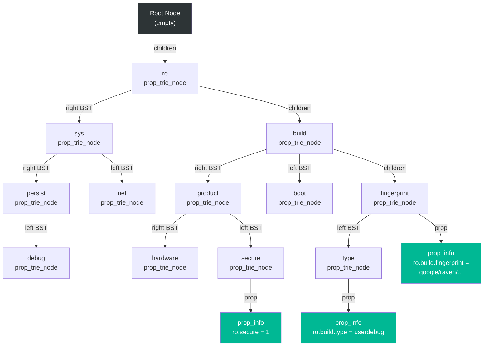

`find_property` 方法遍历这棵 trie 来定位属性：

```c
// Source: bionic/libc/system_properties/prop_area.cpp
const prop_info* prop_area::find_property(prop_trie_node* const trie,
    const char* name, uint32_t namelen,
    const char* value, uint32_t valuelen, bool alloc_if_needed) {
    if (!trie) return nullptr;

    const char* remaining_name = name;
    prop_trie_node* current = trie;
    while (true) {
        const char* sep = strchr(remaining_name, '.');
        const bool want_subtree = (sep != nullptr);
        const uint32_t substr_size = (want_subtree)
            ? sep - remaining_name : strlen(remaining_name);

        if (!substr_size) return nullptr;

        // Navigate to children, creating if needed
        prop_trie_node* root = nullptr;
        uint_least32_t children_offset =
            atomic_load_explicit(&current->children, memory_order_relaxed);
        if (children_offset != 0) {
            root = to_prop_trie_node(&current->children);
        } else if (alloc_if_needed) {
            uint_least32_t new_offset;
            root = new_prop_trie_node(remaining_name, substr_size, &new_offset);
            if (root) {
                atomic_store_explicit(&current->children, new_offset,
                                      memory_order_release);
            }
        }
        if (!root) return nullptr;

        // Binary search among siblings
        current = find_prop_trie_node(root, remaining_name, substr_size,
                                       alloc_if_needed);
        if (!current) return nullptr;
        if (!want_subtree) break;
        remaining_name = sep + 1;
    }

    // Check if this node has a prop_info attached
    uint_least32_t prop_offset =
        atomic_load_explicit(&current->prop, memory_order_relaxed);
    if (prop_offset != 0) {
        return to_prop_info(&current->prop);
    } else if (alloc_if_needed) {
        // Allocate new prop_info
        ...
    }
    return nullptr;
}
```

对于像 `ro.build.fingerprint` 这样的属性名，查找过程为：

1. 从根节点开始，下降到子节点
2. 在子节点中二分查找 `ro` 段
3. 下降到 `ro` 的子节点，二分查找 `build`
4. 下降到 `build` 的子节点，二分查找 `fingerprint`
5. 返回附加在 `fingerprint` 节点上的 `prop_info`

兄弟节点间的二分查找在 `find_prop_trie_node` 中实现：

```c
// Source: bionic/libc/system_properties/prop_area.cpp
prop_trie_node* prop_area::find_prop_trie_node(prop_trie_node* const trie,
    const char* name, uint32_t namelen, bool alloc_if_needed) {
    prop_trie_node* current = trie;
    while (true) {
        if (!current) return nullptr;
        const int ret = cmp_prop_name(name, namelen, current->name,
                                       current->namelen);
        if (ret == 0) return current;        // Found
        if (ret < 0) {                       // Go left
            uint_least32_t left_offset =
                atomic_load_explicit(&current->left, memory_order_relaxed);
            if (left_offset != 0) {
                current = to_prop_trie_node(&current->left);
            } else {
                if (!alloc_if_needed) return nullptr;
                // Allocate new node to the left
                ...
            }
        } else {                             // Go right
            ...
        }
    }
}
```

### 6.1.5 prop_info 结构

每个实际的属性值存储在 `prop_info` 结构中，定义于 `bionic/libc/system_properties/include/system_properties/prop_info.h`：

```c
// Source: bionic/libc/system_properties/include/system_properties/prop_info.h
struct prop_info {
    static constexpr uint32_t kLongFlag = 1 << 16;
    static constexpr size_t kLongLegacyErrorBufferSize = 56;

    atomic_uint_least32_t serial;
    union {
        char value[PROP_VALUE_MAX];       // 92 bytes for short values
        struct {
            char error_message[kLongLegacyErrorBufferSize];
            uint32_t offset;              // Offset to long value
        } long_property;
    };
    char name[0];                         // Property name follows

    bool is_long() const {
        return (load_const_atomic(&serial, memory_order_relaxed) & kLongFlag) != 0;
    }

    const char* long_value() const {
        return reinterpret_cast<const char*>(this) + long_property.offset;
    }
};

static_assert(sizeof(prop_info) == 96, "sizeof struct prop_info must be 96 bytes");
```

`prop_info` 中的 `serial` 字段有多种用途：

- **位 0（脏位）：** 写入进行期间置为 1。读取者看到脏序列号就知道应改从备份区读取。
- **位 16（长值标志）：** 当值超过 `PROP_VALUE_MAX`（92 字节）时置为 1。只读属性可以利用该机制存储任意长的值。
- **位 24-31（值长度）：** 高位字节编码当前值长度。
- **其余位：** 单调递增计数器。

`prop_info` 的内存布局：

```
+----------------------------+  offset 0
|  serial (4B, atomic)       |  Dirty bit | Long flag | Length | Counter
+----------------------------+  offset 4
|  value[92] or              |  For short: inline value
|  { error_msg[56]           |  For long: error message buffer
|    offset (4B) }           |            + offset to long value
+----------------------------+  offset 96
|  name[] (variable)         |  Full property name, null-terminated
+----------------------------+
```

### 6.1.6 无等待读取协议

系统属性机制实现了一个复杂的无等待读取协议，确保读取者即使在写入进行时也永远不会阻塞。该协议依赖 `serial` 字段和"脏备份区"。

当 init 需要更新属性时，它按 `bionic/libc/system_properties/system_properties.cpp` 中的如下序列执行：

```c
// Source: bionic/libc/system_properties/system_properties.cpp
int SystemProperties::Update(prop_info* pi, const char* value, unsigned int len) {
    ...
    uint32_t serial = atomic_load_explicit(&pi->serial, memory_order_relaxed);
    unsigned int old_len = SERIAL_VALUE_LEN(serial);

    // Step 1: Copy old value to dirty backup area
    memcpy(pa->dirty_backup_area(), pi->value, old_len + 1);

    // Step 2: Set dirty bit (bit 0 = 1)
    serial |= 1;
    atomic_store_explicit(&pi->serial, serial, memory_order_release);

    // Step 3: Memory fence before value update
    atomic_thread_fence(memory_order_release);

    // Step 4: Copy new value into prop_info
    memcpy(pi->value, value, len + 1);

    // Step 5: Clear dirty bit, update length and counter
    int new_serial = (len << 24) | ((serial + 1) & 0xffffff);
    atomic_store_explicit(&pi->serial, new_serial, memory_order_release);

    // Step 6: Wake waiters via futex
    __futex_wake(&pi->serial, INT32_MAX);

    // Step 7: Increment the global area serial
    atomic_store_explicit(serial_pa->serial(),
        atomic_load_explicit(serial_pa->serial(), memory_order_relaxed) + 1,
        memory_order_release);
    __futex_wake(serial_pa->serial(), INT32_MAX);
    return 0;
}
```

在读取者一侧，`ReadMutablePropertyValue` 处理脏位：

```c
// Source: bionic/libc/system_properties/system_properties.cpp
uint32_t SystemProperties::ReadMutablePropertyValue(const prop_info* pi, char* value) {
    uint32_t new_serial = load_const_atomic(&pi->serial, memory_order_acquire);
    uint32_t serial;
    unsigned int len;
    for (;;) {
        serial = new_serial;
        len = SERIAL_VALUE_LEN(serial);
        if (__predict_false(SERIAL_DIRTY(serial))) {
            // Writer is mid-update: read from backup area instead
            prop_area* pa = contexts_->GetPropAreaForName(pi->name);
            memcpy(value, pa->dirty_backup_area(), len + 1);
        } else {
            memcpy(value, pi->value, len + 1);
        }
        atomic_thread_fence(memory_order_acquire);
        new_serial = load_const_atomic(&pi->serial, memory_order_relaxed);
        if (__predict_true(serial == new_serial)) {
            break;  // Serial unchanged: read was consistent
        }
        // Serial changed during read: retry
        atomic_thread_fence(memory_order_acquire);
    }
    return serial;
}
```

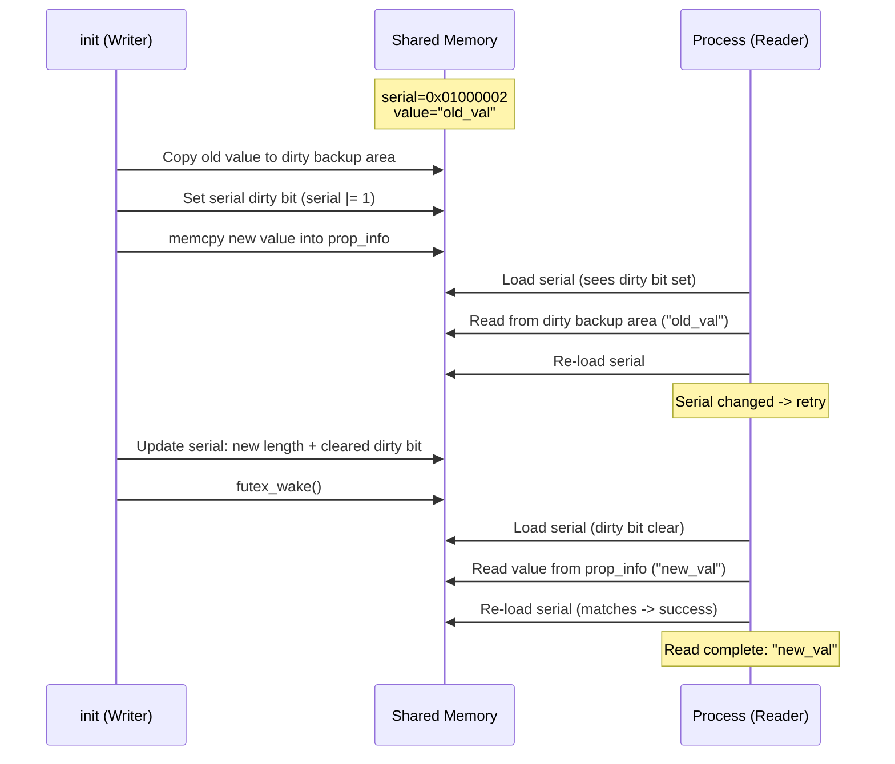

只读属性（`ro.*`）有一项优化：由于它们设置后永远不会改变，读取者完全跳过脏位协议：

```c
// Source: bionic/libc/system_properties/system_properties.cpp
void SystemProperties::ReadCallback(const prop_info* pi,
    void (*callback)(void* cookie, const char* name,
                     const char* value, uint32_t serial),
    void* cookie) {
    if (is_read_only(pi->name)) {
        // Read-only: no dirty bit check needed
        uint32_t serial = load_const_atomic(&pi->serial, memory_order_relaxed);
        if (pi->is_long()) {
            callback(cookie, pi->name, pi->long_value(), serial);
        } else {
            callback(cookie, pi->name, pi->value, serial);
        }
        return;
    }
    // Mutable property: use the full protocol
    char value_buf[PROP_VALUE_MAX];
    uint32_t serial = ReadMutablePropertyValue(pi, value_buf);
    callback(cookie, pi->name, value_buf, serial);
}
```

### 6.1.7 长属性值

历史上，属性值被限制在 `PROP_VALUE_MAX`（92 字节）以内。从 Android P 开始，只读（`ro.*`）属性可以通过"长属性"机制超过这一限制。当值超过 `PROP_VALUE_MAX` 时，serial 中的 `kLongFlag`（位 16）被置位。该值存储在属性区域内的另一个偏移处：

```c
// Source: bionic/libc/system_properties/prop_area.cpp
prop_info* prop_area::new_prop_info(const char* name, uint32_t namelen,
    const char* value, uint32_t valuelen, uint_least32_t* const off) {
    uint_least32_t new_offset;
    void* const p = allocate_obj(sizeof(prop_info) + namelen + 1, &new_offset);
    if (p == nullptr) return nullptr;

    prop_info* info;
    if (valuelen >= PROP_VALUE_MAX) {
        // Long value: allocate separate storage
        uint32_t long_value_offset = 0;
        char* long_location = reinterpret_cast<char*>(
            allocate_obj(valuelen + 1, &long_value_offset));
        if (!long_location) return nullptr;

        memcpy(long_location, value, valuelen);
        long_location[valuelen] = '\0';

        // Store offset relative to the prop_info structure
        long_value_offset -= new_offset;
        info = new (p) prop_info(name, namelen, long_value_offset);
    } else {
        // Short value: store inline
        info = new (p) prop_info(name, namelen, value, valuelen);
    }
    *off = new_offset;
    return info;
}
```

`prop_info` 上的 `long_value()` 方法重建该指针：

```c
const char* long_value() const {
    return reinterpret_cast<const char*>(this) + long_property.offset;
}
```

这使得像 `ro.build.fingerprint`（可能相当长）这样的属性能够完整存储其值而不被截断。

### 6.1.8 property_info Trie（SELinux 上下文 Trie）

与存储实际值的属性值 trie 不同，还有第二棵 trie 结构。它将属性名映射到其 SELinux 上下文和类型信息。这就是"property_info" trie，序列化后写入 `/dev/__properties__/property_info`。

Init 在启动时从 `property_contexts` 文件构建这棵 trie：

```c
// Source: system/core/init/property_service.cpp
void CreateSerializedPropertyInfo() {
    auto property_infos = std::vector<PropertyInfoEntry>();

    // Load platform property contexts
    if (access("/system/etc/selinux/plat_property_contexts", R_OK) != -1) {
        LoadPropertyInfoFromFile(
            "/system/etc/selinux/plat_property_contexts", &property_infos);

        // Load partition-specific contexts
        LoadPropertyInfoFromFile(
            "/system_ext/etc/selinux/system_ext_property_contexts", ...);
        LoadPropertyInfoFromFile(
            "/vendor/etc/selinux/vendor_property_contexts", ...);
        LoadPropertyInfoFromFile(
            "/product/etc/selinux/product_property_contexts", ...);
        LoadPropertyInfoFromFile(
            "/odm/etc/selinux/odm_property_contexts", ...);
    }
    ...

    // Serialize into a compact binary format
    auto serialized_contexts = std::string();
    auto error = std::string();
    if (!BuildTrie(property_infos, "u:object_r:default_prop:s0", "string",
                   &serialized_contexts, &error)) {
        LOG(ERROR) << "Unable to serialize property contexts: " << error;
        return;
    }

    // Write to /dev/__properties__/property_info
    WriteStringToFile(serialized_contexts, PROP_TREE_FILE, 0444, 0, 0, false);
    selinux_android_restorecon(PROP_TREE_FILE, 0);
}
```

序列化后的 property_info trie 定义于
`system/core/property_service/libpropertyinfoparser/include/property_info_parser/property_info_parser.h`：

```c
// Source: system/core/property_service/libpropertyinfoparser/.../property_info_parser.h
struct PropertyInfoAreaHeader {
    uint32_t current_version;
    uint32_t minimum_supported_version;
    uint32_t size;
    uint32_t contexts_offset;     // -> array of SELinux context strings
    uint32_t types_offset;        // -> array of type strings
    uint32_t root_offset;         // -> root TrieNodeInternal
};

struct TrieNodeInternal {
    uint32_t property_entry;      // -> PropertyEntry for this node
    uint32_t num_child_nodes;
    uint32_t child_nodes;         // -> sorted array of child node offsets
    uint32_t num_prefixes;
    uint32_t prefix_entries;      // -> prefix match entries
    uint32_t num_exact_matches;
    uint32_t exact_match_entries; // -> exact match entries
};

struct PropertyEntry {
    uint32_t name_offset;
    uint32_t namelen;
    uint32_t context_index;       // Index into contexts array
    uint32_t type_index;          // Index into types array
};
```

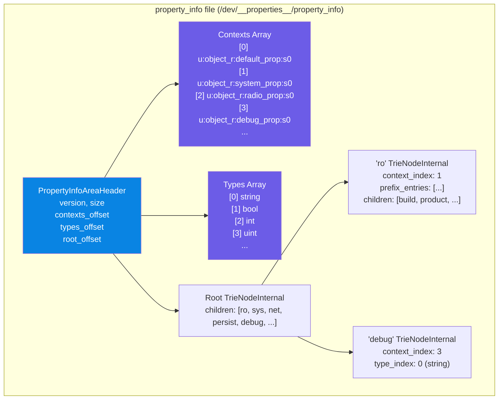

当进程调用 `__system_property_find("debug.myapp.trace")` 时，bionic 库：

1. 查找 property_info trie，找到 `debug.*` 的 SELinux 上下文索引

2. 使用该索引打开 `/dev/__properties__/` 下正确的属性区域文件
3. 在该区域内的属性值 trie 中查找实际值

这种两级查找确保每个 SELinux 上下文映射到自己的内存映射文件，使内核能够在文件级别强制执行读取权限。

---

## 6.2 属性命名空间

Android 系统属性遵循分层命名约定，前缀决定了属性在可变性、持久化和访问控制方面的行为。理解这些命名空间对使用该平台至关重要。

### 6.2.1 只读属性（ro.*）

以 `ro.` 开头的属性是"一次写入"的——它们可以在启动期间设置，但之后不能修改。该强制机制位于 `system/core/init/property_service.cpp` 中：

```c
// Source: system/core/init/property_service.cpp, PropertySet()
static std::optional<uint32_t> PropertySet(const std::string& name,
    const std::string& value, SocketConnection* socket, std::string* error) {
    ...
    prop_info* pi = (prop_info*)__system_property_find(name.c_str());
    if (pi != nullptr) {
        // ro.* properties are actually "write-once".
        if (StartsWith(name, "ro.")) {
            *error = "Read-only property was already set";
            return {PROP_ERROR_READ_ONLY_PROPERTY};
        }
        __system_property_update(pi, value.c_str(), valuelen);
    } else {
        int rc = __system_property_add(name.c_str(), name.size(),
                                        value.c_str(), valuelen);
        ...
    }
    ...
}
```

`ro.*` 属性的关键特性：

- **首次设置后不可变。** 任何对已存在的 `ro.*` 属性进行设置的尝试都会返回 `PROP_ERROR_READ_ONLY_PROPERTY`。
- **可以有长值。** 与可变属性（限制在 91 字节）不同，`ro.*` 属性可以利用长属性机制存储超过 `PROP_VALUE_MAX` 的值。
- **优化读取。** 读取者跳过脏位协议，因为值在设置后永远不会改变。
- **启动期间设置。** 通常从 `build.prop` 文件、内核命令行（`androidboot.*`）和设备树中加载。

常见的 `ro.*` 属性包括：

| 属性 | 描述 | 示例值 |
|----------|-------------|---------------|
| `ro.build.fingerprint` | 唯一构建标识符 | `google/raven/raven:14/...` |
| `ro.build.type` | 构建变体 | `userdebug`、`user`、`eng` |
| `ro.build.version.sdk` | API 级别 | `34` |
| `ro.product.model` | 设备型号 | `Pixel 6 Pro` |
| `ro.product.manufacturer` | 设备制造商 | `Google` |
| `ro.hardware` | 硬件平台 | `tensor` |
| `ro.debuggable` | 调试构建标志 | `1` 或 `0` |
| `ro.secure` | 安全强制 | `1` |
| `ro.boot.serialno` | 设备序列号 | （因设备而异） |
| `ro.vendor.api_level` | Vendor API 级别 | `34` |

### 6.2.2 持久化属性（persist.*）

以 `persist.` 开头的属性会自动保存到磁盘并在重启后恢复。持久化机制实现于 `system/core/init/persistent_properties.cpp`。

存储文件是 `/data/property/persistent_properties`，以 Protocol Buffer 编码：

```c
// Source: system/core/init/persistent_properties.cpp
[[clang::no_destroy]] std::string persistent_property_filename =
    "/data/property/persistent_properties";
```

当设置 `persist.*` 属性时，`PropertySet()` 会触发写入：

```c
// Source: system/core/init/property_service.cpp
bool need_persist = StartsWith(name, "persist.") || StartsWith(name, "next_boot.");
if (socket && persistent_properties_loaded && need_persist) {
    if (persist_write_thread) {
        persist_write_thread->Write(name, value, std::move(*socket));
        return {};  // Response sent asynchronously after write completes
    }
    WritePersistentProperty(name, value);
}
```

写入操作会读取整个 protobuf 文件，更新相关条目，并使用重命名原子地写回：

```c
// Source: system/core/init/persistent_properties.cpp
void WritePersistentProperty(const std::string& name, const std::string& value) {
    auto persistent_properties = LoadPersistentPropertyFile();
    if (!persistent_properties.ok()) {
        // Recover from memory if file is corrupted
        persistent_properties = LoadPersistentPropertiesFromMemory();
    }

    // Find and update, or add new entry
    auto it = std::find_if(...);
    if (it != persistent_properties->mutable_properties()->end()) {
        it->set_value(value);
    } else {
        AddPersistentProperty(name, value, &persistent_properties.value());
    }

    WritePersistentPropertyFile(*persistent_properties);
}
```

写盘使用标准的原子重命名模式：

```c
// Source: system/core/init/persistent_properties.cpp
Result<void> WritePersistentPropertyFile(
    const PersistentProperties& persistent_properties) {
    const std::string temp_filename = persistent_property_filename + ".tmp";
    unique_fd fd(TEMP_FAILURE_RETRY(
        open(temp_filename.c_str(),
             O_WRONLY | O_CREAT | O_NOFOLLOW | O_TRUNC | O_CLOEXEC, 0600)));
    ...
    std::string serialized_string;
    persistent_properties.SerializeToString(&serialized_string);
    WriteStringToFd(serialized_string, fd);
    fsync(fd.get());
    fd.reset();

    // Atomic rename
    rename(temp_filename.c_str(), persistent_property_filename.c_str());

    // fsync the directory for durability
    auto dir_fd = unique_fd{open(dir.c_str(), O_DIRECTORY | O_RDONLY | O_CLOEXEC)};
    fsync(dir_fd.get());
    return {};
}
```

出于性能考虑，还有一个异步写入线程可用。当 `ro.property_service.async_persist_writes` 为 `true` 时，init 会将持久化写入委托给专用的 `PersistWriteThread`：

```c
// Source: system/core/init/property_service.cpp
class PersistWriteThread {
  public:
    void Write(std::string name, std::string value, SocketConnection socket);
  private:
    void Work() {
        while (true) {
            std::tuple<std::string, std::string, SocketConnection> item;
            {
                std::unique_lock<std::mutex> lock(mutex_);
                while (work_.empty()) { cv_.wait(lock); }
                item = std::move(work_.front());
                work_.pop_front();
            }
            WritePersistentProperty(std::get<0>(item), std::get<1>(item));
            NotifyPropertyChange(std::get<0>(item), std::get<1>(item));
            std::get<2>(item).SendUint32(PROP_SUCCESS);
        }
    }
    std::thread thread_;
    std::mutex mutex_;
    std::condition_variable cv_;
    std::deque<std::tuple<std::string, std::string, SocketConnection>> work_;
};
```

### 6.2.3 暂存属性（next_boot.*）

以 `next_boot.` 为前缀的属性是较新的机制，用于暂存将在下次重启时生效的属性变更。它们与 `persist.*` 属性一起存储在同一 protobuf 文件中，但在启动时会通过替换相应的 `persist.*` 值来"应用"：

```c
// Source: system/core/init/persistent_properties.cpp, LoadPersistentProperties()
auto const staged_prefix = std::string_view("next_boot.");
auto staged_props = std::unordered_map<std::string, std::string>();
for (const auto& property_record : persistent_properties->properties()) {
    auto const& prop_name = property_record.name();
    auto const& prop_value = property_record.value();
    if (StartsWith(prop_name, staged_prefix)) {
        auto actual_prop_name = prop_name.substr(staged_prefix.size());
        staged_props[actual_prop_name] = prop_value;
    }
}
```

例如，将 `next_boot.persist.sys.locale` 设置为 `fr-FR` 会使 `persist.sys.locale` 在下次启动时变为 `fr-FR`。`next_boot.*` 条目在应用后会被移除。

### 6.2.4 系统属性（sys.*）

`sys.*` 命名空间用于反映当前系统状态的运行时状态属性。它们是可变的，并且不会在重启后持久化。常见示例：

| 属性 | 描述 |
|----------|-------------|
| `sys.boot_completed` | 启动完成时设置为 `1` |
| `sys.powerctl` | 触发重启/关机 |
| `sys.usb.config` | 当前 USB 配置 |
| `sys.sysctl.extra_free_kbytes` | 内存调优 |

`sys.powerctl` 属性很特殊——设置它会触发设备重启或关机。属性服务会记录设置过程以便追责：

```c
// Source: system/core/init/property_service.cpp
if (name == "sys.powerctl") {
    std::string cmdline_path = StringPrintf("proc/%d/cmdline", cr.pid);
    std::string process_cmdline;
    if (ReadFileToString(cmdline_path, &process_cmdline)) {
        process_log_string = StringPrintf(" (%s)", process_cmdline.c_str());
    }
    LOG(INFO) << "Received sys.powerctl='" << value << "' from pid: "
              << cr.pid << process_log_string;
}
```

### 6.2.5 Vendor 属性（vendor.*）

`vendor.*` 前缀保留给厂商专用属性。这些属性受 Project Treble 引入的 Vendor Interface（VINTF）属性命名空间隔离规则约束。详见第 6.7 节。

### 6.2.6 调试属性（debug.*）

`debug.*` 命名空间对 shell 用户开放，通常用于开发和调试目的。与系统属性相比，这些属性的 SELinux 策略更为宽松，允许开发者在 `userdebug` 构建上通过 `adb shell setprop` 设置它们，而无需 root 权限。

来自 property_contexts 文件：

```
# Source: system/sepolicy/private/property_contexts
debug.                  u:object_r:debug_prop:s0
debug.db.               u:object_r:debuggerd_prop:s0
```

### 6.2.7 控制属性（ctl.*）

`ctl.*` 命名空间并不是常规的属性命名空间——这些属性被属性服务拦截，用于控制 init 服务：

```c
// Source: system/core/init/property_service.cpp
if (StartsWith(name, "ctl.")) {
    return {SendControlMessage(name.c_str() + 4, value, cr.pid, socket, error)};
}
```

设置 `ctl.start=<service_name>` 会启动服务，`ctl.stop=<service_name>` 会停止服务，`ctl.restart=<service_name>` 会重启服务。这些操作的权限检查基于目标服务的 SELinux 上下文。

### 6.2.8 服务状态属性（init.svc.*）

Init 自动维护 `init.svc.<service_name>` 属性，反映每个服务的状态。`system/core/init/service.cpp` 中的 `Service::NotifyStateChange()` 只发布四个值：`stopped`、`running`、`stopping` 和 `restarting`（没有 `starting` 状态）。

### 6.2.9 命名空间行为小结

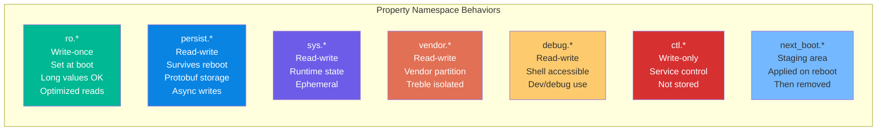

---

## 6.3 属性上下文与 SELinux 集成

### 6.3.1 property_contexts 文件格式

每个系统属性都通过 `property_contexts` 文件被分配一个 SELinux 安全上下文。这些文件将属性名前缀（或确切名称）映射到 SELinux 标签，并可选择指定类型约束。格式为：

```
<property_name_prefix>    <selinux_context>    [exact]    [type]
```

其中：

- **property_name_prefix：** 属性名前缀（例如 `debug.`），匹配所有以该字符串开头的属性
- **selinux_context：** SELinux 标签（例如 `u:object_r:debug_prop:s0`）
- **exact（可选）：** 如果存在，则只有确切名称匹配才符合条件
- **type（可选）：** 类型约束（`string`、`bool`、`int`、`uint`、`double`、`size`、`enum`）

来自 `system/sepolicy/private/property_contexts` 的示例：

```
# Source: system/sepolicy/private/property_contexts
net.rmnet               u:object_r:net_radio_prop:s0
net.                    u:object_r:system_prop:s0
debug.                  u:object_r:debug_prop:s0
debug.db.               u:object_r:debuggerd_prop:s0
sys.powerctl            u:object_r:powerctl_prop:s0
persist.sys.            u:object_r:system_prop:s0
persist.bluetooth.      u:object_r:bluetooth_prop:s0
ro.build.type           u:object_r:build_prop:s0  exact  string
persist.profcollectd.enabled  u:object_r:profcollectd_enabled_prop:s0  exact  bool
```

注意匹配的优先级：更具体的前缀会覆盖不那么具体的前缀。例如，`debug.db.uid` 匹配 `debug.db.`（`debuggerd_prop` 上下文），而不是 `debug.`（`debug_prop` 上下文）。还要注意，`ro.build.*` 属性是用 `exact` 条目标记的，而不是前缀规则。它们并不都共享同一个上下文：`ro.build.fingerprint` 映射到 `fingerprint_prop`，而不是 `build_prop`。

### 6.3.2 分区专用上下文文件

每个分区都可以提供自己的 property_contexts 文件。Init 按以下顺序加载它们：

```c
// Source: system/core/init/property_service.cpp, CreateSerializedPropertyInfo()
// Platform contexts
"/system/etc/selinux/plat_property_contexts"

// System extension contexts
"/system_ext/etc/selinux/system_ext_property_contexts"

// Vendor contexts
"/vendor/etc/selinux/vendor_property_contexts"

// Product contexts
"/product/etc/selinux/product_property_contexts"

// ODM contexts
"/odm/etc/selinux/odm_property_contexts"
```

所有上下文在启动时合并为一棵序列化的 trie。这允许每个分区为自己定义上下文，而无需修改平台策略。

### 6.3.3 属性写入上的 SELinux 强制

当进程尝试设置属性时，属性服务会执行一次 SELinux 访问检查。这实现在 `CheckMacPerms` 中：

```c
// Source: system/core/init/property_service.cpp
static bool CheckMacPerms(const std::string& name, const char* target_context,
                          const char* source_context, const ucred& cr) {
    if (!target_context || !source_context) {
        return false;
    }

    PropertyAuditData audit_data;
    audit_data.name = name.c_str();
    audit_data.cr = &cr;

    auto lock = std::lock_guard{selinux_check_access_lock};
    return selinux_check_access(source_context, target_context,
                                "property_service", "set",
                                &audit_data) == 0;
}
```

检查流程：

1. 进程连接到属性服务套接字。
2. Init 通过 `getpeercon()` 获取进程的 SELinux 上下文。
3. Init 从 property_info trie 中查找目标属性的 SELinux 上下文。
4. `selinux_check_access()` 验证 SELinux 策略允许源上下文对目标上下文执行 `property_service` 对象类的 `set` 操作。

检查失败时，拒绝会被记录到内核审计日志中，属性设置返回 `PROP_ERROR_PERMISSION_DENIED`。在 Android 17 中，`CheckPermissions()` 发生了变化。现在它把源上下文和目标上下文直接嵌入返回给调用方的错误字符串中。因此，一次失败的 `setprop` 会报告两个上下文，即使审计速率限制器抑制了内核的 AVC 日志：

```c
// Source: system/core/init/property_service.cpp, CheckPermissions()
if (!CheckMacPerms(name, target_context, source_context.c_str(), cr)) {
    // Info about contexts are available also in the selinux denials in the kernel message,
    // but they may be suppressed by the ratelimiter, in which case this log from init can be
    // helpful.
    *error = StringPrintf(
            "SELinux permission check failed "
            "(source_context=%s, target_context=%s)",
            source_context.c_str(), target_context ?: "(null)");
    return PROP_ERROR_PERMISSION_DENIED;
}
```

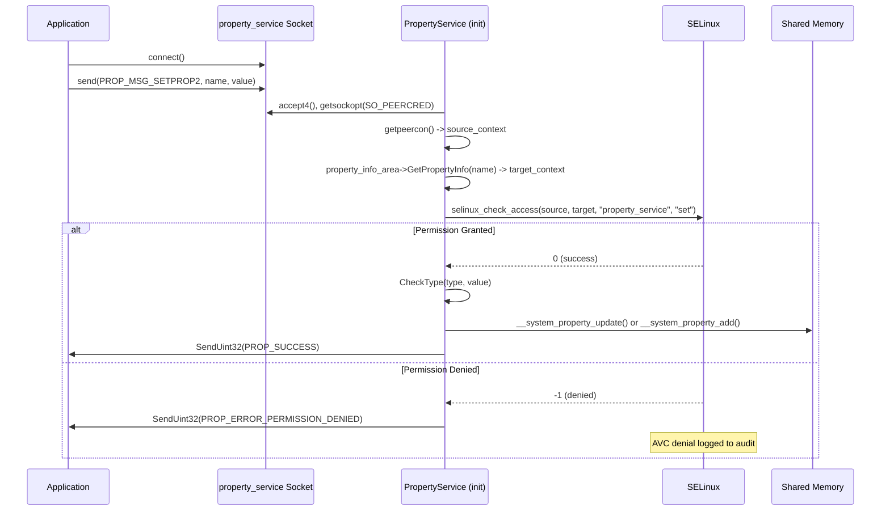

### 6.3.4 属性读取上的 SELinux 强制

读取访问控制更为微妙。读取直接访问共享内存而无需 IPC，因此强制发生在文件级别。每个 SELinux 上下文在 `/dev/__properties__/` 下都有自己的文件。内核的文件访问权限决定了进程可以读取哪些上下文。

`ContextsSerialized` 实现将每个上下文映射到自己的属性区域文件：

```c
// Source: bionic/libc/system_properties/contexts_serialized.cpp
prop_area* ContextsSerialized::GetPropAreaForName(const char* name) {
    uint32_t index;
    property_info_area_file_->GetPropertyInfoIndexes(name, &index, nullptr);
    if (index == ~0u || index >= num_context_nodes_) {
        return nullptr;
    }
    auto* context_node = &context_nodes_[index];
    if (!context_node->pa()) {
        context_node->Open(false, nullptr);
    }
    return context_node->pa();
}
```

当 `Open()` 尝试对属性区域文件执行 mmap 时，内核会检查调用进程的 SELinux 上下文。该上下文必须拥有该文件 SELinux 标签的 `file { read open map }` 权限。如果进程缺少权限，mmap 失败，该属性就表现为不存在。

### 6.3.5 类型检查

从 Android P 开始，property_contexts 可以指定类型约束。类型检查由属性服务在写入时执行：

```c
// Source: system/core/init/property_service.cpp
uint32_t CheckPermissions(const std::string& name, const std::string& value,
    const std::string& source_context, const ucred& cr, std::string* error) {
    if (!IsLegalPropertyName(name)) {
        *error = "Illegal property name";
        return PROP_ERROR_INVALID_NAME;
    }

    if (StartsWith(name, "ctl.")) {
        if (!CheckControlPropertyPerms(name, value, source_context, cr)) {
            *error = StringPrintf("Invalid permissions to perform '%s' on '%s'",
                                  name.c_str() + 4, value.c_str());
            return PROP_ERROR_HANDLE_CONTROL_MESSAGE;
        }
        return PROP_SUCCESS;
    }

    const char* target_context = nullptr;
    const char* type = nullptr;
    property_info_area->GetPropertyInfo(name.c_str(), &target_context, &type);

    if (!CheckMacPerms(name, target_context, source_context.c_str(), cr)) {
        *error = StringPrintf("SELinux permission check failed "
                              "(source_context=%s, target_context=%s)",
                              source_context.c_str(), target_context ?: "(null)");
        return PROP_ERROR_PERMISSION_DENIED;
    }

    if (!CheckType(type, value)) {
        *error = StringPrintf(
            "Property type check failed, value doesn't match expected type '%s'",
            (type ?: "(null)"));
        return PROP_ERROR_INVALID_VALUE;
    }

    return PROP_SUCCESS;
}
```

`CheckPermissions()` 按顺序执行三个关卡：

1. 对名称的合法性检查（`IsLegalPropertyName`）。
2. 对于 `ctl.` 属性，通过 `CheckControlPropertyPerms()` 进行服务范围的权限检查。它同时检查旧的 `ctl.<service>` 形式和较新的 `ctl.<action>$<service>` 形式。
3. 对于普通属性，执行 SELinux MAC 检查加上类型检查。

支持的类型约束：

| 类型 | 有效值 | 示例 |
|------|-------------|---------|
| `string` | 任意字符串 | `"hello world"` |
| `bool` | `true`、`false`、`1`、`0` | `true` |
| `int` | 有符号整数 | `-42` |
| `uint` | 无符号整数 | `1024` |
| `double` | 浮点数 | `3.14` |
| `size` | 数字后跟 `g`、`k` 或 `m` | `512m` |
| `enum` | 指定值之一 | `filtered` |

### 6.3.6 Appcompat 覆盖机制

Android 提供了一种"appcompat 覆盖"机制。它让平台可以向选择了启用兼容性覆盖的进程呈现一个不同的属性值。其他所有读取者仍然看到原始值。该机制分散在 init 和 bionic 中实现。

在 init 一侧，覆盖仅在平台编译时定义了 `WRITE_APPCOMPAT_OVERRIDE_SYSTEM_PROPERTIES` 才会构建。在该配置下，`CreateSerializedPropertyInfo()` 会第二次写入同一棵序列化上下文 trie，写入一个并行的文件夹。因此，覆盖区域共享平台的 SELinux 上下文布局：

```c
// Source: system/core/init/property_service.cpp
[[maybe_unused]] static constexpr char APPCOMPAT_OVERRIDE_PROP_FOLDERNAME[] =
    "/dev/__properties__/appcompat_override";
[[maybe_unused]] static constexpr char APPCOMPAT_OVERRIDE_PROP_TREE_FILE[] =
    "/dev/__properties__/appcompat_override/property_info";

// ... in CreateSerializedPropertyInfo():
#ifdef WRITE_APPCOMPAT_OVERRIDE_SYSTEM_PROPERTIES
    mkdir(APPCOMPAT_OVERRIDE_PROP_FOLDERNAME, S_IRWXU | S_IXGRP | S_IXOTH);
    WriteStringToFile(serialized_contexts, APPCOMPAT_OVERRIDE_PROP_TREE_FILE,
                      0444, 0, 0, false);
    selinux_android_restorecon(APPCOMPAT_OVERRIDE_PROP_TREE_FILE, 0);
#endif
```

实际的名称改写发生在 bionic 中。当进程启用覆盖时，`SystemProperties::Find()` 会首先查找请求名称的 `ro.appcompat_override.` 前缀影子。如果该影子存在，就返回影子而不是真实属性：

```c
// Source: bionic/libc/system_properties/system_properties.cpp
#define APPCOMPAT_PREFIX "ro.appcompat_override."

const prop_info* SystemProperties::Find(const char* name) {
    ...
    // if appcompat override is enabled, we first try finding the
    // APPCOMPAT_PREFIXed system property.
    if (use_appcompat_override_) {
        const size_t totalLength = strlen(APPCOMPAT_PREFIX) + strlen(name) + 1;
        char overrideName[totalLength];
        snprintf(overrideName, totalLength, "%s%s", APPCOMPAT_PREFIX, name);
        prop_area* pa = contexts_->GetPropAreaForName(overrideName);
        if (pa) {
            const prop_info* pi = pa->find(overrideName);
            if (pi) return pi;
        }
    }
    // Fall through to the normal lookup of `name`.
    ...
}
```

因此，启用覆盖后读取 `ro.some.flag` 的进程，在写入过 `ro.appcompat_override.ro.some.flag` 时会透明地收到它的值。其他所有进程仍然看到不带前缀的值。平台就是这样把针对单个应用的兼容性值交给单个选择启用的读取者的。

---

## 6.4 Init 中的 PropertyService

### 6.4.1 初始化序列

属性服务在 init 的第二阶段分两个阶段初始化。完整的初始化流程为：

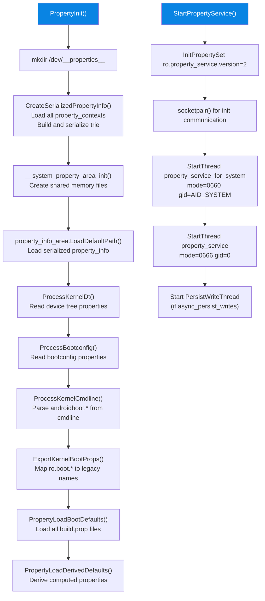

### 6.4.2 加载启动属性

`PropertyLoadBootDefaults()` 函数负责按正确的顺序加载所有属性文件。顺序至关重要，因为后续（更具体）分区中定义的属性会覆盖先前（更通用）分区中定义的属性：

```c
// Source: system/core/init/property_service.cpp
void PropertyLoadBootDefaults() {
    std::map<std::string, std::string> properties;

    // Phase 1: Second stage ramdisk properties
    LoadPropertiesFromSecondStageRes(&properties);

    // Phase 2: System partition (lowest precedence among partitions)
    load_properties_from_file("/system/build.prop", nullptr, &properties);

    // Phase 3: System extension partition
    load_properties_from_partition("system_ext", 30);

    // Phase 4: System DLKM
    load_properties_from_file("/system_dlkm/etc/build.prop", nullptr, &properties);

    // Phase 5: Vendor partition
    load_properties_from_file("/vendor/default.prop", nullptr, &properties);
    load_properties_from_file("/vendor/build.prop", nullptr, &properties);

    // Phase 6: Vendor DLKM
    load_properties_from_file("/vendor_dlkm/etc/build.prop", nullptr, &properties);

    // Phase 7: ODM DLKM
    load_properties_from_file("/odm_dlkm/etc/build.prop", nullptr, &properties);

    // Phase 8: ODM partition
    load_properties_from_partition("odm", 28);

    // Phase 9: Product partition (highest precedence)
    load_properties_from_partition("product", 30);

    // Phase 10: Debug ramdisk properties (if present)
    if (access(kDebugRamdiskProp, R_OK) == 0) {
        load_properties_from_file(kDebugRamdiskProp, nullptr, &properties);
    }

    // Commit all properties to shared memory
    for (const auto& [name, value] : properties) {
        std::string error;
        PropertySetNoSocket(name, value, &error);
    }

    // Derive composed properties
    property_initialize_ro_product_props();
    property_derive_build_fingerprint();
    property_initialize_ro_cpu_abilist();
    property_initialize_ro_vendor_api_level();
    update_sys_usb_config();
}
```

优先级从低到高的顺序为：

1. `system/build.prop`
2. `system_ext/etc/build.prop`
3. `system_dlkm/etc/build.prop`
4. `vendor/default.prop` 和 `vendor/build.prop`
5. `vendor_dlkm/etc/build.prop`
6. `odm_dlkm/etc/build.prop`
7. `odm/etc/build.prop`
8. `product/etc/build.prop`

### 6.4.3 内核命令行处理

Init 将内核命令行和 bootconfig 中的 `androidboot.*` 参数转换为 `ro.boot.*` 属性：

```c
// Source: system/core/init/property_service.cpp
constexpr auto ANDROIDBOOT_PREFIX = "androidboot."sv;

static void ProcessKernelCmdline() {
    android::fs_mgr::ImportKernelCmdline(
        [&](const std::string& key, const std::string& value) {
            if (StartsWith(key, ANDROIDBOOT_PREFIX)) {
                InitPropertySet("ro.boot." + key.substr(ANDROIDBOOT_PREFIX.size()),
                                value);
            }
        });
}

static void ProcessBootconfig() {
    android::fs_mgr::ImportBootconfig(
        [&](const std::string& key, const std::string& value) {
            if (StartsWith(key, ANDROIDBOOT_PREFIX)) {
                InitPropertySet("ro.boot." + key.substr(ANDROIDBOOT_PREFIX.size()),
                                value);
            }
        });
}
```

加载 `ro.boot.*` 属性后，`ExportKernelBootProps` 会创建旧式别名：

```c
// Source: system/core/init/property_service.cpp
static void ExportKernelBootProps() {
    constexpr const char* UNSET = "";
    struct {
        const char* src_prop;
        const char* dst_prop;
        const char* default_value;
    } prop_map[] = {
        { "ro.boot.serialno",   "ro.serialno",   UNSET,     },
        { "ro.boot.mode",       "ro.bootmode",   "unknown", },
        { "ro.boot.baseband",   "ro.baseband",   "unknown", },
        { "ro.boot.bootloader", "ro.bootloader", "unknown", },
        { "ro.boot.hardware",   "ro.hardware",   "unknown", },
        { "ro.boot.revision",   "ro.revision",   "0",       },
    };
    for (const auto& prop : prop_map) {
        std::string value = GetProperty(prop.src_prop, prop.default_value);
        if (value != UNSET) InitPropertySet(prop.dst_prop, value);
    }
}
```

`ro.boot.serialno` 的 `UNSET` 哨兵值意味着，只有在内核命令行上确实提供了序列号时，init 才会创建旧式的 `ro.serialno` 别名。空的序列号会让 `ro.serialno` 保持未定义状态，而不是空白。

### 6.4.4 基于套接字的写入 API

属性服务通过两个 Unix 域套接字接受写入请求：

```c
// Source: system/core/init/property_service.cpp
void StartPropertyService(int* epoll_socket) {
    InitPropertySet("ro.property_service.version", "2");

    int sockets[2];
    socketpair(AF_UNIX, SOCK_SEQPACKET | SOCK_CLOEXEC, 0, sockets);
    *epoll_socket = from_init_socket = sockets[0];
    init_socket = sockets[1];

    StartSendingMessages();

    // Socket for system processes (mode=0660, gid=system)
    StartThread(PROP_SERVICE_FOR_SYSTEM_NAME, 0660, AID_SYSTEM,
                property_service_for_system_thread, true);

    // Socket for all processes (mode=0666, gid=0)
    StartThread(PROP_SERVICE_NAME, 0666, 0,
                property_service_thread, false);
    ...
}
```

创建了两个套接字：

- **`property_service_for_system`**（模式 0660）：仅系统组进程可以访问。该套接字还监听内部 init 消息（例如加载持久化属性）。
- **`property_service`**（模式 0666）：所有进程都可以访问。这是通用的属性设置套接字。

每个套接字在自己的线程中运行于 epoll 循环：

```c
// Source: system/core/init/property_service.cpp
static void PropertyServiceThread(int fd, bool listen_init) {
    Epoll epoll;
    epoll.Open();
    epoll.RegisterHandler(fd, std::bind(handle_property_set_fd, fd));

    if (listen_init) {
        epoll.RegisterHandler(init_socket, HandleInitSocket);
    }

    while (true) {
        auto epoll_result = epoll.Wait(std::nullopt);
        ...
    }
}
```

### 6.4.5 线路协议

属性设置协议使用两种消息类型：

**PROP_MSG_SETPROP（旧式）：**
```
[uint32_t cmd=1] [char name[PROP_NAME_MAX]] [char value[PROP_VALUE_MAX]]
```
定长字段，无响应。供较旧的 bionic 版本使用。

**PROP_MSG_SETPROP2（当前）：**
```
[uint32_t cmd=0x00020001] [uint32_t name_len] [char name[]] [uint32_t value_len] [char value[]]
```
带长度前缀的字符串，并有一个 uint32 响应码。命令字定义在
`bionic/libc/include/sys/system_properties.h` 中：`PROP_MSG_SETPROP` 为
`1`，而 `PROP_MSG_SETPROP2` 为 `0x00020001`。

```c
// Source: system/core/init/property_service.cpp
static void handle_property_set_fd(int fd) {
    static constexpr uint32_t kDefaultSocketTimeout = 5000; /* ms */

    int s = accept4(fd, nullptr, nullptr, SOCK_CLOEXEC);
    ...
    ucred cr;
    socklen_t cr_size = sizeof(cr);
    getsockopt(s, SOL_SOCKET, SO_PEERCRED, &cr, &cr_size);

    SocketConnection socket(s, cr);
    uint32_t timeout_ms = kDefaultSocketTimeout;

    uint32_t cmd = 0;
    socket.RecvUint32(&cmd, &timeout_ms);

    switch (cmd) {
    case PROP_MSG_SETPROP: {
        char prop_name[PROP_NAME_MAX];
        char prop_value[PROP_VALUE_MAX];
        socket.RecvChars(prop_name, PROP_NAME_MAX, &timeout_ms);
        socket.RecvChars(prop_value, PROP_VALUE_MAX, &timeout_ms);
        ...
        HandlePropertySetNoSocket(prop_name, prop_value, source_context, cr, &error);
        break;
    }
    case PROP_MSG_SETPROP2: {
        std::string name, value;
        socket.RecvString(&name, &timeout_ms);
        socket.RecvString(&value, &timeout_ms);
        ...
        auto result = HandlePropertySet(name, value, source_context, cr,
                                         &socket, &error);
        if (result) socket.SendUint32(*result);
        break;
    }
    }
}
```

### 6.4.6 属性变更通知

当属性变更时，init 可以触发 `.rc` 文件中定义的动作。每次成功的属性设置之后都会调用 `PropertyChanged` 函数：

```c
// Source: system/core/init/property_service.cpp
void NotifyPropertyChange(const std::string& name, const std::string& value) {
    auto lock = std::lock_guard{accept_messages_lock};
    if (accept_messages) {
        PropertyChanged(name, value);
    }
}
```

这使得 `.rc` 文件触发器成为可能，例如：

```
on property:sys.boot_completed=1
    start post_boot_service

on property:ro.debuggable=1
    start adbd
```

### 6.4.7 加载持久化属性

持久化属性在 `/data` 挂载后加载。系统套接字线程通过来自 init 主循环的一条 protobuf 消息来处理此操作：

```c
// Source: system/core/init/property_service.cpp
static void HandleInitSocket() {
    auto message = ReadMessage(init_socket);
    auto init_message = InitMessage{};
    init_message.ParseFromString(*message);

    switch (init_message.msg_case()) {
    case InitMessage::kLoadPersistentProperties: {
        load_override_properties();

        auto persistent_properties = LoadPersistentProperties();
        for (const auto& property_record : persistent_properties.properties()) {
            InitPropertySet(property_record.name(), property_record.value());
        }

        // Enable debug features if debug ramdisk was used
        if (android::base::GetBoolProperty("ro.force.debuggable", false)) {
            update_sys_usb_config();
        }

        InitPropertySet("ro.persistent_properties.ready", "true");
        persistent_properties_loaded = true;
        break;
    }
    }
}
```

旧的持久化属性格式在 `/data/property/` 下存储单个文件（每个属性一个文件）。现代 Android 使用单个 protobuf 文件。迁移是透明处理的：

```c
// Source: system/core/init/persistent_properties.cpp
PersistentProperties LoadPersistentProperties() {
    auto persistent_properties = LoadPersistentPropertyFile();
    if (!persistent_properties.ok()) {
        // Fallback to legacy directory format
        persistent_properties = LoadLegacyPersistentProperties();
        if (persistent_properties.ok()) {
            // Migrate to new format
            WritePersistentPropertyFile(*persistent_properties);
            RemoveLegacyPersistentPropertyFiles();
        }
    }
    ...
}
```

---

## 6.5 SystemProperties Java API

### 6.5.1 隐藏 API

系统属性的 Java 接口由 `android.os.SystemProperties` 提供，位于
`frameworks/base/core/java/android/os/SystemProperties.java`。该类标注了
`@SystemApi` 和 `@hide`。它不属于公共 SDK，但对平台代码和使用系统 SDK 的应用可用：

```java
// Source: frameworks/base/core/java/android/os/SystemProperties.java
@SystemApi
@RavenwoodKeepWholeClass
public class SystemProperties {
    private static final String TAG = "SystemProperties";

    public static final int PROP_VALUE_MAX = 91;
    ...
}
```

### 6.5.2 Get 方法

该类提供了几个类型化的 getter 方法：

```java
// Source: frameworks/base/core/java/android/os/SystemProperties.java

// String get with empty default
@NonNull @SystemApi
public static String get(@NonNull String key) {
    if (TRACK_KEY_ACCESS) onKeyAccess(key);
    return native_get(key);
}

// String get with custom default
@NonNull @SystemApi
public static String get(@NonNull String key, @Nullable String def) {
    if (TRACK_KEY_ACCESS) onKeyAccess(key);
    return native_get(key, def);
}

// Integer get
@SystemApi
public static int getInt(@NonNull String key, int def) {
    if (TRACK_KEY_ACCESS) onKeyAccess(key);
    return native_get_int(key, def);
}

// Long get
@SystemApi
public static long getLong(@NonNull String key, long def) {
    if (TRACK_KEY_ACCESS) onKeyAccess(key);
    return native_get_long(key, def);
}

// Boolean get -- accepts: y/yes/1/true/on and n/no/0/false/off
@SystemApi
public static boolean getBoolean(@NonNull String key, boolean def) {
    if (TRACK_KEY_ACCESS) onKeyAccess(key);
    return native_get_boolean(key, def);
}
```

这些 native 方法以 JNI 优化注解声明：

```java
@FastNative
private static native String native_get(String key, String def);
@FastNative
private static native int native_get_int(String key, int def);
@FastNative
private static native long native_get_long(String key, long def);
@FastNative
private static native boolean native_get_boolean(String key, boolean def);
```

`@FastNative` 注解表示这些是"快速"JNI 调用，跳过了标准 JNI 开销。它们可以直接调用 bionic 的 `__system_property_find()` 和 `__system_property_read_callback()`，而后者只是共享内存查找。

### 6.5.3 Set 方法

值得注意的是，`set` 方法**没有**标注 `@FastNative`：

```java
// _NOT_ FastNative: native_set performs IPC and can block
@UnsupportedAppUsage(maxTargetSdk = Build.VERSION_CODES.P)
private static native void native_set(String key, String def);

@UnsupportedAppUsage
public static void set(@NonNull String key, @Nullable String val) {
    if (val != null && !key.startsWith("ro.") &&
        val.getBytes(StandardCharsets.UTF_8).length > PROP_VALUE_MAX) {
        throw new IllegalArgumentException(
            "value of system property '" + key + "' is longer than "
            + PROP_VALUE_MAX + " bytes: " + val);
    }
    if (TRACK_KEY_ACCESS) onKeyAccess(key);
    native_set(key, val);
}
```

`set()` 方法通过 Unix 域套接字向属性服务执行 IPC，因此它可能阻塞。值长度验证（91 字节）在 native 调用之前在 Java 中执行。它仅对非 `ro.*` 属性强制执行，而 `ro.*` 属性可以使用长属性机制。

### 6.5.4 基于句柄的优化访问

对于频繁读取的属性，该类提供了一种 `Handle` 机制，缓存来自 bionic 的 `prop_info` 指针：

```java
// Source: frameworks/base/core/java/android/os/SystemProperties.java

@Nullable
public static Handle find(@NonNull String name) {
    long nativeHandle = native_find(name);
    if (nativeHandle == 0) {
        return null;
    }
    return new Handle(nativeHandle);
}

public static final class Handle {
    private final long mNativeHandle;

    @NonNull public String get() {
        return native_get(mNativeHandle);
    }

    public int getInt(int def) {
        return native_get_int(mNativeHandle, def);
    }

    public long getLong(long def) {
        return native_get_long(mNativeHandle, def);
    }

    public boolean getBoolean(boolean def) {
        return native_get_boolean(mNativeHandle, def);
    }

    private Handle(long nativeHandle) {
        mNativeHandle = nativeHandle;
    }
}
```

`native_find()` 调用返回共享内存中 `prop_info` 的指针。通过缓存该句柄，后续通过 `native_get(long handle)` 的读取完全绕过 trie 查找，直接进入属性的内存位置。基于句柄的 getter 对整数/布尔类型标注了 `@CriticalNative`，它甚至比 `@FastNative` 更快，因为它完全跳过了 JNI 环境设置。

### 6.5.5 变更回调

应用可以注册回调，以便在任意属性变更时收到通知：

```java
// Source: frameworks/base/core/java/android/os/SystemProperties.java

@UnsupportedAppUsage
private static final ArrayList<Runnable> sChangeCallbacks = new ArrayList<Runnable>();

@UnsupportedAppUsage
public static void addChangeCallback(@NonNull Runnable callback) {
    synchronized (sChangeCallbacks) {
        if (sChangeCallbacks.size() == 0) {
            native_add_change_callback();
        }
        sChangeCallbacks.add(callback);
    }
}

// Called from native code when any property changes
private static void callChangeCallbacks() {
    ArrayList<Runnable> callbacks = null;
    synchronized (sChangeCallbacks) {
        if (sChangeCallbacks.size() == 0) return;
        callbacks = new ArrayList<Runnable>(sChangeCallbacks);
    }
    final long token = Binder.clearCallingIdentity();
    try {
        for (int i = 0; i < callbacks.size(); i++) {
            try {
                callbacks.get(i).run();
            } catch (Throwable t) {
                Log.e(TAG, "Exception in SystemProperties change callback", t);
            }
        }
    } finally {
        Binder.restoreCallingIdentity(token);
    }
}
```

Java 变更回调机制不会轮询属性区域或等待 futex。`native_add_change_callback()` 通过
`add_sysprop_change_callback()` 注册一个 libutils 回调（见
`frameworks/base/core/jni/android_os_SystemProperties.cpp`）。只有当同进程中的某个组件显式调用 `report_sysprop_change()` 时，该回调才会触发。它对 Java 暴露为
`SystemProperties.reportSyspropChanged()`。该调用随后回调到
`callChangeCallbacks()`。

### 6.5.6 Digest 方法

`digestOf` 方法计算一组属性值的 SHA-1 哈希，用于检测配置变更：

```java
// Source: frameworks/base/core/java/android/os/SystemProperties.java
public static @NonNull String digestOf(@NonNull String... keys) {
    Arrays.sort(keys);
    try {
        final MessageDigest digest = MessageDigest.getInstance("SHA-1");
        for (String key : keys) {
            final String item = key + "=" + get(key) + "\n";
            digest.update(item.getBytes(StandardCharsets.UTF_8));
        }
        return HexEncoding.encodeToString(digest.digest()).toLowerCase();
    } catch (NoSuchAlgorithmException e) {
        throw new RuntimeException(e);
    }
}
```

### 6.5.7 NDK 与原生访问

对于 NDK 应用，公共 C API 为：

```c
// sys/system_properties.h (NDK header)
int __system_property_get(const char* name, char* value);
const prop_info* __system_property_find(const char* name);
void __system_property_read_callback(
    const prop_info* pi,
    void (*callback)(void* cookie, const char* name,
                     const char* value, uint32_t serial),
    void* cookie);
int __system_property_foreach(
    void (*propfn)(const prop_info* pi, void* cookie),
    void* cookie);
bool __system_property_wait(
    const prop_info* pi, uint32_t old_serial,
    uint32_t* new_serial_ptr, const timespec* relative_timeout);
```

对于设置属性，同一个 bionic 头文件暴露了 `__system_property_set()`：

```c
// sys/system_properties.h (NDK header)
int __system_property_set(const char* name, const char* value);
```

平台（非 NDK）代码还拥有来自 `system/libbase/include/android-base/properties.h` 中 libbase 的更高层辅助函数——libbase 是一个平台 Soong 库，不属于 NDK sysroot：

```c
// android-base/properties.h
namespace android::base {
    std::string GetProperty(const std::string& key, const std::string& default_value);
    bool GetBoolProperty(const std::string& key, bool default_value);
    template <typename T>
    T GetIntProperty(const std::string& key, T default_value,
                     T min = /* numeric min */, T max = /* numeric max */);
    bool SetProperty(const std::string& key, const std::string& value);
    bool WaitForProperty(const std::string& key, const std::string& expected_value,
                         std::chrono::milliseconds relative_timeout);
    bool WaitForPropertyCreation(const std::string& key,
                                  std::chrono::milliseconds relative_timeout);
}
```

### 6.5.8 UnsupportedAppUsage 与 Greylist

许多 `SystemProperties` 方法都标注了 `@UnsupportedAppUsage`，这意味着第三方应用历史上通过反射来访问它们。从 Android P 开始，对隐藏 API 的访问受到了限制。这些注解跟踪哪些 API 被应用使用过，以及它们在什么 SDK 级别被屏蔽：

```java
@UnsupportedAppUsage(maxTargetSdk = Build.VERSION_CODES.P)
private static native String native_get(String key, String def);
```

`maxTargetSdk` 值指定了该成员保持可访问的最高目标 SDK。目标为 API 28（Pie）或更低版本的应用仍然可以反射调用 `native_get`。目标为 API 29（Q）或更高版本的应用则不能。这里没有供第三方应用使用的公共 SDK 替代品。系统属性从未成为它们的公共 API，因此被屏蔽的反射没有可以迁移的目标。

`sysprop_library` 机制（第 6.6 节）面向的是不同的受众。当一个平台拥有的库安装在 `/system` 或 `/system_ext` 中时，Soong 会将其视为 API 并生成一个公共存根。任何分区上的模块——包括用 `sdk_version: system_*` 构建的模块——都可以链接该存根
（`build/soong/sysprop/sysprop_library.go:510-548`）。因此，其类型化访问器是*平台、厂商和产品*代码中临时属性读取的结构化替代品，而不是应用中的替代品。

---

## 6.6 Soong 中的 sysprop_library

### 6.6.1 动机：作为 API 的类型化属性

传统的属性机制在跨分区通信方面有几个局限性：

1. **无类型安全。** 所有值都是字符串；调用者必须手动解析和验证。
2. **无 API 跟踪。** 当属性被重命名或其期望值发生变化时，没有机制来检测破坏性变更。
3. **无代码生成。** 每个调用者都要编写自己的 get/set 样板代码。
4. **无所有权模型。** 不清楚哪个分区"拥有"一个属性。

Soong 中的 `sysprop_library` 模块类型解决了所有这些问题。它在 `.sysprop` 文件中定义属性，并在 Java、C++ 和 Rust 中生成类型安全的访问器库。它还通过每个属性的 `scope` 和 `property_owner` 规则限定所暴露的 API 表面。（较早的版本还强制执行检查入库 API 文件的兼容性检查；Android 17 移除了它——见第 6.6.8 节。）

### 6.6.2 .sysprop 文件格式

属性使用 protobuf 文本格式在 `.sysprop` 文件中定义。以下是来自 `system/libsysprop/srcs/android/sysprop/BluetoothProperties.sysprop` 的一个示例：

```protobuf
# Source: system/libsysprop/srcs/android/sysprop/BluetoothProperties.sysprop
module: "android.sysprop.BluetoothProperties"
owner: Platform

prop {
    api_name: "snoop_default_mode"
    type: Enum
    scope: Public
    access: ReadWrite
    enum_values: "empty|disabled|filtered|full"
    prop_name: "persist.bluetooth.btsnoopdefaultmode"
}

prop {
    api_name: "factory_reset"
    type: Boolean
    scope: Public
    access: ReadWrite
    prop_name: "persist.bluetooth.factoryreset"
}

prop {
    api_name: "isGapLePrivacyEnabled"
    type: Boolean
    scope: Public
    access: Readonly
    prop_name: "bluetooth.core.gap.le.privacy.enabled"
}

prop {
    api_name: "getClassOfDevice"
    type: UIntList
    scope: Public
    access: Readonly
    prop_name: "bluetooth.device.class_of_device"
}
```

每个 `prop` 块指定：

| 字段 | 描述 | 值 |
|-------|-------------|--------|
| `api_name` | 生成的方法名 | 任意有效标识符 |
| `type` | 属性值类型 | `Boolean`、`Integer`、`Long`、`Double`、`String`、`Enum`、`UInt`、`ULong`，以及列表变体（`BooleanList`、`IntegerList`、`LongList`、`DoubleList`、`StringList`、`EnumList`、`UIntList`、`ULongList`） |
| `scope` | 可见性范围 | `Public`（稳定 API）、`Internal`（实现细节） |
| `access` | 读/写访问 | `Readonly`、`Writeonce`、`ReadWrite` |
| `prop_name` | 实际属性键 | 例如 `persist.bluetooth.factoryreset` |
| `enum_values` | 用于 Enum 类型 | 以竖线分隔的值 |
| `integer_as_bool` | 将整数解释为布尔值 | `true` / `false` |
| `deprecated` | 将访问器标记为已弃用 | `true` / `false` |
| `legacy_prop_name` | 当 `prop_name` 未设置时回退到该键 | 例如旧键名 |
| `default_value` | 当属性未设置时返回的值 | 例如 `true`、`123` |

完整的字段集合声明在 `system/tools/sysprop/sysprop.proto` 的 `Property` 消息中。其中两个字段较新。`legacy_prop_name` 让被重命名的属性可以把读取旧键作为回退。`default_value`（作为字段 10 添加）改变了生成的 getter 的形态，下文将介绍。

### 6.6.3 Android.bp 中的模块定义

`sysprop_library` 在 `Android.bp` 文件中声明：

```json
sysprop_library {
    name: "PlatformProperties",
    srcs: ["*.sysprop"],
    property_owner: "Platform",
    vendor_available: true,
    api_packages: ["android.sysprop"],
}
```

`property_owner` 字段控制跨分区访问：

```go
// Source: build/soong/sysprop/sysprop_library.go
switch m.Owner() {
case "Platform":
    // Every partition can access platform-defined properties
    isOwnerPlatform = true
case "Vendor":
    // System can't access vendor's properties
    if installedInSystem {
        ctx.ModuleErrorf("System can't access sysprop_library owned by Vendor")
    }
case "Odm":
    // Only vendor can access Odm-defined properties
    if !installedInVendorOrOdm {
        ctx.ModuleErrorf("Odm-defined properties should be accessed only in "
            + "Vendor or Odm")
    }
}
```

### 6.6.4 代码生成

当定义了一个 `sysprop_library` 模块时，Soong 通过 `syspropLibraryHook` 自动创建几个子模块：

```go
// Source: build/soong/sysprop/sysprop_library.go
func syspropLibraryHook(ctx android.LoadHookContext, m *syspropLibrary) {
    ...
    // 1. C++ implementation library (lib<name>)
    ctx.CreateModule(cc.LibraryFactory, &ccProps)

    // 2. Java source generator
    ctx.CreateModule(syspropJavaGenFactory, &syspropGenProperties{
        Srcs:  m.properties.Srcs,
        Scope: scope,
        Name:  proptools.StringPtr(m.javaGenModuleName()),
    })

    // 3. Java implementation library
    ctx.CreateModule(java.LibraryFactory, &javaLibraryProperties{
        Name: proptools.StringPtr(m.BaseModuleName()),
        Srcs: []string{":" + m.javaGenModuleName()},
    })

    // 4. Public Java stub (if platform-owned and installed in system)
    if isOwnerPlatform && installedInSystem {
        ctx.CreateModule(syspropJavaGenFactory, ...)   // public scope
        ctx.CreateModule(java.LibraryFactory, ...)     // public stub
    }

    // 5. Rust implementation library
    ctx.CreateModule(syspropRustGenFactory, &rustProps)
    ...
}
```

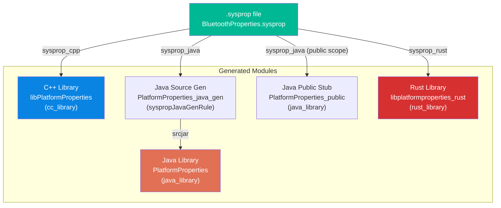

### 6.6.5 生成的 Java 代码

对于一个如下定义的属性：

```protobuf
prop {
    api_name: "snoop_default_mode"
    type: Enum
    scope: Public
    access: ReadWrite
    enum_values: "empty|disabled|filtered|full"
    prop_name: "persist.bluetooth.btsnoopdefaultmode"
}
```

生成的 Java 代码将如下所示：

```java
package android.sysprop;

public final class BluetoothProperties {
    // Enum type
    public enum snoop_default_mode_values {
        EMPTY("empty"),
        DISABLED("disabled"),
        FILTERED("filtered"),
        FULL("full");
        ...
    }

    // Getter
    public static Optional<snoop_default_mode_values> snoop_default_mode() {
        String value = SystemProperties.get("persist.bluetooth.btsnoopdefaultmode");
        // tryParseEnum is a private helper emitted into the generated class
        return Optional.ofNullable(
                tryParseEnum(snoop_default_mode_values::valueOf, value));
    }

    // Setter (because access: ReadWrite)
    public static void snoop_default_mode(snoop_default_mode_values value) {
        SystemProperties.set("persist.bluetooth.btsnoopdefaultmode",
                              value.getPropValue());
    }
}
```

### 6.6.6 生成的 C++ 代码

对应的 C++ 代码生成如下（命名空间来自将 `module` 名称中的点替换为 `::`，见 `system/tools/sysprop/CppGen.cpp` 中的 `GetCppNamespace()`）：

```cpp
namespace android::sysprop::BluetoothProperties {

// Getter returning std::optional of the generated enum type
std::optional<snoop_default_mode_values> snoop_default_mode();

// Setter returning bool (true on success)
bool snoop_default_mode(const std::optional<snoop_default_mode_values>& value);

}  // namespace android::sysprop::BluetoothProperties
```

### 6.6.7 生成代码中的 Scope 与访问控制

`scope` 字段控制生成什么：

- **`Public`：** 该属性同时出现在内部和公共的生成库中，并通过生成的公共存根库导出。（过去用于保护这一表面的检查入库 API 文件兼容性检查已在 Android 17 中移除——见第 6.6.8 节。）
- **`Internal`：** 该属性只出现在内部库中。它不属于稳定 API 表面的一部分。

`access` 字段控制生成哪些方法：

- **`Readonly`：** 只生成 getter。该属性名通常不以 `persist.` 开头，而是在构建时或启动期间设置。
- **`Writeonce`：** 同时生成 getter 和 setter，但 setter 被标注为一次性使用（用于 `ro.*` 属性）。
- **`ReadWrite`：** 同时生成 getter 和 setter。

### 6.6.8 API 稳定性（Android 17 简化）

历史上，`sysprop_library` 通过一个两文件检查来强制执行 API 稳定性。每个模块检查入库一份 `api/<name>-current.txt` 和一份 `api/<name>-latest.txt`。`GenerateAndroidBuildActions()` 从 `.sysprop` 源文件导出 API，并与这两个文件比较（与 `current.txt` 完全相同，且向后兼容 `latest.txt`）。重命名属性、更改其类型或删除它都会导致构建失败，除非重新生成这些检查入库的文本文件。

Android 17 移除了该机制。"Remove sysprop as API txt files" 变更删除了整个 `system/libsysprop` 中各模块的 `api/*-current.txt` / `*-latest.txt` 文件。现在树中不再有此类文件。同一变更还从 Soong 中剥离了导出并比较的逻辑。在 17 中，`sysprop_library` 的 `GenerateAndroidBuildActions()` 除了验证每个源文件确实是 `.sysprop` 文件之外什么都不做：

```go
// Source: build/soong/sysprop/sysprop_library.go
// GenerateAndroidBuildActions of sysprop_library handles API dump and API check.
// generated java_library will depend on these API files.
func (m *syspropLibrary) GenerateAndroidBuildActions(ctx android.ModuleContext) {
    srcs := android.PathsForModuleSrc(ctx, m.properties.Srcs)
    for _, syspropFile := range srcs {
        if syspropFile.Ext() != ".sysprop" {
            ctx.PropertyErrorf("srcs", "srcs contains non-sysprop file %q",
                               syspropFile.String())
        }
    }
    if ctx.Failed() {
        return
    }
}
```

`sysprop_library` 暴露了一个构建时 API 表面。现在完全由每个 `.sysprop` 条目中的 `scope` 字段（第 6.6.7 节）和跨分区的 `property_owner` 规则（第 6.6.3 节）来管理它。检查入库的 API 快照不再参与。模块上的 `Api_packages` 属性仍然命名了被文档化并作为 API 公开的包：

```go
// Source: build/soong/sysprop/sysprop_library.go
type syspropLibraryProperties struct {
    // Determine who owns this sysprop library. Possible values are
    // "Platform", "Vendor", or "Odm"
    Property_owner string

    // list of package names that will be documented and publicized as API
    Api_packages []string
    ...
}
```

旧设计的一个残留仍然留在源代码中。`build/soong/sysprop/sysprop_library.go` 中的提供者结构体 `SyspropLibraryInfo` 仍然带有 `CheckApiFileTimeStamp`（以及 `CurrentApiFile`）字段。两者都没有连接到任何导出并比较的命令。对开发者的实际影响是，编辑 `.sysprop` 文件不再需要一个单独的 `m <module>-dump-api` 步骤来刷新检查入库的 API 文本。

### 6.6.9 与 property_contexts 的集成

`sysprop_library` 模块自动与属性类型检查系统集成。所有 sysprop 库的列表在构建时收集：

```go
// Source: build/soong/sysprop/sysprop_library.go
if m.ExportedToMake() {
    syspropLibrariesLock.Lock()
    defer syspropLibrariesLock.Unlock()

    libraries := syspropLibraries(ctx.Config())
    *libraries = append(*libraries, "//"+ctx.ModuleDir()+":"+ctx.ModuleName())
}
```

该列表由 property_contexts 构建规则使用，以确保 property_contexts 中的类型约束与 `.sysprop` 文件中声明的一致。

### 6.6.10 生成访问器中的默认值

按照定义，`.sysprop` 属性在有东西写入它之前是"未设置"的。历史上，每个生成的 getter 都返回 `Optional`/`std::optional`，调用者必须用自己的回退来解包。Android 17 向属性 schema 添加了 `default_value` 字段。回退因此可以放在 `.sysprop` 定义本身中，而代码生成器会把它烘焙进访问器。

该字段是 `Property` 消息中的 `default_value`（字段 10）：

```protobuf
# Source: system/tools/sysprop/sysprop.proto
message Property {
  string api_name = 1;
  Type type = 2;
  Access access = 3;
  Scope scope = 4;
  string prop_name = 5;
  string enum_values = 6;
  bool integer_as_bool = 7;
  bool deprecated = 8;
  string legacy_prop_name = 9;
  string default_value = 10;
}
```

当非列表属性设置了 `default_value` 时，Java 生成器会将 getter 的返回类型从 `Optional<T>` 改为裸 `T`。getter 读取属性。如果结果是空字符串（属性未设置），它会在解析前替换默认值。然后通过 `.orElse(null)` 直接返回解析后的值：

```cpp
// Source: system/tools/sysprop/JavaGen.cpp
if (prop.default_value().empty()) {
  writer.Write("public static Optional<%s> %s() {\n", prop_type.c_str(),
               prop_id.c_str());
} else {
  // With a default, the accessor returns T, not Optional<T>.
  writer.Write("public static %s %s() {\n", prop_type.c_str(), prop_id.c_str());
}
...
writer.Write("String value = SystemProperties.get(\"%s\");\n",
             prop.prop_name().c_str());
...
if (!prop.default_value().empty()) {
  writer.Write("if (\"\".equals(value)) {\n");
  writer.Indent();
  writer.Write("value = \"%s\";\n", prop.default_value().c_str());
  writer.Dedent();
  writer.Write("}\n");
}
```

相同的 `default_value` 替换也接入了 C++ 生成器（`system/tools/sysprop/CppGen.cpp`）和 Rust 生成器（`system/tools/sysprop/RustGen.cpp`）。每个生成器直接从解析后的 schema 读取该字段。（`system/tools/sysprop/Common.cpp` 中的 `SetDefaultValues()`，尽管叫这个名字，实际上只填充空的 `prop_name` 并把已弃用的 `System` scope 改写为 `Public`——它从不触碰 `default_value`。）

因此，声明了 `default_value: "true"` 的属性所暴露的 getter，在属性未设置时只需返回 `true`。这消除了 6.6.5 的示例中对于没有默认值的属性仍然展示的每个调用者的 `orElse(...)` 样板代码。这与 `legacy_prop_name`（第 6.6.2 节）互补。被重命名的属性可以回退到其旧键。如果旧键也未设置，该属性可以回退到声明的默认值。所有这些都发生在生成的访问器内部。

---

## 6.7 Vendor 属性与 Treble 隔离

### 6.7.1 Vendor 接口与属性命名空间

Android 的 Project Treble 引入了系统分区与 vendor 分区之间的严格分离。对于系统属性，这意味着：

1. **Vendor 属性应使用 `vendor.` 或 `persist.vendor.` 前缀。** 这确保它们明确位于 vendor 命名空间中。

2. **系统组件不应依赖厂商专用属性。** `sysprop_library` 所有权模型在构建时强制执行这一点。

3. **对 vendor 代码可见的平台属性必须是稳定的。** 当 vendor 代码使用由 `Platform` 拥有的 `sysprop_library` 时，只有 `Public` scope 的属性可以访问。（过去与此相伴的检查入库 API 文件兼容性检查已在 Android 17 中移除；见第 6.6.8 节。）

### 6.7.2 Vendor 属性上下文

vendor 分区在 `/vendor/etc/selinux/vendor_property_contexts` 提供自己的 property_contexts 文件。该文件定义了厂商专用属性的 SELinux 标签。

从 vendor 分区文件加载属性时，属性服务使用一个特殊的 vendor 上下文：

```c
// Source: system/core/init/property_service.cpp
static void LoadProperties(char* data, const char* filter,
    const char* filename, std::map<std::string, std::string>* properties) {
    static constexpr const char* const kVendorPathPrefixes[4] = {
        "/vendor",
        "/odm",
        "/vendor_dlkm",
        "/odm_dlkm",
    };

    const char* context = kInitContext;
    if (SelinuxGetVendorAndroidVersion() >= __ANDROID_API_P__) {
        for (const auto& vendor_path_prefix : kVendorPathPrefixes) {
            if (StartsWith(filename, vendor_path_prefix)) {
                context = kVendorContext;
            }
        }
    }
    ...
}
```

这意味着从 vendor 分区文件加载的属性会以 vendor SELinux 上下文设置，该上下文与平台（init）上下文有不同的访问规则。

### 6.7.3 Vendor API 级别

`ro.vendor.api_level` 属性由 init 自动计算，以反映 vendor 分区必须支持的最低 API 级别：

```c
// Source: system/core/init/property_service.cpp
static void property_initialize_ro_vendor_api_level() {
    constexpr auto VENDOR_API_LEVEL_PROP = "ro.vendor.api_level";

    if (__system_property_find(VENDOR_API_LEVEL_PROP) != nullptr) {
        return;  // Already set explicitly in vendor/build.prop
    }

    const auto board_first_api_level =
        GetIntProperty("ro.board.first_api_level", __ANDROID_VENDOR_API_MAX__);
    const bool is_frozen_chipset =
        board_first_api_level != __ANDROID_VENDOR_API_MAX__;

    // In Android U and earlier ro.board.api_level may be undefined, so fall back
    // to the first api level.
    const auto board_api_level =
        GetIntProperty("ro.board.api_level", board_first_api_level);

    // A frozen chipset may lower ro.vendor.api_level to the board API level, since
    // the vendor image is frozen and not expected to change anymore.
    const auto effective_board_api_level =
        is_frozen_chipset ? board_api_level : __ANDROID_VENDOR_API_MAX__;

    auto product_first_api_level =
        GetIntProperty("ro.product.first_api_level", __ANDROID_API_FUTURE__);
    if (product_first_api_level == __ANDROID_API_FUTURE__) {
        product_first_api_level =
            GetIntProperty("ro.build.version.sdk", __ANDROID_API_FUTURE__);
    }

    auto vendor_api_level = std::min(
        AVendorSupport_getVendorApiLevelOf(product_first_api_level),
        effective_board_api_level);

    PropertySetNoSocket(VENDOR_API_LEVEL_PROP,
                         std::to_string(vendor_api_level), &error);
}
```

`is_frozen_chipset` 标志是关键的细微之处。声明了 `ro.board.first_api_level` 的芯片组拥有冻结的 vendor 镜像，因此 init 可以将 `ro.vendor.api_level` 钉在板级的 API 级别上。非冻结的芯片组则使用 `__ANDROID_VENDOR_API_MAX__` 作为板级贡献。最终值是该值与通过 `AVendorSupport_getVendorApiLevelOf()` 从产品/SDK 侧推导出的 API 级别中的最小值。

### 6.7.4 跨分区属性访问规则

`sysprop_library` 构建系统基于所有权和安装分区来强制执行访问规则：

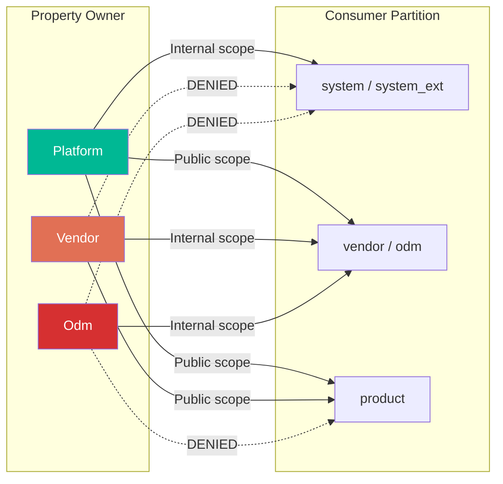

关键规则：

- **Platform 拥有**的属性由 system/system_ext（所有者自己的分区）上的代码以 `Internal` scope 消费。只有 `Public` scope 表面会暴露给 vendor/odm 和 product 消费者。
- **Vendor 拥有**的属性不能从系统分区访问。
- **ODM 拥有**的属性只能从 vendor/ODM 分区访问。
- **Product** 分区始终使用 `Public` scope，因为它不能拥有属性。

### 6.7.5 ODM 与 Vendor DLKM 分区

ODM（原始设计制造商）和 DLKM（动态可加载内核模块）分区有自己的 build.prop 文件，由属性服务加载。加载顺序确保 ODM 属性覆盖 vendor 属性：

```
vendor/default.prop       -> loaded first
vendor/build.prop         -> overrides vendor/default.prop
vendor_dlkm/etc/build.prop
odm_dlkm/etc/build.prop
odm/etc/build.prop        -> overrides all vendor properties
```

这种层级结构允许 ODM 在不修改 vendor 分区的情况下自定义 vendor 属性。

---

## 6.8 启动属性

### 6.8.1 构建属性（ro.build.*）

构建属性在构建时由构建系统设置，并嵌入在 `build.prop` 文件中。它们描述构建配置：

| 属性 | 描述 | 示例 |
|----------|-------------|---------|
| `ro.build.display.id` | 构建的显示字符串 | `UP1A.231005.007` |
| `ro.build.version.incremental` | 增量构建号 | `10817346` |
| `ro.build.version.sdk` | SDK API 级别 | `34` |
| `ro.build.version.release` | 用户可见版本 | `14` |
| `ro.build.version.security_patch` | 安全补丁日期 | `2023-10-05` |
| `ro.build.type` | 构建类型 | `user` / `userdebug` / `eng` |
| `ro.build.tags` | 构建标签 | `release-keys` / `dev-keys` |
| `ro.build.fingerprint` | 复合指纹 | （推导得出） |
| `ro.build.id` | 构建 ID | `UP1A.231005.007` |

### 6.8.2 构建指纹推导

如果没有显式设置，构建指纹会被自动推导：

```c
// Source: system/core/init/property_service.cpp
static void property_derive_build_fingerprint() {
    std::string build_fingerprint = GetProperty("ro.build.fingerprint", "");
    if (!build_fingerprint.empty()) {
        return;  // Already set explicitly
    }

    const std::string UNKNOWN = "unknown";
    build_fingerprint = GetProperty("ro.product.brand", UNKNOWN);
    build_fingerprint += '/';
    build_fingerprint += GetProperty("ro.product.name", UNKNOWN);

    // 16KB page size device option support
    bool has16KbDevOption =
        android::base::GetBoolProperty("ro.product.build.16k_page.enabled", false);
    if (has16KbDevOption && getpagesize() == 16384) {
        build_fingerprint += "_16kb";
    }

    build_fingerprint += '/';
    build_fingerprint += GetProperty("ro.product.device", UNKNOWN);
    build_fingerprint += ':';
    build_fingerprint += GetProperty("ro.build.version.release_or_codename", UNKNOWN);
    build_fingerprint += '/';
    build_fingerprint += GetProperty("ro.build.id", UNKNOWN);
    build_fingerprint += '/';
    build_fingerprint += GetProperty("ro.build.version.incremental", UNKNOWN);
    build_fingerprint += ':';
    build_fingerprint += GetProperty("ro.build.type", UNKNOWN);
    build_fingerprint += '/';
    build_fingerprint += GetProperty("ro.build.tags", UNKNOWN);

    PropertySetNoSocket("ro.build.fingerprint", build_fingerprint, &error);
}
```

得到的指纹看起来像：
`google/raven/raven:14/UP1A.231005.007/10817346:userdebug/dev-keys`

### 6.8.3 产品属性（ro.product.*）

产品属性描述设备身份。它们遵循一个分区专用的推导系统，其中每个分区可以定义自己的值，优先级顺序决定哪个值胜出：

```c
// Source: system/core/init/property_service.cpp
static void property_initialize_ro_product_props() {
    const char* RO_PRODUCT_PROPS[] = {
        "brand", "device", "manufacturer", "model", "name",
    };
    const char* RO_PRODUCT_PROPS_DEFAULT_SOURCE_ORDER =
        "product,odm,vendor,system_ext,system";

    std::string ro_product_props_source_order =
        GetProperty("ro.product.property_source_order", "");
    if (ro_product_props_source_order.empty()) {
        ro_product_props_source_order = RO_PRODUCT_PROPS_DEFAULT_SOURCE_ORDER;
    }

    for (const auto& ro_product_prop : RO_PRODUCT_PROPS) {
        std::string base_prop = "ro.product." + std::string(ro_product_prop);
        if (!GetProperty(base_prop, "").empty()) continue;

        for (const auto& source : Split(ro_product_props_source_order, ",")) {
            std::string target_prop = "ro.product." + source + "." + ro_product_prop;
            std::string target_prop_val = GetProperty(target_prop, "");
            if (!target_prop_val.empty()) {
                PropertySetNoSocket(base_prop, target_prop_val, &error);
                break;
            }
        }
    }
}
```

`ro.product.model` 的推导链：

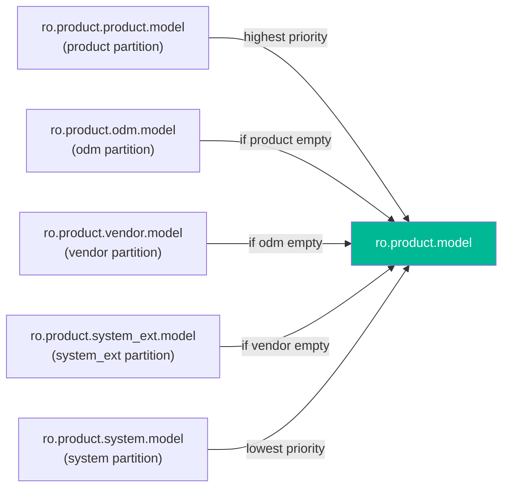

### 6.8.4 硬件属性（ro.hardware.*）

硬件属性描述物理硬件平台：

| 属性 | 来源 | 描述 |
|----------|--------|-------------|
| `ro.hardware` | 内核命令行 / DT | 硬件平台名称 |
| `ro.boot.hardware` | 内核命令行 | 启动硬件标识符 |
| `ro.hardware.chipname` | Vendor build.prop | SoC 芯片名称 |
| `ro.boot.hardware.cpu.pagesize` | 启动时推导 | CPU 页面大小 |

硬件属性通常从内核命令行设置，然后传播：

```c
// From ExportKernelBootProps():
{ "ro.boot.hardware", "ro.hardware", "unknown" }
```

CPU 页面大小属性是自动推导的：

```c
// Source: system/core/init/property_service.cpp
void PropertyLoadDerivedDefaults() {
    const char* PAGE_PROP = "ro.boot.hardware.cpu.pagesize";
    if (GetProperty(PAGE_PROP, "").empty()) {
        PropertySetNoSocket(PAGE_PROP, std::to_string(getpagesize()), &error);
    }
}
```

### 6.8.5 启动模式属性（ro.boot.*）

这些属性来自内核命令行（`androidboot.*`）和 bootconfig：

| 属性 | 描述 |
|----------|-------------|
| `ro.boot.serialno` | 设备序列号 |
| `ro.boot.mode` | 启动模式（normal、charger、recovery） |
| `ro.boot.baseband` | 基带版本 |
| `ro.boot.bootloader` | Bootloader 版本 |
| `ro.boot.hardware` | 硬件标识符 |
| `ro.boot.revision` | 硬件修订版 |
| `ro.boot.slot_suffix` | A/B slot 后缀（_a 或 _b） |
| `ro.boot.verifiedbootstate` | 验证启动状态（green/yellow/orange） |

内核命令行到属性的映射：

```
Kernel cmdline:  androidboot.serialno=ABC123
    -> Property:  ro.boot.serialno=ABC123

Bootconfig:      androidboot.hardware=tensor
    -> Property:  ro.boot.hardware=tensor
```

### 6.8.6 CPU ABI 列表属性

CPU ABI 列表属性决定了设备支持哪些指令集架构：

```c
// Source: system/core/init/property_service.cpp
static void property_initialize_ro_cpu_abilist() {
    const char* kAbilistSources[] = {
        "product", "odm", "vendor", "system",
    };

    // Find first source defining these properties
    for (const auto& source : kAbilistSources) {
        const auto abilist32_prop = "ro." + source + ".product.cpu.abilist32";
        const auto abilist64_prop = "ro." + source + ".product.cpu.abilist64";
        abilist32_prop_val = GetProperty(abilist32_prop, "");
        abilist64_prop_val = GetProperty(abilist64_prop, "");
        if (abilist32_prop_val != "" || abilist64_prop_val != "") {
            break;
        }
    }

    // Merge: 64-bit first, then 32-bit
    auto abilist_prop_val = abilist64_prop_val;
    if (abilist32_prop_val != "") {
        if (abilist_prop_val != "") abilist_prop_val += ",";
        abilist_prop_val += abilist32_prop_val;
    }

    PropertySetNoSocket("ro.product.cpu.abilist", abilist_prop_val, &error);
    PropertySetNoSocket("ro.product.cpu.abilist32", abilist32_prop_val, &error);
    PropertySetNoSocket("ro.product.cpu.abilist64", abilist64_prop_val, &error);
}
```

典型值：

- `ro.product.cpu.abilist` = `arm64-v8a,armeabi-v7a,armeabi`
- `ro.product.cpu.abilist64` = `arm64-v8a`
- `ro.product.cpu.abilist32` = `armeabi-v7a,armeabi`

### 6.8.7 完整的启动属性加载时间线

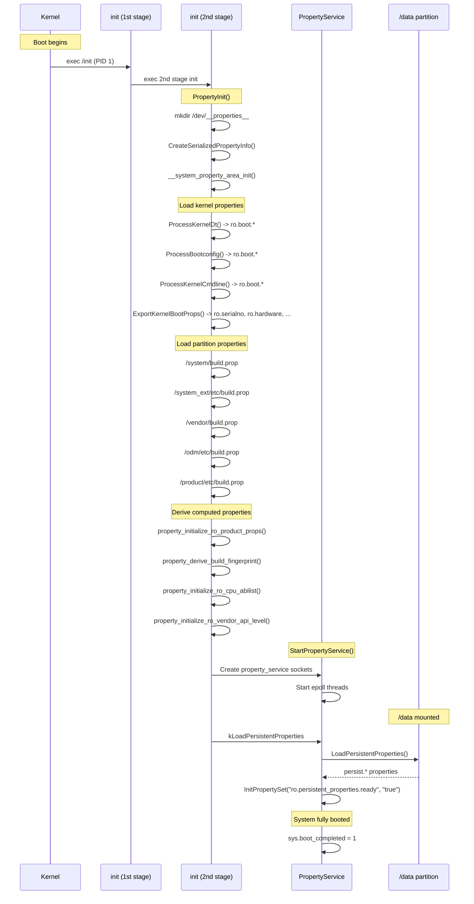

---

## 6.9 Android 17 属性变更

属性机制已经成熟，因此 Android 17 的变更是完善而非重新设计。它们集中在两个领域：init/SELinux 写入路径和 Soong `sysprop_library` 构建机制。本节汇总了前文各节融入上下文的那些变更及其源代码锚点，使本章同时可以作为 16 到 17 的检查清单。

### 6.9.1 sysprop_library 移除 API 文本文件检查

最大的变化是移除了 `sysprop_library` API 快照文件。在 17 之前，每个模块都检查入库 `api/<name>-current.txt` 和 `api/<name>-latest.txt`，Soong 会从 `.sysprop` 源文件导出 API，并在每次构建时与这两个文件比较。Android 17 从 `system/libsysprop` 中删除了这些文件（树中已无残留）。它还从 `build/soong/sysprop/sysprop_library.go` 中剥离了导出并比较的逻辑。该模块的 `GenerateAndroidBuildActions()` 现在只验证源文件扩展名。

sysprop 库暴露的稳定表面由每个属性的 `scope` 和 `property_owner` 跨分区规则管理，而不是由检查入库的 API 文件管理。第 6.6.8 节讲解了新的代码路径。

### 6.9.2 .sysprop schema 中的默认值与旧名称

`system/tools/sysprop/sysprop.proto` 中的 `.sysprop` schema 新增了一个 `default_value` 字段（字段 10）。设置后，生成的 Java/C++/Rust getter 会返回一个具体值而不是 `Optional`。当属性未设置时，它会替换为声明的默认值。这消除了每个调用者的 `orElse(...)` 样板代码。

这与 `legacy_prop_name`（字段 9）配合使用，后者让被重命名的属性可以回退到其旧键。两个字段都由 `JavaGen.cpp`、`CppGen.cpp` 和 `RustGen.cpp` 直接消费。第 6.6.10 节展示了生成的代码。

### 6.9.3 写入时更详细的 SELinux 拒绝信息

`system/core/init/property_service.cpp` 中的 `CheckPermissions()` 现在会把源和目标 SELinux 上下文嵌入错误字符串中。当 `property_service { set }` 检查失败时，它返回该字符串（"init: enhance SELinux denial error message for set property service"）。审计速率限制器可能会丢弃内核的 AVC 拒绝日志。因此，当 init 自己报告 `source_context=...` / `target_context=...` 时会很有帮助。属性设置失败因此变得容易排查得多。

同一个函数还通过 `CheckControlPropertyPerms()` 使其 `ctl.` 权限处理变得显式，该函数同时检查旧的 `ctl.<service>` 形式和较新的 `ctl.<action>$<service>` 形式。第 6.3.3 和 6.3.5 节介绍了写入路径检查。

### 6.9.4 加载文件时的属性展开，以及冻结芯片组的 api_level

两个较小的 init 完善补全了这一组变更。首先，`LoadProperties()`——`load_properties_from_file()` 委托给它的解析器——现在会对从文件中读取的 `import` 文件名和属性值都运行 `ExpandProps()`。因此，`build.prop` 中的 `${ro.foo}` 风格引用会在文件加载时被解析：

```c
// Source: system/core/init/property_service.cpp, LoadProperties()
auto expanded_value = ExpandProps(value);
```

其次，`property_initialize_ro_vendor_api_level()` 获得了第 6.7.3 节描述的 `is_frozen_chipset` 逻辑。声明了 `ro.board.first_api_level` 的芯片组被视为冻结。它可以将 `ro.vendor.api_level` 降低到板级 API 级别，而不是总是贡献 `__ANDROID_VENDOR_API_MAX__`。

### 6.9.5 aconfig 与 sysprop：何时用哪个

17 时代一个反复出现的问题是：何时使用系统属性，何时使用 aconfig 标志（第 3 章）。它们解决不同的问题，对新代码而言边界很重要：

- **系统属性 / `sysprop_library`** 是一个运行时的、设备级的键值存储。值可以在运行时读取（对可变命名空间还可以写入）。值可以跨重启持久化（`persist.*`）。它们由 bootloader 设置（`ro.boot.*`）。SELinux 上下文和 Treble 所有权对它们进行分区。用于设备配置、构建身份、运行时状态以及 vendor/HAL 可调参数——即随设备或随启动而变化的东西。
- **aconfig 标志** 是构建时声明的特性标志，带有生成的、类型化的访问器和发布列车上线模型。它们决定某条代码路径对给定构建是否*编译进去并启用*，并通过生成的 `*_flags` 库读取，而不是通过 `SystemProperties` 读取。用于在标志后面落地一个特性，并按计划开启它。

在实践中，`sysprop_library` 回答"这台设备现在被配置成做什么"，而 aconfig 回答"这个特性是否为这个构建开启了"。Android 17 继续将一次性布尔型 `ro.*`/`persist.*` 调试开关迁移到 aconfig（当目标是特性门控时）。它把真正的设备配置留在属性存储上。两者互补，不可互换。

---

## 6.10 Rust 系统属性 API：librustutils

属性存储拥有比 Java `SystemProperties` 类（第 6.5 节）和 bionic C 入口点（第 6.1 节）更多的一等客户端。

Android 现在发布了越来越多的用 Rust 编写的平台组件层。例如 keystore2、Rust zygote、init 的一部分、KeyMint HAL 和 eBPF 加载器。这些组件不会直接链接 bionic 的 C API。

它们通过一个小型 Rust crate `librustutils`（位于 `system/librustutils/`）来读取、写入和监听属性。它是本章所讲的 C 和 Java API 在 Rust 一侧的补充。值得理解，因为它*就是* Rust 平台代码接触属性存储的方式。

### 6.10.1 这个 crate 是什么

`librustutils` 是一个约 1.75K 行的 Rust crate，是对少量 bionic 设施的安全封装。否则 Rust 组件就得通过原始 FFI 调用这些设施。它的模块映射声明在 `system/librustutils/rustutils/src/lib.rs` 和 `system/librustutils/rustutils/src/android.rs` 中：

- `system_properties`——对 bionic 系统属性的安全的 get/set/wait，外加一个 `PropertyWatcher` 类型。这是与本章相关的部分。
- `sockets`——`android_get_control_socket()`，为 init 创建并命名的 Unix 域套接字返回一个 `OwnedFd`（第 4 章的套接字传递机制）。
- `inherited_fd`——对跨 `exec` 继承的文件描述符的安全 `OwnedFd` 所有权。
- 较小的辅助模块：`process`、`rootdev`、`users` 和一个 `log` 模块。

该 crate 在 `system/librustutils/rustutils/Android.bp` 中作为 `librustutils` 构建。系统属性模块通过自动生成的 bindgen 封装 `libsystem_properties_bindgen` 到达 bionic。该封装的允许列表（在同一 `Android.bp` 中）精确锁定了该 crate 需要的五个 bionic 符号：`__system_property_find`、`__system_property_foreach`、`__system_property_read_callback`、`__system_property_set` 和 `__system_property_wait`。在安全的 Rust 表面之下，下面的每个调用都是这些 bionic 调用之一。它使用本章前面描述的相同的共享内存读取路径和属性服务写入路径。它没有引入任何新的 IPC 机制。

### 6.10.2 读取、写入与迭代

`system/librustutils/rustutils/src/android/system_properties.rs` 中的自由函数覆盖了常见用例。调用者从不接触指针：

```rust
// Source: system/librustutils/rustutils/src/android/system_properties.rs

/// Reads a system property. Returns Ok(None) if the property doesn't exist.
pub fn read(name: &str) -> Result<Option<String>>;

/// Returns the property's value as a bool ("1"/"y"/"yes"/"on"/"true" ->
/// true, "0"/"n"/"no"/"off"/"false" -> false), or default_value otherwise.
pub fn read_bool(name: &str, default_value: bool) -> Result<bool>;

/// Writes a system property (wraps __system_property_set).
pub fn write(name: &str, value: &str) -> Result<()>;

/// Iterates the properties the current process is allowed to access.
pub fn foreach<F>(mut f: F) -> Result<()> where F: FnMut(&str, &str);
```

`read()` 和 `read_bool()` 反映了与 Java `getBoolean()` 接受的相同的布尔值解析词汇表（第 6.5.2 节）。当 `__system_property_set` 返回 `-1` 时，`write()` 返回 `PropertyWatcherError::SetPropertyFailed`。这就是 Rust 调用者看到 SELinux 拒绝或属性服务报告的一次性写入违规（第 6.3.3 节）的方式。如果属性区域未设置，`foreach()` 返回 `PropertyWatcherError::Uninitialized`。

错误是一个类型化的 `enum`，即定义在 `system/librustutils/rustutils/src/android/system_properties/error.rs` 中的 `PropertyWatcherError`。它有表示属性不存在、区域未初始化、等待超时、名称或值中包含 NUL 字节以及非 UTF-8 值的变体。因此，C API 以裸 `-1` 报告的失败变成了可匹配的 Rust 值。

### 6.10.3 PropertyWatcher：观察变更

最具特色的类型是 `PropertyWatcher`。C API 暴露了 `__system_property_wait`，它在 futex 上阻塞，直到属性的序列号发生变化。第 6.1.6 节的无等待协议会递增该序列号。`PropertyWatcher` 把这个循环封装成一个跟踪序列号的安全对象。因此 Rust 代码可以在没有竞争的情况下等待属性出现、变更或达到特定值：

```rust
// Source: system/librustutils/rustutils/src/android/system_properties.rs
pub struct PropertyWatcher {
    prop_name: CString,
    prop_info: Option<&'static PropInfo>,
    serial: c_uint,
}

impl PropertyWatcher {
    pub fn new(name: &str) -> Result<Self>;
    // Read current name/value via __system_property_read_callback.
    pub fn read<T, F>(&mut self, f: F) -> Result<T> where F: FnMut(&str, &str) -> T;
    pub fn read_string(&mut self) -> Result<Option<String>>;
    // Block until the property changes, or the timeout elapses.
    pub fn wait(&mut self, timeout: Option<Duration>) -> Result<()>;
    // Block until the property exists and equals expected_value.
    pub fn wait_for_value(&mut self, expected_value: &str,
                          timeout: Option<Duration>) -> Result<()>;
}
```

在内部，`wait()` 记录它看到的上一次变更的序列号。它把该数字传回 `__system_property_wait`，因此两次等待之间发生的变更不会被漏掉。如果被监视的属性尚不存在，监视器首先等待*全局*序列号（一个空的 `prop_info`），直到该属性被创建。然后它切换到该属性自己的序列号。这正是 keystore2 在启动里程碑上阻塞的方式。例如，参见 `system/security/keystore2/src/globals.rs` 中的 `PropertyWatcher::new("sys.boot_completed")` 以及对 `keystore.boot_level` 的监视器（见 `system/security/keystore2/src/super_key.rs`）。

### 6.10.4 它的位置与使用者

两件事使 `librustutils` 成为本章前面 API 的自然 Rust 对应物。首先，许多模块依赖它：整个树中约有 87 个构建模块在其 `Android.bp` 中列出了 `librustutils`。其中包括 `system/security/keystore2/Android.bp`、`system/zygote/zygote/Android.bp` 中的 Rust zygote、`system/keymint/hal/Android.bp` 中的 KeyMint HAL，以及 `system/bpf/loader/Android.bp` 中的 eBPF 加载器。

其次，它是 Soong `sysprop_library` 生成器为 Rust 目标生成的运行时。`system/librustutils/rustutils/src/android/system_properties/parsers_formatters.rs` 中的 `parsers_formatters` 模块被文档标注为"should only be used in the system properties generated code"。该 crate 中 `error.rs` 文件里的 `SysPropError` enum 就是生成的 Rust 访问器返回的东西。这正是第 6.6 节描述的同一个由 `.sysprop` 驱动的 `RustGen.cpp` 路径。因此，从 Rust 使用的、类型化的 `sysprop_library` 访问器最终会通过这个 crate 读写。Java 访问器以同样的方式通过 `android.os.SystemProperties`。

结论是：当平台上的一个 Rust 组件需要一个属性时，它不会重新发明套接字协议或共享内存读取。它调用 `rustutils::android::system_properties::{read, write, read_bool, foreach}` 或构造一个 `PropertyWatcher`。该 crate 把请求汇聚到与 C 和 Java API 使用的完全相同的 bionic 原语和属性服务路径上。

---

## 6.11 动手实践：探索系统属性

本节提供动手练习，帮助你理解系统属性机制。所有练习都假设你有一个通过 `adb` 连接的设备或模拟器，运行 `userdebug` 或 `eng` 构建。

### 6.11.1 练习：列出与查看属性

**列出所有属性：**

```bash
# List all properties (typically 800-1200 on a real device)
adb shell getprop | wc -l

# List all read-only properties
adb shell getprop | grep "^\[ro\."

# List all persistent properties
adb shell getprop | grep "^\[persist\."
```

**读取特定属性：**

```bash
# Build fingerprint
adb shell getprop ro.build.fingerprint

# Device model
adb shell getprop ro.product.model

# API level
adb shell getprop ro.build.version.sdk

# Boot mode
adb shell getprop ro.bootmode

# Check if device is debuggable
adb shell getprop ro.debuggable
```

**查看属性区域文件：**

```bash
# List the property area files
adb shell ls -la /dev/__properties__/

# Check the property_info file size
adb shell ls -la /dev/__properties__/property_info

# Count property area files (one per SELinux context)
adb shell ls /dev/__properties__/ | wc -l
```

### 6.11.2 练习：设置与观察属性

**设置一个调试属性：**

```bash
# Set a debug property (allowed for shell user on userdebug builds)
adb shell setprop debug.mytest.value "hello world"

# Verify it was set
adb shell getprop debug.mytest.value
# Output: hello world

# Try setting a persist property
adb shell setprop persist.mytest.value "survives reboot"
adb shell getprop persist.mytest.value

# Reboot and verify persistence
adb reboot
# After reboot:
adb shell getprop persist.mytest.value
# Output: survives reboot
```

**观察只读约束：**

```bash
# Try to change a read-only property (will fail)
adb shell setprop ro.build.type "eng"
# This will silently fail or produce an error

# Verify it didn't change
adb shell getprop ro.build.type
```

### 6.11.3 练习：观察属性变更

**用 shell 循环轮询一个属性：**

```bash
# In one terminal, wait for a property to change
adb shell "
    echo 'Waiting for debug.mytest.signal...'
    while [ \"\$(getprop debug.mytest.signal)\" != 'go' ]; do
        sleep 0.1
    done
    echo 'Signal received!'
"

# In another terminal, trigger the change
adb shell setprop debug.mytest.signal go
```

**用 `__system_property_wait()` 阻塞等待属性变更：**

旧的 `watchprops` 工具在 Android 6.0（Marshmallow）之后被移除了。因此没有现成的 shell 命令能流式输出属性变更。要不用轮询来等待，可以围绕 bionic 的 `__system_property_wait()` 构建一个小型原生程序：

```c
// watch_prop.c -- block until the named property changes, then print it
#include <stdio.h>
#include <sys/system_properties.h>

int main(int argc, char** argv) {
    if (argc != 2) return 1;
    const prop_info* pi = __system_property_find(argv[1]);
    if (!pi) return 1;
    uint32_t serial = __system_property_serial(pi);
    __system_property_wait(pi, serial, &serial, NULL);  // blocks until a change
    char value[PROP_VALUE_MAX];
    __system_property_get(argv[1], value);
    printf("%s = %s\n", argv[1], value);
    return 0;
}
```

（Rust 代码可以用 `rustutils::android::system_properties::PropertyWatcher` 达到同样的目的。）把该二进制推送到设备上，并针对 `debug.mytest.signal` 运行它。然后从另一个终端用 `setprop` 设置该属性，观察它被唤醒。

### 6.11.4 练习：检查属性上下文

**查看 property_contexts 文件：**

```bash
# Platform property contexts
adb shell cat /system/etc/selinux/plat_property_contexts | head -30

# Vendor property contexts
adb shell cat /vendor/etc/selinux/vendor_property_contexts | head -20

# Check what context a specific property has
adb shell getprop -Z debug.test.value
```

**测试 SELinux 强制：**

```bash
# Check what your shell's SELinux context is
adb shell id -Z

# Try to set a property you shouldn't have access to
adb shell setprop ro.boot.serialno "fake"
# This should fail due to both read-only and SELinux restrictions

# Check the audit log for denials
adb shell dmesg | grep "avc.*property_service"
```

### 6.11.5 练习：持久化属性存储

**查看持久化属性文件：**

```bash
# Check the persistent properties file
adb shell ls -la /data/property/

# The file is protobuf-encoded, so it's not directly human-readable
# You can examine it with a hex dump
adb shell xxd /data/property/persistent_properties | head -20
```

**跟踪持久化属性写入：**

```bash
# Set a persistent property and observe the file update
adb shell "
    ls -la /data/property/persistent_properties
    setprop persist.mytest.timestamp \$(date +%s)
    ls -la /data/property/persistent_properties
"
# The file size and modification time should change
```

### 6.11.6 练习：属性推导链

**追踪产品属性推导：**

```bash
# See where ro.product.model comes from
# Check each source partition:
echo "System:     $(adb shell getprop ro.product.system.model)"
echo "System_ext: $(adb shell getprop ro.product.system_ext.model)"
echo "Vendor:     $(adb shell getprop ro.product.vendor.model)"
echo "ODM:        $(adb shell getprop ro.product.odm.model)"
echo "Product:    $(adb shell getprop ro.product.product.model)"
echo ""
echo "Final:      $(adb shell getprop ro.product.model)"
echo "Source order: $(adb shell getprop ro.product.property_source_order)"
```

**查看构建指纹的组成部分：**

```bash
echo "Brand:   $(adb shell getprop ro.product.brand)"
echo "Name:    $(adb shell getprop ro.product.name)"
echo "Device:  $(adb shell getprop ro.product.device)"
echo "Release: $(adb shell getprop ro.build.version.release_or_codename)"
echo "ID:      $(adb shell getprop ro.build.id)"
echo "Incr:    $(adb shell getprop ro.build.version.incremental)"
echo "Type:    $(adb shell getprop ro.build.type)"
echo "Tags:    $(adb shell getprop ro.build.tags)"
echo ""
echo "Fingerprint: $(adb shell getprop ro.build.fingerprint)"
```

### 6.11.7 练习：通过属性控制服务

**使用 ctl.* 属性控制服务：**

```bash
# List running services
adb shell getprop | grep "init.svc\." | grep running

# Check a specific service state
adb shell getprop init.svc.adbd

# Restart a service via ctl property (requires appropriate permissions)
adb root
adb shell setprop ctl.restart adbd

# Watch the service state change
adb shell "
    echo 'Before: '$(getprop init.svc.adbd)
    setprop ctl.restart adbd
    sleep 1
    echo 'After:  '$(getprop init.svc.adbd)
"
```

### 6.11.8 练习：构建一个 sysprop_library

**创建一个最小化的 sysprop_library：**

创建一个 `.sysprop` 文件：

```protobuf
# my_module/MyAppProperties.sysprop
module: "com.example.MyAppProperties"
owner: Platform

prop {
    api_name: "debug_enabled"
    type: Boolean
    scope: Internal
    access: ReadWrite
    prop_name: "persist.myapp.debug_enabled"
}

prop {
    api_name: "max_connections"
    type: Integer
    scope: Internal
    access: ReadWrite
    prop_name: "persist.myapp.max_connections"
}
```

创建 `Android.bp`：

```json
sysprop_library {
    name: "MyAppProperties",
    srcs: ["MyAppProperties.sysprop"],
    property_owner: "Platform",
}
```

构建之后，生成的库提供类型安全的访问：

```java
// Generated Java usage
import com.example.MyAppProperties;

// Type-safe boolean getter (returns Optional<Boolean>)
Optional<Boolean> debug = MyAppProperties.debug_enabled();
if (debug.orElse(false)) {
    Log.d(TAG, "Debug mode is enabled");
}

// Type-safe integer getter
Optional<Integer> maxConn = MyAppProperties.max_connections();
int connections = maxConn.orElse(10);

// Type-safe setters
MyAppProperties.debug_enabled(true);
MyAppProperties.max_connections(20);
```

### 6.11.9 练习：测量属性读取性能

**基准测试属性读取：**

```bash
# Time 10000 property reads
adb shell "
    START=\$(date +%s%N)
    for i in \$(seq 1 10000); do
        getprop ro.build.fingerprint > /dev/null
    done
    END=\$(date +%s%N)
    ELAPSED=\$(( (END - START) / 1000000 ))
    echo \"10000 reads in \${ELAPSED}ms\"
    echo \"Average: \$(( ELAPSED * 1000 / 10000 )) us per read\"
"
```

注意，`getprop` 有进程创建开销。实际的共享内存查找要快得多（通常低于 1 微秒）。更准确的基准测试会使用一个直接调用 `__system_property_find()` 和 `__system_property_read_callback()` 的原生程序。

### 6.11.10 练习：在内存中探索属性 trie

**使用 debuggerd 查看属性内存映射：**

```bash
# Find the init process
adb shell "cat /proc/1/maps | grep __properties__"
# This shows the memory-mapped property regions for init

# For any other process, replace 1 with the PID:
PID=$(adb shell pidof com.android.systemui)
adb shell "cat /proc/$PID/maps | grep __properties__"
```

这个练习表明，每个进程都在可能不同的虚拟地址上映射了属性区域。但它们全部通过共享的内存映射文件引用相同的物理页。

---

## 总结

Android 的系统属性看起来很简单，但在键值接口之下隐藏着相当可观的复杂性。该架构通过几个相互协作的子系统实现了其设计目标：

1. **无锁读取**，借助内存映射文件和基于 trie 的查找结构。原子操作和脏备份区协议确保数据在不加锁的情况下保持一致。

2. **集中式写入**，通过 init 的属性服务。它接受来自 Unix 域套接字的请求，并中介对共享内存的所有变更。

3. **SELinux 强制**，通过每个上下文的属性区域文件。每个 SELinux 上下文获得自己的内存映射文件，带有内核强制执行的访问控制。

4. **类型化属性**，通过 `sysprop_library` 构建系统模块，它生成 Java、C++ 和 Rust 的类型安全访问器。在 Android 17 中，旧的检查入库 API 文本文件兼容性检查被移除。此外，`.sysprop` schema 新增了 `default_value` 和 `legacy_prop_name` 字段，生成器会把它们烘焙进访问器。

5. **分区隔离**，通过与 Treble 对齐的所有权模型。在该模型中，platform、vendor 和 ODM 属性有明确定义的边界和访问规则。此外，init 会以冻结芯片组感知的方式推导 `ro.vendor.api_level`。

系统属性的关键源文件为：

| 组件 | 路径 |
|-----------|------|
| 属性服务（init） | `system/core/init/property_service.cpp` |
| 持久化属性 | `system/core/init/persistent_properties.cpp` |
| 共享内存 trie | `bionic/libc/system_properties/prop_area.cpp` |
| prop_info 结构 | `bionic/libc/system_properties/include/system_properties/prop_info.h` |
| Trie 节点结构 | `bionic/libc/system_properties/include/system_properties/prop_area.h` |
| 系统属性核心 | `bionic/libc/system_properties/system_properties.cpp` |
| NDK API | `bionic/libc/bionic/system_property_api.cpp` |
| 序列化上下文 | `bionic/libc/system_properties/contexts_serialized.cpp` |
| 属性信息 trie | `system/core/property_service/libpropertyinfoparser/include/property_info_parser/property_info_parser.h` |
| Java API | `frameworks/base/core/java/android/os/SystemProperties.java` |
| Soong sysprop_library | `build/soong/sysprop/sysprop_library.go` |
| .sysprop schema（proto） | `system/tools/sysprop/sysprop.proto` |
| sysprop Java/C++/Rust 代码生成 | `system/tools/sysprop/JavaGen.cpp`、`system/tools/sysprop/CppGen.cpp`、`system/tools/sysprop/RustGen.cpp` |
| 平台属性上下文 | `system/sepolicy/private/property_contexts` |
| 示例 .sysprop 文件 | `system/libsysprop/srcs/android/sysprop/BluetoothProperties.sysprop` |
