# 第 20 章：system_server

`system_server` 进程是 Android 框架的心脏。它诞生于早期启动过程中的 Zygote，托管着一百多个 Java 系统服务。这些服务共同管理设备的方方面面：活动、窗口、软件包、电源、网络、通知、输入、显示、音频、安全等等。每个 Android 应用每秒都会通过 Binder IPC 与 `system_server` 交互数十次。即便开发者从未编写过任何一行提及它的代码，这一点也始终成立。

本章从 Zygote 创建 `system_server` 开始，追踪它经过多阶段启动序列的过程。它清点了所托管的服务，并解释了其线程模型。它还考察了用于防范死锁的 Watchdog，并提供了检查运行中系统的动手练习。

---

## 20.1 system_server 进程

### 20.1.1 从 Zygote 诞生

当 Android 运行时启动时，`init` 会启动 `app_process`，后者创建 Zygote 进程。Zygote 预加载常用类和资源，然后把 `system_server` 作为它的第一个子进程 fork 出来。这种基于 fork 的创建方式让 `system_server` 获得了巨大的先发优势。所有预加载的框架类、常用库和共享资源都已经通过写时复制内存映射到它的地址空间中。

`SystemServer.java` 中的入口点非常简洁。在第 710 行：

```java
// frameworks/base/services/java/com/android/server/SystemServer.java, line 710
public static void main(String[] args) {
    new SystemServer().run();
}
```

构造函数记录基本的启动信息（第 714-727 行）：

```java
// frameworks/base/services/java/com/android/server/SystemServer.java, line 714
public SystemServer() {
    // Check for factory test mode.
    mFactoryTestMode = FactoryTest.getMode();

    // Record process start information.
    mStartCount = SystemProperties.getInt(SYSPROP_START_COUNT, 0) + 1;
    mRuntimeStartElapsedTime = SystemClock.elapsedRealtime();
    mRuntimeStartUptime = SystemClock.uptimeMillis();
    Process.setStartTimes(mRuntimeStartElapsedTime, mRuntimeStartUptime,
            mRuntimeStartElapsedTime, mRuntimeStartUptime);

    // Remember if it's runtime restart or reboot.
    mRuntimeRestart = mStartCount > 1;
}
```

`mStartCount` 字段跟踪 `system_server` 已启动的次数。大于 1 的值表示这是运行时重启而非全新启动。这一区分很重要，因为运行时重启会跳过某些一次性初始化步骤。

### 20.1.2 run() 方法——初始化整个世界

`run()` 方法（第 852 行）是所有初始化发生的地方。它遵循一个精心排序的序列：

```
run()
  |
  +-- InitBeforeStartServices
  |     +-- Record start info in system properties
  |     +-- Initialize time zone
  |     +-- Set Binder to warn on blocking calls
  |     +-- Configure SQLite defaults
  |     +-- Prepare main looper
  |     +-- Start SystemServerInitThreadPool
  |     +-- Enqueue SystemConfig loading
  |     +-- Load libandroid_servers.so
  |     +-- Spawn fd leak check thread (debug builds)
  |     +-- Check for pending shutdown
  |     +-- Create system context
  |     +-- Create SystemServiceManager
  |
  +-- Start services
  |     +-- startBootstrapServices()
  |     +-- startCoreServices()
  |     +-- startOtherServices()
  |     +-- startApexServices()
  |     +-- updateWatchdogTimeout()
  |
  +-- Enter Looper.loop() -- runs forever
```

几个关键的早期步骤值得注意。

**Binder 线程池配置：**

```java
// frameworks/base/services/java/com/android/server/SystemServer.java, line 510
private static final int sMaxBinderThreads = 31;
// ...
// line 948
BinderInternal.setMaxThreads(sMaxBinderThreads);
```

`system_server` 将其 Binder 线程池提升到 31 个线程，远高于普通应用默认的 15 个。这是必要的，因为 `system_server` 需要同时为数百个客户端进程提供服务。

**主 looper 准备：**

```java
// frameworks/base/services/java/com/android/server/SystemServer.java, line 954
android.os.Process.setThreadPriority(
        android.os.Process.THREAD_PRIORITY_FOREGROUND);
Looper.prepareMainLooper();
Looper.getMainLooper().setSlowLogThresholdMs(
        SLOW_DISPATCH_THRESHOLD_MS, SLOW_DELIVERY_THRESHOLD_MS);
```

主线程获得前台优先级。其 looper 被配置为：当一条消息的分发耗时超过 100ms 或投递耗时超过 200ms 时记录一条警告。这些阈值有助于识别性能问题。

**系统上下文创建：**

```java
// frameworks/base/services/java/com/android/server/SystemServer.java, line 1176
private void createSystemContext() {
    ActivityThread activityThread = ActivityThread.systemMain();
    mSystemContext = activityThread.getSystemContext();
    mSystemContext.setTheme(DEFAULT_SYSTEM_THEME);

    final Context systemUiContext = activityThread.getSystemUiContext();
    systemUiContext.setTheme(DEFAULT_SYSTEM_THEME);
    Trace.registerWithPerfetto();
}
```

尽管 `system_server` 并非典型的 Android 应用，它仍需要一个 `ActivityThread` 和一个 `Context`。它用它们来访问资源、数据库、内容提供者以及框架 API 的其余部分。

**SystemServiceManager 创建：**

```java
// frameworks/base/services/java/com/android/server/SystemServer.java, line 1001
mSystemServiceManager = new SystemServiceManager(mSystemContext);
mSystemServiceManager.setStartInfo(mRuntimeRestart,
        mRuntimeStartElapsedTime, mRuntimeStartUptime);
mDumper.addDumpable(mSystemServiceManager);

LocalServices.addService(SystemServiceManager.class, mSystemServiceManager);
```

`SystemServiceManager` 是中央协调者。它维护所有已启动 `SystemService` 实例的列表，驱动启动阶段切换，并分发用户生命周期事件。它被发布为本地服务，因此 `system_server` 内部的任何代码都无需 Binder 即可访问它。

### 20.1.3 服务模块组织

`frameworks/base/services/` 目录按功能区域组织服务。主模块是 `services/java/`，其中包含 `SystemServer.java` 本身；核心模块 `services/core/` 托管了大多数直接位于 `com.android.server` 之下的服务。围绕它分布着大约四打面向特定功能的模块（确切的集合随版本变化）：

```
frameworks/base/services/
  +-- java/              # SystemServer.java entry point
  +-- core/              # Core services (many sub-packages)
  +-- accessibility/     # AccessibilityManagerService
  +-- appfunctions/      # AppFunctionManagerService
  +-- appprediction/     # AppPredictionManagerService
  +-- appwidget/         # AppWidgetService
  +-- autofill/          # AutofillManagerService
  +-- backup/            # BackupManagerService
  +-- companion/         # CompanionDeviceManagerService
  +-- contentcapture/    # ContentCaptureManagerService
  +-- contentrestriction/ # ContentRestrictionService (Android 17)
  +-- contentsuggestions/ # ContentSuggestionsManagerService
  +-- contextualsearch/  # ContextualSearchManagerService
  +-- coverage/          # CoverageService
  +-- credentials/       # CredentialManagerService
  +-- devicepolicy/      # DevicePolicyManagerService
  +-- flags/             # FeatureFlagsService
  +-- midi/              # MidiService
  +-- musicrecognition/  # MusicRecognitionManagerService
  +-- net/               # NetworkStackClient / ConnectivityModuleConnector helpers
  +-- people/            # PeopleService
  +-- permission/        # AccessCheckingService
  +-- print/             # PrintManagerService
  +-- profcollect/       # ProfcollectForwardingService
  +-- restrictions/      # RestrictionsManagerService
  +-- searchui/          # SearchUiManagerService
  +-- selectiontoolbar/  # SelectionToolbarManagerService
  +-- serial/            # SerialManagerService (Android 17 wired serial API)
  +-- smartspace/        # SmartspaceManagerService
  +-- supervision/       # SupervisionService
  +-- systemcaptions/    # SystemCaptionsManagerService
  +-- texttospeech/      # TextToSpeechManagerService
  +-- translation/       # TranslationManagerService
  +-- usage/             # UsageStatsService, StorageStatsService
  +-- usb/               # UsbService
  +-- voiceinteraction/  # VoiceInteractionManagerService
  +-- wifi/              # (managed via APEX jar)
  +-- ...                # plus more feature modules
```

`serial/` 模块是 Android 17 中的新成员：它托管 `SerialManagerService`，即 20.29 中介绍的有线串行 API 的 system_server 一侧。

### 20.1.4 四个启动阶段

初始化完成后，`SystemServer.run()` 会严格按照顺序调用四个方法（第 1047-1050 行）：

```java
// frameworks/base/services/java/com/android/server/SystemServer.java, line 1043
// Start services.
try {
    t.traceBegin("StartServices");
    // ...
    startBootstrapServices(t);
    startCoreServices(t);
    startOtherServices(t);
    startApexServices(t);
    // ...
}
```

所有服务启动完成后，主线程在第 1097 行进入 `Looper.loop()` 并且永不返回：

```java
// frameworks/base/services/java/com/android/server/SystemServer.java, line 1097
// Loop forever.
Looper.loop();
throw new RuntimeException("Main thread loop unexpectedly exited");
```

下面的 Mermaid 图展示了完整的生命周期：

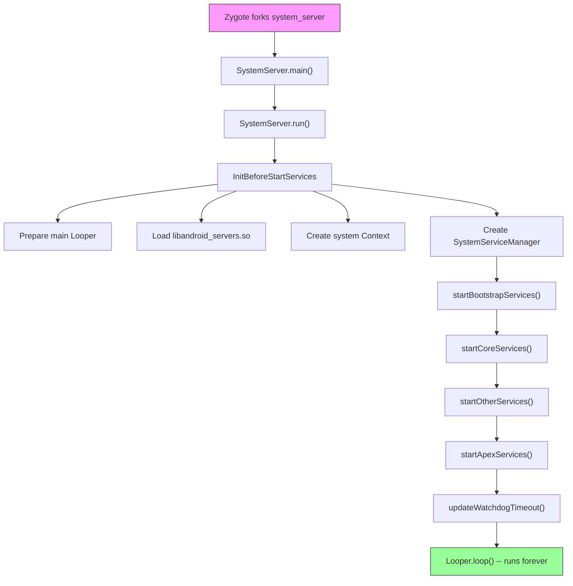

---

## 20.2 服务生命周期

### 20.2.1 SystemService 基类

运行在 `system_server` 内部的每个服务都继承自抽象类 `SystemService`，其定义位于：

```
frameworks/base/services/core/java/com/android/server/SystemService.java
```

该类被标注为 `@SystemApi(client = Client.SYSTEM_SERVER)`，使其成为系统服务器模块的稳定 API 表面。它的核心结构很简单（第 72、337-360 行）：

```java
// frameworks/base/services/core/java/com/android/server/SystemService.java, line 72
@SystemApi(client = Client.SYSTEM_SERVER)
public abstract class SystemService {

    private final Context mContext;
    private final List<Class<?>> mDependencies;

    // line 337
    public SystemService(@NonNull Context context) {
        this(context, Collections.emptyList());
    }

    // line 357
    public SystemService(@NonNull Context context,
                         @NonNull List<Class<?>> dependencies) {
        mContext = context;
        mDependencies = Objects.requireNonNull(dependencies);
    }
```

`dependencies` 列表被 Ravenwood 无设备测试环境用来理解支持某个特定测试所需的传递依赖。在生产环境中，大多数服务传入的是空列表。

### 20.2.2 生命周期回调

`SystemService` 定义了以下生命周期回调：

| 回调 | 调用时机 | 用途 |
|----------|-------------|---------|
| `onStart()` | 服务创建 | 通过 `publishBinderService()` 发布 binder 接口 |
| `onBootPhase(int)` | 每个启动阶段 | 对系统就绪里程碑作出响应 |
| `onUserStarting(TargetUser)` | 用户启动 | 初始化每用户状态 |
| `onUserUnlocking(TargetUser)` | 用户解锁中 | 访问凭据加密的存储 |
| `onUserUnlocked(TargetUser)` | 用户已解锁 | 解锁后初始化 |
| `onUserSwitching(from, to)` | 用户切换 | 转移前台用户状态 |
| `onUserStopping(TargetUser)` | 用户停止中 | 最后一次访问 CE 存储的机会 |
| `onUserStopped(TargetUser)` | 用户已停止 | 进程拆除后的最终清理 |
| `onUserCompletedEvent(TargetUser, type)` | 用户事件完成后 | 延迟的非紧急处理 |

`onStart()` 是唯一的抽象方法（第 412 行）：

```java
// frameworks/base/services/core/java/com/android/server/SystemService.java, line 412
public abstract void onStart();
```

所有其他回调都有空的默认实现，允许服务只覆盖它们需要的回调。

**来自源码的重要说明：**

> 注意：所有生命周期方法都在系统服务器的主 looper 线程上调用。

这意味着生命周期回调不得阻塞。长时间运行的初始化必须分发到后台线程。

### 20.2.3 发布服务

`SystemService` 提供了三种发布接口的机制：

**1. Binder 服务** —— 可由其他进程通过 `ServiceManager` 访问（第 633-663 行）：

```java
// frameworks/base/services/core/java/com/android/server/SystemService.java, line 633
protected final void publishBinderService(@NonNull String name,
        @NonNull IBinder service) {
    publishBinderService(name, service, false);
}

// line 661
protected final void publishBinderService(String name, IBinder service,
        boolean allowIsolated, int dumpPriority) {
    ServiceManager.addService(name, service, allowIsolated, dumpPriority);
}
```

**2. 本地服务** —— 仅可在 `system_server` 内部通过 `LocalServices` 访问（第 680-682 行）：

```java
// frameworks/base/services/core/java/com/android/server/SystemService.java, line 680
protected final <T> void publishLocalService(Class<T> type, T service) {
    LocalServices.addService(type, service);
}
```

本地服务避免了进程内通信的 Binder IPC 开销。许多服务会同时发布一个 Binder 接口（供应用使用）和一个本地接口（供其他系统服务使用）。

**3. 直接注册** —— 有些服务绕过 `SystemService`，直接通过 `ServiceManager.addService()` 注册。这种较旧的模式仍被一些早于 `SystemService` 框架的服务所使用。

### 20.2.4 启动阶段

启动阶段允许服务将自身初始化与整体系统就绪状态同步。每个阶段都是一个数字常量，服务会按升序接收它们。`SystemService.java` 中定义的阶段（第 80-124 行）：

| 阶段 | 值 | 常量 | 含义 |
|-------|-------|----------|---------|
| 等待默认显示 | 100 | `PHASE_WAIT_FOR_DEFAULT_DISPLAY` | 显示管理器已提供默认显示 |
| 等待传感器服务 | 200 | `PHASE_WAIT_FOR_SENSOR_SERVICE` | SensorService 可用（隐藏，内部） |
| 锁屏设置就绪 | 480 | `PHASE_LOCK_SETTINGS_READY` | 可获取锁屏设置数据 |
| 系统服务就绪 | 500 | `PHASE_SYSTEM_SERVICES_READY` | PowerManager 和 PackageManager 等核心服务可安全调用 |
| 设备特定服务就绪 | 520 | `PHASE_DEVICE_SPECIFIC_SERVICES_READY` | OEM/设备特定服务可用 |
| Activity 管理器就绪 | 550 | `PHASE_ACTIVITY_MANAGER_READY` | 服务可广播 Intent |
| 第三方应用可启动 | 600 | `PHASE_THIRD_PARTY_APPS_CAN_START` | 应用可向服务发起 Binder 调用 |
| 启动完成 | 1000 | `PHASE_BOOT_COMPLETED` | 启动完成，桌面应用已启动 |

`SystemServiceManager` 将阶段分发给所有已注册的服务：

```java
// SystemServiceManager iterates all services:
// for each service: service.onBootPhase(phase)
```


启动阶段构成了一种契约。需要调用 `PowerManager` 的服务应等到 `PHASE_SYSTEM_SERVICES_READY`（500）。需要启动第三方应用组件的服务应等到 `PHASE_THIRD_PARTY_APPS_CAN_START`（600）。

### 20.2.5 TargetUser 与用户生命周期

`TargetUser` 内部类（第 147-246 行）封装了用于生命周期回调的用户信息：

```java
// frameworks/base/services/core/java/com/android/server/SystemService.java, line 147
public static final class TargetUser {
    private final @UserIdInt int mUserId;
    private final boolean mFull;
    private final boolean mProfile;
    private final String mUserType;
    private final boolean mPreCreated;
    // ...
}
```

服务可以覆盖 `isUserSupported(TargetUser)`（第 483 行），以选择不对特定用户类型进行生命周期回调。例如，只对完整用户（而非受限 profile）工作的服务可以对 profile 用户返回 `false`，从而避免不必要的每用户初始化。

`UserCompletedEventType`（第 254-326 行）允许对已完成的用户事件进行批量通知。这是一项性能优化——需要对多个用户事件作出响应的服务可以在 `onUserCompletedEvent()` 中一起处理它们，而不是逐个处理。

### 20.2.6 SystemServiceManager

`SystemServiceManager`（定义于 `SystemServiceManager.java`，第 75-138 行）是编排者：

```java
// frameworks/base/services/core/java/com/android/server/SystemServiceManager.java, line 75
public final class SystemServiceManager implements Dumpable {
    private List<SystemService> mServices;
    private Set<String> mServiceClassnames;
    private int mCurrentPhase = -1;
    // ...
}
```

它提供了几个 `startService()` 变体：

1. **按类** —— `startService(Class<T>)` —— 用于 `services.jar` 中的服务
2. **按类名** —— `startService(String)` —— 用于位于系统服务器类路径但不在 `services.jar` 中的服务
3. **从 JAR** —— `startServiceFromJar(String, String)` —— 用于独立 APEX JAR（如 WiFi、Bluetooth、Connectivity）中的服务

基于 JAR 的加载（第 167-173 行）使用 `PathClassLoader`：

```java
// frameworks/base/services/core/java/com/android/server/SystemServiceManager.java, line 167
public SystemService startServiceFromJar(String className, String path) {
    PathClassLoader pathClassLoader =
            SystemServerClassLoaderFactory.getOrCreateClassLoader(
                    path, this.getClass().getClassLoader(), isJarInTestApex(path));
    final Class<SystemService> serviceClass =
            loadClassFromLoader(className, pathClassLoader);
    return startService(serviceClass);
}
```

这种模块化加载让主线模块（WiFi、Bluetooth、Connectivity、UWB）能够通过 APEX 交付它们的系统服务。这些服务不会被编译进平台单体。

---

## 20.3 关键服务目录

### 20.3.1 引导服务

引导服务构成了关键依赖链。它们存在循环依赖，使得简单的顺序初始化无法进行。因此，它们在专门的 `startBootstrapServices()` 方法中启动。以下按 `SystemServer.java` 中的启动顺序列出：

| # | 服务 | 类 | 用途 |
|---|---------|-------|---------|
| 1 | Watchdog | `Watchdog` | 死锁检测（最先启动） |
| 2 | PlatformCompat | `PlatformCompat` | 应用兼容性框架 |
| 3 | FileIntegrityService | `FileIntegrityService` | fs-verity 支持 |
| 4 | Installer | `Installer` | 软件包安装守护进程接口 |
| 5 | DeviceIdentifiersPolicyService | `DeviceIdentifiersPolicyService` | 设备 ID 访问策略 |
| 6 | FeatureFlagsService | `FeatureFlagsService` | 运行时标志覆盖 |
| 7 | UriGrantsManagerService | `UriGrantsManagerService.Lifecycle` | 内容 URI 权限授予 |
| 8 | PowerStatsService | `PowerStatsService` | 导轨功耗数据跟踪 |
| 9 | AccessCheckingService | `AccessCheckingService` | 权限与应用操作 |
| 10 | **ActivityTaskManagerService** | `ActivityTaskManagerService.Lifecycle` | Activity/任务管理 |
| 11 | **ActivityManagerService** | `ActivityManagerService.Lifecycle` | 进程生命周期管理 |
| 12 | DataLoaderManagerService | `DataLoaderManagerService` | 增量数据加载 |
| 13 | **PowerManagerService** | `PowerManagerService` | 电源状态管理 |
| 14 | ThermalManagerService | `ThermalManagerService` | 热节流 |
| 15 | RecoverySystemService | `RecoverySystemService.Lifecycle` | OTA 与恢复 |
| 16 | LightsService | `LightsService` | LED 与背光控制 |
| 17 | **DisplayManagerService** | `DisplayManagerService` | 显示管理 |
| 18 | DomainVerificationService | `DomainVerificationService` | 应用链接验证 |
| 19 | **PackageManagerService** | `PackageManagerService` | 软件包/APK 管理 |
| 20 | UserManagerService | `UserManagerService.LifeCycle` | 多用户管理 |
| 21 | OverlayManagerService | `OverlayManagerService` | 运行时资源叠加层 |
| 22 | ResourcesManagerService | `ResourcesManagerService` | 资源包管理 |
| 23 | SensorPrivacyService | `SensorPrivacyService` | 相机/麦克风隐私开关 |
| 24 | SensorService | `SensorService` | 传感器 HAL 接口 |

### 20.3.2 核心服务

核心服务不纠缠在引导依赖网中，但仍然必不可少。来自 `startCoreServices()`：

| # | 服务 | 类 | 用途 |
|---|---------|-------|---------|
| 1 | SystemConfigService | `SystemConfigService` | 系统配置 |
| 2 | BatteryService | `BatteryService` | 电量跟踪 |
| 3 | UsageStatsService | `UsageStatsService` | 应用使用统计 |
| 4 | WebViewUpdateService | `WebViewUpdateService` | WebView 提供者管理 |
| 5 | CachedDeviceStateService | `CachedDeviceStateService` | 设备状态缓存 |
| 6 | BinderCallsStatsService | `BinderCallsStatsService.LifeCycle` | Binder 调用指标 |
| 7 | LooperStatsService | `LooperStatsService.Lifecycle` | Handler 消息计时 |
| 8 | RollbackManagerService | `RollbackManagerService` | APK 回滚管理 |
| 9 | NativeTombstoneManagerService | `NativeTombstoneManagerService` | 原生崩溃跟踪 |
| 10 | BugreportManagerService | `BugreportManagerService` | 错误报告捕获 |
| 11 | GpuService | `GpuService` | GPU 驱动管理 |
| 12 | RemoteProvisioningService | `RemoteProvisioningService` | 远程密钥配置 |

### 20.3.3 其他服务（主要子集）

`startOtherServices()` 方法是最大的——它启动了大部分系统服务。以下是按功能区域组织的完整目录：

#### 安全与凭据

| 服务 | 类 | 源包 | 用途 |
|---------|-------|---------------|---------|
| KeyChainSystemService | `KeyChainSystemService` | `security/` | 证书管理 |
| KeyAttestationApplicationIdProvider | 直接注册 | `security/` | 密钥证明 ID |
| LockSettingsService | `LockSettingsService.Lifecycle` | `locksettings/` | 屏幕锁定与加密 |
| PersistentDataBlockService | `PersistentDataBlockService` | `pdb/` | 恢复出厂保护 |
| OemLockService | `OemLockService` | `oemlock/` | Bootloader 锁定状态 |
| TrustManagerService | `TrustManagerService` | `trust/` | 信任代理（Smart Lock） |
| BiometricService | `BiometricService` | `biometrics/` | 生物识别协调 |
| AuthService | `AuthService` | `biometrics/` | 认证路由 |
| FaceService | `FaceService` | `biometrics/sensors/face/` | 面部解锁 |
| FingerprintService | `FingerprintService` | `biometrics/sensors/fingerprint/` | 指纹解锁 |
| AttestationVerificationService | `AttestationVerificationManagerService` | `security/` | 证明验证 |
| AdvancedProtectionService | `AdvancedProtectionService.Lifecycle` | `security/advancedprotection/` | 高级保护模式 |
| CredentialManagerService | `CredentialManagerService` | `credentials/` | 凭据管理 |

#### 窗口、显示与输入

| 服务 | 类 | 源包 | 用途 |
|---------|-------|---------------|---------|
| **WindowManagerService** | `WindowManagerService` | `wm/` | 窗口管理与合成 |
| **InputManagerService** | `InputManagerService.Lifecycle` | `input/` | 输入事件路由 |
| InputMethodManagerService | `InputMethodManagerService.Lifecycle` | `inputmethod/` | 软键盘管理 |
| AccessibilityManagerService | `AccessibilityManagerService.Lifecycle` | `accessibility/` | 无障碍功能 |
| DeviceStateManagerService | `DeviceStateManagerService` | `devicestate/` | 折叠屏/姿态状态 |
| ColorDisplayService | `ColorDisplayService` | `display/color/` | 夜灯、色彩校正 |
| UiModeManagerService | `UiModeManagerService` | core | 车载/TV/手表模式检测 |

#### 网络

| 服务 | 类 | 源包 | 用途 |
|---------|-------|---------------|---------|
| NetworkManagementService | `NetworkManagementService` | `net/` | 网络接口管理 |
| NetworkPolicyManagerService | `NetworkPolicyManagerService` | `net/` | 数据使用策略 |
| ConnectivityService | 从 APEX JAR 加载 | connectivity 模块 | 网络连接 |
| VpnManagerService | `VpnManagerService` | core | VPN 管理 |
| WiFiService | 从 APEX JAR 加载 | WiFi 模块 | WiFi 管理 |
| WiFiScanningService | 从 APEX JAR 加载 | WiFi 模块 | WiFi 扫描 |
| WiFiAwareService | 从 APEX JAR 加载 | WiFi 模块 | WiFi Aware（NAN） |
| WiFiP2pService | 从 APEX JAR 加载 | WiFi 模块 | WiFi Direct |
| BluetoothService | 从 APEX JAR 加载 | Bluetooth 模块 | 蓝牙管理 |
| NetworkStatsService | 从 APEX JAR 加载 | connectivity 模块 | 网络统计 |

#### 存储与软件包管理

| 服务 | 类 | 源包 | 用途 |
|---------|-------|---------------|---------|
| StorageManagerService | `StorageManagerService.Lifecycle` | core | 卷与存储管理 |
| StorageStatsService | `StorageStatsService.Lifecycle` | `usage/` | 存储使用统计 |
| DeviceStorageMonitorService | `DeviceStorageMonitorService` | `storage/` | 存储不足告警 |
| BackupManagerService | `BackupManagerService.Lifecycle` | `backup/` | 应用备份与恢复 |
| BlobStoreManagerService | `BlobStoreManagerService` | `blob/` | 共享二进制大对象 |

#### 电源与热管理

| 服务 | 类 | 源包 | 用途 |
|---------|-------|---------------|---------|
| HintManagerService | `HintManagerService` | `power/hint/` | 向 HAL 发送性能提示 |
| DeviceIdleController | `DeviceIdleController` | `apex/jobscheduler/` | 待机（Doze）模式管理（与 `alarm/` 和 `job/` 同一模块） |
| DreamManagerService | `DreamManagerService` | `dreams/` | 屏保与待机界面 |
| TwilightService | `TwilightService` | `twilight/` | 日出/日落跟踪 |

#### 音频、媒体与相机

| 服务 | 类 | 源包 | 用途 |
|---------|-------|---------------|---------|
| **AudioService** | `AudioService.Lifecycle` | `audio/` | 音频路由与音量 |
| SoundTriggerMiddlewareService | `SoundTriggerMiddlewareService.Lifecycle` | `soundtrigger_middleware/` | “Hey Google” 检测 |
| SoundTriggerService | `SoundTriggerService` | `soundtrigger/` | 声音触发管理 |
| MediaSessionService | `MediaSessionService` | `media/` | 媒体播放控制 |
| MediaRouterService | `MediaRouterService` | `media/` | 媒体输出路由 |
| MediaProjectionManagerService | `MediaProjectionManagerService` | `media/projection/` | 屏幕录制/投屏 |
| MediaResourceMonitorService | `MediaResourceMonitorService` | `media/` | 媒体资源跟踪 |
| MediaMetricsManagerService | `MediaMetricsManagerService` | `media/metrics/` | 媒体性能指标 |
| CameraServiceProxy | `CameraServiceProxy` | `camera/` | 相机服务协调 |
| BroadcastRadioService | `BroadcastRadioService` | `broadcastradio/` | AM/FM 广播 |

#### 通知与状态

| 服务 | 类 | 源包 | 用途 |
|---------|-------|---------------|---------|
| **NotificationManagerService** | `NotificationManagerService` | `notification/` | 通知管理 |
| StatusBarManagerService | `StatusBarManagerService` | `statusbar/` | 状态栏控制 |

#### 位置、时间与传感器

| 服务 | 类 | 源包 | 用途 |
|---------|-------|---------------|---------|
| LocationManagerService | `LocationManagerService.Lifecycle` | `location/` | 位置提供者 |
| TimeDetectorService | `TimeDetectorService.Lifecycle` | `timedetector/` | 自动时间设置 |
| TimeZoneDetectorService | `TimeZoneDetectorService.Lifecycle` | `timezonedetector/` | 时区检测 |
| LocationTimeZoneManagerService | `LocationTimeZoneManagerService.Lifecycle` | `timezonedetector/location/` | 基于位置的时区 |
| NetworkTimeUpdateService | `NetworkTimeUpdateService` | `timedetector/` | NTP 时间同步 |
| GnssTimeUpdateService | `GnssTimeUpdateService.Lifecycle` | `timedetector/` | GPS 时间同步 |
| CountryDetectorService | `CountryDetectorService` | core | 国家/地区检测 |
| AltitudeService | `AltitudeService.Lifecycle` | `location/altitude/` | 海拔数据 |
| SensorNotificationService | `SensorNotificationService` | core | 传感器事件通知 |

#### 应用管理

| 服务 | 类 | 源包 | 用途 |
|---------|-------|---------------|---------|
| DevicePolicyManagerService | `DevicePolicyManagerService.Lifecycle` | `devicepolicy/` | 企业设备管理 |
| ShortcutService | `ShortcutService.Lifecycle` | `pm/` | 应用快捷方式 |
| LauncherAppsService | `LauncherAppsService` | `pm/` | 桌面应用交互 |
| CrossProfileAppsService | `CrossProfileAppsService` | `pm/` | 跨 profile 应用启动 |
| AppHibernationService | `AppHibernationService` | `apphibernation/` | 未使用应用休眠 |
| AppBindingService | `AppBindingService.Lifecycle` | `appbinding/` | 系统应用绑定 |
| BackgroundInstallControlService | `BackgroundInstallControlService` | `pm/` | 后台安装控制 |
| GameManagerService | `GameManagerService.Lifecycle` | `app/` | 游戏模式管理 |

#### 通信

| 服务 | 类 | 源包 | 用途 |
|---------|-------|---------------|---------|
| TelecomLoaderService | `TelecomLoaderService` | `telecom/` | 电信服务加载 |
| TelephonyRegistry | `TelephonyRegistry` | core | 电话事件广播 |
| MmsServiceBroker | `MmsServiceBroker` | core | MMS 服务协调 |
| ClipboardService | `ClipboardService` | `clipboard/` | 系统剪贴板 |

#### 作业与调度

| 服务 | 类 | 源包 | 用途 |
|---------|-------|---------------|---------|
| **AlarmManagerService** | `AlarmManagerService` | `alarm/` | 闹钟调度 |
| **JobSchedulerService** | `JobSchedulerService` | `job/` | 延迟作业调度 |

#### 内容与搜索

| 服务 | 类 | 源包 | 用途 |
|---------|-------|---------------|---------|
| AccountManagerService | `AccountManagerService.Lifecycle` | `accounts/` | 账户管理 |
| ContentService | `ContentService.Lifecycle` | `content/` | 内容提供者同步 |
| SearchManagerService | `SearchManagerService.Lifecycle` | `search/` | 系统搜索 |
| ContentCaptureManagerService | `ContentCaptureManagerService` | `contentcapture/` | 面向智能的内容捕获 |
| AppSearchModule | 从 APEX 加载 | AppSearch 模块 | 设备端搜索索引 |

#### TV 与 HDMI

| 服务 | 类 | 源包 | 用途 |
|---------|-------|---------------|---------|
| HdmiControlService | `HdmiControlService` | `hdmi/` | HDMI-CEC 控制 |
| TvInputManagerService | `TvInputManagerService` | `tv/` | TV 输入框架 |
| TvInteractiveAppManagerService | `TvInteractiveAppManagerService` | `tv/interactive/` | 交互式 TV 应用 |
| TunerResourceManagerService | `TunerResourceManagerService` | `tv/tunerresourcemanager/` | TV 调谐器资源 |

#### 文本与本地化

| 服务 | 类 | 源包 | 用途 |
|---------|-------|---------------|---------|
| TextServicesManagerService | `TextServicesManagerService.Lifecycle` | `textservices/` | 拼写检查 |
| TextClassificationManagerService | `TextClassificationManagerService.Lifecycle` | `textclassifier/` | 智能文本选择 |
| FontManagerService | `FontManagerService.Lifecycle` | `graphics/fonts/` | 系统字体管理 |
| LocaleManagerService | `LocaleManagerService` | `locales/` | 每应用语言区域 |
| GrammaticalInflectionService | `GrammaticalInflectionService` | `grammaticalinflection/` | 语法性别 |

#### 硬件与外设

| 服务 | 类 | 源包 | 用途 |
|---------|-------|---------------|---------|
| UsbService | `UsbService.Lifecycle` | `usb/` | USB 主机/设备管理 |
| SerialManagerService | `SerialManagerService.Lifecycle` | `serial/` | Android 17 有线串口 API（由 `enable_wired_serial_api` 控制）；见 20.29 |
| HardwarePropertiesManagerService | `HardwarePropertiesManagerService` | core | CPU/GPU 温度 |
| ConsumerIrService | `ConsumerIrService` | core | 红外遥控发射 |
| VibratorManagerService | `VibratorManagerService.Lifecycle` | `vibrator/` | 触觉反馈 |
| MultisensoryService | `MultisensoryService.Lifecycle` | `multisensory/` | 面向 Multisensory 设计系统的音频-触觉反馈（由 `enable_multisensory_feedback` 控制，非 TV） |
| DockObserver | `DockObserver` | core | 底座状态检测 |
| WiredAccessoryManager | `WiredAccessoryManager` | core | 有线耳机检测 |
| MidiService | `MidiService.Lifecycle` | `midi/` | MIDI 设备管理 |

#### AI 与智能

| 服务 | 类 | 源包 | 用途 |
|---------|-------|---------------|---------|
| VoiceInteractionManagerService | `VoiceInteractionManagerService` | `voiceinteraction/` | 语音助手 |
| SpeechRecognitionManagerService | `SpeechRecognitionManagerService` | `speech/` | 语音识别 |
| AppPredictionManagerService | `AppPredictionManagerService` | `appprediction/` | 应用使用预测 |
| SmartspaceManagerService | `SmartspaceManagerService` | `smartspace/` | 一目了然的小组件 |
| AttentionManagerService | `AttentionManagerService` | `attention/` | 用户注意力检测 |
| RotationResolverManagerService | `RotationResolverManagerService` | `rotationresolver/` | 基于人脸的旋转 |
| AmbientContextManagerService | `AmbientContextManagerService` | `ambientcontext/` | 环境上下文检测 |
| WearableSensingManagerService | `WearableSensingManagerService` | `wearable/` | 可穿戴传感器处理 |
| OnDeviceIntelligenceManagerService | 从 APEX 加载 | 设备端智能 | 设备端 AI 服务 |
| PccSandboxManagerService | `PccSandboxManagerService` | `privatecompute/` | Private Compute Core 沙箱管理（由 `enable_pcc_framework_support` 控制） |
| ContentRestrictionService | `ContentRestrictionService.Lifecycle` | `contentrestriction/` | 内容分类/限制 API（由 `content_restriction_api` 控制） |

#### 系统基础设施

| 服务 | 类 | 源包 | 用途 |
|---------|-------|---------------|---------|
| DropBoxManagerService | `DropBoxManagerService` | core | 错误/诊断日志存储 |
| IncidentCompanionService | `IncidentCompanionService` | `incident/` | 事件上报 |
| StatsCompanion | 从 APEX 加载 | statsd 模块 | 指标采集助手 |
| StatsPullAtomService | `StatsPullAtomService` | `stats/` | 拉取式指标原子 |
| BinaryTransparencyService | `BinaryTransparencyService` | core | 二进制完整性验证 |
| PinnerService | `PinnerService` | `pinner/` | 在 RAM 中固定关键文件 |
| TracingServiceProxy | `TracingServiceProxy` | `tracing/` | Perfetto 跟踪协调 |
| LogcatManagerService | `LogcatManagerService` | `logcat/` | Logcat 访问管理 |
| CoverageService | `CoverageService` | `coverage/` | 代码覆盖率（调试构建） |
| GraphicsStatsService | `android.graphics.GraphicsStatsService` | `frameworks/base/graphics/` | 帧时序统计（直接通过 `ServiceManager.addService` 注册） |

### 20.3.4 主线模块服务（通过 APEX 交付）

有几个服务通过主线模块 APEX 交付，并从独立的 JAR 文件中加载：

| 模块 | JAR 路径 | 服务类 |
|--------|----------|-----------------|
| WiFi | `/apex/com.android.wifi/javalib/service-wifi.jar` | WifiService, WifiScanningService, WifiRttService, WifiAwareService, WifiP2pService |
| Bluetooth | `/apex/com.android.bt/javalib/service-bluetooth.jar` | BluetoothService |
| Connectivity | `/apex/com.android.tethering/javalib/service-connectivity.jar` | ConnectivityServiceInitializer, NetworkStatsServiceInitializer |
| UWB | `/apex/com.android.uwb/javalib/service-uwb.jar` | UwbService |
| Statsd | `/apex/com.android.os.statsd/javalib/service-statsd.jar` | StatsCompanion.Lifecycle |
| Scheduling | `/apex/com.android.scheduling/javalib/service-scheduling.jar` | RebootReadinessManagerService |
| Profiling | `/apex/com.android.profiling/javalib/service-profiling.jar` | ProfilingService.Lifecycle |
| DeviceLock | `/apex/com.android.devicelock/javalib/service-devicelock.jar` | DeviceLockService |

### 20.3.5 核心服务器包结构

`frameworks/base/services/core/java/com/android/server/` 目录包含 107 个子包和 75 个顶层 Java 文件。以下是按功能域组织的完整子包列表（少数位于 `core/` 之外的密切相关包会在出现处注明）：

#### 进程与活动管理
- `am/` -- ActivityManagerService、进程管理、广播分发
- `wm/` -- WindowManagerService、ActivityTaskManagerService、窗口策略
- `app/` -- GameManagerService
- `appbinding/` -- AppBindingService
- `apphibernation/` -- AppHibernationService
- `appop/` -- AppOpsService（应用操作权限）
- `appwindowlayout/` -- AppWindowLayoutSettingsService

#### 软件包管理
- `pm/` -- PackageManagerService、UserManagerService、Installer
- `integrity/` -- AppIntegrityManagerService
- `rollback/` -- RollbackManagerService

#### 安全
- `biometrics/` -- BiometricService、FaceService、FingerprintService
- `locksettings/` -- LockSettingsService
- `permission/` -- PermissionManagerLocal、PermissionBpfMap（AccessCheckingService 位于独立的 `services/permission/` 模块中）
- `security/` -- KeyChain、证明、高级保护
- `trust/` -- TrustManagerService
- `sensorprivacy/` -- SensorPrivacyService
- `selinux/` -- SELinux 审计日志

#### 显示与图形
- `display/` -- DisplayManagerService、ColorDisplayService
- `graphics/` -- FontManagerService
- `dreams/` -- DreamManagerService

#### 输入与无障碍
- `input/` -- InputManagerService
- `inputmethod/` -- InputMethodManagerService
- `accessibility/` -- AccessibilityManagerService

#### 网络
- `connectivity/` -- PacProxyService、IpConnectivityMetrics
- `net/` -- NetworkManagementService、NetworkPolicyManagerService
- `vcn/` -- VcnManagementService

#### 电源与热管理
- `power/` -- PowerManagerService、ShutdownThread、HintManagerService
- `powerstats/` -- PowerStatsService

#### 音频与媒体
- `audio/` -- AudioService
- `media/` -- MediaSessionService、MediaRouterService、MediaProjection
- `soundtrigger/` -- SoundTriggerService（位于 `services/voiceinteraction` 下，不在 core 中）
- `soundtrigger_middleware/` -- SoundTriggerMiddlewareService（位于 `services/voiceinteraction` 下，不在 core 中）
- `broadcastradio/` -- BroadcastRadioService
- `camera/` -- CameraServiceProxy

#### 通信
- `telecom/` -- TelecomLoaderService（位于 `services/telecom` 下，不在 core 中）
- `companion/` -- CompanionDeviceManagerService

#### 存储
- `storage/` -- DeviceStorageMonitorService
- `blob/` -- BlobStoreManagerService（位于 `apex/blobstore` 下，不在 core 中）
- `pdb/` -- PersistentDataBlockService

#### 时间与位置
- `timedetector/` -- TimeDetectorService、NetworkTimeUpdateService
- `timezonedetector/` -- TimeZoneDetectorService
- `timezone/` -- 时区数据管理
- `location/` -- LocationManagerService
- `twilight/` -- TwilightService

#### 内容
- `content/` -- ContentService
- `contentcapture/` -- ContentCaptureManagerService
- `search/` -- SearchManagerService
- `accounts/` -- AccountManagerService

#### 通知与状态栏
- `notification/` -- NotificationManagerService
- `statusbar/` -- StatusBarManagerService
- `slice/` -- SliceManagerService

#### 设备管理
- `devicepolicy/` -- DevicePolicyManagerService（位于 `services/devicepolicy` 下，不在 core 中）
- `devicestate/` -- DeviceStateManagerService

#### 系统服务
- `flags/` -- 仅 aconfig 标志声明（FeatureFlagsService 位于独立的 `services/flags/` 模块中）
- `compat/` -- PlatformCompat
- `crashrecovery/` -- CrashRecoveryHelper（引擎现位于 `packages/modules/CrashRecovery/` 模块中）
- `criticalevents/` -- CriticalEventLog
- `cpu/` -- CpuMonitorService
- `gpu/` -- GpuService
- `incident/` -- IncidentCompanionService
- `stats/` -- StatsPullAtomService、StatsBootstrapAtomService（StatsCompanion 本身随 statsd APEX 发布）
- `tracing/` -- TracingServiceProxy
- `logcat/` -- LogcatManagerService
- `os/` -- BugreportManagerService、SchedulingPolicyService
- `recoverysystem/` -- RecoverySystemService
- `resources/` -- ResourcesManagerService
- `uri/` -- UriGrantsManagerService
- `utils/` -- 工具类

#### 专用
- `tv/` -- TvInputManagerService、TvRemoteService
- `hdmi/` -- HdmiControlService
- `vibrator/` -- VibratorManagerService
- `lights/` -- LightsService
- `usb/` -- （模块级，不在 core 中）
- `vr/` -- VR 模式支持
- `om/` -- OverlayManagerService
- `wallpaper/` -- WallpaperManagerService
- `theming/` -- ThemeManagerService
- `webkit/` -- WebViewUpdateService
- `sensors/` -- SensorService
- `pinner/` -- PinnerService
- `clipboard/` -- ClipboardService
- `emergency/` -- EmergencyAffordanceService

#### 智能与机器学习
- `attention/` -- AttentionManagerService
- `ambientcontext/` -- AmbientContextManagerService
- `rotationresolver/` -- RotationResolverManagerService
- `speech/` -- SpeechRecognitionManagerService
- `textclassifier/` -- TextClassificationManagerService
- `textservices/` -- TextServicesManagerService

#### 其他
- `infra/` -- 基础设施基类
- `feature/` -- 仅 aconfig 标志声明（dropbox_flags.aconfig）
- `firewall/` -- Intent 防火墙
- `health/` -- Health HAL 集成
- `locales/` -- LocaleManagerService
- `grammaticalinflection/` -- GrammaticalInflectionService
- `memory/` -- 内存管理
- `privatecompute/` -- 隐私计算服务
- `role/` -- 角色管理助手
- `signedconfig/` -- 签名配置
- `testharness/` -- 测试装置模式
- `updates/` -- 系统更新处理
- `wearable/` -- WearableSensingManagerService

---

## 20.4 服务启动顺序

### 20.4.1 startBootstrapServices()

引导阶段（`SystemServer.java` 第 1192-1462 行）启动构成关键依赖链的服务。确切的顺序很重要，因为存在相互依赖：


引导阶段的关键依赖关系：

1. **Watchdog 最先启动**（第 1208-1210 行）：在任何可能死锁的服务之前，它必须已经运行。
2. **Installer 在 PackageManager 之前**（第 1244 行）：`installd` 必须在 PMS 扫描软件包之前创建关键目录。
3. **AMS 与 ATMS 一起**（第 1290-1303 行）：这两者紧密耦合——ATMS 管理活动/任务，而 AMS 管理进程。
4. **PowerManager 提前**（第 1316 行）：许多服务都需要电源管理。
5. **DisplayManager 在 PMS 之前**（第 1349 行）：软件包管理器需要显示指标来进行基于密度的资源选择。
6. **PHASE_WAIT_FOR_DEFAULT_DISPLAY**（第 1355 行）：所有需要显示信息的服务在此等待。
7. **PackageManager 暂停 Watchdog**（第 1372-1374 行）：PMS 初始化非常慢，因此显式暂停了 Watchdog。

### 20.4.2 startCoreServices()

核心服务（第 1467-1549 行）更简单——没有循环依赖：

```
startCoreServices()
  +-- SystemConfigService
  +-- BatteryService
  +-- UsageStatsService
  +-- WebViewUpdateService (if FEATURE_WEBVIEW)
  +-- CachedDeviceStateService
  +-- BinderCallsStatsService
  +-- LooperStatsService
  +-- RollbackManagerService
  +-- NativeTombstoneManagerService
  +-- BugreportManagerService
  +-- GpuService
  +-- RemoteProvisioningService
  +-- CpuMonitorService (debug builds only)
```

### 20.4.3 startOtherServices()

`startOtherServices()` 方法（第 1550-3677 行）是最长的。它包含基于设备功能、形态（手机/手表/TV/车载）和功能标志的条件性服务启动。高层流程：

```
startOtherServices()
  |
  +-- Pre-WMS services
  |     +-- KeyChainSystemService
  |     +-- BinaryTransparencyService
  |     +-- SchedulingPolicyService
  |     +-- TelecomLoaderService
  |     +-- TelephonyRegistry
  |     +-- AccountManagerService
  |     +-- ContentService
  |     +-- System providers installation
  |     +-- DropBoxManagerService
  |     +-- HintManagerService
  |     +-- RoleManagerService
  |     +-- VibratorManagerService
  |     +-- AlarmManagerService
  |     +-- InputManagerService
  |     +-- DeviceStateManagerService
  |     +-- CameraServiceProxy
  |
  +-- WindowManagerService startup
  |     +-- PHASE_WAIT_FOR_SENSOR_SERVICE (200)
  |     +-- WindowManagerService.main()
  |     +-- AMS.setWindowManager()
  |     +-- WMS.onInitReady()
  |     +-- BluetoothService
  |
  +-- Post-WMS services
  |     +-- InputMethodManagerService
  |     +-- AccessibilityManagerService
  |     +-- StorageManagerService
  |     +-- UiModeManagerService
  |     +-- LockSettingsService
  |     +-- DevicePolicyManagerService
  |     +-- StatusBarManagerService
  |     +-- NetworkManagementService
  |     +-- NetworkPolicyManagerService
  |     +-- WiFi services (from APEX)
  |     +-- ConnectivityService (from APEX)
  |     +-- NotificationManagerService
  |     +-- LocationManagerService
  |     +-- AudioService
  |     +-- JobSchedulerService
  |     +-- BackupManagerService
  |     +-- Biometric services
  |     +-- ShortcutService
  |     +-- LauncherAppsService
  |     +-- MediaProjectionManagerService
  |     +-- SliceManagerService
  |     +-- StatsCompanion (from APEX)
  |     +-- AutofillManagerService
  |     +-- ClipboardService
  |     +-- TracingServiceProxy
  |
  +-- Boot phase transitions
  |     +-- PHASE_LOCK_SETTINGS_READY (480)
  |     +-- PHASE_SYSTEM_SERVICES_READY (500)
  |     +-- Device-specific services
  |     +-- PHASE_DEVICE_SPECIFIC_SERVICES_READY (520)
  |     +-- SafetyCenterService
  |     +-- AppSearchModule
  |     +-- HealthConnectManagerService
  |
  +-- AMS.systemReady() callback
        +-- PHASE_ACTIVITY_MANAGER_READY (550)
        +-- CarServiceHelperService (automotive)
        +-- Networking systemReady calls
        +-- PHASE_THIRD_PARTY_APPS_CAN_START (600)
        +-- Start SystemUI
        +-- PHASE_BOOT_COMPLETED (1000)
```

### 20.4.4 上下文中的启动阶段序列

下面是启动阶段如何与服务启动交错进行。每个纵向位置代表一个时间点：

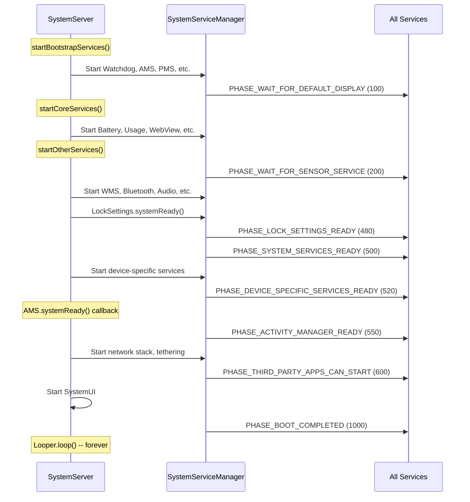

### 20.4.5 条件性服务启动

许多服务只在存在特定硬件功能时才启动。`SystemServer` 在启动前会检查 `PackageManager.hasSystemFeature()`：

| 功能标志 | 受控的服务 |
|-------------|----------------|
| `FEATURE_BLUETOOTH` | BluetoothService |
| `FEATURE_WIFI` | WiFi*, WifiScanning |
| `FEATURE_WIFI_RTT` | WifiRttService |
| `FEATURE_WIFI_AWARE` | WifiAwareService |
| `FEATURE_WIFI_DIRECT` | WifiP2pService |
| `FEATURE_USB_HOST` 或 `FEATURE_USB_ACCESSORY` | UsbService |
| `FEATURE_FINGERPRINT` | FingerprintService |
| `FEATURE_FACE` | FaceService |
| `FEATURE_IRIS` | IrisService |
| `FEATURE_COMPANION_DEVICE_SETUP` | CompanionDeviceManagerService |
| `FEATURE_HDMI_CEC` | HdmiControlService |
| `FEATURE_LIVE_TV` | TvInputManagerService, TvInteractiveAppManagerService |
| `FEATURE_PRINTING` | PrintManagerService |
| `FEATURE_BACKUP` | BackupManagerService |
| `FEATURE_APP_WIDGETS` | AppWidgetService |
| `FEATURE_MIDI` | MidiService |
| `FEATURE_TELEPHONY` | TelecomLoaderService, MmsServiceBroker |
| `FEATURE_AUTOFILL` | AutofillManagerService |
| `FEATURE_CREDENTIALS` | CredentialManagerService |
| `FEATURE_CONTEXT_HUB` | ContextHubSystemService |
| `FEATURE_UWB` | UwbService |
| `FEATURE_CONSUMER_IR` | ConsumerIrService |
| `FEATURE_BROADCAST_RADIO` | BroadcastRadioService |
| `FEATURE_PICTURE_IN_PICTURE` | MediaResourceMonitorService |
| `FEATURE_TUNER` | TunerResourceManagerService |

形态检查同样控制服务：

| 形态 | 布尔变量 | 受影响的服务示例 |
|-------------|-----------------|--------------------------|
| 手表 | `isWatch` | 许多服务被跳过（搜索、Twilight 等） |
| TV | `isTv` | 启用 TvRemoteService；跳过 VibratorManager |
| 车载 | `isAutomotive` | 启用 CarServiceHelperService |
| ARC（ChromeOS） | `isArc` | ArcSystemHealthService、特殊的 AudioService |

---

## 20.5 Watchdog

### 20.5.1 目的与架构

Watchdog（定义在 `Watchdog.java` 中）是一种关键的安全机制，用于检测 `system_server` 线程何时变得无响应。如果被监控的线程在超时时间内（默认：60 秒）未能响应，Watchdog 会杀死 `system_server`，触发运行时重启。这比让设备停留在无响应状态要好。

来自类文档（第 84-86 行）：

```java
// frameworks/base/services/core/java/com/android/server/Watchdog.java, line 84
/**
 * This class calls its monitor every minute. Killing this process if they
 * don't return.
 **/
public class Watchdog implements Dumpable {
```

Watchdog 是单例（第 484-490 行）：

```java
// frameworks/base/services/core/java/com/android/server/Watchdog.java, line 484
public static Watchdog getInstance() {
    if (sWatchdog == null) {
        sWatchdog = new Watchdog();
    }
    return sWatchdog;
}
```

### 20.5.2 默认超时

默认超时为 60 秒。还存在一个 10 秒的备选值。它只能通过手动翻转源码中硬编码的 `DB` 常量来选择。在代码树中该常量为 `false`。这个备选值并不与 debuggable/userdebug 构建绑定（第 101 行）：

```java
// frameworks/base/services/core/java/com/android/server/Watchdog.java, line 101
private static final long DEFAULT_TIMEOUT = DB ? 10 * 1000 : 60 * 1000;
```

前看门狗超时比率将完整超时划分为检查间隔（第 107 行）：

```java
// frameworks/base/services/core/java/com/android/server/Watchdog.java, line 107
private static final int PRE_WATCHDOG_TIMEOUT_RATIO = 4;
```

这意味着在 60 秒超时下，Watchdog 每 15 秒检查一次。在 15 秒时，它进入 `WAITED_UNTIL_PRE_WATCHDOG` 状态并生成非致命的线程转储。在 60 秒时，它变为 `OVERDUE` 并杀死进程。

### 20.5.3 完成状态

Watchdog 定义了四种状态（第 114-117 行）：

```java
// frameworks/base/services/core/java/com/android/server/Watchdog.java, line 114
static final int COMPLETED = 0;
static final int WAITING = 1;
static final int WAITED_UNTIL_PRE_WATCHDOG = 2;
static final int OVERDUE = 3;
```

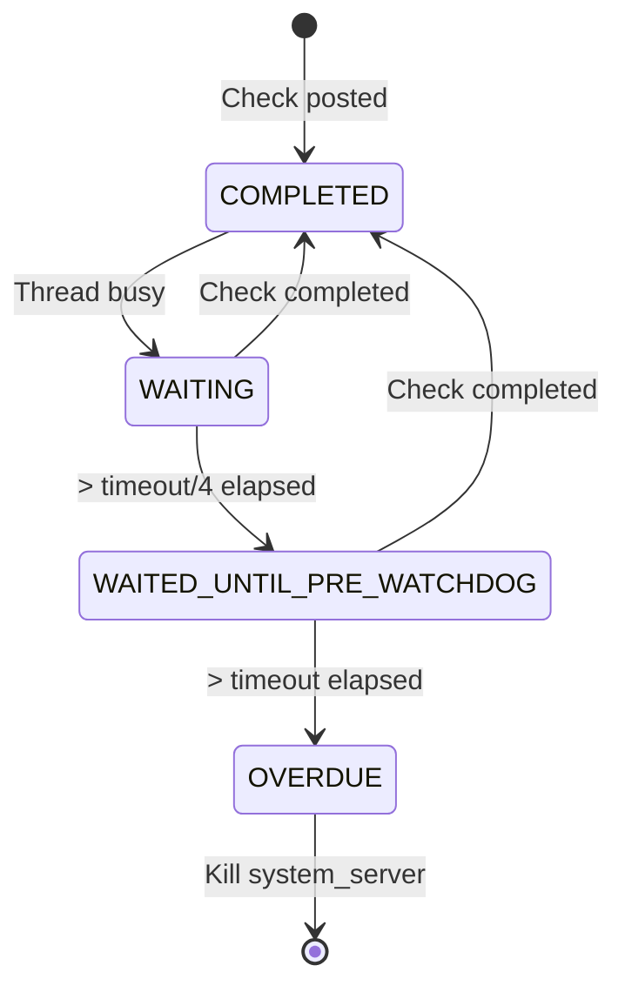

### 20.5.4 HandlerChecker

核心监控机制是 `HandlerChecker` 内部类（第 263-436 行）。每个 `HandlerChecker` 与一个 Handler（以及因此某个特定线程的 Looper）关联：

```java
// frameworks/base/services/core/java/com/android/server/Watchdog.java, line 263
public static class HandlerChecker implements Runnable {
    private final Handler mHandler;
    private final String mName;
    private final ArrayList<Monitor> mMonitors = new ArrayList<Monitor>();
    private long mWaitMaxMillis;
    private boolean mCompleted;
    private Monitor mCurrentMonitor;
    private long mStartTimeMillis;
    private int mPauseCount;
```

检查机制的工作方式如下：

1. Watchdog 线程调用 `scheduleCheckLocked()`，它将 `HandlerChecker`（作为一个 `Runnable`）投递到被监控线程消息队列的前端。
2. 当被监控线程处理该消息时，`run()` 会执行所有已注册的监视器，并将 `mCompleted` 设为 `true`。
3. 如果被监控线程被阻塞（死锁，或正在处理一条很慢的消息），`Runnable` 永远不会执行，`mCompleted` 保持为 `false`。

`run()` 方法（第 373-390 行）：

```java
// frameworks/base/services/core/java/com/android/server/Watchdog.java, line 373
@Override
public void run() {
    final int size = mMonitors.size();
    for (int i = 0 ; i < size ; i++) {
        synchronized (mLock) {
            mCurrentMonitor = mMonitors.get(i);
        }
        mCurrentMonitor.monitor();
    }

    synchronized (mLock) {
        mCompleted = true;
        mCurrentMonitor = null;
    }
}
```

有一个重要的优化（第 311-321 行）。如果检查器没有已注册的监视器*并且*目标 looper 当前正在轮询（空闲），HandlerChecker 会跳过投递。如果检查器被暂停，它也跳过投递。空闲的 looper 意味着线程未被阻塞，因此无需浪费时间进行上下文切换。如果已注册监视器，则无论如何都会投递，因为监视器本身仍需要运行。

### 20.5.5 被监控的线程

Watchdog 构造函数（第 492-549 行）为所有关键的 system_server 线程注册检查器：

```java
// frameworks/base/services/core/java/com/android/server/Watchdog.java, line 492
private Watchdog() {
    mThread = new Thread(this::run, "watchdog");

    // Custom monitor checker thread
    ServiceThread t = new ServiceThread("watchdog.monitor",
            android.os.Process.THREAD_PRIORITY_DEFAULT, true);
    t.start();
    mMonitorChecker = new HandlerChecker(
            new Handler(t.getLooper()), "monitor thread", mLock);
    mHandlerCheckers.add(withDefaultTimeout(mMonitorChecker));

    // Foreground thread
    mHandlerCheckers.add(withDefaultTimeout(
        new HandlerChecker(FgThread.getHandler(),
                           "foreground thread", mLock)));
    // Main thread
    mHandlerCheckers.add(withDefaultTimeout(
        new HandlerChecker(new Handler(Looper.getMainLooper()),
                           "main thread", mLock)));
    // UI thread
    mHandlerCheckers.add(withDefaultTimeout(
        new HandlerChecker(UiThread.getHandler(),
                           "ui thread", mLock)));
    // I/O thread
    mHandlerCheckers.add(withDefaultTimeout(
        new HandlerChecker(IoThread.getHandler(),
                           "i/o thread", mLock)));
    // Display thread
    mHandlerCheckers.add(withDefaultTimeout(
        new HandlerChecker(DisplayThread.getHandler(),
                           "display thread", mLock)));
    // Animation thread
    mHandlerCheckers.add(withDefaultTimeout(
        new HandlerChecker(AnimationThread.getHandler(),
                           "animation thread", mLock)));
    // Surface animation thread
    mHandlerCheckers.add(withDefaultTimeout(
        new HandlerChecker(SurfaceAnimationThread.getHandler(),
                           "surface animation thread", mLock)));

    // Binder thread monitor
    addMonitor(new BinderThreadMonitor());
    mInterestingJavaPids.add(Process.myPid());
}
```

七个被监控的工作线程加上监视线程，总共八个检查器。

### 20.5.6 Monitor 接口

持有关键锁的服务应实现 `Watchdog.Monitor`（第 460-462 行）：

```java
// frameworks/base/services/core/java/com/android/server/Watchdog.java, line 460
public interface Monitor {
    void monitor();
}
```

`monitor()` 方法应尝试获取服务的锁并返回。如果锁被某个死锁线程持有，`monitor()` 会阻塞，Watchdog 就会检测到死锁。

`BinderThreadMonitor`（第 453-458 行）检查至少有一个 Binder 线程可用：

```java
// frameworks/base/services/core/java/com/android/server/Watchdog.java, line 453
private static final class BinderThreadMonitor implements Watchdog.Monitor {
    @Override
    public void monitor() {
        Binder.blockUntilThreadAvailable();
    }
}
```

如果所有 31 个 Binder 线程都被阻塞（例如在死锁链中），该监视器将触发 Watchdog。

### 20.5.7 Watchdog 运行循环

Watchdog 主循环（第 858-900+ 行）持续运行：

```java
// frameworks/base/services/core/java/com/android/server/Watchdog.java, line 858
private void run() {
    boolean preWatchdogTriggered = false;
    // ...
    while (true) {
        // ...
        final long watchdogTimeoutMillis = mWatchdogTimeoutMillis;
        final long checkIntervalMillis =
                watchdogTimeoutMillis / PRE_WATCHDOG_TIMEOUT_RATIO;

        synchronized (mLock) {
            // Schedule checks on all handler checkers
            for (int i=0; i<mHandlerCheckers.size(); i++) {
                HandlerCheckerAndTimeout hc = mHandlerCheckers.get(i);
                hc.checker().scheduleCheckLocked(
                    hc.customTimeoutMillis()
                        .orElse(watchdogTimeoutMillis
                                * Build.HW_TIMEOUT_MULTIPLIER));
            }

            // Wait for check interval
            long start = SystemClock.uptimeMillis();
            while (timeout > 0) {
                // ...
                mLock.wait(timeout);
                // ...
            }

            // Evaluate results
            final int waitState = evaluateCheckerCompletionLocked();
            if (waitState == COMPLETED) {
                // everything is fine
                continue;
            } else if (waitState == WAITING) {
                continue;
            } else if (waitState == WAITED_UNTIL_PRE_WATCHDOG) {
                // pre-watchdog: dump but don't kill
            }
        }
        // If OVERDUE: collect stacks and kill
    }
}
```

### 20.5.8 Watchdog 触发时会发生什么

当 Watchdog 检测到 OVERDUE 状态时：

1. **堆栈跟踪收集**：转储以下进程的堆栈跟踪：
   - system_server（Java 线程）
   - “感兴趣的” Java 进程（StorageManager、电话进程）
   - 感兴趣的原生进程（surfaceflinger、audioserver、
     cameraserver、mediaserver 等）
   - 匹配感兴趣的 HIDL 和 AIDL 接口的 HAL 服务

2. **DropBox 条目**：将收集的数据写入 DropBoxManager。

3. **进程终止**：调用 `Process.killProcess(Process.myPid())` 以
    终止 system_server。

4. **运行时重启**：Zygote fork 出 system_server，并通过其 SIGCHLD
   处理程序回收它。Zygote 检测到死亡并 SIGKILL 自身
   （`frameworks/base/core/jni/com_android_internal_os_Zygote.cpp`）。
    然后 init 重启 zygote 服务。该重启会拆除并重新生成整个 Java 运行时。

感兴趣的原生进程（第 126-148 行）：

```java
// frameworks/base/services/core/java/com/android/server/Watchdog.java, line 126
public static final String[] NATIVE_STACKS_OF_INTEREST = new String[] {
    "/system/bin/audioserver",
    "/system/bin/cameraserver",
    "/system/bin/drmserver",
    "/system/bin/idmap2d",
    "/system/bin/mediadrmserver",
    "/system/bin/mediaserver",
    "/system/bin/netd",
    "/system/bin/sdcard",
    "/system/bin/servicemanager",
    "/system/bin/surfaceflinger",
    "/system/bin/vold",
    "media.extractor",
    "media.metrics",
    "media.codec",
    "media.swcodec",
    "media.transcoding",
    "com.android.bluetooth",
    "/apex/com.android.art/bin/artd",
    "/apex/com.android.compos/bin/composd",
    "/apex/com.android.os.statsd/bin/statsd",
    "/apex/com.android.virt/bin/virtualizationservice",
};
```

### 20.5.9 Watchdog 暂停机制

对于已知的长时间运行操作，Watchdog 提供了暂停/恢复 API。例如，PackageManagerService 初始化（SystemServer.java 中第 1364-1370 行）：

```java
// frameworks/base/services/java/com/android/server/SystemServer.java, line 1364
try {
    Watchdog.getInstance().pauseWatchingCurrentThread("packagemanagermain");
    mPackageManagerService = PackageManagerService.main(
            mSystemContext, installer, domainVerificationService,
            mFactoryTestMode != FactoryTest.FACTORY_TEST_OFF);
} finally {
    Watchdog.getInstance().resumeWatchingCurrentThread("packagemanagermain");
}
```

类似地，DEX 优化会暂停 Watchdog（第 1972-1978 行）：

```java
// frameworks/base/services/java/com/android/server/SystemServer.java, line 1972
try {
    Watchdog.getInstance().pauseWatchingCurrentThread("dexopt");
    mPackageManagerService.updatePackagesIfNeeded();
} catch (Throwable e) {
    reportWtf("update packages", e);
} finally {
    Watchdog.getInstance().resumeWatchingCurrentThread("dexopt");
}
```

暂停机制支持嵌套——每次 `pauseLocked()` 会使计数器加一，每次
`resumeLocked()` 会使其减一。只有当计数器归零时监控才会恢复。

### 20.5.10 超时历史与循环中断

Watchdog 跟踪超时历史以检测崩溃循环（第 120-123 行）：

```java
// frameworks/base/services/core/java/com/android/server/Watchdog.java, line 120
private static final String TIMEOUT_HISTORY_FILE =
        "/data/system/watchdog-timeout-history.txt";
private static final String PROP_FATAL_LOOP_COUNT =
        "framework_watchdog.fatal_count";
private static final String PROP_FATAL_LOOP_WINDOWS_SECS =
        "framework_watchdog.fatal_window.second";
```

如果 `system_server` 在配置的窗口内因 Watchdog 超时而反复崩溃，系统可以采取更激进的恢复措施（例如进入恢复模式）。

---

## 20.6 线程模型

### 20.6.1 概述

`system_server` 进程使用一个精心设计的线程模型，为不同的优先级级别提供共享的单例线程。并非每个服务都创建自己的线程，大多数服务共享一组小型的知名线程。这减少了上下文切换，简化了锁顺序，并使系统更容易推理。

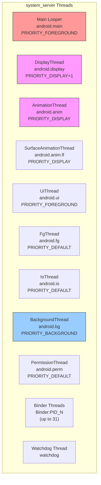

这些线程是独立、并行的 looper，而不是流水线的各个阶段。没有任何东西以固定顺序把工作从一个转发到下一个。每个服务选择优先级与其要投递的工作相匹配的线程。因此，同一个服务可能把显示更新投递到 `DisplayThread`，把磁盘写入投递到
`IoThread`，把周期性清理投递到 `BackgroundThread`。这些线程之间互不通信。

### 20.6.2 ServiceThread 基类

大多数系统服务器线程都继承 `ServiceThread`（定义在
`frameworks/base/core/java/com/android/server/ServiceThread.java`），
它本身继承 `HandlerThread`。例外是 `BackgroundThread`，它直接继承
`HandlerThread`，因此没有 `allowIo`/StrictMode 参数：

```java
// frameworks/base/core/java/com/android/server/ServiceThread.java, line 30
public class ServiceThread extends HandlerThread {
    private final boolean mAllowIo;

    public ServiceThread(String name, int priority, boolean allowIo) {
        super(name, priority);
        mAllowIo = allowIo;
    }

    @Override
    public void run() {
        if (!mAllowIo) {
            StrictMode.initThreadDefaults(null);
        }
        super.run();
    }

    protected static Handler makeSharedHandler(Looper looper) {
        return new Handler(looper, null, false, /* shared= */ true);
    }
}
```

`allowIo` 参数控制 StrictMode 的执行。不应执行磁盘或网络 I/O 的线程（如显示线程和动画线程）将此项设为 `false`。因此，一旦发生 I/O 就会出现 StrictMode 违规。

`makeSharedHandler()` 工厂方法以 `shared=true` 创建 handler，允许多个组件安全地向同一个 handler 投递，而无需持有其内部锁。

### 20.6.3 线程目录

#### 主 Looper 线程

- **名称**：`system_server` 的主线程
- **优先级**：`THREAD_PRIORITY_FOREGROUND` (-2)
- **用途**：运行主消息循环；接收所有 `SystemService`
  生命周期回调
- **初始化于**：`SystemServer.run()` 第 937 行

```java
// frameworks/base/services/java/com/android/server/SystemServer.java, line 937
Looper.prepareMainLooper();
```

主 looper 具有慢分发/慢投递阈值：

- 慢分发：100ms
- 慢投递：200ms

#### DisplayThread

- **文件**：`frameworks/base/services/core/java/com/android/server/DisplayThread.java`
- **线程名称**：`android.display`
- **优先级**：`THREAD_PRIORITY_DISPLAY + 1` (-3)
- **允许 I/O**：`false`
- **跟踪标签**：`TRACE_TAG_SYSTEM_SERVER`
- **用途**：影响屏幕上显示内容的操作。供
  WindowManager、DisplayManager 和 InputManager 用于快速的实时
  操作。

来自源码注释（第 26-29 行）：

> 系统共享的单例前台线程。这是一个用于影响屏幕显示内容的操作线程，需要保持
> 最低延迟。该线程几乎只应由
> WindowManager、DisplayManager 和 InputManager 用于实时执行快速
> 操作。

#### AnimationThread

- **文件**：`frameworks/base/services/core/java/com/android/server/AnimationThread.java`
- **线程名称**：`android.anim`
- **优先级**：`THREAD_PRIORITY_DISPLAY` (-4)
- **允许 I/O**：`false`
- **跟踪标签**：`TRACE_TAG_WINDOW_MANAGER`
- **用途**：所有传统的窗口动画、启动窗口和
  遍历。优先级略高于 DisplayThread。

#### SurfaceAnimationThread

- **文件**：`frameworks/base/services/core/java/com/android/server/wm/SurfaceAnimationThread.java`
- **线程名称**：`android.anim.lf`
- **优先级**：`THREAD_PRIORITY_DISPLAY` (-4)
- **允许 I/O**：`false`
- **跟踪标签**：`TRACE_TAG_WINDOW_MANAGER`
- **用途**：运行 `SurfaceAnimationRunner`，它不持有
  窗口管理器锁。这种分离可防止在 WM 锁被争用时出现动画卡顿。

#### UiThread

- **文件**：`frameworks/base/services/core/java/com/android/server/UiThread.java`
- **线程名称**：`android.ui`
- **优先级**：`THREAD_PRIORITY_FOREGROUND` (-2)
- **允许 I/O**：`false`
- **线程组**：`THREAD_GROUP_TOP_APP`（在 `run()` 中设置）
- **用途**：系统 UI 操作。操作耗时不得超过几毫秒，以避免 UI 卡顿。

特殊行为（第 42-46 行）：

```java
// frameworks/base/services/core/java/com/android/server/UiThread.java, line 42
@Override
public void run() {
    // Make sure UiThread is in the fg stune boost group
    Process.setThreadGroup(Process.myTid(), Process.THREAD_GROUP_TOP_APP);
    super.run();
}
```

UiThread 显式地将自己放入 `THREAD_GROUP_TOP_APP`
调度组以获得最大 CPU 优先级。

#### FgThread（前台线程）

- **文件**：`frameworks/base/core/java/com/android/server/FgThread.java`
- **线程名称**：`android.fg`
- **优先级**：`THREAD_PRIORITY_DEFAULT` (0)
- **允许 I/O**：`true`
- **用途**：不应被后台工作阻塞的前台服务操作。许多服务在此调度其主要工作。

来自源码注释（第 27-35 行）：

> 系统共享的单例前台线程。这是一个用于常规前台服务操作的线程，不应被
> 后台运行的任何内容阻塞。特别是，共享的后台
> 线程可能正在执行相对较长的运行操作，比如将状态保存到磁盘（除了
> 单纯是后台优先级之外），这可能导致调度到它的操作延迟用户可感知的
> 一段时间。

#### IoThread

- **文件**：`frameworks/base/services/core/java/com/android/server/IoThread.java`
- **线程名称**：`android.io`
- **优先级**：`THREAD_PRIORITY_DEFAULT` (0)
- **允许 I/O**：`true`
- **用途**：可能短暂阻塞于网络
  I/O 的非后台操作（不是等待数据，而是与网络守护进程通信）。

#### BackgroundThread

- **文件**：`frameworks/base/core/java/com/android/internal/os/BackgroundThread.java`
- **线程名称**：`android.bg`
- **优先级**：`THREAD_PRIORITY_BACKGROUND` (10)
- **用途**：系统中的后台操作。在整个进程内共享一个单例。与其他线程不同，它直接继承
  `HandlerThread` 而不是 `ServiceThread`，因此没有 `allowIo` 参数。
  它具有非常宽松的慢阈值：
  - 慢分发：10,000ms（10 秒！）
  - 慢投递：30,000ms（30 秒！）

宽松的阈值反映了后台操作预期会更慢，并且不在用户体验的关键路径上。

#### PermissionThread

- **文件**：`frameworks/base/services/core/java/com/android/server/PermissionThread.java`
- **线程名称**：`android.perm`
- **优先级**：`THREAD_PRIORITY_DEFAULT` (0)
- **允许 I/O**：`true`
- **用途**：处理与 PermissionController 之间的调用，以及
  权限与 app-op 状态之间的同步。

### 20.6.4 线程优先级汇总

| 线程 | 名称 | 优先级 | 数值 | 允许 I/O | StrictMode |
|--------|------|----------|---------|-----------|------------|
| AnimationThread | `android.anim` | DISPLAY | -4 | 否 | 强制执行 |
| SurfaceAnimationThread | `android.anim.lf` | DISPLAY | -4 | 否 | 强制执行 |
| DisplayThread | `android.display` | DISPLAY+1 | -3 | 否 | 强制执行 |
| UiThread | `android.ui` | FOREGROUND | -2 | 否 | 强制执行 |
| Main Looper | `main` | FOREGROUND | -2 | 不适用 | 不适用 |
| FgThread | `android.fg` | DEFAULT | 0 | 是 | 不强制执行 |
| IoThread | `android.io` | DEFAULT | 0 | 是 | 不强制执行 |
| PermissionThread | `android.perm` | DEFAULT | 0 | 是 | 不强制执行 |
| BackgroundThread | `android.bg` | BACKGROUND | 10 | 不适用（普通 HandlerThread） | 不强制执行 |

### 20.6.5 Handler、Looper 与 MessageQueue

每个共享线程都有一个运行 `MessageQueue` 的 `Looper`。服务通过 `Handler`
实例投递 `Message` 对象或 `Runnable` 回调来与线程交互：

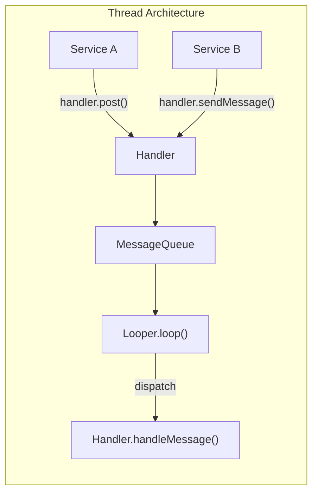

system_server 中使用的关键模式：

1. **共享 handler**：以 `shared=true` 创建，以允许从
   任意线程投递而无需外部同步。
2. **Handler 执行器**：`HandlerExecutor` 将 Handler 包装为 Java
    `Executor`，以便与现代异步 API 配合使用。
3. **消息优先级**：`Message.setAsynchronous(true)` 绕过同步
    屏障，用于时间关键型操作。

`android.os.MessageQueue` 是到处都在使用的核心操作系统原语，并非 system_server 专用，因此其完整论述属于核心线程层。

这里相关的部分是：Android 17 新增了一个无锁的重新实现，在构建时通过
`release_package_messagequeue_implementation`
Soong 配置来选择。默认的 `CombinedMessageQueue` 变体
（`frameworks/base/core/java/android/os/CombinedMessageQueue/MessageQueue.java`）
在运行时选择实现。它会回退到旧的、由
`synchronized` 保护的队列。对于符合条件的进程，它会切换到其并发
的“ConcurrentMessageQueue”路径。兼容性变更
`USE_NEW_MESSAGEQUEUE`（`@EnabledAfter(targetSdkVersion
= BAKLAVA)`，即目标 SDK 37+ 的应用）以及
`use_concurrent_message_queue_in_apps` aconfig 标志控制资格判定。并发路径允许用于系统（core-UID）进程，例如
system_server。

另一个独立的、可在构建时选择的变体是“DeliQueue”（一个 Treiber
栈加上一个每 looper 的最小堆，通过 `VarHandle` CAS 而非
监视器锁来协调）。它位于
`frameworks/base/core/java/android/os/CombinedDeliMessageQueue/MessageQueue.java`
以及 `frameworks/base/core/java/android/os/MessageStack.java` 中。
旧变体位于
`frameworks/base/core/java/android/os/LegacyMessageQueue/` 下。

### 20.6.6 Binder 线程

除了命名线程之外，`system_server` 还维护一个最多 31 个 Binder 线程的线程池（SystemServer.java 第 493 行）：

```java
// frameworks/base/services/java/com/android/server/SystemServer.java, line 493
private static final int sMaxBinderThreads = 31;
```

Binder 线程命名为 `Binder:PID_N`，其中 PID 是进程 ID，N 是线程编号。这些线程处理来自应用进程的所有传入 IPC。当所有 31 个线程都忙碌时，新的传入 Binder 调用会排队，如果拥塞持续，Watchdog 的 `BinderThreadMonitor` 最终会触发。

### 20.6.7 线程选择指南

实现系统服务时，选择正确的线程至关重要：

| 场景 | 推荐线程 | 理由 |
|----------|-------------------|-----------|
| 显示合成、窗口布局 | DisplayThread | 显示延迟最低 |
| 窗口动画 | AnimationThread | 最高优先级以实现流畅动画 |
| Surface 动画（无锁） | SurfaceAnimationThread | 避免 WM 锁争用 |
| 系统对话框、叠加层 | UiThread | 前台优先级，TOP_APP 组 |
| 服务业务逻辑 | FgThread | 默认优先级，不被后台阻塞 |
| 磁盘 I/O、数据库写入 | IoThread | 允许 I/O，默认优先级 |
| 非紧急后台工作 | BackgroundThread | 低优先级，宽松超时 |
| 权限检查 | PermissionThread | 专用，避免阻塞其他线程 |

### 20.6.8 SystemServerInitThreadPool

在启动期间，`system_server` 使用一个临时线程池进行并行
初始化（第 944 行）：

```java
// frameworks/base/services/java/com/android/server/SystemServer.java, line 944
SystemServerInitThreadPool.start();
```

这个线程池允许多个独立的初始化任务并发运行，从而减少启动时间。例如：

- `SystemConfig.getInstance()`（第 1156 行）
- 次要 Zygote 预加载（第 1581 行）
- 传感器管理器服务启动（第 1743 行）
- HIDL 服务启动（第 1750 行）
- WebView 准备（第 3420 行）

初始化完成后该线程池即被关闭，在正常运行期间不再使用。

---

## 20.7 深入剖析：关键服务内部实现

### 20.7.1 ActivityManagerService 与 ActivityTaskManagerService

ActivityManagerService（AMS）和 ActivityTaskManagerService（ATMS）是
`system_server` 中最重要的服务。它们最初是一个单一的整体服务，后来被拆分，将进程管理（AMS）与活动/任务管理（ATMS）分离开来。

**源文件：**

- `frameworks/base/services/core/java/com/android/server/am/ActivityManagerService.java`
- `frameworks/base/services/core/java/com/android/server/wm/ActivityTaskManagerService.java`

`startBootstrapServices()` 中的启动顺序（第 1274-1283 行）：

```java
// frameworks/base/services/java/com/android/server/SystemServer.java, line 1274
t.traceBegin("StartActivityManager");
ActivityTaskManagerService atm = mSystemServiceManager.startService(
        ActivityTaskManagerService.Lifecycle.class).getService();
mActivityManagerService = ActivityManagerService.Lifecycle.startService(
        mSystemServiceManager, atm);
mActivityManagerService.setSystemServiceManager(mSystemServiceManager);
mActivityManagerService.setInstaller(installer);
mWindowManagerGlobalLock = atm.getGlobalLock();
```

关键观察：

1. ATMS 先启动并返回其服务引用。
2. AMS 第二个启动并接收 ATMS 引用。
3. AMS 获得对 SystemServiceManager 和 Installer 的引用。
4. WindowManagerGlobalLock 从 ATMS 获取。

**AMS 职责：**

- 进程生命周期管理（启动、停止、杀死）
- OOM 调整计算
- 广播分发
- 内容提供者管理
- 崩溃与 ANR 处理
- 运行时强制执行应用权限

**ATMS 职责：**

- Activity 栈与任务管理
- Activity 生命周期（创建、恢复、暂停、停止、销毁）
- 最近任务
- 多窗口管理
- Activity 转场

稍后在 `startBootstrapServices()` 中，会建立关键的交叉引用（第 1406-1418 行）：

```java
// frameworks/base/services/java/com/android/server/SystemServer.java, line 1406
t.traceBegin("SetSystemProcess");
mActivityManagerService.setSystemProcess();
t.traceEnd();

// ...

t.traceBegin("InitWatchdog");
watchdog.init(mSystemContext, mActivityManagerService);
t.traceEnd();
```

`AMS.setSystemProcess()` 将 activity 服务注册为一个 Binder
服务，并设置系统进程的 ApplicationInfo。Watchdog
初始化需要 AMS 来注册重启广播
接收器。

### 20.7.2 WindowManagerService

WindowManagerService（WMS）管理设备上的所有窗口——应用
窗口、状态栏、导航栏、对话框、toast 等。它是
Android 中最复杂的服务之一。

**源：** `frameworks/base/services/core/java/com/android/server/wm/WindowManagerService.java`

WMS 在 `startOtherServices()` 中启动（第 1722-1730 行）：

```java
// frameworks/base/services/java/com/android/server/SystemServer.java, line 1722
t.traceBegin("StartWindowManagerService");
mSystemServiceManager.startBootPhase(t,
        SystemService.PHASE_WAIT_FOR_SENSOR_SERVICE);
wm = WindowManagerService.main(context, inputManager, !mFirstBoot,
        new PhoneWindowManager(), mActivityManagerService.mActivityTaskManager);
ServiceManager.addService(Context.WINDOW_SERVICE, wm, false,
        DUMP_FLAG_PRIORITY_CRITICAL | DUMP_FLAG_PRIORITY_HIGH
                | DUMP_FLAG_PROTO);
```

WMS 依赖于：

- InputManagerService（用于输入事件分发）
- PhoneWindowManager（用于策略决策，如按键处理）
- ActivityTaskManagerService（用于 activity 窗口管理）
- SensorService（必须等待 PHASE_WAIT_FOR_SENSOR_SERVICE）

WMS 以 `DUMP_FLAG_PRIORITY_CRITICAL | DUMP_FLAG_PRIORITY_HIGH`
注册，因为它的转储输出对于调试显示问题至关重要。

WMS 启动后，会触发几个关键回调：

```java
// line 1733
mActivityManagerService.setWindowManager(wm);

// line 1737
wm.onInitReady();

// line 1758
inputManager.setWindowManagerCallbacks(wm.getInputManagerCallback());
inputManager.start();

// line 1763
mDisplayManagerService.windowManagerAndInputReady();
```

正是这种交叉引用的“舞蹈”使得 WMS、AMS、InputManager 和
DisplayManager 都处于引导/早期其他阶段——它们无法独立运行。

### 20.7.3 PackageManagerService

PackageManagerService（PMS）管理所有已安装的软件包（APK）、它们的
权限、组件和元数据。它庞大而复杂，其初始化是启动过程中最长的操作之一。

**源：** `frameworks/base/services/core/java/com/android/server/pm/PackageManagerService.java`

PMS 在 `startBootstrapServices()` 中启动（第 1362-1374 行）：

```java
// frameworks/base/services/java/com/android/server/SystemServer.java, line 1362
t.traceBegin("StartPackageManagerService");
try {
    Watchdog.getInstance().pauseWatchingCurrentThread("packagemanagermain");
    mPackageManagerService = PackageManagerService.main(
            mSystemContext, installer, domainVerificationService,
            mFactoryTestMode != FactoryTest.FACTORY_TEST_OFF);
} finally {
    Watchdog.getInstance().resumeWatchingCurrentThread("packagemanagermain");
}
mFirstBoot = mPackageManagerService.isFirstBoot();
mPackageManager = mSystemContext.getPackageManager();
```

PMS 依赖于：

- Installer（`installd` 守护进程接口）
- DomainVerificationService（应用链接验证）
- DisplayManager（必须拥有显示指标以进行资源选择）

在 PMS 初始化期间显式暂停了 Watchdog。这是因为软件包扫描可能需要数秒（在首次启动且预装应用很多时甚至可能需要数分钟）。若不暂停，Watchdog 会在一个合法的长时间操作期间杀死
`system_server`。

### 20.7.4 PowerManagerService

PowerManagerService 管理设备的电源状态——唤醒锁、
显示电源、待机模式、省电模式和关机。

**源：** `frameworks/base/services/core/java/com/android/server/power/PowerManagerService.java`

```java
// frameworks/base/services/java/com/android/server/SystemServer.java, line 1300
t.traceBegin("StartPowerManager");
mPowerManagerService = mSystemServiceManager.startService(
        PowerManagerService.class);
t.traceEnd();
```

PowerManager 提前启动，因为许多其他服务在初始化期间需要获取
唤醒锁。AMS 启动后，电源管理被完全初始化：

```java
// line 1310
t.traceBegin("InitPowerManagement");
mActivityManagerService.initPowerManagement();
t.traceEnd();
```

### 20.7.5 NotificationManagerService

NotificationManagerService（NMS）管理所有通知、通道、
通知策略以及与状态栏的交互。

**源：** `frameworks/base/services/core/java/com/android/server/notification/NotificationManagerService.java`

```java
// frameworks/base/services/java/com/android/server/SystemServer.java, line 2341
t.traceBegin("StartNotificationManager");
mSystemServiceManager.startService(NotificationManagerService.class);
SystemNotificationChannels.removeDeprecated(context);
SystemNotificationChannels.createAll(context);
notification = INotificationManager.Stub.asInterface(
        ServiceManager.getService(Context.NOTIFICATION_SERVICE));
```

NMS 依赖于 StorageManagerService（用于媒体/USB 通知），
因此当文件系统可用时 StorageManager 会先启动。

### 20.7.6 DisplayManagerService

DisplayManagerService 管理物理和虚拟显示、显示
电源状态以及显示适配器。

**源：** `frameworks/base/services/core/java/com/android/server/display/DisplayManagerService.java`

```java
// frameworks/base/services/java/com/android/server/SystemServer.java, line 1339
t.traceBegin("StartDisplayManager");
mDisplayManagerService = mSystemServiceManager.startService(
        DisplayManagerService.class);
```

关键的 PHASE_WAIT_FOR_DEFAULT_DISPLAY (100) 启动阶段紧随其后：

```java
// line 1344
t.traceBegin("WaitForDisplay");
mSystemServiceManager.startBootPhase(t,
        SystemService.PHASE_WAIT_FOR_DEFAULT_DISPLAY);
```

在默认显示可用之前，任何软件包扫描都无法开始，因为 PackageManagerService 需要显示指标来为设备的密度选择
正确的资源。

---

## 20.8 服务通信模式

### 20.8.1 Binder 服务与本地服务

`system_server` 中的服务通过两种不同的模式通信：

**Binder 服务** 注册到 `ServiceManager`，设备上的任何进程都可以访问。它们提供应用所使用的公共 API 表面：

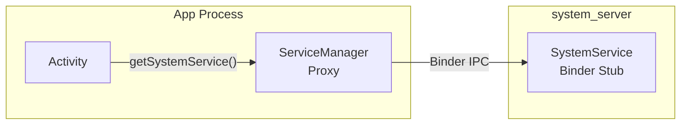

**本地服务** 注册到 `LocalServices`，仅可在 `system_server` 进程内部访问。它们提供其他系统服务使用的特权内部 API：

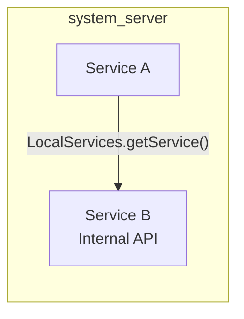

双接口模式非常普遍。例如 PowerManager：

- **Binder**：`IPowerManager` —— 供应用获取唤醒锁
- **本地**：`PowerManagerInternal` —— 供系统服务强制
  显示开/关、覆盖唤醒锁行为等。

### 20.8.2 Lifecycle 内部类模式

许多服务使用继承 `SystemService` 的内部 `Lifecycle` 类：

```java
public class ExampleManagerService extends IExampleManager.Stub {

    public static final class Lifecycle extends SystemService {
        private ExampleManagerService mService;

        public Lifecycle(Context context) {
            super(context);
        }

        @Override
        public void onStart() {
            mService = new ExampleManagerService(getContext());
            publishBinderService(Context.EXAMPLE_SERVICE, mService);
            publishLocalService(ExampleManagerInternal.class,
                    mService.new LocalService());
        }

        @Override
        public void onBootPhase(int phase) {
            mService.onBootPhase(phase);
        }
    }
}
```

这种模式将 Binder stub 实现（外部类）与生命周期管理（内部类）分离开来。`Lifecycle` 类正是 `SystemServiceManager` 实例化和管理的对象。

### 20.8.3 服务依赖

`system_server` 中的服务依赖并未正式声明（不像依赖注入框架）。相反，它们隐含在启动顺序中。需要 `PowerManager` 的服务只需在 `PowerManagerService` 之后启动。之所以可行，是因为 `SystemServer.java` 显式控制着顺序。

曾有过多次形式化依赖的尝试：

- `TODO: Use service dependencies instead` 注释出现在
  `SystemServer.java` 中（第 1762 行）
- `SystemService` 构造函数中的 `dependencies` 参数是为 Ravenwood
  测试环境添加的
- 启动阶段提供粗粒度的同步

然而，在很大程度上，`SystemServer.java` 中的启动顺序仍然是主要的依赖机制。

### 20.8.4 通过 Handler 进行跨服务通信

当一个服务需要异步通知另一个服务时，它会向目标服务的 handler 投递一条消息。例如，当
DisplayManagerService 检测到显示变化时，它可能通过向 DisplayThread handler 投递消息来通知
WindowManagerService。

常见模式：

1. **直接 handler 投递**：`displayThread.getHandler().post(callback)`
2. **消息对象**：`handler.obtainMessage(MSG_TYPE).sendToTarget()`
3. **本地服务回调**：通过
    `LocalServices.getService()` 注册监听器接口并直接调用它

### 20.8.5 SystemServer Dumper

SystemServer 注册了一个特殊的 `system_server_dumper` Binder 服务
（第 974 行），它充当中央转储协调者：

```java
// frameworks/base/services/java/com/android/server/SystemServer.java, line 974
ServiceManager.addService("system_server_dumper", mDumper);
mDumper.addDumpable(this);
```

`SystemServerDumper`（第 759-834 行）接受 `Dumpable` 对象，并提供了一个转储它们状态的统一接口：

```bash
# List all dumpables
adb shell dumpsys system_server_dumper --list

# Dump a specific dumpable
adb shell dumpsys system_server_dumper --name SystemServiceManager
```

它与每服务的 `dumpsys` 机制是分开的，因为它转储不与任何
特定 Binder 服务关联的 `system_server` 内部状态。

---

## 20.9 错误处理与恢复

### 20.9.1 reportWtf 模式

在 `SystemServer.java` 中，服务启动失败被一致的模式捕获（第 1095-1098 行）：

```java
// frameworks/base/services/java/com/android/server/SystemServer.java, line 1095
private void reportWtf(String msg, Throwable e) {
    Slog.w(TAG, "***********************************************");
    Slog.wtf(TAG, "BOOT FAILURE " + msg, e);
}
```

`Slog.wtf()`（What a Terrible Failure）会记录错误，并且在 userdebug
构建上，可能触发额外的诊断动作。大多数服务启动失败都会被捕获并通过 `reportWtf()` 报告，而不是让
`system_server` 崩溃，因为部分可用的系统总好过完全没有系统。

### 20.9.2 早期 WTF 处理

在 AMS 完全初始化之前，WTF 无法被立即处理（此时还没有 dropbox）。`SystemServer` 会缓存它们（第 1015-1016 行）：

```java
// frameworks/base/services/java/com/android/server/SystemServer.java, line 1016
RuntimeInit.setDefaultApplicationWtfHandler(SystemServer::handleEarlySystemWtf);
```

稍后，在 AMS 就绪之后，待处理的 WTF 会被刷新（第 3224-3230 行）：

```java
// line 3225
synchronized (SystemService.class) {
    if (sPendingWtfs != null) {
        mActivityManagerService.schedulePendingSystemServerWtfs(sPendingWtfs);
        sPendingWtfs = null;
    }
}
```

### 20.9.3 待处理关机检查

在启动服务之前，`SystemServer` 会检查上一次会话是否曾有待处理的关机（第 1100-1150 行）：

```java
// frameworks/base/services/java/com/android/server/SystemServer.java, line 1100
private void performPendingShutdown() {
    final String shutdownAction = SystemProperties.get(
            ShutdownThread.SHUTDOWN_ACTION_PROPERTY, "");
    if (shutdownAction != null && shutdownAction.length() > 0) {
        boolean reboot = (shutdownAction.charAt(0) == '1');
        // ...
        ShutdownThread.rebootOrShutdown(null, reboot, reason);
    }
}
```

这处理了设备在崩溃时正处于重启过程中的情况（例如为进行 OTA 更新）。待处理的重启会在继续正常启动之前完成。

### 20.9.4 安全模式

安全模式在 WindowManagerService 启动后被检测到（第 1851 行）：

```java
// frameworks/base/services/java/com/android/server/SystemServer.java, line 1851
final boolean safeMode = wm.detectSafeMode();
if (safeMode) {
    Settings.Global.putInt(context.getContentResolver(),
            Settings.Global.AIRPLANE_MODE_ON, 1);
}
```

在安全模式下：

- 飞行模式立即启用
- AMS 进入安全模式（`mActivityManagerService.enterSafeMode()`）
- 第三方服务可能受限
- 系统显示安全模式叠加层

### 20.9.5 FD 泄漏检测

在调试构建上，`SystemServer` 会派生一个线程来监控文件描述符
使用情况（第 642-695 行）：

```java
// frameworks/base/services/java/com/android/server/SystemServer.java, line 642
private static void spawnFdLeakCheckThread() {
    final int enableThreshold = SystemProperties.getInt(
            SYSPROP_FDTRACK_ENABLE_THRESHOLD, 1600);
    final int abortThreshold = SystemProperties.getInt(
            SYSPROP_FDTRACK_ABORT_THRESHOLD, 3000);
```

该线程周期性检查最高文件描述符编号：

- 超过 1600：启用 `libfdtrack` 进行详细跟踪
- 超过 3000：转储 hprof 堆转储并中止进程

这防止了缓慢的 FD 泄漏最终导致进程耗尽文件描述符时出现莫名其妙的失败。

### 20.9.6 CriticalEventLog

所有服务启动完成后，会记录一个关键事件（第 1038 行）：

```java
// frameworks/base/services/java/com/android/server/SystemServer.java, line 1038
CriticalEventLog.getInstance().logSystemServerStarted();
```

`CriticalEventLog` 维护关键系统事件的持久记录（启动、崩溃、Watchdog
杀死），这些记录在重启后仍然存在。rescue party 逻辑使用此数据来检测崩溃循环并采取纠正
措施（例如进入恢复模式或禁用有问题的应用）。

---

## 20.10 性能考量

### 20.10.1 启动时间优化

`SystemServer` 使用多种策略来最小化启动时间：

**1. 并行初始化**：`SystemServerInitThreadPool` 并发运行独立的
初始化任务：

```java
// line 944
SystemServerInitThreadPool.start();

// line 1156 - SystemConfig loading
SystemServerInitThreadPool.submit(SystemConfig::getInstance, ...);

// line 1581 - Secondary Zygote preload
mZygotePreload = SystemServerInitThreadPool.submit(() -> { ... });

// line 1743 - Sensor manager
SystemServerInitThreadPool.submit(() -> {
    startISensorManagerService();
});

// line 1750 - HIDL services
SystemServerInitThreadPool.submit(() -> {
    startHidlServices();
});
```

**2. 延迟初始化**：许多服务在
`onStart()` 中做最少的工作，并把繁重的初始化推迟到后续启动阶段。

**3. 惰性加载**：`FgThread`、`IoThread` 和
`BackgroundThread` 等服务使用 holder 模式或 `NoPreloadHolder` 模式
进行惰性初始化。

**4. 启动时间跟踪**：会跟踪并报告计时信息：

```java
// line 1049
if (!mRuntimeRestart && !isFirstBootOrUpgrade()) {
    final long uptimeMillis = SystemClock.elapsedRealtime();
    // ...
    final long maxUptimeMillis = 60 * 1000;
    if (uptimeMillis > maxUptimeMillis) {
        Slog.wtf(SYSTEM_SERVER_TIMING_TAG,
                "SystemServer init took too long. uptimeMillis=" + uptimeMillis);
    }
}
```

如果启动耗时超过 60 秒，则会记录一条 WTF。

### 20.10.2 内存优化

在 `run()` 早期，`system_server` 清除了其增长限制（第 911 行）：

```java
// frameworks/base/services/java/com/android/server/SystemServer.java, line 911
VMRuntime.getRuntime().clearGrowthLimit();
```

普通应用有一个堆增长限制（通常为 256MB 或 512MB）。但
`system_server` 移除了该限制。这是因为它需要管理整个
系统的状态，这可能需要大量内存。

### 20.10.3 Binder 性能

若干优化确保 Binder IPC 性能：

**禁用后台调度：**

```java
// line 929
BinderInternal.disableBackgroundScheduling(true);
```

这确保所有传入 `system_server` 的 Binder 调用都以
前台优先级运行，防止饥饿。

**阻塞调用警告：**

```java
// line 880
Binder.setWarnOnBlocking(true);
```

在 `system_server` 内部，不鼓励向其他进程发起阻塞（同步）的 Binder 调用，因为它们可能导致死锁。此设置会在发生此类调用时记录警告。

**事务回调：**

```java
// line 1062
Binder.setTransactionCallback(new IBinderCallback() {
    @Override
    public void onTransactionError(int pid, int code, int flags, int err) {
        mActivityManagerService.frozenBinderTransactionDetected(
                pid, code, flags, err);
    }
});
```

这检测到冻结（缓存）进程收到一个失败的 Binder 事务，这对管理进程生命周期很重要。

### 20.10.4 慢日志阈值

每个线程都有可配置的慢分发和慢投递阈值：

| 线程 | 分发阈值 | 投递阈值 |
|--------|-------------------|-------------------|
| Main Looper | 100ms | 200ms |
| UiThread | 100ms | 200ms |
| FgThread | 100ms | 200ms |
| PermissionThread | 100ms | 200ms |
| BackgroundThread | 10,000ms | 30,000ms |
| DisplayThread | 默认 | 默认 |
| AnimationThread | 默认 | 默认 |
| IoThread | 默认 | 默认 |

当一条消息超过这些阈值时，会记录一条包含消息详情和计时信息的警告。这对于
识别导致卡顿的操作非常有价值。

相关定义：

- **分发阈值**：消息 handler 运行了多久——`Handler.dispatchMessage()` 本身的持续时间（分发结束减去分发开始）
- **投递阈值**：消息的计划时间
  （`msg.when`）与分发开始之间有多久（在队列中迟到的时间）

---

## 20.11 APEX 模块服务加载

### 20.11.1 模块化挑战

随着 Android 通过 Project Mainline 实现模块化，原先编译进
`services.jar` 的服务需要从模块交付的 APEX 中加载。这带来了一个挑战：如何从一个不在默认类路径上的 JAR 中加载 `SystemService` 子类。

### 20.11.2 SystemServerClassLoaderFactory

`SystemServiceManager.startServiceFromJar()` 方法为每个独立的 JAR 创建一个
`PathClassLoader`：

```java
// frameworks/base/services/core/java/com/android/server/SystemServiceManager.java, line 167
public SystemService startServiceFromJar(String className, String path) {
    PathClassLoader pathClassLoader =
            SystemServerClassLoaderFactory.getOrCreateClassLoader(
                    path, this.getClass().getClassLoader(),
                    isJarInTestApex(path));
    final Class<SystemService> serviceClass =
            loadClassFromLoader(className, pathClassLoader);
    return startService(serviceClass);
}
```

类加载器层次结构：

1. APEX JAR 的 `PathClassLoader` 以系统服务器的默认
   类加载器作为其父类加载器。
2. 这允许 APEX 服务访问所有框架类，同时它自己的类从 APEX JAR 中加载。
3. `SystemServerClassLoaderFactory` 缓存类加载器，因此同一个
   APEX JAR 不会被多次加载。

### 20.11.3 模块服务的生命周期

通过 APEX 交付的服务参与与内置服务相同的生命周期。它们接收启动阶段回调、用户生命周期事件，并受 Watchdog 监控。唯一的区别是加载机制。

来自 WiFi 的示例：

```java
// frameworks/base/services/java/com/android/server/SystemServer.java, line 2256
t.traceBegin("StartWifi");
mSystemServiceManager.startServiceFromJar(
        WIFI_SERVICE_CLASS, WIFI_APEX_SERVICE_JAR_PATH);
```

其中：
```java
// line 434
private static final String WIFI_APEX_SERVICE_JAR_PATH =
        "/apex/com.android.wifi/javalib/service-wifi.jar";
private static final String WIFI_SERVICE_CLASS =
        "com.android.server.wifi.WifiService";
```

### 20.11.4 完整的 APEX JAR 路径

以下是 `SystemServer.java` 中使用的 APEX 路径的完整映射：

| 常量 | 路径 |
|----------|------|
| `WIFI_APEX_SERVICE_JAR_PATH` | `/apex/com.android.wifi/javalib/service-wifi.jar` |
| `BLUETOOTH_APEX_SERVICE_JAR_PATH` | `/apex/com.android.bt/javalib/service-bluetooth.jar` |
| `CONNECTIVITY_SERVICE_APEX_PATH` | `/apex/com.android.tethering/javalib/service-connectivity.jar` |
| `UWB_APEX_SERVICE_JAR_PATH` | `/apex/com.android.uwb/javalib/service-uwb.jar` |
| `RANGING_APEX_SERVICE_JAR_PATH` | `/apex/com.android.uwb/javalib/service-ranging.jar` |
| `STATS_COMPANION_APEX_PATH` | `/apex/com.android.os.statsd/javalib/service-statsd.jar` |
| `SCHEDULING_APEX_PATH` | `/apex/com.android.scheduling/javalib/service-scheduling.jar` |
| `DEVICE_LOCK_APEX_PATH` | `/apex/com.android.devicelock/javalib/service-devicelock.jar` |
| `PROFILING_SERVICE_JAR_PATH` | `/apex/com.android.profiling/javalib/service-profiling.jar` |
| `UPROBESTATS_BRIDGE_SERVICE_JAR_PATH` | `/apex/com.android.uprobestats/javalib/service-uprobestats-bridge.jar` |
| `DEVICE_TO_DEVICE_APEX_SERVICE_JAR_PATH` | `/apex/com.android.bettertogether/javalib/service-device-to-device.jar` |

---

## 20.12 设备特定与形态特定服务

### 20.12.1 设备特定服务

标准服务启动之后，`SystemServer` 从一个资源数组加载 OEM 特定的服务（第 3232-3244 行）：

```java
// frameworks/base/services/java/com/android/server/SystemServer.java, line 3232
t.traceBegin("StartDeviceSpecificServices");
final String[] classes = mSystemContext.getResources().getStringArray(
        R.array.config_deviceSpecificSystemServices);
for (final String className : classes) {
    t.traceBegin("StartDeviceSpecificServices " + className);
    try {
        mSystemServiceManager.startService(className);
    } catch (Throwable e) {
        reportWtf("starting " + className, e);
    }
    t.traceEnd();
}
```

OEM 在其设备叠加层中填充 `config_deviceSpecificSystemServices`，从而无需修改
`SystemServer.java` 即可添加自定义系统服务。

### 20.12.2 手表特定服务

Wear OS 设备启动几个额外的服务：

| 服务 | 类引用 |
|---------|----------------|
| WearPowerService | `WEAR_POWER_SERVICE_CLASS` |
| HealthService | `HEALTH_SERVICE_CLASS` |
| SystemStateDisplayService | `SYSTEM_STATE_DISPLAY_SERVICE_CLASS` |
| WearConnectivityService | `WEAR_CONNECTIVITY_SERVICE_CLASS` |
| WearDisplayService | `WEAR_DISPLAY_SERVICE_CLASS` |
| WearDebugService | `WEAR_DEBUG_SERVICE_CLASS`（调试构建） |
| WearTimeService | `WEAR_TIME_SERVICE_CLASS` |
| WearSettingsService | `WEAR_SETTINGS_SERVICE_CLASS` |
| WearModeService | `WEAR_MODE_SERVICE_CLASS` |
| WristOrientationService | `WRIST_ORIENTATION_SERVICE_CLASS`（常量已声明，但当前 SystemServer.java 从不启动它） |
| WearGestureService | `WEAR_GESTURE_SERVICE_CLASS`（有条件） |
| WearInputService | `WEAR_INPUT_SERVICE_CLASS`（有条件） |
| DisplayOffloadService | `WEAR_DISPLAYOFFLOAD_SERVICE_CLASS` |

这些定义在 `com.android.clockwork` 包中，并从
`PRODUCT_SYSTEM_SERVER_JARS` 类路径加载。

### 20.12.3 车载特定服务

车载（Android Automotive OS）设备启动：

```java
// line 3432
t.traceBegin("StartCarServiceHelperService");
final SystemService cshs = mSystemServiceManager
        .startService(CAR_SERVICE_HELPER_SERVICE_CLASS);
```

`CarServiceHelperService` 充当系统服务器与 Car
Service 之间的桥梁。Car Service 运行在单独的进程中。它管理
车载特定功能，如车辆 HAL、座舱控制和
驾驶安全。

### 20.12.4 TV 特定服务

TV 设备获得额外的媒体服务：

| 功能检查 | 服务 |
|--------------|---------|
| `FEATURE_LIVE_TV` 或 `isTv` | TvInteractiveAppManagerService |
| `FEATURE_LIVE_TV` 或 `isTv` | TvInputManagerService |
| `FEATURE_TUNER` | TunerResourceManagerService |
| `isTv` | TvRemoteService |
| `isTv` 且 `mediaQualityFw()` | MediaQualityService |

### 20.12.5 IoT 服务

运行 Android Things 的嵌入式/IoT 设备：

```java
// line 2941
if (RoSystemFeatures.hasFeatureEmbedded(context)) {
    t.traceBegin("StartIoTSystemService");
    mSystemServiceManager.startService(IOT_SERVICE_CLASS);
    t.traceEnd();
}
```

---

## 20.13 SystemUI 启动

### 20.13.1 最后一步

所有服务现在都在运行，并且直到
`PHASE_THIRD_PARTY_APPS_CAN_START` 的启动阶段都已执行。在主循环之前，
`startOtherServices()` 的最后一个步骤是启动 SystemUI
（第 3655-3661 行）：

```java
// frameworks/base/services/java/com/android/server/SystemServer.java, line 3655
t.traceBegin("StartSystemUI");
try {
    startSystemUi(context, windowManagerF);
} catch (Throwable e) {
    reportWtf("starting System UI", e);
}
```

SystemUI 是一个独立的应用进程（不是 `system_server` 内的服务）。
`system_server` 启动它，因为它提供状态栏、
导航栏、通知阴影、快速设置以及其他关键
UI 元素。

### 20.13.2 启动完成阶段

最后一个启动阶段并不是由 `SystemServer` 自己分发的。它要晚得多，由 `ActivityManagerService.finishBooting()` 在启动真正完成时分发
（`frameworks/base/services/core/java/com/android/server/am/ActivityManagerService.java`，
第 5967 行）：

```java
// frameworks/base/services/core/java/com/android/server/am/ActivityManagerService.java, line 5967
mSystemServiceManager.startBootPhase(t, SystemService.PHASE_BOOT_COMPLETED);
```

这向所有服务发出启动完成的信号。服务现在可以：

- 允许完整的用户交互
- 开始后台维护任务
- 开始收集统计数据
- 启用依赖完整系统的功能

### 20.13.3 无限循环

最后，主线程进入事件循环（第 1081 行）：

```java
// frameworks/base/services/java/com/android/server/SystemServer.java, line 1081
Looper.loop();
throw new RuntimeException("Main thread loop unexpectedly exited");
```

第 1082 行的 `RuntimeException` 是一个安全网——`Looper.loop()`
永远不应返回。如果它返回了，说明发生了灾难性的错误。

从这一刻起，`system_server` 中的所有工作都通过以下方式发生：

1. 主 looper 和共享线程上的 Handler 消息
2. 来自应用进程的 Binder 线程回调
3. 来自 HAL 服务的原生回调
4. 定时器和闹钟回调

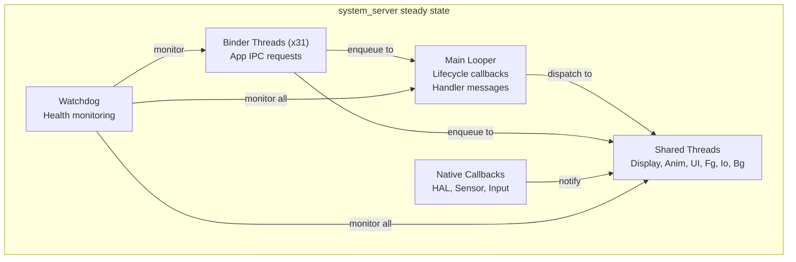

---

## 20.14 调试 system_server

### 20.14.1 常见故障模式

| 症状 | 可能原因 | 诊断 |
|---------|-------------|-----------|
| 设备卡在启动动画 | 服务初始化死锁或崩溃循环 | 在 logcat 中检查 BOOT FAILURE、Watchdog 日志 |
| 运行时重启循环 | 持续的 Watchdog 超时 | 检查 `/data/system/watchdog-timeout-history.txt` |
| 服务无响应（类似 ANR） | 锁争用或线程阻塞 | 用 `kill -3` 获取线程转储 |
| Binder 事务失败 | 线程池耗尽 | 检查 `dumpsys binder_calls_stats` |
| 内存压力 | 堆过大或泄漏 | 检查 `dumpsys meminfo system_server` |
| System UI 崩溃 | SystemUI 进程死亡 | 在 logcat 中检查 SystemUI 崩溃 |

### 20.14.2 获取线程转储

Java 线程转储是排查 `system_server`
问题最有用的诊断工具：

```bash
# Method 1: SIGQUIT (generates ANR trace)
adb shell kill -3 $(adb shell pidof system_server)
sleep 2
# Traces are written as timestamped anr_<timestamp> files
adb shell ls /data/anr/
adb pull /data/anr/anr_<timestamp>

# Method 2: debuggerd (native + Java stacks)
adb shell debuggerd $(adb shell pidof system_server)
```

跟踪文件包含：

- 每个 Java 线程的堆栈跟踪
- 锁所有权信息
- 线程状态（RUNNABLE、BLOCKED、WAITING 等）
- 监视器信息（哪个线程持有哪个锁）

### 20.14.3 识别死锁

一个经典的 `system_server` 死锁涉及两个服务持有锁并互相等待。线程转储会显示：

```
"android.display" prio=5 tid=12 BLOCKED
  - waiting to lock <0x12345678> (a WindowManagerGlobalLock)
    held by thread 15
  at WindowManagerService.doSomething()

"Binder:1234_5" prio=5 tid=15 BLOCKED
  - waiting to lock <0x87654321> (a ActivityManagerService)
    held by thread 12
  at ActivityManagerService.doSomethingElse()
```

这表明线程 12 正在等待线程 15 持有的锁。线程 15
在等待线程 12 持有的锁。这是经典的死锁。

### 20.14.4 分析启动计时

要确定哪个服务拖慢了启动：

```bash
# Get timing for each service start
adb logcat -s SystemServerTiming | sort -t= -k2 -n -r | head -20
```

### 20.14.5 阅读 Watchdog 转储

当 Watchdog 触发时，它会同时把详细信息写入
logcat 和 DropBox：

```bash
# Check DropBox for Watchdog entries
adb shell dumpsys dropbox --print | grep -A 100 "system_server_watchdog"

# Check kernel log for the kill
adb shell dmesg | grep system_server
```

Watchdog 转储包括：

- 哪些检查器被阻塞
- 是阻塞在 handler 还是特定的监视器中
- 所有感兴趣进程的堆栈跟踪
- 原生进程的内核堆栈跟踪

### 20.14.6 性能分析 system_server

用于性能分析：

```bash
# CPU profiling with simpleperf
adb shell simpleperf record -p $(adb shell pidof system_server) \
    --duration 10 -o /data/local/tmp/perf.data
adb pull /data/local/tmp/perf.data
simpleperf report -i perf.data

# Java method tracing (debug builds)
adb shell am profile start system /data/local/tmp/system_server.trace
sleep 5
adb shell am profile stop system
adb pull /data/local/tmp/system_server.trace
```

### 20.14.7 有用的系统属性

| 属性 | 用途 | 默认值 |
|----------|---------|---------|
| `sys.system_server.start_count` | 自启动以来 system_server 的启动次数 | 1 |
| `sys.system_server.start_elapsed` | 启动时间（elapsed realtime 毫秒） | 不定 |
| `sys.system_server.start_uptime` | 启动时间（uptime 毫秒） | 不定 |
| `persist.sys.debug.fdtrack_enable_threshold` | 启用跟踪的 FD 数量 | 1600 |
| `persist.sys.debug.fdtrack_abort_threshold` | 中止的 FD 数量 | 3000 |
| `persist.sys.debug.fdtrack_interval` | FD 检查间隔（秒） | 120 |
| `framework_watchdog.fatal_count` | 用于循环检测的 Watchdog 崩溃计数 | 不定 |
| `framework_watchdog.fatal_window.second` | 崩溃循环检测的时间窗口 | 不定 |

---

## 20.15 编写自定义系统服务

### 20.15.1 服务结构模板

一个结构良好的系统服务遵循以下模式：

```java
// IMyService.aidl -- define the Binder interface

// MyManagerService.java
package com.android.server.myservice;

public class MyManagerService extends IMyService.Stub {

    // Internal interface for other system services
    final class LocalService extends MyManagerInternal {
        // Privileged operations
    }

    // Lifecycle class for SystemServiceManager
    public static final class Lifecycle extends SystemService {
        private MyManagerService mService;

        public Lifecycle(Context context) {
            super(context);
        }

        @Override
        public void onStart() {
            mService = new MyManagerService(getContext());
            publishBinderService(Context.MY_SERVICE, mService);
            publishLocalService(MyManagerInternal.class,
                    mService.new LocalService());
        }

        @Override
        public void onBootPhase(int phase) {
            if (phase == PHASE_SYSTEM_SERVICES_READY) {
                mService.systemReady();
            }
        }

        @Override
        public void onUserStarting(@NonNull TargetUser user) {
            mService.onUserStarting(user.getUserIdentifier());
        }
    }
}
```

### 20.15.2 在 SystemServer 中注册

将服务启动添加到 `SystemServer.java` 中合适的方法：

```java
// In startOtherServices() or startCoreServices()
t.traceBegin("StartMyService");
mSystemServiceManager.startService(MyManagerService.Lifecycle.class);
t.traceEnd();
```

### 20.15.3 线程安全考量

编写系统服务时，线程安全至关重要：

1. **Binder 调用来自 Binder 线程**——Binder stub 中的任何公共方法都可能被多个线程并发调用。
2. **生命周期回调来自主线程**——但其他调用可能同时来自 Binder 线程。
3. **使用合适的共享线程**——不要为每个操作都创建新线程。
4. **实现 `Watchdog.Monitor`**——如果你持有可能与其他系统服务发生
   死锁的锁。
5. **避免在向其他服务发起 Binder 调用时持有锁**——
    这是死锁的主要原因。

### 20.15.4 使用 Ravenwood 测试

Ravenwood 框架支持对系统服务进行无设备测试。
`SystemService` 构造函数中的 `dependencies` 参数有助于
Ravenwood 了解哪些其他服务需要可用：

```java
public MyManagerService(Context context) {
    super(context, List.of(PowerManager.class, PackageManager.class));
}
```

这告诉 Ravenwood，`MyManagerService` 需要
`PowerManager` 和 `PackageManager` 才能工作，因此它们必须在测试
环境中先设置好。

---

## 20.16 startApexServices() 阶段

### 20.16.1 APEX 服务发现

`startOtherServices()` 完成后，`SystemServer` 进入第四个也是最后一个启动方法：`startApexServices()`。该阶段处理在 APEX 模块中定义的服务。该列表通过
`ApexManager.getInstance().getApexSystemServices()` 发现（从 APEX
清单填充）。当清单条目没有
jar 路径时，每个条目通过
`mSystemServiceManager.startService(name)` 启动。当它有
jar 路径时，则通过
`mSystemServiceManager.startServiceFromJar(name, jarPath)` 启动。

与 `startOtherServices()` 中 `startServiceFromJar()` 调用的关键区别在于 name/jar 对的来源。这里它来自 APEX 清单。它不是硬编码在 `SystemServer.java` 中的。这使得
APEX 模块可以添加系统服务而完全无需修改 `SystemServer.java`。

### 20.16.2 更新 Watchdog 超时

所有服务启动完成后，Watchdog 超时会根据系统设置更新（第 1053 行）：

```java
// frameworks/base/services/java/com/android/server/SystemServer.java, line 1053
updateWatchdogTimeout(t);
```

此调用注册了一个 `SettingsObserver`，用于监视
`Settings.Global.WATCHDOG_TIMEOUT_MILLIS` 的变化，从而允许超时由服务端配置系统动态调整：

```java
// frameworks/base/services/core/java/com/android/server/Watchdog.java, line 615
void updateWatchdogTimeout(long timeoutMillis) {
    if (!DB && !Build.IS_USERDEBUG
            && timeoutMillis
                <= ZygoteConnectionConstants.WRAPPED_PID_TIMEOUT_MILLIS) {
        timeoutMillis =
                ZygoteConnectionConstants.WRAPPED_PID_TIMEOUT_MILLIS + 1;
    }
    mWatchdogTimeoutMillis = timeoutMillis;
    Slog.i(TAG, "Watchdog timeout updated to "
            + mWatchdogTimeoutMillis + " millis");
}
```

在非调试构建上，超时不能被设置为低于 Zygote 包装的 PID 超时，以防止在调试包装的应用时出现误报。

---

## 20.17 锁顺序与死锁预防

### 20.17.1 锁层次结构

在 `system_server` 内部，多个服务持有多个锁。为了防止
死锁，框架使用了一种非正式的锁排序约定：

1. **WindowManagerGlobalLock** —— WMS 与
    ATMS 之间共享的“大锁”。这是系统中争用最激烈的锁。
2. **ActivityManagerService 锁** —— 保护 AMS 内部状态。
3. **PowerManagerService.mLock** —— 保护电源状态。
4. **各个服务锁** —— 每个服务的内部状态。

一般规则：始终以一致的顺序获取锁。永远不要在持有某个服务特定的锁的同时调用另一个可能
尝试获取更高级锁的服务。

### 20.17.2 LockGuard

`LockGuard` 类（位于 `frameworks/base/services/core/java/com/android/server/LockGuard.java`）
提供了运行时锁顺序验证：

```java
// Usage pattern:
LockGuard.installLock(this, LockGuard.INDEX_WINDOW);
// Later:
LockGuard.guard(LockGuard.INDEX_POWER); // warns if holding WINDOW lock
```

当一个线程以错误的顺序获取锁时，LockGuard 会记录一条警告。
该警告有助于开发者在现场真正发生死锁之前识别潜在的死锁场景。

### 20.17.3 ThreadPriorityBooster

`ThreadPriorityBooster` 类（位于
`frameworks/base/services/core/java/com/android/server/ThreadPriorityBooster.java`）
在持有关键锁期间临时提升线程优先级。这
防止了优先级反转——即低优先级线程持有高优先级线程需要的锁。

模式：

```java
class MyService {
    private final ThreadPriorityBooster mBooster =
            new ThreadPriorityBooster(
                    Process.THREAD_PRIORITY_DISPLAY,
                    LockGuard.INDEX_WINDOW);

    void criticalOperation() {
        mBooster.boost();
        try {
            synchronized (mLock) {
                // Critical work at display priority
            }
        } finally {
            mBooster.reset();
        }
    }
}
```

### 20.17.4 常见死锁模式

`system_server` 中最常见的死锁模式：

**模式 1：服务 A 在持有锁的同时调用服务 B**

```
Thread 1: ServiceA.lock() -> ServiceB.method() -> ServiceB.lock()
Thread 2: ServiceB.lock() -> ServiceA.method() -> ServiceA.lock()
```

预防：永远不要在持有自己的锁的同时调用另一个服务。相反，在锁内复制所需数据，释放锁，然后再发起外部调用。

**模式 2：在持有锁的同时发起 Binder 调用**

```
Thread 1 (Binder): ServiceA.lock() -> app process Binder call
App process: ServiceA.method() -> ServiceA.lock() (blocked!)
```

预防：这就是为什么在
`system_server` 中设置了 `Binder.setWarnOnBlocking(true)`。避免在持有锁的同时发起出站 Binder 调用。

**模式 3：锁与 Handler**

```
Thread 1: lock() -> handler.post(runnable that needs lock)
Handler thread: runnable runs -> tries to acquire lock -> blocked
Meanwhile Thread 1 waits for handler.runWithScissors() -> deadlock
```

预防：避免 `runWithScissors()`（投递并等待）模式。改用异步消息传递。

---

## 20.18 内存架构

### 20.18.1 堆配置

与普通应用相比，`system_server` 具有特殊的堆配置：

```java
// frameworks/base/services/java/com/android/server/SystemServer.java, line 911
VMRuntime.getRuntime().clearGrowthLimit();
```

普通应用通常具有：

- 默认堆大小：256MB（因设备而异）
- 增长限制：与默认值相同（强制执行）

`system_server`：

- 增长限制：已移除（无限增长）
- 实际使用：通常为 200-500MB，取决于安装的应用数量
  和设备配置

### 20.18.2 共享内存优化

在 `run()` 早期，`system_server` 初始化一个共享内存区域
（第 1021-1022 行）：

```java
// frameworks/base/services/java/com/android/server/SystemServer.java, line 1021
ApplicationSharedMemory instance = ApplicationSharedMemory.create();
ApplicationSharedMemory.setInstance(instance);
```

这个共享内存区域允许在 `system_server`
和应用进程之间高效共享数据，而无需 Binder IPC 开销。它用于高频、小数据的通信路径。

### 20.18.3 Zygote 内存继承

由于 `system_server` 是从 Zygote fork 出来的，它继承了：

- 所有预加载的框架类（已在类表中）
- 公共资源和资产
- ICU 和时区数据
- OpenGL/Vulkan 驱动状态

这种共享内存（通过 Linux 写时复制页）意味着 `system_server` 的实际
私有内存占用远小于其虚拟内存大小所暗示的值。

### 20.18.4 GC 考量

`system_server` 的垃圾回收行为有特殊含义：

1. **大堆**：要扫描的对象更多，GC 暂停更长
2. **并发 GC**：ART 运行时使用并发 GC 来最小化
    暂停时间，但 `system_server` 在启动期间分配很快
3. **PMS 初始化期间的 GC**：PackageManagerService 在软件包扫描期间大量分配。ArtModuleServiceInitializer 被提前加载（在 PMS 之前），正是为了避免类链接器与
    GC 竞争（如代码注释第 1182-1186 行所述）：

```java
// line 1180
// This needs to happen before DexUseManagerLocal init. We do it
// here to avoid colliding with a GC. ArtModuleServiceInitializer
// is a class from a separate dex file "service-art.jar", so
// referencing it involves the class linker. The class linker and
// the GC are mutually exclusive (b/263486535).
```

---

## 20.19 SystemServerInitThreadPool

### 20.19.1 用途

`SystemServerInitThreadPool` 提供一个临时线程池，专门用于在启动期间并行化初始化工作。它
被提前启动（第 944 行），并在初始化完成后关闭。

**源：** `frameworks/base/services/core/java/com/android/server/SystemServerInitThreadPool.java`

### 20.19.2 使用模式

任务以带有描述性名称的 lambda 形式提交：

```java
// SystemConfig loading - line 1156
SystemServerInitThreadPool.submit(
        SystemConfig::getInstance, "ReadingSystemConfig");

// Secondary Zygote preload - line 1581
mZygotePreload = SystemServerInitThreadPool.submit(() -> {
    String[] abis32 = Build.SUPPORTED_32_BIT_ABIS;
    if (abis32.length > 0
            && !Process.ZYGOTE_PROCESS.preloadDefault(abis32[0])) {
        Slog.e(TAG, "Unable to preload default resources for secondary");
    }
}, "SecondaryZygotePreload");

// Native sensor manager - line 1743
SystemServerInitThreadPool.submit(() -> {
    startISensorManagerService();
}, "StartISensorManagerService");

// HIDL services - line 1750
SystemServerInitThreadPool.submit(() -> {
    startHidlServices();
}, "StartHidlServices");

// WebView preparation - line 3420
webviewPrep = SystemServerInitThreadPool.submit(() -> {
    ConcurrentUtils.waitForFutureNoInterrupt(
            mZygotePreload, "Zygote preload");
    mZygotePreload = null;
    mWebViewUpdateService.prepareWebViewInSystemServer();
}, "WebViewFactoryPreparation");
```

### 20.19.3 同步

有些任务依赖更早的任务。`submit()` 返回的 `Future<?>` 允许后续代码等待完成：

```java
// Wait for Zygote preload before WebView prep
ConcurrentUtils.waitForFutureNoInterrupt(mZygotePreload, "Zygote preload");

// Wait for WebView prep before starting third-party apps
if (webviewPrep != null) {
    ConcurrentUtils.waitForFutureNoInterrupt(
            webviewPrep, WEBVIEW_PREPARATION);
}
```

### 20.19.4 转储状态

该线程池被注册为一个 dumpable（第 945 行）：

```java
mDumper.addDumpable(SystemServerInitThreadPool.getInstance());
```

这允许监控哪些初始化任务仍在待处理或已完成启动。

---

## 20.20 Binder 事务监控

### 20.20.1 事务回调

所有服务启动完成后，`system_server` 安装一个 Binder 事务
回调（第 1062-1067 行）：

```java
// frameworks/base/services/java/com/android/server/SystemServer.java, line 1062
Binder.setTransactionCallback(new IBinderCallback() {
    @Override
    public void onTransactionError(int pid, int code, int flags, int err) {
        mActivityManagerService.frozenBinderTransactionDetected(
                pid, code, flags, err);
    }
});
```

这检测发往冻结（缓存）进程的失败 Binder 事务。
当进程被冻结（移入 cgroup freezer）时，发往它的 Binder
事务会立即失败。此回调会通知 AMS，后者随后可以处理该情况（例如杀死冻结的进程或
重新排队该事务）。

### 20.20.2 GC 后内存指标

`system_server` 还注册了一个 GC 后回调用于内存监控
（第 1071-1078 行）：

```java
// line 1071
if (android.app.Flags.reportPostgcMemoryMetrics()
        && com.android.libcore.readonly.Flags.postCleanupApis()) {
    VMRuntime.addPostCleanupCallback(new Runnable() {
        @Override public void run() {
            MetricsLoggerWrapper.logPostGcMemorySnapshot();
        }
    });
}
```

这在每个 GC 周期之后收集内存指标，为 `system_server`
的长期内存行为提供洞察。

---

## 20.21 system_server 中的功能标志

### 20.21.1 由标志控制的服务启动

现代 AOSP 中的许多服务启动由功能标志控制。这
允许无需更改代码即可启用/禁用服务：

```java
// Example: IntrusionDetectionService (line 1842)
if (!isWatch && !isTv && !isAutomotive
        && android.security.Flags.aflApi()) {
    t.traceBegin("StartIntrusionDetectionService");
    mSystemServiceManager.startService(IntrusionDetectionService.class);
    t.traceEnd();
}

// Example: TradeInModeService (line 1873)
if (!isWatch && !isTv && !isAutomotive && enableTradeInMode()) {
    t.traceBegin("StartTradeInModeService");
    mSystemServiceManager.startService(TradeInModeService.class);
    t.traceEnd();
}

// Example: the Android 17 wired Serial API (line 2551), gated by
// the android.hardware.serial.flags.enable_wired_serial_api flag
if (android.hardware.serial.flags.Flags.enableWiredSerialApi()) {
    t.traceBegin("StartSerialManagerService");
    mSystemServiceManager.startService(SerialManagerService.Lifecycle.class);
    t.traceEnd();
}

// Example: ContentRestrictionService (line 3142)
if (android.app.contentrestriction.flags.Flags.contentRestrictionApi()) {
    t.traceBegin("StartContentRestrictionService");
    mSystemServiceManager.startService(ContentRestrictionService.Lifecycle.class);
    t.traceEnd();
}
```

一些早先由标志控制的服务后来已“毕业”。在 Android 17 中，`AdvancedProtectionService`（第 1867 行）仅由形态控制（`!isWatch && !isTv && !isAutomotive`）。它不再需要 API 稳定期间所携带的 `android.security.Flags.aapmApi()` 检查。

### 20.21.2 FeatureFlagsService

`FeatureFlagsService` 在引导阶段启动（第 1256 行）：

```java
// line 1256
t.traceBegin("StartFeatureFlagsService");
mSystemServiceManager.startService(FeatureFlagsService.class);
t.traceEnd();
```

该服务被提前启动，因为其他服务在初始化期间需要读取标志
值。它提供了分发运行时标志覆盖并使进程与最新标志值保持同步的机制。

### 20.21.3 作为模块的崩溃恢复

在较早的版本中，`refactorCrashrecovery()` 标志保护崩溃
恢复逻辑。当该标志关闭时，平台内的 `RescueParty` 和
`PackageWatchdog` 通过一个 `CrashRecoveryAdaptor` 垫片访问。该迁移已完成：在 Android 17 中，崩溃恢复作为模块无条件运行。`SystemServer` 仅通过一个字符串类名引用该实现，因此代码可以位于主线风格的模块中，而不是平台 JAR 中：

```java
// frameworks/base/services/java/com/android/server/SystemServer.java, line 406
private static final String CRASHRECOVERY_MODULE_LIFECYCLE_CLASS =
        "com.android.server.crashrecovery.CrashRecoveryModule$Lifecycle";
```

在 `PackageManagerService.systemReady()` 之后，该模块按名称启动——没有标志检查，也没有到旧适配
器的 `else` 回退：

```java
// frameworks/base/services/java/com/android/server/SystemServer.java, line 3259
t.traceBegin("StartCrashRecoveryModule");
mSystemServiceManager.startService(CRASHRECOVERY_MODULE_LIFECYCLE_CLASS);
t.traceEnd();
```

20.26 节讲述了这一行启动所引入的 `CrashRecoveryModule`、`PackageWatchdog`
和 `RescueParty` 的内部实现。

---

## 20.22 架构图

### 20.22.1 完整的 system_server 架构

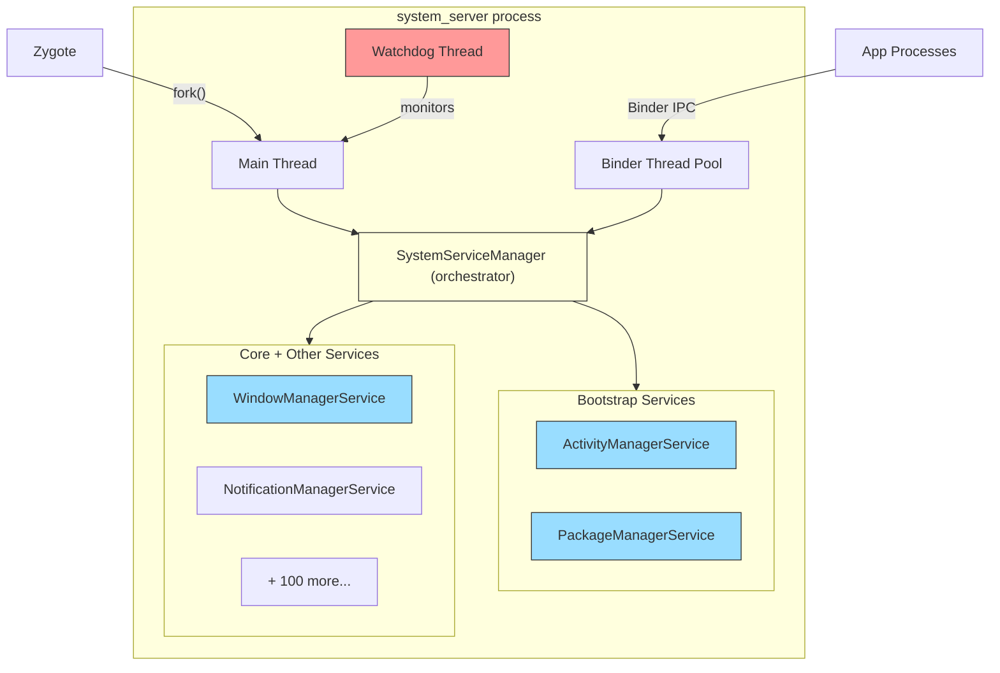

### 20.22.2 服务注册流程

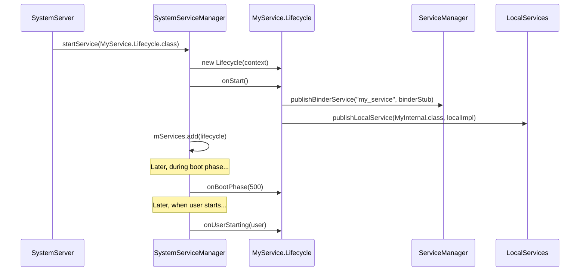

---

## 20.23 历史背景

### 20.23.1 system_server 的演进

`system_server` 架构已显著演进：

**早期 Android（1.x-2.x）：**

- 单体式 `SystemServer.java`，内联构造服务
- 没有 `SystemService` 基类
- 没有启动阶段
- 有限的线程模型

**Android 4.x-5.x：**

- 引入 `SystemService` 基类
- 为有序初始化添加了启动阶段
- `SystemServiceManager` 用于生命周期管理
- 引入共享线程（Display、Animation、UI、Fg、Io、Bg）

**Android 8.x-9.x（Project Treble）：**

- HAL 接口迁移到 HIDL
- 框架与厂商代码之间更严格的分离
- 添加了 Watchdog AIDL 接口监控

**Android 10+（Project Mainline）：**

- 服务迁移到 APEX 模块
- 添加了 `startServiceFromJar()` 机制
- `SystemServerClassLoaderFactory` 用于 APEX 类加载
- Connectivity、WiFi、Bluetooth 服务模块化
- `ActivityTaskManagerService` 从 `ActivityManagerService` 拆分，将
  活动与任务管理移入 `com.android.server.wm`

**Android 12+：**

- 添加了 PermissionThread
- 增强了 Watchdog，加入前看门狗超时
- 服务启动的功能标志控制

**Android 14+：**

- Ravenwood 测试框架集成
- 用于测试的服务依赖
- 增强的崩溃恢复模块
- 将 CrashRecovery 重构为模块

### 20.23.2 单体模式

`system_server` 遵循“单体进程，模块化服务”模式。
所有服务在单个进程中运行，原因有几个：

1. **性能**：通过 `LocalServices` 进行的进程内调用避免
    Binder IPC 开销。考虑到服务之间每秒相互调用数千次，这是显著的。
2. **原子性**：将所有服务放在一个进程中意味着任何服务的崩溃都会重启所有服务，从而保持一致性。
3. **锁共享**：关键锁（如 `WindowManagerGlobalLock`）
    可以跨服务共享而无需 IPC。
4. **内存效率**：共享堆减少了整体内存使用。

缺点是，一个编写糟糕的服务可能会拖垮整个系统，这就是 Watchdog 如此重要的原因。

### 20.23.3 为什么不用微服务？

Android 曾考虑将系统服务拆分为独立进程
（类似微服务的架构），但因以下原因予以否决：

1. **IPC 成本**：每个跨服务调用都需要 Binder IPC
    （至少约 10us），这对于 AMS、WMS 和 InputManager 之间紧密的交互模式而言是不可接受的。
2. **一致性**：部分失败需要复杂的恢复
    逻辑。对于单体进程，要么全有，要么全无。
3. **内存开销**：每个进程都有自己的堆、类加载和
    VM 开销。数百个小进程会比一个大进程使用多得多
    的内存。

APEX 模块方法是一个折中方案：代码是模块化且可更新的，但它全部运行在同一个进程中。

---

## 20.24 快速参考

### 20.24.1 源文件索引

| 文件路径 | 用途 |
|-----------|---------|
| `frameworks/base/services/java/com/android/server/SystemServer.java` | 入口点、启动编排 |
| `frameworks/base/services/core/java/com/android/server/SystemService.java` | 服务基类、启动阶段常量 |
| `frameworks/base/services/core/java/com/android/server/SystemServiceManager.java` | 服务生命周期管理 |
| `frameworks/base/services/core/java/com/android/server/Watchdog.java` | 死锁检测、线程监控 |
| `frameworks/base/core/java/com/android/server/ServiceThread.java` | Handler 线程基类 |
| `frameworks/base/services/core/java/com/android/server/DisplayThread.java` | 显示操作线程 |
| `frameworks/base/services/core/java/com/android/server/AnimationThread.java` | 窗口动画线程 |
| `frameworks/base/services/core/java/com/android/server/wm/SurfaceAnimationThread.java` | 无锁 surface 动画 |
| `frameworks/base/services/core/java/com/android/server/UiThread.java` | 系统 UI 线程 |
| `frameworks/base/core/java/com/android/server/FgThread.java` | 前台操作线程 |
| `frameworks/base/services/core/java/com/android/server/IoThread.java` | I/O 操作线程 |
| `frameworks/base/core/java/com/android/internal/os/BackgroundThread.java` | 后台操作线程 |
| `frameworks/base/services/core/java/com/android/server/PermissionThread.java` | 权限操作线程 |
| `frameworks/base/services/core/java/com/android/server/SystemServerInitThreadPool.java` | 启动期并行初始化线程池 |

### 20.24.2 启动阶段快速参考

| 值 | 常量 | 门控 |
|-------|----------|------|
| 100 | `PHASE_WAIT_FOR_DEFAULT_DISPLAY` | 默认显示可用 |
| 200 | `PHASE_WAIT_FOR_SENSOR_SERVICE` | 传感器 HAL 就绪 |
| 480 | `PHASE_LOCK_SETTINGS_READY` | 锁屏设置可读 |
| 500 | `PHASE_SYSTEM_SERVICES_READY` | 核心服务可调用 |
| 520 | `PHASE_DEVICE_SPECIFIC_SERVICES_READY` | OEM 服务可调用 |
| 550 | `PHASE_ACTIVITY_MANAGER_READY` | 可广播 Intent |
| 600 | `PHASE_THIRD_PARTY_APPS_CAN_START` | 应用可发起 Binder 调用 |
| 1000 | `PHASE_BOOT_COMPLETED` | 桌面应用已启动 |

### 20.24.3 线程快速参考

| 线程名称 | Java 类 | 优先级 | I/O | 由 Watchdog 监控 |
|-------------|-----------|----------|-----|----------------------|
| `main` | Main Looper | FOREGROUND (-2) | 是 | 是 |
| `android.display` | `DisplayThread` | DISPLAY+1 (-3) | 否 | 是 |
| `android.anim` | `AnimationThread` | DISPLAY (-4) | 否 | 是 |
| `android.anim.lf` | `SurfaceAnimationThread` | DISPLAY (-4) | 否 | 是 |
| `android.ui` | `UiThread` | FOREGROUND (-2) | 否 | 是 |
| `android.fg` | `FgThread` | DEFAULT (0) | 是 | 是 |
| `android.io` | `IoThread` | DEFAULT (0) | 是 | 是 |
| `android.bg` | `BackgroundThread` | BACKGROUND (10) | 是 | 否 |
| `android.perm` | `PermissionThread` | DEFAULT (0) | 是 | 否 |
| `watchdog` | `Watchdog` | DEFAULT (0) | 不适用 | 不适用 |
| `watchdog.monitor` | `ServiceThread` | DEFAULT (0) | 是 | 不适用 |
| `Binder:PID_N` | Binder 池 | FOREGROUND (-2) | 是 | 是（通过 BinderThreadMonitor） |

### 20.24.4 关键常量

| 常量 | 值 | 位置 |
|----------|-------|----------|
| `sMaxBinderThreads` | 31 | `SystemServer.java:493` |
| `DEFAULT_TIMEOUT` | 60,000ms | `Watchdog.java:101` |
| `PRE_WATCHDOG_TIMEOUT_RATIO` | 4 | `Watchdog.java:107` |
| `SLOW_DISPATCH_THRESHOLD_MS` | 100ms | `SystemServer.java:346` |
| `SLOW_DELIVERY_THRESHOLD_MS` | 200ms | `SystemServer.java:347` |
| `DEFAULT_SYSTEM_THEME` | `Theme_DeviceDefault_System` | `SystemServer.java:499` |
| `SERVICE_CALL_WARN_TIME_MS` | 50ms | `SystemServiceManager.java:78` |
| `DEFAULT_MAX_USER_POOL_THREADS` | 3 | `SystemServiceManager.java:92` |
| `USER_POOL_SHUTDOWN_TIMEOUT_SECONDS` | 30s | `SystemServiceManager.java:97` |

### 20.24.5 常用 dumpsys 命令

| 命令 | 显示的信息 |
|---------|-------------------|
| `dumpsys activity` | AMS 状态：进程、活动、广播 |
| `dumpsys activity processes` | 正在运行的进程与 OOM adj |
| `dumpsys window` | WMS 状态：窗口、显示、输入 |
| `dumpsys package <pkg>` | 软件包详情、权限、组件 |
| `dumpsys power` | 电源状态、唤醒锁、电池统计 |
| `dumpsys notification` | 活动通知与通道 |
| `dumpsys audio` | 音频路由、音量、设备 |
| `dumpsys connectivity` | 网络状态、连接 |
| `dumpsys display` | 显示配置、亮度 |
| `dumpsys input` | 输入设备、事件分发 |
| `dumpsys alarm` | 已安排的闹钟 |
| `dumpsys jobscheduler` | 待处理与正在运行的作业 |
| `dumpsys battery` | 电池状态与历史 |
| `dumpsys usagestats` | 应用使用统计 |
| `dumpsys meminfo system_server` | 内存明细 |
| `dumpsys binder_calls_stats` | Binder 调用统计 |
| `dumpsys looper_stats` | Handler 消息计时 |
| `dumpsys system_server_dumper` | system_server 内部状态 |
| `service list` | 所有已注册的 Binder 服务 |

---

## 20.25 BackupManagerService

Android 备份框架让应用能够将其数据备份到
云端或本地存储。应用可在设备重置、迁移或应用重装后恢复数据。`BackupManagerService`（BMS）是协调整个
流程的系统服务——管理备份传输、调度键值备份和全数据备份，并协调恢复操作。

**关键源文件：**

| 文件 | 描述 |
|------|-------------|
| `frameworks/base/services/backup/java/com/android/server/backup/BackupManagerService.java` | 顶层委托服务 |
| `frameworks/base/services/backup/java/com/android/server/backup/UserBackupManagerService.java` | 每用户备份逻辑 |
| `frameworks/base/services/backup/java/com/android/server/backup/TransportManager.java` | 传输生命周期管理 |
| `frameworks/base/services/backup/java/com/android/server/backup/FullBackupJob.java` | 全备份的 JobScheduler 集成 |
| `frameworks/base/services/backup/java/com/android/server/backup/keyvalue/KeyValueBackupTask.java` | 键值备份执行 |
| `frameworks/base/services/backup/java/com/android/server/backup/fullbackup/PerformFullTransportBackupTask.java` | 全备份执行 |
| `frameworks/base/services/backup/java/com/android/server/backup/restore/PerformUnifiedRestoreTask.java` | 恢复执行 |
| `frameworks/base/services/backup/java/com/android/server/backup/transport/TransportConnection.java` | 传输绑定逻辑 |

### 20.25.1 架构概述

BMS 采用两层架构：一个系统级委托者和每用户
管理器。这种设计反映了 Android 的多用户模型。

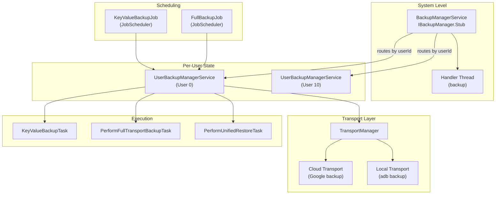

`BackupManagerService` 类的文档说明了它的角色：

```java
// frameworks/base/services/backup/java/com/android/server/backup/BackupManagerService.java
/**
 * This class is responsible for handling user-aware operations and acts as
 * a delegator, routing incoming calls to the appropriate per-user
 * {@link UserBackupManagerService} to handle the corresponding
 * backup/restore operation.
 */
public class BackupManagerService extends IBackupManager.Stub
        implements BackupManagerInternal {
```

每个 `UserBackupManagerService` 实例维护自己的：

- **TransportManager** —— 跟踪该用户已注册的传输
- **BackupHandler** —— 基于消息的任务调度
- **ProcessedPackagesJournal** —— 已备份软件包的持久日志
- **DataChangedJournal** —— 有待处理键值变更的软件包列表
- **FullBackupQueue** —— 全备份的轮转调度

### 20.25.2 激活与禁用

BMS 可以在两个层级上被禁用：

1. **永久** —— 系统属性 `ro.backup.disable` 设为 `true`
2. **临时** —— `setBackupServiceActive(userId, boolean)` API，通常
    由 `DevicePolicyManager` 针对企业设备调用

激活状态通过哨兵文件跟踪：

```java
// frameworks/base/services/backup/java/com/android/server/backup/BackupManagerService.java
private static final String BACKUP_SUPPRESS_FILENAME = "backup-suppress";
private static final String BACKUP_ACTIVATED_FILENAME = "backup-activated";
private static final String REMEMBER_ACTIVATED_FILENAME = "backup-remember-activated";
```

激活检查遵循四级优先级：

1. **全局抑制** —— `USER_SYSTEM` 的抑制文件禁用所有用户
2. **用户特定抑制** —— 特定用户的抑制文件
3. **默认激活** —— 用户的备份是否默认为激活
4. **显式激活文件** —— 用户激活文件的存在

### 20.25.3 备份传输

备份传输是一个可插拔组件，定义了备份数据的去向。传输通过 `PackageManager` 扫描带有 action
`android.backup.TRANSPORT_HOST` 的服务来发现：

```java
// frameworks/base/services/backup/java/com/android/server/backup/TransportManager.java
public static final String SERVICE_ACTION_TRANSPORT_HOST =
        "android.backup.TRANSPORT_HOST";
```

`TransportManager` 维护来自
`SystemConfig.getBackupTransportWhitelist()` 的允许传输白名单。只有白名单中的传输才能注册。每个传输都被包装在一个 `TransportConnection` 中，由它处理 Binder 绑定的生命周期：

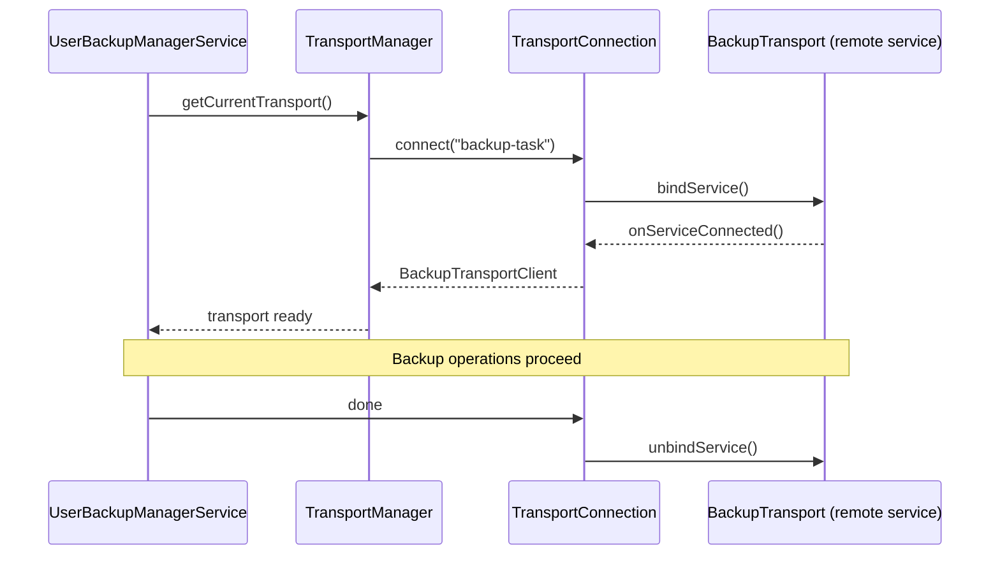

Google 的云备份传输（`com.google.android.gms/.backup.BackupTransportService`）
实现了 `IBackupTransport` 接口，但架构是开放的——OEM 可以提供自己的传输实现。

### 20.25.4 键值备份与全备份

Android 支持两种根本不同的备份策略：

**键值备份：**

- 应用继承 `BackupAgent` 并实现 `onBackup()`/`onRestore()`
- 数据使用 `BackupDataOutput` 以键值对形式存储
- 增量式——只传输已更改的键
- 通过 `JobScheduler` 经由 `KeyValueBackupJob` 调度
- 通过 `DataChangedJournal` 跟踪——当应用调用
  `BackupManager.dataChanged()` 时，其软件包名会被写入该日志

**全备份：**

- 自动备份整个应用目录（内部存储、数据库等）
- 无需更改应用代码（除非 `BackupAgent` 覆盖了 `onFullBackup()`）
- 通过清单中的 `android:fullBackupContent` 配置
- 经由 `FullBackupJob` 在轮转队列中调度
- 要求设备处于空闲且正在充电（Wear 设备除外）

```java
// frameworks/base/services/backup/java/com/android/server/backup/FullBackupJob.java
builder.setRequiredNetworkType(constants.getFullBackupRequiredNetworkType())
        .setRequiresCharging(constants.getFullBackupRequireCharging());
if (!ctx.getPackageManager().hasSystemFeature(PackageManager.FEATURE_WATCH)) {
    builder.setRequiresDeviceIdle(true);
}
```

两种类型的备份生命周期：

```mermaid
flowchart TB
    subgraph "Key-Value Backup"
        KV1["App calls<br/>BackupManager.dataChanged()"]
        KV2["Package added to<br/>DataChangedJournal"]
        KV3["KeyValueBackupJob fires"]
        KV4["KeyValueBackupTask<br/>binds to app's BackupAgent"]
        KV5["Agent.onBackup() called<br/>(incremental state delta)"]
        KV6["Delta sent to transport<br/>via performBackup()"]

        KV1 --> KV2 --> KV3 --> KV4 --> KV5 --> KV6
    end

    subgraph "Full Backup"
        FB1["FullBackupJob fires<br/>(idle + charging)"]
        FB2["Next app in<br/>round-robin queue"]
        FB3["Bind to app's<br/>BackupAgent"]
        FB4["Agent.onFullBackup() called<br/>(or default file walker)"]
        FB5["Tar-format stream sent<br/>to transport"]

        FB1 --> FB2 --> FB3 --> FB4 --> FB5
    end
```

### 20.25.5 BackupHandler 消息协议

`UserBackupManagerService` 使用在
`BackupHandler` 中定义的基于 handler 的消息协议：

| 消息 | 用途 |
|---------|---------|
| `MSG_RUN_BACKUP` | 执行一次待处理的键值备份 |
| `MSG_RUN_ADB_BACKUP` | 执行 adb 备份（用户发起） |
| `MSG_RUN_ADB_RESTORE` | 执行 adb 恢复 |
| `MSG_RUN_RESTORE` | 执行云端恢复 |
| `MSG_RUN_CLEAR` | 清除某个软件包的备份数据 |
| `MSG_RETRY_CLEAR` | 在传输不可用后重试清除 |
| `MSG_REQUEST_BACKUP` | 请求备份特定软件包 |
| `MSG_SCHEDULE_BACKUP_PACKAGE` | 安排一个软件包进行备份 |
| `MSG_BACKUP_OPERATION_TIMEOUT` | 备份代理操作期间超时 |
| `MSG_RESTORE_OPERATION_TIMEOUT` | 恢复操作期间超时 |
| `MSG_RESTORE_SESSION_TIMEOUT` | 恢复会话的超时 |
| `MSG_FULL_CONFIRMATION_TIMEOUT` | 全备份的用户确认超时 |
| `MSG_OP_COMPLETE` | 操作完成通知 |

### 20.25.6 备份资格

并非所有软件包都符合备份资格。`BackupEligibilityRules` 类
根据以下因素确定资格：

- `android:allowBackup` 清单属性（默认为 `true`）
- 应用标志：不得为 `STOPPED`，必须是一个真实软件包
- Target SDK 以及备份特定的兼容性变更
- 对于键值备份：必须声明了 `BackupAgent`
- 对于全备份：如果未指定自定义代理，可以使用默认代理
- 签名验证：来自不同签名密钥的恢复数据会被拒绝

### 20.25.7 恢复操作

恢复由 `PerformUnifiedRestoreTask` 协调，它通过一个状态机同时处理
键值恢复和全数据恢复：

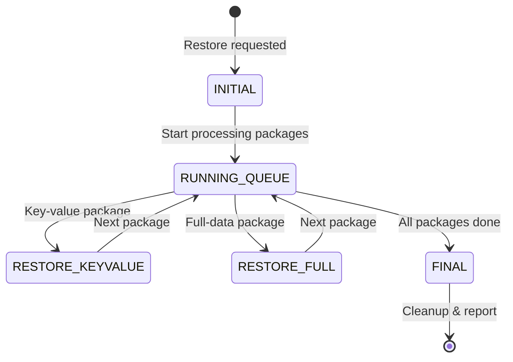

恢复被排入 `mPendingRestores` 并串行处理——每用户同时只能运行一个
恢复：

```java
// frameworks/base/services/backup/java/com/android/server/backup/UserBackupManagerService.java
@GuardedBy("mPendingRestores")
private boolean mIsRestoreInProgress;

@GuardedBy("mPendingRestores")
private final Queue<BackupRestoreTask> mPendingRestores = new ArrayDeque<>();
```

### 20.25.8 云端与本地备份

传输架构允许在备份目的地之间无缝切换：

| 方面 | 云端备份（Google） | 本地备份（adb） |
|--------|----------------------|-------------------|
| 传输 | `com.google.android.gms` | `com.android.localtransport/.LocalTransportService`（类 `com.android.localtransport.LocalTransport`） |
| 触发 | JobScheduler（自动） | `adb backup` 命令（手动） |
| 加密 | TLS + 服务端加密 | 可选的用户设置密码 |
| 格式 | 传输特定（protobuf） | 带可选加密的 tar 归档 |
| 配额 | 有限制（25MB 键值，全备份可配置） | 无限制 |
| 需要网络 | 是 | 否 |
| 文件版本头 | 不适用 | `ANDROID BACKUP\n` + 版本 5 |

ADB 备份的文件格式为：

```java
// frameworks/base/services/backup/java/com/android/server/backup/UserBackupManagerService.java
public static final int BACKUP_FILE_VERSION = 5;
public static final String BACKUP_FILE_HEADER_MAGIC = "ANDROID BACKUP\n";
public static final String BACKUP_METADATA_FILENAME = "_meta";
public static final int BACKUP_METADATA_VERSION = 1;
public static final int BACKUP_WIDGET_METADATA_TOKEN = 0x01FFED01;
```

### 20.25.9 多用户考量

BMS 处理多用户设备的边缘情况：

- 主用户在启动时可能不存在（首次启动），通过
  `mDidMainUserExistAtBoot` 跟踪
- 非系统用户的备份状态同时存储在用户目录
  和系统目录中。当用户被移除时，BMS 通过 `onRemovedNonSystemUser()` 清理系统目录部分
- 每个用户获得一个独立的 `UserBackupManagerService`，拥有自己的传输、调度和状态

---

## 20.26 CrashRecoveryModule 与 RescueParty

Android 检测来自应用、系统服务或启动循环的持续性崩溃。当检测到时，崩溃恢复子系统会逐步升级，采取越来越激进的缓解措施。这些措施将设备恢复到可用状态。
该系统建立在三个协作组件之上：`PackageWatchdog`、
`RescueParty` 和 `CrashRecoveryModule`。

**关键源文件：**

在 Android 17 中，崩溃恢复代码已从 `frameworks/base` 移出，进入
`packages/modules/CrashRecovery/` 下的一个独立主线模块。因此，之前的平台
路径已不复存在：

| 文件 | 描述 |
|------|-------------|
| `packages/modules/CrashRecovery/service/java/com/android/server/crashrecovery/CrashRecoveryModule.java` | 模块生命周期 |
| `packages/modules/CrashRecovery/service/java/com/android/server/PackageWatchdog.java` | 故障监控引擎 |
| `packages/modules/CrashRecovery/service/java/com/android/server/RescueParty.java` | 升级式缓解逻辑 |
| `frameworks/base/services/core/java/com/android/server/crashrecovery/CrashRecoveryHelper.java` | 连接性模块健康监听器 |

### 20.26.1 CrashRecoveryModule 生命周期

`CrashRecoveryModule` 作为主线模块交付，并遵循
`SystemService` 生命周期：

```java
// packages/modules/CrashRecovery/service/java/com/android/server/crashrecovery/CrashRecoveryModule.java
public static class Lifecycle extends SystemService {
    @Override
    public void onStart() {
        RescueParty.registerHealthObserver(mSystemContext);
        mPackageWatchdog.registerShutdownBroadcastReceiver();
        mPackageWatchdog.noteBoot();
    }

    @Override
    public void onBootPhase(int phase) {
        if (phase == PHASE_THIRD_PARTY_APPS_CAN_START) {
            mPackageWatchdog.onPackagesReady();
        }
    }
}
```

在 `onStart()` 时，会发生三个关键动作：

1. RescueParty 将自身注册为 PackageWatchdog 的健康观察者
2. PackageWatchdog 注册以监听关机广播
3. PackageWatchdog 记录启动事件（用于启动循环检测）

在启动阶段 600（`PHASE_THIRD_PARTY_APPS_CAN_START`），PackageWatchdog
初始化其健康检查控制器并开始监控。

### 20.26.2 PackageWatchdog

PackageWatchdog 是中央故障监控引擎。它通过多个故障信号跟踪软件包
健康状态，并将缓解委托给已注册的观察者。

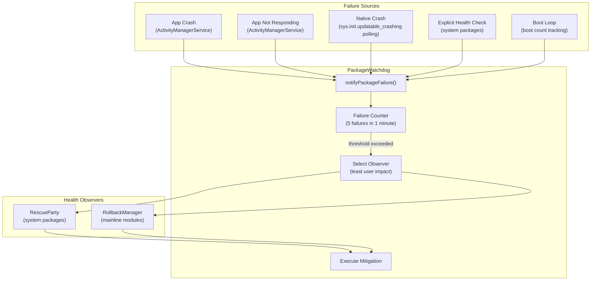

**故障原因：**

```java
// packages/modules/CrashRecovery/service/java/com/android/server/PackageWatchdog.java
public static final int FAILURE_REASON_UNKNOWN = 0;
public static final int FAILURE_REASON_NATIVE_CRASH = 1;
public static final int FAILURE_REASON_EXPLICIT_HEALTH_CHECK = 2;
public static final int FAILURE_REASON_APP_CRASH = 3;
public static final int FAILURE_REASON_APP_NOT_RESPONDING = 4;
public static final int FAILURE_REASON_BOOT_LOOP = 5;
```

**触发阈值：**

| 参数 | 默认值 | 描述 |
|-----------|---------|-------------|
| `DEFAULT_TRIGGER_FAILURE_COUNT` | 5 | 触发缓解所需的失败次数 |
| `DEFAULT_TRIGGER_FAILURE_DURATION_MS` | 60,000ms（1 分钟） | 统计失败次数的窗口 |
| `DEFAULT_OBSERVING_DURATION_MS` | 2 天 | 监控某个软件包的时间长度 |
| `DEFAULT_DEESCALATION_WINDOW_MS` | 1 小时 | 缓解计数的滑动窗口 |
| `DEFAULT_BOOT_LOOP_TRIGGER_COUNT` | 5 | 检测启动循环所需的启动次数 |
| `DEFAULT_BOOT_LOOP_TRIGGER_WINDOW_MS` | 10 分钟 | 启动循环检测的窗口 |

当调用 `notifyPackageFailure()` 时，watchdog 会：

1. 记录该软件包的失败时间戳
2. 在触发窗口内统计失败次数
3. 如果超过阈值，则选择已注册观察者中
    **用户影响最小**的那个（使用 `PackageHealthObserverImpact` 级别）
4. 调用该观察者的缓解方法
5. 记录该缓解以便降级跟踪

**观察者注册与选择：**

```java
// Each observer registers with PackageWatchdog
PackageWatchdog.getInstance(context).registerHealthObserver(
        context.getMainExecutor(), RescuePartyObserver.getInstance(context));
```

当注册了多个观察者（例如 RescueParty 和 RollbackManager）时，
watchdog 会选择其缓解措施用户影响最小的那个。这
确保了优先选择软件包回滚而非恢复出厂设置。

**状态持久化：**

PackageWatchdog 使用 `AtomicFile` 机制将其观察者状态持久化到
`/data/system/package-watchdog.xml`。启动循环缓解计数单独存储在
`/metadata/watchdog/mitigation_count.txt` 中，以在文件系统检查点中止后仍然存活。

### 20.26.3 RescueParty 升级级别

RescueParty 注册为一个 `PackageHealthObserver`，并实现分阶段的升级策略。每次后续的缓解尝试都会升级到更
激进的级别：

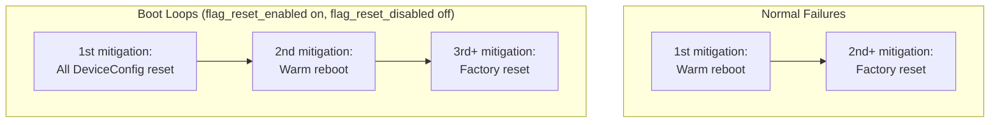

普通故障直接从热重启（首次缓解）
升级到恢复出厂设置（第二次及以后的缓解）。启动循环则多一步。当 CrashRecovery 模块的 `flag_reset_enabled` 标志
开启（且 `flag_reset_disabled` 关闭）时，首次缓解会重置所有
DeviceConfig 标志。然后升级到热重启，再升级到恢复出厂设置。否则，启动循环遵循普通路径。

升级常量：

```java
// packages/modules/CrashRecovery/service/java/com/android/server/RescueParty.java
static final int RESCUE_LEVEL_NONE = 0;
static final int RESCUE_LEVEL_SCOPED_DEVICE_CONFIG_RESET = 1;
static final int RESCUE_LEVEL_ALL_DEVICE_CONFIG_RESET = 2;
static final int RESCUE_LEVEL_WARM_REBOOT = 3;
static final int RESCUE_LEVEL_RESET_SETTINGS_UNTRUSTED_DEFAULTS = 4;
static final int RESCUE_LEVEL_RESET_SETTINGS_UNTRUSTED_CHANGES = 5;
static final int RESCUE_LEVEL_RESET_SETTINGS_TRUSTED_DEFAULTS = 6;
static final int RESCUE_LEVEL_FACTORY_RESET = 7;
```

注意，`RESCUE_LEVEL_RESET_SETTINGS_*` 和
`RESCUE_LEVEL_SCOPED_DEVICE_CONFIG_RESET` 常量仍然存在，但今天它们是空操作——`executeRescueLevelInternal()` 用空的
`// do nothing` 分支处理它们。

### 20.26.4 RescueParty 禁用条件

RescueParty 在几种场景下被有意禁用，以避免干扰
开发和测试：

- **工程构建**（`Build.TYPE.equals("eng")`）——始终禁用
- **userdebug 构建**——在所有 userdebug 构建上始终禁用，这是
    某人正在主动调试设备或设备处于实验室环境的良好信号
- **DeviceConfig 标志** —— `persist.device_config.configuration.disable_rescue_party`
- **手动属性** —— `persist.sys.disable_rescue` 用于紧急覆盖
- **显式启用** —— `persist.sys.enable_rescue` 覆盖所有禁用检查

```java
// packages/modules/CrashRecovery/service/java/com/android/server/RescueParty.java
// We're disabled on all userdebug builds, as this is a decent signal
// that someone is actively trying to debug the device, or that it's
// in a lab environment.
if (Build.TYPE.equals("userdebug")) {
    Slog.v(TAG, "Disabled because of userdebug build");
    return true;
}
```

### 20.26.5 启动循环检测

启动循环由 `PackageWatchdog.BootThreshold` 检测：

```
Boot loop detection:
  - Track: mBootThreshold(count=5, window=10min)
  - PackageWatchdog.noteBoot() called at every system_server start
  - If 5 boots occur within 10 minutes → FAILURE_REASON_BOOT_LOOP
  - Boot loop failures skip per-package scoped mitigations
    (no package to blame → go straight to global mitigations)
```

由于没有可归咎的软件包，启动循环在 RescueParty 中运行一个独立的升级
阶梯。`getRescueLevelForBootLoop()`（RescueParty.java，第
274-285 行）在热重启之前插入了一个额外的全 DeviceConfig 重置步骤。因此，第 1 次尝试重置每个 DeviceConfig 命名空间，第 2 次尝试热
重启，第 3 次及以后尝试恢复出厂设置。

该额外步骤仅在标志重置功能启用时适用。否则，启动循环路径会
回退到普通的 `getRescueLevel()` 阶梯（热重启，然后恢复出厂设置）。缓解计数本身会原样传递。没有偏移。这两个函数都不会返回作用域 DeviceConfig 重置
级别，因为它需要一个目标软件包。

### 20.26.6 恢复出厂设置节流

为防止快速的恢复出厂设置循环，RescueParty 实现了节流：

```java
// packages/modules/CrashRecovery/service/java/com/android/server/RescueParty.java
static final long DEFAULT_FACTORY_RESET_THROTTLE_DURATION_MIN = 1440; // 24 hours
```

`CrashRecoveryProperties` 系统存储：

- `attemptingFactoryReset` —— 是否正在进行恢复出厂设置
- `attemptingReboot` —— 是否正在进行重启
- `lastFactoryResetTimeMs` —— 上一次恢复出厂设置的时间戳
- `maxRescueLevelAttempted` —— 曾经达到的最高级别

### 20.26.7 CrashRecoveryHelper

`CrashRecoveryHelper` 类连接 PackageWatchdog 与
连接性模块健康监控：

```java
// frameworks/base/services/core/java/com/android/server/crashrecovery/CrashRecoveryHelper.java
public void registerConnectivityModuleHealthListener() {
    mConnectivityModuleConnector.registerHealthListener(
            packageName -> {
            final VersionedPackage pkg = getVersionedPackage(packageName);
            if (pkg == null) {
                Slog.wtf(TAG, "NetworkStack failed but could not find its package");
                return;
            }
            final List<VersionedPackage> pkgList = Collections.singletonList(pkg);
            PackageWatchdog.getInstance(mContext).notifyPackageFailure(pkgList,
                    PackageWatchdog.FAILURE_REASON_EXPLICIT_HEALTH_CHECK);
        });
}
```

这确保了网络栈崩溃像其他故障一样汇入同一个
PackageWatchdog 管道，从而实现一致的
缓解（包括可能回滚 Tethering APEX）。

### 20.26.8 与 RollbackManager 的集成

PackageWatchdog 与 `RollbackManager` 协同工作，以进行主线模块的
崩溃恢复：

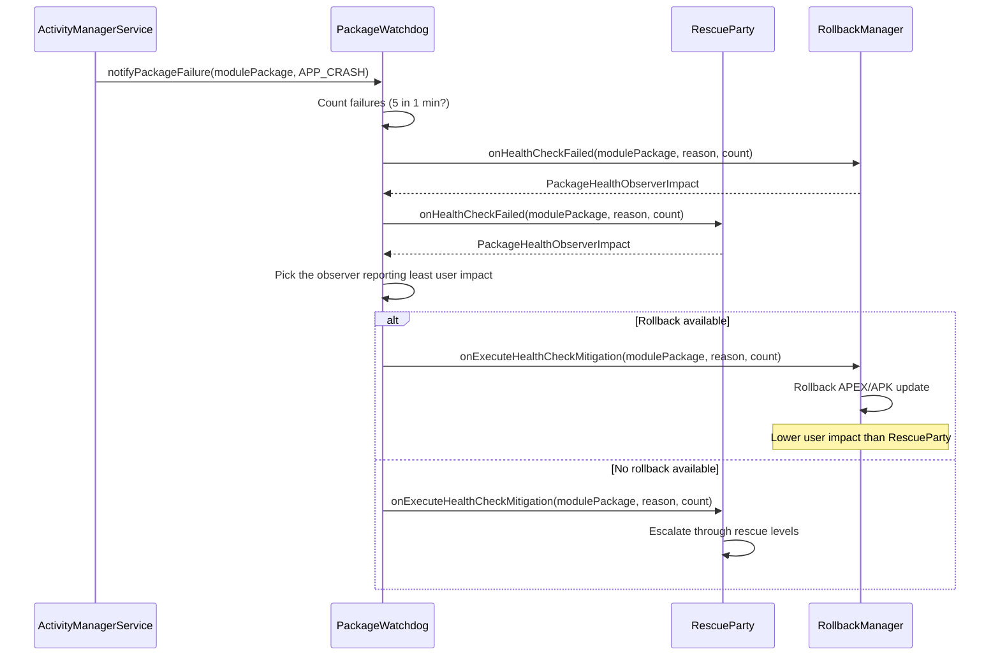

关键原则是**最小用户影响**。回滚（恢复到之前版本）始终优先于设置重置或恢复出厂设置，因为
它的破坏性更小。

---

## 20.27 ClipboardService

`ClipboardService` 管理系统剪贴板——实现跨应用复制粘贴的机制。看似简单的功能涉及深层的安全考量。这些包括跨应用数据泄露、内容 URI 权限授予、多用户隔离、虚拟设备剪贴板隔离区、自动剪贴板清除以及访问通知 toast。

> **来源：**
> `frameworks/base/services/core/java/com/android/server/clipboard/ClipboardService.java`

### 20.27.1 架构概述

ClipboardService 继承 `SystemService`，并在启动时发布两个接口：

```java
// ClipboardService.java, line 251-254
@Override
public void onStart() {
    publishBinderService(Context.CLIPBOARD_SERVICE, new ClipboardImpl());
    LocalServices.addService(ClipboardManagerInternal.class, new ClipboardInternalImpl());
}
```

双接口遵循标准的 `system_server` 模式：
`ClipboardImpl`（Binder）用于面向应用的 IPC，而 `ClipboardInternalImpl`
（本地）用于其他系统服务的进程内使用。

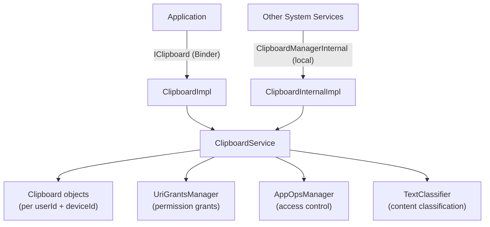

### 20.27.2 剪贴板数据模型

剪贴板数据存储在以复合键 `(userId, deviceId)` 为索引的 `Clipboard` 对象中：

```java
// ClipboardService.java, line 182
@GuardedBy("mLock")
private final SparseArrayMap<Integer, Clipboard> mClipboards = new SparseArrayMap<>();
```

每个 `Clipboard` 实例持有：

| 字段 | 类型 | 用途 |
|-------|------|---------|
| `primaryClip` | `ClipData` | 实际的剪贴板内容 |
| `primaryClipUid` | `int` | 设置剪贴内容的 UID |
| `mPrimaryClipPackage` | `String` | 设置剪贴内容的软件包 |
| `primaryClipListeners` | `RemoteCallbackList` | 已注册的变更监听器 |
| `mNotifiedUids` | `SparseBooleanArray` | 已显示访问 toast 的 UID |
| `mNotifiedTextClassifierUids` | `SparseBooleanArray` | 已发送给分类器的 UID |
| `mTextClassifier` | `TextClassifier` | 用于内容标注的会话 |

`ClipData` 本身是剪贴板内容的框架表示。它包装了一个
`ClipDescription`（MIME 类型）以及一个或多个
`ClipData.Item` 对象。每个 item 可以携带纯文本、HTML 文本、一个 `Intent` 或一个
内容 `Uri`。支持的 MIME 类型包括：

- `MIMETYPE_TEXT_PLAIN` —— 简单文本
- `MIMETYPE_TEXT_HTML` —— HTML 标记
- `MIMETYPE_TEXT_INTENT` —— 一个 Intent
- `MIMETYPE_TEXT_URILIST` —— 内容 URI
- `MIMETYPE_APPLICATION_SHORTCUT` —— 桌面快捷方式
- `MIMETYPE_APPLICATION_ACTIVITY` —— activity 引用
- `MIMETYPE_APPLICATION_TASK` —— task 引用

### 20.27.3 跨应用安全限制

剪贴板是一个高价值的攻击向量，因为任何应用都能读取其他任何应用放置的数据。Android 强制执行多层保护：

**AppOps 门控。** 每次读写都经过 `AppOpsManager`：

```java
// clipboardAccessAllowed checks both OP_READ_CLIPBOARD and OP_WRITE_CLIPBOARD
if (!clipboardAccessAllowed(
        AppOpsManager.OP_READ_CLIPBOARD, pkg, attributionTag,
        intendingUid, intendingUserId, intendingDeviceId)) {
    return null;
}
```

**内容 URI 权限授予。** 当 `ClipData` 包含内容 URI 时，
剪贴板服务通过 `UriGrantsManager` 向读取应用授予临时读取权限。这就是在
调用 `getPrimaryClip()` 时运行的 `addActiveOwnerLocked()` 调用。

**用户隔离。** 每个 Android 用户获得一个独立的剪贴板命名空间。
`getIntendingUserId()` 方法通过
`ActivityManagerInternal.handleIncomingUser()` 验证跨用户访问，需要
`INTERACT_ACROSS_USERS_FULL` 或 `INTERACT_ACROSS_USERS` 权限。

**设备锁定检查。** 如果用户 profile 被锁定（设备已锁定，FBE
凭据加密存储尚不可用），剪贴板读取会返回 null：

```java
if (isDeviceLocked(intendingUserId, deviceId)) {
    return null;
}
```

### 20.27.4 剪贴板访问通知

从 Android 12 起，每当有应用读取剪贴板时，系统都会显示一个 toast 通知。这就是用户看到的“从 &lt;应用> 粘贴”消息：

```java
// ClipboardService.java, line 161
private static final long ACCESS_NOTIFICATION_SUPPRESSION_TIMEOUT_MILLIS = 1000L;
```

该常量是一个窗口（1 秒），在此期间，受信任组件调用
`ClipboardManagerInternal.notifyUserAuthorizedClipAccess()` 之后，某个 UID 的访问通知会被抑制。这意味
着用户已显式授权了粘贴，因此无需再为此弹出
toast。它不是针对同一 UID 重复 toast 的防抖。该功能由每用户设置
（`CLIPBOARD_SHOW_ACCESS_NOTIFICATIONS`）和一个服务端 `DeviceConfig` 标志控制。

紧接在 `getPrimaryClip()` 调用 `showAccessNotificationLocked()` 之后，它
还会将剪贴板内容发送给 `TextClassifier` 以进行内容类型
记录。它通过 `notifyTextClassifierLocked()` 完成此操作，后者最多分类
`mMaxClassificationLength`（默认 400）个字符。

### 20.27.5 自动剪贴板清除

为减少敏感数据（密码、信用卡）停留在剪贴板上的窗口，该服务实现了自动清除：

```java
// ClipboardService.java, line 139
public static final long DEFAULT_CLIPBOARD_TIMEOUT_MILLIS = 3600000; // 1 hour
```

当调用 `setPrimaryClip()` 时，服务会安排一条延迟的
`ClipboardClearHandler.MSG_CLEAR` 消息。超时（默认 1 小时）
和功能开关都通过 `DeviceConfig` 控制：

```java
if (DeviceConfig.getBoolean(DeviceConfig.NAMESPACE_CLIPBOARD,
        PROPERTY_AUTO_CLEAR_ENABLED, true)) {
    mClipboardClearHandler.sendMessageDelayed(clearMessage,
            getTimeoutForAutoClear());
}
```

如果用户在超时前粘贴了内容，会从粘贴时刻起重新安排一个新的计时器，给用户另一个完整的超时窗口。

### 20.27.6 虚拟设备剪贴板隔离区

随着虚拟设备（CDM——Companion Device Manager）的引入，
剪贴板隔离变得更加复杂。运行在虚拟设备上的应用可能拥有与默认设备分离的剪贴板：

```java
// getIntendingDeviceId() determines which clipboard an app should access
private int getIntendingDeviceId(int requestedDeviceId, int uid) {
    if (mVdmInternal == null) {
        return DEVICE_ID_DEFAULT;
    }
    ArraySet<Integer> virtualDeviceIds = mVdmInternal.getDeviceIdsForUid(uid);
    // ...
}
```

该策略通过
`VirtualDeviceManager.getDevicePolicy(deviceId, POLICY_TYPE_CLIPBOARD)` 针对每个虚拟设备控制。当设置了 `DEVICE_POLICY_CUSTOM` 时，虚拟设备共享默认
剪贴板。否则，它获得自己的隔离剪贴板。当虚拟设备关闭时，`VirtualDeviceListener` 回调会移除其剪贴板。

```mermaid
graph LR
    subgraph "Default Device"
        DC["Clipboard<br/>(userId=0, deviceId=DEFAULT)"]
    end
    subgraph "Virtual Device 1"
        VC1["Clipboard<br/>(userId=0, deviceId=1)"]
    end
    subgraph "Virtual Device 2 (shared)"
        VC2["Uses Default Clipboard<br/>(DEVICE_POLICY_CUSTOM)"]
    end
    VC2 -.->|"shares"| DC
```

### 20.27.7 模拟器与 ARC 集成

ClipboardService 在构造时检测执行环境，并安装一个合适的剪贴板监视器：

```java
// ClipboardService.java, line 223-238
if (Build.IS_EMULATOR) {
    mClipboardMonitor = new EmulatorClipboardMonitor(/* callback */);
} else if (Build.IS_ARC) {
    mClipboardMonitor = new ArcClipboardMonitor(/* callback */);
} else {
    mClipboardMonitor = (clip) -> {};
}
```

`EmulatorClipboardMonitor` 在 Android
模拟器与宿主机之间同步剪贴板。`ArcClipboardMonitor` 启用 ChromeOS 宿主与 ARC
（Android Runtime for Chrome）中 Android 容器之间的剪贴板共享。

---

## 20.28 DownloadManager 与 DownloadProvider

下载子系统提供了一个系统级下载服务，处理带有通知集成、重试逻辑、网络
约束感知和 MediaStore 集成的后台 HTTP 下载。与大多数系统
服务不同，下载基础设施被拆分为一个系统 API
（`DownloadManager`）和一个单独的 ContentProvider 进程
（`DownloadProvider`）。

> **来源根目录：**
> `packages/providers/DownloadProvider/src/com/android/providers/downloads/`

### 20.28.1 架构

```mermaid
graph TD
    App["Application"] -->|"DownloadManager API"| DM["DownloadManager"]
    DM -->|"ContentResolver.insert()"| DP["DownloadProvider<br/>(ContentProvider)"]
    DP -->|"schedules"| JS["DownloadJobService<br/>(JobScheduler)"]
    JS -->|"spawns"| DT["DownloadThread"]
    DT -->|"HTTP request"| Net["Network"]
    DT -->|"progress updates"| DP
    DT -->|"notifications"| DN["DownloadNotifier"]
    DP -->|"SQLite"| DB["downloads.db"]

    style DP fill:#f9f,stroke:#333
    style DT fill:#bbf,stroke:#333
```

关键组件有：

| 组件 | 文件 | 角色 |
|-----------|------|------|
| `DownloadProvider` | `DownloadProvider.java` | 管理下载数据库的 ContentProvider |
| `DownloadJobService` | `DownloadJobService.java` | 承载下载执行线程的 JobService |
| `DownloadThread` | `DownloadThread.java` | 在后台线程上执行实际的 HTTP 下载 |
| `DownloadNotifier` | `DownloadNotifier.java` | 管理下载进度/完成通知 |
| `DownloadInfo` | `DownloadInfo.java` | 下载状态的内存中表示 |
| `DownloadScanner` | `DownloadScanner.java` | 遗留的 MediaScanner 桥接；提供者中已没有任何东西再调用它——MediaStore 条目现在来自 `MediaStoreDownloadsHelper` 和 `DownloadStorageProvider` |
| `Constants` | `Constants.java` | 重试限制、超时值、其他常量 |

### 20.28.2 下载数据库

DownloadProvider 使用一个 SQLite 数据库（`downloads.db`，版本 114）。该
schema 有两张表，都在 `onCreate()` 中创建。主 `downloads`
表（`createDownloadsTable()`，第 528 行）跟踪每次下载的
URI、文件路径、状态、已下载字节数、MIME 类型、通知
可见性、重试次数、ETag 等。`request_headers` 表
（`createHeadersTable()`，第 568 行）存储调用者附加到某次下载的额外 HTTP 请求
头。

```java
// DownloadProvider.java, line 97-101
private static final String DB_NAME = "downloads.db";
private static final int DB_VERSION = 114;
private static final String DB_TABLE = "downloads";
private static final int IDLE_CONNECTION_TIMEOUT_MS = 30000;
```

URI 匹配通过一个标准的 `UriMatcher` 路由请求：

| URI 模式 | 常量 | 描述 |
|-------------|----------|-------------|
| `downloads/my_downloads` | `MY_DOWNLOADS` | 属于调用 UID 的下载 |
| `downloads/my_downloads/#` | `MY_DOWNLOADS_ID` | 属于调用 UID 的单个下载 |
| `downloads/all_downloads` | `ALL_DOWNLOADS` | 所有下载（需要权限） |
| `downloads/all_downloads/#` | `ALL_DOWNLOADS_ID` | 单个下载（任意 UID） |

### 20.28.3 使用 JobScheduler 的下载执行

每次下载在 `DownloadJobService` 中作为作业执行。当新的
下载被插入提供者时，会安排一个作业。该服务维护一个活跃线程的 `SparseArray<DownloadThread>`：

```java
// DownloadJobService.java, line 57-76
@Override
public boolean onStartJob(JobParameters params) {
    final int id = params.getJobId();
    final DownloadInfo info = DownloadInfo.queryDownloadInfo(this, id);
    if (info == null) {
        return false;
    }
    final DownloadThread thread;
    synchronized (mActiveThreads) {
        if (mActiveThreads.indexOfKey(id) >= 0) {
            return false; // Already running
        }
        thread = new DownloadThread(this, params, info);
        mActiveThreads.put(id, thread);
    }
    thread.start();
    return true;
}
```

作业超时为 10 分钟（标准 JobScheduler 限制）。如果下载未完成，作业会被重新安排，下载使用 HTTP
Range 头和存储的 ETag 续传。

### 20.28.4 重试逻辑

`DownloadThread` 实现了一个带指数退避的重试机制：

```java
// Constants.java, line 143-155
public static final int MAX_RETRIES = 5;
public static final int MIN_RETRY_AFTER = 30;      // 30 seconds
public static final int MAX_RETRY_AFTER = 24 * 60 * 60; // 24 hours
```

当发生错误时，线程会区分可重试的失败与永久性失败：

```mermaid
flowchart TD
    E["Error occurs"] --> R{"Is status retryable?"}
    R -->|"Yes"| P{"Made progress?"}
    P -->|"Yes"| Reset["Reset fail count to 1"]
    P -->|"No"| Inc["Increment fail count"]
    Reset --> C{"numFailed < MAX_RETRIES (5)?"}
    Inc --> C
    C -->|"Yes"| Net{"Network available?"}
    Net -->|"Yes"| Retry["STATUS_WAITING_TO_RETRY<br/>(backoff delay)"]
    Net -->|"No"| Wait["STATUS_WAITING_FOR_NETWORK"]
    C -->|"No"| Fail["Permanent failure"]
    R -->|"No"| Fail
```

“是否有进展”检查是关键：如果当前尝试期间传输了任何数据，失败计数器会重置为 1。这防止了一个大
文件下载因间歇性连接而永久失败。

### 20.28.5 通知集成

`DownloadNotifier` 管理三个通知通道：

| 通道 | 重要性 | 用途 |
|---------|-----------|-------|
| `active` | `IMPORTANCE_MIN` | 正在进行的下载 |
| `waiting` | `IMPORTANCE_DEFAULT` | 等待网络的下载 |
| `complete` | `IMPORTANCE_DEFAULT` | 已完成或失败的下载 |

下载可见性由 `DownloadManager.Request` 中设置的 `VISIBILITY_*` 常量控制：

- `VISIBILITY_VISIBLE` —— 运行时显示通知
- `VISIBILITY_VISIBLE_NOTIFY_COMPLETED` —— 运行时和完成后显示
- `VISIBILITY_VISIBLE_NOTIFY_ONLY_COMPLETION` —— 仅在完成时显示
- `VISIBILITY_HIDDEN` —— 无通知（需要 `DOWNLOAD_WITHOUT_NOTIFICATION`）

通知器在一个 `LongSparseLongArray` 中跟踪活跃的下载速度，以计算并显示预估剩余时间。

### 20.28.6 网络感知

`DownloadThread` 使用调用者的默认网络而非系统默认网络，尊重每 UID 的网络限制：

```java
// DownloadThread.java, line 300-304
mNetwork = mSystemFacade.getNetwork(mParams);
if (mNetwork == null) {
    throw new StopRequestException(STATUS_WAITING_FOR_NETWORK,
            "No network associated with requesting UID");
}
```

线程注册一个 `NetworkPolicyListener`，以便在下载过程中对策略变更
（计量网络限制、数据节省模式）作出反应。流量被
打上请求 UID 的标签，以便正确进行数据记账：

```java
TrafficStats.setThreadStatsTagDownload();
TrafficStats.setThreadStatsUid(mInfo.mUid);
```

---

## 20.29 Android 17 有线串行 API

Android 17 将串口支持改造为一个正式的、面向应用的 API。
早期版本在 `system_server` 中暴露了一个小型 `SerialService`，
它只能打开 OEM 在
`config_serialPorts` 中列出的那少数几个 UART 路径。只有持有
`SERIAL_PORT` 权限的特权应用才能调用它。

新的有线 Serial API 枚举真实的 USB 串口适配器，并针对每个端口征求用户同意。然后它把一个文件描述符交给应用，应用可对其读写。这是 Android 上 Web Serial API 背后的平台部分。整个功能由
`android.hardware.serial.flags.enable_wired_serial_api` 标志控制。

### 20.29.1 三层架构

该功能跨越三个进程。它们是应用的 `SerialManager` 客户端、
`system_server` 中的 `SerialManagerService` 门面，以及一个独立的 Rust
守护进程（`serialservice`）。守护进程完成实际的设备枚举和
文件描述符工作。`SerialManagerService` 拥有用户同意与
策略。它从不自行触碰 `/dev`。相反，它通过一个名为 `native_serial` 的 Binder 接口将打开请求代理给
原生守护进程。

下图展示了应用如何到达一个物理串口。

```mermaid
graph TD
    subgraph App["App process"]
        SM["SerialManager<br/>(android.hardware.serial)"]
    end
    subgraph SysServer["system_server"]
        SMS["SerialManagerService<br/>(ISerialManager.Stub)"]
        UAM["SerialUserAccessManager<br/>(per-user consent)"]
        SDF["SerialDeviceFilter<br/>(available ports)"]
        SMS --> UAM
        SMS --> SDF
    end
    subgraph Native["serialservice (Rust daemon)"]
        NSM["ISerialManager impl<br/>binder: native_serial"]
        DEV["/dev/tty* serial nodes"]
        NSM --> DEV
    end

    SM -->|"android.hardware.serial.ISerialManager (Binder)"| SMS
    SDF -->|"android.hardware.serialservice.ISerialManager (Binder)"| NSM
    SMS -->|"requestOpen() returns ParcelFileDescriptor"| NSM

    style SMS fill:#fdd,stroke:#333
    style NSM fill:#ddf,stroke:#333
```

### 20.29.2 system_server 中的 SerialManagerService

`SerialManagerService`
（`frameworks/base/services/serial/java/com/android/server/serial/SerialManagerService.java`）
继承 `ISerialManager.Stub`，并在 `startOtherServices()` 中启动。
该启动由标志控制，当有线串口关闭时，改为启动遗留的
`SerialService`（且仅在非手表设备上）：

```java
// frameworks/base/services/java/com/android/server/SystemServer.java, line 2551
if (android.hardware.serial.flags.Flags.enableWiredSerialApi()) {
    t.traceBegin("StartSerialManagerService");
    mSystemServiceManager.startService(SerialManagerService.Lifecycle.class);
    t.traceEnd();
} else {
    if (!isWatch) {
        t.traceBegin("StartSerialService");
        mSystemServiceManager.startService(SerialService.Lifecycle.class);
        t.traceEnd();
    }
}
```

该服务通过其内部 `Lifecycle` 类成为一个 `SystemService`。该类
在 `onStart()` 中以 `Context.SERIAL_SERVICE` 为名发布 binder。它还会
转发 `onUserUnlocking()` / `onUserStopping()`，以便每用户的访问状态
可以被加载和拆除（仅在 `persistent_access` 标志
开启时使用）：

```java
// frameworks/base/services/serial/java/com/android/server/serial/SerialManagerService.java, line 573
public static class Lifecycle extends SystemService {
    @Override
    public void onStart() {
        if (enableWiredSerialApi()) {
            mService = new SerialManagerService(mContext);
            publishBinderService(Context.SERIAL_SERVICE, mService);
        }
    }
    // onUserUnlocking() / onUserStopping() ...
}
```

`SerialManagerService` 惰性连接到原生守护进程。第一个
需要设备的操作（`getSerialPorts()`、`requestOpen()`、监听器
注册，或 shell 命令）会运行 `connectToNativeService()`。该方法
调用 `ServiceManager.waitForService("native_serial")` 并在该 binder 上构建一个
`SerialDeviceFilter`。然后它开始监听
连接/断开事件。守护进程名称常量和惰性连接逻辑放在一起：

```java
// frameworks/base/services/serial/java/com/android/server/serial/SerialManagerService.java, line 91
private static final String NATIVE_SERIAL_SERVICE_NAME = "native_serial";
```

### 20.29.3 用户同意与端口过滤

两个辅助类把策略保留在 `system_server` 中，而不是守护进程中：

- `SerialUserAccessManager`
  （`frameworks/base/services/serial/java/com/android/server/serial/SerialUserAccessManager.java`）
  为每个用户创建。当应用调用 `requestOpen()` 时，服务会
  经由 `requestAccess()` 路由。该方法会显示由
  `config_portAccessDialogComponent` 指定的同意对话框。只有当用户授予访问权后，它才会继续打开。`grantSerialPortAccess()` /
  `revokeSerialPortAccess()`（由
  `MANAGE_SERIAL_PORTS`
  权限保护）允许管理应用预先授权或撤销访问。
   `persistent` 标志决定某次授权是否在重启后保留。
- `SerialDeviceFilter`
  （`frameworks/base/services/serial/java/com/android/server/serial/SerialDeviceFilter.java`）
  维护当前可用 `SerialPortInfo` 条目的集合。它会丢弃 `config_blockedUsbSerialIds` 中列出的任何 USB ID。它还会将
  端口添加/移除事件扇出给已注册的 `ISerialPortListener` 客户端。

`requestOpen()` 还会验证所提供的软件包名确实属于调用 UID。它通过
`PackageManagerInternal.isSameApp()` 完成此验证，在任何同意或打开发生之前。
因此应用无法冒充另一个应用。公共标志
（`SerialPort.OPEN_FLAG_*`）在 `toOsConstants()` 中被转换为 `open(2)` 标志，
始终添加 `O_NOCTTY`，使端口绝不会成为进程的控制终端。

### 20.29.4 native_serial Rust 守护进程

面向设备的工作位于 `system_server` 之外，在一个小型 Rust
二进制文件中，位于 `frameworks/native/services/serialservice/`。它注册一个
惰性 binder 服务，因此只有首次需要时才会启动：

```rust
// frameworks/native/services/serialservice/rust/service.rs, line 53
binder::register_lazy_service(
    "native_serial",
    BnSerialManager::new_async_binder(
        SerialManager::new().await,
        TokioRuntime(Handle::current()),
        BinderFeatures::default(),
    )
    .as_binder(),
)?;
```

该守护进程在 `serialservice.rc` 中被声明为一个 `late_start`、
`oneshot`、`disabled` 服务，以 `system` 用户身份运行，路径为
`/system_ext/bin/serialservice`。`disabled` 选项加上惰性服务
注册意味着 init 只会在需要时生成它。

其
`android.hardware.serialservice.ISerialManager` AIDL 有意设计得很窄——
`getSerialPorts()`、监听器注册/注销，以及返回
`ParcelFileDescriptor` 的 `requestOpen()`。Rust
实现（`rust/serial_manager.rs`）监视 `ueventd` 设备节点以保持端口列表最新，并为独占打开应用
`TIOCEXCL`。枚举和文件 I/O 位于一个单独的、沙箱化的 Rust 进程中。这
使得那段由 USB 驱动、易发生内存安全问题的代码远离 `system_server`。
特权同意与策略逻辑保留在框架中。

### 20.29.5 客户端 API 与向后兼容

应用通过 `SerialManager`
（`frameworks/base/core/java/android/hardware/serial/SerialManager.java`）与该功能交互，
它通过 `Context.getSystemService(Context.SERIAL_SERVICE)` 获取。新的
类继承旧的 `android.hardware.SerialManager`，因此现有调用者仍可编译。`getPorts()` 为新流程返回丰富的 `SerialPort` 对象。遗留的 `getSerialPorts()` 和
`openSerialPort(path, speed)` 方法被覆盖，以将旧的配置端口行为经由新服务路由。`SystemServiceRegistry`
根据同一标志选择要注册的管理器：

```java
// frameworks/base/core/java/android/app/SystemServiceRegistry.java, line 913
if (enableWiredSerialApi()) {
    registerService(Context.SERIAL_SERVICE, android.hardware.serial.SerialManager.class,
            ...);
    // Redirect requests for the old SerialManager class to the new one.
    SYSTEM_SERVICE_NAMES.put(android.hardware.SerialManager.class, Context.SERIAL_SERVICE);
} else {
    registerService(Context.SERIAL_SERVICE, android.hardware.SerialManager.class, ...);
}
```

因此当标志关闭时，平台行为与之前完全一致。当标志
开启时，现代和遗留的 `SerialManager` 类名都会解析到由
`native_serial` 守护进程支撑的、经过同意门控的新实现。

---

## 20.30 三个由标志控制的 Android 17 服务

Android 17 向 `system_server` 增加了三个管理器，每个都只在
某个 aconfig 标志开启时才启动。它们出现在本章前文的服务表中；下面描述每个服务做什么以及如何被控制。

`MultisensoryService`
（`frameworks/base/services/core/java/com/android/server/multisensory/MultisensoryService.java`）
为 Multisensory 设计系统播放协调的音频-触觉反馈，
将振动与音频播放配对。它注册在
`Context.MULTISENSORY_MANAGER_SERVICE` 下。`SystemServer` 只在非 TV
设备上、且仅当该标志设置时启动它：

```java
// frameworks/base/services/java/com/android/server/SystemServer.java
if (!isTv && android.os.multisensory.Flags.enableMultisensoryFeedback()) {
    mSystemServiceManager.startService(MultisensoryService.Lifecycle.class);
}
```

`ContentRestrictionService`
（`frameworks/base/services/contentrestriction/java/com/android/server/contentrestriction/ContentRestrictionService.java`）
处理每用户的内容限制，通过一个委托的应用服务并结合基于角色的访问，对内容
限制进行分类和执行。它注册在
`Context.CONTENT_RESTRICTION_SERVICE` 下，并在
`android.app.contentrestriction.flags.Flags.contentRestrictionApi()` 开启时启动。

`PccSandboxManagerService`
（`frameworks/base/services/core/java/com/android/server/privatecompute/PccSandboxManagerService.java`）
管理在 Private Compute Core 沙箱中运行的组件（关于 PCC 本身请见
第 51 章）。它发布一个 Binder 接口和一个用于沙箱通信的
原生服务接口。它注册在
`Context.PCC_SANDBOX_SERVICE` 下，由
`android.app.privatecompute.flags.Flags.enablePccFrameworkSupport()` 控制；该服务会在 `onStart()` 中发布之前重新检查同一标志。

这三个都不是桩。每个都有可用的实现，但三者在原始构建上都保持未启动状态，直到它们的标志被打开。

---

## 20.31 动手实践

### 20.31.1 列出所有系统服务

使用 `service list` 查看所有已注册的 Binder 服务：

```bash
adb shell service list
```

这会产生类似以下的输出：

```
Found 290 services:
0	DockObserver: [android.os.IBinder]
1	SurfaceFlinger: [android.ui.ISurfaceComposer]
2	accessibility: [android.view.accessibility.IAccessibilityManager]
3	account: [android.accounts.IAccountManager]
4	activity: [android.app.IActivityManager]
5	activity_task: [android.app.IActivityTaskManager]
...
```

统计总数：

```bash
adb shell service list | head -1
```

### 20.31.2 检查 system_server 进程

查看基本的进程信息：

```bash
# Process ID
adb shell pidof system_server

# Thread count
adb shell ls /proc/$(adb shell pidof system_server)/task | wc -l

# Process status
adb shell cat /proc/$(adb shell pidof system_server)/status | head -20

# Memory usage
adb shell dumpsys meminfo system_server
```

### 20.31.3 dumpsys 命令

`dumpsys` 是检查服务状态的主要工具。每个服务
都实现了一个 `dump()` 方法：

```bash
# Dump all services (very long!)
adb shell dumpsys

# Dump a specific service
adb shell dumpsys activity
adb shell dumpsys window
adb shell dumpsys package
adb shell dumpsys power
adb shell dumpsys notification
adb shell dumpsys audio
adb shell dumpsys connectivity
adb shell dumpsys display
adb shell dumpsys input
adb shell dumpsys alarm
adb shell dumpsys jobscheduler
adb shell dumpsys battery
adb shell dumpsys usagestats
adb shell dumpsys deviceidle

# Dump the SystemServer dumper for internal state
adb shell dumpsys system_server_dumper
adb shell dumpsys system_server_dumper --list
adb shell dumpsys system_server_dumper --name SystemServer
adb shell dumpsys system_server_dumper --name Watchdog
```

### 20.31.4 检查启动阶段

启动阶段转换会被记录日志，可以追踪：

```bash
# View boot timing events
adb shell logcat -b events | grep boot_progress

# View SystemServer timing tags
adb shell logcat -s SystemServerTiming

# Full boot tracing with Perfetto
adb shell perfetto -o /data/misc/perfetto-traces/boot.pb \
    -c - <<EOF
buffers: { size_kb: 65536 }
data_sources: {
    config {
        name: "android.log"
        android_log_config {
            log_ids: LID_EVENTS
        }
    }
}
duration_ms: 60000
EOF
```

### 20.31.5 观察服务启动顺序

SystemServer 会记录每次服务启动及其计时信息：

```bash
# Filter for service start messages
adb shell logcat -s SystemServer SystemServiceManager

# Look for specific boot phase transitions
adb shell logcat | grep -E "PHASE_|startBootPhase"
```

### 20.31.6 Watchdog 诊断

```bash
# Dump Watchdog state
adb shell dumpsys system_server_dumper --name Watchdog

# View Watchdog-related logs
adb shell logcat -s Watchdog

# Check for past Watchdog kills
adb shell logcat -b crash | grep -i watchdog

# View timeout history
adb shell cat /data/system/watchdog-timeout-history.txt
```

### 20.31.7 线程检查

```bash
# List all system_server threads with names
adb shell ps -T -p $(adb shell pidof system_server)

# View specific named threads
adb shell ps -T -p $(adb shell pidof system_server) | grep -E \
    "android\.(display|anim|ui|fg|io|bg|perm)|Binder:|watchdog"

# Get Java thread dump (sends SIGQUIT)
adb shell kill -3 $(adb shell pidof system_server)
# Then check /data/anr/ for the trace file
adb shell ls -la /data/anr/
```

### 20.31.8 服务依赖与启动计时

```bash
# View how long each service took to start
adb shell logcat -s SystemServerTimingAsync SystemServerTiming | \
    grep -E "traceBegin|traceEnd"

# Check if a specific service is running
adb shell service check activity
adb shell service check window
adb shell service check package

# Call a service directly
adb shell service call activity 1  # IBinder.FIRST_CALL_TRANSACTION
```

### 20.31.9 检查 SystemServiceManager 状态

```bash
# Dump all registered system services
adb shell dumpsys system_server_dumper --name SystemServiceManager
```

这会显示：

- 所有已注册的服务及其类
- 当前启动阶段
- 服务启动时间
- 活跃的用户 ID

### 20.31.10 监控 Binder 线程池

```bash
# Check Binder thread usage
adb shell cat /proc/$(adb shell pidof system_server)/status | \
    grep Threads

# View Binder calls stats
adb shell dumpsys binder_calls_stats

# View specific Binder transaction information
adb shell cat /sys/kernel/debug/binder/proc/$(adb shell pidof system_server) \
    2>/dev/null | head -50
```

### 20.31.11 强制 Watchdog 超时（仅开发用）

在 userdebug/eng 构建上，你可以通过制造死锁来测试 Watchdog。
**警告：这将使 system_server 崩溃并重启运行时。**

```bash
# Reduce watchdog timeout (settings must be available)
adb shell settings put global system_server_watchdog_timeout_ms 10000
```

### 20.31.12 使用 Perfetto 跟踪服务启动

```bash
# Push the trace config init will hand to perfetto on the next boot
adb push boottrace.pbtxt /data/misc/perfetto-configs/boottrace.pbtxt

# Arm the boot trace
adb shell setprop persist.traced.enable 1
adb shell setprop persist.debug.perfetto.boottrace 1

# After reboot, pull the trace
adb pull /data/misc/perfetto-traces/boottrace.perfetto-trace

# Open in ui.perfetto.dev
```

`external/perfetto/perfetto.rc` 中的
`perfetto_trace_on_boot` 服务
（第 124-132 行）就是对 `persist.debug.perfetto.boottrace=1` 作出反应的部分：它
针对
`/data/misc/perfetto-configs/boottrace.pbtxt` 运行
`/system/bin/perfetto`，并把结果写入
`/data/misc/perfetto-traces/boottrace.perfetto-trace`。一旦跟踪开始，init 会清除该
属性，因此每次你希望捕获的启动前都必须重新设置它。（较旧的 `persist.debug.atrace.boottrace` 属性是一个不同的、遗留机制——`frameworks/native/cmds/atrace/atrace.rc`
启动一个 `atrace --async_start` 服务，它会写入
`/data/misc/boottrace` 下。）

该跟踪会显示来自 SystemServer 的所有 `TimingsTraceAndSlog` 跨度，
包括每次服务启动和启动阶段转换，并带有精确的
时间戳。

### 20.31.13 模拟启动阶段

你可以在重启期间实时观察启动阶段的进展：

```bash
# Reboot and immediately start capturing
adb reboot && sleep 5 && adb wait-for-device && \
    adb logcat -s SystemServiceManager | grep -i phase
```

预期的输出序列：

```
SystemServiceManager: Starting phase 100
SystemServiceManager: Starting phase 200
SystemServiceManager: Starting phase 480
SystemServiceManager: Starting phase 500
SystemServiceManager: Starting phase 520
SystemServiceManager: Starting phase 550
SystemServiceManager: Starting phase 600
SystemServiceManager: Starting phase 1000
```

### 20.31.14 检查服务注册

要查看某个特定服务是如何注册的：

```bash
# Check if a service exists and get its interface descriptor
adb shell service check activity
adb shell service check window
adb shell service check package

# Get service debug info (PID, interface)
adb shell dumpsys -l
```

### 20.31.15 监控 Looper 统计

```bash
# Dump looper statistics to see message processing times
adb shell dumpsys looper_stats

# This shows for each looper:
# - Message count
# - Total time
# - Max time
# - Exception count
```

这些数据来自在
`startCoreServices()` 中启动的 `LooperStatsService`，对于识别哪些消息在哪些线程上较慢非常有价值。

---

## 总结

`system_server` 进程是 Android 中最大、最复杂的进程。它从 Zygote fork 而来，并通过一个精心排序的四阶段启动序列初始化 100 多个 Java 系统服务：
引导、核心、其他以及 APEX 服务。每个服务都继承
`SystemService` 基类，并在系统从
`PHASE_WAIT_FOR_DEFAULT_DISPLAY` (100) 推进到
`PHASE_BOOT_COMPLETED` (1000) 的八个启动阶段时接收生命周期回调。

线程模型使用八个共享的单例线程（加上主
looper 和 31 个 Binder 线程的线程池）。每个线程都有特定的
优先级级别和用途。Watchdog 每 15
秒监控所有关键线程。如果任何线程在
60 秒内保持无响应，它就会杀死 `system_server`。这会触发运行时重启，而不是让设备
冻结。

服务通信使用双接口模式：Binder 服务
供应用进行跨进程访问，本地服务供其他系统服务进行高效的
进程内访问。锁排序规范、ThreadPriorityBooster
和 LockGuard 机制可防止数百个相互交互的服务之间发生
死锁。

性能通过 `SystemServerInitThreadPool` 进行并行初始化、惰性单例线程创建、Zygote
内存继承以及精心的启动阶段排序来优化。APEX 模块
加载机制允许服务通过
主线模块交付和更新，而无需修改 `SystemServer.java`。

理解 `system_server` 对 AOSP 开发至关重要，因为几乎所有框架 API 都会经过它。你可能需要添加一个新的系统
服务、调试启动挂起、优化启动时间，或调查 Watchdog
超时。无论哪种情况，本章的概念都为你在 Android 框架上的
工作奠定了基础。这些概念是：服务生命周期、
启动阶段、线程模型、Watchdog 监控、锁排序以及
双接口通信模式。
