# 第 48 章：SystemUI

SystemUI 是负责屏幕中当前焦点应用之外几乎所有可见内容的 Android 进程。它绘制状态栏、通知栏、快捷设置、锁屏和导航栏。它还绘制音量对话框、电源菜单、截图体验和最近任务覆盖层。它存在于单个 APK 中，作为持久化系统服务以 UID `android.uid.systemui` 运行。如果它被杀死，框架会自动通过 `RescueParty` 将其重启。

SystemUI 是 AOSP 中最大的单个软件包之一。其源码目录在 `frameworks/base/packages/SystemUI/src/com/android/systemui/` 下包含 180 多个子包，覆盖从 `accessibility` 到 `wmshell` 的领域。该代码库正在经历一场持续多年的迁移。传统的单一类"上帝对象"正被分层架构取代（数据仓库 → 领域交互器 → UI 视图模型，大致为 MVVM/MVI 形态）。新架构使用 Dagger 依赖注入、Kotlin 协程和 Jetpack Compose。

Android 17 将这场迁移推进得比以往任何版本都远。本章由两个结构性转变主导：

- **Scene 框架（"flexiglass"）** —— 一个 Compose `SceneTransitionLayout`，取代手工实现的 `NotificationPanelViewController` / `CentralSurfacesImpl` 滑动与状态机制。它使用声明式的*场景*（Lockscreen、Shade、QuickSettings、Gone）和*覆盖层*（Bouncer、NotificationsShade、QuickSettingsShade）。它由 `SceneContainerFlag` 控制启用。
- **`pods/` 模块化** —— SystemUI 软件包内新增的顶级 `pods/` 目录。自包含的功能模块（scene、shade、qs、statusbar、notifications、brightness、user，……）正被提取到其中，成为可独立构建的 Soong 模块。移入 `pods/` 的代码保留其 `com.android.systemui.*` 包名，因此像 `Scenes` 这样的类可以从 `src/` 移到 `pods/scene/src/api/`，而不必改变其全限定名。

本章详细考察每个主要子系统。它追踪从进程启动到每个可见界面的代码。它还在每一节中包含 Android 17 的变更。

---

## 48.1  SystemUI 架构

### 48.1.1  进程启动

SystemUI 在其清单中声明为 `android:sharedUserId="android.uid.systemui"` 和 `coreApp="true"`：

```xml
<!-- frameworks/base/packages/SystemUI/AndroidManifest.xml -->
<manifest xmlns:android="http://schemas.android.com/apk/res/android"
    package="com.android.systemui"
    android:sharedUserId="android.uid.systemui"
    coreApp="true">
```

当 `system_server` 调用 `SystemServer.startSystemUi()` 时进程启动，该方法为 SystemUI 服务组件构建一个 `Intent`，并以系统用户身份对其调用 `startServiceAsUser()`。（`IStatusBarService.registerStatusBar()` 调用方向相反：它是 SystemUI 稍后*向* `system_server` 发起、用于注册其 `IStatusBar` 回调的调用。）入口点是 `SystemUIService`，一个普通的 Android `Service`：

```java
// frameworks/base/packages/SystemUI/src/com/android/systemui/SystemUIService.java
public class SystemUIService extends Service {
    @Inject
    public SystemUIService(
            @Main Handler mainHandler,
            DumpHandler dumpHandler,
            BroadcastDispatcher broadcastDispatcher,
            LogBufferEulogizer logBufferEulogizer,
            LogBufferFreezer logBufferFreezer,
            BatteryStateNotifier batteryStateNotifier,
            UncaughtExceptionPreHandlerManager uncaughtExceptionPreHandlerManager) {
        // ...
    }

    @Override
    public void onCreate() {
        super.onCreate();
        // Start all of SystemUI
        ((SystemUIApplication) getApplication()).startSystemUserServicesIfNeeded();
        // ...
    }
}
```

`Application` 子类是 `SystemUIApplicationImpl`。它的 `onCreate` 初始化 Dagger 图并注册 `BOOT_COMPLETED`：

```java
// frameworks/base/packages/SystemUI/src/com/android/systemui/application/impl/
//   SystemUIApplicationImpl.java
public class SystemUIApplicationImpl extends SystemUIApplication
        implements ApplicationContextInitializer, HasWMComponent {

    @Override
    public void onCreate() {
        super.onCreate();
        TimingsTraceLog log = new TimingsTraceLog("SystemUIBootTiming",
                Trace.TRACE_TAG_APP);
        log.traceBegin("DependencyInjection");
        mInitializer = mContextAvailableCallback.onContextAvailable(this);
        mSysUIComponent = mInitializer.getSysUIComponent();
        mBootCompleteCache = mSysUIComponent.provideBootCacheImpl();
        log.traceEnd();
        // ...
    }
}
```

### 48.1.2  Dagger 依赖注入

SystemUI 使用三级 Dagger 组件层次结构：

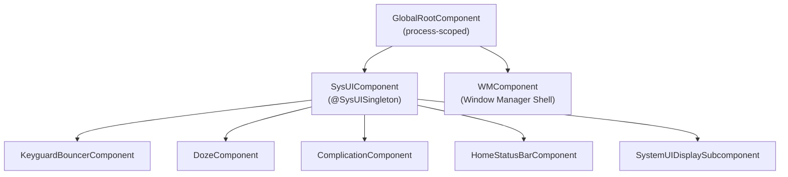

**GlobalRootComponent** 是顶层组件。它绑定到应用程序的 `Context`，并暴露 `SysUIComponent.Builder`：

```java
// frameworks/base/packages/SystemUI/src/com/android/systemui/dagger/
//   GlobalRootComponent.java
public interface GlobalRootComponent {
    interface Builder {
        @BindsInstance Builder context(Context context);
        @BindsInstance Builder instrumentationTest(@InstrumentationTest boolean test);
        GlobalRootComponent build();
    }

    WMComponent.Builder getWMComponentBuilder();
    SysUIComponent.Builder getSysUIComponent();
    InitializationChecker getInitializationChecker();
    @Main Looper getMainLooper();
}
```

**SysUIComponent** 是主要子组件，SystemUI 的大多数单例都存在于其中。它安装大量 Dagger 模块：

```java
// frameworks/base/packages/SystemUI/src/com/android/systemui/dagger/
//   SysUIComponent.java
@SysUISingleton
@Subcomponent(modules = {
        DefaultComponentBinder.class,
        DependencyProvider.class,
        MultiUserUtilsModule.class,
        NotificationInsetsModule.class,
        QsFrameTranslateModule.class,
        ReferenceSystemUIModule.class,
        StartControlsStartableModule.class,
        StartBinderLoggerModule.class,
        SystemUIModule.class,
        SystemUICoreStartableModule.class,
        WallpaperModule.class})
public interface SysUIComponent {
    // ...
    Map<Class<?>, Provider<CoreStartable>> getStartables();
    @PerUser Map<Class<?>, Provider<CoreStartable>> getPerUserStartables();
}
```

该构建器接受来自 WMComponent 的 shell 接口，例如 `Pip`、`SplitScreen`、`Bubbles` 和 `ShellTransitions`。SystemUI 就是通过这种方式与窗口管理器 shell 进程集成的。

**SystemUIInitializer** 编排 Dagger 图的构建：

```java
// frameworks/base/packages/SystemUI/src/com/android/systemui/SystemUIInitializer.java
public abstract class SystemUIInitializer {
    public void init(boolean fromTest) throws ExecutionException, InterruptedException {
        mRootComponent = getGlobalRootComponentBuilder()
                .context(mContext)
                .instrumentationTest(fromTest)
                .build();

        // Stand up WMComponent
        setupWmComponent(mContext);

        // Build SysUI, injecting Shell interfaces
        SysUIComponent.Builder builder = mRootComponent.getSysUIComponent();
        builder = prepareSysUIComponentBuilder(builder, mWMComponent)
                .setShell(mWMComponent.getShell())
                .setPip(mWMComponent.getPip())
                .setSplitScreen(mWMComponent.getSplitScreen())
                // ... more shell bindings
                ;
        mSysUIComponent = builder.build();

        Dependency dependency = mSysUIComponent.createDependency();
        dependency.start();
    }
}
```

### 48.1.3  CoreStartable —— 服务生命周期

每个主要的 SystemUI 功能都实现为一个 `CoreStartable`。该接口定义了应用程序驱动的生命周期：

```
CoreStartable
  +-- start()          // Called once, in topological order
  +-- onBootCompleted()
  +-- isDumpCritical() // Included in bugreport CRITICAL section?
  +-- dump()           // For `adb shell dumpsys`
```

CoreStartable 通过 multibinding 注册在 Dagger 模块中：

```kotlin
// frameworks/base/packages/SystemUI/src/com/android/systemui/dagger/
//   SystemUICoreStartableModule.kt
@Module
abstract class SystemUICoreStartableModule {
    @Binds @IntoMap @ClassKey(KeyguardViewMediator::class)
    abstract fun bindKeyguardViewMediator(sysui: KeyguardViewMediator): CoreStartable

    @Binds @IntoMap @ClassKey(GlobalActionsComponent::class)
    abstract fun bindGlobalActionsComponent(sysui: GlobalActionsComponent): CoreStartable

    @Binds @IntoMap @ClassKey(WMShell::class)
    abstract fun bindWMShell(sysui: WMShell): CoreStartable

    // ... 30+ more bindings
}
```

应用程序以拓扑排序方式启动它们，并尊重声明的依赖关系：

```java
// SystemUIApplicationImpl.java -- topological start loop
boolean startedAny = false;
ArrayDeque<Map.Entry<Class<?>, Provider<CoreStartable>>> queue;
ArrayDeque<Map.Entry<Class<?>, Provider<CoreStartable>>> nextQueue =
        new ArrayDeque<>(startables.entrySet());

do {
    startedAny = false;
    queue = nextQueue;
    nextQueue = new ArrayDeque<>(startables.size());
    while (!queue.isEmpty()) {
        Map.Entry<Class<?>, Provider<CoreStartable>> entry = queue.removeFirst();
        Class<?> cls = entry.getKey();
        Set<Class<? extends CoreStartable>> deps =
                mSysUIComponent.getStartableDependencies().get(cls);
        if (deps == null || startedStartables.containsAll(deps)) {
            mServices[i] = startStartable(clsName, entry.getValue());
            startedStartables.add(cls);
            startedAny = true;
        } else {
            nextQueue.add(entry);
        }
    }
} while (startedAny && !nextQueue.isEmpty());
```

如果任何 startable 的依赖无法解析，进程会抛出一个 `RuntimeException`，其中包含缺少哪些依赖的详细信息。

### 48.1.4  插件系统

SystemUI 通过插件架构支持运行时可扩展性。插件是实现 `plugin` 源码集接口的 APK：

```
frameworks/base/packages/SystemUI/plugin/src/com/android/systemui/plugins/
  qs/QSTile.java
  qs/QSFactory.java
  qs/QS.java
  GlobalActions.java
  VolumeDialogController.java
  ...
```

`ExtensionController` 负责发现和加载插件，其中 `GlobalActionsComponent` 是一个典型示例：

```java
// frameworks/base/packages/SystemUI/src/com/android/systemui/globalactions/
//   GlobalActionsComponent.java
@Override
public void start() {
    mExtension = mExtensionController.newExtension(GlobalActions.class)
            .withPlugin(GlobalActions.class)
            .withDefault(mGlobalActionsProvider::get)
            .withCallback(this::onExtensionCallback)
            .build();
    mPlugin = mExtension.get();
}
```

该模式允许 OEM 通过发布以平台密钥签名的插件 APK，来替换默认的电源菜单、音量对话框或 QS 磁贴。

### 48.1.5  功能标志

SystemUI 使用 Android 的 aconfig 标志系统进行功能门控。标志定义于：

```
frameworks/base/packages/SystemUI/aconfig/
```

代码通过生成的访问器检查标志：

```java
import com.android.systemui.Flags;

if (Flags.predictiveBackAnimateShade()) {
    // new behavior
}
```

QS 流水线有自己的标志仓库：

```kotlin
// frameworks/base/packages/SystemUI/src/com/android/systemui/qs/pipeline/shared/
//   QSPipelineFlagsRepository.kt
@SysUISingleton
class QSPipelineFlagsRepository @Inject constructor() {
    val tilesEnabled: Boolean
        get() = AconfigFlags.qsNewTiles()
}
```

### 48.1.6  目录结构

以下是 `frameworks/base/packages/SystemUI/src/com/android/systemui/` 下 180 多个子包的精简列表：

```
accessibility/    -- Magnification, floating menu
activity/         -- Activity lifecycle helpers
ambient/          -- Ambient display
authentication/   -- Device authentication domain layer
back/             -- Predictive back gesture
battery/          -- Battery state
biometrics/       -- Fingerprint, face, UDFPS
bluetooth/        -- Bluetooth QS tile data
bouncer/          -- Keyguard bouncer (MVI)
brightness/       -- Brightness slider
camera/           -- Camera access tracking
charging/         -- Charging animation
classifier/       -- Touch classifier (falsing)
clipboardoverlay/ -- Clipboard preview overlay
communal/         -- Communal (glanceable hub) mode
controls/         -- Device controls (home automation)
dagger/           -- DI components and modules
demomode/         -- Demo mode for screenshots
display/          -- Display management
doze/             -- Doze/AOD
dreams/           -- Screen saver (daydream)
flags/            -- Feature flag infrastructure
fragments/        -- Fragment host
globalactions/    -- Power menu
keyguard/         -- Lock screen
media/            -- Media controls, route picker
navigationbar/    -- Navigation bar and gesture nav
notifications/    -- Notification pipeline
plugins/          -- Plugin infrastructure
power/            -- Power domain layer
privacy/          -- Privacy indicators
qs/               -- Quick Settings
recents/          -- Recent apps
scene/            -- Scene container (next-gen UI)
screenshot/       -- Screenshot capture and editing
shade/            -- Notification shade
statusbar/        -- Status bar, icons, policies
volume/           -- Volume dialog
wallpapers/       -- Wallpaper management
wmshell/          -- WM Shell integration
```

在 `src/` 树旁边，Android 17 在 SystemUI 软件包顶部新增了一个同级的 `pods/` 目录（`frameworks/base/packages/SystemUI/pods/`）。每个*pod*都是一个自包含的功能模块，拥有自己的 Soong 构建目标以及自己的 `src/`、`ui/` 和测试源码。例如 `pods/scene/`、`pods/shade/`、`pods/qs/`、`pods/statusbar/`、`pods/notifications/`、`pods/brightness/`、`pods/user/` 等等。

移入 pod 的代码保留其 `com.android.systemui.*` 包名，因此对调用者而言移动是无感知的。例如，规范的 `Scenes` 和场景键定义现在位于 `frameworks/base/packages/SystemUI/pods/scene/src/api/shared/model/Scenes.kt`，包名为 `com.android.systemui.scene.shared.model`。Scene 框架的其余部分（交互器、startable、视图模型）仍位于 `src/com/android/systemui/scene/` 下。当本章中的某个路径在 `src/` 下找不到时，请检查对应的 `pods/` 模块。

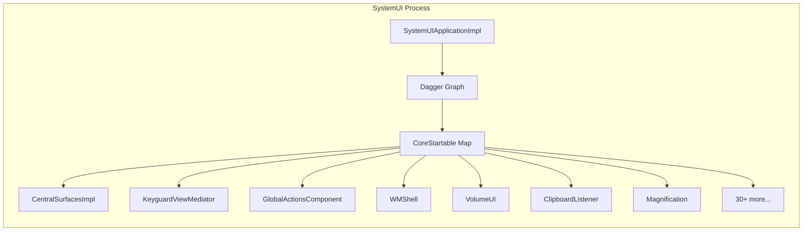

---

## 48.2  状态栏

状态栏是屏幕顶部那条窄条。它显示时钟、通知图标、电池电量、信号强度和系统状态图标。它是 SystemUI 启动过程中最先创建的视觉元素之一。

### 48.2.1  CentralSurfaces —— 编排者

`CentralSurfaces` 是一个扩展了 `Dumpable`、`LifecycleOwner` 和 `CoreStartable` 的接口。其实现 `CentralSurfacesImpl` 是一个大类，随着逻辑不断被提取而逐渐缩小。历史上，它充当状态栏、通知栏、锁屏等的中心协调者：

```java
// frameworks/base/packages/SystemUI/src/com/android/systemui/statusbar/phone/
//   CentralSurfaces.java
public interface CentralSurfaces extends Dumpable, LifecycleOwner, CoreStartable {
    String TAG = "CentralSurfaces";
    boolean SHOW_LOCKSCREEN_MEDIA_ARTWORK = true;
    long LAUNCH_TRANSITION_TIMEOUT_MS = 5000;
    // ...
}
```

`CentralSurfacesImpl` 通过一个庞大的构造函数注入——它几乎依赖所有其他 SystemUI 组件。它管理：

- 状态栏窗口的创建与定位
- 通知栏展开
- 锁屏/ bouncer 过渡
- 浅色栏（深色/浅色图标着色）
- 生物识别解锁动画
- 锁屏上的媒体封面
- 演示模式

该类正被逐步分解。新代码应依赖更窄的接口（例如 `ShadeController`、`ShadeViewController`、`KeyguardStateController`），而不是直接依赖 `CentralSurfaces`。

### 48.2.2  StatusBarWindowController

状态栏占用一个 `WindowManager.LayoutParams.TYPE_STATUS_BAR` 类型的系统窗口。其窗口管理被封装在 `StatusBarWindowControllerImpl` 中：

```java
// frameworks/base/packages/SystemUI/src/com/android/systemui/statusbar/window/
//   StatusBarWindowControllerImpl.java
public class StatusBarWindowControllerImpl implements StatusBarWindowController {
    // Window type, insets configuration, cutout handling
}
```

状态栏窗口的关键方面：

| 属性 | 值 |
|---|---|
| 窗口类型 | `TYPE_STATUS_BAR` |
| 像素格式 | `PixelFormat.TRANSLUCENT` |
| 切口模式 | `LAYOUT_IN_DISPLAY_CUTOUT_MODE_ALWAYS` |
| 重力 | `Gravity.TOP` |
| 标志 | `FLAG_NOT_FOCUSABLE`、`FLAG_DRAWS_SYSTEM_BAR_BACKGROUNDS` |

该控制器处理显示屏切口（刘海、挖孔），并配置 `InsetsFrameProvider`，使状态栏参与 insets 系统。应用收到与该窗口高度对应的 `statusBars()` insets。

### 48.2.3  主屏状态栏流水线

在早期版本中，折叠状态栏的可见内容由单个 `CollapsedStatusBarFragment` 驱动。该 `Fragment` 加载 `R.layout.status_bar`，并直接实现 `CommandQueue.Callbacks`、`StatusBarStateController.StateListener` 和 `SystemStatusAnimationCallback`。Android 17 已完成对该"上帝 Fragment"的分解，将其变为*主屏状态栏* MVVM 流水线。不再有任何 `Fragment` 子类驱动状态栏；`R.layout.status_bar` 的根视图（`PhoneStatusBarView`）由一个 binder 绑定到视图模型：

```
frameworks/base/packages/SystemUI/src/com/android/systemui/statusbar/pipeline/shared/ui/
  viewmodel/HomeStatusBarViewModel.kt   -- observable status bar state
  binder/HomeStatusBarViewBinder.kt     -- binds the view to the view-model
  domain/interactor/HomeStatusBarInteractor.kt
```

每个显示屏窗口的作用域由 `HomeStatusBarComponent`（一个 Dagger `@Subcomponent`）提供。每次创建新的 `PhoneStatusBarView` 时它都会被重建。该组件以前名为 `StatusBarFragmentComponent`：

```java
// frameworks/base/packages/SystemUI/src/com/android/systemui/statusbar/phone/
//   fragment/dagger/HomeStatusBarComponent.java
@Subcomponent(modules = {HomeStatusBarModule.class})
public interface HomeStatusBarComponent {
    @Subcomponent.Factory
    interface Factory {
        HomeStatusBarComponent create(
                @BindsInstance @RootView PhoneStatusBarView phoneStatusBarView,
                @BindsInstance StatusBarWindowController statusBarWindowController);
    }
}
```

视图模型汇聚旧 Fragment 订阅的相同信号，现在以流（flow）而非回调的形式：

- **禁用标志**：来自 `system_server`（通过 `CommandQueue`），用于隐藏图标
- **状态栏状态**转换（SHADE、KEYGUARD、SHADE_LOCKED）
- **系统事件动画**——隐私指示器、进行中的通话、屏幕录制和媒体投影的动画芯片（`statusbar/chips/` 包）
- **通知栏展开**——随通知栏展开淡出图标

当 Scene 框架启用时（`SceneContainerFlag`，48.16 节），一个 Compose 根视图也可以承载状态栏（`statusbar/pipeline/shared/ui/composable/StatusBarRoot.kt`）。该根视图取代了加载出来的 View 层次结构。

### 48.2.4  PhoneStatusBarView

`PhoneStatusBarView` 是折叠状态栏的根 `View`：

```java
// frameworks/base/packages/SystemUI/src/com/android/systemui/statusbar/phone/
//   PhoneStatusBarView.java
public class PhoneStatusBarView extends FrameLayout {
    // Touch handling, cutout/insets, system-event animation hooks
}
```

视图控制器（`PhoneStatusBarViewController`，现为 Kotlin）协调触摸处理，并驱动 `HomeStatusBarViewBinder`（48.2.3 节）。深色/浅色图标着色由 `LightBarController` 应用。它使用 WindowManager 通过 `CommandQueue` 推送给 SystemUI 的每个栈的 `AppearanceRegion` / `APPEARANCE_LIGHT_STATUS_BARS` 外观。该控制器本身不对屏幕内容进行采样。

### 48.2.5  状态栏图标流水线

状态栏中的图标经过一个多阶段流水线：

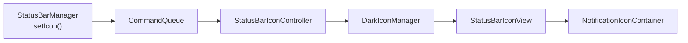

`StatusBarIconController` 维护图标列表及其可见性。`DarkIconManager` 应用着色：深色背景上使用白色图标，浅色背景上使用深色图标。着色边界来自 WindowManager 报告给 SystemUI 的 `AppearanceRegion` 列表（窗口边界加上 `APPEARANCE_LIGHT_STATUS_BARS` 位）。

### 48.2.6  状态栏状态

状态栏在 `StatusBarStateControllerImpl` 管理的多个逻辑状态下运行：

```java
// frameworks/base/packages/SystemUI/src/com/android/systemui/statusbar/
//   StatusBarState.java
public class StatusBarState {
    public static final int SHADE = 0;          // Normal unlocked
    public static final int KEYGUARD = 1;       // Lock screen
    public static final int SHADE_LOCKED = 2;   // Shade pulled down over keyguard
}
```

状态之间的转换驱动整个 SystemUI 的动画。状态控制器将变更广播给所有注册的 `StateListener` 实例。

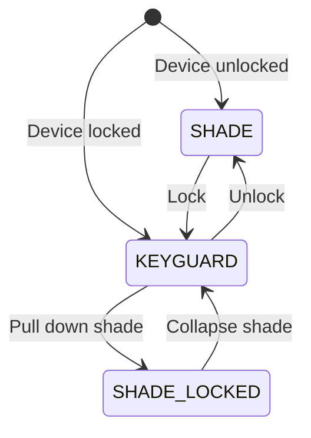

### 48.2.7  隐私指示器与位置指示器

隐私指示器是当应用使用相机、麦克风或位置时出现在状态栏末端的芯片。代码位于 `frameworks/base/packages/SystemUI/src/com/android/systemui/privacy/`。`AppOpsPrivacyItemMonitor` 监视 AppOps 并将活跃的访问转换为 `PrivacyItem` 对象；`PrivacyItemController` 持有当前列表并提供给 `OngoingPrivacyChip`。每个条目携带一个 `PrivacyType`（定义于 `PrivacyItem.kt`）：`TYPE_CAMERA`、`TYPE_MICROPHONE`、`TYPE_LOCATION` 和 `TYPE_MEDIA_PROJECTION`，每个都有其自己的图标和标签。

`privacy` 命名空间中的两个 `DeviceConfig` 标志控制显示哪些来源。`PrivacyConfig` 读取它们。`PROPERTY_MIC_CAMERA_ENABLED` 涵盖相机和麦克风，另有单独的路径控制位置。驱动它们的 AppOps 在 `AppOpsPrivacyItemMonitor` 中拆分：`OPS_MIC_CAMERA` 涵盖相机和录音操作，而 `OPS_LOCATION` 是 `OP_FINE_LOCATION`。当 `locationAvailable` 关闭时，位置操作被过滤掉，永远不会成为 `PrivacyItem`。

Android 17 在 aconfig 标志 `android.location.flags.location_indicators_enabled`（`frameworks/base/location/java/android/location/flags/location.aconfig`）之后重构了位置指示器，并带有配套标志 `location_indicators_animation` 和 `location_indicators_outline`。`PrivacyConfig.locationAvailable` 从 `locationIndicatorsEnabled()` 初始化，因此该标志从根本上启用指示器。当标志开启时，位置访问会产生一个不同的芯片，而不是复用相机/麦克风样式。`PrivacyConfig.privacyItemsAreLocationOnly()` 报告是否每个活跃条目都是 `TYPE_LOCATION`。当此条件成立时，`getPrivacyColor()` 返回 `R.color.privacy_chip_location_only_background`。当 `location_indicators_outline` 也开启时，`getPrivacyOutlineColor()` 和 `getPrivacyOutlineStroke()` 为仅位置芯片提供 1px 描边轮廓，而不是相机和麦克风使用的填充背景。

该标志还改变了位置芯片的停留时长。`PrivacyItemController.processNewList()` 将仅位置集合保持 `TIME_TO_HOLD_INDICATORS_FOR_LOCATION`（10 秒），而不是其他访问使用的 `TIME_TO_HOLD_INDICATORS`（5 秒）。因此，一次短暂的定位读取会保持可见足够长的时间，让用户注意到。点击这些芯片中的任何一个仍会打开隐私对话框（`PrivacyDialogControllerV2`），列出哪些应用使用了哪些来源。

---

## 48.3  通知栏

通知栏是从屏幕顶部滑下的面板，显示通知和快捷设置。它是 Android 中最复杂的 UI 组件之一。

### 48.3.1  窗口配置

通知栏占据与状态栏分离的窗口。其窗口类型为 `TYPE_NOTIFICATION_SHADE`（一种特殊类型，允许它在其他系统窗口之上接收输入）：

```java
// frameworks/base/packages/SystemUI/src/com/android/systemui/shade/
//   NotificationShadeWindowControllerImpl.java
@SysUISingleton
public class NotificationShadeWindowControllerImpl
        implements NotificationShadeWindowController, Dumpable {
    // Manages the notification shade window parameters
    // Adjusts focus, touchability, and dimensions based on state
}
```

窗口控制器根据当前状态动态调整窗口参数：

| 状态 | 窗口行为 |
|---|---|
| 通知栏折叠 | 不可聚焦，最小高度 |
| 通知栏展开中 | 高度扩展，接收触摸 |
| 通知栏已展开 | 全屏，可聚焦以接收远程输入 |
| 锁屏 | 全屏，bouncer 可能可聚焦 |
| 打盹/AOD | 最小化，低功耗 |

### 48.3.2  NotificationPanelViewController

`NotificationPanelViewController` 是*传统*（scene 之前）通知栏面板的主要控制器。它管理：

- 触摸跟踪和基于速度的展开/折叠
- 通知栏内的 QS 展开
- 锁屏特定行为（时钟、锁屏上的通知）
- 大屏幕上的分屏通知栏（左侧通知，右侧 QS）
- 展开过程中的模糊效果

```java
// frameworks/base/packages/SystemUI/src/com/android/systemui/shade/
//   NotificationPanelViewController.java
public class NotificationPanelViewController
        implements Dumpable, ShadeSurface {
    // Handles all shade panel touch events and state transitions
}
```

该控制器是 Scene 框架旨在淘汰的最大型的传统机制之一。当 `SceneContainerFlag` 启用时（48.16 节），该类中的滑动展开和 QS 展开逻辑被 `SceneTransitionLayout` 取代，`NotificationPanelViewController` 被绕过。

关键触摸处理流程：

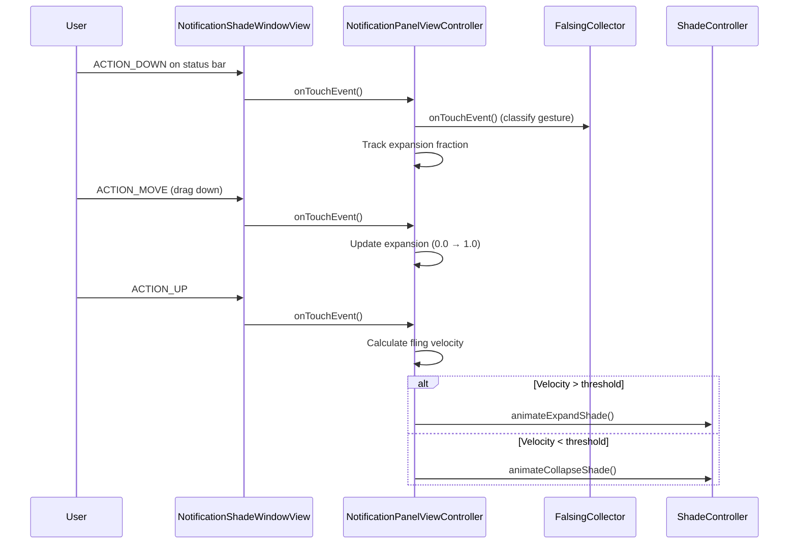

### 48.3.3  ShadeController

`ShadeController` 是抽象通知栏操作的接口。它扩展了 `CoreStartable`：

```java
// frameworks/base/packages/SystemUI/src/com/android/systemui/shade/
//   ShadeController.java
public interface ShadeController extends CoreStartable {
    boolean isShadeEnabled();
    void instantExpandShade();
    void instantCollapseShade();
    void animateCollapseShade(int flags, boolean force,
                              boolean delayed, float speedUpFactor);
    void animateExpandShade();
    void animateExpandQs();
    void cancelExpansionAndCollapseShade();
    boolean isShadeFullyOpen();
    boolean isExpandingOrCollapsing();
    void collapseShade();
    void collapseShadeForActivityStart();
    // ...
}
```

默认实现是 `ShadeControllerImpl`（`ShadeControllerImpl.java`），而 `ShadeControllerSceneImpl`（`ShadeControllerSceneImpl.kt`）是面向 scene 容器架构的下一代实现。`QuickSettingsController` 遵循相同的拆分：传统路径使用 `QuickSettingsControllerImpl.java`，scene 路径使用 `QuickSettingsControllerSceneImpl.kt`。Dagger 根据 `SceneContainerFlag` 绑定其一。

### 48.3.4  NotificationStackScrollLayout

通知列表由 `NotificationStackScrollLayout` 渲染，这是一个自定义 `ViewGroup`，实现了：

- 可变高度的子视图（通知行）
- 越界滚动物理效果
- 消除手势（滑动消除）
- 分组和分区标题
- 悬浮通知插入
- 溢出图标的托盘

每个通知行是一个 `ExpandableNotificationRow`，其本身包含加载出来的通知视图（收起、展开、悬浮变体）。

### 48.3.5  遮罩管理

通知栏背后的遮罩（调暗覆盖层）由 `ScrimController` 管理，它处理多个遮罩层：

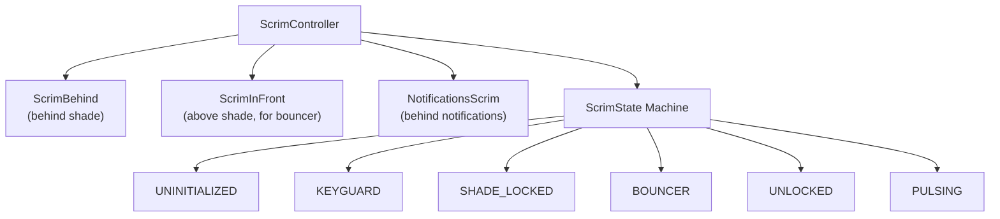

每个 `ScrimState` 定义遮罩的 alpha 值和着色颜色。状态之间的转换对这些属性进行平滑动画。

### 48.3.6  锁屏到通知栏的过渡

`LockscreenShadeTransitionController` 管理从锁屏向下拖动进入通知栏的手势。它协调：

- QS 展开比例
- 遮罩 alpha 过渡
- 锁屏可见性
- 通知位置插值

---

## 48.4  快捷设置

快捷设置（QS）是通过下拉通知栏访问的磁贴网格。第一次下拉显示几个磁贴的"Quick QS"条；第二次下拉展开为完整的 QS 面板。

### 48.4.1  架构概览

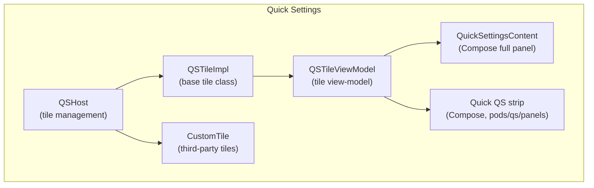

### 48.4.2  QSHost —— 磁贴管理

`QSHost` 是管理活跃 QS 磁贴集合的接口：

```java
// frameworks/base/packages/SystemUI/src/com/android/systemui/qs/QSHost.java
public interface QSHost {
    String TILES_SETTING = Settings.Secure.QS_TILES;
    int POSITION_AT_END = -1;

    static List<String> getDefaultSpecs(Resources res) {
        final ArrayList<String> tiles = new ArrayList();
        int resource = QsSplitInternetTile.isEnabled()
                ? R.string.quick_settings_tiles_default_split
                : R.string.quick_settings_tiles_default;
        final String defaultTileList = res.getString(resource);
        tiles.addAll(Arrays.asList(defaultTileList.split(",")));
        return tiles;
    }

    Collection<QSTile> getTiles();
    void removeTile(String tileSpec);
    void removeTiles(Collection<String> specs);
    QSTile createTile(String tileSpec);
    void addCallback(Callback callback);
    List<String> getSpecs();
}
```

磁贴配置作为以逗号分隔的磁贴规格列表存储在 `Settings.Secure.QS_TILES` 中（例如 `"wifi,bt,flashlight,rotation"`）。默认集合定义在一个字符串资源中，OEM 通常会覆盖它。

### 48.4.3  QSTile 接口

每个 QS 磁贴都实现 `QSTile` 插件接口：

```java
// frameworks/base/packages/SystemUI/plugin/src/com/android/systemui/plugins/qs/
//   QSTile.java
@ProvidesInterface(version = QSTile.VERSION)
public interface QSTile {
    int VERSION = 5;

    String getTileSpec();
    boolean isAvailable();
    void refreshState();
    void click(@Nullable Expandable expandable);
    void secondaryClick(@Nullable Expandable expandable);
    void longClick(@Nullable Expandable expandable);
    @NonNull State getState();
    CharSequence getTileLabel();
    void setListening(Object client, boolean listening);
    void destroy();
}
```

`State` 内部类承载所有视觉状态：

| 字段 | 说明 |
|---|---|
| `state` | `Tile.STATE_ACTIVE`、`STATE_INACTIVE`、`STATE_UNAVAILABLE` |
| `icon` | Drawable 或资源 |
| `label` | 主要文本 |
| `secondaryLabel` | 次要文本（例如网络名称） |
| `contentDescription` | 无障碍 |
| `dualTarget` | 长按是否有单独的动作 |

### 48.4.4  QSTileImpl —— 基础实现

`QSTileImpl` 是内置磁贴的抽象基类：

```java
// frameworks/base/packages/SystemUI/src/com/android/systemui/qs/tileimpl/
//   QSTileImpl.java
public abstract class QSTileImpl<TState extends State>
        implements QSTile, LifecycleOwner, Dumpable {

    protected final QSHost mHost;
    private static final long DEFAULT_STALE_TIMEOUT = 10 * DateUtils.MINUTE_IN_MILLIS;

    // Subclasses must implement:
    // - newTileState()
    // - handleClick()
    // - handleUpdateState(TState state, Object arg)
    // - getLongClickIntent()
    // - getTileLabel()
}
```

状态管理在后台 looper 上运行。流程是：

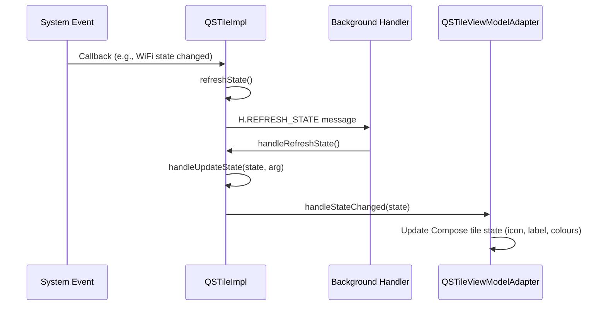

### 48.4.5  内置磁贴

AOSP 附带约 30 个内置 QS 磁贴。该集合在 Android 17 中有所变动。`ModesTile.kt` 和 `ModesDndTile.kt`（"Modes"/勿扰的重构）、`RecordIssueTile.kt`（开发者问题记录）、`FlashlightTileWithLevel.kt`（亮度可调的手电筒）和 `SensorPrivacyToggleTile.java` 均已存在。旧的 `DreamTile.java` 已被移除：

```
frameworks/base/packages/SystemUI/src/com/android/systemui/qs/tiles/
  AirplaneModeTile.java        ModesDndTile.kt
  AlarmTile.kt                 ModesTile.kt
  BatterySaverTile.java        NfcTile.java
  BluetoothTile.java           NightDisplayTile.java
  CameraToggleTile.java        NotesTile.kt
  CastTile.java                OneHandedModeTile.java
  ColorCorrectionTile.java     QRCodeScannerTile.java
  ColorInversionTile.java      QuickAccessWalletTile.java
  DataSaverTile.java           RecordIssueTile.kt
  DeviceControlsTile.kt        ReduceBrightColorsTile.java
  FlashlightTile.java          RotationLockTile.java
  FlashlightTileWithLevel.kt   ScreenRecordTile.java
  FontScalingTile.kt           SensorPrivacyToggleTile.java
  HearingDevicesTile.java      UiModeNightTile.java
  HotspotTile.java             WifiTile.kt
  InternetTileNewImpl.kt       WorkModeTile.java
  LocationTile.java            MicrophoneToggleTile.java
  MobileDataTile.kt
```

每个磁贴都遵循相同的模式。以下是 `FlashlightTile` 作为代表性示例：

```java
// frameworks/base/packages/SystemUI/src/com/android/systemui/qs/tiles/
//   FlashlightTile.java
public class FlashlightTile extends QSTileImpl<BooleanState>
        implements FlashlightController.FlashlightListener {

    public static final String TILE_SPEC = "flashlight";
    private final FlashlightController mFlashlightController;

    @Inject
    public FlashlightTile(
            QSHost host,
            QsEventLogger uiEventLogger,
            @Background Looper backgroundLooper,
            @Main Handler mainHandler,
            FalsingManager falsingManager,
            MetricsLogger metricsLogger,
            StatusBarStateController statusBarStateController,
            ActivityStarter activityStarter,
            QSLogger qsLogger,
            FlashlightController flashlightController) {
        super(host, uiEventLogger, backgroundLooper, mainHandler,
                falsingManager, metricsLogger, statusBarStateController,
                activityStarter, qsLogger);
        mFlashlightController = flashlightController;
        mFlashlightController.observe(getLifecycle(), this);
    }
}
```

像 `WifiTile` 这样的现代磁贴使用带有领域交互器的分层架构：

```kotlin
// frameworks/base/packages/SystemUI/src/com/android/systemui/qs/tiles/
//   WifiTile.kt
class WifiTile @Inject constructor(
    private val host: QSHost,
    // ...
    private val dataInteractor: WifiTileDataInteractor,
    private val tileMapper: WifiTileMapper,
    private val userActionInteractor: WifiTileUserActionInteractor,
) : QSTileImpl<QSTile.State?>(/* ... */) {
    // Data flows through interactor -> mapper -> view
}
```

### 48.4.6  自定义磁贴（第三方）

第三方应用可以通过实现 `android.service.quicksettings.TileService` 添加 QS 磁贴。SystemUI 通过 `CustomTile` 管理这些磁贴：

```java
// frameworks/base/packages/SystemUI/src/com/android/systemui/qs/external/
//   CustomTile.java
public class CustomTile extends QSTileImpl<State>
        implements TileChangeListener, CustomTileInterface {
    public static final String PREFIX = "custom(";
    // Tile spec format: "custom(com.example.app/.MyTileService)"
}
```

自定义磁贴的生命周期由 `TileLifecycleManager` 管理，它绑定到第三方 `TileService` 并管理 `IQSTileService` 接口。`TileServiceManager` 对绑定进行限流，以防止资源耗尽。

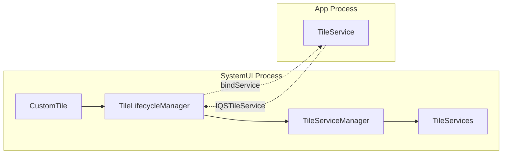

### 48.4.7  自动添加磁贴

当满足某些条件时，部分磁贴会被自动添加（例如，管理工作资料时出现 Work Profile 磁贴）。该逻辑在 QS 流水线的数据层中实现：

```
frameworks/base/packages/SystemUI/src/com/android/systemui/qs/pipeline/
  data/    -- Repositories for tile data and auto-add rules
  domain/  -- Interactors for tile lifecycle
  shared/  -- Shared flags and models
```

### 48.4.8  QSPanel 布局

早期版本使用 `QSPanel` View 渲染完整的 QS 面板（它使用 `TileLayout` 或 `PagedTileLayout`）。它们使用 `QuickQSPanel` 渲染 Quick QS 条。这两个各自有独立的控制器。整个传统 View 层次结构已在 Android 17 中被移除——这些类在代码树中已不复存在，QS 仅使用 Compose。

旧的 `QSFragment`（及其 `QSImpl` 宿主）被一个由 Compose 支撑的单一入口点 `QSFragmentCompose`（`qs/composefragment/QSFragmentCompose.kt`）取代，由 `QSFragmentComposeViewModel` 驱动。面板内容可组合项是 `QuickSettingsContent`（`compose/features/src/com/android/systemui/qs/ui/composable/QuickSettingsContent.kt`），磁贴网格位于 `pods/qs/panels/` 模块中。没有 View 回退。

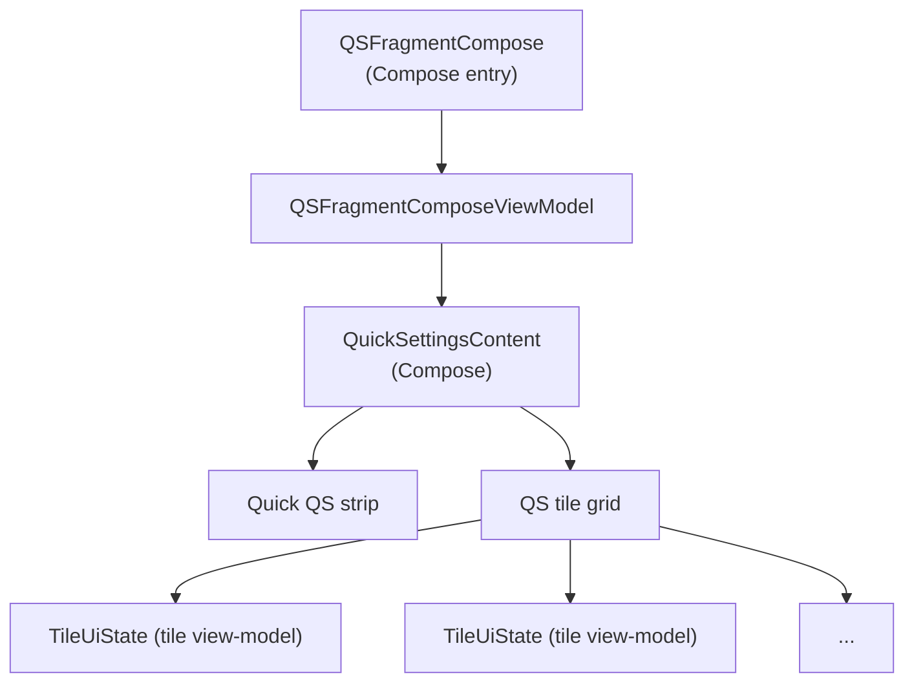

---

## 48.5  锁屏

锁屏（keyguard）是关键的安全性界面。在任何用户内容可见之前它必须显示，并且必须正确管理身份验证（PIN、图案、密码、生物识别）。

### 48.5.1  KeyguardViewMediator

`KeyguardViewMediator` 是 SystemUI 中最大的 CoreStartable，约 4,700 行。它在 `KeyguardService`（接收来自框架的锁定/解锁命令）与锁屏 UI 之间进行协调：

```java
// frameworks/base/packages/SystemUI/src/com/android/systemui/keyguard/
//   KeyguardViewMediator.java
public class KeyguardViewMediator
        implements CoreStartable, StatusBarStateController.StateListener {
    // Manages keyguard lifecycle: show, hide, dismiss, lock
}
```

关键职责：

| 职责 | 说明 |
|---|---|
| 锁屏超时 | 在熄屏超时后安排锁定 |
| 锁屏声音 | 锁定/解锁音效 |
| SIM PIN 处理 | 提示输入 SIM 解锁 |
| 信任代理 | 与 Smart Lock 集成 |
| 遮挡 | 处理显示在锁屏之上的活动 |
| 解锁动画 | 协调解锁过渡 |

该协调器通过 `ViewMediatorCallback` 接收来自 `system_server` 的回调：

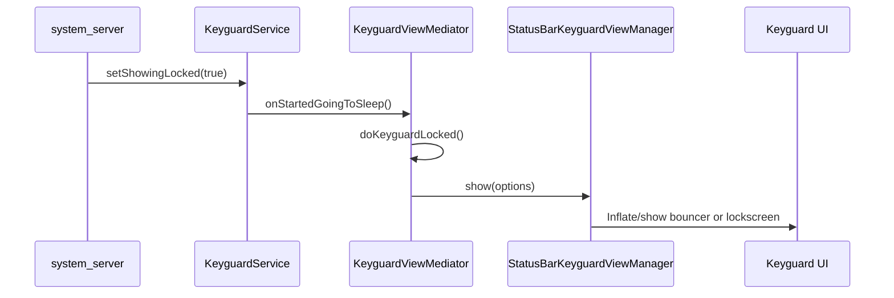

### 48.5.2  StatusBarKeyguardViewManager

`StatusBarKeyguardViewManager` 在协调器与实际锁屏视图之间充当桥梁。它管理主 bouncer（PIN/图案/密码输入）、备用 bouncer（生物识别提示）以及锁屏到通知栏的过渡：

```java
// frameworks/base/packages/SystemUI/src/com/android/systemui/statusbar/phone/
//   StatusBarKeyguardViewManager.java
@SysUISingleton
public class StatusBarKeyguardViewManager implements RemoteInputController.Callback,
        StatusBarStateController.StateListener, ConfigurationController.ConfigurationListener,
        ShadeExpansionListener, NavigationModeController.ModeChangedListener,
        KeyguardViewController, FoldAodAnimationController.FoldAodAnimationStatus {
    // Manages bouncer visibility, predictive back animation,
    // alternate bouncer, global actions visibility
}
```

它与新 MVI 架构中的多个领域交互器交互：

- `PrimaryBouncerInteractor` —— 显示/隐藏 PIN/图案/密码 bouncer
- `AlternateBouncerInteractor` —— 管理生物识别（UDFPS）bouncer
- `KeyguardDismissActionInteractor` —— 处理解锁后的消除动作
- `KeyguardTransitionInteractor` —— 跟踪锁屏状态转换

### 48.5.3  Bouncer

bouncer 是安全挑战（PIN、图案或密码）。其实现位于：

```
frameworks/base/packages/SystemUI/src/com/android/systemui/bouncer/
  data/repository/BouncerRepositoryModule.kt
  domain/interactor/BouncerInteractor.kt
  domain/interactor/PrimaryBouncerInteractor.kt
  domain/interactor/AlternateBouncerInteractor.kt
  domain/startable/BouncerStartable.kt
  ui/BouncerView.kt
```

bouncer 遵循 MVI 模式：

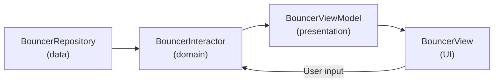

### 48.5.4  AOD（息屏显示）集成

当设备打盹时，锁屏转换为息屏显示（Always-On Display）模式。这由以下组件协调：

- **DozeServiceHost** —— 连接基于 `DreamService` 的 doze 与 SystemUI
- **DozeScrimController** —— 管理 doze 期间的遮罩不透明度
- **DozeParameters** —— 配置（通知脉冲、点击查看）

锁屏状态机包含 AOD 特定的转换：

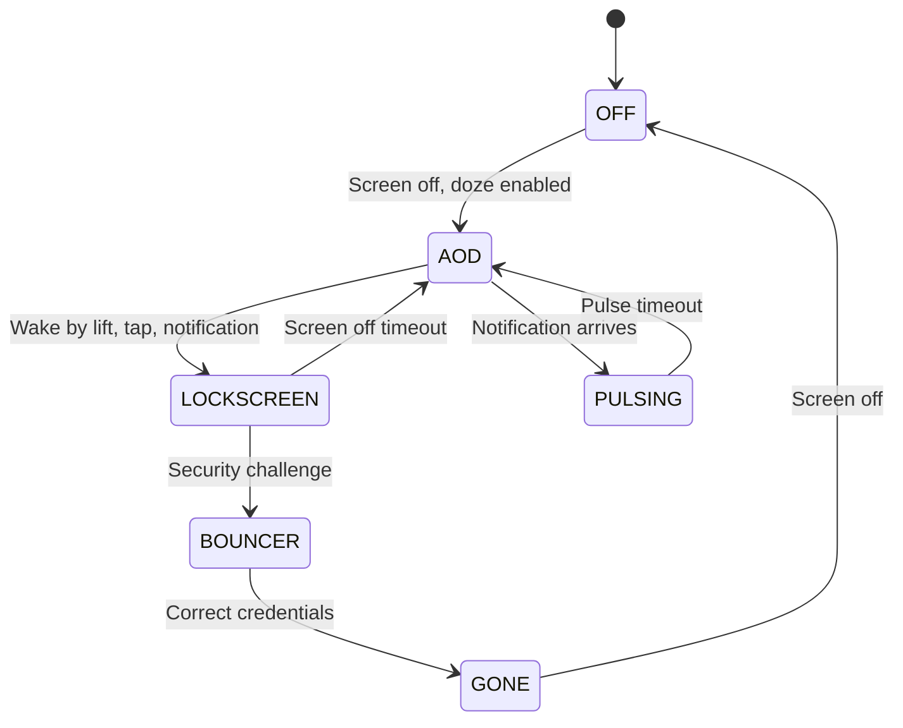

### 48.5.5  锁屏自定义

锁屏支持：

- **时钟自定义** —— 通过 `ClockRegistryModule` 提供可插拔的时钟表盘
- **快捷操作** —— 锁屏角落的快捷方式（相机、钱包）
- **复杂功能** —— AOD 上的天气、日期、电池
- **壁纸** —— 独立的锁屏壁纸
- **Communal（可浏览中心）** —— 从锁屏访问的小组件界面

---

## 48.6  最近任务

SystemUI 并不直接实现最近任务 UI。相反，它通过 `OverviewProxy` 模式委托给 Launcher3（或基于 Launcher 的 quickstep 实现）。

### 48.6.1  最近任务架构

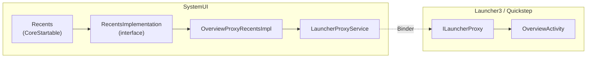

### 48.6.2  OverviewProxyRecentsImpl

默认的 `RecentsImplementation` 将所有调用代理给 Launcher：

```java
// frameworks/base/packages/SystemUI/src/com/android/systemui/recents/
//   OverviewProxyRecentsImpl.java
@SysUISingleton
public class OverviewProxyRecentsImpl implements RecentsImplementation {

    @Override
    public void showRecentApps(boolean triggeredFromAltTab) {
        ILauncherProxy launcherProxy = mLauncherProxyService.getProxy();
        if (launcherProxy != null) {
            try {
                launcherProxy.onOverviewShown(triggeredFromAltTab);
            } catch (RemoteException e) {
                Log.e(TAG, "Failed to send overview show event to launcher.", e);
            }
        }
    }

    @Override
    public void toggleRecentApps() {
        ILauncherProxy launcherProxy = mLauncherProxyService.getProxy();
        if (launcherProxy != null) {
            final Runnable toggleRecents = () -> {
                try {
                    mLauncherProxyService.getProxy().onOverviewToggle();
                    mLauncherProxyService.notifyToggleRecentApps();
                } catch (RemoteException e) {
                    Log.e(TAG, "Cannot send toggle recents through proxy service.", e);
                }
            };
            if (mKeyguardStateController.isShowing()) {
                mActivityStarter.executeRunnableDismissingKeyguard(
                        () -> mHandler.post(toggleRecents), null, true, false, true);
            } else {
                toggleRecents.run();
            }
        }
    }
}
```

### 48.6.3  LauncherProxyService

`LauncherProxyService` 维护与 Launcher 概览实现的 binder 连接。当用户从导航栏向上滑动时，SystemUI 将手势路由给 Launcher，后者渲染任务缩略图并处理任务切换。

### 48.6.4  RecentsModule

Dagger 模块绑定实现：

```java
// frameworks/base/packages/SystemUI/src/com/android/systemui/recents/
//   RecentsModule.java
@Module
public abstract class RecentsModule {
    @Binds
    abstract RecentsImplementation bindRecentsImplementation(
            OverviewProxyRecentsImpl impl);
}
```

---

## 48.7  音量对话框

当用户按下硬件音量键或系统音量被编程方式改变时，音量对话框会出现。

### 48.7.1  VolumeDialogControllerImpl

该控制器是音量状态的权威来源。它在专用的后台线程上运行：

```java
// frameworks/base/packages/SystemUI/src/com/android/systemui/volume/
//   VolumeDialogControllerImpl.java
@SysUISingleton
public class VolumeDialogControllerImpl implements VolumeDialogController, Dumpable {
    // All work done on a dedicated background worker thread
    // Methods ending in "W" must be called on the worker thread
}
```

该控制器：

- 向 `AudioManager` 注册 `IVolumeController` 回调
- 跟踪多个音频流的状态（MUSIC、RING、ALARM、VOICE_CALL、ACCESSIBILITY）
- 监视铃声模式（正常、振动、静音）
- 跟踪 DND（勿扰）状态
- 管理媒体会话以实现按应用音量

### 48.7.2  VolumeDialog（MVI 重写）

早期版本将该对话框实现为单个庞大的 `VolumeDialogImpl` 类。Android 17 已将其替换为 `frameworks/base/packages/SystemUI/src/com/android/systemui/volume/dialog/` 下完全分层的包，遵循与现代 SystemUI 其余部分相同的数据/领域/UI 拆分：

```
volume/dialog/
  VolumeDialog.kt              -- the dialog shell (replaces VolumeDialogImpl)
  VolumeDialogPlugin.kt        -- plugin entry that shows/hides the dialog
  data/repository/             -- VolumeDialogVisibilityRepository, stream state
  domain/interactor/           -- visibility, stream, ringer interactors
  ringer/                      -- ringer-mode toggle (ring/vibrate/silent)
  sliders/                     -- one slider component per active stream
  captions/                    -- captions toggle
  settings/                    -- settings gear affordance
  ui/binder, ui/viewmodel      -- view-model + binder layer
  dagger/                      -- per-dialog Dagger scope and modules
```

`VolumeDialog.kt` 是对话框外壳；`VolumeDialogPlugin.kt` 是观察 `VolumeDialogVisibilityRepository` 并显示或隐藏对话框的入口点。每个音频流获得自己的 `VolumeDialogSliderComponent`（Dagger 作用域），而不是在内部管理各行。对话框仍使用每个活跃流一个滑块的垂直布局：

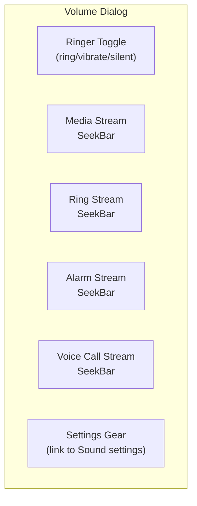

关键特性：

| 特性 | 实现 |
|---|---|
| 自动消失 | 超时处理器（默认 3 秒） |
| 实时反馈 | 随系统音量变化更新 |
| CSD 警告 | 用于听力安全的 `CsdWarningDialogDelegate` |
| 安全警告 | 用于媒体音量的 `SafetyWarningDialogDelegate` |
| 字幕开关 | `CaptionsToggleImageButton` |
| 姿态感知 | 折叠屏姿态变化时消失 |

### 48.7.3  VolumeDialogComponent

`VolumeDialogComponent` 将控制器和对话框作为一个 `CoreStartable` 连接在一起：

```java
// frameworks/base/packages/SystemUI/src/com/android/systemui/volume/
//   VolumeDialogComponent.java
public class VolumeDialogComponent
        implements VolumeComponent, TunerService.Tunable, /* ... */ {
    // Integrates VolumeDialogControllerImpl with the VolumeDialog
    // (volume/dialog/) and the volume panel (volume/panel/)
}
```

`Events.java` 遥测类（48.7.4 节）保持不变。对话框和更新的**音量面板**（`volume/panel/`）共享它。音量面板是承载媒体输出、空间音频和按应用音量控制的大屏设置式面板。

### 48.7.4  音量事件

`Events` 类定义所有音量相关的遥测事件：

```java
// frameworks/base/packages/SystemUI/src/com/android/systemui/volume/Events.java
public class Events {
    @Deprecated public static final int EVENT_SHOW_DIALOG = 0;
    @Deprecated public static final int EVENT_DISMISS_DIALOG = 1;
    public static final int EVENT_ACTIVE_STREAM_CHANGED = 2;
    // ...
    public static final int EVENT_LEVEL_CHANGED = 10;
    // ...
    @Deprecated public static final int EVENT_RINGER_TOGGLE = 18;
    // ...
    public static final int DISMISS_REASON_SETTINGS_CLICKED = 5;
    // ...
    public static final int DISMISS_REASON_POSTURE_CHANGED = 11;
}
```

---

## 48.8  电源菜单

当用户长按电源键时会出现电源菜单（Global Actions）。它提供关机、重启、紧急呼叫的选项，以及可选的锁定。

### 48.8.1  GlobalActionsComponent

`GlobalActionsComponent` 是 CoreStartable 入口点。它使用插件扩展模式以允许 OEM 替换：

```java
// frameworks/base/packages/SystemUI/src/com/android/systemui/globalactions/
//   GlobalActionsComponent.java
@SysUISingleton
public class GlobalActionsComponent
        implements CoreStartable, Callbacks, GlobalActionsManager {

    @Override
    public void start() {
        mBarService = IStatusBarService.Stub.asInterface(
                ServiceManager.getService(Context.STATUS_BAR_SERVICE));
        mExtension = mExtensionController.newExtension(GlobalActions.class)
                .withPlugin(GlobalActions.class)
                .withDefault(mGlobalActionsProvider::get)
                .withCallback(this::onExtensionCallback)
                .build();
        mPlugin = mExtension.get();
        mCommandQueue.addCallback(this);
    }

    @Override
    public void handleShowGlobalActionsMenu() {
        mExtension.get().showGlobalActions(this);
    }

    @Override
    public void onGlobalActionsShown() {
        mStatusBarKeyguardViewManager.setGlobalActionsVisible(true);
        mBarService.onGlobalActionsShown();  // ... RemoteException handling elided
    }

    @Override
    public void shutdown() {
        mBarService.shutdown();
    }

    @Override
    public void reboot(boolean safeMode) {
        mBarService.reboot(safeMode);
    }
}
```

### 48.8.2  GlobalActionsImpl

默认插件实现：

```java
// frameworks/base/packages/SystemUI/src/com/android/systemui/globalactions/
//   GlobalActionsImpl.java
public class GlobalActionsImpl implements GlobalActions, CommandQueue.Callbacks {

    @Override
    public void showGlobalActions(GlobalActionsManager manager) {
        if (mDisabled) return;
        mGlobalActionsDialog.showDialog(
                mKeyguardStateController.isShowing(),
                mDeviceProvisionedController.isDeviceProvisioned(),
                null /* view */,
                mContext.getDisplayId());
    }

    @Override
    public void showShutdownUi(boolean isReboot, String reason) {
        mShutdownUi.showShutdownUi(isReboot, reason);
        mShadeController.instantCollapseShade();
    }

    @Override
    public void disable(int displayId, int state1, int state2, boolean animate) {
        final boolean disabled = (state2 & DISABLE2_GLOBAL_ACTIONS) != 0;
        if (displayId != mContext.getDisplayId() || disabled == mDisabled) return;
        mDisabled = disabled;
        if (disabled) {
            mGlobalActionsDialog.dismissDialog();
        }
    }
}
```

### 48.8.3  GlobalActionsDialogLite

`GlobalActionsDialogLite` 实现实际的电源菜单对话框：

```java
// frameworks/base/packages/SystemUI/src/com/android/systemui/globalactions/
//   GlobalActionsDialogLite.java
// Window type: TYPE_STATUS_BAR_SUB_PANEL
// Layout mode: LAYOUT_IN_DISPLAY_CUTOUT_MODE_ALWAYS
```

对话框根据设备能力动态构建其操作列表：

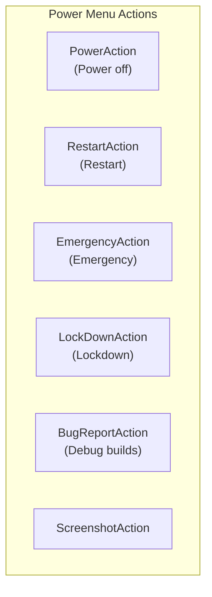

操作可用性取决于：

| 条件 | 效果 |
|---|---|
| 设备已配置 | 所有操作可用 |
| 锁屏显示中 | 可能限制部分操作 |
| 用户锁定 | 改变锁定按钮文本 |
| 飞行模式 | 影响紧急拨号器 |
| 电话功能可用 | 控制紧急操作 |
| 调试构建 | 启用 bug 报告操作 |

### 48.8.4  ShutdownUi

当关机或重启启动时，`ShutdownUi` 在系统关机期间显示全屏进度动画。通知栏被立即折叠，以防止在关机序列期间的交互。

### 48.8.5  电源菜单布局

多个布局类支持不同的屏幕配置：

```
GlobalActionsColumnLayout.java   -- Vertical column (phones, portrait)
GlobalActionsFlatLayout.java     -- Horizontal row
GlobalActionsGridLayout.java     -- Grid (tablets)
GlobalActionsLayoutLite.java     -- Base layout logic
GlobalActionsPowerDialog.java    -- Power-specific dialog variant
```

---

## 48.9  截图

截图系统捕获屏幕内容，显示预览，并提供编辑/分享操作。

### 48.9.1  TakeScreenshotService

截图请求通过绑定服务 `TakeScreenshotService` 从 `system_server` 到达：

```java
// frameworks/base/packages/SystemUI/src/com/android/systemui/screenshot/
//   TakeScreenshotService.java
public class TakeScreenshotService extends Service {
    // Receives screenshot requests from PhoneWindowManager
    // Routes to appropriate handler (headless or interactive)
}
```

### 48.9.2  ScreenshotController

`ScreenshotController`（Kotlin，使用 `@AssistedInject`）管理整个截图流程：

```kotlin
// frameworks/base/packages/SystemUI/src/com/android/systemui/screenshot/
//   ScreenshotController.kt
class ScreenshotController @AssistedInject internal constructor(
    appContext: Context,
    screenshotWindowFactory: ScreenshotWindow.Factory,
    viewProxyFactory: ScreenshotShelfViewProxy.Factory,
    screenshotNotificationsControllerFactory:
        ScreenshotNotificationsController.Factory,
    screenshotActionsControllerFactory:
        ScreenshotActionsController.Factory,
    actionExecutorFactory: ActionExecutor.Factory,
    private val screenshotSoundController: ScreenshotSoundController,
    private val uiEventLogger: UiEventLogger,
    private val imageExporter: ImageExporter,
    private val imageCapture: ImageCapture,
    private val scrollCaptureExecutor: ScrollCaptureExecutor,
    // ...
    @Assisted private val display: Display,
) : InteractiveScreenshotHandler {
```

### 48.9.3  截图流程

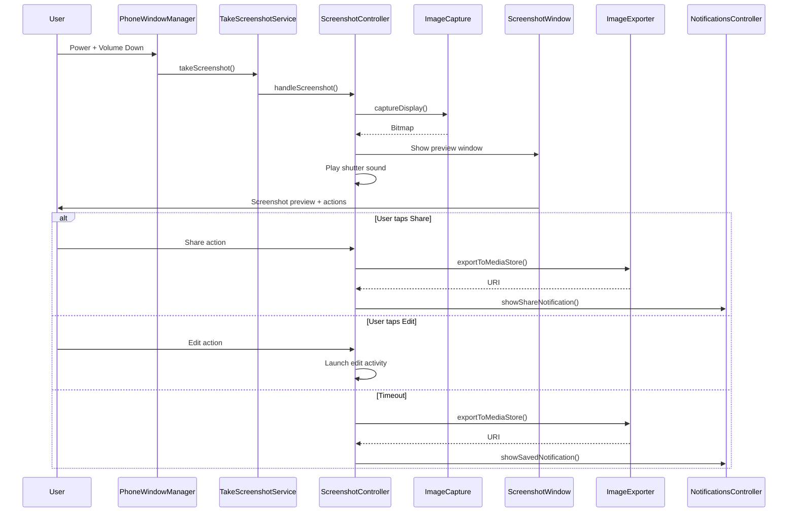

### 48.9.4  截图组件

| 组件 | 角色 |
|---|---|
| `ImageCapture` / `ImageCaptureImpl` | 将屏幕内容捕获为 `Bitmap` |
| `ScreenshotWindow` | 管理预览覆盖窗口 |
| `ScreenshotShelfViewProxy` | 预览托盘 UI（缩略图 + 操作） |
| `ImageExporter` | 保存到 `MediaStore` |
| `ScreenshotNotificationsController` | 显示保存/分享通知 |
| `ScreenshotSoundController` | 播放相机快门声 |
| `ScrollCaptureExecutor` | 长截图/滚动截图捕获 |
| `ScreenshotDetectionController` | 通知应用截图已被捕获 |
| `MessageContainerController` | 显示工作资料消息 |
| `TimeoutHandler` | 超时后自动消失 |
| `ScreenshotActionsController` | 管理操作按钮（分享、编辑） |
| `ActionIntentCreator` | 创建分享/编辑的 intent |

### 48.9.5  长截图

滚动捕获系统支持捕获超出可见视口的内容。`ScrollCaptureExecutor` 与应用的 `ScrollCaptureCallback` 通信，逐步捕获内容块，然后将它们拼接成一张图像。

### 48.9.6  跨资料截图

`ScreenshotCrossProfileService` 处理涉及托管资料内容的截图，使用 `ICrossProfileService` 跨用户边界代理操作。

---

## 48.10  多显示屏 SystemUI

现代 Android 支持多个显示屏（外接显示器、双屏折叠屏、车载副屏）。SystemUI 必须在每个显示屏上渲染适当的 UI。

### 48.10.1  PerDisplayRepository 模式

`PerDisplayRepository<T>` 模式（来自 `com.android.app.displaylib`）维护组件的按显示屏实例：

```kotlin
// frameworks/base/packages/SystemUI/src/com/android/systemui/dagger/
//   PerDisplayRepositoriesModule.kt
@Module(
    includes = [PerDisplayCoroutineScopeRepositoryModule::class,
        DisplayComponentRepository::class]
)
interface PerDisplayRepositoriesModule {
    companion object {
        @SysUISingleton
        @Provides
        fun provideSysUiStateRepository(
            repositoryFactory: PerDisplayInstanceRepositoryImpl.Factory<SysUiState>,
            instanceProvider: SysUIStateInstanceProvider,
        ): PerDisplayRepository<SysUiState> {
            val debugName = "SysUiStatePerDisplayRepo"
            return repositoryFactory.create(debugName, instanceProvider)
        }
    }
}
```

`PerDisplayRepository<T>` 机制来自共享的 `com.android.app.displaylib` 库（`frameworks/libs/systemui/displaylib`）。像 `SysUiState` 这样的组件通过 `PerDisplayInstanceRepositoryImpl` 按显示屏跟踪，因此每个连接的显示屏都获得自己的实例。在 Android 17 中，按显示屏的 `SysUiState` 仓库由 `PerDisplayRepositoriesModule.provideSysUiStateRepository`（`frameworks/base/packages/SystemUI/src/com/android/systemui/dagger/PerDisplayRepositoriesModule.kt`）无条件提供，而非处于功能标志之后。

### 48.10.2  按显示屏状态栏

状态栏窗口控制器使用 `StatusBarWindowControllerStore` 管理按显示屏实例：

```
frameworks/base/packages/SystemUI/src/com/android/systemui/statusbar/window/
  StatusBarWindowControllerStore.kt    -- Store for per-display controllers
  StatusBarWindowControllerImpl.java   -- Per-display window management
  StatusBarWindowStateController.kt    -- Per-display window state tracking
```

每个显示屏获得自己的状态栏窗口，带有适当的 insets 和切口处理。

### 48.10.3  按显示屏导航栏

`NavigationBarControllerImpl` 管理所有显示屏上的导航栏：

```java
// frameworks/base/packages/SystemUI/src/com/android/systemui/navigationbar/
//   NavigationBarControllerImpl.java
@SysUISingleton
public class NavigationBarControllerImpl implements
        ConfigurationController.ConfigurationListener,
        NavigationModeController.ModeChangedListener,
        Dumpable, NavigationBarController {

    private final SparseArray<NavigationBar> mNavigationBars = new SparseArray<>();
    // SparseArray keyed by display ID
}
```

当添加新显示屏时，调用 `createNavigationBar()`。当移除时，`removeNavigationBar()` 进行清理。

### 48.10.4  显示屏子组件

`SystemUIDisplaySubcomponent`（Kotlin）通过自定义 `@PerDisplaySingleton` 作用域提供显示屏作用域的依赖；参考构建通过 `ReferenceSysUIDisplaySubcomponent` 提供它：

```
frameworks/base/packages/SystemUI/src/com/android/systemui/display/
  dagger/SystemUIDisplaySubcomponent.kt
  dagger/ReferenceSysUIDisplaySubcomponent.kt
  data/repository/DisplayComponentRepository.kt
```

每个显示屏获得自己的协程作用域、配置控制器和一组感知显示屏的 UI 组件。

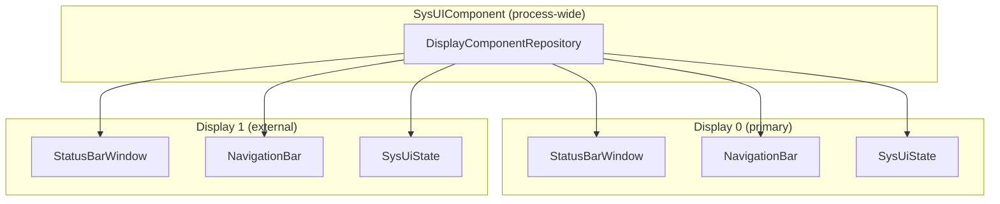

### 48.10.5  连接的显示屏

状态栏功能现在无条件扩展到连接的显示屏。`HomeStatusBarComponent`（及其绑定的 `PhoneStatusBarView` 加上 `HomeStatusBarViewModel`，48.2.3 节）按显示屏创建。每个都有自己的图标流水线和可见性管理。（曾经对此进行门控的 `StatusBarConnectedDisplays` 标志已被移除。它仅在 TODO 注释中幸存。真正的 aconfig 标志 `status_bar_is_connected_display_chip_controlled_by_config` 仍然门控连接显示屏的*芯片*。）

围绕它有一个小的连接显示屏 UI 栈。`ConnectedDisplayInteractor`（`src/com/android/systemui/display/domain/interactor/ConnectedDisplayInteractor.kt`）暴露一个 `connectedDisplayState` 流，当外部显示屏连接时报告 `CONNECTED`，当该显示屏还带有 `FLAG_SECURE` 时报告 `CONNECTED_SECURE`。`ConnectedDisplayIconViewModel`（`src/com/android/systemui/statusbar/systemstatusicons/connecteddisplay/ui/viewmodel/ConnectedDisplayIconViewModel.kt`）将该状态映射到状态栏连接显示屏图标，芯片本身由 `status_bar_is_connected_display_chip_controlled_by_config` 门控。当显示屏首次插入时，`ExternalDisplayConnectionDialog`（`src/com/android/systemui/display/ui/view/ExternalDisplayConnectionDialog.kt`，Compose 路径位于 `enable_compose_external_display_dialog` 之后）询问用户镜像还是扩展。

按显示屏的类由 `SystemUIDisplaySubcomponent` 和 `PerDisplaySystemUIModule`（`src/com/android/systemui/display/dagger/`）构建。该子组件是 `@PerDisplaySingleton` 作用域。它在显示屏出现时创建。其协程作用域在显示屏移除时取消，因此显示屏作用域的控制器随其显示屏一起拆除。

---

## 48.11  导航栏

导航栏在屏幕底部（或侧面）提供系统导航控件。它支持三种模式：三键、二键和完全手势。

### 48.11.1  导航模式控制器

`NavigationModeController` 跟踪当前导航模式，该模式由一个覆盖包决定：

```java
// frameworks/base/packages/SystemUI/src/com/android/systemui/navigationbar/
//   NavigationModeController.java
@SysUISingleton
public class NavigationModeController implements Dumpable {
    public interface ModeChangedListener {
        void onNavigationModeChanged(int mode);
    }
    // Reads navigation mode from overlay applied to
    // com.android.internal.R.integer.config_navBarInteractionMode
}
```

三种模式定义在 `WindowManagerPolicyConstants` 中：

| 模式 | 常量 | 说明 |
|---|---|---|
| 三键 | `NAV_BAR_MODE_3BUTTON` | 返回、主屏幕、最近任务按钮 |
| 二键 | `NAV_BAR_MODE_2BUTTON` | 返回手势 + 主屏幕药丸 |
| 手势 | `NAV_BAR_MODE_GESTURAL` | 完整手势导航 |

### 48.11.2  NavigationBarView

`NavigationBarView` 是导航栏的根视图：

```java
// frameworks/base/packages/SystemUI/src/com/android/systemui/navigationbar/views/
//   NavigationBarView.java
public class NavigationBarView extends FrameLayout {
    // Contains ButtonDispatchers for Home, Back, Recents
    // Manages rotation, layout direction, and button visibility
}
```

该视图使用 `ButtonDispatcher` 抽象不同按钮实现（物理、软件或手势目标）之间的按钮行为：

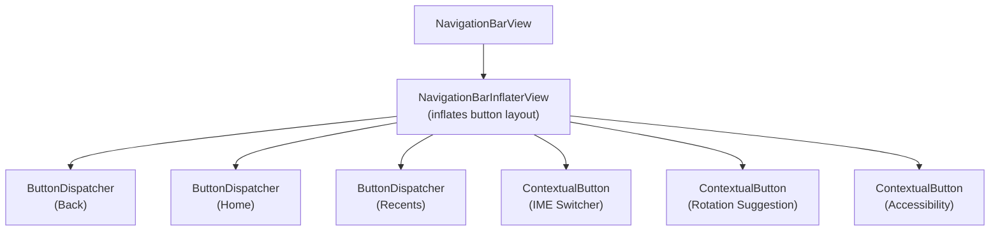

### 48.11.3  NavigationBarInflaterView

按钮布局由 `NavigationBarInflaterView` 解析的字符串规格定义：

```xml
<!-- frameworks/base/packages/SystemUI/res/values/config.xml -->
<!-- Default 3-button layout (config_navBarLayout): -->
<string name="config_navBarLayout" translatable="false">left[.5W],back[1WC];home;recent[1WC],right[.5W]</string>

<!-- 2-button / quickstep layout (config_navBarLayoutQuickstep): -->
<string name="config_navBarLayoutQuickstep" translatable="false">back[1.7WC];home;contextual[1.7WC]</string>

<!-- Gestural layout (config_navBarLayoutHandle): -->
<string name="config_navBarLayoutHandle" translatable="false">back[70AC];home_handle;ime_switcher[70AC]</string>
```

括号中的大小后缀使用 `W`（加权宽度）、`WC`（加权、居中）和 `AC`（绝对 dp、居中）；`NavigationBarInflaterView` 选择与当前导航模式匹配的规格。注意即使是手势规格也仍在 `home_handle` 周围声明了 `back` 和 `ime_switcher` 槽位。

这允许 OEM 通过覆盖自定义按钮顺序和大小。

### 48.11.4  手势导航

在手势模式下，导航栏被细长的主屏幕指示条取代。导航手势由 `EdgeBackGestureHandler` 处理：

```java
// frameworks/base/packages/SystemUI/src/com/android/systemui/navigationbar/
//   gestural/EdgeBackGestureHandler.java
public class EdgeBackGestureHandler {
    // Handles edge swipe gestures for back navigation
    // Manages gesture exclusion zones
    // Integrates with predictive back animation
}
```

手势系统：

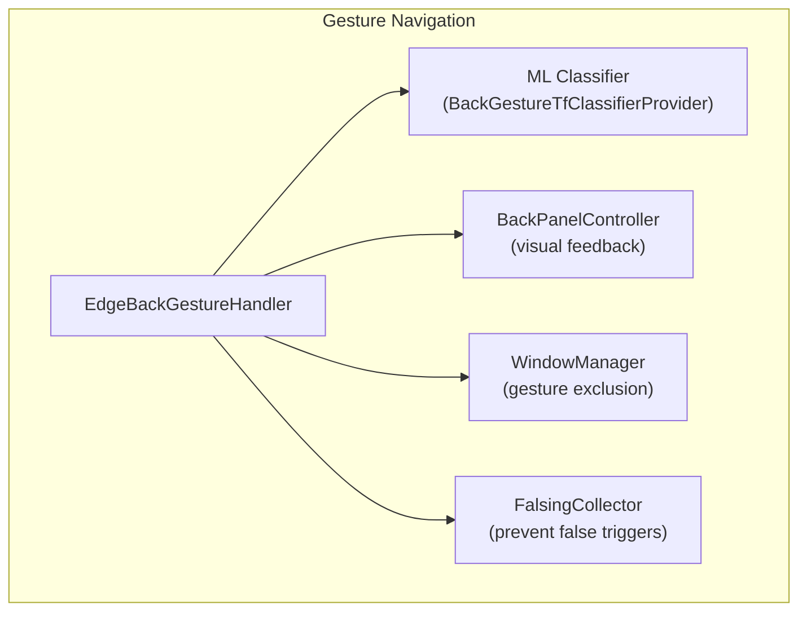

边缘返回手势检测：

1. 处理器为显示屏边缘注册输入监视器
2. 当触摸在边缘区域内（通常 24dp）开始时，开始跟踪
3. 一个 TensorFlow Lite 分类器评估手势是返回滑动还是应用手势（例如抽屉打开）
4. 如果被分类为返回，`BackPanelController` 显示可视化箭头
5. 手势作为 `BackEvent` 分发给焦点窗口
6. 如果启用了预测返回，应用可以响应动画

### 48.11.5  DisplayBackGestureHandler

为了支持多显示屏，`DisplayBackGestureHandler` 包装按显示屏的手势处理：

```kotlin
// frameworks/base/packages/SystemUI/src/com/android/systemui/navigationbar/
//   gestural/DisplayBackGestureHandler.kt
// Per-display back gesture handling
```

### 48.11.6  NavigationBarTransitions

`NavigationBarTransitions` 管理导航栏在模式之间的视觉过渡：

```
// Transition modes (shared/.../statusbar/phone/BarTransitions.java):
MODE_TRANSPARENT           -- Fully transparent
MODE_SEMI_TRANSPARENT      -- Partially transparent
MODE_TRANSLUCENT           -- Translucent with scrim
MODE_LIGHTS_OUT            -- Dimmed (immersive mode)
MODE_OPAQUE_DARK           -- Solid dark background
MODE_WARNING               -- Warning background
MODE_LIGHTS_OUT_TRANSPARENT -- Dimmed and transparent
MODE_OPAQUE_LIGHT          -- Solid light background
```

### 48.11.7  任务栏集成

在大屏幕上（平板、折叠屏），传统导航栏可能被 Launcher 提供的任务栏取代。SystemUI 中的 `TaskbarDelegate` 与 Launcher 提供的任务栏协调：

```java
// frameworks/base/packages/SystemUI/src/com/android/systemui/navigationbar/
//   TaskbarDelegate.java
public class TaskbarDelegate implements // ...
    // Routes navigation bar callbacks to the Launcher taskbar
    // Falls back to traditional nav bar when Launcher is unavailable
```

`enableTaskbarOnPhones` 功能标志控制任务栏是否也在手机形态上可用。

---

## 48.12  Monet / 动态颜色 / Material You

Android 12 引入了 **Material You**，这是一种设计语言，整个系统 UI 的配色方案都派生自用户的壁纸。背后的引擎称为 **Monet**。Monet 是一个色彩科学流水线。它从 `WallpaperColors` 中提取一个种子颜色，并通过 Material Color Utilities 库生成色调调色板。然后它将生成的颜色作为虚拟资源覆盖应用到每个软件包。

### 48.12.1  端到端流水线

```mermaid
graph TB
    subgraph "Wallpaper Stack"
        WP[WallpaperManager]
        WC["WallpaperColors<br/>Primary / Secondary / Tertiary<br/>+ allColors population map"]
    end

    subgraph "SystemUI -- ThemeOverlayController"
        TOC["ThemeOverlayController<br/>CoreStartable"]
        SEED["getSeedColor()<br/>ColorScheme.getSeedColors()"]
        CS_DARK["ColorScheme<br/>(dark)"]
        CS_LIGHT["ColorScheme<br/>(light)"]
        FAB["FabricatedOverlay x3<br/>accent / neutral / dynamic"]
    end

    subgraph "Monet Library"
        HCT["Hct.fromInt(seed)"]
        SCHEME["DynamicScheme<br/>TonalSpot / Vibrant /<br/>Expressive / Neutral / ..."]
        TP["TonalPalette<br/>13 shade stops<br/>0..1000"]
    end

    subgraph "OverlayManager"
        OM["OverlayManagerService"]
        RES["android.R.color.system_*"]
    end

    subgraph "All Apps"
        APPS["Apps read<br/>system_accent1_500,<br/>system_neutral1_100, ..."]
    end

    WP -->|"onColorsChanged"| TOC
    TOC --> SEED
    SEED --> HCT
    HCT --> SCHEME
    SCHEME --> TP
    TP --> CS_DARK
    TP --> CS_LIGHT
    CS_DARK --> FAB
    CS_LIGHT --> FAB
    TOC -->|"applyCurrentUserOverlays()"| OM
    FAB --> OM
    OM -->|"registerFabricatedOverlay"| RES
    RES --> APPS
```

### 48.12.2  颜色提取 —— 种子选择

`ColorScheme.getSeedColors()` 实现了 Monet 种子选择算法。给定 `WallpaperColors`（包含所有带人口统计数据的量化颜色），它：

1. **构建色相直方图** —— 360 个槽位，每个累积该色相颜色的比例。
2. **为每个颜色评分** —— 按色相比例（70%）与距 48.0 目标的彩度距离（`ACCENT1_CHROMA`）的加权组合。目标以上彩度项权重为 0.3，目标以下仅为 0.1。
3. **过滤低彩度颜色**（彩度 &lt; 5），它们会产生灰色主题。
4. **选择色相不同的种子** —— 从 90 度开始迭代降低最小色相距离直至 15 度，最多选取 4 个种子。
5. **回退到 `GOOGLE_BLUE`（0xFF1b6ef3）** —— 如果不存在合适的颜色。

```java
// frameworks/libs/systemui/monet/src/com/android/systemui/monet/ColorScheme.java
public static List<Integer> getSeedColors(WallpaperColors wallpaperColors, boolean filter) {
    // ...
    // Score: 0.7 * hueProportion + 0.3 * (chroma - 48)
    // Iterative hue-distance selection from 90° down to 15°
    // Fallback: GOOGLE_BLUE
}
```

对于量化人口为零的动态壁纸，该方法直接信任三种主色的顺序，仅按最小彩度过滤。

### 48.12.3  ColorScheme 类

`ColorScheme` 包装 Material Color Utilities 的 `DynamicScheme`，并暴露六个 `TonalPalette` 实例：

```java
// frameworks/libs/systemui/monet/src/com/android/systemui/monet/ColorScheme.java
@Deprecated  // migrating to MaterialDynamicColors
public class ColorScheme {
    private final TonalPalette mAccent1;   // primaryPalette
    private final TonalPalette mAccent2;   // secondaryPalette
    private final TonalPalette mAccent3;   // tertiaryPalette
    private final TonalPalette mNeutral1;  // neutralPalette
    private final TonalPalette mNeutral2;  // neutralVariantPalette
    private final TonalPalette mError;     // errorPalette
}
```

每个调色板通过 Material 库的 `TonalPalette` 从 `Hct`（色相-彩度-色调）色彩空间构建。该类根据 `ThemeStyle` 委托给特定样式的 `DynamicScheme`：

| ThemeStyle | DynamicScheme | 特征 |
|---|---|---|
| `TONAL_SPOT` | `SchemeTonalSpot` | 默认 —— 平衡、中等彩度 |
| `VIBRANT` | `SchemeVibrant` | 更高彩度以获得更鲜艳的颜色 |
| `EXPRESSIVE` | `SchemeExpressive` | 最大的色度多样性 |
| `SPRITZ` | `SchemeNeutral` | 低饱和、柔和 |
| `RAINBOW` | `SchemeRainbow` | 完整色相旋转 |
| `FRUIT_SALAD` | `SchemeFruitSalad` | 有趣的多色相 |
| `CONTENT` | `SchemeContent` | 忠实于源图像 |
| `MONOCHROMATIC` | `SchemeMonochrome` | 单色相灰度 |
| `CMF` | `SchemeCmf` | Android 17 新增 —— Colour-Material-Finish 方案 |
| `CLOCK` | `SchemeClock` | 用于锁屏时钟的自定义 SystemUI 方案 |
| `CLOCK_VIBRANT` | `SchemeClockVibrant` | 高彩度时钟变体 |

Android 17 还将 Material 库向前推进。`ColorScheme` 从种子 `Hct` 值*列表*（多种子支持）和 `SpecVersion`（`SPEC_2026` 是当前默认值）构建每个 `DynamicScheme`。较旧的规格使用单个种子。

### 48.12.4  TonalPalette 和色调档位

每个 `TonalPalette` 包含 13 个色调档位：

```java
// frameworks/libs/systemui/monet/src/com/android/systemui/monet/TonalPalette.java
public static final List<Integer> SHADE_KEYS =
    Arrays.asList(0, 10, 50, 100, 200, 300, 400, 500, 600, 700, 800, 900, 1000);
```

色调 0 是白色，色调 1000 是黑色。`getAtTone(shade)` 方法通过 `(1000 - shade) / 10` 将 0-1000 范围映射到 Material 库的 0-100 色调标度。这产生了 Android 的 `system_accent1_0` 到 `system_accent1_1000` 资源颜色。

### 48.12.5  ThemeOverlayController —— 编排者

`ThemeOverlayController` 是一个 `CoreStartable`，它将壁纸变化检测、配色方案生成和覆盖应用连接在一起：

```java
// frameworks/base/packages/SystemUI/src/com/android/systemui/theme/
//   ThemeOverlayController.java
@SysUISingleton
public class ThemeOverlayController implements CoreStartable, Dumpable {
    // Key fields:
    protected ColorScheme mColorScheme;
    protected int mMainWallpaperColor = Color.TRANSPARENT;
    private int mThemeStyle = ThemeStyle.TONAL_SPOT;
    private double mContrast = 0.0;
    private FabricatedOverlay mAccentOverlay;
    private FabricatedOverlay mNeutralOverlay;
    private FabricatedOverlay mDynamicOverlay;
}
```

**在 `start()` 中注册的监听器：**

| 监听器 | 用途 |
|---|---|
| `WallpaperManager.OnColorsChangedListener` | 检测所有用户的壁纸颜色变化 |
| `SecureSettings` ContentObserver | 检测 `THEME_CUSTOMIZATION_OVERLAY_PACKAGES` 变化 |
| `UserTracker.Callback` | 用户切换时重新评估 |
| `UiModeManager.ContrastChangeListener` | 对比度级别变化时重新评估 |
| `ACTION_PROFILE_ADDED` 的 `BroadcastReceiver` | 为新的托管资料应用覆盖 |
| `ACTION_WALLPAPER_CHANGED` 的 `BroadcastReceiver` | 重新启用颜色事件接受 |
| `KeyguardTransitionInteractor`（休眠状态） | 推迟处理直到熄屏 |

### 48.12.6  颜色事件推迟

该控制器使用推迟机制来避免使用过程中刺眼的颜色变化。当用户正在看屏幕时，控制器抑制颜色事件直到显示屏熄灭：

```mermaid
sequenceDiagram
    participant WM as WallpaperManager
    participant TOC as ThemeOverlayController
    participant KTI as KeyguardTransitionInteractor
    participant OMS as OverlayManagerService

    WM->>TOC: onColorsChanged(colors, userId)
    alt Screen is ON and acceptColorEvents=false
        TOC->>TOC: mDeferredWallpaperColors.put(userId, colors)
        Note over TOC: "Deferred until screen off"
    else acceptColorEvents=true
        TOC->>TOC: mAcceptColorEvents = false
        TOC->>TOC: handleWallpaperColors()
        TOC->>TOC: reevaluateSystemTheme()
    end

    KTI-->>TOC: device asleep - isFinishedInStateWhereWithScene = true
    TOC->>TOC: Process deferred colours
    TOC->>TOC: createOverlays(seedColor)
    TOC->>OMS: applyCurrentUserOverlays()
```

壁纸选择器在 `ACTION_WALLPAPER_CHANGED` 广播上设置 `EXTRA_FROM_FOREGROUND_APP=true`，这将 `mAcceptColorEvents` 重置为 `true` —— 因此用户发起的更改会立即应用。

### 48.12.7  覆盖的创建和应用

`createOverlays()` 方法生成三个虚拟覆盖：

```java
private void createOverlays(int color) {
    mDarkColorScheme = new ColorScheme(color, true /* isDark */, mThemeStyle, mContrast);
    mLightColorScheme = new ColorScheme(color, false /* isDark */, mThemeStyle, mContrast);
    mColorScheme = isNightMode() ? mDarkColorScheme : mLightColorScheme;

    mAccentOverlay = newFabricatedOverlay("accent");
    assignColorsToOverlay(mAccentOverlay, DynamicColors.getAllAccentPalette());

    mNeutralOverlay = newFabricatedOverlay("neutral");
    assignColorsToOverlay(mNeutralOverlay, DynamicColors.getAllNeutralPalette());

    mDynamicOverlay = newFabricatedOverlay("dynamic");
    assignColorsToOverlay(mDynamicOverlay, DynamicColors.getAllDynamicColorsMapped());
    assignColorsToOverlay(mDynamicOverlay, DynamicColors.getFixedColorsMapped());
    assignColorsToOverlay(mDynamicOverlay, DynamicColors.getCustomColorsMapped());
}
```

每个颜色 token 都获得 `_light` 和 `_dark` 资源变体：

```java
overlay.setResourceValue(prefix + "_light", TYPE_INT_COLOR_ARGB8,
    p.second.getArgb(mLightColorScheme.getMaterialScheme()), null);
overlay.setResourceValue(prefix + "_dark", TYPE_INT_COLOR_ARGB8,
    p.second.getArgb(mDarkColorScheme.getMaterialScheme()), null);
```

这适用于每个 token 列表，包括固定颜色（例如 `primaryFixed`）。它们走相同的代码路径并获得两个变体。固定颜色在两种方案中只是解析为相同的值。

### 48.12.8  DynamicColors token 映射

`DynamicColors` 类生成完整的颜色 token 集：

```java
// frameworks/libs/systemui/monet/src/com/android/systemui/monet/DynamicColors.java
public class DynamicColors {
    // Palette colours: accent1_0..1000, accent2_*, accent3_*, neutral1_*, neutral2_*
    public static List<Pair<String, DynamicColor>> getAllAccentPalette();
    public static List<Pair<String, DynamicColor>> getAllNeutralPalette();

    // Material Dynamic Colors: primary, onPrimary, primaryContainer, ...
    public static List<Pair<String, DynamicColor>> getAllDynamicColorsMapped();

    // Fixed colours: primaryFixed, secondaryFixed, ...
    public static List<Pair<String, DynamicColor>> getFixedColorsMapped();

    // Custom SystemUI-specific colours
    public static List<Pair<String, DynamicColor>> getCustomColorsMapped();
}
```

token 名称以 `android:color/system_` 为前缀映射到 Android 资源名称。例如，`accent1_500` 变为 `android:color/system_accent1_500`。

### 48.12.9  ThemeOverlayApplier —— 事务

`ThemeOverlayApplier` 获取虚拟覆盖并通过 `OverlayManager` 在单个原子事务中应用它们：

```java
// frameworks/base/packages/SystemUI/src/com/android/systemui/theme/
//   ThemeOverlayApplier.java
@SysUISingleton
public class ThemeOverlayApplier implements Dumpable {
    // Overlay categories applied in order:
    static final List<String> THEME_CATEGORIES = Lists.newArrayList(
        OVERLAY_CATEGORY_SYSTEM_PALETTE,    // Tonal palette
        OVERLAY_CATEGORY_ICON_LAUNCHER,     // Launcher icons
        OVERLAY_CATEGORY_SHAPE,             // Adaptive icon shape
        OVERLAY_CATEGORY_FONT,              // System font
        OVERLAY_CATEGORY_ACCENT_COLOR,      // Accent colour
        OVERLAY_CATEGORY_DYNAMIC_COLOR,     // Dynamic Material colours
        OVERLAY_CATEGORY_ICON_ANDROID,      // Framework icons
        OVERLAY_CATEGORY_ICON_SYSUI,        // SystemUI icons
        OVERLAY_CATEGORY_ICON_SETTINGS,     // Settings icons
        OVERLAY_CATEGORY_ICON_THEME_PICKER  // Theme picker icons
    );
}
```

该应用器首先禁用受影响类别中当前启用的所有覆盖。然后它注册新的虚拟覆盖并启用它们。所有这些都在单个 `OverlayManagerTransaction` 中完成，以尽量减少配置更改。

该应用器将 `SYSTEM_USER_CATEGORIES` 中的类别应用于当前用户和用户 0（系统用户）。这确保 SystemUI 和框架进程看到正确的颜色。

### 48.12.10  设置集成

主题自定义以 JSON 对象形式持久化在 `Settings.Secure.THEME_CUSTOMIZATION_OVERLAY_PACKAGES` 中：

```json
{
  "android.theme.customization.system_palette": "1b6ef3",
  "android.theme.customization.accent_color": "1b6ef3",
  "android.theme.customization.color_source": "home_wallpaper",
  "android.theme.customization.theme_style": "TONAL_SPOT",
  "android.theme.customization.color_both": "1",
  "_applied_timestamp": 1234567890
}
```

`ThemeOverlayController` 监视此设置并在每次更改时重新评估。当壁纸更改且未选择预设颜色时，它会自动更新此设置。它记录颜色来源和时间戳。

### 48.12.11  硬件默认颜色

自 Android 15 起，`hardwareColorStyles` 标志允许 OEM 在设置向导期间提供设备特定的默认调色板。在设备配置完成之前，控制器读取硬件默认值（种子颜色 + 样式 + 来源）。它将它们持久化为初始主题设置。

### 48.12.12  对比度支持

`ThemeOverlayController` 与 `UiModeManager.getContrast()` 集成以应用 Material Design 对比度级别。当用户在无障碍设置中更改显示对比度时，控制器收到回调，将新的对比度值传递给 `ColorScheme`，并重新生成覆盖：

```java
// In ColorScheme constructor:
new ColorScheme(seed, isDark, mThemeStyle, mContrast)
// mContrast flows through to DynamicScheme's contrastLevel parameter
```

这调整色调映射，使前景/背景颜色对保持所选的对比度比率。

### 48.12.13  关键源路径（Monet）

| 路径 | 说明 |
|---|---|
| `frameworks/libs/systemui/monet/src/com/android/systemui/monet/ColorScheme.java` | 种子选择、调色板生成 |
| `frameworks/libs/systemui/monet/src/com/android/systemui/monet/TonalPalette.java` | 13 档色调调色板包装器 |
| `frameworks/libs/systemui/monet/src/com/android/systemui/monet/DynamicColors.java` | token 到 DynamicColor 的映射 |
| `frameworks/libs/systemui/monet/src/com/android/systemui/monet/CustomDynamicColors.java` | SystemUI 特定的自定义 token |
| `frameworks/libs/systemui/monet/src/com/android/systemui/monet/Shades.java` | 传统色调生成 |
| `frameworks/libs/systemui/monet/src/com/android/systemui/monet/SchemeClock.java` | 时钟面配色方案 |
| `frameworks/libs/systemui/monet/src/com/android/systemui/monet/SchemeClockVibrant.java` | 鲜艳时钟变体 |
| `frameworks/base/packages/SystemUI/src/com/android/systemui/theme/ThemeOverlayController.java` | 编排者（CoreStartable） |
| `frameworks/base/packages/SystemUI/src/com/android/systemui/theme/ThemeOverlayApplier.java` | OverlayManager 事务 |
| `frameworks/base/packages/SystemUI/src/com/android/systemui/theme/ThemeModule.java` | Dagger 模块 |

---

## 48.13  Window Manager Shell 深入剖析

48.1.2 节提到 SystemUI 从一个名为 `WMComponent` 的独立 Dagger 子组件接收"shell 接口"——`Pip`、`SplitScreen`、`Bubbles`、`ShellTransitions`。该子组件及其背后这些接口的代码位于它们自己的 AOSP 库中：`frameworks/base/libs/WindowManager/Shell`，在整个代码库中称为 *WM Shell*（Java 包 `com.android.wm.shell`）。本节讲解 WM Shell 是什么、它如何与 SystemUI 集成，以及它的按功能子包如何映射到多窗口体验。用户在屏幕上看到这些体验。

### 48.13.1  Shell 是库，不是进程

"shell"这个名字可能引人误解。WM Shell **并不**作为独立进程运行——`ps` 中没有 `wm_shell` 条目。它是一个 Java 库（`frameworks/base/libs/WindowManager/Shell/Android.bp` 中的 `wm_shell-sources` filegroup），由 SystemUI APK 静态链接并加载到其自己的进程中。"shell"之名反映了它的概念角色：围绕 `WindowManagerService` 核心的一层壳，为窗口功能提供策略和 UI，而不使 `system_server` 臃肿。

这种划分有一个具体原因。多窗口 UX（PIP 窗口、分屏分隔条、自由窗口装饰、气泡徽章）需要渲染 View、监听手势并响应配置更改。这项工作自然属于前台 UI 进程，而不是系统服务器。SystemUI 已经是一个常驻前台进程，具备渲染、输入和 IPC 管道，因此 Shell 库搭便车于其上。在 Wear、TV 或 Auto 上，不同的 SystemUI 变体链接不同的形态因子 Shell 模块（见 48.13.7）。加载机制相同。

```mermaid
flowchart LR
    subgraph SystemServer["system_server process"]
        WMS["WindowManagerService<br/>(window tree, layout)"]
        ATM["ActivityTaskManagerService"]
        ITaskOrg["ITaskOrganizerController<br/>(Binder)"]
        WMS --> ITaskOrg
        ATM --> WMS
    end
    subgraph SystemUI["systemui process"]
        WMComponent["WMComponent<br/>(Dagger subcomponent)"]
        ShellInterface["ShellInterface<br/>(lifecycle facade)"]
        ShellTaskOrg["ShellTaskOrganizer<br/>(extends TaskOrganizer)"]
        Features["pip/<br/>splitscreen/<br/>bubbles/<br/>freeform/<br/>desktopmode/<br/>onehanded/<br/>recents/<br/>transition/<br/>startingsurface"]
        SysUI["SysUI components<br/>(WMShell adapter, QS, NotifShade, ...)"]
        WMComponent --> ShellInterface
        WMComponent --> ShellTaskOrg
        WMComponent --> Features
        ShellInterface --> SysUI
        Features --> SysUI
    end
    ShellTaskOrg <-.Binder.-> ITaskOrg
```

右侧进程加载整个 Shell 库；左侧进程拥有"存在哪些窗口"这一事实来源。它们通过一个 Binder 接口（`ITaskOrganizerController`）加上少数事件监听器通信。

### 48.13.2  WMComponent：Shell 的 Dagger 边界

WM Shell 通过 `WMComponent` Dagger 子组件向 SystemUI 暴露一个严格的接口面：

```java
// Source: frameworks/base/libs/WindowManager/Shell/src/com/android/wm/shell/
//   dagger/WMComponent.java:56
@WMSingleton
@Subcomponent(modules = {WMShellModule.class})
public interface WMComponent {

    default void init() {
        getShell().onInit();
    }

    // Interfaces provided to SysUI
    @WMSingleton ShellInterface getShell();
    @WMSingleton Optional<OneHanded> getOneHanded();
    @WMSingleton Optional<Pip> getPip();
    @WMSingleton Optional<SplitScreen> getSplitScreen();
    @WMSingleton Optional<Bubbles> getBubbles();
    @WMSingleton Optional<TaskViewFactory> getTaskViewFactory();
    @WMSingleton ShellTransitions getShellTransitions();
    @WMSingleton KeyguardTransitions getKeyguardTransitions();
    @WMSingleton Optional<StartingSurface> getStartingSurface();
    @WMSingleton Optional<DisplayAreaHelper> getDisplayAreaHelper();
    @WMSingleton Optional<RecentTasks> getRecentTasks();
    @WMSingleton Optional<BackAnimation> getBackAnimation();
    @WMSingleton Optional<DesktopMode> getDesktopMode();
    @WMSingleton Optional<AppZoomOut> getAppZoomOut();
    @WMSingleton Optional<AppHandles> getAppHandles();
    // ... plus a few injector methods for field injection
}
```

这个签名体现了两条设计规则：

- **几乎一切都是 `Optional<>`**。PIP 只存在于允许它的形态因子上。分屏在手表上不存在。`RecentTasks` 在手机上存在，但由 Launcher 消费，而不是 SystemUI 直接消费。将每个功能包装在 `Optional` 中，使同一套 SystemUI 代码库可以在手机、平板、TV、Wear 和 Auto 上构建。
- **组件列出的是 Dagger *模块*，而不是类**。`WMComponent` 安装 `WMShellModule`。TV 变体 `TvWMComponent` 改为安装 `TvWMShellModule`，后者绑定相同的 `Pip` / `Bubbles` / 等接口的不同实现。与 SystemUI 的接口契约完全相同；实现是特定于形态因子的。

`@WMSingleton` 作用域确保每个功能在每个 Shell 中获得恰好一个实例。`WMSingleton` 是定义在 `WMSingleton.java` 中的自定义 Dagger 作用域。它*不是* `@Singleton`。这是因为 SysUI 侧有自己的 `@SysUISingleton`，两个作用域需要在同一进程中共存而不冲突。

### 48.13.3  ShellInterface：生命周期门面

大多数功能位于各自的类型之后，但 Shell 整体通过一个名为 `ShellInterface` 的单一门面暴露：

```java
// Source: frameworks/base/libs/WindowManager/Shell/src/com/android/wm/shell/
//   sysui/ShellInterface.java:34
public interface ShellInterface {
    default void onInit() {}
    default void onConfigurationChanged(Configuration newConfiguration) {}
    default void onKeyguardVisibilityChanged(boolean visible, boolean occluded,
            boolean animatingDismiss) {}
    default void onKeyguardDismissAnimationFinished() {}
    default void onUserChanged(int newUserId, @NonNull Context userContext) {}
    default void onUserProfilesChanged(@NonNull List<UserInfo> profiles) {}
    default void addDisplayImeChangeListener(DisplayImeChangeListener listener,
            Executor executor) {}
    default void removeDisplayImeChangeListener(DisplayImeChangeListener listener) {}
    // ... handles shell commands, dumps, etc.
}
```

该接口镜像了 SystemUI 已经跟踪的生命周期事件（锁屏可见性、用户更改、配置更改、IME 位置）。实现是 `ShellController`，它将这些事件扇出到每个注册的 Shell 功能。

这种形态意味着 Shell 不轮询 SystemUI；SystemUI *推送*状态变化。SysUI 侧的适配器是 `com.android.systemui.wmshell.WMShell`，一个 `@SysUISingleton CoreStartable`。它的 `start()` 方法将每个 SystemUI 信号连接到相应的 `ShellInterface` 方法。信号来自 `KeyguardStateController`、`WakefulnessLifecycle`、`ConfigurationController`、`UserTracker` 和 `CommandQueue`。

### 48.13.4  ShellInit：有序初始化

由 Dagger 注入的库有一个已知的*构造*顺序（由依赖图驱动），但 Dagger 并不保证已知的*初始化*顺序。`ShellInit` 增加了这一保证：

```java
// Source: frameworks/base/libs/WindowManager/Shell/src/com/android/wm/shell/
//   sysui/ShellInit.java:62
public <T extends Object> void addInitCallback(Runnable r, T instance) {
    if (mHasInitialized) {
        if (Build.isDebuggable()) {
            // All callbacks must be added prior to the Shell being initialized
            throw new IllegalArgumentException("Can not add callback after init");
        }
        return;
    }
    final String className = instance.getClass().getSimpleName();
    mInitCallbacks.add(new Pair<>(className, r));
    ProtoLog.v(WM_SHELL_INIT, "Adding init callback for %s", className);
}

@VisibleForTesting
public void init() {
    ProtoLog.v(WM_SHELL_INIT, "Initializing Shell Components: %d", mInitCallbacks.size());
    SurfaceControl.setDebugUsageAfterRelease(true);
    // Init in order of registration
    for (int i = 0; i < mInitCallbacks.size(); i++) {
        final Pair<String, Runnable> info = mInitCallbacks.get(i);
        final long t1 = SystemClock.uptimeMillis();
        info.second.run();
        final long t2 = SystemClock.uptimeMillis();
        ProtoLog.v(WM_SHELL_INIT, "\t%s init took %dms", info.first, (t2 - t1));
    }
    mInitCallbacks.clear();
    mHasInitialized = true;
}
```

每个 Shell 组件在其构造函数中注入 `ShellInit` 并调用 `addInitCallback(this::onInit, this)`。因为 Dagger 以叶子优先构造图，回调自动按依赖顺序排列。当 `WMComponent.init()` 随后触发 `getShell().onInit()` 时，`ShellController` 调用 `ShellInit.init()`，后者按注册顺序清空队列。每个组件的初始化时间通过 ProtoLog 记录（见 48.13.10），因此 Shell 启动开销的回归会显示在跟踪中。

在调试构建中，在 `init()` 之后添加回调会抛出异常。这是一个有意的防护。延迟初始化通常意味着某功能通过主线程上的延迟注入构造，而不是在组件构建时。这将破坏依赖有序的启动。

### 48.13.5  ShellTaskOrganizer：通往 WindowManager 的桥梁

Shell 功能需要*观察*和*操作*系统的 task 树。PIP 需要知道 task 何时进入画中画模式。分屏需要将其分隔条下的任务重新挂接父级。过渡需要检查刚刚出现了什么。`system_server` 的 `ActivityTaskManagerService` 通过 `TaskOrganizer` API 暴露该观察面。`ShellTaskOrganizer` 是 Shell 对它的单一实现：

```java
// Source: frameworks/base/libs/WindowManager/Shell/src/com/android/wm/shell/
//   ShellTaskOrganizer.java:90
public class ShellTaskOrganizer extends TaskOrganizer {
    // ...
    public ShellTaskOrganizer(ShellInit shellInit, /* ... */) {
        super(/* ... */);
        // wait to register until Transitions is initialized
        shellInit.addInitCallback(this::onInit, this);
    }

    @Override
    public List<TaskAppearedInfo> registerOrganizer() {
        synchronized (mLock) {
            final List<TaskAppearedInfo> taskInfos = super.registerOrganizer();
            // ... rebroadcast current tasks to Shell listeners
            return taskInfos;
        }
    }
}
```

`TaskOrganizer` 是一个 AOSP 内部 Binder 接口。当 Shell 调用 `registerOrganizer()` 时，`system_server` 开始将 `onTaskAppeared` / `onTaskInfoChanged` / `onTaskVanished` 回调推送回 Shell 进程。Shell 维护单一注册——PIP 和分屏等功能不会各自注册自己的 `TaskOrganizer`；它们通过按功能的监听器接口订阅 `ShellTaskOrganizer`。这保持了 IPC 通道的狭窄，并避免了对同一窗口事件的重复通知。

### 48.13.6  按功能子包

Shell 将每个多窗口体验归入自己的包。下表将可见功能映射到其源位置：

| `com.android.wm.shell.` 下的包 | 用户看到什么 |
|---------------------------------------|---------------------|
| `pip/`, `pip2/` | 画中画视频窗口。`pip2` 是对传统 `pip` 包的分阶段重写。 |
| `splitscreen/` | 并排或上下分屏，带中央拖动分隔条。 |
| `bubbles/` | 浮动会话气泡 + 气泡栏。 |
| `freeform/` | 大屏幕上的可自由浮动、可调整大小的窗口。 |
| `desktopmode/` | 连接显示屏桌面，带多个可见应用窗口。 |
| `onehanded/` | 单手模式，将屏幕内容向下拖动。 |
| `back/` | 预测返回动画（系统与跨 activity）。 |
| `transition/` | 由 Shell 驱动的跨 activity / 跨 task 过渡。 |
| `startingsurface/` | 应用启动画面和快照起始窗口。 |
| `recents/` | 向 Launcher 提供的最近任务数据馈送。 |
| `windowdecor/` | 自由窗口和桌面窗口上的标题栏 / 手柄。 |
| `compatui/` | 重启以调整大小和长宽比不匹配按钮。 |
| `taskview/` | 可在另一个窗口内承载 task 的可复用视图 `TaskView`。 |
| `unfold/` | 折叠屏展开/折叠动画流水线。 |
| `activityembedding/` | Jetpack ActivityEmbedding 宿主侧支持。 |
| `keyguard/` | `KeyguardTransitions` —— Shell 在锁屏显示/隐藏动画中的一部分。 |
| `apptoweb/` | 用于嵌入式浏览的 Web 链接启动辅助。 |
| `appzoomout/` | 施加于顶级显示区域的挤压/回推缩小效果，由 SystemUI 的顶部窗口效果驱动。 |
| `hidedisplaycutout/` | 让应用选择将切口设为黑色条。 |
| `crashhandling/` | Shell 重启后的崩溃后窗口状态恢复：将主屏幕 task 恢复到顶部，并清理孤立的气泡/PIP task。 |

每个子包拥有自己的模型、自己的 UI（通常是渲染在 Shell 拥有的窗口内的 Compose 或 View 树），以及其在 `WMComponent` 中的公共接口。跨包交互通过 Shell 内部契约（`Transitions`、`ShellTaskOrganizer` 监听器、`ShellController` 回调）进行，而不是直接调用。使 `WMComponent` 接口面保持最小化的同一隔离纪律同样适用于库内部。

### 48.13.7  形态因子变体：WMShellModule 与 TvWMShellModule

同一个 `WMComponent` 接口由不同的 Dagger 模块满足，取决于构建目标。最大的模块是 `WMShellModule`（约手机/平板/折叠屏行为）。TV 构建替换为 `TvWMShellModule`。它包括 `TvPipModule`（TV 特定的 PIP），并用 TV 实现覆盖两个 provider：起始窗口类型算法（`TvStartingWindowTypeAlgorithm`）和分屏控制器（`TvSplitScreenController`）。它替换 TV 变体而不是禁用功能。TV 变体通过 `TvWMComponent` 选择：

```blueprint
// Conceptually:
//   WMComponent       includes WMShellModule
//   TvWMComponent     includes TvWMShellModule
```

SystemUI 构建根据其产品风味选择其中之一。Wear 和 Auto 以同样方式插入自己的变体。发布自定义形态因子（Chromebook、AR 头戴设备，……）的 OEM 通常添加另一个子组件，而不是分叉 Shell 库。这是因为每个变体仍然受益于进入基础 `WMShellModule` 的上游功能开发。

基础模块 `WMShellBaseModule` 在变体之间共享（手机/平板的 `WMShellModule` 更大）。它绑定传输层（`ShellExecutor`、`HandlerThread`、`Choreographer`）。它还绑定横切服务（`ShellInit`、`ShellController`、`ShellCommandHandler`、`ProtoLogController`、`ShellTaskOrganizer`、`Transitions`、`DisplayController`）。最后，它绑定一长串每个形态因子都需要的 provider（返回动画、拖放、启动画面、IME 位置跟踪）。

### 48.13.8  Transitions：从 Shell 驱动动画

Android 12 之前，跨 activity 动画由 `system_server` 驱动，动画硬编码在 `WindowManagerService` 中。现代模型将*动画实现*移入 Shell，而 `system_server` 仍然拥有启动动画的*决策*。管道位于 `com.android.wm.shell.transition.Transitions` 中：

- `system_server` 通过 Binder 调用 `ITransitionPlayer#onTransitionReady(...)`。这是 Shell 的 `Transitions` 向 `WindowOrganizer` 注册的播放器接口。该调用将一个 `TransitionInfo` 交给 Shell，其中列出了出现/消失/变化的窗口。（`IShellTransitions` 是 Shell 为注册远程过渡而*导出*的独立接口。）
- `Transitions` 按优先级顺序将信息与注册的 `TransitionHandler` 匹配。第一个接受的处理程序成为该过渡的动画器。
- 处理程序操作 `SurfaceControl`，并在 Shell 主线程上运行动画器。动画完成后，Shell 回调 `finishTransition(...)` 给 `system_server`，后者随后应用排队的 `WindowContainerTransaction`。

每个想要自定义动作的功能（PIP 进入/退出、分屏分隔条拖动、桌面窗口动画、预测返回）注册自己的 `TransitionHandler`。Shell 的中心 `DefaultTransitionHandler` 是当其他处理程序都不处理该过渡时的回退。

`ShellTransitions` 是 SystemUI 通过 `WMComponent`（`getShellTransitions()`）接收的小接口。它只暴露 SystemUI 需要的钩子（例如注册其自己的通知栏和锁屏动画处理程序）。它隐藏了内部实现。

### 48.13.9  TaskView：在 View 中嵌入 Task

`taskview/` 提供 Shell 最可复用的原语之一：一个在普通 `View` 内承载真实 task 的 `TaskView`。Bubbles 用它在展开的气泡窗口内渲染会话应用。设置面板用它承载嵌入式偏好设置。拥有适当权限的应用用它承载可信覆盖层。

内部，`TaskViewFactory` 是通过 `WMComponent` 暴露的 `@WMSingleton` 工厂。它创建 `TaskViewTaskController` 和一个基于 `SurfaceControl` 的 `TaskView` View，向 `ShellTaskOrganizer` 注册该 task，并在 task 出现时将其表面重新挂接到 View 之下。调整大小和边界更新通过 `WindowContainerTransaction` 流回 `system_server`。可见的结果是，单个子 View 显示另一个应用的 UI，而宿主进程仍然拥有该表面上方的输入分发。

### 48.13.10  ProtoLog：构建时日志转换

Shell 日志不同寻常：它不直接调用 `Log.d(TAG, ...)`。相反，每个日志调用都经过 `ProtoLog`，并且一个构建时工具（`protologtool`，定义在 `Android.bp` 中）将调用改写为紧凑的二进制形式。改写由 `ShellProtoLogGroup` 和 `wm_shell_protolog-groups` Java 库驱动。

```blueprint
// Source: frameworks/base/libs/WindowManager/Shell/Android.bp:54
java_genrule {
    name: "wm_shell_protolog_src",
    srcs: [
        ":protolog-impl",
        ":wm_shell-sources",
        ":wm_shell_protolog-groups",
    ],
    tools: [
        "protologtool",
        "soong_javac_wrapper",
    ],
    cmd: "$(location protologtool) transform-protolog-calls " +
        "--protolog-class com.android.internal.protolog.ProtoLog " +
        "--loggroups-class com.android.wm.shell.protolog.ShellProtoLogGroup " +
        "--loggroups-jar $(location :wm_shell_protolog-groups) " +
        "--javac-wrapper-path $(location soong_javac_wrapper) " +
        "--viewer-config-file-path /system_ext/etc/wmshell.protolog.pb " +
        "--output-srcjar $(out) " +
        "$(locations :wm_shell-sources)",
    out: ["wm_shell_protolog.srcjar"],
}
```

构建产生两个产物：

- 一个*改写后*的 Shell 源码 `.srcjar`，其中每个 `ProtoLog.v(GROUP, "format", args)` 变为一个数字 ID 加上其参数值，从运行时二进制中丢弃格式字符串。
- `wmshell.protolog.pb`（安装到 `/system_ext/etc/`），一个从日志 ID 反向映射到格式字符串的 protobuf 编码映射。

这种拆分使 Shell 日志语句保持廉价（一个 ID + 参数，热路径中无字符串操作）。它仍然让 `dumpsys` 和跟踪工具按需重建人类可读的行。第 58 章的跟踪部分详细涵盖 ProtoLog。对 Shell 而言，关键点是：在 Shell 源码中 `grep` 人类日志文本得到的是*转换前*的代码。这正是开发人员阅读和审查的代码。

### 48.13.11  Jetpack 部分（libs/WindowManager/Jetpack）

同级的 `frameworks/base/libs/WindowManager/Jetpack/` 目录*不是* Shell 库的一部分。它实现 `androidx.window.extensions.*` —— AndroidX `WindowManager` Jetpack 库的平台侧 —— 并作为设备上的 `androidx.window.extensions` 发布。依赖 `androidx.window` 的应用（折叠屏姿态 API、ActivityEmbedding、区域扩展）与该扩展 APK 通信，后者再与平台通信。

源：`frameworks/base/libs/WindowManager/Jetpack/src/androidx/window/extensions/`（`WindowExtensionsImpl.java`、`WindowExtensionsProvider.java`，加上 `area/`、`bubble/`、`embedding/`、`layout/`、`util/` 子包）。

这两个库共享父目录，因为它们共享一个领域（WindowManager 相邻的客户端代码），并且在历史上共享贡献者。除此之外它们是独立的。Shell 在 SystemUI 内运行。Jetpack 扩展库通过扩展发现 API 加载到每个应用的进程中。

### 48.13.12  SystemUI 如何回传给 Shell：WMShell CoreStartable

SystemUI 侧有一个单一适配器，将 SystemUI 的状态接入 Shell 的监听器：

```java
// Source: frameworks/base/packages/SystemUI/src/com/android/systemui/wmshell/
//   WMShell.java:99
@SysUISingleton
public final class WMShell implements CoreStartable, CommandQueue.Callbacks {
    // Injected: ShellInterface, Optional<Pip>, Optional<SplitScreen>,
    //           Optional<Bubbles>, Optional<OneHanded>, Optional<RecentTasks>,
    //           Optional<DesktopMode>, KeyguardStateController,
    //           WakefulnessLifecycle, ConfigurationController, ...
}
```

该类的 JavaDoc 说明了明确的排序规则：

> SysUI 应用启动
>  → SystemUIFactory 被初始化
>    → WMComponent 被创建
>    → SysUIComponent 被创建（注入了 WMComponents）
>  → SysUI 服务启动
>    → WMShell 启动并通过导出的 Shell 接口将 SysUI 与 Shell 组件绑定

换句话说：整个 Shell 图在任何 SysUI `CoreStartable` 运行*之前*被构建和初始化。到 `WMShell.start()` 触发时，每个 Shell 功能都已准备好接收回调。`WMShell` 随后订阅 SystemUI 生命周期控制器，并将每个更改转发到相应的 `ShellInterface` / 按功能方法（例如 `KeyguardStateController` → `mShellInterface.onKeyguardVisibilityChanged(...)`，`UserTracker` → `mShellInterface.onUserChanged(...)`）。

### 48.13.13  关键源文件参考（WM Shell）

| 文件 | 用途 |
|------|---------|
| `frameworks/base/libs/WindowManager/Shell/Android.bp` | 模块定义、ProtoLog genrule、形态因子变体 |
| `frameworks/base/libs/WindowManager/Shell/src/com/android/wm/shell/dagger/WMComponent.java` | Dagger 子组件 —— Shell 的公共接口面 |
| `frameworks/base/libs/WindowManager/Shell/src/com/android/wm/shell/dagger/WMShellBaseModule.java` | 跨形态因子基础绑定 |
| `frameworks/base/libs/WindowManager/Shell/src/com/android/wm/shell/dagger/WMShellModule.java` | 手机/平板形态因子绑定 |
| `frameworks/base/libs/WindowManager/Shell/src/com/android/wm/shell/dagger/TvWMShellModule.java` | TV 形态因子绑定 |
| `frameworks/base/libs/WindowManager/Shell/src/com/android/wm/shell/sysui/ShellInterface.java` | SysUI 调用的生命周期门面 |
| `frameworks/base/libs/WindowManager/Shell/src/com/android/wm/shell/sysui/ShellController.java` | `ShellInterface` 的实现 —— 事件扇出 |
| `frameworks/base/libs/WindowManager/Shell/src/com/android/wm/shell/sysui/ShellInit.java` | 有序初始化回调注册表 |
| `frameworks/base/libs/WindowManager/Shell/src/com/android/wm/shell/ShellTaskOrganizer.java` | 单一 `TaskOrganizer` 注册；按功能监听器 |
| `frameworks/base/libs/WindowManager/Shell/src/com/android/wm/shell/transition/Transitions.java` | 过渡处理程序注册表和分发 |
| `frameworks/base/libs/WindowManager/Shell/protolog/src/com/android/wm/shell/protolog/ShellProtoLogGroup.java` | ProtoLog 组枚举，构建时转换 |
| `frameworks/base/packages/SystemUI/src/com/android/systemui/wmshell/WMShell.java` | SysUI 侧适配器 `CoreStartable` |
| `frameworks/base/libs/WindowManager/Jetpack/src/androidx/window/extensions/` | Jetpack 窗口扩展 APK（独立于 Shell） |

---

## 48.14  低光 Dream 库

48.5 节和（稍后的）48.15 节提到了 `DREAMING` 锁屏状态。这是 `DreamService`（Android 的屏保机制，通常称为 *daydream*）显示在锁屏之上的时期。系统 dream 由 `DreamManagerService` 选择。

一些形态因子希望在低环境光下切换到*不同*的 dream。典型情况是智能显示屏、平板或 Hub 上昏暗的、仅显示时钟的屏保。在这些形态因子上，一个小库中介这一选择。该库位于 `frameworks/base/libs/dream/lowlight/`，打包为 `LowLightDreamLib`。它被链接到需要它的 SystemUI 变体中。

本节讲解该库的接口面、它实现的状态机，以及 SystemUI 如何从其 `lowlight/` 包中使用它。

### 48.14.1  库拥有什么、不拥有什么

`LowLightDreamLib` 有意保持范围狭窄。它拥有：

- 三值环境光枚举（`AMBIENT_LIGHT_MODE_UNKNOWN`、`AMBIENT_LIGHT_MODE_REGULAR`、`AMBIENT_LIGHT_MODE_LOW_LIGHT`）。
- "过渡协调器"，允许其他 SystemUI 组件在 dream 切换*之前*运行动画。
- Dagger 管道，让宿主 SystemUI 变体注入一个 `ComponentName?`，表示"天黑时显示的 dream"。

它**不**拥有：

- 环境光感应。宿主提供传感器读数。
- dream UI 本身。宿主（或 OEM 提供的 APK）实现通过 Dagger 接线的 `DreamService` 的 `ComponentName`。
- 基础"常规"dream。`DreamManagerService` 从按用户的 `Settings.Secure.SCREENSAVER_COMPONENTS` 列表中选择它——该库仅通过 `setSystemDreamComponent` 进行覆盖。

源码布局（约 8 个源文件）：

```
frameworks/base/libs/dream/lowlight/
  src/com/android/dream/lowlight/
    LowLightDreamManager.kt          -- core 3-mode state machine
    LowLightTransitionCoordinator.kt -- enter/exit animation hooks
    util/{KotlinUtils.kt, TruncatedInterpolator.kt}
    dagger/
      LowLightDreamModule.kt          -- @Provides for timeout, scope, dispatcher
      LowLightDreamComponent.kt       -- Subcomponent + Factory (host wires DreamManager + dream ComponentName)
      qualifiers/{Application.kt, Main.kt}
  res/values/config.xml               -- config_lowLightTransitionTimeoutMs (default 2000ms)
```

### 48.14.2  LowLightDreamManager：3 模式状态机

`LowLightDreamManager` 是唯一具有副作用的公共类。其状态是一个单一的 `@AmbientLightMode` int 加上一个进行中的过渡 `Job`：

```kotlin
// Source: frameworks/base/libs/dream/lowlight/src/com/android/dream/lowlight/
//   LowLightDreamManager.kt:42
class LowLightDreamManager @Inject constructor(
    @Application private val coroutineScope: CoroutineScope,
    private val dreamManager: DreamManager,
    private val lowLightTransitionCoordinator: LowLightTransitionCoordinator,
    @param:Named(LowLightDreamModule.LOW_LIGHT_DREAM_COMPONENT)
    private val lowLightDreamComponent: ComponentName?,
    @param:Named(LowLightDreamModule.LOW_LIGHT_TRANSITION_TIMEOUT_MS)
    private val lowLightTransitionTimeoutMs: Long
) {
    @RequiresPermission(Manifest.permission.WRITE_DREAM_STATE)
    fun setAmbientLightMode(@AmbientLightMode ambientLightMode: Int) {
        if (lowLightDreamComponent == null) {
            // ... log + bail. Host opted out of low-light dreams.
            return
        }
        if (mAmbientLightMode == ambientLightMode) return
        mAmbientLightMode = ambientLightMode
        val shouldEnterLowLight = mAmbientLightMode == AMBIENT_LIGHT_MODE_LOW_LIGHT

        mTransitionJob?.cancel()
        mTransitionJob = coroutineScope.launch {
            try {
                lowLightTransitionCoordinator.waitForLowLightTransitionAnimation(
                    timeout = mLowLightTransitionTimeout,
                    entering = shouldEnterLowLight
                )
            } catch (ex: TimeoutCancellationException) {
                Log.e(TAG, "timed out while waiting for low light animation", ex)
            } catch (ex: CancellationException) {
                Log.w(TAG, "low light transition animation cancelled")
                // Catch the cancellation so that we still set the system dream component if the
                // animation is cancelled, such as by a user tapping to wake as the transition to
                // low light happens.
            }
            dreamManager.setSystemDreamComponent(
                if (shouldEnterLowLight) lowLightDreamComponent else null
            )
        }
    }
}
```

三个值得注意的细节：

- **`lowLightDreamComponent == null` 是退出选项。** 不需要此功能的宿主将限定的 `ComponentName?` 绑定到 `null`。管理器随后短路每个调用，而从不触碰 `DreamManager`。同一套 SystemUI Dagger 图就是这样在有低光 dream 和没有低光 dream 的产品上都能编译的。
- **一次只能有一个进行中的过渡。** 每次调用都会取消之前的 `mTransitionJob`。如果环境传感器在阈值附近震荡，每个稳定区间内你*最多*得到一个动画 + `setSystemDreamComponent`。
- **动画是被等待的，不是竞速的。** `coroutineScope.launch` 在协调器的 `waitForLowLightTransitionAnimation` 上阻塞，然后再切换 dream。切换发生在宿主进入/退出动画器完成*之后*。因此 SystemUI Compose 动画先运行，然后 dream 切入。`CancellationException` 分支有意继续执行，仍然调用 `setSystemDreamComponent`。因此"过渡期间唤醒"仍会使系统处于一致状态，而不是半过渡状态。

`WRITE_DREAM_STATE` 注解反映了底层的 `DreamManagerService` 权限。只有系统 UID 和持有 `android.permission.WRITE_DREAM_STATE`（签名或系统权限）的应用才能调用此方法。这与 SystemUI 进程特征相符。

### 48.14.3  LowLightTransitionCoordinator：让宿主先动画

裸 dream 切换看起来很突兀。屏幕会从常规 dream（或锁屏壁纸）直接切到低光 dream，没有淡入淡出。`LowLightTransitionCoordinator` 让宿主注册*一个*进入监听器和*一个*退出监听器，每个都返回一个 `Animator?`：

```kotlin
// Source: frameworks/base/libs/dream/lowlight/src/com/android/dream/lowlight/
//   LowLightTransitionCoordinator.kt:30
@Singleton
class LowLightTransitionCoordinator @Inject constructor() {
    interface LowLightEnterListener {
        fun onBeforeEnterLowLight(): Animator?
    }
    interface LowLightExitListener {
        fun onBeforeExitLowLight(): Animator?
    }
    // ... setLowLightEnterListener(...) / setLowLightExitListener(...)

    suspend fun waitForLowLightTransitionAnimation(timeout: Duration, entering: Boolean) =
        suspendCoroutineWithTimeout(timeout) { continuation ->
            // ... call listener, listen on Animator.onAnimationEnd, resume continuation
        }
}
```

两个设计选择很突出：

- **每个方向一个监听器。** 协调器有意*不*支持订阅者列表。跨多个子系统堆叠动画会以 dream 切换无法恢复的方式竞速。宿主选择一个编排器（通常是拥有低光界面的 SystemUI 变体中的 `lowlightclock` UI 控制器）。该编排器负责在内部扇出。
- **返回 `null` 表示"无动画，立即切换"。** 当监听器返回 null 时，辅助函数同步恢复续体，因此无操作宿主仍然获得 dream 切入，而没有额外的事件循环跳转。

2000ms 的默认超时（`config_lowLightTransitionTimeoutMs`）是一个下限。卡住的动画无法永远阻塞 dream。`setAmbientLightMode` 记录超时并继续切换。

### 48.14.4  宿主侧的 Dagger 接线

想要该库的 SystemUI 变体从其顶层组件注入一个 `LowLightDreamComponent.Factory`。变体还提供该库无法知道的两个值：系统 `DreamManager` 和 dream `ComponentName?`。

```kotlin
// Source: frameworks/base/libs/dream/lowlight/src/com/android/dream/lowlight/
//   dagger/LowLightDreamComponent.kt:25
@Subcomponent(modules = [LowLightDreamModule::class])
interface LowLightDreamComponent {
    @Subcomponent.Factory
    interface Factory {
        fun create(
            @BindsInstance dreamManager: DreamManager,
            @Named(LowLightDreamModule.LOW_LIGHT_DREAM_COMPONENT)
            @BindsInstance lowLightDreamComponent: ComponentName?
        ): LowLightDreamComponent
    }
}
```

`LowLightDreamModule` 然后从 `Context` 资源提供其余内容：

```kotlin
// Source: frameworks/base/libs/dream/lowlight/src/com/android/dream/lowlight/
//   dagger/LowLightDreamModule.kt:35
@Module
object LowLightDreamModule {
    @Provides @Named(LOW_LIGHT_TRANSITION_TIMEOUT_MS)
    fun providesLowLightTransitionTimeout(context: Context): Long =
        context.resources.getInteger(R.integer.config_lowLightTransitionTimeoutMs).toLong()

    @Provides @Main
    fun providesMainDispatcher(): CoroutineDispatcher = Dispatchers.Main.immediate

    @Provides @Application
    fun providesApplicationScope(@Main dispatcher: CoroutineDispatcher): CoroutineScope =
        CoroutineScope(dispatcher)
}
```

`@Named(LOW_LIGHT_DREAM_COMPONENT)` 是关键的接缝。定义低光 dream 的产品将绑定指向例如 `com.example.systemui/.LowLightDream`。不想要低光 dream 的产品绑定 `null`，而 `LowLightDreamManager.setAmbientLightMode` 变为无操作。无论哪种方式，该库都编译到每个 SystemUI 风味中。

### 48.14.5  消费路径：SystemUI 的 lowlight 包

上游 AOSP 中该库的消费者位于 SystemUI 的 `com.android.systemui.lowlight` 包中。`AmbientLightModeMonitor` 订阅设备光线传感器和一个防抖算法，将环境光分类为 `AMBIENT_LIGHT_MODE_LIGHT`、`AMBIENT_LIGHT_MODE_DARK` 或 `AMBIENT_LIGHT_MODE_UNDECIDED`。`LowLightBehaviorCoreStartable` 是将该信号与锁屏、 dock 和电源状态联系在一起的 `CoreStartable`。当低光行为要求低光 dream 时，`LowLightClockDreamAction`（在 `lowlightclock/` 中）调用 `lowLightDreamManager.setAmbientLightMode(mode)`。该库处理其余部分：

```mermaid
flowchart LR
    Sensor["Light sensor<br/>(AmbientLightModeMonitor)"]
    Monitor["LowLightBehaviorCoreStartable<br/>(SystemUI lowlight/)"]
    Mgr["LowLightDreamManager<br/>(LowLightDreamLib)"]
    Coord["LowLightTransitionCoordinator"]
    HostUI["Host enter/exit listener<br/>(lowlightclock UI)"]
    DM["DreamManager<br/>(DreamManagerService)"]
    Dream["Low-light DreamService<br/>(per-product APK)"]

    Sensor --> Monitor
    Monitor --> Mgr
    Mgr --> Coord
    Coord --> HostUI
    HostUI --> Coord
    Mgr --> DM
    DM --> Dream
```

注意宿主 UI 位于协调器*之后*——库调用宿主，而不是反过来。这让 SystemUI 监听器纯粹是反应式的（它从不问"天黑了吗？"），并将状态集中在管理器中。

### 48.14.6  在更广泛的 Dream 故事中的位置

该库有意对低光 dream 显示*什么*保持不可知。实践中这些是极简的、昏暗的、基本静态的界面——常见模式是低亮度时钟、专辑封面屏保或日期/天气面板。在 `DreamService` 级别切换而不是在一个 dream 内部切换的意义在于组合。常规 dream 可以是用户选择的第三方屏保。低光 dream 是一个系统控制的、高对比度的、低功耗预算的界面。该库是一座桥梁，让 SystemUI 变体可以在它们之间切换，而不必强迫每个 dream 实现自己的变暗模式。

关于更广泛的屏保 / `DreamService` 架构（DreamManagerService、`DreamOverlayService`、doze + AOD 交互），参见第 48 章 §48.5（锁屏）和 §48.15（锁屏深入剖析）。这些部分追踪锁屏状态机中的 `DREAMING` 状态。

### 48.14.7  关键源文件参考（LowLightDreamLib）

| 文件 | 用途 |
|------|---------|
| `frameworks/base/libs/dream/lowlight/Android.bp` | `LowLightDreamLib` `android_library` 模块，声明 Dagger 编译器插件 |
| `frameworks/base/libs/dream/lowlight/src/com/android/dream/lowlight/LowLightDreamManager.kt` | 3 模式状态机，调用 `DreamManager.setSystemDreamComponent` |
| `frameworks/base/libs/dream/lowlight/src/com/android/dream/lowlight/LowLightTransitionCoordinator.kt` | 进入/退出 `Animator?` 监听器对，协程 `await` 辅助函数 |
| `frameworks/base/libs/dream/lowlight/src/com/android/dream/lowlight/dagger/LowLightDreamModule.kt` | 超时、主调度器、应用程序协程作用域的 `@Provides` |
| `frameworks/base/libs/dream/lowlight/src/com/android/dream/lowlight/dagger/LowLightDreamComponent.kt` | Dagger `@Subcomponent`，宿主将 `DreamManager` + `ComponentName?` 接线到其中 |
| `frameworks/base/libs/dream/lowlight/res/values/config.xml` | `config_lowLightTransitionTimeoutMs`（默认 2000ms） |
| `frameworks/base/packages/SystemUI/src/com/android/systemui/lowlight/AmbientLightModeMonitor.kt` | 将环境光分类为亮/暗/未定模式的 SystemUI 光线传感器监视器 |
| `frameworks/base/packages/SystemUI/src/com/android/systemui/lowlight/LowLightBehaviorCoreStartable.kt` | 驱动低光行为的 `CoreStartable`；`lowlightclock/LowLightClockDreamAction.kt` 调用 `setAmbientLightMode` |

---

## 48.15  锁屏深入剖析

48.5 节介绍了锁屏架构。本节更详细地探讨内部状态机、生物识别解锁模式、bouncer 流程、AOD 过渡以及 MVI 现代化。它使用完整的锁屏源码树。

### 48.15.1  锁屏状态机

锁屏子系统本质上是一个状态机。`KeyguardState` 枚举定义了所有可能的状态：

```kotlin
// frameworks/base/packages/SystemUI/src/com/android/systemui/keyguard/shared/model/
//   KeyguardState.kt
enum class KeyguardState {
    OFF,              // Display completely off, sensors disabled
    DOZING,           // Low-power mode, some sensors active
    DREAMING,         // Third-party dream (screensaver) showing
    AOD,              // Always-On Display showing minimal UI
    ALTERNATE_BOUNCER,// Biometric credential prompt (e.g. UDFPS)
    PRIMARY_BOUNCER,  // PIN / Pattern / Password prompt
    LOCKSCREEN,       // Full lock screen UI, device awake
    GLANCEABLE_HUB,   // Widget surface accessible from lock screen
    GONE,             // Keyguard dismissed, user in launcher/app
    UNDEFINED,        // Scene framework: any non-lockscreen scene
    OCCLUDED,         // Activity showing over keyguard
}
```

完整的状态转换图：

```mermaid
stateDiagram-v2
    [*] --> OFF

    OFF --> DOZING : Screen off,<br/>sensors enabled
    OFF --> AOD : Screen off,<br/>AOD enabled

    DOZING --> AOD : AOD trigger
    DOZING --> LOCKSCREEN : Wake gesture<br/>lift/tap/power
    DOZING --> GONE : Fingerprint<br/>WAKE_AND_UNLOCK

    AOD --> LOCKSCREEN : Wake gesture
    AOD --> DOZING : AOD disabled
    AOD --> GONE : Fingerprint<br/>WAKE_AND_UNLOCK

    LOCKSCREEN --> PRIMARY_BOUNCER : Security challenge
    LOCKSCREEN --> ALTERNATE_BOUNCER : UDFPS prompt
    LOCKSCREEN --> AOD : Screen off timeout
    LOCKSCREEN --> DOZING : Screen off, no AOD
    LOCKSCREEN --> GONE : Swipe unlock<br/>no security
    LOCKSCREEN --> GLANCEABLE_HUB : Right edge swipe
    LOCKSCREEN --> OCCLUDED : showWhenLocked<br/>Activity
    LOCKSCREEN --> DREAMING : Dream starts

    PRIMARY_BOUNCER --> GONE : Correct credentials
    PRIMARY_BOUNCER --> LOCKSCREEN : Back / cancel

    ALTERNATE_BOUNCER --> GONE : Biometric match
    ALTERNATE_BOUNCER --> PRIMARY_BOUNCER : Fallback to PIN

    GLANCEABLE_HUB --> LOCKSCREEN : Left edge swipe
    GLANCEABLE_HUB --> PRIMARY_BOUNCER : Swipe up

    OCCLUDED --> LOCKSCREEN : Activity finishes
    OCCLUDED --> GONE : Unlock while occluded

    DREAMING --> LOCKSCREEN : Wake from dream
    DREAMING --> DOZING : Dream to doze

    GONE --> OFF : Screen off
    GONE --> DOZING : Screen off,<br/>sensors enabled
    GONE --> LOCKSCREEN : Lock timeout
```

标记为 `@Deprecated` 的状态（`DREAMING`、`PRIMARY_BOUNCER`、`GLANCEABLE_HUB`、`GONE`、`OCCLUDED`）正被 Scene Container 框架取代。该框架将它们映射为场景和覆盖层。它通过 `SceneTransitionLayout`（48.16 节）管理过渡。

### 48.15.2  唤醒与睡眠状态分类

`KeyguardState` 伴随对象为电源管理对每个状态进行分类：

| 状态 | 唤醒 | 睡眠 |
|---|:---:|:---:|
| OFF | | X |
| DOZING | | X |
| DREAMING | | X |
| AOD | | X |
| ALTERNATE_BOUNCER | X | |
| PRIMARY_BOUNCER | X | |
| LOCKSCREEN | X | |
| GLANCEABLE_HUB | X | |
| GONE | X | |
| OCCLUDED | X | |
| UNDEFINED | X | |

该分类驱动 `ThemeOverlayController` 的延迟颜色逻辑（48.12.6 节）和各种依赖电源的行为。

### 48.15.3  KeyguardTransitionInteractor

`KeyguardTransitionInteractor` 是观察和驱动锁屏状态之间过渡的主要 API：

```kotlin
// frameworks/base/packages/SystemUI/src/com/android/systemui/keyguard/domain/interactor/
//   KeyguardTransitionInteractor.kt
@SysUISingleton
class KeyguardTransitionInteractor @Inject constructor(
    @Application val scope: CoroutineScope,
    private val repository: KeyguardTransitionRepository,
    private val sceneInteractor: SceneInteractor,
    private val powerInteractor: PowerInteractor,
) {
    // Core observable:
    val transitionState: StateFlow<TransitionStep>

    // Per-state transition value (0.0 to 1.0):
    // Caches a MutableSharedFlow per KeyguardState for efficiency
    private val transitionValueCache = mutableMapOf<KeyguardState, MutableSharedFlow<Float>>()
}
```

每个 `TransitionStep` 包含：

- `from: KeyguardState` —— 源状态
- `to: KeyguardState` —— 目标状态
- `value: Float` —— 从 0.0（开始）到 1.0（完成）的进度
- `transitionState: TransitionState` —— STARTED、RUNNING、CANCELED、FINISHED

按边流允许特定的交互器只观察它们关心的过渡：

```kotlin
// Observe only LOCKSCREEN -> AOD transitions
keyguardTransitionInteractor.transition(Edge.create(from = LOCKSCREEN, to = AOD))
    .collect { step -> /* animate based on step.value */ }
```

### 48.15.4  过渡交互器层次结构

每个状态到状态的过渡都有一个专用的交互器：

```
FromAodTransitionInteractor
FromAlternateBouncerTransitionInteractor
FromDozingTransitionInteractor
FromDreamingTransitionInteractor
FromGlanceableHubTransitionInteractor
FromGoneTransitionInteractor
FromLockscreenTransitionInteractor
FromOccludedTransitionInteractor
FromPrimaryBouncerTransitionInteractor
```

这些交互器监听信号（电源状态变化、生物识别事件、用户手势），并在仓库上调用 `startTransition()` 以推动状态机前进。`StartKeyguardTransitionModule` 将它们全部接线到 Dagger 中。

### 48.15.5  KeyguardViewMediator 内部机制

`KeyguardViewMediator` 仍然是 `system_server` 与 SystemUI 锁屏之间的桥梁。关键内部机制：

**锁屏超时调度：**

当屏幕关闭时，`onStartedGoingToSleep()` 通过 `doKeyguardLocked()` 安排超时。锁屏延迟取决于：

- `Settings.Secure.LOCK_SCREEN_LOCK_AFTER_TIMEOUT` —— 用户配置的延迟
- 信任代理状态（Smart Lock 可能推迟锁定）
- 设备是否被手动锁定（电源键 = 立即锁定）

**SIM PIN 管理：**

当 SIM 需要 PIN 时，`KeyguardViewMediator` 进入一个特殊流程：

1. `onSimStateChanged()` 检测到 `SIM_LOCKED` 状态
2. `doKeyguardLocked()` 强制锁屏显示，无论其他设置如何
3. bouncer 呈现 SIM PIN 输入（与设备 PIN 不同）
4. 验证成功后，如果设备安全性也未完成，锁屏可能消失或保持

**遮挡处理：**

声明了 `showWhenLocked=true` 的活动可以显示在锁屏之上。协调器通过 `setOccluded(boolean)` 跟踪遮挡，并与 `StatusBarKeyguardViewManager` 协调以隐藏/显示底层锁屏视图。

### 48.15.6  生物识别解锁模式

`BiometricUnlockInteractor` 将来自 `BiometricUnlockController` 的整数模式常量转换为类型化的 `BiometricUnlockMode` 枚举：

```kotlin
// frameworks/base/packages/SystemUI/src/com/android/systemui/keyguard/shared/model/
//   BiometricUnlockModel.kt
enum class BiometricUnlockMode {
    NONE,                       // No auth occurred, no wake needed
    NONE_UNLOCKED,              // Auth succeeded, no wake needed
    WAKE_AND_DISMISS,           // Fingerprint while screen off -> wake + dismiss
    WAKE_AND_DISMISS_PULSING,   // Fingerprint during AOD pulse -> fade out + dismiss
    SHOW_BOUNCER,               // Wake but play normal dismiss / show bouncer
    ONLY_WAKE,                  // Wake device, keyguard was not showing, no auth
    ONLY_WAKE_UNLOCKED,         // Wake device, auth succeeded
    DISMISS,                    // Unlock while keyguard occluded or showing
    DISMISS_BOUNCER,            // Biometric while bouncer visible -> dismiss
    WAKE_AND_DISMISS_FROM_DREAM // Fingerprint while dreaming -> wake + dismiss
}
```

Android 17 将旧的 `WAKE_AND_UNLOCK*` / `UNLOCK_COLLAPSING` 常量重命名为 `WAKE_AND_DISMISS*` / `DISMISS` 系列。它还将不需要身份验证的情况拆分为 `*_UNLOCKED` 变体。因此，该枚举现在有十个值，而不是之前的八个。该模式决定锁屏状态转换：

```mermaid
graph TD
    FP["Fingerprint<br/>Acquired"]
    FACE["Face<br/>Acquired"]

    FP --> |"Screen OFF"| WAU["WAKE_AND_DISMISS<br/>OFF/DOZING -> GONE"]
    FP --> |"AOD Pulsing"| WAUP["WAKE_AND_DISMISS_PULSING<br/>AOD -> GONE"]
    FP --> |"Screen ON,<br/>Keyguard visible"| UC["DISMISS<br/>LOCKSCREEN -> GONE"]
    FP --> |"Dreaming"| WAUD["WAKE_AND_DISMISS_FROM_DREAM<br/>DREAMING -> GONE"]
    FP --> |"Bouncer visible"| DB["DISMISS_BOUNCER<br/>PRIMARY_BOUNCER -> GONE"]

    FACE --> |"Bypass enabled"| UC
    FACE --> |"Bypass disabled,<br/>on lockscreen"| OW["ONLY_WAKE<br/>Stay on LOCKSCREEN"]
    FACE --> |"Bouncer visible"| DB
    FACE --> |"Failed"| SB["SHOW_BOUNCER<br/>LOCKSCREEN -> PRIMARY_BOUNCER"]
```

`BiometricUnlockModel` 将模式与 `BiometricUnlockSource`（FINGERPRINT_SENSOR、FACE_SENSOR 等）配对，用于审计和动画目的。

### 48.15.7  Bouncer 流程详情

bouncer 子系统使用 MVI 模式，具有清晰的数据/领域/UI 分离：

```
frameworks/base/packages/SystemUI/src/com/android/systemui/bouncer/
  data/repository/
    BouncerRepositoryModule.kt        -- Dagger bindings
    KeyguardBouncerRepository.kt      -- State repository
  domain/interactor/
    BouncerInteractor.kt              -- Main interactor
    PrimaryBouncerInteractor.kt       -- PIN/pattern/password
    AlternateBouncerInteractor.kt     -- UDFPS/biometric
  domain/startable/
    BouncerStartable.kt               -- CoreStartable wiring
  ui/
    BouncerView.kt                    -- UI-layer abstraction / delegate holder
```

Compose bouncer UI 本身位于 `compose/features/src/com/android/systemui/bouncer/ui/composable/` 下（`BouncerContent.kt`、`PinBouncer.kt`，……）。

**主 Bouncer 生命周期：**

```mermaid
sequenceDiagram
    participant User
    participant KTI as KeyguardTransitionInteractor
    participant PBI as PrimaryBouncerInteractor
    participant KBR as KeyguardBouncerRepository
    participant BV as BouncerView
    participant BI as BouncerInteractor
    participant AI as AuthenticationInteractor

    User->>KTI: Swipe up on lockscreen
    KTI->>KTI: startTransition(LOCKSCREEN -> PRIMARY_BOUNCER)
    KTI->>PBI: Transition triggers bouncer show
    PBI->>KBR: setPrimaryShow(true)
    KBR-->>BV: primaryBouncerShow flow emits true
    BV->>BV: Inflate PIN/Pattern/Password input

    User->>BV: Enter PIN "1234"
    BV->>BI: authenticate(pin)
    BI->>AI: authenticate(pin)
    Note over AI: checkCredential via<br/>LockPatternUtils / LockPatternChecker

    alt Correct
        AI-->>BI: Success
        PBI->>KBR: setPrimaryShow(false)
        PBI->>KTI: startTransition(PRIMARY_BOUNCER -> GONE)
    else Wrong
        AI-->>BI: Failure
        BI->>BV: showError("Wrong PIN")
        Note over BV: Lockout after N failures
    end
```

**备用 Bouncer（UDFPS）：**

当设备具有屏下指纹传感器时，备用 bouncer 呈现一个指纹图标覆盖层：

1. `AlternateBouncerInteractor` 检测设备支持 UDFPS
2. 在锁屏唤醒时，它触发 `LOCKSCREEN -> ALTERNATE_BOUNCER`
3. UDFPS 覆盖层在传感器位置显示一个指纹图标
4. 如果用户点击传感器且指纹匹配 -> `GONE`
5. 如果用户想要 PIN -> `ALTERNATE_BOUNCER -> PRIMARY_BOUNCER`

### 48.15.8  AOD 过渡流水线

息屏显示过渡涉及多个协调的子系统：

```mermaid
sequenceDiagram
    participant PM as PowerManager
    participant KVM as KeyguardViewMediator
    participant DSH as DozeServiceHost
    participant DSC as DozeScrimController
    participant KTI as KeyguardTransitionInteractor
    participant FADE as FromAodTransitionInteractor

    PM->>KVM: onStartedGoingToSleep()
    KVM->>KTI: startTransition(LOCKSCREEN -> AOD)
    KTI-->>DSC: transitionValue(AOD): 0.0 -> 1.0
    DSC->>DSC: Animate scrim alpha

    Note over DSH: Doze service starts
    DSH->>DSH: Set pulse parameters

    PM->>KVM: onFinishedGoingToSleep()
    Note over DSC: AOD UI fully visible

    Note over DSH: Notification arrives
    DSH->>KTI: startTransition(AOD -> LOCKSCREEN)
    KTI-->>FADE: FromAodTransitionInteractor triggers
    FADE->>DSC: Animate scrim to transparent
    FADE->>DSC: Wake screen
```

Doze 参数控制 AOD 行为：

- **DozeParameters.getAlwaysOn()** —— 是否启用 AOD
- **DozeParameters.shouldControlScreenOff()** —— 动画还是立即熄灭
- **DozeParameters.getPulseVisibleDuration()** —— 通知脉冲显示多长时间

### 48.15.9  KeyguardRepository —— 数据层

`KeyguardRepository` 接口集中所有锁屏状态：

```
frameworks/base/packages/SystemUI/src/com/android/systemui/keyguard/data/repository/
  KeyguardRepository.kt               -- Core keyguard state
  BiometricSettingsRepository.kt       -- Biometric configuration
  DevicePostureRepository.kt           -- Fold state
  KeyguardBypassRepository.kt          -- Face bypass settings
  KeyguardClockRepository.kt           -- Clock face selection
  KeyguardOcclusionRepository.kt       -- Activity occlusion
  KeyguardQuickAffordanceRepository.kt -- Bottom shortcuts
  KeyguardSmartspaceRepository.kt      -- Smart suggestions
  KeyguardSurfaceBehindRepository.kt   -- Behind-keyguard surface
  InWindowLauncherUnlockAnimationRepository.kt -- Unlock animation
```

`KeyguardRepository` 暴露的关键流：

- `isKeyguardShowing: StateFlow<Boolean>`
- `isKeyguardOccluded: StateFlow<Boolean>`
- `biometricUnlockState: StateFlow<BiometricUnlockModel>`
- `isDozing: StateFlow<Boolean>`
- `isDreaming: StateFlow<Boolean>`

（唤醒状态不在此仓库中：`wakefulness: StateFlow<WakefulnessModel>` 流由 `power/` 包中的 `PowerRepository` / `PowerInteractor` 暴露。）

### 48.15.10  Scene Container 迁移

锁屏正在向 Scene Container 架构进行重大迁移。在此模型下：

```mermaid
graph TB
    subgraph "Legacy (being replaced)"
        KVM_L["KeyguardViewMediator<br/>manages show/hide"]
        SBKVM_L["StatusBarKeyguardViewManager<br/>bridges to views"]
        CS_L["CentralSurfacesImpl<br/>owns the window"]
    end

    subgraph "Scene Container (new)"
        STL["SceneTransitionLayout<br/>Compose-based scene manager"]
        LS["Lockscreen Scene"]
        BS["Bouncer Overlay"]
        GS["Gone Scene"]
        OS["Occluded Scene"]
        CHS["Communal Scene"]
    end

    KVM_L -.->|"migrating to"| STL
    SBKVM_L -.->|"migrating to"| LS
    CS_L -.->|"migrating to"| STL
```

`KeyguardState.mapToSceneContainerContent()` 将传统状态映射到场景/覆盖键（返回一个 `ContentKey?`）：

- `LOCKSCREEN`、`AOD`、`DOZING`、`OFF`、`ALTERNATE_BOUNCER` 都映射到 `Scenes.Lockscreen`
- `PRIMARY_BOUNCER` 映射到 `Overlays.Bouncer`
- `GONE` 映射到 `Scenes.Gone`
- `OCCLUDED` 映射到 `Scenes.Occluded`
- `GLANCEABLE_HUB` 映射到 `Scenes.Communal`
- `DREAMING` 映射到 `Scenes.Dream`
- `UNDEFINED` 映射到 `null`（无 scene 框架内容）

`SceneContainerFlag` 控制新路径是否激活，并对迁移后将不存在的状态标注 `@Deprecated`。48.16 节端到端地介绍 Scene 框架。

### 48.15.11  关键源路径（锁屏）

| 路径 | 说明 |
|---|---|
| `frameworks/base/packages/SystemUI/src/com/android/systemui/keyguard/KeyguardViewMediator.java` | 中央协调器 |
| `frameworks/base/packages/SystemUI/src/com/android/systemui/keyguard/KeyguardService.java` | system_server 桥梁 |
| `frameworks/base/packages/SystemUI/src/com/android/systemui/keyguard/KeyguardLifecyclesDispatcher.java` | 生命周期事件 |
| `frameworks/base/packages/SystemUI/src/com/android/systemui/keyguard/KeyguardUnlockAnimationController.kt` | 解锁动画 |
| `frameworks/base/packages/SystemUI/src/com/android/systemui/keyguard/shared/model/KeyguardState.kt` | 状态枚举（11 个状态） |
| `frameworks/base/packages/SystemUI/src/com/android/systemui/keyguard/shared/model/BiometricUnlockModel.kt` | 解锁模式枚举（10 种模式） |

| `frameworks/base/packages/SystemUI/src/com/android/systemui/keyguard/shared/model/TransitionStep.kt` | 过渡进度 |
| `frameworks/base/packages/SystemUI/src/com/android/systemui/keyguard/shared/model/TransitionState.kt` | 过渡状态（STARTED/RUNNING/CANCELED/FINISHED） |
| `frameworks/base/packages/SystemUI/src/com/android/systemui/keyguard/shared/model/DozeStateModel.kt` | Doze 状态 |
| `frameworks/base/packages/SystemUI/src/com/android/systemui/keyguard/shared/model/DozeTransitionModel.kt` | Doze 过渡 |
| `frameworks/base/packages/SystemUI/src/com/android/systemui/keyguard/data/repository/KeyguardRepository.kt` | 核心状态仓库 |
| `frameworks/base/packages/SystemUI/src/com/android/systemui/keyguard/data/repository/KeyguardTransitionRepository.kt` | 过渡状态仓库 |
| `frameworks/base/packages/SystemUI/src/com/android/systemui/keyguard/data/repository/BiometricSettingsRepository.kt` | 生物识别配置仓库 |
| `frameworks/base/packages/SystemUI/src/com/android/systemui/keyguard/data/repository/KeyguardOcclusionRepository.kt` | 遮挡跟踪仓库 |
| `frameworks/base/packages/SystemUI/src/com/android/systemui/keyguard/domain/interactor/KeyguardInteractor.kt` | 通用锁屏交互器 |
| `frameworks/base/packages/SystemUI/src/com/android/systemui/keyguard/domain/interactor/KeyguardTransitionInteractor.kt` | 过渡观察 |
| `frameworks/base/packages/SystemUI/src/com/android/systemui/keyguard/domain/interactor/BiometricUnlockInteractor.kt` | 生物识别模式映射 |
| `frameworks/base/packages/SystemUI/src/com/android/systemui/keyguard/domain/interactor/KeyguardDismissInteractor.kt` | 消除处理 |
| `frameworks/base/packages/SystemUI/src/com/android/systemui/keyguard/domain/interactor/KeyguardEnabledInteractor.kt` | 启用/禁用 |
| `frameworks/base/packages/SystemUI/src/com/android/systemui/keyguard/domain/interactor/From*TransitionInteractor.kt` | 按状态的过渡驱动器 |
| `frameworks/base/packages/SystemUI/src/com/android/systemui/keyguard/domain/interactor/TrustInteractor.kt` | Smart Lock 交互器 |
| `frameworks/base/packages/SystemUI/src/com/android/systemui/keyguard/domain/interactor/DozeInteractor.kt` | Doze 管理 |
| `frameworks/base/packages/SystemUI/src/com/android/systemui/keyguard/KeyguardViewConfigurator.kt` | 视图设置 |
| `frameworks/base/packages/SystemUI/src/com/android/systemui/bouncer/data/repository/KeyguardBouncerRepository.kt` | Bouncer 仓库 |
| `frameworks/base/packages/SystemUI/src/com/android/systemui/bouncer/domain/interactor/PrimaryBouncerInteractor.kt` | 主 bouncer 交互器 |
| `frameworks/base/packages/SystemUI/src/com/android/systemui/bouncer/domain/interactor/AlternateBouncerInteractor.kt` | 备用 bouncer 交互器 |
| `frameworks/base/packages/SystemUI/src/com/android/systemui/bouncer/ui/BouncerView.kt` | Bouncer 视图 |

---

## 48.16  Scene 框架（Flexiglass）

前面几节提到一个取代传统控制器的"Scene Container"或"scene"路径。本节将这些线索汇总起来。Scene 框架——内部代号为 **flexiglass**——是 Android 17 SystemUI 中最大的单一架构变更。它将 `NotificationPanelViewController`、`CentralSurfacesImpl` 和 `StatusBarKeyguardViewManager` 中手写的滑动、展开和状态机代码替换为声明式的 Compose 模型。在此模型中，锁屏、通知栏、快捷设置和 bouncer 成为由 `SceneTransitionLayout` 布局的*场景*和*覆盖层*。

### 48.16.1  场景、覆盖层和场景族

该框架区分两种内容。**场景**填满容器，并且与其他场景互斥；**覆盖层**显示在当前场景*之上*。两者都由 scene pod 中定义的字符串键标识：

```kotlin
// frameworks/base/packages/SystemUI/pods/scene/src/api/shared/model/Scenes.kt
object Scenes {
    val Communal: SceneKey       // Glanceable hub (locked + docked)
    val Dream: SceneKey          // A dream (screensaver) is showing
    val Gone: SceneKey           // No scene content (unlocked, in an app)
    val Lockscreen: SceneKey     // The lock screen
    val Occluded: SceneKey       // showWhenLocked activity over keyguard
    val QuickSettings: SceneKey  // Full QS (accordion second pull)
    val Shade: SceneKey          // Notifications + QQS (single/split shade)
}
```

```kotlin
// frameworks/base/packages/SystemUI/src/com/android/systemui/scene/shared/model/
//   Overlays.kt
object Overlays {
    val Bouncer: OverlayKey             // PIN / pattern / password challenge
    val NotificationsShade: OverlayKey  // Dual-shade notifications panel
    val QuickActions: OverlayKey        // Anchored QuickActionPanels (large screen)
    val QuickSettingsShade: OverlayKey  // Dual-shade quick settings panel
}
```

`Shade`/`QuickSettings` *场景*与 `NotificationsShade`/`QuickSettingsShade` *覆盖层*之间的拆分编码了三种通知栏布局：

| 通知栏布局 | 使用位置 | 场景/覆盖层模型 |
|---|---|---|
| 单栏（手风琴） | 手机 | `Shade` 场景（QQS），然后是 `QuickSettings` 场景（完整 QS） |
| 分栏 | 大屏 / 展开的折叠屏 | `Shade` 场景，通知和 QS 并排 |
| 双栏 | 大屏（双通知栏标志） | `NotificationsShade` 和 `QuickSettingsShade` 覆盖层，独立显示 |

尽管名为 `Scenes.Gone`，它并不是一个可见的场景。它表示不存在任何 scene 框架内容（设备已解锁，应用拥有屏幕）。场景*族*（例如 `SceneFamilies.Home`）是别名，解析器根据设备状态将其映射到具体场景。

### 48.16.2  Scene Container 配置

`SceneContainerConfig` 声明容器支持哪些场景和覆盖层、其初始场景，以及用于滑动手势的导航距离：

```kotlin
// frameworks/base/packages/SystemUI/src/com/android/systemui/scene/shared/model/
//   SceneContainerConfig.kt
data class SceneContainerConfig(
    val sceneKeys: List<SceneKey>,
    val initialSceneKey: SceneKey,
    val overlayKeys: List<OverlayKey> = emptyList(),
    val navigationDistances: Map<SceneKey, Int>,
)
```

`SceneContainerFrameworkModule` 提供具体配置。场景集合为 `Gone`、`Communal`、`Dream`、`Occluded`、`Lockscreen`，以及（不在双通知栏模式时）`QuickSettings` 和 `Shade`。覆盖层集合为 `NotificationsShade`、`QuickSettingsShade`、`Bouncer`，以及——当 `StatusBarPopupChips` 标志开启时——`QuickActions`。

### 48.16.3  SceneTransitionLayout：Compose 引擎

渲染引擎位于独立 Compose 库中：`frameworks/base/packages/SystemUI/compose/scene/`（Java 包 `com.android.compose.animation.scene`）。其公共入口点是 `SceneTransitionLayout` 可组合项：

```kotlin
// frameworks/base/packages/SystemUI/compose/scene/src/com/android/compose/
//   animation/scene/SceneTransitionLayout.kt
@Composable
fun SceneTransitionLayout(
    state: SceneTransitionLayoutState,
    modifier: Modifier = Modifier,
    // ...
    builder: SceneTransitionLayoutScope.() -> Unit,
)
```

该库独立于 SystemUI。它拥有滑动手势检测（`SwipeToScene`、`DraggableHandler`、`SwipeAnimation`）和预测返回处理器（`PredictiveBackHandler`）。它还拥有跨场景的共享元素动画（`SharedElement`、`MovableElement`）以及描述如何从一个场景动画到另一个场景的过渡 DSL（`TransitionDsl`）。SystemUI 自己的场景可组合项（`SceneContainer`、`GoneScene`、`Overlay`、`SceneContainerTransitions`）位于 `compose/features/src/com/android/systemui/scene/ui/composable/` 中。

```mermaid
graph TD
    subgraph "compose/scene library (com.android.compose.animation.scene)"
        STL["SceneTransitionLayout"]
        STLS["SceneTransitionLayoutState"]
        SWIPE["SwipeToScene / DraggableHandler"]
        BACK["PredictiveBackHandler"]
        SHARED["SharedElement / MovableElement"]
    end
    subgraph "SystemUI scene domain"
        SI["SceneInteractor"]
        SCS["SceneContainerStartable"]
        CFG["SceneContainerConfig"]
    end
    subgraph "SystemUI scene composables (compose/features)"
        SC["SceneContainer"]
        SCVM["SceneContainerViewModel"]
    end
    SI --> STLS
    STLS --> STL
    STL --> SWIPE
    STL --> BACK
    STL --> SHARED
    CFG --> SI
    SCVM --> SC
    SC --> STL
    SCS --> SI
```

### 48.16.4  SceneInteractor：状态所有者

`SceneInteractor` 是当前场景和活动过渡状态的 `@SysUISingleton` 事实来源：

```kotlin
// frameworks/base/packages/SystemUI/src/com/android/systemui/scene/domain/interactor/
//   SceneInteractor.kt
@SysUISingleton
class SceneInteractor @Inject constructor(/* ... */) {
    val currentScene: StateFlow<SceneKey>
    val transitionState: TransitionState  // Compose snapshot state

    @Deprecated("Prefer the more performant non-Flow version.")
    val transitionStateFlow: StateFlow<ObservableTransitionState>

    fun changeScene(toScene: SceneKey, loggingReason: String, /* ... */)
    fun snapToScene(toScene: SceneKey, loggingReason: String)
    fun showOverlay(overlay: OverlayKey, loggingReason: String, /* ... */)
    fun hideOverlay(overlay: OverlayKey, loggingReason: String, /* ... */)
}
```

`changeScene` 请求*动画*过渡；`snapToScene` 立即跳转。`transitionState` 是一个 Compose 快照状态 `TransitionState`。已弃用的 `transitionStateFlow` 伴随项暴露一个 `ObservableTransitionState`，它要么是 `Idle(scene)`，要么是 `Transition(fromScene, toScene, progress)`。`compose/scene` 库消费相同的形态来驱动其动画。将当前场景作为 Compose `State`（`currentSceneAsState`）读取使可组合项随场景变化而重组。

### 48.16.5  SceneContainerStartable：连接传统状态

scene 框架无法一次替换所有内容。`SceneContainerStartable` 是在迁移进行期间保持传统世界与 scene 世界同步的 `CoreStartable`：

```kotlin
// frameworks/base/packages/SystemUI/src/com/android/systemui/scene/domain/startable/
//   SceneContainerStartable.kt
@SysUISingleton
class SceneContainerStartable @Inject constructor(/* ... */) : CoreStartable {
    override fun start() {
        if (SceneContainerFlag.isEnabled) {
            hydrateVisibility()
            automaticallySwitchScenes()
            hydrateSystemUiState()
            hydrateWindowController()
            hydrateInteractionState()
            hydrateBackStack()
            // ...
        }
    }
}
```

每个 `hydrate*` 方法接线一片状态：

- **`automaticallySwitchScenes`** 根据设备信号驱动场景变化——例如，解锁成功切换到 `Scenes.Gone`，锁定返回 `Scenes.Lockscreen`，dream 启动 `Scenes.Dream`。
- **`hydrateVisibility`** 控制 scene 窗口根视图是否可见。
- **`hydrateSystemUiState`** 将活跃场景镜像到 Launcher 和其他消费者仍然读取的传统 `SysUiState` 标志。
- **`hydrateWindowController`** 保持 `NotificationShadeWindowController` 窗口参数（可聚焦性、可触摸性）与活跃场景一致。
- **`hydrateBackStack`** 将场景返回栈提供给预测返回处理器，以便系统返回手势在场景之间正确移动。

这就是 `KeyguardState.mapToSceneContainerContent()`（48.15.10 节）将传统锁屏状态机转换为场景/覆盖键的方式。锁屏过渡交互器仍然运行，`SceneContainerStartable` 将它们的输出投射到 scene 容器上。

### 48.16.6  SceneContainerFlag 门控

整个框架由 `SceneContainerFlag` 门控，后者由 `scene_container` aconfig 标志（`aconfig/systemui.aconfig`）支撑：

```kotlin
// frameworks/base/packages/SystemUI/src/com/android/systemui/scene/shared/flag/
//   SceneContainerFlag.kt
object SceneContainerFlag {
    @JvmField var isEnabledOnVariant: Boolean = true

    @JvmStatic
    inline val isEnabled
        get() = sceneContainer() && isEnabledOnVariant
}
```

`isEnabledOnVariant` 让 SystemUI 变体（例如 Automotive）在 `Application` 构造函数中尽早设置，强制关闭该框架，无论 aconfig 标志如何。在整个代码库中，重构后的调用点使用 `SceneContainerFlag.isUnexpectedlyInLegacyMode()` / `assertInLegacyMode()` 防护，因此传统路径和新路径不能静默地同时运行。该标志在手机型号上尚未默认启用。因此本章前面记录的传统控制器在 Android 17 中仍然是发布代码路径。scene 框架在标志之后先行运行。

### 48.16.7  关键源路径（Scene 框架）

| 路径 | 说明 |
|---|---|
| `frameworks/base/packages/SystemUI/pods/scene/src/api/shared/model/Scenes.kt` | 场景键定义（移入 scene pod） |
| `frameworks/base/packages/SystemUI/src/com/android/systemui/scene/shared/model/Overlays.kt` | 覆盖键定义 |
| `frameworks/base/packages/SystemUI/src/com/android/systemui/scene/shared/model/SceneContainerConfig.kt` | 容器配置 |
| `frameworks/base/packages/SystemUI/src/com/android/systemui/scene/shared/flag/SceneContainerFlag.kt` | 功能门控 |
| `frameworks/base/packages/SystemUI/src/com/android/systemui/scene/domain/interactor/SceneInteractor.kt` | 场景/过渡状态所有者 |
| `frameworks/base/packages/SystemUI/src/com/android/systemui/scene/domain/startable/SceneContainerStartable.kt` | 传统/scene 状态桥梁 |
| `frameworks/base/packages/SystemUI/src/com/android/systemui/scene/SceneContainerFrameworkModule.kt` | 提供 `SceneContainerConfig` 的 Dagger 模块 |
| `frameworks/base/packages/SystemUI/compose/scene/src/com/android/compose/animation/scene/SceneTransitionLayout.kt` | Compose scene 引擎 |
| `frameworks/base/packages/SystemUI/compose/features/src/com/android/systemui/scene/ui/composable/SceneContainer.kt` | SystemUI scene 容器可组合项 |
| `frameworks/base/packages/SystemUI/src/com/android/systemui/shade/shared/flag/DualShadeFlag.kt` | 双通知栏功能门控 |

---

## 48.17  动手实践：添加自定义 QS 磁贴

本动手练习演示如何向 SystemUI 添加一个新的内置快捷设置磁贴。我们将创建一个"Caffeine"磁贴，使屏幕保持唤醒。

### 48.17.1  第 1 步：创建磁贴类

在 tiles 目录中创建新文件：

```
frameworks/base/packages/SystemUI/src/com/android/systemui/qs/tiles/
  CaffeineTile.java
```

```java
package com.android.systemui.qs.tiles;

import android.content.Intent;
import android.os.Handler;
import android.os.Looper;
import android.os.PowerManager;
import android.service.quicksettings.Tile;

import androidx.annotation.Nullable;

import com.android.internal.logging.MetricsLogger;
import com.android.systemui.animation.Expandable;
import com.android.systemui.dagger.qualifiers.Background;
import com.android.systemui.dagger.qualifiers.Main;
import com.android.systemui.plugins.ActivityStarter;
import com.android.systemui.plugins.FalsingManager;
import com.android.systemui.plugins.qs.QSTile.BooleanState;
import com.android.systemui.plugins.statusbar.StatusBarStateController;
import com.android.systemui.qs.QSHost;
import com.android.systemui.qs.QsEventLogger;
import com.android.systemui.qs.logging.QSLogger;
import com.android.systemui.qs.tileimpl.QSTileImpl;
import com.android.systemui.res.R;

import javax.inject.Inject;

/**
 * Quick settings tile: Caffeine (keep screen awake).
 *
 * This tile acquires a partial wake lock to prevent the screen from
 * turning off.  The wake lock is released when the tile is toggled
 * off or when SystemUI is destroyed.
 */
public class CaffeineTile extends QSTileImpl<BooleanState> {

    public static final String TILE_SPEC = "caffeine";

    private final PowerManager.WakeLock mWakeLock;
    private boolean mIsActive = false;

    @Inject
    public CaffeineTile(
            QSHost host,
            QsEventLogger uiEventLogger,
            @Background Looper backgroundLooper,
            @Main Handler mainHandler,
            FalsingManager falsingManager,
            MetricsLogger metricsLogger,
            StatusBarStateController statusBarStateController,
            ActivityStarter activityStarter,
            QSLogger qsLogger,
            PowerManager powerManager) {
        super(host, uiEventLogger, backgroundLooper, mainHandler,
                falsingManager, metricsLogger, statusBarStateController,
                activityStarter, qsLogger);
        mWakeLock = powerManager.newWakeLock(
                PowerManager.FULL_WAKE_LOCK, "SystemUI:CaffeineTile");
    }

    @Override
    public BooleanState newTileState() {
        BooleanState state = new BooleanState();
        state.handlesLongClick = false;
        return state;
    }

    @Override
    protected void handleClick(@Nullable Expandable expandable) {
        mIsActive = !mIsActive;
        if (mIsActive) {
            mWakeLock.acquire();
        } else {
            if (mWakeLock.isHeld()) {
                mWakeLock.release();
            }
        }
        refreshState();
    }

    @Override
    protected void handleUpdateState(BooleanState state, Object arg) {
        state.value = mIsActive;
        state.state = mIsActive ? Tile.STATE_ACTIVE : Tile.STATE_INACTIVE;
        state.label = "Caffeine";
        state.contentDescription = "Keep screen awake";
        // Use an appropriate icon resource. Modern tiles call the
        // QSTileImpl.maybeLoadResourceIcon(int) helper:
        state.icon = maybeLoadResourceIcon(mIsActive
                ? R.drawable.ic_caffeine_on   // You must add these drawables
                : R.drawable.ic_caffeine_off);
    }

    @Override
    public int getMetricsCategory() {
        return 0; // Custom category or use MetricsEvent.QS_CUSTOM
    }

    @Override
    public Intent getLongClickIntent() {
        return new Intent(android.provider.Settings.ACTION_DISPLAY_SETTINGS);
    }

    @Override
    public CharSequence getTileLabel() {
        return "Caffeine";
    }

    @Override
    protected void handleDestroy() {
        super.handleDestroy();
        if (mWakeLock.isHeld()) {
            mWakeLock.release();
        }
    }
}
```

### 48.17.2  第 2 步：在 QS 工厂中注册磁贴

`QSFactoryImpl` 不再对磁贴规格使用 `switch`。相反，它持有一个 `Map<String, Provider<QSTileImpl<?>>> mTileMap` 并查找规格：

```java
// frameworks/base/packages/SystemUI/src/com/android/systemui/qs/tileimpl/
//   QSFactoryImpl.java
protected QSTileImpl createTileInternal(String tileSpec) {
    if (mTileMap.containsKey(tileSpec)) {
        return mTileMap.get(tileSpec).get();
    }
    // ... custom-tile handling
}
```

要注册你的磁贴，你只需通过 Dagger multibinding 将其贡献到该映射中。在相关的磁贴 Dagger 模块（例如 `QSModule` / `QSHostModule`）中：

```java
@Binds
@IntoMap
@StringKey(CaffeineTile.TILE_SPEC)
abstract QSTileImpl<?> bindCaffeineTile(CaffeineTile tile);
```

无需修改工厂。该映射由每个 `@IntoMap` 绑定组装而成。

### 48.17.3  第 3 步：添加 Drawable 资源

将图标资源添加到 SystemUI 的 `res/` 目录：

```
frameworks/base/packages/SystemUI/res/drawable/
  ic_caffeine_on.xml    -- Filled coffee cup icon (active state)
  ic_caffeine_off.xml   -- Outlined coffee cup icon (inactive state)
```

对于矢量 drawable，使用 24x24dp 并带有适当的着色。

### 48.17.4  第 4 步：添加到默认磁贴列表（可选）

要将磁贴包含在默认 QS 面板中，请修改字符串资源：

```xml
<!-- frameworks/base/packages/SystemUI/res/values/config.xml -->
<string name="quick_settings_tiles_default" translatable="false">
    wifi,cell,battery,flashlight,rotation,caffeine
</string>
```

### 48.17.5  第 5 步：构建和测试

```bash
# Build SystemUI
m SystemUI

# Push to device
adb root
adb remount
adb sync system
adb shell stop
adb shell start

# Or for faster iteration, restart just SystemUI:
adb shell killall com.android.systemui
```

验证磁贴出现在 QS 编辑器中。如果未在默认列表中，请打开 QS 编辑模式（铅笔图标），并将"Caffeine"磁贴拖入活动区域。

### 48.17.6  第 6 步：验证功能

```bash
# Check wake lock state
adb shell dumpsys power | grep -i "wake lock"

# Toggle the tile and verify the wake lock appears/disappears
# Look for: "SystemUI:CaffeineTile" in the output
```

### 48.17.7  QS 磁贴的架构总结

```mermaid
graph TD
    subgraph "Your Tile"
        CT["CaffeineTile"]
        CT -->|"extends"| QTI["QSTileImpl<BooleanState>"]
        QTI -->|"implements"| QST["QSTile (plugin interface)"]
    end
    subgraph "QS Framework"
        QSH["QSHost"]
        QSF["QSFactory"]
        QSP["Compose QS panel<br/>(pods/qs/panels)"]
        QTV["QSTileViewModelAdapter"]
    end
    subgraph "Dagger"
        MOD["Dagger Module<br/>@IntoMap @StringKey"]
    end
    MOD -->|"provides"| CT
    QSH -->|"creates via"| QSF
    QSF -->|"instantiates"| CT
    CT -->|"state updates"| QTV
    QTV -->|"displayed in"| QSP
```

### 48.17.8  测试磁贴

对于单元测试，请遵循 SystemUI 测试目录中的现有模式：

```
frameworks/base/packages/SystemUI/multivalentTests/
```

创建一个测试类，该类：

1. Mock `PowerManager` 和 `PowerManager.WakeLock`
2. 调用 `handleClick()` 并验证唤醒锁的获取
3. 再次调用 `handleClick()` 并验证唤醒锁的释放
4. 调用 `handleDestroy()` 并验证清理

```java
@SmallTest
@RunWith(AndroidTestingRunner.class)
public class CaffeineTileTest extends SysuiTestCase {
    private CaffeineTile mTile;
    @Mock private PowerManager mPowerManager;
    @Mock private PowerManager.WakeLock mWakeLock;

    @Before
    public void setUp() {
        MockitoAnnotations.initMocks(this);
        when(mPowerManager.newWakeLock(anyInt(), anyString()))
                .thenReturn(mWakeLock);
        // Create tile with mocked dependencies
    }

    @Test
    public void testClick_acquiresWakeLock() {
        mTile.handleClick(null);
        verify(mWakeLock).acquire();
    }

    @Test
    public void testDoubleClick_releasesWakeLock() {
        when(mWakeLock.isHeld()).thenReturn(true);
        mTile.handleClick(null);  // ON
        mTile.handleClick(null);  // OFF
        verify(mWakeLock).release();
    }

    @Test
    public void testDestroy_releasesWakeLock() {
        when(mWakeLock.isHeld()).thenReturn(true);
        mTile.handleClick(null);  // ON
        mTile.handleDestroy();
        verify(mWakeLock).release();
    }
}
```

---

## 总结

SystemUI 是一个庞大且持续演进的代码库，实现了 Android 上几乎所有的系统级 UI 界面。本章涵盖了：

| 章节 | 关键类 |
|---|---|
| 架构 | `SystemUIApplicationImpl`、`GlobalRootComponent`、`SysUIComponent`、`CoreStartable` |
| 状态栏 | `CentralSurfacesImpl`、`StatusBarWindowControllerImpl`、`HomeStatusBarViewModel` |
| 通知栏 | `NotificationPanelViewController`、`ShadeController`、`NotificationStackScrollLayout` |
| 快捷设置 | `QSHost`、`QSTileImpl`、`QSFragmentCompose`、`CustomTile` |
| 锁屏 | `KeyguardViewMediator`、`StatusBarKeyguardViewManager`、Bouncer |
| 最近任务 | `OverviewProxyRecentsImpl`、`LauncherProxyService` |
| 音量对话框 | `VolumeDialogControllerImpl`、`VolumeDialog`（`volume/dialog/`） |
| 电源菜单 | `GlobalActionsComponent`、`GlobalActionsDialogLite` |
| 截图 | `ScreenshotController`、`ImageCapture`、`ImageExporter` |
| 多显示屏 | `PerDisplayRepository`、`StatusBarWindowControllerStore` |
| 导航栏 | `NavigationBarView`、`EdgeBackGestureHandler`、`NavigationModeController` |
| Monet / 动态颜色 | `ThemeOverlayController`、`ColorScheme`、`TonalPalette`、`DynamicColors` |
| 锁屏深入剖析 | `KeyguardState`、`KeyguardTransitionInteractor`、`BiometricUnlockInteractor` |

代码库正从单体控制器过渡到分层的数据/领域/UI 架构，使用 Dagger DI、Kotlin 协程和 Jetpack Compose。Android 17 中的关键现代化工作包括：

- **Scene 框架（"flexiglass"）** —— 用场景和覆盖层的 Compose `SceneTransitionLayout` 取代 `CentralSurfacesImpl` 和 `NotificationPanelViewController`（`SceneContainerFlag`，48.16 节）
- **`pods/` 模块化** —— 将功能模块（scene、shade、qs、statusbar、notifications，……）提取为可独立构建的 Soong 模块
- **主屏状态栏流水线** —— 用 MVVM 的 `HomeStatusBarViewModel` / `HomeStatusBarViewBinder` 取代 `CollapsedStatusBarFragment`
- **QS Compose** —— `QSFragmentCompose` 取代旧的 `QSFragment` / `QSImpl`
- **音量 MVI 重写** —— `volume/dialog/` 取代 `VolumeDialogImpl`
- **双通知栏** —— 分离的通知和快捷设置通知栏（`NotificationsShade` / `QuickSettingsShade` 覆盖层，`DualShadeFlag`）
- **预测返回** —— 带动画预览的返回手势
- **连接显示屏状态栏** —— 外部显示屏上的按显示屏状态栏

### 关键源路径

| 路径 | 说明 |
|---|---|
| `frameworks/base/packages/SystemUI/AndroidManifest.xml` | 进程声明 |
| `frameworks/base/packages/SystemUI/src/com/android/systemui/application/impl/SystemUIApplicationImpl.java` | 应用启动 |
| `frameworks/base/packages/SystemUI/src/com/android/systemui/SystemUIService.java` | 入口服务 |
| `frameworks/base/packages/SystemUI/src/com/android/systemui/SystemUIInitializer.java` | Dagger 初始化 |
| `frameworks/base/packages/SystemUI/src/com/android/systemui/dagger/GlobalRootComponent.java` | 根 DI 组件 |
| `frameworks/base/packages/SystemUI/src/com/android/systemui/dagger/SysUIComponent.java` | 主 DI 子组件 |
| `frameworks/base/packages/SystemUI/src/com/android/systemui/dagger/SystemUICoreStartableModule.kt` | Startable 绑定 |
| `frameworks/base/packages/SystemUI/src/com/android/systemui/dagger/SystemUIModule.java` | 模块聚合器 |
| `frameworks/base/packages/SystemUI/src/com/android/systemui/dagger/PerDisplayRepositoriesModule.kt` | 多显示屏 DI |
| `frameworks/base/packages/SystemUI/src/com/android/systemui/statusbar/phone/CentralSurfaces.java` | 状态栏接口 |
| `frameworks/base/packages/SystemUI/src/com/android/systemui/statusbar/phone/CentralSurfacesImpl.java` | 状态栏实现 |
| `frameworks/base/packages/SystemUI/src/com/android/systemui/statusbar/phone/StatusBarKeyguardViewManager.java` | 锁屏桥梁 |
| `frameworks/base/packages/SystemUI/src/com/android/systemui/statusbar/window/StatusBarWindowControllerImpl.java` | 状态栏窗口 |
| `frameworks/base/packages/SystemUI/src/com/android/systemui/statusbar/pipeline/shared/ui/viewmodel/HomeStatusBarViewModel.kt` | 状态栏内容（视图模型） |
| `frameworks/base/packages/SystemUI/src/com/android/systemui/statusbar/phone/fragment/dagger/HomeStatusBarComponent.java` | 按显示屏状态栏子组件 |
| `frameworks/base/packages/SystemUI/src/com/android/systemui/shade/NotificationPanelViewController.java` | 通知栏面板 |
| `frameworks/base/packages/SystemUI/src/com/android/systemui/shade/ShadeController.java` | 通知栏抽象 |
| `frameworks/base/packages/SystemUI/src/com/android/systemui/shade/NotificationShadeWindowControllerImpl.java` | 通知栏窗口 |
| `frameworks/base/packages/SystemUI/src/com/android/systemui/qs/QSHost.java` | QS 磁贴管理 |
| `frameworks/base/packages/SystemUI/pods/qs/panels/` | QS 磁贴网格（Compose） |
| `frameworks/base/packages/SystemUI/src/com/android/systemui/qs/tileimpl/QSTileImpl.java` | 基础磁贴 |
| `frameworks/base/packages/SystemUI/src/com/android/systemui/qs/tiles/` | 内置磁贴 |
| `frameworks/base/packages/SystemUI/src/com/android/systemui/qs/external/CustomTile.java` | 第三方磁贴 |
| `frameworks/base/packages/SystemUI/src/com/android/systemui/qs/pipeline/` | 新磁贴流水线 |
| `frameworks/base/packages/SystemUI/src/com/android/systemui/keyguard/KeyguardViewMediator.java` | 锁屏逻辑 |
| `frameworks/base/packages/SystemUI/src/com/android/systemui/bouncer/` | Bouncer（安全挑战，MVI） |
| `frameworks/base/packages/SystemUI/src/com/android/systemui/navigationbar/NavigationBarControllerImpl.java` | 导航栏控制器 |
| `frameworks/base/packages/SystemUI/src/com/android/systemui/navigationbar/NavigationModeController.java` | 导航栏模式跟踪 |
| `frameworks/base/packages/SystemUI/src/com/android/systemui/navigationbar/views/NavigationBarView.java` | 导航栏视图 |
| `frameworks/base/packages/SystemUI/src/com/android/systemui/navigationbar/gestural/EdgeBackGestureHandler.java` | 手势导航 |
| `frameworks/base/packages/SystemUI/src/com/android/systemui/volume/VolumeDialogControllerImpl.java` | 音量状态 |
| `frameworks/base/packages/SystemUI/src/com/android/systemui/volume/dialog/VolumeDialog.kt` | 音量对话框 UI（MVI） |
| `frameworks/base/packages/SystemUI/src/com/android/systemui/globalactions/GlobalActionsComponent.java` | 电源菜单入口 |
| `frameworks/base/packages/SystemUI/src/com/android/systemui/globalactions/GlobalActionsImpl.java` | 电源菜单默认实现 |
| `frameworks/base/packages/SystemUI/src/com/android/systemui/globalactions/GlobalActionsDialogLite.java` | 电源菜单对话框 UI |
| `frameworks/base/packages/SystemUI/src/com/android/systemui/screenshot/ScreenshotController.kt` | 截图流程 |
| `frameworks/base/packages/SystemUI/src/com/android/systemui/screenshot/TakeScreenshotService.java` | 截图服务 |
| `frameworks/base/packages/SystemUI/src/com/android/systemui/recents/OverviewProxyRecentsImpl.java` | 最近任务代理 |
| `frameworks/base/packages/SystemUI/src/com/android/systemui/display/dagger/SystemUIDisplaySubcomponent.kt` | 显示屏作用域 DI |
| `frameworks/base/packages/SystemUI/plugin/src/com/android/systemui/plugins/qs/QSTile.java` | 磁贴插件接口 |
| `frameworks/base/packages/SystemUI/plugin/src/com/android/systemui/plugins/GlobalActions.java` | 电源菜单插件 |
| `frameworks/base/packages/SystemUI/plugin/src/com/android/systemui/plugins/VolumeDialogController.java` | 音量插件 |
