# 第 36 章：电话服务

Android 的电话服务子系统是平台中最复杂、分层最多的部分之一。它跨越多个层次。顶部是任何应用程序都可以调用的公共 SDK API（`TelephonyManager`、`SmsManager`）。其下是一个特权系统服务（`PhoneInterfaceManager`）和一个内部的“phone”对象层次结构。接下来是无线电接口层（RIL），它将请求序列化后发送给蜂窝调制解调器。最后，位于底部的是由硬件供应商实现的 AIDL HAL。

本章在 AOSP 源码中追踪这条链路的每一个环节。它讲解了 SIM、SMS、IMS、运营商配置以及数据连接的机制。它还提供了动手练习，用于在真实设备或模拟器上探索这一技术栈。

---

## 36.1 电话服务架构

### 36.1.1 全景图

Android 电话服务被组织为四个主要层，每一层运行在不同的进程或地址空间中：

1. **应用层** -- 使用公共 `TelephonyManager`、`SmsManager`、`SubscriptionManager` 或 `TelecomManager` API 的第三方或系统应用。
2. **框架层** -- 运行在 `com.android.phone` 进程中的电话服务，包括 `PhoneInterfaceManager`（`ITelephony` 的 Binder 存根）和 `Phone` 对象层次结构。
3. **RIL 层** -- `RIL.java` 类，将高层命令转换为发往供应商无线电守护进程的 AIDL/HIDL 调用。
4. **HAL / 调制解调器层** -- 供应商提供的无线电 HAL 实现（`IRadioModem`、`IRadioSim`、`IRadioNetwork` 等），它实际与基带处理器通信。

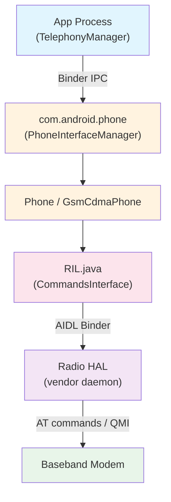

电话服务框架代码位于 AOSP 树中几个不同的仓库里。关键源码位置如下：

| 层次 | 路径 | 说明 |
|-------|------|-------------|
| 公共 API | `frameworks/base/telephony/java/android/telephony/` | `TelephonyManager`、`SubscriptionManager`、`SmsManager`、`CarrierConfigManager` |
| 内部框架 | `frameworks/opt/telephony/src/java/com/android/internal/telephony/` | `Phone`、`GsmCdmaPhone`、`RIL`、`ServiceStateTracker`、`CommandsInterface` |
| 电话进程 | `packages/services/Telephony/src/com/android/phone/` | `PhoneInterfaceManager`、`PhoneGlobals`、`CarrierConfigLoader` |
| 电话模块 | `packages/modules/Telephony/` | 主线模块化的电话代码（apex、framework、libs） |
| 无线电 HAL | `hardware/interfaces/radio/aidl/` | 基于 AIDL 的 HAL 接口：modem、sim、network、data、voice、messaging、ims |
| Telecom | `packages/services/Telecomm/` | `CallsManager`、呼叫路由、`InCallService` 绑定 |

源码参考 -- 接收来自 `TelephonyManager` 的每一个 Binder 调用的顶层类：

```
// packages/services/Telephony/src/com/android/phone/PhoneInterfaceManager.java
public class PhoneInterfaceManager extends ITelephony.Stub {
```

### 36.1.2 TelephonyManager -- 公共入口点

`TelephonyManager` 是电话服务栈面向 SDK 的门面。它被注解为 `@SystemService`：

```
// frameworks/base/telephony/java/android/telephony/TelephonyManager.java
@SystemService(Context.TELEPHONY_SERVICE)
public class TelephonyManager {
```

应用程序通过 `Context.getSystemService(TelephonyManager.class)` 获取它。在内部，`TelephonyManager` 上的大多数方法都会通过 Binder IPC 转发到 `ITelephony.Stub.Proxy`，而该代理会解析到电话进程中的 `PhoneInterfaceManager`。（少数简单的 getter 完全跳过 Binder 跳转：例如 `getNetworkOperatorName()` 只是读取由 `ServiceStateTracker` 保持最新值的 `TelephonyProperties.operator_alpha()` 系统属性。）

`getServiceState()` 调用的简化视图：

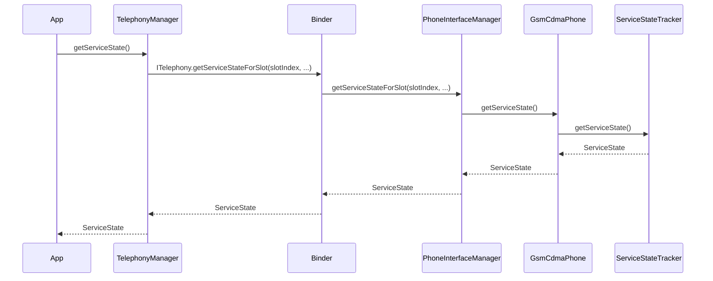

`TelephonyManager` 上关键的公共 API 分组：

- **设备标识**：`getImei()`、`getMeid()`、`getDeviceId()`
- **SIM 信息**：`getSimState()`、`getSimOperator()`、`getSimSerialNumber()`
- **网络状态**：`getNetworkType()`、`getNetworkOperatorName()`、`getServiceState()`
- **通话状态**：`getCallState()`、`listen()`（已弃用）、`registerTelephonyCallback()`
- **数据**：`getDataState()`、`getDataNetworkType()`、`isDataEnabled()`
- **无线电控制**（特权）：`setRadioPower()`、`setPreferredNetworkType()`

### 36.1.3 PhoneInterfaceManager -- Binder 网关

`PhoneInterfaceManager` 位于 `packages/services/Telephony/` 中，并继承 `ITelephony.Stub`。它是电话服务栈中最大的类之一（只有 `TelephonyManager` 本身更大）。它承担三项关键功能：

1. **权限强制** -- 每个方法都会检查调用者的 UID 是否满足所需权限（`READ_PHONE_STATE`、`MODIFY_PHONE_STATE`、`READ_PRIVILEGED_PHONE_STATE`、运营商特权等）。
2. **电话选择** -- 对于多 SIM 设备，它使用 `PhoneFactory` 将调用者的订阅 ID 映射到正确的 `Phone` 对象。
3. **委派** -- 它调用内部的 `Phone` 层次结构并返回结果。

权限检查模式示例：

```java
// packages/services/Telephony/src/com/android/phone/PhoneInterfaceManager.java
public String getImeiForSlot(int slotIndex, String callingPackage,
        String callingFeatureId) {
    Phone phone = PhoneFactory.getPhone(slotIndex);
    if (phone == null) {
        return null;
    }
    int subId = phone.getSubId();
    enforceCallingPackage(callingPackage, Binder.getCallingUid(), "getImeiForSlot");
    if (!TelephonyPermissions.checkCallingOrSelfReadDeviceIdentifiers(mApp, subId,
            callingPackage, callingFeatureId, "getImeiForSlot")) {
        return null;
    }

    final long identity = Binder.clearCallingIdentity();
    try {
        return phone.getImei();
    } finally {
        Binder.restoreCallingIdentity(identity);
    }
}
```

### 36.1.4 Phone 类层次结构

内部的 `Phone` 抽象类是电话服务框架的核心。它继承 `Handler`（因此可以处理异步调制解调器响应），并定义了栈中其余部分所编程依赖的通用接口。

```
// frameworks/opt/telephony/src/java/com/android/internal/telephony/Phone.java
public abstract class Phone extends Handler implements PhoneInternalInterface {
```

类层次结构：

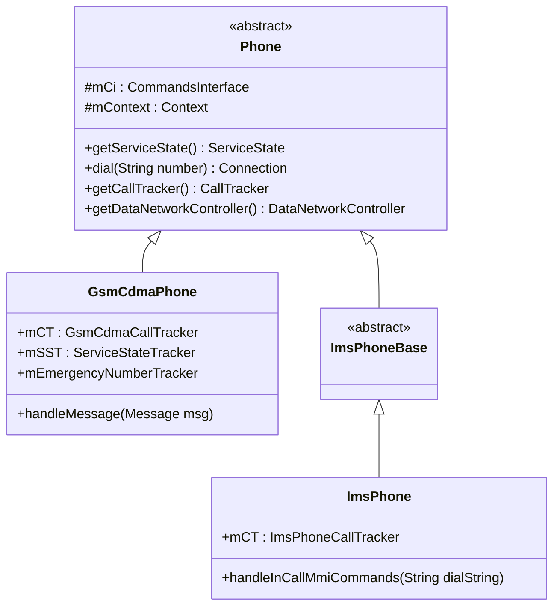

`GsmCdmaPhone` 是面向 GSM 和 CDMA 网络的统一电话实现（两者在 Android 7 中被合并）。它是由 `PhoneFactory` 为每个 SIM 卡槽实例化的类：

```java
// frameworks/opt/telephony/src/java/com/android/internal/telephony/GsmCdmaPhone.java
public class GsmCdmaPhone extends Phone {
    public static final String LOG_TAG = "GsmCdmaPhone";
    ...
    public GsmCdmaCallTracker mCT;
    public ServiceStateTracker mSST;
    public EmergencyNumberTracker mEmergencyNumberTracker;
```

`ImsPhone` 是一个覆盖电话，用于处理 IMS（LTE / Wi-Fi 语音）呼叫。它委派给 `ImsPhoneCallTracker` 进行呼叫控制：

```java
// frameworks/opt/telephony/src/java/com/android/internal/telephony/imsphone/ImsPhone.java
package com.android.internal.telephony.imsphone;
```

### 36.1.5 PhoneFactory -- 启动整个栈

`PhoneFactory` 是用于在启动时将一切连接在一起的静态工厂。`PhoneGlobals.onCreate()` 调用 `PhoneFactory.makeDefaultPhones()`，它会：

1. 创建 `CommandsInterface[]`（每个调制解调器一个 RIL）。
2. 创建 `UiccController`（UICC/SIM 管理器单例）。
3. 创建 `SubscriptionManagerService`。
4. 创建 `EuiccController`（用于 eSIM 管理）。
5. 创建 `GsmCdmaPhone[]`（每个 SIM 卡槽一个）。
6. 创建 `PhoneSwitcher`（用于多 SIM 数据切换），最后创建。

```java
// frameworks/opt/telephony/src/java/com/android/internal/telephony/PhoneFactory.java
public class PhoneFactory {
    static private Phone[] sPhones = null;
    static private CommandsInterface[] sCommandsInterfaces = null;
    static private UiccController sUiccController;
    ...
    public static void makeDefaultPhones(Context context,
            @NonNull FeatureFlags featureFlags) {
```

完整的启动序列：

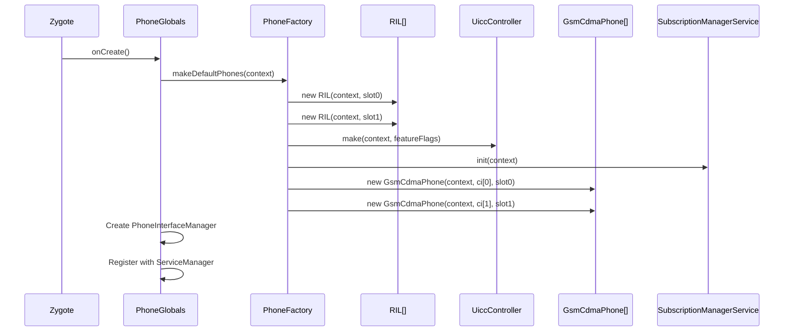

### 36.1.6 关键事件常量

`Phone` 基类定义了一组丰富的事件常量，用于其 `Handler` 消息循环。这些常量驱动着异步状态机：

```java
// frameworks/opt/telephony/src/java/com/android/internal/telephony/Phone.java
protected static final int EVENT_RADIO_AVAILABLE             = 1;
protected static final int EVENT_SSN                         = 2;
protected static final int EVENT_SIM_RECORDS_LOADED          = 3;
private static final int EVENT_MMI_DONE                      = 4;
protected static final int EVENT_RADIO_ON                    = 5;
protected static final int EVENT_GET_BASEBAND_VERSION_DONE   = 6;
protected static final int EVENT_USSD                        = 7;
public static final int EVENT_RADIO_OFF_OR_NOT_AVAILABLE     = 8;
private static final int EVENT_GET_SIM_STATUS_DONE           = 11;
protected static final int EVENT_SET_CALL_FORWARD_DONE       = 12;
protected static final int EVENT_GET_CALL_FORWARD_DONE       = 13;
protected static final int EVENT_CALL_RING                   = 14;
private static final int EVENT_SET_NETWORK_MANUAL_COMPLETE   = 16;
private static final int EVENT_SET_NETWORK_AUTOMATIC_COMPLETE = 17;
protected static final int EVENT_SET_CLIR_COMPLETE           = 18;
protected static final int EVENT_REGISTERED_TO_NETWORK       = 19;
protected static final int EVENT_GET_DEVICE_IDENTITY_DONE    = 21;
public static final int EVENT_EMERGENCY_CALLBACK_MODE_ENTER  = 25;
protected static final int EVENT_SRVCC_STATE_CHANGED         = 31;
protected static final int EVENT_CARRIER_CONFIG_CHANGED      = 43;
protected static final int EVENT_MODEM_RESET                 = 45;
protected static final int EVENT_RADIO_STATE_CHANGED         = 47;
protected static final int EVENT_REGISTRATION_FAILED         = 57;
protected static final int EVENT_BARRING_INFO_CHANGED        = 58;
protected static final int EVENT_LINK_CAPACITY_CHANGED       = 59;
protected static final int EVENT_SUBSCRIPTIONS_CHANGED       = 62;
protected static final int EVENT_CELL_IDENTIFIER_DISCLOSURE  = 72;
protected static final int EVENT_SECURITY_ALGORITHM_UPDATE   = 74;
protected static final int EVENT_LAST = EVENT_SET_ALLOWED_NETWORK_TYPES_FOR_2G_DISABLED_DONE;
```

事件编号在当前代码库中已扩展到 77。它反映了从最初的仅支持 GSM 的电话，历经 CDMA 支持、IMS 集成、安全通知以及 5G NR 能力，长达数十年的积累。

### 36.1.7 Phone 实例变量与子组件

`Phone` 基类持有对数十个子组件的引用，这些子组件管理电话服务的不同方面：

```java
// frameworks/opt/telephony/src/java/com/android/internal/telephony/Phone.java
public CommandsInterface mCi;
protected DataNetworkController mDataNetworkController;
protected CarrierSignalAgent mCarrierSignalAgent;
protected CarrierActionAgent mCarrierActionAgent;
public SmsStorageMonitor mSmsStorageMonitor;
public SmsUsageMonitor mSmsUsageMonitor;
protected DeviceStateMonitor mDeviceStateMonitor;
protected DisplayInfoController mDisplayInfoController;
protected AccessNetworksManager mAccessNetworksManager;
protected CarrierResolver mCarrierResolver;
protected SignalStrengthController mSignalStrengthController;
protected Phone mImsPhone = null;
protected UiccController mUiccController = null;
```

观察者通知广泛使用 registrant 模式：

```java
// frameworks/opt/telephony/src/java/com/android/internal/telephony/Phone.java
protected final RegistrantList mPreciseCallStateRegistrants = new RegistrantList();
private final RegistrantList mHandoverRegistrants = new RegistrantList();
private final RegistrantList mNewRingingConnectionRegistrants = new RegistrantList();
private final RegistrantList mIncomingRingRegistrants = new RegistrantList();
protected final RegistrantList mDisconnectRegistrants = new RegistrantList();
private final RegistrantList mServiceStateRegistrants = new RegistrantList();
protected final RegistrantList mMmiCompleteRegistrants = new RegistrantList();
protected final RegistrantList mMmiRegistrants = new RegistrantList();
```

这些 `RegistrantList` 对象实现了贯穿整个电话服务栈的观察者模式。组件调用 `registerForXxx()` 来添加自己，并在事件发生时接收 `Message` 回调。

### 36.1.8 GsmCdmaPhone 构造函数 -- 将一切连接起来

`GsmCdmaPhone` 构造函数展示了所有子组件是如何创建并连接在一起的。它使用 `TelephonyComponentFactory` 进行依赖注入：

```java
// frameworks/opt/telephony/src/java/com/android/internal/telephony/GsmCdmaPhone.java
public GsmCdmaPhone(Context context, CommandsInterface ci, PhoneNotifier notifier,
        boolean unitTestMode, int phoneId, int precisePhoneType,
        TelephonyComponentFactory telephonyComponentFactory,
        ImsManagerFactory imsManagerFactory, @NonNull FeatureFlags featureFlags) {
    super(precisePhoneType == PhoneConstants.PHONE_TYPE_GSM ? "GSM" : "CDMA",
            notifier, context, ci, unitTestMode, phoneId, telephonyComponentFactory,
            featureFlags);
    mPrecisePhoneType = precisePhoneType;
    mVoiceCallSessionStats = new VoiceCallSessionStats(mPhoneId, this, featureFlags);
    mImsManagerFactory = imsManagerFactory;
    initOnce(ci);
    initRatSpecific(precisePhoneType);
    // CarrierSignalAgent uses CarrierActionAgent in construction so it needs to be created
    // after CarrierActionAgent.
    mCarrierActionAgent = mTelephonyComponentFactory.inject(CarrierActionAgent.class.getName())
            .makeCarrierActionAgent(this);
    mCarrierSignalAgent = mTelephonyComponentFactory.inject(CarrierSignalAgent.class.getName())
            .makeCarrierSignalAgent(this);
    mAccessNetworksManager = mTelephonyComponentFactory
            .inject(AccessNetworksManager.class.getName())
            .makeAccessNetworksManager(this, getLooper(), featureFlags);
    mSignalStrengthController = mTelephonyComponentFactory.inject(
            SignalStrengthController.class.getName()).makeSignalStrengthController(this);
    mSST = mTelephonyComponentFactory.inject(ServiceStateTracker.class.getName())
            .makeServiceStateTracker(this, this.mCi, featureFlags);
    ...
    mDataNetworkController = mTelephonyComponentFactory.inject(
            DataNetworkController.class.getName())
            .makeDataNetworkController(this, getLooper(), featureFlags);
```

工厂模式（`TelephonyComponentFactory`）允许测试代码注入 mock，这对于庞大的电话服务单元测试套件至关重要。

### 36.1.9 ServiceStateTracker -- 网络注册

`ServiceStateTracker`（SST）是最重要的子组件之一。它持续监控并报告设备在蜂窝网络上的注册状态：

```java
// frameworks/opt/telephony/src/java/com/android/internal/telephony/ServiceStateTracker.java
```

SST 轮询调制解调器以获取注册状态变化，处理未经请求的网络指示，并维护供栈中其余部分查询的 `ServiceState` 对象。`ServiceState` 包含：

- 语音注册状态（在服务中、仅紧急、不在服务中）
- 数据注册状态
- 无线接入技术（LTE、NR、WCDMA 等）
- 漫游状态
- 运营商名称和 PLMN 代码
- 小区标识（cell ID、TAC 等）
- NR 状态（已连接、非受限、受限）

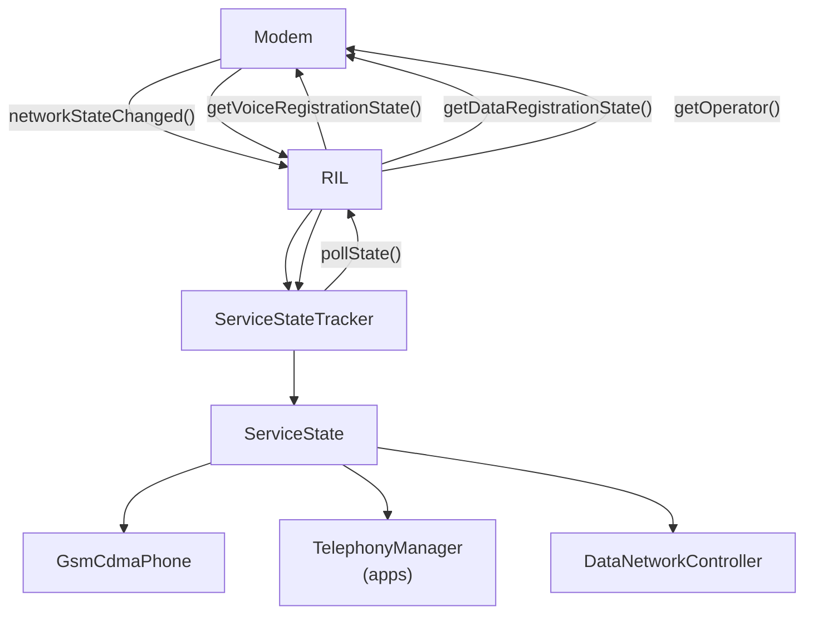

### 36.1.10 电话模块（主线）

从 Android 12 开始，电话服务栈的部分内容被模块化为一个主线模块：

```
packages/modules/Telephony/
    apex/          -- Telephony APEX definition
    framework/     -- Module framework code
    libs/          -- Shared libraries
    flags/         -- Feature flags
    tests/         -- Module tests
```

这使得 Google 无需完整升级操作系统即可通过 Play 商店交付电话服务更新。该 APEX 模块本身名为 `com.android.telephonycore`（其 bootclasspath 和 systemserverclasspath 片段带有 `com.android.telephony-*` 名称），打包框架组件并可选地打包电话服务。

### 36.1.11 安全考虑

电话服务栈处理敏感数据（IMSI、电话号码、SMS 内容），并强制执行严格的权限边界：

| 权限 | 保护级别 | 授予访问的内容 |
|-----------|-----------------|------------------|
| `READ_PHONE_STATE` | dangerous | 电话号码、通话状态、网络运营商 |
| `READ_PHONE_NUMBERS` | dangerous | 特指电话号码 |
| `CALL_PHONE` | dangerous | 拨出电话 |
| `SEND_SMS` | dangerous | 发送 SMS |
| `READ_SMS` | dangerous | 读取 SMS 数据库 |
| `RECEIVE_SMS` | dangerous | 接收 SMS 广播 |
| `MODIFY_PHONE_STATE` | signature\|privileged | 无线电电源、网络模式 |
| `READ_PRIVILEGED_PHONE_STATE` | signature\|privileged | IMEI、IMSI |
| `CARRIER_PRIVILEGES` | dynamic (SIM-based) | 运营商特权操作 |

在近期的 Android 版本中新增的内容是，电话服务栈加入了蜂窝安全透明特性：

```java
// frameworks/opt/telephony/src/java/com/android/internal/telephony/Phone.java
protected static final int EVENT_CELL_IDENTIFIER_DISCLOSURE  = 72;
protected static final int EVENT_SECURITY_ALGORITHM_UPDATE   = 74;
```

这些事件在使用了空加密算法或检测到 IMSI 捕获器时通知用户。相关类：

```
frameworks/opt/telephony/src/java/com/android/internal/telephony/security/CellularIdentifierDisclosureNotifier.java
frameworks/opt/telephony/src/java/com/android/internal/telephony/security/NullCipherNotifier.java
frameworks/opt/telephony/src/java/com/android/internal/telephony/security/CellularNetworkSecuritySafetySource.java
```

---

## 36.2 无线电接口层（RIL）

### 36.2.1 概述

无线电接口层是 Java 电话服务框架与厂商专有调制解调器固件之间的桥梁。历史上，RIL 是一个 C 守护进程（`rild`），它通过 Unix 套接字使用自定义二进制协议与框架通信。现代 Android（12+）已迁移到稳定的基于 AIDL 的 HAL，将旧的单一 `IRadio` HIDL 接口拆分为按领域划分的 AIDL 接口。

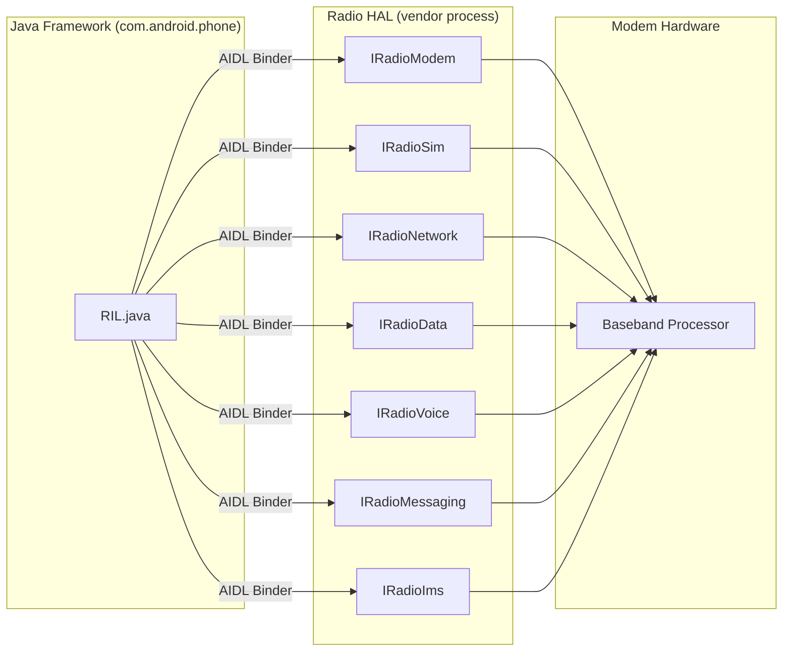

### 36.2.2 RIL.java -- Java 端

`RIL.java` 实现了每个 `Phone` 对象所编程依赖的 `CommandsInterface`。它是大量异步请求/响应管道代码：

```java
// frameworks/opt/telephony/src/java/com/android/internal/telephony/RIL.java
public class RIL extends BaseCommands implements CommandsInterface {
    static final String RILJ_LOG_TAG = "RILJ";
    static final String RILJ_WAKELOCK_TAG = "*telephony-radio*";
```

该类为每个 HAL 域维护独立的服务代理对象：

```java
// frameworks/opt/telephony/src/java/com/android/internal/telephony/RIL.java
private RadioResponse mRadioResponse;
private RadioIndication mRadioIndication;
private volatile IRadio mRadioProxy = null;
private DataResponse mDataResponse;
private DataIndication mDataIndication;
private ImsResponse mImsResponse;
private ImsIndication mImsIndication;
private MessagingResponse mMessagingResponse;
private MessagingIndication mMessagingIndication;
private ModemResponse mModemResponse;
private ModemIndication mModemIndication;
private NetworkResponse mNetworkResponse;
private NetworkIndication mNetworkIndication;
private SimResponse mSimResponse;
private SimIndication mSimIndication;
private VoiceResponse mVoiceResponse;
private VoiceIndication mVoiceIndication;
```

每个服务代理都存储在一个以 HAL 服务类型为键的 `SparseArray` 中：

```java
private SparseArray<RadioServiceProxy> mServiceProxies = new SparseArray<>();
```

### 36.2.3 CommandsInterface -- 抽象边界

`CommandsInterface` 定义了电话服务框架可以向调制解调器请求的完整操作集。它既包括主动请求的命令（请求），也包括未经请求的指示注册：

```java
// frameworks/opt/telephony/src/java/com/android/internal/telephony/CommandsInterface.java
public interface CommandsInterface {

    // Call forwarding constants
    static final int CF_ACTION_DISABLE          = 0;
    static final int CF_ACTION_ENABLE           = 1;
    static final int CF_ACTION_REGISTRATION     = 3;
    static final int CF_ACTION_ERASURE          = 4;

    static final int CF_REASON_UNCONDITIONAL    = 0;
    static final int CF_REASON_BUSY             = 1;
    static final int CF_REASON_NO_REPLY         = 2;
    static final int CF_REASON_NOT_REACHABLE    = 3;
    static final int CF_REASON_ALL              = 4;
    static final int CF_REASON_ALL_CONDITIONAL  = 5;

    // IMS capabilities
    int IMS_MMTEL_CAPABILITY_VOICE = 1 << 0;
    int IMS_MMTEL_CAPABILITY_VIDEO = 1 << 1;
    int IMS_MMTEL_CAPABILITY_SMS   = 1 << 2;
    int IMS_RCS_CAPABILITIES       = 1 << 3;
```

关键的主动请求命令类别：

| 类别 | 示例方法 |
|----------|----------------|
| 语音 | `dial()`、`acceptCall()`、`hangupConnection()`、`conference()` |
| 数据 | `setupDataCall()`、`deactivateDataCall()`、`getDataCallList()` |
| 网络 | `setNetworkSelectionModeAutomatic()`、`getAvailableNetworks()`、`setAllowedNetworkTypesBitmap()` |
| SIM | `getIccCardStatus()`、`supplyIccPin()`、`iccIO()`、`changeIccPin()` |
| SMS | `sendSMS()`、`acknowledgeLastIncomingGsmSms()`、`writeSmsToSim()` |
| Modem | `setRadioPower()`、`getBasebandVersion()`、`getDeviceIdentity()` |

### 36.2.4 HAL 版本演进

RIL 类跟踪受支持的 HAL 版本以实现向后兼容：

```java
// frameworks/opt/telephony/src/java/com/android/internal/telephony/RIL.java
public static final HalVersion RADIO_HAL_VERSION_1_1 = new HalVersion(1, 1);
public static final HalVersion RADIO_HAL_VERSION_1_2 = new HalVersion(1, 2);
public static final HalVersion RADIO_HAL_VERSION_1_3 = new HalVersion(1, 3);
public static final HalVersion RADIO_HAL_VERSION_1_4 = new HalVersion(1, 4);
public static final HalVersion RADIO_HAL_VERSION_1_5 = new HalVersion(1, 5);
public static final HalVersion RADIO_HAL_VERSION_1_6 = new HalVersion(1, 6);
public static final HalVersion RADIO_HAL_VERSION_2_0 = new HalVersion(2, 0);
public static final HalVersion RADIO_HAL_VERSION_2_1 = new HalVersion(2, 1);
public static final HalVersion RADIO_HAL_VERSION_2_2 = new HalVersion(2, 2);
public static final HalVersion RADIO_HAL_VERSION_2_3 = new HalVersion(2, 3);
public static final HalVersion RADIO_HAL_VERSION_2_4 = new HalVersion(2, 4);
```

1.x 版本使用旧的 HIDL `IRadio` 单一接口。2.0+ 版本代表现代的 AIDL 拆分 HAL。当 AIDL 服务不可用时，RIL 类会透明地回退到 HIDL，并使用兼容性覆盖映射：

```java
// frameworks/opt/telephony/src/java/com/android/internal/telephony/RIL.java
private final ConcurrentHashMap<Integer, HalVersion> mCompatOverrides =
        new ConcurrentHashMap<>();
```

### 36.2.5 AIDL 无线电 HAL 接口

从 Android 13 开始，无线电 HAL 被定义为 `hardware/interfaces/radio/aidl/` 下的一组 AIDL 接口。每个接口都用 `@VintfStability` 注解，以获得厂商接口稳定性保证。

七个领域接口及其 AIDL 源码位置：

| 接口 | 路径 | 职责 |
|-----------|------|----------------|
| `IRadioModem` | `hardware/interfaces/radio/aidl/android/hardware/radio/modem/IRadioModem.aidl` | 无线电电源、设备标识、基带版本、硬件配置 |
| `IRadioSim` | `hardware/interfaces/radio/aidl/android/hardware/radio/sim/IRadioSim.aidl` | SIM PIN/PUK、ICC I/O、电话簿、运营商限制 |
| `IRadioNetwork` | `hardware/interfaces/radio/aidl/android/hardware/radio/network/IRadioNetwork.aidl` | 网络扫描、注册、信号强度、禁止接入信息 |
| `IRadioData` | `hardware/interfaces/radio/aidl/android/hardware/radio/data/IRadioData.aidl` | 数据呼叫建立/拆除、保活、QoS、切片 |
| `IRadioVoice` | `hardware/interfaces/radio/aidl/android/hardware/radio/voice/IRadioVoice.aidl` | 拨号、接听、挂断、DTMF、呼叫前转、USSD |
| `IRadioMessaging` | `hardware/interfaces/radio/aidl/android/hardware/radio/messaging/IRadioMessaging.aidl` | SMS 收发、小区广播、MMS 支持 |
| `IRadioIms` | `hardware/interfaces/radio/aidl/android/hardware/radio/ims/IRadioIms.aidl` | IMS 注册信息、SRVCC、IMS 流量类型 |

每个领域接口都遵循三元组模式：

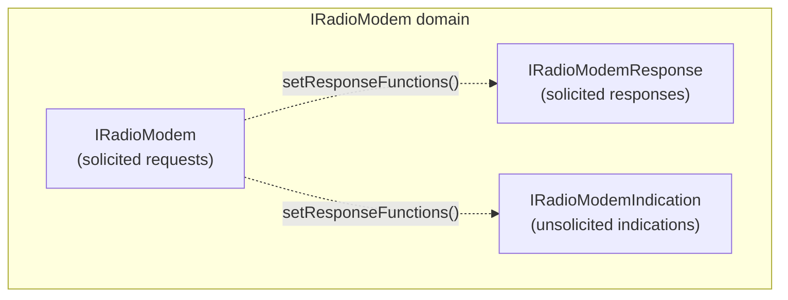

例如，来自 modem 域：

```
// hardware/interfaces/radio/aidl/android/hardware/radio/modem/IRadioModem.aidl
@VintfStability
oneway interface IRadioModem {
    void enableModem(in int serial, in boolean on);
    void getBasebandVersion(in int serial);
    void getDeviceIdentity(in int serial);
    void getHardwareConfig(in int serial);
    void getModemActivityInfo(in int serial);
    ...
}
```

每个方法都带有一个 `serial` 参数，框架用它来匹配异步响应。`oneway` 修饰符意味着调用是即发即弃的；响应通过回调接口到达。

### 36.2.6 主动请求消息与未经请求的消息

RIL 通信模型有两种截然不同的流程：

**主动请求消息** -- 框架发送请求并期望得到响应：

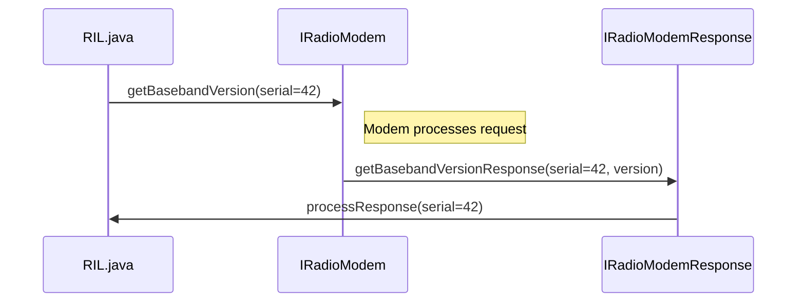

**未经请求的指示** -- 调制解调器在未被询问的情况下发送通知：

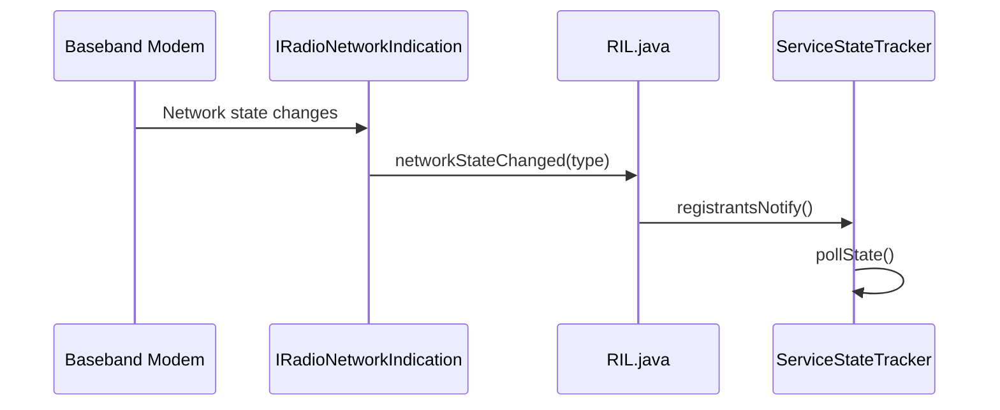

常见的未经请求的指示包括：

- `radioStateChanged` -- 调制解调器电源状态变化
- `networkStateChanged` -- 注册 / 漫游变化
- `newSms` -- 收到新的 SMS
- `callStateChanged` -- 活动呼叫发生变化
- `dataCallListChanged` -- 数据承载状态发生变化
- `simStatusChanged` -- SIM 卡插入 / 移除
- `currentSignalStrength` -- 信号强度更新

### 36.2.7 唤醒锁管理

RIL 使用 Android 唤醒锁在等待调制解调器响应时保持设备唤醒。维护了两个独立的唤醒锁：

```java
// frameworks/opt/telephony/src/java/com/android/internal/telephony/RIL.java
public final WakeLock mWakeLock;           // request/response
public final WakeLock mAckWakeLock;        // ack sent
...
private static final int DEFAULT_WAKE_LOCK_TIMEOUT_MS = 60000;
private static final int DEFAULT_ACK_WAKE_LOCK_TIMEOUT_MS = 200;
```

请求唤醒锁在发送请求时获取，并在响应到达（或超时触发）时释放。待处理的请求被跟踪在一个 `SparseArray` 中：

```java
SparseArray<RILRequest> mRequestList = new SparseArray<>();
```

### 36.2.8 特性到服务的映射

RIL 将 Android 特性标志映射到特定的 HAL 服务，从而在设备不支持某些能力时实现优雅降级：

```java
// frameworks/opt/telephony/src/java/com/android/internal/telephony/RIL.java
private static final Map<String, Integer> FEATURES_TO_SERVICES = Map.ofEntries(
    Map.entry(PackageManager.FEATURE_TELEPHONY_CALLING, HAL_SERVICE_VOICE),
    Map.entry(PackageManager.FEATURE_TELEPHONY_DATA, HAL_SERVICE_DATA),
    Map.entry(PackageManager.FEATURE_TELEPHONY_MESSAGING, HAL_SERVICE_MESSAGING),
    Map.entry(PackageManager.FEATURE_TELEPHONY_IMS, HAL_SERVICE_IMS)
);
```

HAL 服务常量定义在 `TelephonyManager` 中：

```java
// frameworks/base/telephony/java/android/telephony/TelephonyManager.java
public static final int HAL_SERVICE_RADIO     = 0;
public static final int HAL_SERVICE_DATA      = 1;
public static final int HAL_SERVICE_MESSAGING = 2;
public static final int HAL_SERVICE_MODEM     = 3;
public static final int HAL_SERVICE_NETWORK   = 4;
public static final int HAL_SERVICE_SIM       = 5;
public static final int HAL_SERVICE_VOICE     = 6;
public static final int HAL_SERVICE_IMS       = 7;
```

### 36.2.9 死亡接收者与恢复

如果无线电 HAL 进程崩溃，RIL 会通过 Binder 死亡接收者检测到它并尝试恢复：

```java
// frameworks/opt/telephony/src/java/com/android/internal/telephony/RIL.java
static final int EVENT_RADIO_PROXY_DEAD = 6;
static final int EVENT_AIDL_PROXY_DEAD  = 7;
```

当收到死亡通知时，RIL 会：

1. 将所有待处理请求标记为失败。
2. 清除代理引用。
3. 通知 `ServiceStateTracker` 和 `DataNetworkController`。
4. 尝试重新绑定到 HAL 服务。

### 36.2.10 RilHandler -- 内部事件处理

RIL 有自己的内部 `Handler` 子类，用于处理超时和死亡事件：

```java
// frameworks/opt/telephony/src/java/com/android/internal/telephony/RIL.java
public class RilHandler extends Handler {
    @Override
    public void handleMessage(Message msg) {
        RILRequest rr;
        switch (msg.what) {
            case EVENT_WAKE_LOCK_TIMEOUT:
                // Haven't heard back from the last request.  Assume we're
                // not getting a response and release the wake lock.
                synchronized (mRequestList) {
                    if (msg.arg1 == mWlSequenceNum && clearWakeLock(FOR_WAKELOCK)) {
                        if (mRadioBugDetector != null) {
                            mRadioBugDetector.processWakelockTimeout();
                        }
                        if (RILJ_LOGD) {
                            int count = mRequestList.size();
                            riljLog("WAKE_LOCK_TIMEOUT mRequestList=" + count);
                            for (int i = 0; i < count; i++) {
                                rr = mRequestList.valueAt(i);
                                riljLog(i + ": [" + rr.mSerial + "] "
                                        + RILUtils.requestToString(rr.mRequest));
                            }
                        }
                    }
                }
                break;

            case EVENT_ACK_WAKE_LOCK_TIMEOUT:
                if (msg.arg1 == mAckWlSequenceNum && clearWakeLock(FOR_ACK_WAKELOCK)) {
                    if (RILJ_LOGV) riljLog("ACK_WAKE_LOCK_TIMEOUT");
                }
                break;

            case EVENT_BLOCKING_RESPONSE_TIMEOUT:
                int serial = (int) msg.obj;
                rr = findAndRemoveRequestFromList(serial);
                if (rr == null) break;
                if (rr.mResult != null) {
                    Object timeoutResponse = getResponseForTimedOutRILRequest(rr);
                    AsyncResult.forMessage(rr.mResult, timeoutResponse, null);
                    rr.mResult.sendToTarget();
                }
                decrementWakeLock(rr);
                rr.release();
                break;

            case EVENT_RADIO_PROXY_DEAD:
                // HIDL radio proxy died
                ...
                resetProxyAndRequestList(service);
                break;

            case EVENT_AIDL_PROXY_DEAD:
                // AIDL radio proxy died
                ...
                resetProxyAndRequestList(aidlService);
                break;
        }
    }
}
```

### 36.2.11 无线电 Bug 检测

`RadioBugDetector` 通过监控唤醒锁超时来自动检测卡死的调制解调器：

```java
// frameworks/opt/telephony/src/java/com/android/internal/telephony/RIL.java
if (mRadioBugDetector != null) {
    mRadioBugDetector.processWakelockTimeout();
}
```

当调制解调器持续无法响应时，检测器通过 `AnomalyReporter` 报告异常，从而触发诊断数据收集。

### 36.2.12 Binder 死亡处理

RIL 根据 HAL 绑定使用两种不同的死亡接收者机制：

**HIDL（旧版）**：`HwBinder.DeathRecipient`

```java
// frameworks/opt/telephony/src/java/com/android/internal/telephony/RIL.java
final class RadioProxyDeathRecipient implements HwBinder.DeathRecipient {
    @Override
    public void serviceDied(long cookie) {
        riljLog("serviceDied");
        mRilHandler.sendMessageAtFrontOfQueue(mRilHandler.obtainMessage(
                EVENT_RADIO_PROXY_DEAD,
                HAL_SERVICE_RADIO, 0, cookie));
    }
}
```

**AIDL（现代）**：`IBinder.DeathRecipient`

```java
private final class BinderServiceDeathRecipient implements IBinder.DeathRecipient {
    private IBinder mBinder;
    private final int mService;

    @Override
    public void binderDied() {
        riljLog("Service " + serviceToString(mService) + " has died.");
        mRilHandler.sendMessageAtFrontOfQueue(mRilHandler.obtainMessage(
                EVENT_AIDL_PROXY_DEAD, mService, 0, mLinkedFlags));
        unlinkToDeath();
    }
}
```

当任何服务死亡时，会调用 `resetProxyAndRequestList()`，它会：

1. 清除服务代理引用。
2. 为所有待处理请求发送错误响应。
3. 释放所有持有的唤醒锁。
4. 触发重新连接尝试。

对于 AIDL 服务，重置其中一个服务会触发所有 AIDL 服务的重置，因为它们通常位于同一个供应商进程中。

### 36.2.13 请求序列化与直方图

每个 RIL 请求都会获得一个唯一的序列号。框架维护请求/响应延迟的直方图：

```java
// frameworks/opt/telephony/src/java/com/android/internal/telephony/RIL.java
static SparseArray<TelephonyHistogram> sRilTimeHistograms = new SparseArray<>();
static final int RIL_HISTOGRAM_BUCKET_COUNT = 5;

public static List<TelephonyHistogram> getTelephonyRILTimingHistograms() {
    List<TelephonyHistogram> list;
    synchronized (sRilTimeHistograms) {
        list = new ArrayList<>(sRilTimeHistograms.size());
        for (int i = 0; i < sRilTimeHistograms.size(); i++) {
            TelephonyHistogram entry = new TelephonyHistogram(sRilTimeHistograms.valueAt(i));
            list.add(entry);
        }
    }
    return list;
}
```

这些直方图通过 `TelephonyManager.getTelephonyHistograms()`（由 `RIL.getTelephonyRILTimingHistograms()` 支持）公开，用于性能监控。独立的 `requestModemActivityInfo()` API 返回用于功耗归因的调制解调器电源和活动计数器。

### 36.2.14 用于测试的模拟调制解调器

RIL 类内置了对模拟调制解调器的支持，从而无需真实硬件即可进行集成测试：

```java
// frameworks/opt/telephony/src/java/com/android/internal/telephony/RIL.java
private MockModem mMockModem;
```

它通过 `TelephonyShellCommand` 激活，并用测试替身替换真实的 HAL 服务代理。MockModem 框架位于：

```
frameworks/opt/telephony/src/java/com/android/internal/telephony/MockModem.java
```

它允许测试脚本：

- 模拟 SIM 卡插入/移除
- 模拟网络注册变化
- 模拟来电和 SMS
- 模拟无线电电源状态变化

### 36.2.15 从 HIDL 迁移到 AIDL

从 HIDL 到 AIDL 的演进是一次重大的架构转变：

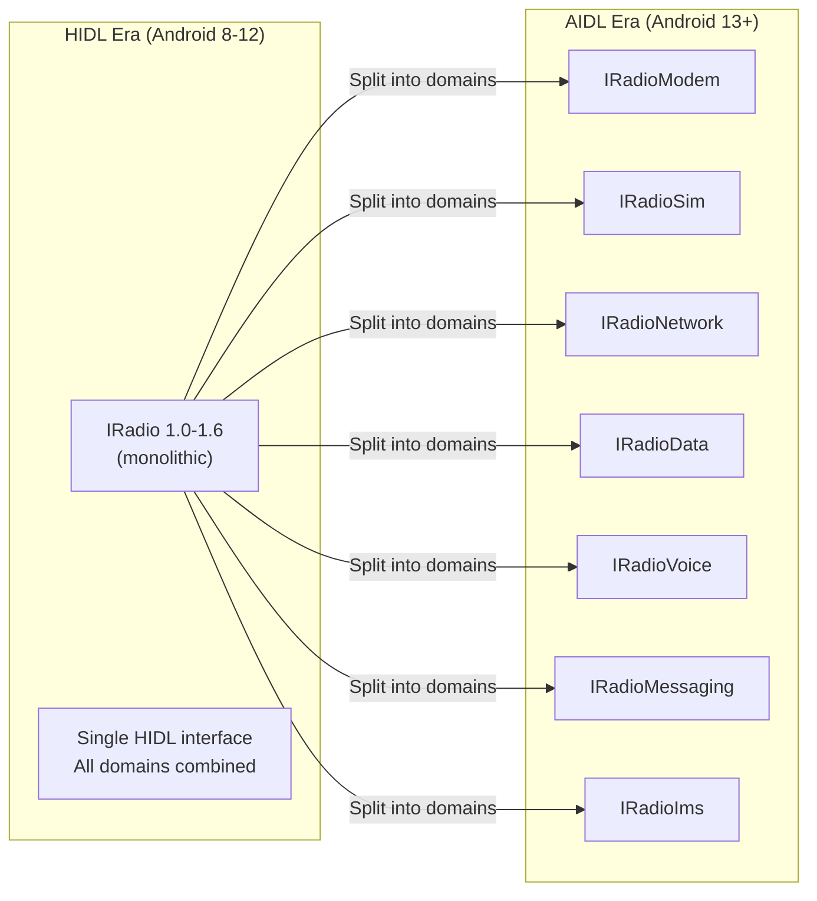

HIDL 版本被保留以实现向后兼容：

```
hardware/interfaces/radio/1.0/   -- Android 8 (original HIDL)
hardware/interfaces/radio/1.1/   -- Android 8.1
hardware/interfaces/radio/1.2/   -- Android 9
hardware/interfaces/radio/1.3/   -- Android 10
hardware/interfaces/radio/1.4/   -- Android 10
hardware/interfaces/radio/1.5/   -- Android 11
hardware/interfaces/radio/1.6/   -- Android 12
hardware/interfaces/radio/aidl/  -- Android 13+ (AIDL split)
```

AIDL 拆分的优势：

| 方面 | HIDL（单一） | AIDL（拆分） |
|--------|-------------------|--------------|
| 更新范围 | 任何更改都会触及所有域 | 每个域独立更新 |
| 进程隔离 | 单个进程 | 每个服务可以位于自己的进程中 |
| 稳定性 | VINTF 但更难扩展 | `@VintfStability`，版本管理更清晰 |
| 类型安全 | 结构体 + 枚举类型 | 完整的 AIDL parcelable 支持 |
| 测试 | 必须模拟整个接口 | 模拟单个域 |

---

## 36.3 SIM 卡管理

### 36.3.1 UICC 框架概述

通用集成电路卡（UICC）是承载 SIM 应用的智能卡。Android 通过 `frameworks/opt/telephony/src/java/com/android/internal/telephony/uicc/` 中的一组类来建模物理卡层次结构：

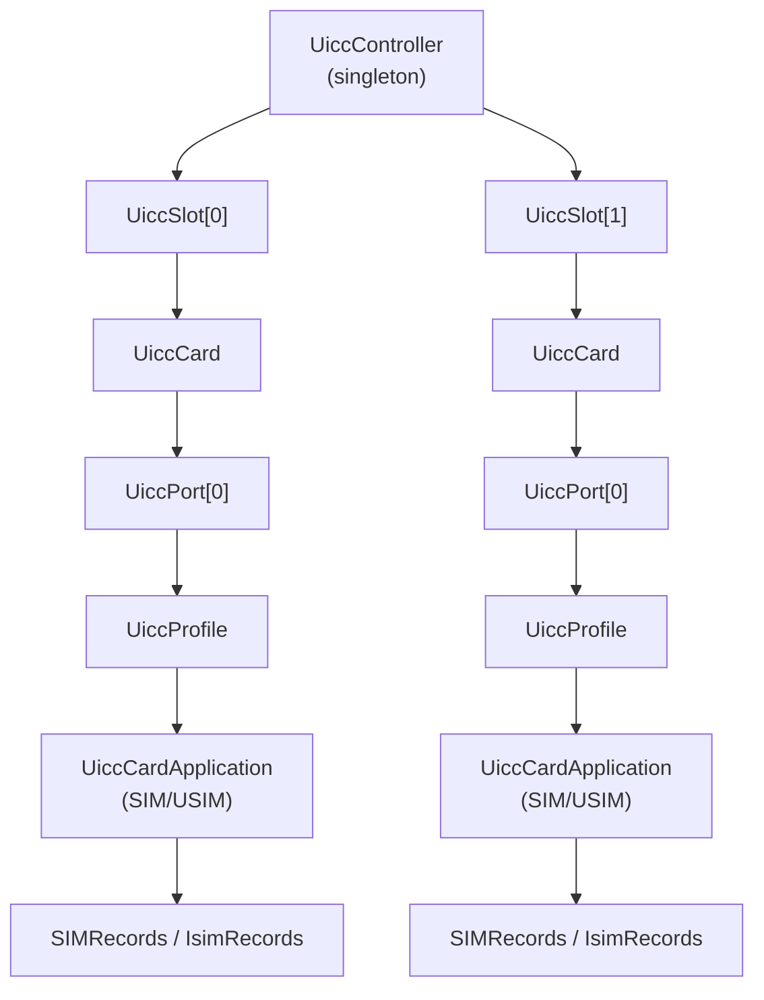

`UiccController` 是入口点。它是在 `PhoneFactory.makeDefaultPhones()` 期间创建的单例：

```java
// frameworks/opt/telephony/src/java/com/android/internal/telephony/uicc/UiccController.java
/**
 * This class is responsible for keeping all knowledge about
 * Universal Integrated Circuit Card (UICC), also know as SIM's,
 * in the system.
 *
 * UiccController is created with the call to make() function.
 * UiccController is a singleton and make() must only be called once.
 *
 * Once created UiccController registers with RIL for "on" and
 * "unsol_sim_status_changed" notifications.
 */
```

关键的 UICC 类及其文件：

| 类 | 文件 | 角色 |
|-------|------|------|
| `UiccController` | `uicc/UiccController.java` | 单例；管理所有卡槽和卡 |
| `UiccSlot` | `uicc/UiccSlot.java` | 物理卡槽（可以是物理卡或 eSIM） |
| `UiccPort` | `uicc/UiccPort.java` | UiccCard 上的逻辑端口（用于 MEP -- 多启用配置文件） |
| `UiccCard` | `uicc/UiccCard.java` | 表示智能卡本身 |
| `UiccProfile` | `uicc/UiccProfile.java` | 表示卡上的运营商配置文件 |
| `UiccCardApplication` | `uicc/UiccCardApplication.java` | 卡上的 SIM/USIM/ISIM 应用 |
| `SIMRecords` | `uicc/SIMRecords.java` | 读取/缓存来自 SIM 的 EF（基本文件）数据 |
| `IsimRecords` | `uicc/IsimRecords.java` | ISIM 应用记录（用于 IMS） |
| `IccFileHandler` | `uicc/IccFileHandler.java` | 通过 ICC I/O 命令读取/写入 SIM 文件 |
| `PinStorage` | `uicc/PinStorage.java` | 存储缓存的 SIM PIN 以支持无人值守重启 |

### 36.3.2 SIM 卡状态流程

当 SIM 卡被插入（或在启动时），会发生以下序列：

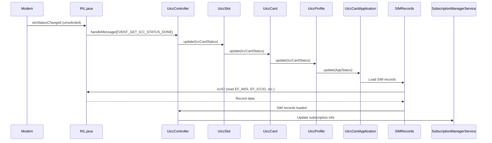

`IccCardApplicationStatus` 包含应用状态：

```java
// frameworks/opt/telephony/src/java/com/android/internal/telephony/uicc/IccCardApplicationStatus.java
public enum AppType {
    APPTYPE_UNKNOWN,
    APPTYPE_SIM,
    APPTYPE_USIM,
    APPTYPE_RUIM,
    APPTYPE_CSIM,
    APPTYPE_ISIM
}
```

### 36.3.3 IRadioSim HAL

与 SIM 相关的操作通过 `IRadioSim` 进行：

```
// hardware/interfaces/radio/aidl/android/hardware/radio/sim/IRadioSim.aidl
@VintfStability
oneway interface IRadioSim {
    void areUiccApplicationsEnabled(in int serial);
    void changeIccPin2ForApp(in int serial, in String oldPin2,
            in String newPin2, in String aid);
    void changeIccPinForApp(in int serial, in String oldPin,
            in String newPin, in String aid);
    void enableUiccApplications(in int serial, in boolean enable);
```

关键的 SIM HAL 操作：

| 方法 | 用途 |
|--------|---------|
| `getIccCardStatus` | 获取当前卡/应用状态 |
| `supplyIccPinForApp` | 输入 SIM PIN |
| `supplyIccPukForApp` | 输入 PUK 码 |
| `changeIccPinForApp` | 修改 SIM PIN |
| `iccIoForApp` | 原始 ICC I/O（读取/写入 SIM 文件） |
| `iccOpenLogicalChannel` | 为 APDU 打开逻辑通道 |
| `iccTransmitApduLogicalChannel` | 向 SIM 发送 APDU |
| `setAllowedCarriers` | 运营商锁定（SIM 锁） |
| `getSimPhonebookRecords` | 读取 SIM 电话簿 |

### 36.3.4 SubscriptionManager 与 SubscriptionManagerService

`SubscriptionManager` 是用于管理 SIM 订阅的公共 API。它公开有关活动和非活动 SIM 卡的信息：

```java
// frameworks/base/telephony/java/android/telephony/SubscriptionManager.java
public class SubscriptionManager {
    public List<SubscriptionInfo> getActiveSubscriptionInfoList()
    public SubscriptionInfo getActiveSubscriptionInfo(int subId)
    public int getActiveSubscriptionInfoCount()
    public int getDefaultSmsSubscriptionId()
    public int getDefaultVoiceSubscriptionId()
    public int getDefaultDataSubscriptionId()
```

在实现侧，`SubscriptionManagerService`（取代较旧的 `SubscriptionController`）是一个综合性服务，位于：

```
frameworks/opt/telephony/src/java/com/android/internal/telephony/subscription/SubscriptionManagerService.java
```

它管理存储在电话服务提供程序（`content://telephony/siminfo`）中的订阅数据库，处理订阅生命周期事件，并协调多 SIM 设置。

### 36.3.5 多 SIM 支持：DSDS 和 DSDA

Android 支持多种 SIM 配置：

| 模式 | 说明 | 无线电配置 |
|------|-------------|---------------------|
| **单 SIM** | 一个 SIM 卡槽 | 一个调制解调器实例 |
| **DSDS**（双卡双待） | 两张 SIM，数据/语音每次只能有一张处于活动状态 | 两个逻辑调制解调器，一条活动射频链 |
| **DSDA**（双卡双通） | 两张 SIM，两者可同时处于活动状态 | 两个调制解调器，两条射频链 |
| **TSTS**（三卡三待） | 三张 SIM | 三个逻辑调制解调器 |

SIM 卡槽数量由 `PhoneConfigurationManager` 管理：

```java
// frameworks/opt/telephony/src/java/com/android/internal/telephony/PhoneConfigurationManager.java
```

`MultiSimSettingController` 协调跨 SIM 的设置：

```java
// frameworks/opt/telephony/src/java/com/android/internal/telephony/MultiSimSettingController.java
```

`PhoneSwitcher` 处理 DSDS 模式下的数据 SIM 切换：

```java
// frameworks/opt/telephony/src/java/com/android/internal/telephony/data/PhoneSwitcher.java
```

`SimultaneousCallingTracker` 管理 DSDA 并发呼叫场景：

```java
// frameworks/opt/telephony/src/java/com/android/internal/telephony/SimultaneousCallingTracker.java
```

多 SIM 架构：

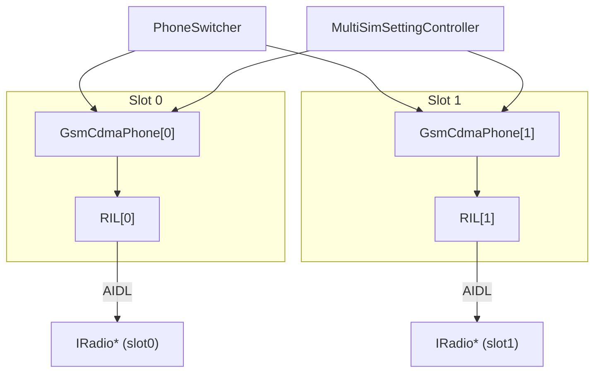

### 36.3.6 eSIM（eUICC）支持

嵌入式 SIM 支持通过 eUICC 框架实现：

```
frameworks/opt/telephony/src/java/com/android/internal/telephony/euicc/EuiccController.java
frameworks/opt/telephony/src/java/com/android/internal/telephony/euicc/EuiccCardController.java
frameworks/opt/telephony/src/java/com/android/internal/telephony/euicc/EuiccConnector.java
```

`EuiccController` 委派给 `EuiccService` 实现（通常由运营商或 Google 提供）：

```java
// frameworks/opt/telephony/src/java/com/android/internal/telephony/euicc/EuiccController.java
```

eSIM 配置文件的生命周期：

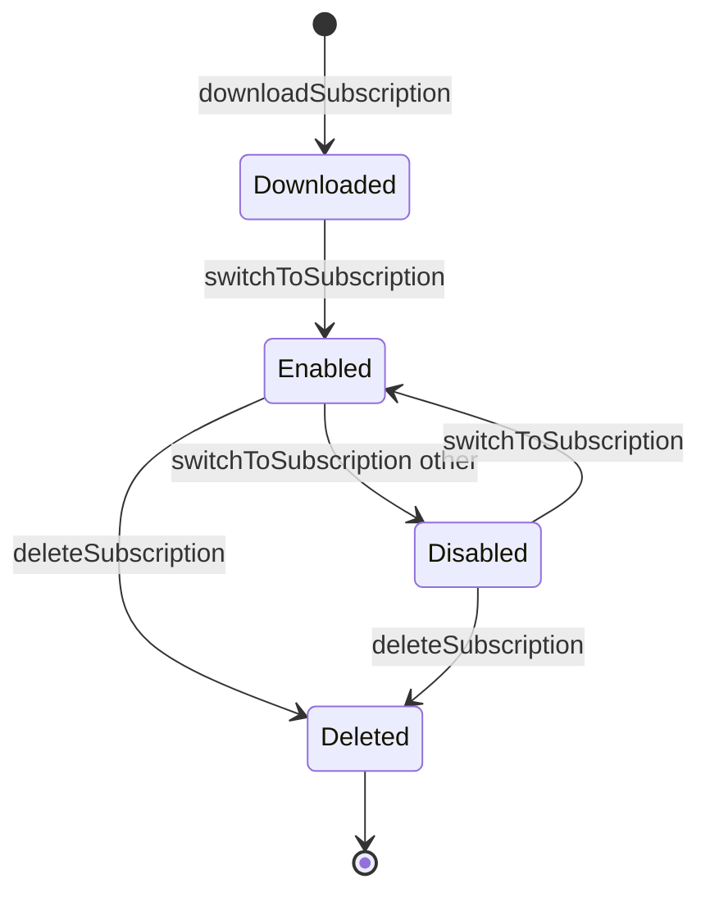

`EuiccManager` 上的关键 eSIM API：

- `downloadSubscription()` -- 从运营商服务器下载 eSIM 配置文件
- `switchToSubscription()` -- 激活已下载的配置文件
- `deleteSubscription()` -- 删除配置文件
- `getEid()` -- 获取 eUICC 硬件标识符

### 36.3.7 SubscriptionInfo -- 数据模型

`SubscriptionInfo` 是表示 SIM 订阅的公共数据类。它包含：

```java
// frameworks/base/telephony/java/android/telephony/SubscriptionInfo.java
public class SubscriptionInfo implements Parcelable {
    // Unique subscription ID
    private int mId;
    // ICCID of the SIM card
    private String mIccId;
    // Slot index (0, 1, ...)
    private int mSimSlotIndex;
    // Display name (e.g., "T-Mobile")
    private CharSequence mDisplayName;
    // Carrier name
    private CharSequence mCarrierName;
    // MCC + MNC (stored as strings)
    private final String mMcc;
    private final String mMnc;
    // Country ISO
    private String mCountryIso;
    // Is embedded (eSIM)?
    private boolean mIsEmbedded;
    // Data roaming setting
    private int mDataRoaming;
    // Card ID
    private int mCardId;
    // Is opportunistic?
    private boolean mIsOpportunistic;
    // Group UUID (for grouped subscriptions)
    private ParcelUuid mGroupUuid;
}
```

（在实际源码中，每个字段都声明为 `final`；该类是不可变的，并通过 `SubscriptionInfo.Builder` 构建。）

内部 `SubscriptionInfoInternal` 增加了一些未公开到公共 API 的附加字段：

```java
// frameworks/opt/telephony/src/java/com/android/internal/telephony/subscription/SubscriptionInfoInternal.java
```

### 36.3.8 多 SIM 设置与默认值

`SubscriptionManager` 提供了查询和设置默认订阅的方法：

```java
// frameworks/base/telephony/java/android/telephony/SubscriptionManager.java
public int getDefaultVoiceSubscriptionId()    // Default for voice calls
public int getDefaultSmsSubscriptionId()      // Default for SMS
public int getDefaultDataSubscriptionId()     // Default for mobile data
public int getActiveDataSubscriptionId()      // Currently active data sub
```

在 DSDS 模式下，用户可以为语音、SMS 和数据设置不同的默认值。`MultiSimSettingController` 强制保持一致性：

```java
// frameworks/opt/telephony/src/java/com/android/internal/telephony/MultiSimSettingController.java
```

例如，如果一张 SIM 卡被移除，控制器会自动将默认值更新为剩余的那张 SIM 卡。

### 36.3.9 PhoneSwitcher -- 数据 SIM 切换

在 DSDS 模式下，一次只能有一张 SIM 卡处于数据活动状态。`PhoneSwitcher` 管理 DDS（默认数据订阅）切换：

```java
// frameworks/opt/telephony/src/java/com/android/internal/telephony/data/PhoneSwitcher.java
```

切换逻辑考虑以下因素：

1. 用户显式的数据 SIM 偏好
2. 紧急呼叫要求
3. 机会性订阅的存在
4. 运营商请求的临时切换（例如，在非数据 SIM 上使用 MMS）

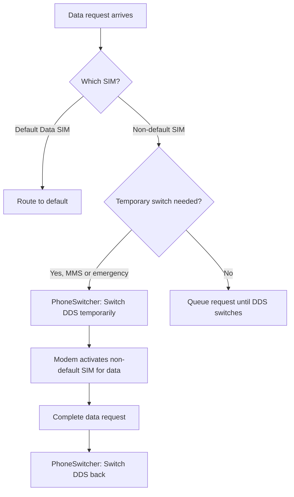

### 36.3.10 SIM 状态机

SIM 卡在初始化过程中会经历几个状态：

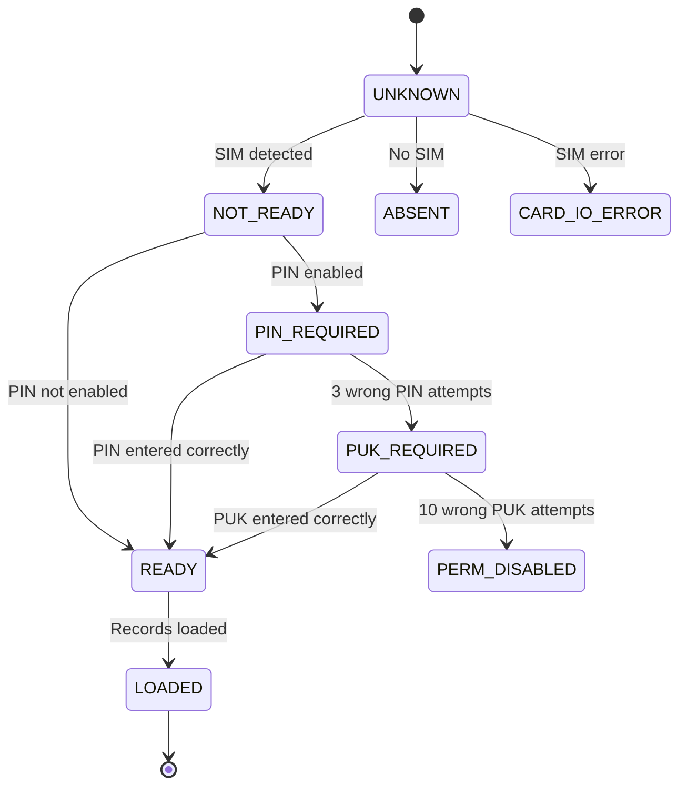

这些状态被定义为 `TelephonyManager` 中的常量：

```java
// frameworks/base/telephony/java/android/telephony/TelephonyManager.java
public static final int SIM_STATE_UNKNOWN       = 0;
public static final int SIM_STATE_ABSENT        = 1;
public static final int SIM_STATE_PIN_REQUIRED  = 2;
public static final int SIM_STATE_PUK_REQUIRED  = 3;
public static final int SIM_STATE_NETWORK_LOCKED = 4;
public static final int SIM_STATE_READY         = 5;
public static final int SIM_STATE_NOT_READY     = 6;
public static final int SIM_STATE_PERM_DISABLED = 7;
public static final int SIM_STATE_CARD_IO_ERROR = 8;
public static final int SIM_STATE_LOADED        = 10;
public static final int SIM_STATE_PRESENT       = 11;
```

### 36.3.11 SIM 文件系统与 EF

SIM 卡包含由 3GPP 定义的层次文件系统。Android 读取的关键基本文件（EF）如下：

| EF 名称 | EF ID | 内容 |
|---------|-------|---------|
| EF_IMSI | 6F07 | 国际移动用户标识 |
| EF_ICCID | 2FE2 | SIM 卡唯一标识符 |
| EF_AD | 6FAD | 管理数据（MNC 长度） |
| EF_MSISDN | 6F40 | 电话号码 |
| EF_SPN | 6F46 | 服务提供商名称 |
| EF_SMS | 6F3C | 存储在 SIM 上的短信 |
| EF_ADN | 6F3A | 缩位拨号号码（电话簿） |
| EF_FDN | 6F3B | 固定拨号号码 |
| EF_PLMN_ACT | 6F60 | 带接入技术的用户控制 PLMN 选择器 |
| EF_HPLMN | 6F31 | HPLMN 搜索周期 |
| EF_SST | 6F38 | SIM 服务表 |

`SIMRecords` 类使用 `IccFileHandler` 读取这些文件：

```java
// frameworks/opt/telephony/src/java/com/android/internal/telephony/uicc/SIMRecords.java
```

对于 USIM（3G+），文件位于 USIM 应用的应用专用文件（ADF）之下，由其 AID（应用标识符）标识。

### 36.3.12 PIN 存储与无人值守重启

`PinStorage` 提供对 SIM PIN 的安全缓存，以支持无人值守重启（例如 OTA 更新之后）：

```java
// frameworks/opt/telephony/src/java/com/android/internal/telephony/uicc/PinStorage.java
```

PIN 以加密方式存储在内存中，并在重启后自动提供给 SIM 卡。因此，设备无需用户干预即可重新连接到网络。这对于在夜间接收 OTA 更新的设备至关重要。

### 36.3.13 运营商限制（SIM 锁）

`IRadioSim` HAL 支持运营商限制（SIM 锁定）：

```
void setAllowedCarriers(in int serial,
        in CarrierRestrictions carriers,
        in SimLockMultiSimPolicy multiSimPolicy);
void getAllowedCarriers(in int serial);
```

这允许运营商和设备制造商限制哪些 SIM 卡可在该设备中使用。`CarrierRestrictions` 结构通过 MCC/MNC 指定允许和排除的运营商，并可选择指定 GID（组标识符）。

---

## 36.4 SMS/MMS

### 36.4.1 SMS 架构概述

Android 的短信处理涉及跨越框架、运营商服务和调制解调器的多个组件：

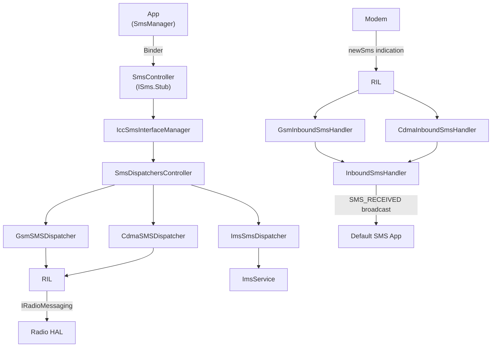

### 36.4.2 短信发送流程

当应用程序通过 `SmsManager.sendTextMessage()` 发送短信时：

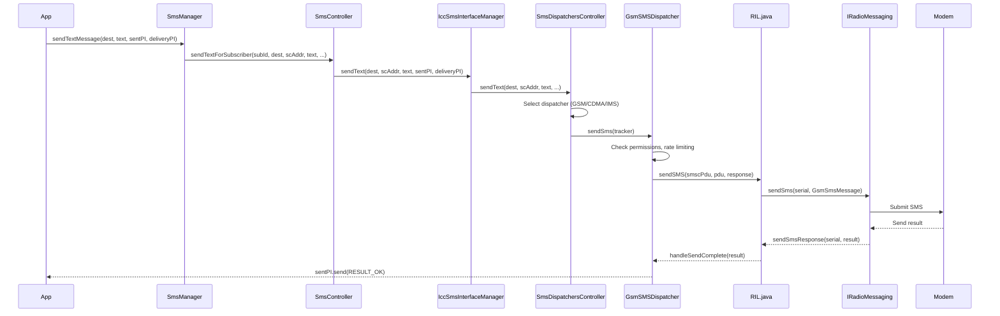

`SmsDispatchersController` 根据当前的 IMS 注册状态和服务状态来决定使用哪个分发器：

```java
// frameworks/opt/telephony/src/java/com/android/internal/telephony/SmsDispatchersController.java
public class SmsDispatchersController extends Handler {
    private static final String TAG = "SmsDispatchersController";

    /** Radio is ON */
    private static final int EVENT_RADIO_ON = 11;

    /** IMS registration/SMS format changed */
    private static final int EVENT_IMS_STATE_CHANGED = 12;

    /** Service state changed */
    private static final int EVENT_SERVICE_STATE_CHANGED = 14;
```

### 36.4.3 短信接收流程

来电短信以调制解调器发出的未经请求的指示形式到达：

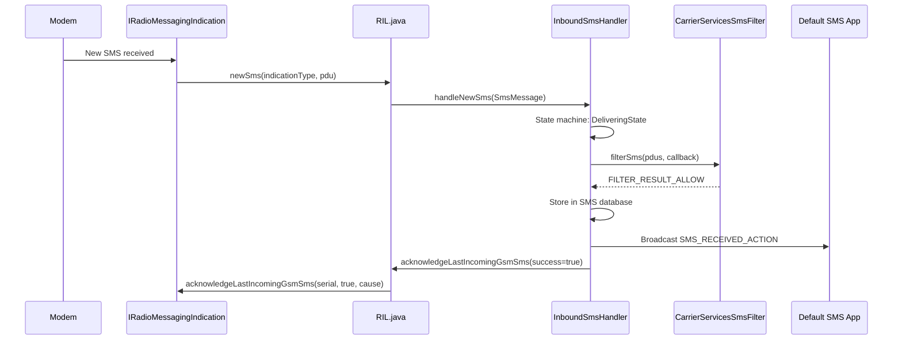

`InboundSmsHandler` 是一个具有多个状态的状态机：

```java
// frameworks/opt/telephony/src/java/com/android/internal/telephony/InboundSmsHandler.java
```

这些状态管理：

- **IdleState** -- 等待来电短信
- **DeliveringState** -- 处理收到的消息
- **WaitingState** -- 等待默认短信应用确认

### 36.4.4 IRadioMessaging HAL

消息 HAL 接口在调制解调器层处理短信：

```
// hardware/interfaces/radio/aidl/android/hardware/radio/messaging/IRadioMessaging.aidl
@VintfStability
oneway interface IRadioMessaging {
    void acknowledgeIncomingGsmSmsWithPdu(in int serial,
            in boolean success, in String ackPdu);
    void acknowledgeLastIncomingGsmSms(in int serial,
            in boolean success, in SmsAcknowledgeFailCause cause);
    void sendSms(in int serial, in GsmSmsMessage message);
    void sendSmsExpectMore(in int serial, in GsmSmsMessage message);
    void sendImsSms(in int serial, in ImsSmsMessage message);
```

在 AIDL 目录 `hardware/interfaces/radio/aidl/android/hardware/radio/messaging/` 中定义的关键消息数据结构：

| 类型 | 文件 | 用途 |
|------|------|---------|
| `GsmSmsMessage` | `GsmSmsMessage.aidl` | GSM 短信 PDU + SMSC 地址 |
| `CdmaSmsMessage` | `CdmaSmsMessage.aidl` | CDMA 短信消息 |
| `ImsSmsMessage` | `ImsSmsMessage.aidl` | IMS 短信消息（基于 IP） |
| `SendSmsResult` | `SendSmsResult.aidl` | 带有消息引用和确认 PDU 的结果 |
| `SmsWriteArgs` | `SmsWriteArgs.aidl` | 用于将短信写入 SIM 卡 |

### 36.4.5 短信限流与安全

`SMSDispatcher` 强制执行限流以防止短信滥用：

```java
// frameworks/opt/telephony/src/java/com/android/internal/telephony/SMSDispatcher.java
```

关键安全措施：

- **权限检查**：需要 `SEND_SMS` 权限
- **限流**：可配置每个周期的最大短信数量
- **高价号码检测**：在向高价费率号码发送前发出警告
- **运营商过滤**：`CarrierMessagingService` 可以拦截和过滤消息
- **用户确认对话框**：对于可疑的发送模式会显示

### 36.4.6 MMS 处理

MMS（多媒体消息服务）的处理方式与短信不同。MMS 消息通过移动数据连接收发，而不是通过 RIL 短信通道：

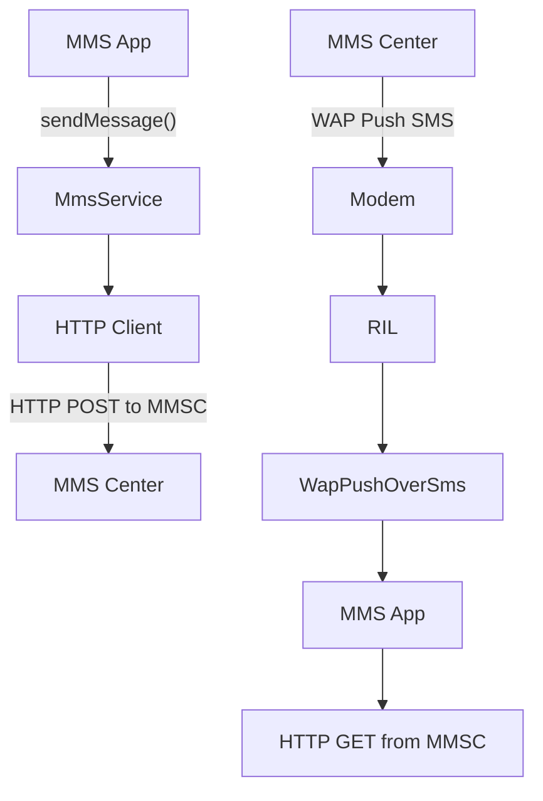

MMS 通知以 WAP Push 短信的形式到达。`WapPushOverSms` 类负责分发这些通知：

```java
// frameworks/opt/telephony/src/java/com/android/internal/telephony/WapPushOverSms.java
```

### 36.4.7 运营商消息服务

运营商可以通过实现 `CarrierMessagingService` 来拦截和过滤来电和去电的短信/MMS：

```java
// android.service.carrier.CarrierMessagingService
public abstract class CarrierMessagingService extends Service {
    public void onFilterSms(MessagePdu pdu, String format,
            int destPort, int subId, ResultCallback<Boolean> callback)
    public void onSendTextSms(String text, int subId,
            String destAddress, int sendSmsFlag,
            ResultCallback<SendSmsResult> callback)
    public void onSendMultipartTextSms(List<String> parts, int subId,
            String destAddress, int sendSmsFlag,
            ResultCallback<SendMultipartSmsResult> callback)
    public void onSendDataSms(byte[] data, int subId,
            String destAddress, int destPort,
            ResultCallback<SendSmsResult> callback)
}
```

`InboundSmsHandler` 中的 `CarrierServicesSmsFilter` 在将消息投递给默认短信应用之前会检查运营商过滤。

### 36.4.8 短信域选择

现代 Android 使用域选择来通过最佳可用网络路由短信。`SmsDispatchersController` 评估以下内容：

1. IMS 短信是否可用？（使用 `ImsSmsDispatcher`）
2. 设备是否处于仅 LTE 模式？（使用 IMS 或等待）
3. 当前 RAT 是否为 CDMA？（使用 `CdmaSMSDispatcher`）
4. 默认：使用 `GsmSMSDispatcher`

```java
// frameworks/opt/telephony/src/java/com/android/internal/telephony/SmsDispatchersController.java
/** Radio is ON */
private static final int EVENT_RADIO_ON = 11;
/** IMS registration/SMS format changed */
private static final int EVENT_IMS_STATE_CHANGED = 12;
/** Callback from RIL_REQUEST_IMS_REGISTRATION_STATE */
private static final int EVENT_IMS_STATE_DONE = 13;
/** Service state changed */
private static final int EVENT_SERVICE_STATE_CHANGED = 14;
```

域选择框架还支持紧急短信：

```java
// frameworks/opt/telephony/src/java/com/android/internal/telephony/domainselection/EmergencySmsDomainSelectionConnection.java
// frameworks/opt/telephony/src/java/com/android/internal/telephony/domainselection/SmsDomainSelectionConnection.java
```

### 36.4.9 短信在 SIM 卡上的存储

短信可以存储在 SIM 卡的 EF_SMS 文件中。`IRadioMessaging` HAL 为此提供了方法：

```
void writeSmsToSim(in int serial, in SmsWriteArgs smsWriteArgs);
void deleteSmsOnSim(in int serial, in int index);
```

`SmsWriteArgs` 结构指定了状态（已读、未读、已发送、未发送）和要写入的 PDU。

### 36.4.10 小区广播短信

小区广播（也称为无线紧急警报、ETWS 和 CMAS）将消息投递给小区区域内的所有设备。它使用与点对点短信不同的独立通道：

```java
// frameworks/opt/telephony/src/java/com/android/internal/telephony/CellBroadcastConfigTracker.java
```

调制解调器通过未经请求的指示传递小区广播消息，`CellBroadcastService` 处理这些消息以进行紧急警报。

### 36.4.11 SmsManager 公共 API

`SmsManager` 是短信的公共 SDK 接口：

```java
// frameworks/base/telephony/java/android/telephony/SmsManager.java
public final class SmsManager {
    public void sendTextMessage(String destAddress, String scAddress,
            String text, PendingIntent sentIntent, PendingIntent deliveryIntent)
    public void sendMultipartTextMessage(String destAddress, String scAddress,
            ArrayList<String> parts, ArrayList<PendingIntent> sentIntents,
            ArrayList<PendingIntent> deliveryIntents)
    public void sendDataMessage(String destAddress, String scAddress,
            short destPort, byte[] data, PendingIntent sentIntent,
            PendingIntent deliveryIntent)
    public ArrayList<String> divideMessage(String text)
}
```

`sentIntent` 会收到以下结果代码之一：

| 代码 | 含义 |
|------|---------|
| `RESULT_OK` | 短信发送成功 |
| `RESULT_ERROR_GENERIC_FAILURE` | 一般性失败 |
| `RESULT_ERROR_RADIO_OFF` | 无线电已关闭 |
| `RESULT_ERROR_NULL_PDU` | PDU 为空 |
| `RESULT_ERROR_NO_SERVICE` | 无网络服务 |
| `RESULT_ERROR_LIMIT_EXCEEDED` | 超出速率限制 |
| `RESULT_ERROR_SHORT_CODE_NOT_ALLOWED` | 高价短信被阻止 |
| `RESULT_ERROR_SHORT_CODE_NEVER_ALLOWED` | 高价短信被永久阻止 |

---

## 36.5 IMS（IP 多媒体子系统）

### 36.5.1 IMS 架构概述

IMS 使语音（VoLTE）、视频和消息能够通过 IP 网络传输，而不是传统的电路交换路径。Android 的 IMS 架构分为三层：

```mermaid
graph TD
    subgraph "Application Layer"
        Dialer["Dialer / InCallUI"]
        MsgApp["Messaging App"]
    end

    subgraph "Telecom / Telephony Framework"
        TC["TelecomManager"]
        IM["ImsManager"]
        IP["ImsPhone"]
        IPCT["ImsPhoneCallTracker"]
    end

    subgraph "IMS Framework"
        IR["ImsResolver"]
        ISC["ImsServiceController"]
        MMTEL["MmTelFeature"]
        RCS["RcsFeature"]
    end

    subgraph "Vendor IMS Implementation"
        ImsS["ImsService<br/>(vendor APK)"]
    end

    subgraph "Radio HAL"
        IHAL["IRadioIms"]
    end

    Dialer --> TC
    TC --> IP
    IP --> IPCT
    IPCT --> IM
    IM --> IR
    IR --> ISC
    ISC --> ImsS
    ImsS --> MMTEL
    ImsS --> RCS
    ImsS -->|optional| IHAL
```

### 36.5.2 ImsResolver -- 寻找正确的 ImsService

`ImsResolver` 发现并绑定到 `ImsService` 实现。它将运营商配置的软件包优先于设备默认值：

```java
// frameworks/opt/telephony/src/java/com/android/internal/telephony/ims/ImsResolver.java
/**
 * Creates a list of ImsServices that are available to bind to based on the
 * Device configuration overlay values "config_ims_rcs_package" and
 * "config_ims_mmtel_package" as well as Carrier Configuration value
 * "config_ims_rcs_package_override_string" and
 * "config_ims_mmtel_package_override_string".
 *
 * These ImsServices are then bound to in the following order:
 * 1. Carrier Config defined override value per SIM.
 * 2. Device overlay default value (including no SIM case).
 */
public class ImsResolver implements
        ImsServiceController.ImsServiceControllerCallbacks {
```

绑定优先级：

```mermaid
flowchart TD
    A["Carrier Config Override?"] -->|Yes| B["Bind to carrier override ImsService"]
    A -->|No| C["Device overlay default?"]
    C -->|Yes| D["Bind to device default ImsService"]
    C -->|No| E["No IMS available"]
```

### 36.5.3 ImsPhone 与 ImsPhoneCallTracker

`ImsPhone` 是处理 IMS 呼叫的电话对象。它作为 `GsmCdmaPhone` 的伴随对象创建：

```java
// frameworks/opt/telephony/src/java/com/android/internal/telephony/imsphone/ImsPhone.java
package com.android.internal.telephony.imsphone;
```

`ImsPhoneCallTracker` 管理实际的 IMS 呼叫生命周期：

```java
// frameworks/opt/telephony/src/java/com/android/internal/telephony/imsphone/ImsPhoneCallTracker.java
```

IMS 呼叫流程：

```mermaid
sequenceDiagram
    participant User
    participant Telecom as TelecomManager
    participant CS as ConnectionService
    participant IP as ImsPhone
    participant IPCT as ImsPhoneCallTracker
    participant ImsM as ImsManager
    participant ImsS as ImsService (vendor)

    User->>Telecom: Place call
    Telecom->>CS: createConnection()
    CS->>IP: dial(number)
    IP->>IPCT: dial(number, ImsCallProfile)
    IPCT->>ImsM: createCall(profile)
    ImsM->>ImsS: startSession()
    ImsS->>ImsS: SIP INVITE to IMS core
    ImsS-->>ImsM: Call connected
    ImsM-->>IPCT: onCallStarted()
    IPCT-->>IP: State = ACTIVE
    IP-->>Telecom: Connection state ACTIVE
```

### 36.5.4 VoLTE（LTE 语音）

VoLTE 使用 SIP/RTP 通过 LTE 数据路径路由语音呼叫，而不是电路交换回落（CSFB）。关键组件：

1. **MmTelFeature** -- 供应商对多媒体电话特性（语音、视频、IMS 短信）的实现。
2. **ImsCall** -- 表示带有 SIP 状态的活动 IMS 会话。
3. **ImsCallProfile** -- 呼叫属性（音频编解码器、视频状态等）。

`MmTelFeature` 能力标志控制哪些服务可用：

```java
// frameworks/opt/telephony/src/java/com/android/internal/telephony/CommandsInterface.java
int IMS_MMTEL_CAPABILITY_VOICE = 1 << 0;
int IMS_MMTEL_CAPABILITY_VIDEO = 1 << 1;
int IMS_MMTEL_CAPABILITY_SMS   = 1 << 2;
```

### 36.5.5 VoWiFi（Wi-Fi 呼叫）

Wi-Fi 呼叫使用相同的 IMS 基础设施，但通过 Wi-Fi 而不是 LTE 路由 SIP/RTP 流量。关键的使能因素是 `ImsRegistrationImplBase` 注册技术：

```java
// android.telephony.ims.stub.ImsRegistrationImplBase
public static final int REGISTRATION_TECH_LTE   = 0;
public static final int REGISTRATION_TECH_IWLAN = 1; // Wi-Fi
public static final int REGISTRATION_TECH_CROSS_SIM = 2;
public static final int REGISTRATION_TECH_NR    = 3;
```

当通过 IWLAN（互联无线局域网）注册时，设备可以通过 Wi-Fi 拨打和接听电话。

### 36.5.6 IRadioIms HAL

IMS 无线电 HAL 提供调制解调器层的 IMS 支持：

```
// hardware/interfaces/radio/aidl/android/hardware/radio/ims/IRadioIms.aidl
@VintfStability
oneway interface IRadioIms {
    void setSrvccCallInfo(int serial, in SrvccCall[] srvccCalls);
    void updateImsRegistrationInfo(int serial, in ImsRegistration imsRegistration);
```

关键的 IMS HAL 操作：

| 方法 | 用途 |
|--------|---------|
| `setSrvccCallInfo` | 向无线电提供 SRVCC 呼叫信息 |
| `updateImsRegistrationInfo` | 通知调制解调器 IMS 注册状态 |
| `startImsTraffic` | 通知调制解调器即将到来的 IMS 流量类型 |
| `stopImsTraffic` | 通知调制解调器 IMS 流量已结束 |
| `triggerEpsFallback` | 请求从 NR 回落到 EPS |

IMS 流量类型指示了在 DSDS 场景下调制解调器进行射频资源分配的优先级：

```
// hardware/interfaces/radio/aidl/android/hardware/radio/ims/ImsTrafficType.aidl
// Priority: EMERGENCY > EMERGENCY_SMS > VOICE > VIDEO > SMS > REGISTRATION > Ut/XCAP
```

### 36.5.7 SRVCC（单无线电语音呼叫连续性）

SRVCC 处理活动 IMS 语音呼叫从 LTE/NR 到旧式电路交换网络（2G/3G）的切换。当设备移出 VoLTE 覆盖范围时会发生这种情况：

```mermaid
sequenceDiagram
    participant Call as Active VoLTE Call
    participant Modem
    participant RIL as RIL.java
    participant Phone as GsmCdmaPhone
    participant ImsP as ImsPhone
    participant IPCT as ImsPhoneCallTracker

    Modem->>RIL: srvccStateChanged(STARTED)
    RIL->>Phone: EVENT_SRVCC_STATE_CHANGED
    Phone->>ImsP: handleSrvccStateChanged(STARTED)
    Note over ImsP: Transfer call state to CS domain
    Modem->>RIL: srvccStateChanged(COMPLETED)
    RIL->>Phone: EVENT_SRVCC_STATE_CHANGED
    Phone->>Phone: CS call tracker takes over
    Note over Call: Call continues on 2G/3G
```

### 36.5.8 视频呼叫（ViLTE）

通过 LTE 的视频呼叫用双向视频流扩展了 VoLTE：

```java
// android.telecom.VideoProfile
public class VideoProfile implements Parcelable {
    public static final int STATE_AUDIO_ONLY     = 0x0;
    public static final int STATE_TX_ENABLED     = 0x1;
    public static final int STATE_RX_ENABLED     = 0x2;
    public static final int STATE_BIDIRECTIONAL  = STATE_TX_ENABLED | STATE_RX_ENABLED;
    public static final int STATE_PAUSED         = 0x4;
}
```

`ImsCallProfile` 携带视频状态信息，`ImsPhoneCallTracker` 管理视频流的生命周期。

### 36.5.9 ImsServiceController -- 管理绑定

`ImsServiceController` 管理已绑定 ImsService 的生命周期：

```java
// frameworks/opt/telephony/src/java/com/android/internal/telephony/ims/ImsServiceController.java
```

它处理：

- 绑定和解绑到 ImsService
- 特性创建（`createMmTelFeature()`、`createRcsFeature()`）
- 解绑时的特性移除
- 崩溃恢复（意外死亡后重新绑定）

每个特性都会经历 `ImsFeature.STATE_*` 生命周期（`STATE_UNAVAILABLE`、`STATE_INITIALIZING`、`STATE_READY`，定义在 `frameworks/base/telephony/java/android/telephony/ims/feature/ImsFeature.java` 中），由 ImsServiceController 驱动：

```mermaid
stateDiagram-v2
    [*] --> UNAVAILABLE
    UNAVAILABLE --> INITIALIZING : bind
    INITIALIZING --> READY : Feature connected
    READY --> UNAVAILABLE : unbind
    READY --> UNAVAILABLE : service died
    UNAVAILABLE --> INITIALIZING : rebind after crash
```

### 36.5.10 RCS（富通信服务）

RCS 通过 ImsService 的 `RcsFeature` 处理。Android 框架提供：

- `ImsRcsController` -- 从电话进程管理 RCS 特性
- `RcsFeature` -- 供应商的 RCS 实现
- UCE（用户能力交换）-- 用于在用户之间共享能力
- RCS 预配置（provisioning）-- 自动配置支持

```java
// packages/services/Telephony/src/com/android/phone/ImsRcsController.java
// packages/services/Telephony/src/com/android/phone/RcsProvisioningMonitor.java
```

`TelephonyRcsService` 将 RCS 集成到电话服务框架中：

```java
// packages/services/Telephony/src/com/android/services/telephony/rcs/TelephonyRcsService.java
```

### 36.5.11 IMS Provisioning

IMS 特性通常需要先从运营商获取预配置（provisioning）才能使用。预配置状态由 `ImsProvisioningController` 管理：

```java
// packages/services/Telephony/src/com/android/phone/ImsProvisioningController.java
// packages/services/Telephony/src/com/android/phone/ImsProvisioningLoader.java
```

预配置可以通过以下方式交付：

- **运营商配置** -- 运营商配置中的静态预配置
- **XML 自动配置** -- 从运营商服务器下载
- **设备管理** -- 通过 OMA-DM 或类似方式配置

`ProvisioningManager` API 公开预配置状态：

```java
// android.telephony.ims.ProvisioningManager
public class ProvisioningManager {
    public void registerProvisioningChangedCallback(Callback callback)
    public int getProvisioningIntValue(int key)
    public String getProvisioningStringValue(int key)
    public void setProvisioningIntValue(int key, int value)
}
```

### 36.5.12 IMS 启用与注册流程

完整的 IMS 启用流程涉及多个组件：

```mermaid
flowchart TD
    A["Device boots"] --> B["PhoneFactory creates GsmCdmaPhone"]
    B --> C["ImsResolver discovers ImsService packages"]
    C --> D["ImsServiceController binds to vendor ImsService"]
    D --> E["ImsEnablementTracker checks carrier config"]
    E --> F{"IMS enabled?"}
    F -->|Yes| G["ImsService.createMmTelFeature()"]
    G --> H["IMS registration starts"]
    H --> I{"Network available?"}
    I -->|LTE| J["Register over LTE"]
    I -->|Wi-Fi| K["Register over IWLAN"]
    J --> L["VoLTE / ViLTE ready"]
    K --> M["VoWiFi ready"]
    F -->|No| N["IMS disabled"]
```

相关文件：

```
frameworks/opt/telephony/src/java/com/android/internal/telephony/ims/ImsEnablementTracker.java
frameworks/opt/telephony/src/java/com/android/internal/telephony/ims/ImsServiceController.java
frameworks/opt/telephony/src/java/com/android/internal/telephony/imsphone/ImsRegistrationCallbackHelper.java
```

---

## 36.6 运营商配置

### 36.6.1 CarrierConfigManager

`CarrierConfigManager` 提供按运营商划分的配置覆盖项，用于控制电话服务栈的行为。运营商就是通过这种方式在不修改平台代码的情况下定制 Android 电话服务的：

```java
// frameworks/base/telephony/java/android/telephony/CarrierConfigManager.java
@SystemService(Context.CARRIER_CONFIG_SERVICE)
@RequiresFeature(PackageManager.FEATURE_TELEPHONY_SUBSCRIPTION)
public class CarrierConfigManager {
```

配置值以 `PersistableBundle` 对象的形式交付，其中包含键值对。框架附带了一整套全面的默认值，运营商可以通过以下方式覆盖它们：

1. **静态 XML 覆盖层** -- 构建中的 `carrier_config.xml` 文件。
2. **CarrierService** -- 动态提供配置的运营商特权应用。
3. **CarrierConfigLoader** -- 负责加载并缓存配置的系统组件。

### 36.6.2 配置加载流程

```mermaid
sequenceDiagram
    participant SIM as SIM Inserted
    participant CCL as CarrierConfigLoader
    participant Static as Static XML Config
    participant CS as CarrierService
    participant CCM as CarrierConfigManager

    SIM->>CCL: SIM state changed
    CCL->>Static: Load default config
    CCL->>Static: Load carrier-specific overlay (by MCC/MNC)
    CCL->>CS: Bind to carrier app's CarrierService
    CS-->>CCL: onLoadConfig() returns PersistableBundle
    CCL->>CCL: Merge: default < XML overlay < CarrierService
    CCL->>CCM: Broadcast ACTION_CARRIER_CONFIG_CHANGED
    Note over CCM: Apps can now query<br/>getConfigForSubId()
```

### 36.6.3 关键配置类别

`CarrierConfigManager` 定义了数百个配置键。以下是主要类别：

**语音与呼叫**：

- `KEY_CARRIER_VOLTE_AVAILABLE_BOOL` -- 启用 VoLTE
- `KEY_CARRIER_WFC_IMS_AVAILABLE_BOOL` -- 启用 Wi-Fi 呼叫
- `KEY_CARRIER_SUPPORTS_SS_OVER_UT_BOOL` -- 通过 UT 接口提供补充服务
- `KEY_ADDITIONAL_CALL_SETTING_BOOL` -- 显示额外的呼叫设置
- `KEY_SUPPORT_CONFERENCE_CALL_BOOL` -- 会议呼叫支持

**数据**：

- `KEY_DATA_SWITCH_VALIDATION_TIMEOUT_LONG` -- DDS 切换超时
- `KEY_CARRIER_METERED_APN_TYPES_STRINGS` -- 计量 APN 类型
- `KEY_CARRIER_NR_AVAILABILITIES_INT_ARRAY` -- NR SA/NSA 配置
- `KEY_BANDWIDTH_STRING_ARRAY` -- 每种 RAT 的预期带宽

**SMS/MMS**：

- `KEY_MMS_USER_AGENT_STRING` -- MMS HTTP user agent
- `KEY_SMS_REQUIRES_DESTINATION_NUMBER_CONVERSION_BOOL`
- `KEY_MMS_MAX_MESSAGE_SIZE_INT` -- 最大 MMS 大小

**IMS**：

- `KEY_IMS_CONFERENCE_SIZE_LIMIT_INT` -- 最大会议规模
- `KEY_CONFIG_IMS_PACKAGE_OVERRIDE_STRING` -- 自定义 IMS 软件包
- `KEY_CARRIER_RCS_PROVISIONING_REQUIRED_BOOL` -- RCS provisioning

**网络**：

- `KEY_HIDE_PREFERRED_NETWORK_TYPE_BOOL` -- 在 UI 中隐藏首选网络类型设置
- `KEY_HIDE_ENHANCED_4G_LTE_BOOL` -- UI 开关可见性
- `KEY_CARRIER_NR_AVAILABILITIES_INT_ARRAY` -- 5G NR 配置

### 36.6.4 CarrierConfigLoader

电话进程中的 `CarrierConfigLoader` 管理加载生命周期：

```java
// packages/services/Telephony/src/com/android/phone/CarrierConfigLoader.java
```

它实现了一个多级配置系统：

```mermaid
graph TD
    A["Platform defaults<br/>(hardcoded in CarrierConfigManager)"] --> B["Static XML overlay<br/>(per-MCC/MNC carrier_config.xml)"]
    B --> C["CarrierService override<br/>(dynamic, from carrier app)"]
    C --> D["Final merged config"]

    style A fill:#e8f5e9
    style B fill:#fff3e0
    style C fill:#e1f5fe
    style D fill:#f3e5f5
```

每一更高层级都会覆盖来自较低层级的值。最终合并后的 `PersistableBundle` 会被缓存并提供给调用方。

### 36.6.5 监听配置变化

应用程序和框架组件会监听运营商配置的变化：

```java
// Broadcast intent
CarrierConfigManager.ACTION_CARRIER_CONFIG_CHANGED

// Extras
CarrierConfigManager.EXTRA_SLOT_INDEX
CarrierConfigManager.EXTRA_SUBSCRIPTION_INDEX
```

在电话服务框架内部，许多组件都注册了该广播：

```java
// frameworks/opt/telephony/src/java/com/android/internal/telephony/Phone.java
protected static final int EVENT_CARRIER_CONFIG_CHANGED = 43;
```

当运营商配置发生变化（例如在更换 SIM 卡后），整个电话服务栈都会重新评估其配置。数据 APN 会被重新加载，IMS 设置会被重新检查，网络偏好也会被更新。

### 36.6.6 配置重载序列

当检测到运营商配置变化（SIM 卡交换、OTA 更新、运营商应用推送）时，整个电话服务栈都会做出反应：

```mermaid
sequenceDiagram
    participant CCL as CarrierConfigLoader
    participant Broadcast as System Broadcast
    participant SST as ServiceStateTracker
    participant DNC as DataNetworkController
    participant DPM as DataProfileManager
    participant IMS as ImsResolver
    participant Phone as GsmCdmaPhone

    CCL->>Broadcast: ACTION_CARRIER_CONFIG_CHANGED
    Broadcast->>Phone: EVENT_CARRIER_CONFIG_CHANGED
    Phone->>SST: Re-evaluate network preferences
    Phone->>DNC: Re-evaluate data settings
    DNC->>DPM: Reload APN database
    DPM->>DPM: Query telephony content provider
    DNC->>DNC: Tear down/re-setup data connections if APNs changed
    Broadcast->>IMS: Re-evaluate IMS package override
    IMS->>IMS: Rebind to correct ImsService if carrier changed
```

这一级联确保每个组件都采用新的运营商特定行为。

### 36.6.7 按 SIM 卡划分的配置

在多 SIM 设备中，运营商配置是按订阅维护的。`CarrierConfigManager.getConfigForSubId(int subId)` 方法返回特定 SIM 卡的合并配置：

```java
// Usage pattern in telephony framework
CarrierConfigManager configManager = context.getSystemService(CarrierConfigManager.class);
PersistableBundle config = configManager.getConfigForSubId(subId);
boolean volteAvailable = config.getBoolean(
        CarrierConfigManager.KEY_CARRIER_VOLTE_AVAILABLE_BOOL, false);
```

该模式在整个电话服务栈中被使用，组件会缓存相关的配置值并在 `EVENT_CARRIER_CONFIG_CHANGED` 时重新读取它们。

### 36.6.8 配置调试

`TelephonyShellCommand` 提供了一套全面的运营商配置命令行：

```bash
# Get a specific value (-s takes a SIM slot ID)
adb shell cmd phone cc get-value -s <slotId> <key>

# Get all values (omit the key)
adb shell cmd phone cc get-value -s <slotId>

# Override a value (the value type is inferred; -p persists across reboots)
adb shell cmd phone cc set-value [-s <slotId>] [-p] <key> <value>

# Load a whole set of overrides from an XML file
adb shell cmd phone cc set-values-from-xml

# Clear overrides
adb shell cmd phone cc clear-values -s <slotId>
```

### 36.6.9 运营商特权

并非所有运营商配置都来自静态文件。运营商特权应用可以通过 `CarrierService` 动态提供配置。运营商特权是通过对应用的签名证书与存储在 SIM 卡 UICC 访问规则（ARA-M）中的证书进行匹配来授予的：

```java
// frameworks/opt/telephony/src/java/com/android/internal/telephony/CarrierPrivilegesTracker.java
```

这使得运营商应用（预装或下载的）可以：

- 覆盖运营商配置
- 访问特权电话服务 API
- 发送/接收运营商特定的短信
- 管理数据配置文件

特权检查流程：

```mermaid
sequenceDiagram
    participant App as Carrier App
    participant PIM as PhoneInterfaceManager
    participant CPT as CarrierPrivilegesTracker
    participant UiccP as UiccPort / UiccProfile
    participant SIM as SIM Card (ARA-M)

    App->>PIM: Privileged telephony API call
    PIM->>CPT: getCarrierPrivilegeStatusForPackage(package)
    CPT->>UiccP: getSimRules - read UiccAccessRules
    UiccP->>SIM: Read ARA-M access rules
    SIM-->>UiccP: Certificate hashes
    UiccP-->>CPT: UiccAccessRule list
    CPT->>CPT: Compare app signing cert with ARA-M certs
    CPT-->>PIM: CARRIER_PRIVILEGE_STATUS_HAS_ACCESS
    PIM-->>App: API response
```

运营商特权状态值：

```java
// frameworks/base/telephony/java/android/telephony/TelephonyManager.java
public static final int CARRIER_PRIVILEGE_STATUS_HAS_ACCESS = 1;
public static final int CARRIER_PRIVILEGE_STATUS_NO_ACCESS = 0;
public static final int CARRIER_PRIVILEGE_STATUS_RULES_NOT_LOADED = -1;
public static final int CARRIER_PRIVILEGE_STATUS_ERROR_LOADING_RULES = -2;
```

### 36.6.10 CarrierService 动态配置

运营商特权应用可以实现 `CarrierService` 以动态提供配置：

```java
// android.service.carrier.CarrierService
public abstract class CarrierService extends Service {
    public abstract PersistableBundle onLoadConfig(CarrierIdentifier id);
    public void notifyCarrierNetworkChange(boolean active) { }
}
```

当 `onLoadConfig()` 返回时，`CarrierConfigLoader` 会将结果与静态默认值和 XML 覆盖层合并，动态值的优先级最高。

运营商还可以通过 `notifyCarrierNetworkChange()` 向平台发出网络变化信号。此调用会临时更改状态栏中的网络图标，以指示运营商特定的网络事件。

---

## 36.7 电话状态与呼叫管理

### 36.7.1 Telecom 与 Telephony -- 两个系统

Android 的呼叫管理被划分为两个截然不同的系统：

| 系统 | 软件包 | 角色 |
|--------|---------|------|
| **Telecom** | `packages/services/Telecomm/` | 呼叫路由、UI 绑定、音频路由、多呼叫管理 |
| **Telephony** | `packages/services/Telephony/` | 调制解调器交互、无线电状态、SIM、短信 |

Telecom 是更高级别的系统，它管理来自多个来源（蜂窝、VoIP、SIP）的呼叫，而 Telephony 处理蜂窝相关的细节。

```mermaid
graph TD
    subgraph "Telecom Service"
        CM["CallsManager"]
        InCall["InCallController"]
        CAM["CallAudioManager"]
    end

    subgraph "Telephony Service"
        TCS["TelephonyConnectionService"]
        PIM["PhoneInterfaceManager"]
        Phone["GsmCdmaPhone"]
    end

    subgraph "Dialer App"
        ICS["InCallService"]
        UI["InCallUI"]
    end

    UI --> ICS
    ICS -->|Binder| InCall
    InCall --> CM
    CM --> TCS
    TCS --> Phone
    Phone --> RIL["RIL"]
    CM --> CAM
```

### 36.7.2 TelecomManager -- 呼叫控制 API

`TelecomManager` 是用于呼叫管理的公共 API。关键操作：

```java
// frameworks/base/telecomm/framework/java/android/telecom/TelecomManager.java
public class TelecomManager {
    public void placeCall(Uri address, Bundle extras)
    public boolean endCall()
    public void acceptRingingCall()
    public boolean isInCall()
    public boolean isRinging()
    public List<PhoneAccountHandle> getCallCapablePhoneAccounts()
    public PhoneAccountHandle getDefaultOutgoingPhoneAccount(String uriScheme)
}
```

### 36.7.3 ConnectionService -- 桥梁

`ConnectionService` 是 Telecom 为呼叫控制而绑定的抽象服务。电话服务的实现是 `TelephonyConnectionService`：

```java
// packages/services/Telephony/src/com/android/services/telephony/TelephonyConnectionService.java
```

它将 Telecom 的 `Connection` 抽象转换为电话服务的 `Phone` 呼叫：

```mermaid
sequenceDiagram
    participant TC as TelecomManager
    participant CM as CallsManager
    participant TCS as TelephonyConnectionService
    participant Phone as GsmCdmaPhone
    participant CT as GsmCdmaCallTracker
    participant RIL as RIL.java
    participant HAL as IRadioVoice

    TC->>CM: placeCall(tel:+1234567890)
    CM->>TCS: onCreateOutgoingConnection()
    TCS->>Phone: dial("+1234567890")
    Phone->>CT: dial("+1234567890")
    CT->>RIL: dial(dialString, clirMode, uusInfo)
    RIL->>HAL: dial(serial, Dial{address, clir})
    HAL->>HAL: Modem places call
    HAL-->>RIL: dialResponse(serial)
    RIL-->>CT: Response OK
    CT-->>Phone: GsmCdmaConnection created
    Phone-->>TCS: Connection active
    TCS-->>CM: Connection.setActive()
```

### 36.7.4 IRadioVoice HAL

语音 HAL 在调制解调器层处理呼叫控制：

```
// hardware/interfaces/radio/aidl/android/hardware/radio/voice/IRadioVoice.aidl
@VintfStability
oneway interface IRadioVoice {
    void acceptCall(in int serial);
    void cancelPendingUssd(in int serial);
    void conference(in int serial);
    void dial(in int serial, in Dial dialInfo);
    void emergencyDial(in int serial, in Dial dialInfo,
            in int categories, in String[] urns,
            in EmergencyCallRouting routing, ...);
```

关键的语音操作：

| 方法 | 等效 AT 命令 | 用途 |
|--------|----------------------|---------|
| `dial` | `ATD` | 发起呼叫 |
| `acceptCall` | `ATA` | 接听来电 |
| `hangup` | `ATH` | 结束特定呼叫 |
| `conference` | `AT+CHLD=3` | 合并呼叫 |
| `switchWaitingOrHoldingAndActive` | `AT+CHLD=2` | 交换活动/保持的呼叫 |
| `getCurrentCalls` | `AT+CLCC` | 列出活动呼叫 |
| `sendDtmf` | `AT+VTS` | 发送 DTMF 音 |

### 36.7.5 呼叫状态机

一次电话呼叫会经历几个状态：

```mermaid
stateDiagram-v2
    [*] --> IDLE
    IDLE --> DIALING : User dials
    IDLE --> INCOMING : Network delivers call
    DIALING --> ALERTING : Remote phone rings
    ALERTING --> ACTIVE : Remote answers
    INCOMING --> ACTIVE : User answers
    ACTIVE --> HOLDING : User holds
    HOLDING --> ACTIVE : User resumes
    ACTIVE --> DISCONNECTING : User hangs up
    DISCONNECTING --> DISCONNECTED : Modem confirms
    DISCONNECTED --> [*]
    INCOMING --> DISCONNECTED : User rejects
    DIALING --> DISCONNECTED : Call fails
```

`GsmCdmaCallTracker` 和 `ImsPhoneCallTracker` 分别为电路交换呼叫和 IMS 呼叫维护这一状态：

```java
// frameworks/opt/telephony/src/java/com/android/internal/telephony/GsmCdmaCallTracker.java
```

### 36.7.6 紧急呼叫

紧急呼叫在整个栈中都会受到特殊处理：

1. **EmergencyNumberTracker** 维护紧急号码数据库（从多个来源汇编而成：调制解调器、SIM、运营商配置、数据库）：

    ```java
    // frameworks/opt/telephony/src/java/com/android/internal/telephony/emergency/EmergencyNumberTracker.java
    ```

2. **EmergencyStateTracker** 协调紧急呼叫状态机：

    ```java
    // frameworks/opt/telephony/src/java/com/android/internal/telephony/emergency/EmergencyStateTracker.java
    ```

3. **域选择** 决定是通过 CS（电路交换）还是 IMS 路由紧急呼叫：

    ```java
    // frameworks/opt/telephony/src/java/com/android/internal/telephony/domainselection/DomainSelectionResolver.java
    ```

4. `IRadioVoice.emergencyDial()` HAL 方法向调制解调器提供增强的信息：

    ```
    // hardware/interfaces/radio/aidl/android/hardware/radio/voice/IRadioVoice.aidl
    void emergencyDial(in int serial, in Dial dialInfo,
            in int categories, in String[] urns,
            in EmergencyCallRouting routing, ...);
    ```

    紧急呼叫路由选项：

    ```
    // hardware/interfaces/radio/aidl/android/hardware/radio/voice/EmergencyCallRouting.aidl
    // UNKNOWN -- Let the modem decide
    // EMERGENCY -- Use emergency routing
    // NORMAL -- The implementation must handle the call through normal call routing
    ```

### 36.7.7 InCallService -- UI 连接

拨号器应用实现 `InCallService` 以接收呼叫状态更新并显示通话中的 UI：

```java
// frameworks/base/telecomm/framework/java/android/telecom/InCallService.java
public abstract class InCallService extends Service {
    public void onCallAdded(Call call) { }
    public void onCallRemoved(Call call) { }
    public void onCanAddCallChanged(boolean canAddCall) { }
}
```

Telecom 系统会绑定到默认拨号器的 `InCallService` 以及系统 `InCallService`（用于紧急呼叫和车载模式）。

### 36.7.8 呼叫前转与补充服务

电话服务栈通过 MMI 代码支持 GSM/IMS 补充服务（SS）。当用户拨打类似 `*21*number#` 的代码（激活呼叫前转）时，框架会解析它并对请求进行路由：

```java
// frameworks/opt/telephony/src/java/com/android/internal/telephony/CommandsInterface.java
static final int CF_ACTION_DISABLE          = 0;
static final int CF_ACTION_ENABLE           = 1;
static final int CF_ACTION_REGISTRATION     = 3;
static final int CF_ACTION_ERASURE          = 4;

static final int CF_REASON_UNCONDITIONAL    = 0;
static final int CF_REASON_BUSY             = 1;
static final int CF_REASON_NO_REPLY         = 2;
static final int CF_REASON_NOT_REACHABLE    = 3;
static final int CF_REASON_ALL              = 4;
static final int CF_REASON_ALL_CONDITIONAL  = 5;
```

呼叫前转流程：

```mermaid
sequenceDiagram
    participant User
    participant Dialer
    participant Phone as GsmCdmaPhone
    participant MMI as GsmMmiCode
    participant RIL as RIL.java
    participant HAL as IRadioVoice

    User->>Dialer: Dial *21*+1234567890#
    Dialer->>Phone: dial("*21*+1234567890#")
    Phone->>MMI: Parse MMI code
    MMI->>Phone: handleDialInternal()
    Phone->>RIL: setCallForward(CF_ACTION_REGISTRATION,<br/>CF_REASON_UNCONDITIONAL, "+1234567890")
    RIL->>HAL: setCallForward(serial, CallForwardInfo)
    HAL-->>RIL: setCallForwardResponse()
    RIL-->>Phone: Result
    Phone-->>User: MMI complete notification
```

呼叫限制使用设施代码：

```java
// frameworks/opt/telephony/src/java/com/android/internal/telephony/CommandsInterface.java
static final String CB_FACILITY_BAOC         = "AO";  // Bar All Outgoing
static final String CB_FACILITY_BAOIC        = "OI";  // Bar Outgoing International
static final String CB_FACILITY_BAOICxH      = "OX";  // Bar Outgoing Intl except Home
static final String CB_FACILITY_BAIC         = "AI";  // Bar All Incoming
static final String CB_FACILITY_BAICr        = "IR";  // Bar Incoming when Roaming
static final String CB_FACILITY_BA_ALL       = "AB";  // All Barring services
static final String CB_FACILITY_BA_MO        = "AG";  // All MO Barring
static final String CB_FACILITY_BA_MT        = "AC";  // All MT Barring
static final String CB_FACILITY_BA_SIM       = "SC";  // SIM PIN lock
static final String CB_FACILITY_BA_FD        = "FD";  // Fixed Dialing
```

### 36.7.9 USSD（非结构化补充服务数据）

USSD 允许与网络进行交互式通信，用于余额查询、预付费充值等服务：

```java
// frameworks/opt/telephony/src/java/com/android/internal/telephony/CommandsInterface.java
static final int USSD_MODE_NOTIFY        = 0;  // One-shot notification
static final int USSD_MODE_REQUEST       = 1;  // Further user action needed
static final int USSD_MODE_NW_RELEASE    = 2;  // Network terminated session
```

流程如下。用户拨打 USSD 代码（例如 `*123#`）。GsmCdmaPhone 通过 RIL -> IRadioVoice.sendUssd() -> 调制解调器将 USSD 发送到网络。响应以未经请求的指示形式到达并显示给用户。

### 36.7.10 DTMF 音

在活动呼叫期间，DTMF（双音多频）音通过以下方式发送：

```
// hardware/interfaces/radio/aidl/android/hardware/radio/voice/IRadioVoice.aidl
void sendDtmf(in int serial, in String s);
void startDtmf(in int serial, in String s);
void stopDtmf(in int serial);
```

`sendDtmf()` 发送单个短暂的音，而 `startDtmf()`/`stopDtmf()` 允许用户按住一个键以产生更长的音。

### 36.7.11 PhoneAccount 与呼叫路由

`PhoneAccount` 表示一个呼叫来源。在多 SIM 设备中，每个 SIM 卡都有一个 PhoneAccount：

```java
// frameworks/base/telecomm/framework/java/android/telecom/PhoneAccount.java
```

Telecom 使用 PhoneAccount 将去电路由到正确的 SIM 卡 / 呼叫提供方。Telecom 服务中的 `CallsManager` 会评估以下因素：

1. 用户的默认去电账户偏好。
2. 呼叫特定的账户（如果由呼叫方指定）。
3. 紧急呼叫路由规则。
4. 每张 SIM 卡的可用网络状态。

```mermaid
flowchart TD
    A["Outgoing call request"] --> B{"Account specified?"}
    B -->|Yes| C["Use specified PhoneAccount"]
    B -->|No| D{"Default account set?"}
    D -->|Yes| E["Use default PhoneAccount"]
    D -->|No| F["Show account picker dialog"]
    C --> G["Route to ConnectionService"]
    E --> G
    F --> G
```

### 36.7.12 集成 VoIP 通话记录

在 Android 17 之前，系统通话记录实际上就是蜂窝通话记录。一个通过 Telecom 管理自己呼叫（自管理的 `ConnectionService` 或 `CallControl` API）的 VoIP 应用必须维护自己应用内的通话历史。它的呼叫不会出现在系统拨号器的最近通话中与蜂窝呼叫并列的位置。Android 17 新增了*集成通话记录*。VoIP 呼叫现在可以被写入共享的 `CallLog.Calls` 提供程序，并由系统拨号器显示。该功能包含用户选择退出选项和每呼叫头像。

两个 aconfig 标志控制这项工作。它们位于不同的 git 项目和软件包中。阶段 1 标志是 `integrated_call_logs`（`packages/services/Telecomm/flags/telecom_integrated_call_log.aconfig`，软件包 `com.android.server.telecom.flags`）。阶段 2 标志是 `integrated_call_logs_stage2`（`packages/modules/Telephony/telecom/flags/26Q2_migration_flags.aconfig`，软件包 `android.telecom.flags`）。

VoIP 应用在呼叫创建时通过 `CallAttributes`（`frameworks/base/telecomm/framework/java/android/telecom/CallAttributes.java`）选择是否将某次呼叫纳入或排除在集成通话记录之外。构建器新增了以下内容：

- `setLogExcluded(boolean)`（标志 `FLAG_INTEGRATED_CALL_LOGS`）-- 完全将该呼叫排除在系统记录之外。
- `setIsGroupCall(boolean)` 和新的呼叫类型 `CallAttributes.MESSAGING`（标志 `FLAG_INTEGRATED_CALL_LOGS_STAGE2`）-- 标记群组/会议呼叫和回呼式消息呼叫。
- `setContactUri(Uri)`（标志 `FLAG_INTEGRATED_CALL_LOGS_STAGE2`）-- 指向应用 VoIP 联系人目录或 CP2 联系人的 URI。拨号器用它来解析记录条目中参与者的显示名称和头像图片。

通话记录契约在 `CallLog.Calls`（`frameworks/base/core/java/android/provider/CallLog.java`）中加入了匹配的内容。新增内容是一个以 Telecom 呼叫为键的 `UUID` 列（标志 `FLAG_INTEGRATED_CALL_LOGS`）和一个 `FEATURES_GROUP_CALL` 特性位。此外还有一个用于 VoIP 行的独立查询界面，因此较旧的拨号器不会受到影响。它包含 `CONTENT_VOIP_URI`、查询参数 `INCLUDE_VOIP_CALLS_PARAM_KEY`，以及预构建的 `CONTENT_URI_WITH_VOIP_CALLS`。后两项受 `FLAG_FILTER_VOIP_CALL_LOGS` 控制。支持集成通话记录的拨号器查询时会包含 VoIP 呼叫；不支持的拨号器则仍然只看到蜂窝行。

用户偏好通过 `TelecomManager`（`frameworks/base/telecomm/framework/java/android/telecom/TelecomManager.java`）传递。`ACTION_CONFIGURE_CALL_LOG_INTEGRATION` 会启动设置界面，用户可以在其中为某个 VoIP 应用启用或禁用记录。当该选择发生变化时，Telecom 会向受影响的应用广播 `ACTION_VOIP_CALL_LOG_PREFERENCE`，并在 `EXTRA_VOIP_CALL_LOG_PREFERENCE_STATUS` 中携带新状态。应用会重新读取该偏好，并据此停止或恢复添加记录条目。这三项均受 `FLAG_INTEGRATED_CALL_LOGS_STAGE2` 控制。

---

## 36.8 数据连接

### 36.8.1 DataNetworkController -- 中央模块

数据连接管理在 Android 13 中被完全重写。核心类是 `DataNetworkController`：

```java
// frameworks/opt/telephony/src/java/com/android/internal/telephony/data/DataNetworkController.java
/**
 * DataNetworkController in the central module of the telephony data stack.
 * It is responsible to create and manage all the mobile data networks.
 * It is per-SIM basis which means for DSDS devices, there will be two
 * DataNetworkController instances. Unlike the Android 12 DcTracker, which is
 * designed to be per-transport (i.e. cellular, IWLAN), DataNetworkController
 * is designed to handle data networks on both cellular and IWLAN.
 */
public class DataNetworkController extends Handler {
```

数据子系统的架构：

```mermaid
graph TD
    subgraph "DataNetworkController"
        DNC["DataNetworkController<br/>(per-SIM)"]
        DPM["DataProfileManager"]
        DCM["DataConfigManager"]
        DSM["DataSettingsManager"]
        DRM["DataRetryManager"]
        DSRM["DataStallRecoveryManager"]
        ANM["AccessNetworksManager"]
        LBE["LinkBandwidthEstimator"]
    end

    subgraph "Data Networks"
        DN1["DataNetwork<br/>(internet)"]
        DN2["DataNetwork<br/>(ims)"]
        DN3["DataNetwork<br/>(mms)"]
    end

    subgraph "Network Agent"
        NA["TelephonyNetworkAgent"]
    end

    DNC --> DPM
    DNC --> DCM
    DNC --> DSM
    DNC --> DRM
    DNC --> DSRM
    DNC --> ANM
    DNC --> LBE
    DNC --> DN1
    DNC --> DN2
    DNC --> DN3
    DN1 --> NA
    DN2 --> NA
    DN3 --> NA
```

`frameworks/opt/telephony/src/java/com/android/internal/telephony/data/` 中的关键伴随类：

| 类 | 文件 | 职责 |
|-------|------|----------------|
| `DataNetworkController` | `DataNetworkController.java` | 中央协调器 |
| `DataNetwork` | `DataNetwork.java` | 单个数据承载，状态机 |
| `DataProfileManager` | `DataProfileManager.java` | APN/数据配置文件管理 |
| `DataConfigManager` | `DataConfigManager.java` | 用于数据业务的运营商配置 |
| `DataSettingsManager` | `DataSettingsManager.java` | 用户数据设置 |
| `DataRetryManager` | `DataRetryManager.java` | 重试策略 |
| `DataStallRecoveryManager` | `DataStallRecoveryManager.java` | 停滞检测与恢复 |
| `DataServiceManager` | `DataServiceManager.java` | 到数据服务的接口 |
| `AccessNetworksManager` | `AccessNetworksManager.java` | 传输（蜂窝/IWLAN）选择 |
| `PhoneSwitcher` | `PhoneSwitcher.java` | DDS（默认数据订阅）切换 |
| `LinkBandwidthEstimator` | `LinkBandwidthEstimator.java` | 带宽估算 |
| `TelephonyNetworkAgent` | `TelephonyNetworkAgent.java` | ConnectivityService 代理 |
| `TelephonyNetworkProvider` | `TelephonyNetworkProvider.java` | 网络提供方 |
| `AutoDataSwitchController` | `AutoDataSwitchController.java` | 自动 DDS 切换 |

### 36.8.2 DataNetworkController 事件

控制器使用丰富的事件系统来驱动其状态机：

```java
// frameworks/opt/telephony/src/java/com/android/internal/telephony/data/DataNetworkController.java
private static final int EVENT_ADD_NETWORK_REQUEST = 2;
private static final int EVENT_REMOVE_NETWORK_REQUEST = 3;
private static final int EVENT_SRVCC_STATE_CHANGED = 4;
private static final int EVENT_REEVALUATE_UNSATISFIED_NETWORK_REQUESTS = 5;
private static final int EVENT_PS_RESTRICT_ENABLED = 6;
private static final int EVENT_PS_RESTRICT_DISABLED = 7;
private static final int EVENT_DATA_SERVICE_BINDING_CHANGED = 8;
private static final int EVENT_SIM_STATE_CHANGED = 9;
private static final int EVENT_TEAR_DOWN_ALL_DATA_NETWORKS = 12;
private static final int EVENT_SUBSCRIPTION_CHANGED = 15;
private static final int EVENT_REEVALUATE_EXISTING_DATA_NETWORKS = 16;
private static final int EVENT_SERVICE_STATE_CHANGED = 17;
private static final int EVENT_VOICE_CALL_ENDED = 18;
private static final int EVENT_EMERGENCY_CALL_CHANGED = 20;
private static final int EVENT_EVALUATE_PREFERRED_TRANSPORT = 21;
private static final int EVENT_SUBSCRIPTION_PLANS_CHANGED = 22;
private static final int EVENT_SLICE_CONFIG_CHANGED = 24;
```

### 36.8.3 数据呼叫建立流程

建立移动数据连接涉及多个组件：

```mermaid
sequenceDiagram
    participant CS as ConnectivityService
    participant DNC as DataNetworkController
    participant DPM as DataProfileManager
    participant DE as DataEvaluation
    participant DN as DataNetwork
    participant DSM as DataServiceManager
    participant RIL as RIL.java
    participant HAL as IRadioData

    CS->>DNC: NetworkRequest (INTERNET)
    DNC->>DPM: findBestDataProfile(request)
    DPM-->>DNC: DataProfile (e.g., default APN)
    DNC->>DE: evaluateDataSetup(request, profile)
    DE-->>DNC: DataAllowed
    DNC->>DN: new DataNetwork(phone, request, profile)
    DN->>DSM: setupDataCall(profile, ...)
    DSM->>RIL: setupDataCall(accessNetwork, dataProfile, ...)
    RIL->>HAL: setupDataCall("serial, accessNetwork,<br/>dataProfile, roaming, reason, ...")
    HAL->>HAL: Modem establishes PDN
    HAL-->>RIL: setupDataCallResponse(result)
    RIL-->>DSM: SetupDataCallResult
    DSM-->>DN: DataCallResponse
    DN->>DN: Configure LinkProperties
    DN->>DN: Create TelephonyNetworkAgent
    DN-->>CS: NetworkAgent registers
```

### 36.8.4 IRadioData HAL

数据 HAL 管理 PDN（分组数据网络）连接：

```
// hardware/interfaces/radio/aidl/android/hardware/radio/data/IRadioData.aidl
@VintfStability
oneway interface IRadioData {
    void allocatePduSessionId(in int serial);
    void cancelHandover(in int serial, in int callId);
    void deactivateDataCall(in int serial, in int cid,
            in DataRequestReason reason);
    void getDataCallList(in int serial);
    void getSlicingConfig(in int serial);
    void releasePduSessionId(in int serial, in int id);
    void setDataAllowed(in int serial, in boolean allow);
    void setDataProfile(in int serial, in DataProfileInfo[] profiles);
    void setDataThrottling(in int serial, in DataThrottlingAction dataThrottlingAction,
            in long completionDurationMillis);
    void setupDataCall(in int serial, in AccessNetwork accessNetwork,
            in DataProfileInfo dataProfileInfo, in boolean roamingAllowed,
            in DataRequestReason reason, ...);
    void startHandover(in int serial, in int callId);
    void startKeepalive(in int serial, in KeepaliveRequest keepalive);
    void stopKeepalive(in int serial, in int sessionHandle);
```

在 `hardware/interfaces/radio/aidl/android/hardware/radio/data/` 中定义的关键数据类型：

| 类型 | 说明 |
|------|-------------|
| `DataProfileInfo` | APN 名称、协议、认证、类型 |
| `SetupDataCallResult` | CID、地址、DNS、MTU、QoS |
| `DataCallFailCause` | 错误代码（例如 `INSUFFICIENT_RESOURCES`、`MISSING_UNKNOWN_APN`） |
| `SliceInfo` | 5G 网络切片参数 |
| `TrafficDescriptor` | URSP 流量描述符 |
| `QosSession` | QoS 承载会话信息 |
| `KeepaliveRequest` | NAT 保活参数 |

### 36.8.5 APN 管理

接入点名称（APN）定义了设备如何连接到运营商的分组网络。`DataProfileManager` 从电话服务提供程序数据库加载 APN：

```java
// frameworks/opt/telephony/src/java/com/android/internal/telephony/data/DataProfileManager.java
/**
 * DataProfileManager manages the all DataProfiles for the current
 * subscription.
 */
public class DataProfileManager extends Handler {
    /** Event for APN database changed. */
    private static final int EVENT_APN_DATABASE_CHANGED = 2;
```

APN 存储在内容提供程序的 `content://telephony/carriers` 中，并按类型分类：

| APN 类型 | `ApnSetting` 常量 | 用途 |
|----------|----------------------|-------|
| `default` | `TYPE_DEFAULT` | 通用互联网 |
| `mms` | `TYPE_MMS` | MMS 消息 |
| `supl` | `TYPE_SUPL` | GPS 辅助 |
| `dun` | `TYPE_DUN` | 网络共享 |
| `hipri` | `TYPE_HIPRI` | 高优先级 |
| `fota` | `TYPE_FOTA` | 固件 OTA |
| `ims` | `TYPE_IMS` | IMS/VoLTE |
| `ia` | `TYPE_IA` | 初始附着 |
| `emergency` | `TYPE_EMERGENCY` | 紧急数据 |
| `xcap` | `TYPE_XCAP` | XCAP（通过 UT 的呼叫设置） |
| `enterprise` | `TYPE_ENTERPRISE` | 企业切片 |

### 36.8.6 DataNetwork 状态机

每个 `DataNetwork` 对象管理自己的状态机：

```mermaid
stateDiagram-v2
    [*] --> Connecting
    Connecting --> Connected : setupDataCall succeeds
    Connecting --> Disconnected : setup fails
    Connected --> Connected : Re-evaluation OK
    Connected --> Handover : Transport change needed
    Handover --> Connected : Handover succeeds
    Handover --> Disconnected : Handover fails
    Connected --> Disconnecting : Teardown requested
    Disconnecting --> Disconnected : deactivateDataCall done
    Disconnected --> [*]
```

```java
// frameworks/opt/telephony/src/java/com/android/internal/telephony/data/DataNetwork.java
```

`DataNetwork` 在连接时创建一个 `TelephonyNetworkAgent`，后者会向 `ConnectivityService` 注册，从而使该网络可供应用使用：

```java
// frameworks/opt/telephony/src/java/com/android/internal/telephony/data/TelephonyNetworkAgent.java
```

### 36.8.7 数据评估

在建立数据呼叫之前，`DataNetworkController` 会评估是否允许使用数据。`DataEvaluation` 类检查多个条件：

```java
// frameworks/opt/telephony/src/java/com/android/internal/telephony/data/DataEvaluation.java
```

不允许的原因包括：

| 原因 | 说明 |
|--------|-------------|
| `DATA_DISABLED` | 用户关闭了移动数据 |
| `ROAMING_DISABLED` | 数据漫游已关闭且设备正在漫游 |
| `NOT_IN_SERVICE` | 无网络注册 |
| `CDMA_EMERGENCY_CALLBACK_MODE` | 设备处于 CDMA 紧急回呼模式 |
| `SIM_NOT_READY` | SIM 卡未加载 |
| `RADIO_POWER_OFF` | 无线电已关闭 |
| `CONCURRENT_VOICE_DATA_NOT_ALLOWED` | 语音呼叫阻止数据（DSDS） |
| `DATA_THROTTLED` | 运营商限流处于活动状态 |
| `RADIO_DISABLED_BY_CARRIER` | 运营商发出关闭数据的信号 |

### 36.8.8 DataNetworkController 内部状态

控制器维护了大量用于决策的内部状态：

```java
// frameworks/opt/telephony/src/java/com/android/internal/telephony/data/DataNetworkController.java
private final Phone mPhone;
private final DataConfigManager mDataConfigManager;
private final DataSettingsManager mDataSettingsManager;
private final DataProfileManager mDataProfileManager;
private final DataStallRecoveryManager mDataStallRecoveryManager;
private final AccessNetworksManager mAccessNetworksManager;
private final DataRetryManager mDataRetryManager;
private final ImsManager mImsManager;
private final TelecomManager mTelecomManager;
private final NetworkPolicyManager mNetworkPolicyManager;
private final SparseArray<DataServiceManager> mDataServiceManagers = new SparseArray<>();

// Subscription and service state
private int mSubId = SubscriptionManager.INVALID_SUBSCRIPTION_ID;
private ServiceState mServiceState;
private final List<SubscriptionPlan> mSubscriptionPlans = new ArrayList<>();

// Network tracking
private final NetworkRequestList mAllNetworkRequestList = new NetworkRequestList();
private final List<DataNetwork> mDataNetworkList = new ArrayList<>();
private boolean mAnyDataNetworkExisting;
private boolean mAnyCellularDataNetworkExisting;

// Internet data state
private int mInternetDataNetworkState = TelephonyManager.DATA_DISCONNECTED;
private Set<DataNetwork> mConnectedInternetNetworks = new HashSet<>();
private int mImsDataNetworkState = TelephonyManager.DATA_DISCONNECTED;
private int mInternetLinkStatus = DataCallResponse.LINK_STATUS_UNKNOWN;

// Control state
private boolean mPsRestricted = false;
private boolean mNrAdvancedCapableByPco = false;
private boolean mIsSrvccHandoverInProcess = false;
private int mSimState = TelephonyManager.SIM_STATE_UNKNOWN;
private int mDataActivity = TelephonyManager.DATA_ACTIVITY_NONE;
```

控制器还跟踪 IMS 状态以实现优雅的 IMS 拆除：

```java
private final Map<DataNetwork, Runnable> mPendingImsDeregDataNetworks = new ArrayMap<>();
private final SparseIntArray mRegisteredImsFeaturesTransport = new SparseIntArray(2);
private final SparseArray<String> mImsFeaturePackageName = new SparseArray<>();
```

### 36.8.9 数据设置管理器

`DataSettingsManager` 跟踪用户可见的数据设置：

```java
// frameworks/opt/telephony/src/java/com/android/internal/telephony/data/DataSettingsManager.java
```

管理以下设置：

- 移动数据启用/禁用
- 数据漫游启用/禁用
- 通话期间的数据（用于 DSDS）
- 自动数据切换偏好

这些设置被持久化在 `Settings.Global` 中，并由 `DataNetworkController` 观察，以触发数据连接的建立/拆除。

### 36.8.10 数据重试管理器

`DataRetryManager` 为失败的数据建立尝试实现指数退避：

```java
// frameworks/opt/telephony/src/java/com/android/internal/telephony/data/DataRetryManager.java
```

重试类型：

- `DataSetupRetryEntry` -- 在初始建立失败后重试
- `DataHandoverRetryEntry` -- 在切换失败后重试

重试策略可通过 `DataConfigManager` 按运营商配置，允许运营商指定：

- 初始重试延迟
- 最大重试次数
- 退避倍数
- 最大延迟
- 哪些失败原因应触发重试

### 36.8.11 数据停滞恢复

`DataStallRecoveryManager` 检测并从“数据连接存在但流量并未流动”的情况中恢复：

```java
// frameworks/opt/telephony/src/java/com/android/internal/telephony/data/DataStallRecoveryManager.java
```

恢复操作按级别递进：

1. **获取数据呼叫列表** -- 验证调制解调器状态
2. **清理数据连接** -- 拆除并重新连接
3. **重置无线电** -- 切换飞行模式
4. **重启调制解调器** -- 请求调制解调器重启

### 36.8.12 传输选择：蜂窝与 IWLAN

`AccessNetworksManager` 决定数据应通过蜂窝（WWAN）还是 IWLAN（Wi-Fi 卸载）流动：

```java
// frameworks/opt/telephony/src/java/com/android/internal/telephony/data/AccessNetworksManager.java
```

当需要在传输之间切换时（例如从 Wi-Fi 切换到蜂窝以承载 IMS 数据），`DataNetwork` 会执行无缝切换：

```mermaid
sequenceDiagram
    participant ANM as AccessNetworksManager
    participant DNC as DataNetworkController
    participant DN as DataNetwork
    participant DSM_W as DataServiceManager (IWLAN)
    participant DSM_C as DataServiceManager (Cellular)

    ANM->>DNC: Preferred transport changed (IWLAN -> Cellular)
    DNC->>DN: startHandover(CELLULAR)
    DN->>DSM_C: setupDataCall(handover=true)
    DSM_C-->>DN: Setup success
    DN->>DSM_W: deactivateDataCall(handover)
    DN->>DN: Update NetworkAgent properties
    Note over DN: Seamless handover complete
```

### 36.8.13 保活支持

数据栈支持 NAT（网络地址转换）保活，以防止数据连接被中间网络设备丢弃：

```
// hardware/interfaces/radio/aidl/android/hardware/radio/data/IRadioData.aidl
void startKeepalive(in int serial, in KeepaliveRequest keepalive);
void stopKeepalive(in int serial, in int sessionHandle);
```

框架中的 `KeepaliveTracker` 管理活动的保活会话：

```java
// frameworks/opt/telephony/src/java/com/android/internal/telephony/data/KeepaliveTracker.java
```

保活数据包通常是以固定间隔发送的 UDP 或 TCP 数据包，用于维护 NAT 映射，这对于位于 NAT 之后的 VoWiFi 连接尤为重要。

### 36.8.14 QoS（服务质量）

数据栈支持用于差异化服务的 QoS 承载：

```java
// frameworks/opt/telephony/src/java/com/android/internal/telephony/data/QosCallbackTracker.java
```

QoS 信息从调制解调器经由 HAL 流入：

```
// hardware/interfaces/radio/aidl/android/hardware/radio/data/QosSession.aidl
// hardware/interfaces/radio/aidl/android/hardware/radio/data/Qos.aidl
// hardware/interfaces/radio/aidl/android/hardware/radio/data/EpsQos.aidl
// hardware/interfaces/radio/aidl/android/hardware/radio/data/NrQos.aidl
```

QoS 会话与特定的数据流相关联，使调制解调器能够为语音、数据和视频流量提供差异化处理。

### 36.8.15 自动数据切换

`AutoDataSwitchController` 会自动将 DDS（默认数据订阅）切换到连接性更好的 SIM 卡：

```java
// frameworks/opt/telephony/src/java/com/android/internal/telephony/data/AutoDataSwitchController.java
```

自动切换的标准包括：

- SIM 卡之间的信号强度比较
- 网络类型（优先选择 5G 而非 4G）
- 数据停滞检测
- 用户的原始偏好（用于回退）

### 36.8.16 数据指标与分析

电话服务栈收集关于数据连接的大量指标：

```java
// frameworks/opt/telephony/src/java/com/android/internal/telephony/metrics/MetricsCollector.java
// frameworks/opt/telephony/src/java/com/android/internal/telephony/analytics/TelephonyAnalytics.java
```

指标包括：

- 数据呼叫建立时间和成功率
- 切换成功/失败率
- 数据停滞频率
- QoS 承载创建/拆除次数
- 每种 RAT 的数据使用量

这些指标通过 `TelephonyStatsLog` atoms 报告，用于服务器端分析。

### 36.8.17 数据配置管理器

`DataConfigManager` 加载特定于数据业务的运营商配置，并将其提供给数据栈的其余部分：

```java
// frameworks/opt/telephony/src/java/com/android/internal/telephony/data/DataConfigManager.java
```

它管理的关键配置项：

- 重试策略（初始延迟、最大次数、退避）
- 计量/非计量 APN 类型
- 每种 RAT 的带宽估算
- 切换策略
- 数据停滞恢复步骤
- 网络类型约束

当运营商配置发生变化时，`DataConfigManager` 会向其所有回调广播，从而促使 `DataNetworkController`、`DataRetryManager`、`DataStallRecoveryManager` 等重新加载其配置。

### 36.8.18 链路带宽估算器

`LinkBandwidthEstimator` 向 ConnectivityService 提供实时带宽估算，后者将其用于网络选择：

```java
// frameworks/opt/telephony/src/java/com/android/internal/telephony/data/LinkBandwidthEstimator.java
```

估算器使用多个输入：

- 调制解调器报告的 `LinkCapacityEstimate`（来自 IRadioNetwork）
- 每种 RAT/信号级别的历史带宽数据
- 活动传输测量值

这些估算值会输入到 ConnectivityService 在选择 Wi-Fi 和蜂窝网络时使用的 `NetworkScore` 中。

### 36.8.19 5G 网络切片

网络切片支持已集成到数据栈中：

```
// hardware/interfaces/radio/aidl/android/hardware/radio/data/SliceInfo.aidl
// hardware/interfaces/radio/aidl/android/hardware/radio/data/SlicingConfig.aidl
// hardware/interfaces/radio/aidl/android/hardware/radio/data/TrafficDescriptor.aidl
// hardware/interfaces/radio/aidl/android/hardware/radio/data/UrspRule.aidl
```

`DataNetworkController` 处理切片配置变化：

```java
private static final int EVENT_SLICE_CONFIG_CHANGED = 24;
```

URSP（UE 路由选择策略）规则将流量描述符映射到网络切片。不同的应用或流量类型随后可以使用不同的网络切片来获得 QoS 保证。

### 36.8.20 将 OTT 呼叫自动路由到优质切片（Android 17）

网络切片（36.8.19 节）为平台提供了一种将特定流量放到专用 5G 连接上的方法。它留下了*哪些*流量应该获得切片的问题。Android 17 给出了一个具体答案。当一个 OTT（over-the-top）语音或视频呼叫正在进行时，系统可以代表呼叫应用请求一个优质切片。该呼叫随后获得一条低延迟路径，而应用无需自行接入切片请求。

该机制位于 Connectivity 主线模块（`packages/modules/Connectivity`）中，而不是电话服务栈中，但它构建在同一套 URSP/切片基础设施之上。关键的使能因素是一个新的 `NetworkCapabilities` 常量 `NET_CAPABILITY_PRIORITIZE_UNIFIED_COMMUNICATIONS`（值为 38，位于 `packages/modules/Connectivity/framework/src/android/net/NetworkCapabilities.java`）。其 javadoc 指出，该网络“可以提供用于高优先级、低延迟数据路径的专用切片”。javadoc 还指出，OTT 应用可以通过 `ConnectivityManager.requestNetwork()` 直接请求该能力。当系统检测到活动 OTT 呼叫时，也可以代表应用请求该能力。

系统驱动的路径是新增的部分。`ConnectivityCallListenerService`（`packages/modules/Connectivity/framework/src/android/net/ConnectivityCallListenerService.java`）监听 Telecom 呼叫事件，并在 `isCallEligibleForSlicing()` 中决定某次呼叫是否符合条件。当以下两个条件都为真时，呼叫才符合条件。首先，它是一个事务性的、自管理的 VoIP 呼叫（它带有 `Call.Details.PROPERTY_IS_TRANSACTIONAL` 且为自管理）。其次，应用没有设置 `PhoneAccount.CAPABILITY_OPT_OUT_OF_PREMIUM_NETWORK` 标志（`frameworks/base/telecomm/framework/java/android/telecom/PhoneAccount.java`，值为 `0x200000`）。

当此类呼叫开始时，该服务会解析应用的 UID 并调用 `ConnectivityManager.onOttCallStateChanged(uid, true)`；当呼叫结束时，它会用 `false` 调用同一方法。整个行为受 `ConnectivityManager.FEATURE_OTT_NETWORK_SLICING` 特性位控制，因此未启用该特性的构建或模块将保持原有行为。

在 `ConnectivityService` 内部，UID 由 `AppOptInDefaultNetworkController` 跟踪，该控制器在呼叫活动期间用 `POLICY_OTT` 标志标记该 UID。对于每个此类 UID，服务都会在 `getOttSlicingRequests()`（`packages/modules/Connectivity/service/src/com/android/server/ConnectivityService.java`）中构建切片请求：

```java
// ConnectivityService.getOttSlicingRequests()
// Layer 1: prefer unmetered (e.g. Wi-Fi) if available
new NetworkCapabilities.Builder()
        .addCapability(NET_CAPABILITY_INTERNET)
        .addCapability(NET_CAPABILITY_NOT_VCN_MANAGED)
        .addCapability(NET_CAPABILITY_NOT_METERED)
        .build();
// Layer 2: cellular premium slice for unified communications
new NetworkCapabilities.Builder()
        .addTransportType(TRANSPORT_CELLULAR)
        .addCapability(NET_CAPABILITY_NOT_VCN_MANAGED)
        .addCapability(NET_CAPABILITY_PRIORITIZE_UNIFIED_COMMUNICATIONS)
        .build();
```

两层请求在存在非计量网络时优先选择非计量网络，否则回退到蜂窝切片。蜂窝分支承载统一通信能力。数据栈通过上文所述的 URSP 机制将该能力映射到切片。调制解调器的 URSP 规则和 `TrafficDescriptor` 连接能力 `CONNECTION_CAPABILITY_UNIFIED_COMMUNICATIONS`（`frameworks/base/telephony/java/android/telephony/data/TrafficDescriptor.java`）选择路由。`DataNetworkController` 建立匹配的数据网络。

该能力 javadoc 指出这是一种提示。未配置统一通信切片的运营商只会在其最佳可用网络上服务该请求。

```mermaid
graph TD
    OTT["OTT app: transactional self-managed call<br/>via TelecomManager.addCall"]
    LISTEN["ConnectivityCallListenerService<br/>isCallEligibleForSlicing()"]
    CM["ConnectivityManager.onOttCallStateChanged(uid)"]
    CS["ConnectivityService<br/>AppOptInDefaultNetworkController (POLICY_OTT)"]
    REQ["getOttSlicingRequests()<br/>PRIORITIZE_UNIFIED_COMMUNICATIONS"]
    DNC["DataNetworkController<br/>URSP / slice match"]
    SLICE["Premium 5G slice"]

    OTT --> LISTEN
    LISTEN --> CM
    CM --> CS
    CS --> REQ
    REQ --> DNC
    DNC --> SLICE
```

---

## 36.9 ImsMedia -- VoLTE 和 VoWiFi 的 RTP/RTCP

ImsMedia 模块为 IMS 语音和视频呼叫提供实时媒体传输层。IMS 框架（36.5 节）通过 SIP 处理呼叫信令。ImsMedia 处理实际的音频和视频数据 -- 编码、封装为 RTP 数据包、通过 RTCP 进行质量监控，以及 DTMF 音生成。它作为独立的系统应用发布（`ImsMediaService`，通过 `packages/modules/ImsMedia/imsmedia.mk` 中的 `PRODUCT_PACKAGES` 添加到构建中）。该应用运行在自己的进程中 -- 而不是可更新的 APEX。它通过 AIDL HAL 接口与供应商提供的 RTP 栈硬件通信。

### 36.9.1 架构概述

**模块根目录：** `packages/modules/ImsMedia/`

ImsMedia 是一个三层栈。各层分别是框架 API 层、Java 服务层，以及由供应商 HAL 支持的原生 C++ 媒体引擎：

```mermaid
graph TD
    subgraph "IMS Call Stack"
        IMS["ImsService<br/>(IMS framework)"]
    end

    subgraph "Framework API (android.telephony.imsmedia)"
        MGR["ImsMediaManager"]
        ASESS["ImsAudioSession"]
        VSESS["ImsVideoSession"]
        TSESS["ImsTextSession"]
    end

    subgraph "ImsMedia Service Process"
        CTRL["ImsMediaController<br/>(Android Service)"]
        ASVC["AudioSession"]
        VSVC["VideoSession"]
        TSVC["TextSession"]
        JNI["JNIImsMediaService"]
    end

    subgraph "Native Media Engine (libimsmedia)"
        CORE["Media Core"]
        AUDIOG["Audio Stream Graphs<br/>(RTP Tx/Rx, RTCP)"]
        VIDEOG["Video Stream Graphs"]
        TEXTG["Text Stream Graphs"]
        JITTER["Jitter Buffer"]
        CODEC["Codec Nodes<br/>(AMR, EVS, H.264)"]
    end

    subgraph "Vendor HAL (AIDL)"
        HAL_M["IImsMedia"]
        HAL_S["IImsMediaSession"]
    end

    IMS -->|Binder| MGR
    MGR -->|bindService| CTRL
    CTRL --> ASVC
    CTRL --> VSVC
    CTRL --> TSVC
    ASVC --> JNI
    VSVC --> JNI
    JNI --> CORE
    CORE --> AUDIOG
    CORE --> VIDEOG
    CORE --> TEXTG
    AUDIOG --> JITTER
    AUDIOG --> CODEC
    CORE -->|AIDL Binder| HAL_M
    HAL_M --> HAL_S
```

### 36.9.2 会话类型

ImsMedia 支持三种不同的媒体会话类型，每种类型分别封装音频、视频或实时文本：

```java
// Source: packages/modules/ImsMedia/framework/src/android/telephony/imsmedia/ImsMediaSession.java
public interface ImsMediaSession {
    int SESSION_TYPE_AUDIO = 0;
    int SESSION_TYPE_VIDEO = 1;
    int SESSION_TYPE_RTT = 2;   // Real-Time Text (RFC 4103)

    // Packet types
    int PACKET_TYPE_RTP = 0;    // Real Time Protocol (RFC 3550)
    int PACKET_TYPE_RTCP = 1;   // Real Time Control Protocol (RFC 3550)

    // Operation results
    int RESULT_SUCCESS = RtpError.NONE;
    int RESULT_INVALID_PARAM = RtpError.INVALID_PARAM;
    int RESULT_NOT_READY = RtpError.NOT_READY;
    int RESULT_NO_MEMORY = RtpError.NO_MEMORY;
    int RESULT_NO_RESOURCES = RtpError.NO_RESOURCES;
    int RESULT_PORT_UNAVAILABLE = RtpError.PORT_UNAVAILABLE;
    int RESULT_NOT_SUPPORTED = RtpError.NOT_SUPPORTED;
}
```

### 36.9.3 ImsMediaManager -- 开启会话

`ImsMediaManager` 是框架层的入口点。它绑定到 `ImsMediaController` 服务，并提供 `openSession()` API：

```java
// Source: packages/modules/ImsMedia/framework/src/android/telephony/imsmedia/ImsMediaManager.java
public class ImsMediaManager {
    protected static final String MEDIA_SERVICE_PACKAGE =
            "com.android.telephony.imsmedia";
    protected static final String MEDIA_SERVICE_CLASS =
            MEDIA_SERVICE_PACKAGE + ".ImsMediaController";

    /**
     * Opens a RTP session with local UDP sockets for RTP and RTCP.
     * On success, SessionCallback.onOpenSessionSuccess() returns
     * an ImsMediaSession. On failure, onOpenSessionFailure() fires.
     */
    public void openSession(
            @NonNull DatagramSocket rtpSocket,
            @NonNull DatagramSocket rtcpSocket,
            @NonNull @SessionType int sessionType,
            @Nullable RtpConfig rtpConfig,
            @NonNull Executor executor,
            @NonNull SessionCallback callback) {
        callback.setExecutor(executor);
        mImsMedia.openSession(
                ParcelFileDescriptor.fromDatagramSocket(rtpSocket),
                ParcelFileDescriptor.fromDatagramSocket(rtcpSocket),
                sessionType, rtpConfig, callback.getBinder());
    }
}
```

### 36.9.4 ImsMediaController -- 服务

`ImsMediaController` 是一个运行在自己进程中的 Android `Service`。它管理所有活动的媒体会话，并委派给特定类型的会话实现：

```java
// Source: packages/modules/ImsMedia/service/src/com/android/telephony/imsmedia/ImsMediaController.java
public class ImsMediaController extends Service {
    private final SparseArray<IMediaSession> mSessions = new SparseArray();

    // Session creation by type
    switch (sessionType) {
        case SESSION_TYPE_AUDIO:
            session = new AudioSession(sessionId, callback);
            break;
        case SESSION_TYPE_VIDEO:
            JNIImsMediaService.setAssetManager(this.getAssets());
            session = new VideoSession(sessionId, callback);
            break;
        case SESSION_TYPE_RTT:
            session = new TextSession(sessionId, callback);
            break;
    }
}
```

该服务还通过原生层为 H.264 视频提供 SPROP（序列参数集）生成：

```java
// ImsMediaController.java
public void generateVideoSprop(VideoConfig[] videoConfigList,
        IBinder callback) {
    String[] spropList = new String[videoConfigList.length];
    for (VideoConfig config : videoConfigList) {
        Parcel parcel = Parcel.obtain();
        config.writeToParcel(parcel, 0);
        spropList[idx] = JNIImsMediaService.generateSprop(
                parcel.marshall());
    }
    IImsMediaCallback.Stub.asInterface(callback)
            .onVideoSpropResponse(spropList);
}
```

### 36.9.5 RTP 配置

`RtpConfig` 基类封装了 RTP 流所需的所有参数。它定义了媒体方向模式，并携带编解码器特定的子配置：

```java
// Source: packages/modules/ImsMedia/framework/src/android/telephony/imsmedia/RtpConfig.java
public abstract class RtpConfig implements Parcelable {
    // Media direction constants
    public static final int MEDIA_DIRECTION_NO_FLOW = 0;
    public static final int MEDIA_DIRECTION_SEND_ONLY = 1;
    public static final int MEDIA_DIRECTION_RECEIVE_ONLY = 2;
    public static final int MEDIA_DIRECTION_SEND_RECEIVE = 3;
    public static final int MEDIA_DIRECTION_INACTIVE = 4;  // HOLD

    // Core fields
    private @MediaDirection int mDirection;
    private int mAccessNetwork;
    private InetSocketAddress mRemoteRtpAddress;
    private RtcpConfig mRtcpConfig;
    private byte mDscp;              // DiffServ marking
    private byte mRxPayloadTypeNumber;
    private byte mTxPayloadTypeNumber;
    private byte mSamplingRateKHz;
    private RtpContextParams mRtpContextParams;
    private AnbrMode mAnbrMode;      // Access Network Bitrate
}
```

媒体方向状态机：

```mermaid
stateDiagram-v2
    [*] --> NO_FLOW : Session opened, no config
    NO_FLOW --> SEND_RECEIVE : modifySession
    SEND_RECEIVE --> SEND_ONLY : Remote muted
    SEND_RECEIVE --> RECEIVE_ONLY : Local muted
    SEND_RECEIVE --> INACTIVE : Call HOLD
    INACTIVE --> SEND_RECEIVE : Call RESUME
    SEND_ONLY --> SEND_RECEIVE : Remote unmuted
    RECEIVE_ONLY --> SEND_RECEIVE : Local unmuted
```

### 36.9.6 音频配置与编解码器

`AudioConfig` 扩展了 `RtpConfig`，添加了特定于音频的编解码器参数：

```java
// Source: packages/modules/ImsMedia/framework/src/android/telephony/imsmedia/AudioConfig.java
public final class AudioConfig extends RtpConfig {
    // Supported codecs (mapped to HAL radio.ims.media.CodecType)
    public static final int CODEC_AMR = CodecType.AMR;       // Narrowband
    public static final int CODEC_AMR_WB = CodecType.AMR_WB; // Wideband
    public static final int CODEC_EVS = CodecType.EVS;       // Enhanced Voice
    public static final int CODEC_PCMA = CodecType.PCMA;     // G.711 A-law
    public static final int CODEC_PCMU = CodecType.PCMU;     // G.711 mu-law

    private byte pTimeMillis;           // Packetisation time
    private int maxPtimeMillis;         // Maximum ptime
    private boolean dtxEnabled;         // Discontinuous Transmission
    private @CodecType int codecType;
    private byte mDtmfTxPayloadTypeNumber;
    private byte mDtmfRxPayloadTypeNumber;
    private byte dtmfSamplingRateKHz;
    private AmrParams amrParams;        // AMR-specific parameters
    private EvsParams evsParams;        // EVS-specific parameters
}
```

编解码器协商在 VoLTE 呼叫建立期间通常遵循以下流程：

```mermaid
sequenceDiagram
    participant SIP as IMS SIP Stack
    participant IMS as ImsService
    participant MGR as ImsMediaManager
    participant CTRL as ImsMediaController
    participant HAL as IImsMedia HAL

    SIP->>IMS: SDP Answer received (AMR-WB)
    IMS->>MGR: openSession(rtpSocket, rtcpSocket, AUDIO, audioConfig)
    MGR->>CTRL: openSession(rtpFd, rtcpFd, SESSION_TYPE_AUDIO, config)
    CTRL->>CTRL: create AudioSession(sessionId)
    CTRL->>HAL: openSession(sessionId, localEndPoint, rtpConfig)
    HAL-->>CTRL: onOpenSessionSuccess(IImsMediaSession)
    CTRL-->>MGR: onOpenSessionSuccess(ImsAudioSession)
    Note over HAL: RTP/RTCP streams now flowing
    IMS->>MGR: modifySession(updatedConfig)
    Note over HAL: Codec or direction changed mid-call
```

### 36.9.7 RTCP 配置

RTCP（实时控制协议）与 RTP 并行运行，提供接收质量反馈。`RtcpConfig` 支持符合 RFC 3611 的标准 RTCP 和扩展报告：

```java
// Source: packages/modules/ImsMedia/framework/src/android/telephony/imsmedia/RtcpConfig.java
public final class RtcpConfig implements Parcelable {
    // RTCP Extended Report (XR) block types (RFC 3611)
    public static final int FLAG_RTCPXR_NONE = 0;
    public static final int FLAG_RTCPXR_LOSS_RLE_REPORT_BLOCK = 1 << 0;
    public static final int FLAG_RTCPXR_DUPLICATE_RLE_REPORT_BLOCK = 1 << 1;
    public static final int FLAG_RTCPXR_PACKET_RECEIPT_TIMES_REPORT_BLOCK = 1 << 2;
    public static final int FLAG_RTCPXR_RECEIVER_REFERENCE_TIME_REPORT_BLOCK = 1 << 3;
    public static final int FLAG_RTCPXR_DLRR_REPORT_BLOCK = 1 << 4;
    public static final int FLAG_RTCPXR_STATISTICS_SUMMARY_REPORT_BLOCK = 1 << 5;
    public static final int FLAG_RTCPXR_VOIP_METRICS_REPORT_BLOCK = 1 << 6;

    private final String canonicalName;  // CNAME for session
    private final int transmitPort;      // Outgoing RTCP port
    private final int intervalSec;       // Report interval (0 = disabled)
}
```

### 36.9.8 媒体质量监控

ImsMedia 通过 `MediaQualityThreshold` 机制提供实时媒体质量监控。应用设置阈值，并在质量下降时接收回调：

```java
// Source: packages/modules/ImsMedia/framework/src/android/telephony/imsmedia/MediaQualityThreshold.java
public final class MediaQualityThreshold implements Parcelable {
    private final int[] mRtpInactivityTimerMillis;   // No-packet timeout
    private final int mRtcpInactivityTimerMillis;    // No RTCP timeout
    private final int mRtpHysteresisTimeInMillis;    // Debounce period
    private final int mRtpPacketLossDurationMillis;  // Loss measurement window
    private final int[] mRtpPacketLossRate;          // Loss % thresholds
    private final int[] mRtpJitterMillis;            // Jitter thresholds
    private final boolean mNotifyCurrentStatus;      // Immediate report
    private final int mVideoBitrateBps;              // Video bitrate threshold
}
```

质量事件通过 `AudioSessionCallback` 报告（媒体不活动没有音频回调；`notifyMediaInactivity()` 存在于文本和视频会话回调上）：

| 回调 | 触发条件 |
|----------|---------|
| `notifyMediaQualityStatus()` | 丢包或抖动超过阈值 |
| `notifyRtpReceptionStats()` | 周期性接收统计信息 |
| `onCallQualityChanged()` | 聚合质量评分发生变化 |

### 36.9.9 音频会话能力

`ImsAudioSession` 提供丰富的特定于音频的操作：

```java
// Source: packages/modules/ImsMedia/framework/src/android/telephony/imsmedia/ImsAudioSession.java
public class ImsAudioSession implements ImsMediaSession {
    void modifySession(RtpConfig config);        // Change codec/direction
    void setMediaQualityThreshold(threshold);    // Set quality monitoring
    void addConfig(AudioConfig config);          // Early media endpoint
    void deleteConfig(AudioConfig config);       // Remove early media
    void confirmConfig(AudioConfig config);      // Confirm final endpoint
    void sendDtmf(char digit, int duration);     // Fixed-duration DTMF
    void startDtmf(char digit);                  // Start continuous DTMF
    void stopDtmf();                             // Stop continuous DTMF
    void sendHeaderExtension(List<RtpHeaderExtension>);  // Custom headers
}
```

早期媒体支持值得注意：在呼叫建立期间，IMS 网络可能会提供多个候选媒体端点。会话通过 `addConfig()` 累积这些端点，并通过 `confirmConfig()` 提交给其中一个。

### 36.9.10 视频会话

`ImsVideoSession` 增加了特定于视频的操作：

```java
// Source: packages/modules/ImsMedia/framework/src/android/telephony/imsmedia/ImsVideoSession.java
public class ImsVideoSession implements ImsMediaSession {
    void setPreviewSurface(Surface surface);      // Camera preview
    void setDisplaySurface(Surface surface);      // Remote video display
    void requestVideoDataUsage();                 // Bandwidth tracking
}
```

### 36.9.11 AIDL HAL 接口

供应商侧的 RTP 栈实现 `@VintfStability` AIDL HAL：

```
// Source: hardware/interfaces/radio/aidl/android/hardware/radio/ims/media/IImsMedia.aidl
@VintfStability
oneway interface IImsMedia {
    void setListener(in IImsMediaListener mediaListener);
    void openSession(int sessionId, in LocalEndPoint localEndPoint,
            in RtpConfig config);
    void closeSession(int sessionId);
}

// Source: hardware/interfaces/radio/aidl/android/hardware/radio/ims/media/IImsMediaSession.aidl
@VintfStability
oneway interface IImsMediaSession {
    void setListener(in IImsMediaSessionListener sessionListener);
    void modifySession(in RtpConfig config);
    void sendDtmf(char dtmfDigit, int duration);
    void startDtmf(char dtmfDigit);
    void stopDtmf();
    void sendHeaderExtension(in List<RtpHeaderExtension> extensions);
    void setMediaQualityThreshold(in MediaQualityThreshold threshold);
    void requestRtpReceptionStats(in int intervalMs);
    void adjustDelay(in int delayMs);
}
```

`oneway` 修饰符意味着所有调用都是异步的即发即弃调用；结果通过监听器回调返回。

### 36.9.12 原生媒体引擎

C++ 原生层（`libimsmedia`）将实际的媒体处理管道实现为流节点图：

```
packages/modules/ImsMedia/service/src/com/android/telephony/imsmedia/lib/libimsmedia/core/
  audio/
    AudioJitterBuffer.cpp       - Adaptive jitter buffer for audio
    AudioStreamGraphRtcp.cpp    - RTCP stream graph for audio
    nodes/
      AudioRtpPayloadEncoderNode.cpp  - RTP packetisation
      AudioRtpPayloadDecoderNode.cpp  - RTP depacketisation
      DtmfEncoderNode.cpp             - DTMF tone generation
      ImsMediaAudioUtil.cpp           - Audio utility functions
  video/
    VideoStreamGraphRtpTx.cpp   - Video RTP transmit graph
    VideoStreamGraphRtpRx.cpp   - Video RTP receive graph
  text/
    TextManager.cpp             - RTT text management
    TextJitterBuffer.cpp        - Jitter buffer for text
```

每种流类型都使用以管道方式连接的处理节点图：

```mermaid
graph LR
    subgraph "Audio TX Pipeline"
        MIC["Microphone<br/>Source"] --> ENC["Codec Encoder<br/>(AMR/EVS)"]
        ENC --> PAY["RTP Payload<br/>Encoder"]
        PAY --> SOCK_TX["UDP Socket<br/>(RTP)"]
    end

    subgraph "Audio RX Pipeline"
        SOCK_RX["UDP Socket<br/>(RTP)"] --> DEPAY["RTP Payload<br/>Decoder"]
        DEPAY --> JIT["Jitter<br/>Buffer"]
        JIT --> DEC["Codec Decoder<br/>(AMR/EVS)"]
        DEC --> SPK["Speaker<br/>Renderer"]
    end

    subgraph "RTCP"
        RTCP_TX["RTCP Sender<br/>(SR/RR)"]
        RTCP_RX["RTCP Receiver<br/>(SR/RR/XR)"]
    end
```

### 36.9.13 关键源文件

| 组件 | 路径 |
|-----------|------|
| ImsMediaManager | `packages/modules/ImsMedia/framework/src/android/telephony/imsmedia/ImsMediaManager.java` |
| ImsMediaSession | `packages/modules/ImsMedia/framework/src/android/telephony/imsmedia/ImsMediaSession.java` |
| ImsAudioSession | `packages/modules/ImsMedia/framework/src/android/telephony/imsmedia/ImsAudioSession.java` |
| ImsVideoSession | `packages/modules/ImsMedia/framework/src/android/telephony/imsmedia/ImsVideoSession.java` |
| RtpConfig | `packages/modules/ImsMedia/framework/src/android/telephony/imsmedia/RtpConfig.java` |
| AudioConfig | `packages/modules/ImsMedia/framework/src/android/telephony/imsmedia/AudioConfig.java` |
| RtcpConfig | `packages/modules/ImsMedia/framework/src/android/telephony/imsmedia/RtcpConfig.java` |
| MediaQualityThreshold | `packages/modules/ImsMedia/framework/src/android/telephony/imsmedia/MediaQualityThreshold.java` |
| ImsMediaController | `packages/modules/ImsMedia/service/src/com/android/telephony/imsmedia/ImsMediaController.java` |
| IImsMedia HAL | `hardware/interfaces/radio/aidl/android/hardware/radio/ims/media/IImsMedia.aidl` |
| IImsMediaSession HAL | `hardware/interfaces/radio/aidl/android/hardware/radio/ims/media/IImsMediaSession.aidl` |

---

## 36.10 WAP Push

WAP Push 是一种旧式但至今仍被积极使用的机制，用于通过短信向移动设备投递小型数据负载。该名称指的是无线应用协议（Wireless Application Protocol）。然而，它在现代最重要的作用是投递**MMS 通知指示**。这些是通过短信承载的消息，用于告知设备有 MMS 消息等待下载。每当你收到一条图片消息时，一个 WAP Push PDU 会先到达。

### 36.10.1 什么是 WAP Push？

WAP Push 由开放移动联盟（OMA）的 WAP 规范（WAP-235、WAP-230-WSP）定义。WAP Push 消息是承载在一个或多个短信消息内部的二进制 PDU（协议数据单元）。该 PDU 包含：

1. **事务 ID**：标识该 push 事务。
2. **PDU 类型**：PUSH (0x06) 或 CONFIRMED-PUSH (0x07)。
3. **内容类型**：负载的 MIME 类型（例如 MMS 通知的 `application/vnd.wap.mms-message`）。
4. **头部**：WSP（无线会话协议）头部，包括用于路由的可选应用 ID。
5. **主体**：实际的 push 数据负载。

常见的 WAP Push 内容类型：

| 内容类型 | 用途 |
|-------------|---------|
| `application/vnd.wap.mms-message` | MMS 通知（最常见） |
| `application/vnd.wap.sic` | 服务指示（URL push） |
| `application/vnd.wap.slc` | 服务加载（自动获取 URL） |
| `application/vnd.wap.coc` | 缓存操作 |
| `text/vnd.wap.si` | 服务指示（文本形式） |

### 36.10.2 架构

AOSP 中的 WAP Push 处理涉及三个组件。来电短信处理器识别 WAP Push PDU。`WapPushOverSms` 类对它们进行解码和分发。可选的 `WapPushManager` 服务执行基于应用 ID 的路由：

```mermaid
graph TD
    subgraph "Radio Layer"
        MODEM["Modem"]
    end

    subgraph "SMS Processing"
        RIL["RIL<br/>(IRadioMessaging)"]
        IBSMS["InboundSmsHandler"]
    end

    subgraph "WAP Push Processing"
        WPOS["WapPushOverSms"]
        WSPD["WspTypeDecoder"]
        WPM["WapPushManager<br/>(optional)"]
        WPCACHE["WapPushCache"]
    end

    subgraph "Application Dispatch"
        MMS_APP["Default MMS App"]
        WAP_APP["WAP-registered App"]
        BCAST["WAP_PUSH_DELIVER<br/>Broadcast"]
    end

    MODEM -->|SMS PDU| RIL
    RIL --> IBSMS
    IBSMS -->|"isWapPush?"| WPOS
    WPOS --> WSPD
    WPOS --> WPCACHE
    WPOS -->|"has appId?"| WPM
    WPM -->|"MESSAGE_HANDLED"| WPOS
    WPM -.->|"route by appId"| WAP_APP
    WPOS -->|"MMS notification"| MMS_APP
    WPOS -->|"other WAP push"| BCAST
```

### 36.10.3 WapPushOverSms -- 核心分发器

`WapPushOverSms` 是 WAP Push 处理的核心类。它实现 `ServiceConnection` 以绑定到可选的 `WapPushManager` 服务：

```java
// Source: frameworks/opt/telephony/src/java/com/android/internal/telephony/WapPushOverSms.java
public class WapPushOverSms implements ServiceConnection {
    private static final String TAG = "WAP PUSH";
    private final Context mContext;
    private UserManager mUserManager;
    private PowerWhitelistManager mPowerWhitelistManager;

    // Bound WapPushManager service (optional module)
    private volatile IWapPushManager mWapPushManager;

    public WapPushOverSms(Context context, FeatureFlags featureFlags) {
        mContext = context;
        mPowerWhitelistManager =
                mContext.getSystemService(PowerWhitelistManager.class);
        mUserManager = mContext.getSystemService(UserManager.class);
        bindWapPushManagerService(mContext);
    }
}
```

### 36.10.4 PDU 解码

`decodeWapPdu()` 方法执行二进制 PDU 解析。WSP 格式紧凑但复杂：

```java
// Source: WapPushOverSms.java (simplified decode flow)
private DecodedResult decodeWapPdu(byte[] pdu, InboundSmsHandler handler) {
    int index = 0;

    // 1. Transaction ID (1 byte)
    int transactionId = pdu[index++] & 0xFF;

    // 2. PDU Type (1 byte) -- must be PUSH or CONFIRMED_PUSH
    int pduType = pdu[index++] & 0xFF;
    if (pduType != WspTypeDecoder.PDU_TYPE_PUSH &&
            pduType != WspTypeDecoder.PDU_TYPE_CONFIRMED_PUSH) {
        // Some carriers use non-standard PDU offsets
        index = mContext.getResources().getInteger(
                R.integer.config_valid_wappush_index);
        // Re-read transaction ID and PDU type at new offset
    }

    WspTypeDecoder pduDecoder = new WspTypeDecoder(pdu);

    // 3. Header Length (uintvar, up to 5 bytes per WAP-230-WSP 8.1.2)
    pduDecoder.decodeUintvarInteger(index);
    int headerLength = (int) pduDecoder.getValue32();

    // 4. Content-Type (well-known or extension media)
    pduDecoder.decodeContentType(index);
    String mimeType = pduDecoder.getValueString();

    // 5. Extract header and body
    byte[] header = Arrays.copyOfRange(pdu, headerStart,
            headerStart + headerLength);
    byte[] intentData = Arrays.copyOfRange(pdu,
            headerStart + headerLength, pdu.length);

    // 6. Check for MMS notification -- cache message size
    GenericPdu parsedPdu = new PduParser(intentData).parse();
    if (parsedPdu instanceof NotificationInd) {
        NotificationInd nInd = (NotificationInd) parsedPdu;
        WapPushCache.putWapMessageSize(
                nInd.getContentLocation(),
                nInd.getTransactionId(),
                nInd.getMessageSize());
    }

    // 7. Look for application ID in WSP headers
    if (pduDecoder.seekXWapApplicationId(index, headerEnd)) {
        result.wapAppId = pduDecoder.getValueString();
    }

    return result;
}
```

该二进制格式虽然紧凑，却反映了 2000 年代早期移动网络的约束，那时短信负载的每一个字节都很宝贵。

### 36.10.5 应用 ID 路由

如果 WAP Push PDU 包含 `X-Wap-Application-Id` 头部，系统会尝试通过 `WapPushManager` 服务进行路由。这使得特定应用可以注册接收特定类型的 WAP Push 内容：

```java
// Source: WapPushOverSms.java (dispatch with app ID)
if (result.wapAppId != null) {
    IWapPushManager wapPushMan = mWapPushManager;
    if (wapPushMan != null) {
        // Whitelist the WapPushManager package for FGS start
        mPowerWhitelistManager.whitelistAppTemporarilyForEvent(
                mWapPushManagerPackage,
                PowerWhitelistManager.EVENT_MMS,
                REASON_EVENT_MMS, "mms-mgr");

        int procRet = wapPushMan.processMessage(
                result.wapAppId, result.contentType, intent);

        if ((procRet & WapPushManagerParams.MESSAGE_HANDLED) > 0
                && (procRet & WapPushManagerParams.FURTHER_PROCESSING)
                        == 0) {
            return Intents.RESULT_SMS_HANDLED;  // Fully handled
        }
    }
}
```

`WapPushManagerParams` 定义了处理结果标志：

```java
// Source: frameworks/opt/telephony/src/java/com/android/internal/telephony/WapPushManagerParams.java
public class WapPushManagerParams {
    public static final int APP_TYPE_ACTIVITY = 0;
    public static final int APP_TYPE_SERVICE = 1;
    public static final int MESSAGE_HANDLED = 0x1;
    public static final int APP_QUERY_FAILED = 0x2;
    public static final int SIGNATURE_NO_MATCH = 0x4;
    public static final int INVALID_RECEIVER_NAME = 0x8;
    public static final int EXCEPTION_CAUGHT = 0x10;
    public static final int FURTHER_PROCESSING = 0x8000;
}
```

### 36.10.6 MMS 通知分发

最常见的 WAP Push 流程是 MMS 通知投递。当 MIME 类型为 `application/vnd.wap.mms-message` 时，系统会将该 intent 指向默认的 MMS 应用：

```java
// Source: WapPushOverSms.java
Intent intent = new Intent(Intents.WAP_PUSH_DELIVER_ACTION);
intent.setType(result.mimeType);
intent.putExtra("transactionId", result.transactionId);
intent.putExtra("pduType", result.pduType);
intent.putExtra("header", result.header);
intent.putExtra("data", result.intentData);

// Direct to default MMS app only
ComponentName componentName =
        SmsApplication.getDefaultMmsApplicationAsUser(mContext,
                true, userHandle);
if (componentName != null) {
    intent.setComponent(componentName);
    // Whitelist the MMS app for foreground service start
    long duration = mPowerWhitelistManager.whitelistAppTemporarilyForEvent(
            componentName.getPackageName(),
            PowerWhitelistManager.EVENT_MMS,
            REASON_EVENT_MMS, "mms-app");
}

handler.dispatchIntent(intent,
        getPermissionForType(result.mimeType),
        getAppOpsStringPermissionForIntent(result.mimeType),
        options, receiver, userHandle, subId);
```

权限检查取决于内容类型：

| MIME 类型 | 所需权限 |
|-----------|-------------------|
| `application/vnd.wap.mms-message` | `RECEIVE_MMS` |
| 其他所有 WAP Push 类型 | `RECEIVE_WAP_PUSH` |

### 36.10.7 WapPushCache

`WapPushCache` 存储有关收到的 MMS 通知 PDU 的元数据，主要是消息大小。这用于卫星连接场景，在这些场景中下载大型 MMS 可能不可行：

```java
// Source: frameworks/opt/telephony/src/java/com/android/internal/telephony/WapPushCache.java
// Caches: contentLocation + transactionId -> messageSize
WapPushCache.putWapMessageSize(
        nInd.getContentLocation(),
        nInd.getTransactionId(),
        nInd.getMessageSize());
```

### 36.10.8 消息应用中的 WAP Push

在接收端，默认消息应用（例如 `packages/apps/Messaging/`）注册用于 WAP Push 的广播接收器：

```
// packages/apps/Messaging/src/com/android/messaging/receiver/
MmsWapPushReceiver.java           // Receives WAP_PUSH_RECEIVED_ACTION
MmsWapPushDeliverReceiver.java    // Receives WAP_PUSH_DELIVER_ACTION
AbortMmsWapPushReceiver.java      // Aborts WAP push for non-default apps
```

`MmsWapPushDeliverReceiver` 解析 MMS 通知指示，并发起通过 HTTP 从运营商的 MMSC（多媒体消息服务中心）实际下载 MMS 的过程。

### 36.10.9 通过 WAP Push 的端到端 MMS 流程

```mermaid
sequenceDiagram
    participant MMSC as Carrier MMSC
    participant SMSC as Carrier SMSC
    participant Modem as Device Modem
    participant RIL as RIL
    participant IBSMS as InboundSmsHandler
    participant WP as WapPushOverSms
    participant APP as MMS App

    MMSC->>SMSC: MMS notification (WAP Push PDU)
    SMSC->>Modem: SMS bearing WAP Push
    Modem->>RIL: newSms(pdu)
    RIL->>IBSMS: processMessagePart()
    IBSMS->>WP: dispatchWapPdu(pdu)
    WP->>WP: decodeWapPdu() - parse WSP headers
    WP->>WP: Parse MMS notification indicator
    WP->>WP: Cache message size in WapPushCache
    WP->>APP: WAP_PUSH_DELIVER_ACTION intent
    APP->>APP: Parse notification - extract content-location URL
    APP->>MMSC: HTTP GET content-location (download MMS)
    MMSC-->>APP: MMS content (MIME multipart)
    APP->>APP: Store and display MMS message
```

### 36.10.10 关键源文件

| 文件 | 路径 |
|------|------|
| WapPushOverSms | `frameworks/opt/telephony/src/java/com/android/internal/telephony/WapPushOverSms.java` |
| WapPushManagerParams | `frameworks/opt/telephony/src/java/com/android/internal/telephony/WapPushManagerParams.java` |
| WapPushCache | `frameworks/opt/telephony/src/java/com/android/internal/telephony/WapPushCache.java` |
| InboundSmsHandler | `frameworks/opt/telephony/src/java/com/android/internal/telephony/InboundSmsHandler.java` |
| MmsWapPushDeliverReceiver | `packages/apps/Messaging/src/com/android/messaging/receiver/MmsWapPushDeliverReceiver.java` |

---

## 36.11 卫星与非地面网络（NTN）

Android 17 带来了一整套卫星消息与连接栈。这项工作最初是单一 OEM 设备上的紧急 SOS 功能，后来发展为一个通用框架。该框架有一个公共 `SatelliteManager` API，`frameworks/opt/telephony` 中有一个庞大的内部控制器图，以及面向供应商的 `SatelliteService` HAL。它还有运营商漫游“非地面网络”（NTN）模式，在这种模式下普通 SIM 卡会驻留在运营商已配置的卫星上。本节自上而下地讲解该架构，并指出 17 在 16 的基础上新增了什么。

### 36.11.1 两种卫星类型：OEM 预配置与运营商漫游

有两种截然不同的连接模型，栈中几乎所有类都会根据当前处于活动状态的是哪一种来分支：

- **OEM 预配置（P2P/SOS）。** 设备 -- 而不是运营商 -- 拥有与卫星运营商的关系。调制解调器切换到专用的卫星模式，并交换*数据报*（SOS、短信形式或保活），而不是 IP。这是最初的紧急消息路径。
- **运营商漫游 NTN。** 普通的运营商 SIM 卡在其运营商配置中列出卫星 PLMN。当地面覆盖下降时，设备“漫游”到运营商的卫星网络上。随后设备可以承载短信和 MMS，在某些配置下还可以承载数据和语音。连接行为取决于 `CarrierConfigManager.KEY_CARRIER_ROAMING_NTN_CONNECT_TYPE_INT`。其值为 `CARRIER_ROAMING_NTN_CONNECT_AUTOMATIC`、`CARRIER_ROAMING_NTN_CONNECT_MANUAL`，以及（新增的）`CARRIER_ROAMING_NTN_CONNECT_HYBRID`（`frameworks/base/telephony/java/android/telephony/CarrierConfigManager.java`）。

所使用的非地面无线电技术是 `NT_RADIO_TECHNOLOGY_NB_IOT_NTN`、`NT_RADIO_TECHNOLOGY_NR_NTN` 或 `NT_RADIO_TECHNOLOGY_EMTC_NTN` 之一（`frameworks/base/telephony/java/android/telephony/satellite/SatelliteManager.java`）。Android 17 在 `nr_ntn` 标志后面补全了 **NR-NTN** 路径（3GPP Release-17 5G-NR 卫星配置文件），与较旧的 NB-IoT-NTN 路径并列。

```mermaid
graph TD
    subgraph "Apps"
        Msg["Messaging app / Emergency UI"]
        Pointing["Pointing UI app"]
    end
    subgraph "Public API"
        SM["SatelliteManager"]
    end
    subgraph "Telephony service (packages/services/Telephony)"
        PIM["PhoneInterfaceManager"]
    end
    subgraph "Controller graph (frameworks/opt/telephony)"
        SC["SatelliteController"]
        SSC["SatelliteSessionController"]
        DC["DatagramController"]
        DD["DatagramDispatcher"]
        DR["DatagramReceiver"]
        PAC["PointingAppController"]
        SMI["SatelliteModemInterface"]
    end
    subgraph "Vendor"
        HAL["SatelliteService HAL"]
        Modem["Satellite modem"]
    end

    Msg --> SM
    SM --> PIM
    PIM --> SC
    SC --> SSC
    SC --> DC
    DC --> DD
    DC --> DR
    SC --> PAC
    PAC --> Pointing
    SC --> SMI
    SMI --> HAL
    HAL --> Modem
```

### 36.11.2 SatelliteController -- 中央协调器

`SatelliteController` 是整个栈的“大脑”，大约有一万两千行代码，是电话服务模块中最大的单个类（`frameworks/opt/telephony/src/java/com/android/internal/telephony/satellite/SatelliteController.java`）。它是一个单例 `Handler`，拥有其他卫星对象，并仲裁每一次启用/禁用请求：

```java
// frameworks/opt/telephony/src/java/com/android/internal/telephony/satellite/SatelliteController.java
public class SatelliteController extends Handler {
    @NonNull private final SatelliteModemInterface mSatelliteModemInterface;
    @NonNull protected SatelliteSessionController mSatelliteSessionController;
    @NonNull private final PointingAppController mPointingAppController;
    @NonNull private final DatagramController mDatagramController;
    @NonNull private final ControllerMetricsStats mControllerMetricsStats;
    ...
}
```

它有几项职责。它跟踪每个订阅的预配置状态。它加载并验证卫星运营商配置（`SatelliteConfig` / `SatelliteConfigParser`，在 17 中可以通过配置更新器刷新）。它解析哪些 PLMN 是允许的以及适用哪种连接类型。它驱动 NTN 信号强度报告。它还会对启用请求进行序列化。

Android 17 将启用机制重构为带有基于位掩码仲裁的**策略模式**。该模式使用 `SatelliteEnablementController`、`SatelliteEnablementStrategy`、`AutoEnablementController` 和 `ManualEnablementController`。因此，自动的运营商漫游触发和显式的用户切换不再争夺调制解调器（`frameworks/opt/telephony/src/java/com/android/internal/telephony/satellite/SatelliteEnablementController.java`）。

### 36.11.3 会话状态机

`SatelliteSessionController` 是一个 `StateMachine`，它映射调制解调器的卫星模式，并控制数据报传输。其状态对应 `SatelliteManager.SATELLITE_MODEM_STATE_*`：

```mermaid
stateDiagram-v2
    [*] --> Unavailable
    Unavailable --> PowerOff : satellite supported
    PowerOff --> Enabling : enable request
    Enabling --> NotConnected : modem on
    NotConnected --> Connected : acquired satellite
    Connected --> Transferring : send or receive datagram
    Transferring --> Listening : transfer done
    Listening --> Connected : listen timer expires
    Connected --> Suspended : flag gated suspend
    Suspended --> Connected : resume
    Connected --> Disabling : disable request
    Disabling --> PowerOff : modem off
```

`Suspended` 状态是 Android 17 中新增的。它位于 `satellite_suspend` 标志之后。该状态让框架可以挂起一个运营商漫游 NTN 会话。调制解调器不会被拆除。例如，框架可以挂起一个会话，以便更高优先级的地面网络接管（`frameworks/opt/telephony/src/java/com/android/internal/telephony/satellite/SatelliteSessionController.java`）。

`Listening` 状态的存在是因为卫星链路是半双工的，而且代价高昂。在一次发送或接收之后，调制解调器会保持在一个短的监听窗口内（`DEFAULT_SATELLITE_STAY_AT_LISTENING_FROM_SENDING_MILLIS`）。然后它会回到空闲状态。

### 36.11.4 数据报：分发与接收

卫星消息不使用常规的短信/数据路径。负载是 `SatelliteDatagram` 数据块，通过三个类路由：

- `DatagramController` -- 前门；跟踪发送/接收传输状态以及活动的数据报类型（`DATAGRAM_TYPE_SOS_MESSAGE`、`DATAGRAM_TYPE_SMS`、`DATAGRAM_TYPE_KEEP_ALIVE`、`DATAGRAM_TYPE_CHECK_PENDING_INCOMING_SMS`）。
- `DatagramDispatcher` -- 对出站数据报进行排队并发送。它会在链路允许的情况下重试。
- `DatagramReceiver` -- 轮询调制解调器以获取待处理的入站数据报，并将其扇出到已注册的 `SatelliteDatagramCallback`。

```java
// frameworks/opt/telephony/src/java/com/android/internal/telephony/satellite/DatagramController.java
import static android.telephony.satellite.SatelliteManager.DATAGRAM_TYPE_CHECK_PENDING_INCOMING_SMS;
import static android.telephony.satellite.SatelliteManager.DATAGRAM_TYPE_KEEP_ALIVE;

public class DatagramController {
    private final AtomicInteger mDatagramType =
            new AtomicInteger(DATAGRAM_TYPE_UNKNOWN);
    ...
}
```

发送 SOS 消息的流程：

```mermaid
sequenceDiagram
    participant App as "Emergency UI"
    participant SM as "SatelliteManager"
    participant SC as "SatelliteController"
    participant DC as "DatagramController"
    participant DD as "DatagramDispatcher"
    participant Modem as "SatelliteService HAL"

    App->>SM: sendDatagram(SOS)
    SM->>SC: sendDatagram()
    SC->>DC: sendDatagram(type=SOS)
    DC->>DD: enqueue + send
    DD->>Modem: sendDatagram (AIDL)
    Modem-->>DD: ack
    DD-->>DC: SEND_SUCCESS
    DC-->>App: onSendDatagramStateChanged
```

### 36.11.5 对准天线

从手机的角度来看，NB-IoT-NTN 配置中的卫星并非地球同步卫星；用户通常必须对准手机。`PointingAppController` 启动 OEM 的对准 UI 并流式传输 `PointingInfo`。该数据包含天线的方位角/仰角。它来自 `AntennaPosition` 和 `AntennaDirection`。UI 随后可以显示一个箭头，引导用户朝向卫星（`frameworks/opt/telephony/src/java/com/android/internal/telephony/satellite/PointingAppController.java`）。`PointingUiAppLaunchIntentAttributes` 描述了启动 intent 的属性（`frameworks/base/telephony/java/android/telephony/satellite/PointingUiAppLaunchIntentAttributes.java`）。

### 36.11.6 NTN 信号强度

卫星链路报告自己的信号指标，与蜂窝信号格数不同。`NtnSignalStrength` 公开五个级别 -- `NTN_SIGNAL_STRENGTH_NONE`、`POOR`、`MODERATE`、`GOOD`、`GREAT`（`frameworks/base/telephony/java/android/telephony/satellite/NtnSignalStrength.java`）。`SatelliteController` 向调制解调器注册以获取 NTN 信号变化，并通过 `INtnSignalStrengthCallback` 通知应用回调。对于运营商漫游 NTN，用于决定绘制多少“格”的每 RAT 阈值来自运营商配置：`KEY_NTN_LTE_RSRP_THRESHOLDS_INT_ARRAY`、`KEY_NTN_LTE_RSRQ_THRESHOLDS_INT_ARRAY` 和 `KEY_NTN_LTE_RSSNR_THRESHOLDS_INT_ARRAY`，由 `KEY_PARAMETERS_USED_FOR_NTN_LTE_SIGNAL_BAR_INT` 选择（`frameworks/base/telephony/java/android/telephony/CarrierConfigManager.java`）。

`NtnCapabilityResolver` 针对给定的网络注册，决定服务小区是地面的还是非地面的。它还决定该小区使用哪种 NT 无线电技术。当调制解调器没有直接报告这些事实时，它会同时执行这两项操作（`frameworks/opt/telephony/src/java/com/android/internal/telephony/satellite/NtnCapabilityResolver.java`）。

### 36.11.7 SatelliteService HAL 与公共 API

框架通过供应商 `SatelliteService` 与调制解调器通信，该服务绑定在 `android.telephony.satellite.SatelliteService` action 上，并以 `SatelliteImplBase` 作为便捷的基类（`frameworks/base/telephony/java/android/telephony/satellite/stub/SatelliteService.java`、`SatelliteImplBase.java`）。在框架侧，`SatelliteModemInterface` 封装该绑定。对于较旧的 HAL 版本，它会通过兼容性路径路由较新的请求。此类请求包括 `SatelliteNetworkInfo` 和优先网络扫描（`frameworks/opt/telephony/src/java/com/android/internal/telephony/satellite/SatelliteModemInterface.java`）。

应用通过 `SatelliteManager` 访问所有这些功能。`PhoneInterfaceManager`（`packages/services/Telephony/src/com/android/phone/PhoneInterfaceManager.java`）在其入口点强制执行并分发 `SATELLITE_COMMUNICATION` 权限。示例包括 `requestSatelliteEnabled`、`provisionSatelliteService`、`sendDatagram`、`pollPendingDatagrams` 以及注册调用。（名称相似的 `sendSatelliteDatagram` / `pollPendingSatelliteDatagrams` 属于面向供应商的 `ISatellite` HAL，而不属于管理器接口。）Android 17 增加了运营商启用入口点（`requestEnableSatelliteForCarrier`、自动运营商模式，以及 `getManualConnectSatellitePlmnsForCarrier`）。它还在 `frameworks/opt/telephony/src/java/com/android/internal/telephony/satellite/metrics/` 下增加了更丰富的指标表面（`ControllerMetricsStats`、`CarrierRoamingSatelliteSessionStats`，以及独立的 Rx/Tx 数据用量指标）。

---

## 36.12 ImsStack 模块 -- AOSP 的参考 IMS 实现

36.5 节介绍了 IMS *框架* -- `ImsResolver`、`ImsServiceController`，以及运营商或 OEM IMS 实现必须满足的 `android.telephony.ims.ImsService` 契约。历史上，该实现是一个封闭的供应商 APK，而 AOSP 并没有附带真正的实现。Android 17 用 `packages/modules/ImsStack` 中完整的树内 IMS 栈填补了这一空白：一个特权系统应用 `com.android.imsstack`，由原生 SIP 引擎 `libimsstack` 支持。这是平台首次在开源中携带端到端的 VoLTE/VoWiFi/RCS 栈。

### 36.12.1 打包：带有原生 SIP 引擎的特权 system_ext 应用

该模块将 `ImsStack` APK 构建为一个特权的、平台签名的 `system_ext` 应用。该应用声明原生引擎为 `required` 安装依赖。因此，`libimsstack` 会与 APK 一起安装，而不是通过 `jni_libs` 打包进 APK（`packages/modules/ImsStack/java/Android.bp`）：

```
android_app {
    name: "ImsStack",
    privileged: true,
    certificate: "platform",
    system_ext_specific: true,
    // ...
    required: [
        "libimsstack",
        "privapp_permissions_com.android.imsstack",
        "sysconfig_com.android.imsstack",
    ],
}
```

它的清单声明了软件包 `com.android.imsstack`，并在自己的进程中以 `persistent` 方式运行。该应用是 `directBootAware`，因此 IMS 可以在用户解锁之前启动（这对紧急呼叫很重要）。它请求一组普通应用永远无法持有的广泛特权权限。这些权限包括 `MODIFY_PHONE_STATE`、`READ_PRIVILEGED_PHONE_STATE`、`CONNECTIVITY_USE_RESTRICTED_NETWORKS`、`USE_ICC_AUTH_WITH_DEVICE_IDENTIFIER`、`com.android.telephony.permission.USE_IMSMEDIA` 等等（`packages/modules/ImsStack/java/AndroidManifest.xml`）。

### 36.12.2 接入 IMS 框架

该应用的服务声明在标准 IMS action 上，因此 `ImsResolver` 可以像发现任何供应商 IMS 服务一样发现并绑定它：

```xml
<!-- packages/modules/ImsStack/java/AndroidManifest.xml -->
<service android:name=".imsservice.ImsService" ... >
    <intent-filter>
        <action android:name="android.telephony.ims.ImsService"/>
    </intent-filter>
</service>
```

`com.android.imsstack.imsservice.ImsService` 继承 `android.telephony.ims.ImsService`，并按需创建 `MmTelFeature` 和 `RcsFeature` 实例 -- 与框架期望任何 IMS 提供方提供的特性相同（`packages/modules/ImsStack/java/src/com/android/imsstack/imsservice/ImsService.java`）：

```java
// packages/modules/ImsStack/java/src/com/android/imsstack/imsservice/ImsService.java
public class ImsService extends android.telephony.ims.ImsService {
    @Override public void onCreate() {
        super.onCreate();
        ImsServiceController.create(getApplicationContext());
    }
}
```

`ImsServiceController` 是一个单例，负责管理 MMTel 和 RCS 特性（`packages/modules/ImsStack/java/src/com/android/imsstack/imsservice/ImsServiceController.java`），`ImsMmTelService` 实现了呼叫/短信/注册界面（`packages/modules/ImsStack/java/src/com/android/imsstack/imsservice/mmtel/ImsMmTelService.java`）。

### 36.12.3 分层内部结构

```mermaid
graph TD
    Framework["ImsResolver / ImsServiceController<br/>(frameworks/opt/telephony)"]
    subgraph "ImsStack app (com.android.imsstack)"
        IS["imsservice<br/>(ImsService, MmTel, RCS/UCE)"]
        EN["enabler<br/>(AOS, MTC/MTS, SSC, media)"]
        CORE["core<br/>(agents, carrier, config)"]
        JNI["jni<br/>(JniIms, NativeCommands)"]
    end
    subgraph "libimsstack (native)"
        ENG["engine<br/>(SIP transactions, dialogs)"]
        PROTO["protocol<br/>(SIP/SDP parsers, DOM/XML)"]
        PLAT["platform<br/>(sockets, timers, TLS)"]
    end

    Framework --> IS
    IS --> EN
    EN --> CORE
    CORE --> JNI
    JNI --> ENG
    ENG --> PROTO
    ENG --> PLAT
```

在 Java 侧，`imsservice` 包存放面向框架的特性。`enabler` 包存放特性启用器：始终在线会话、MT 呼叫建立、IP 上的短信、UCE 在场状态以及媒体。`core` 包存放配置和数据连接代理。`jni` 包（`JniIms`、`NativeCommands`，位于 `packages/modules/ImsStack/java/src/com/android/imsstack/jni/`）负责将调用编组到原生库。

### 36.12.4 libimsstack -- 原生 SIP 引擎

繁重的工作位于 `packages/modules/ImsStack/native/libimsstack` 下的 C++ 代码中。它被构建为一个名为 `libimsstack` 的单一 `cc_library_shared`。该库静态链接 engine、protocol、config、enabler、platform 和 JNI 子库（`packages/modules/ImsStack/native/libimsstack/Android.bp`）。`libimsstack.cpp` 中的 `JNI_OnLoad` 将原生命令连接到 Java `jni` 包（`packages/modules/ImsStack/native/libimsstack/libimsstack.cpp`）。两个最重要的子树是：

- **protocol** -- 一个从零开始实现的 SIP 和 SDP。它包含头部解析器（`SipCSeqHeader`、`SipContentTypeHeader`、`SipGeolocationRoutingHeader`，…）、一个 SDP 模型（`SdpDescription`、`SdpMediaDescription`、`SdpAvCodec`），以及用于 IMS XML 正文的 DOM XML 解析器（`packages/modules/ImsStack/native/libimsstack/protocol/sip/`、`.../protocol/sip/SipStackManager.cpp`）。
- **engine** -- 将那些消息转化为呼叫/注册逻辑的 SIP 事务和对话状态机。主要类是 `SipStack`、`SipStackTransaction` 和 `SipForkedTransactionManager`，以及 `CoreService`/`Connection` 呼叫模型（`packages/modules/ImsStack/native/libimsstack/engine/sipcore/SipStack.cpp`）。

`platform` 层抽象了套接字、定时器和 TLS，以便引擎可以在 Android 网络栈上运行（`packages/modules/ImsStack/native/libimsstack/platform/`）。

### 36.12.5 它的位置

`ImsStack` 只是 `ImsResolver` 所发现的另一个 `ImsService`（§36.5.2）。因此，内置该模块的设备无需专有 blob 即可获得可用的 VoLTE、VoWiFi 和 RCS。运营商覆盖仍然可以将 `ImsResolver` 指向供应商实现。36.9 节中介绍的独立 `ImsMedia` 服务仍然负责 IMS *媒体*平面（RTP/RTCP）。`ImsStack` 通过 `USE_IMSMEDIA` 权限和启用器的媒体包来请求它。

---

## 36.13 通用引导架构（GBA / BSF）

少数 IMS 和运营商服务（用于补充服务配置的 XCAP/Ut、某些 MBMS 和授权服务器）会根据运营商网络对设备进行认证。它们使用 3GPP **通用引导架构**。SIM 卡的 AKA 凭据通过运营商的引导服务器功能（BSF）进行引导。结果是共享密钥（Ks）和引导事务标识符（B-TID）。由此，可以为每个网络应用功能（NAF）计算出每应用密钥（Ks_NAF）。Android 17 以独立模块 `packages/modules/GenericBootstrappingArchitecture` 的形式提供了该机制的 AOSP 默认实现。

### 36.13.1 GbaService 契约

框架定义了一个可扩展的服务契约。该契约是一个绑定在 `android.telephony.gba.GbaService` 上、并由 `BIND_GBA_SERVICE` 权限保护的 `GbaService`。该服务接收 `onAuthenticationRequest`，并用 `reportKeysAvailable(token, gbaKey, btId, …)` 或 `reportAuthenticationFailure` 进行回复（`frameworks/base/telephony/java/android/telephony/gba/GbaService.java`）。在电话服务侧，`GbaManager` 是客户端。它绑定配置好的 GBA 服务，转发 `GbaAuthRequest`，并跨进程死亡和配置变化跟踪该绑定（`frameworks/opt/telephony/src/java/com/android/internal/telephony/GbaManager.java`）。

```mermaid
sequenceDiagram
    participant Caller as "IMS / XCAP client"
    participant GM as "GbaManager"
    participant GS as "DefaultGbaService"
    participant Auth as "GbaAuthManagerImpl"
    participant BSF as "Carrier BSF (network)"

    Caller->>GM: bootstrapAuthenticationRequest(NAF, protocol)
    GM->>GS: authenticationRequest (AIDL)
    GS->>Auth: performGbaAuthentication()
    Auth->>BSF: HTTP Digest AKA bootstrap
    BSF-->>Auth: B-TID, key lifetime
    Auth->>Auth: derive Ks_NAF from SIM AKA
    Auth-->>GS: GbaResult(Ks_NAF, B-TID, lifetime)
    GS-->>GM: reportKeysAvailable
    GM-->>Caller: GbaAuthResult
```

### 36.13.2 DefaultGbaService 模块

该模块构建一个特权的、平台签名的应用 `com.android.gbaservice`。该应用以 `android.uid.system` 运行，并且是 `directBootAware`。它在 `BIND_GBA_SERVICE` 之后将服务声明在 GBA action 上（`packages/modules/GenericBootstrappingArchitecture/Android.bp`、`AndroidManifest.xml`）。`DefaultGbaService` 继承 `android.telephony.gba.GbaService`，并通过单线程执行器对请求进行序列化，因为每次引导都会触及 SIM 卡（`packages/modules/GenericBootstrappingArchitecture/src/com/android/gbaservice/DefaultGbaService.java`）。

真正的协议工作位于 `GbaAuthManagerImpl` 中。它构建一个 `GbaNetworkTask`，该任务针对 `3GPP-bootstrapping`（GBA_ME）或基于 UICC 的变体（GBA_U）进行参数化。它针对 BSF 运行 HTTP Digest-AKA 交换。它返回一个携带 Ks_NAF、B-TID 和密钥生命周期的 `GbaResult`（`packages/modules/GenericBootstrappingArchitecture/src/com/android/gbaservice/GbaAuthManagerImpl.java`、`GbaNetworkTask.java`）。

SIM 卡本身通过 `TelephonyManager` ICC 认证（`TelephonyManagerGbaMe` / `TelephonyManagerGbaU`）应答 AKA 质询。这就是为什么该应用持有 `USE_ICC_AUTH_WITH_DEVICE_IDENTIFIER` 类特权。派生的引导密钥被缓存在一个小型 SQLite 数据库（`GbaDbHelper`）中，以 NAF id 为键。因此，在密钥生命周期到期之前，重复请求可以跳过这一往返过程。

相关配置中指定的供应商 GBA 服务可以替换 `DefaultGbaService`。供应商服务保持相同的框架契约。IMS 服务也可以以同样的方式被覆盖（§36.5.2）。

---

## 36.14 其他电话服务与库

上文各节追踪了核心栈及其几个较大的附属部分（`ImsStack`、卫星控制器、GBA）。围绕该核心的是一圈较小的库和独立应用/服务。本章提到了它们，但没有展开。它们是所有 IMS 链接所依赖的进程内 IMS 客户端库，以及 `AccessNetworksManager` 背后的传输选择服务。它们还包括机会性网络服务、小区广播紧急警报应用以及 TS.43 授权组件。本节填补这些空白，使绑定关系更加完整。

### 36.14.1 ims-common -- 进程内 IMS 客户端库

36.5 和 36.12 节讨论了 IMS *框架*（`ImsResolver`）以及框架所绑定的 *IMS 服务*（`ImsStack` 或供应商 APK）。它们之间的粘合层是一个独立的库 `ims-common`，构建自 `frameworks/opt/net/ims`（`frameworks/opt/net/ims/Android.bp` 中声明的 `java_library`）。它携带 `com.android.ims` 包。它是运行在需要与已绑定 `ImsService` 通信的进程内的进程内客户端。主要这样的进程是用于 `ImsPhone` / `ImsPhoneCallTracker` 的电话进程。设置和 `QualifiedNetworksService` 也是这样的进程。

最重要的两个类是 `ImsManager` 和特性连接。`ImsManager` 是电话服务栈所编程依赖的 MMTel 入口点。它自己的 javadoc 将其标记为“仅供内部使用”（`frameworks/opt/net/ims/src/java/com/android/ims/ImsManager.java`）。公共的 `android.telephony.ims.ImsMmTelManager` 位于其上层。`ImsCall` 表示一个带有其 SIP/`ImsCallProfile` 状态的活动 IMS 会话（`frameworks/opt/net/ims/src/java/com/android/ims/ImsCall.java`）。

实际的跨进程管道位于一个小型连接层次结构中。`FeatureConnection` 是持有特性 binder 的基类（`IImsMmTelFeature` / `IImsRcsFeature`，通过 `setBinder()` 设置），外加 `IImsRegistration` 和 `IImsConfig` binder。`MmTelFeatureConnection` / `RcsFeatureConnection` 是 MMTel 和 RCS 的特化。它们公开类型化的 `IImsMmTelFeature` / `IImsRcsFeature` 接口，并在 binder 边界两侧保持回调注册同步（`frameworks/opt/net/ims/src/java/com/android/ims/FeatureConnection.java`、`MmTelFeatureConnection.java`、`RcsFeatureConnection.java`）。

```mermaid
graph TD
    subgraph "Telephony (frameworks/opt/telephony)"
        IPCT["ImsPhone / ImsPhoneCallTracker"]
    end
    subgraph "ims-common (com.android.ims, in-process)"
        IM["ImsManager"]
        IC["ImsCall"]
        FC["FeatureConnection"]
        MFC["MmTelFeatureConnection"]
        RFC["RcsFeatureConnection"]
        UCE["rcs.uce.UceController<br/>(presence, EAB, OPTIONS)"]
        FC --> MFC
        FC --> RFC
    end
    subgraph "Bound ImsService (ImsStack or vendor APK)"
        SVC["MmTelFeature / RcsFeature"]
    end

    IPCT --> IM
    IM --> IC
    IM --> MFC
    IM --> RFC
    MFC -->|"Binder (IImsMmTelFeature)"| SVC
    RFC -->|"Binder (IImsRcsFeature)"| SVC
```

RCS 一侧自带一个相当庞大的子树。`com.android.ims.rcs.uce` 实现 RCS 用户能力交换。这涵盖了在场状态发布/订阅、SIP OPTIONS 交换以及增强地址簿缓存。`UceController` 协调它们（`frameworks/opt/net/ims/src/java/com/android/ims/rcs/uce/UceController.java` 以及其下的 `presence/`、`options/`、`eab/` 和 `request/` 子包）。

`ims-common` 是一个普通的 `java_library`。因此，AOSP `ImsStack` 模块和供应商的 IMS 服务都会链接它。该依赖出现在 `packages/modules/ImsStack/java/Android.bp` 和 `frameworks/opt/telephony/Android.bp` 等处。这使得客户端 API 保持一致，无论设备绑定哪个 `ImsService` 实现。

### 36.14.2 QualifiedNetworksService -- 按 APN 的传输选择

36.8.12 节指出 `AccessNetworksManager` 决定给定 APN 的流量是通过蜂窝（WWAN）还是 IWLAN（Wi-Fi）流动。但它并不自己做这个决定。`AccessNetworksManager` 是一个*客户端*，它绑定一个 `QualifiedNetworksService` 并按 APN 类型向其请求一个经过排序的接入网络列表。框架基类和绑定 action 是 `android.telephony.data.QualifiedNetworksService`（`frameworks/base/telephony/java/android/telephony/data/QualifiedNetworksService.java`，常量 `QUALIFIED_NETWORKS_SERVICE_INTERFACE`），绑定通过 `frameworks/opt/telephony/src/java/com/android/internal/telephony/data/AccessNetworksManager.java` 内部的 `QualifiedNetworksServiceConnection` 进行。

AOSP 以独立服务 `packages/services/QualifiedNetworksService` 的形式提供了默认的、可由供应商扩展的实现（软件包 `com.android.telephony.qns`，在 `packages/services/QualifiedNetworksService/AndroidManifest.xml` 中、位于 `android.telephony.data.QualifiedNetworksService` action 上并受 `BIND_TELEPHONY_DATA_SERVICE` 保护而声明）。其核心 `QualifiedNetworksServiceImpl` 继承框架基类。`AccessNetworkEvaluator` 为每个 APN 生成蜂窝 vs IWLAN vs NR-SA 的有序列表。它综合蜂窝服务状态、`IwlanNetworkStatusTracker` 跟踪的 IWLAN 可达性以及运营商策略（`packages/services/QualifiedNetworksService/src/com/android/telephony/qns/QualifiedNetworksServiceImpl.java`、`AccessNetworkEvaluator.java`、`IwlanNetworkStatusTracker.java`）。

```mermaid
sequenceDiagram
    participant DNC as "DataNetworkController"
    participant ANM as "AccessNetworksManager"
    participant QNS as "QualifiedNetworksServiceImpl"
    participant Eval as "AccessNetworkEvaluator"
    participant RM as "RestrictManager"

    ANM->>QNS: bind (android.telephony.data.QualifiedNetworksService)
    QNS->>Eval: createNetworkAvailabilityProvider (per APN)
    Eval->>RM: check throttling / handover guard
    Eval->>Eval: rank WWAN vs IWLAN vs NR-SA
    Eval-->>ANM: updateQualifiedNetworkTypes (ordered list)
    ANM-->>DNC: preferred transport changed
```

该服务还有两项额外职责。`RestrictManager` 应用限流和切换保护限制，以免设备在传输方式之间来回抖动（`packages/services/QualifiedNetworksService/src/com/android/telephony/qns/RestrictManager.java`）。`packages/services/QualifiedNetworksService/src/com/android/telephony/qns/wfc/` 下的一个 Wi-Fi 呼叫激活路径（`WfcActivationActivity`、`WfcActivationHelper`）驱动 ePDG/WFC 连接检查。在该检查成功之后，IWLAN 才能被作为语音传输方式提供。

### 36.14.3 AlternativeNetworkAccess -- 机会性网络服务（ONS）

`packages/services/AlternativeNetworkAccess` 是机会性网络服务（ONS），软件包 `com.android.ons`。它的任务是 eSIM/多 SIM 的“机会性数据”功能。该功能扫描、选择并激活一个辅助（机会性）订阅。该订阅在由合作伙伴网络服务的区域承载数据，例如 CBRS 配置文件。该功能不会干扰用户用于语音的主 SIM 卡。

`OpportunisticNetworkService` 是被绑定的服务。它的 javadoc 指出它“扫描网络并将结果与机会性订阅匹配……以便在具有相应网络的区域中提供用户机会性数据”（`packages/services/AlternativeNetworkAccess/src/com/android/ons/OpportunisticNetworkService.java`）。

这项工作分配给三个辅助类。`ONSNetworkScanCtlr` 运行网络扫描并报告可用性。`ONSProfileSelector` 将扫描结果与候选机会性配置文件匹配并选择一个。`ONSProfileActivator` 确保所选的 CBRS/eSIM 配置文件在插入机会性数据 pSIM 时被下载、激活并分组（`packages/services/AlternativeNetworkAccess/src/com/android/ons/ONSNetworkScanCtlr.java`、`ONSProfileSelector.java`、`ONSProfileActivator.java`）。机会性订阅选择与 36.8.15 节中介绍的数据切换相关联。一旦 ONS 激活了一个配置文件，`PhoneSwitcher` / `AutoDataSwitchController` 就可以通过它路由数据。

### 36.14.4 CellBroadcastReceiver -- 紧急警报应用

36.4.10 节介绍了解析 3GPP 和 3GPP2 小区广播 PDU 的框架 `CellBroadcastService`。它没有涵盖的是那个将已解析的警报变成用户实际看到全屏警告、警报声和振动的应用。

该应用是 `packages/apps/CellBroadcastReceiver`（软件包 `com.android.cellbroadcastreceiver`）。它是一个可更新的主线模块。它随 `com.android.cellbroadcast` APEX 发布（`packages/apps/CellBroadcastReceiver/apex/Android.bp`）。同一个 APEX 还携带 `CellBroadcastService` 模块。第 54 章的主线目录将该 APEX 列为模块 6（R 启动，“紧急警报消息处理（CMAS/ETWS）”）。

划分很清晰。服务负责解码字节，应用负责展示警报。

在应用侧，`CellBroadcastReceiver` 是来电警报 intent 的广播接收器。`CellBroadcastAlertService` 决定是否以及如何发出警报。`CellBroadcastAlertDialog` 是全屏警告活动。`CellBroadcastAlertAudio` 播放标准化的警报音并驱动振动。`CellBroadcastContentProvider` 持久化收到的警报以用于历史视图（均位于 `packages/apps/CellBroadcastReceiver/src/com/android/cellbroadcastreceiver/` 之下）。

它渲染的警报类别是受监管的紧急标准。它们是 CMAS（商用移动警报系统：总统、迫在眉睫的威胁和 AMBER 警报）和 ETWS（地震和海啸预警系统）。类型常量和字符串在 `CellBroadcastResources.java` 中解析。

### 36.14.5 ImsServiceEntitlement -- TS.43 授权与 WFC 激活

在运营商允许设备使用 Wi-Fi 呼叫、VoLTE 或 VoNR 之前，设备通常必须先向运营商的授权服务器*签到*。该签到使用 GSMA **TS.43** 协议，设备会获得服务授权。`packages/apps/ImsServiceEntitlement`（软件包 `com.android.imsserviceentitlement`）就是完成这一工作的 AOSP 应用。它轮询授权服务器并解析 TS.43 状态文档（`ts43/Ts43VowifiStatus`、`Ts43VolteStatus`、`Ts43VonrStatus`、`Ts43SmsOverIpStatus`）。当运营商要求交互式 provisioning 时，它会驱动 `WfcActivationActivity` / `WfcWebPortalFragment` 中基于 WebView 的激活流程。它们的 javadoc 引用了“TS.43 v5.0 第 3.4 节”（`packages/apps/ImsServiceEntitlement/src/com/android/imsserviceentitlement/`）。

轮询由运营商配置驱动。`ImsEntitlementReceiver` 监听 `android.telephony.action.CARRIER_CONFIG_CHANGED`（`packages/apps/ImsServiceEntitlement/AndroidManifest.xml`）。当活动的运营商配置启用 TS.43 授权时，接收器会调度 `ImsEntitlementPollingService` 来（重新）查询服务器。HTTP 交换和结果处理通过 `ImsEntitlementApi` 和 `EntitlementConfiguration` 进行。最终，这一结果决定了 36.5 节所述的 IMS 特性是否向用户提供。

### 36.14.6 gsma_services -- SatelliteClient 和 TS.43 认证库

授权和卫星路径所构建的两个可复用库位于 `frameworks/libs/gsma_services` 下。`SatelliteClient`（模块 `SatelliteClient`，`frameworks/libs/gsma_services/satellite_client/Android.bp`）是 `SatelliteManagerWrapper` 中卫星框架 API 的一个*版本化包装器*。它公开带编号的回调变体。客户端随后可以针对一个跨平台版本稳定的接口进行编译，用于 36.11 节的卫星栈。`Ts43AuthenticationLibrary`（模块 `Ts43AuthenticationLibrary`，`frameworks/libs/gsma_services/ts43authentication/src/com/android/libraries/ts43authentication/Ts43AuthenticationLibrary.java`）提供 TS.43 运营商授权认证（EAP-AKA 和 OIDC）。36.14.5 节中的授权流程依赖它从运营商的授权服务器获取经过认证的令牌。

### 36.14.7 Stk -- SIM 应用工具包应用

SIM 应用工具包（STK，即 3GPP 的“卡应用工具包”/CAT）让 SIM 卡本身能够驱动 UI。卡可以要求手机显示文本、呈现菜单或提示输入。它还可以要求手机拨打电话、发送短信、播放提示音或打开浏览器。卡以**主动命令**的形式发出这些请求，手机执行每个请求并返回*终端响应*。两部分工作分担了这一任务：一个解析卡命令字节的框架侧服务，以及一个渲染这些命令的独立应用。

解析器是 `com.android.internal.telephony.cat` 包中的 `CatService`（`frameworks/opt/telephony/src/java/com/android/internal/telephony/cat/CatService.java`），由 `UiccProfile` 按 UICC 配置文件构造（`frameworks/opt/telephony/src/java/com/android/internal/telephony/uicc/UiccProfile.java` 中的 `CatService.getInstance(...)`）。它注册 `RIL_UNSOL_STK_PROACTIVE_COMMAND`（作为 `MSG_ID_PROACTIVE_COMMAND` 处理）。它将原始 APDU 解码为类型化的 `CatCmdMessage`。为此它使用同一包中的 BER-TLV / comprehension-TLV 解析器和 `CommandParamsFactory`。命令类型是 `AppInterface.CommandType` 枚举。它们包括 `DISPLAY_TEXT` (0x21)、`GET_INKEY` (0x22)、`GET_INPUT` (0x23)、`SET_UP_MENU` (0x25)、`SELECT_ITEM`、`SET_UP_CALL` (0x10)、`SEND_SMS`、`PLAY_TONE`、`LAUNCH_BROWSER`、`REFRESH` 等等（`frameworks/opt/telephony/src/java/com/android/internal/telephony/cat/AppInterface.java`）。

`CatService` 不绘制任何内容。对于需要 UI 的命令，它会调用 `broadcastCatCmdIntent`。该方法将带有 `CatCmdMessage` 的 `CAT_CMD_ACTION`（`com.android.internal.stk.command`）发送给默认 STK 应用。`RECEIVE_STK_COMMANDS` 权限（`AppInterface.STK_PERMISSION`）保护该广播。该应用是 `Stk`（软件包 `com.android.stk`，`packages/apps/Stk`）。它运行在电话进程内（`packages/apps/Stk/AndroidManifest.xml` 中的 `android:process="com.android.phone"`）。

`StkCmdReceiver` 接收该广播并将其转发给 `StkAppService`（一个长期运行的 `Service`）。`StkAppService.handleCmd` 根据 `CommandType` 进行切换并启动匹配的 UI。匹配的 UI 是用于 `DISPLAY_TEXT` 的 `StkDialogActivity`、用于 `SET_UP_MENU` / `SELECT_ITEM` 的 `StkMenuActivity`、用于 `GET_INPUT` / `GET_INKEY` 的 `StkInputActivity`、用于 `PLAY_TONE` 的提示音播放器等等（`packages/apps/Stk/src/com/android/stk/StkAppService.java`）。当用户应答（或命令完成）时，结果通过 `StkAppService` 回到 `CatService.sendTerminalResponse`。该方法编码终端响应并将其通过 RIL 返回给卡。

```mermaid
sequenceDiagram
    participant Card as "UICC (SIM card)"
    participant RIL as "RIL"
    participant CS as "CatService (cat)"
    participant RX as "StkCmdReceiver"
    participant SVC as "StkAppService"
    participant UI as "Stk activities (menu/dialog/input)"

    Card->>RIL: proactive command (APDU)
    RIL->>CS: RIL_UNSOL_STK_PROACTIVE_COMMAND
    CS->>CS: parse BER-TLV into CatCmdMessage
    CS->>RX: broadcast CAT_CMD_ACTION (RECEIVE_STK_COMMANDS)
    RX->>SVC: forward command
    SVC->>UI: launch UI per CommandType
    UI-->>SVC: user result
    SVC->>CS: terminal response
    CS->>RIL: sendTerminalResponse
    RIL->>Card: terminal response (APDU)
```

该应用的启动器入口点是 `StkMain`，即带有 MAIN/LAUNCHER intent filter 的活动。它是用户点击以打开卡的顶层菜单（之前由 `SET_UP_MENU` 命令投递）的图标。它会转入独立的 `StkLauncherActivity`。

并非每张 SIM 卡都提供工具包菜单，因此 `StkAppInstaller` 使用 `PackageManager.setComponentEnabledSetting` 启用或禁用 `StkMain` 组件。正因如此，该图标只有在卡注册了主菜单时才会出现（`packages/apps/Stk/src/com/android/stk/StkAppInstaller.java`、`StkMain.java`）。结果是清晰的划分。`CatService` 拥有协议：它解析命令并发出终端响应。`Stk` 应用拥有呈现。

---

## 36.15 动手实践

### 练习 36-1：使用 dumpsys 检查电话服务

连接设备或模拟器并导出电话服务状态：

```bash
# Full telephony dump (very long)
adb shell dumpsys telephony.registry

# Phone state
adb shell dumpsys telephony.registry | grep -A5 "mCallState"

# Service state (registration, operator, RAT)
adb shell dumpsys telephony.registry | grep -A10 "mServiceState"

# Signal strength
adb shell dumpsys telephony.registry | grep "mSignalStrength"
```

### 练习 36-2：使用 Logcat 探索 RIL 通信

RIL 会记录每个请求和响应。按 `RILJ` 标签过滤：

```bash
# Watch RIL solicited requests and responses
adb logcat -b radio -s RILJ:V

# Watch for specific operations
adb logcat -b radio | grep -E "RILJ|RIL_REQUEST|RIL_UNSOL"
```

尝试触发事件并观察日志：

```bash
# Toggle airplane mode
adb shell cmd connectivity airplane-mode enable
adb shell cmd connectivity airplane-mode disable

# The radio log will show:
# > setRadioPower(on=false)
# < setRadioPowerResponse
# > setRadioPower(on=true)
# < setRadioPowerResponse
# < radioStateChanged(RADIO_ON)
```

### 练习 36-3：以编程方式查询电话服务状态

编写一个简单的 ADB shell 命令来探索电话服务状态：

```bash
# Get IMEI
adb shell cmd phone get-imei

# Using the telephony shell command
adb shell cmd phone

# List available subcommands
adb shell cmd phone help

# Get carrier config
adb shell cmd phone cc get-value -s 1 carrier_volte_available_bool

# Get IMS registration state
adb shell dumpsys telephony.registry | grep -A5 ImsRegistration
```

### 练习 36-4：检查 SIM 卡状态

```bash
# SIM state
adb shell dumpsys telephony.registry | grep -A3 "mSimState"

# UICC controller state
adb shell dumpsys phone | grep -A20 "UiccController"

# Subscription info
adb shell content query --uri content://telephony/siminfo
```

### 练习 36-5：追踪数据连接的建立

```bash
# Watch DataNetworkController logs
adb logcat -b radio -s DataNetworkController:V

# Toggle mobile data
adb shell svc data disable
adb shell svc data enable

# Observe the log output:
# DataNetworkController: onAddNetworkRequest
# DataNetworkController: evaluateDataSetup
# DataNetworkController: DataNetwork created
# DataNetwork: setupDataCall
# DataNetwork: onSetupResponse - success
# DataNetwork: createNetworkAgent
```

### 练习 36-6：阅读 AIDL HAL 定义

直接探索无线电 HAL AIDL 接口：

```bash
# List all radio HAL interface files
find hardware/interfaces/radio/aidl/ -name "*.aidl" | sort

# Count methods in IRadioVoice
grep "void " hardware/interfaces/radio/aidl/android/hardware/radio/voice/IRadioVoice.aidl

# Count methods in IRadioData
grep "void " hardware/interfaces/radio/aidl/android/hardware/radio/data/IRadioData.aidl

# Look at the voice call data structure
cat hardware/interfaces/radio/aidl/android/hardware/radio/voice/Call.aidl
```

### 练习 36-7：模拟来电短信（仅限模拟器）

在 Android 模拟器上，你可以通过模拟器控制台注入短信：

```bash
# Connect to the emulator console
telnet localhost 5554

# Send an SMS
sms send +15551234567 "Hello from Chapter 36!"

# Watch the SMS arrive in logcat
adb logcat -b radio -s InboundSmsHandler:V GsmInboundSmsHandler:V
```

### 练习 36-8：检查运营商配置

```bash
# Dump carrier config for slot 1 (omit the key to print all values)
adb shell cmd phone cc get-value -s 1

# Check specific IMS-related config
adb shell cmd phone cc get-value -s 1 carrier_volte_available_bool
adb shell cmd phone cc get-value -s 1 carrier_wfc_ims_available_bool
adb shell cmd phone cc get-value -s 1 carrier_supports_ss_over_ut_bool
```

### 练习 36-9：监控 IMS 注册

```bash
# IMS registration state
adb shell dumpsys telephony.registry | grep -A5 ImsRegistration

# Watch IMS-related logs
adb logcat -s ImsPhone:V ImsPhoneCallTracker:V ImsResolver:V ImsManager:V

# Toggle Wi-Fi and watch IMS handover
adb shell svc wifi disable
adb shell svc wifi enable
```

### 练习 36-10：探索 UICC 对象层次结构

```bash
# Dump the UICC controller state
adb shell dumpsys phone | grep -A 100 "UiccController"

# Examine individual slot states
adb shell dumpsys phone | grep -A 20 "UiccSlot"

# Check card applications
adb shell dumpsys phone | grep -A 10 "UiccCardApplication"

# See SIM records
adb shell dumpsys phone | grep -A 20 "SIMRecords"
```

该转储展示了完整的 UICC 对象树：

```
UiccController:
  mUiccSlots[0]:
    mCardState=CARDSTATE_PRESENT
    mUiccCard:
      UiccProfile:
        mUniversalPinState=PINSTATE_UNKNOWN
        UiccCardApplication[0]:
          mAppType=APPTYPE_USIM
          mAppState=APPSTATE_READY
          mPersoSubState=PERSOSUBSTATE_READY
```

### 练习 36-11：监控数据网络生命周期

```bash
# Watch data network creation and teardown
adb logcat -b radio -s DataNetwork:V DataNetworkController:V

# Trigger a data network change
adb shell svc data disable
sleep 2
adb shell svc data enable

# Expected log flow:
# DataNetworkController: evaluateDataSetup
# DataNetworkController: Data allowed - NORMAL
# DataNetwork: setupDataCall on WWAN
# DataNetwork: onSetupResponse: resultCode=SUCCESS
# DataNetwork: transitionTo ConnectedState
# DataNetwork: createNetworkAgent
```

### 练习 36-12：检查 APN 配置

```bash
# List all APNs for the current carrier
adb shell content query --uri content://telephony/carriers --where "current=1"

# List all APN types
adb shell content query --uri content://telephony/carriers/preferapn

# Check the preferred APN
adb shell content query --uri content://telephony/carriers/preferapn \
    --projection name:apn:type:protocol

# Dump DataProfileManager state
adb shell dumpsys phone | grep -A 30 "DataProfileManager"
```

### 练习 36-13：测试紧急号码识别

```bash
# List all emergency numbers
adb shell dumpsys phone | grep -A 20 EmergencyNumberTracker

# The output shows emergency numbers from multiple sources:
#   [Phone0][DB    ] 112 GSM(DEFAULT POLICE AMBULANCE FIRE_BRIGADE)
#   [Phone0][DB    ] 911 GSM(DEFAULT POLICE AMBULANCE FIRE_BRIGADE)
#   [Phone0][MODEM ] 112 GSM(UNSPECIFIED)
#   [Phone0][SIM   ] 911 GSM(POLICE)
```

### 练习 36-14：探索多 SIM 配置

```bash
# Check the logical-to-physical SIM slot mapping
adb shell cmd phone get-sim-slots-mapping

# List all subscriptions (active and inactive)
adb shell content query --uri content://telephony/siminfo

# Check default subscription settings
adb shell settings get global multi_sim_voice_call
adb shell settings get global multi_sim_sms
adb shell settings get global multi_sim_data_call

# Dump PhoneSwitcher state
adb shell dumpsys phone | grep -A 20 "PhoneSwitcher"
```

### 练习 36-15：追踪 IMS 注册

```bash
# Watch the complete IMS registration sequence
adb logcat -b radio -s ImsResolver:V ImsServiceController:V \
    ImsPhone:V ImsPhoneCallTracker:V ImsManager:V

# Check IMS feature status
adb shell dumpsys telephony.registry | grep -A5 ImsRegistration

# Check IMS provisioning state
adb shell dumpsys phone | grep -A20 ImsPhone

# Toggle IMS features via carrier config
adb shell cmd phone cc set-value -s 1 carrier_volte_available_bool true
adb shell cmd phone cc set-value -s 1 carrier_wfc_ims_available_bool true
```

### 练习 36-16：分析信号强度

```bash
# Get current signal strength
adb shell dumpsys telephony.registry | grep -A 20 "mSignalStrength"

# Watch signal strength changes in real time
adb logcat -b radio -s SignalStrengthController:V

# The output shows signal level details:
# SignalStrength: {mCdma=CdmaSignalStrength: cdmaDbm=-120 ...
#                  mGsm=GsmSignalStrength: ...
#                  mLte=LteSignalStrength: rssi=-89 rsrp=-100 ...
#                  mNr=NrSignalStrength: ssRsrp=-95 ...}
```

### 练习 36-17：检查运营商配置键

```bash
# List all known carrier config keys (get-value with no key prints everything)
adb shell cmd phone cc get-value -s 1 | head -100

# Check specific categories
adb shell cmd phone cc get-value -s 1 carrier_volte_available_bool
adb shell cmd phone cc get-value -s 1 carrier_wfc_ims_available_bool
adb shell cmd phone cc get-value -s 1 carrier_supports_ss_over_ut_bool
adb shell cmd phone cc get-value -s 1 carrier_nr_availabilities_int_array
adb shell cmd phone cc get-value -s 1 carrier_metered_apn_types_strings

# Override a config value (requires root or test build)
adb shell cmd phone cc set-value -s 1 carrier_volte_available_bool false
# Reset to default
adb shell cmd phone cc clear-values -s 1
```

### 练习 36-18：导出完整的电话状态

```bash
# The phone dumpsys provides an enormous amount of state information.
# Here are key sections to examine:

# Full phone dump (very long, redirect to file)
adb shell dumpsys phone > /tmp/phone_dump.txt

# Key sections in the dump:
# 1. Phone state per slot
grep -A 50 "Phone State:" /tmp/phone_dump.txt

# 2. Service state (network registration)
grep -A 30 "mServiceState" /tmp/phone_dump.txt

# 3. Data network state
grep -A 50 "DataNetworkController" /tmp/phone_dump.txt

# 4. IMS state
grep -A 30 "ImsPhone" /tmp/phone_dump.txt

# 5. UICC state
grep -A 50 "UiccController" /tmp/phone_dump.txt

# 6. Subscription info
grep -A 30 "SubscriptionManagerService" /tmp/phone_dump.txt

# 7. Carrier config
grep -A 50 "CarrierConfigLoader" /tmp/phone_dump.txt
```

### 练习 36-19：使用供应商日志观察无线电 HAL

在 userdebug 或 eng 构建上，供应商无线电 HAL 通常会提供自己的日志：

```bash
# Watch vendor radio logs
adb logcat -b radio | grep -i "radio"

# Qualcomm-specific (common on many devices)
adb logcat -b radio | grep -i "qcril\|ril_utf\|RILQ\|QC-RIL"

# Samsung-specific
adb logcat -b radio | grep -i "SRIL\|samsung-ril"

# Check which radio HAL services are running
adb shell service list | grep radio

# Check AIDL radio HAL service instances
adb shell dumpsys -l | grep radio
```

### 练习 36-20：在模拟器上模拟网络变化

Android 模拟器提供了用于网络模拟的控制台命令：

```bash
# Connect to emulator console
telnet localhost 5554

# Change network speed
network speed gsm      # GSM (14.4 kbps)
network speed edge     # EDGE (473.6 kbps)
network speed umts     # UMTS (384 kbps)
network speed hsdpa    # HSDPA (5.8 Mbps up / 14 Mbps down)
network speed lte      # LTE (58 Mbps up / 173 Mbps down)
network speed full     # Full speed

# Simulate network latency
network delay none     # No delay
network delay gprs     # GPRS delay (35-200ms)
network delay edge     # EDGE delay (80-400ms)
network delay umts     # UMTS delay (35-200ms)

# Change voice/data registration
gsm voice home         # In service (home)
gsm voice roaming      # Roaming
gsm voice searching    # Searching for network
gsm voice denied       # Registration denied
gsm voice off          # Unregistered
gsm voice on           # Re-register

gsm data home          # Data in service
gsm data roaming       # Data roaming
gsm data off           # Data off
```

### 练习 36-21：在代码中走查一次语音呼叫

沿 AOSP 源码追踪一次去电语音呼叫的代码路径：

1. **入口点**：`TelephonyManager` 或 `TelecomManager.placeCall()`

2. **Telecom 路由**：`CallsManager` 选择 `PhoneAccount` 并调用 `TelephonyConnectionService.onCreateOutgoingConnection()`

3. **电话选择**：`TelephonyConnectionService` 为该订阅选择 `GsmCdmaPhone`

4. **呼叫跟踪器**：`GsmCdmaPhone.dial()` 委派给 `GsmCdmaCallTracker.dial()`

5. **RIL 请求**：`GsmCdmaCallTracker` 在 `CommandsInterface` 上调用 `mCi.dial()`

6. **HAL 呼叫**：`RIL.dial()` 将请求序列化为 `IRadioVoice.dial(serial, Dial{address, clir})`

7. **调制解调器响应**：HAL 通过 `IRadioVoiceResponse.dialResponse()` 响应

8. **状态更新**：`GsmCdmaCallTracker.handlePollCalls()` 获取新的呼叫状态

此次追踪需要阅读的关键文件：

```
packages/services/Telecomm/src/com/android/server/telecom/CallsManager.java
packages/services/Telephony/src/com/android/services/telephony/TelephonyConnectionService.java
frameworks/opt/telephony/src/java/com/android/internal/telephony/GsmCdmaPhone.java
frameworks/opt/telephony/src/java/com/android/internal/telephony/GsmCdmaCallTracker.java
frameworks/opt/telephony/src/java/com/android/internal/telephony/RIL.java
hardware/interfaces/radio/aidl/android/hardware/radio/voice/IRadioVoice.aidl
```

### 练习 36-22：理解数据评估决策树

当数据请求到达时，`DataNetworkController` 会运行一套全面的评估。通过观察日志来追踪这一过程：

```bash
# Enable verbose data logging
adb logcat -b radio -s DataNetworkController:V DataEvaluation:V

# Toggle mobile data off and on
adb shell svc data disable
sleep 3
adb shell svc data enable
```

日志输出揭示了评估过程：

```
DataNetworkController: onAddNetworkRequest: INTERNET
DataNetworkController: findBestDataProfileForRequest: INTERNET
DataProfileManager: Found data profile: default
DataNetworkController: evaluateDataSetup for INTERNET
DataEvaluation: Checking: DATA_ENABLED=true
DataEvaluation: Checking: IN_SERVICE=true
DataEvaluation: Checking: SIM_READY=true
DataEvaluation: Checking: RADIO_POWER=true
DataEvaluation: Checking: NOT_ROAMING=true
DataEvaluation: Result: DATA_ALLOWED (NORMAL)
DataNetworkController: Creating DataNetwork for INTERNET
```

### 练习 36-23：构建并运行电话服务单元测试

电话服务栈拥有庞大的单元测试套件：

```bash
# Run all frameworks/opt/telephony unit tests
cd frameworks/opt/telephony
atest FrameworksTelephonyTests

# The phone-app (packages/services/Telephony) tests are a separate module
atest TeleServiceTests

# Run specific test classes
atest com.android.internal.telephony.RILTest
atest com.android.internal.telephony.GsmCdmaPhoneTest
atest com.android.internal.telephony.data.DataNetworkControllerTest

# Run with verbose output
atest --verbose FrameworksTelephonyTests

# The tests use MockModem and Mockito extensively to simulate
# modem behavior without real hardware.
```

### 练习 36-24：探索电话服务 shell 命令

`cmd phone` shell 命令为电话服务探索提供了丰富的 CLI：

```bash
# List all available subcommands
adb shell cmd phone help

# Key subcommands:
adb shell cmd phone ims               # IMS commands
adb shell cmd phone cc                 # Carrier config commands
adb shell cmd phone data              # Data commands
adb shell cmd phone emergency-number-test-mode  # Emergency number test mode
adb shell cmd phone src set-test-enabled true/false  # Test mode

# IMS subcommands
adb shell cmd phone ims help
adb shell cmd phone ims get-ims-service -s 1 -c  # Carrier ImsService for slot 1
adb shell cmd phone ims enable -s 1              # Enable IMS for slot 1

# Data subcommands
adb shell cmd phone data help
adb shell cmd phone data enable -s 1   # Enable mobile data
adb shell cmd phone data disable -s 1  # Disable mobile data
```

---

## 总结

### 架构经验

电话服务子系统体现了几个反复出现的 Android 架构主题：

- **分层抽象**：每一层（SDK -> 服务 -> 框架 -> RIL -> HAL -> 调制解调器）都有清晰的边界，并且可以独立替换。
- **异步 Handler/Message 模式**：`Phone`、`RIL`、`DataNetwork` 和 `InboundSmsHandler` 类都继承 `Handler`，并通过消息传递驱动状态机。
- **AIDL HAL 稳定性**：无线电 HAL 从 HIDL 迁移到带 `@VintfStability` 的 AIDL，确保供应商实现能够经受住平台升级。
- **领域分解**：单一的 `IRadio` 被拆分为七个聚焦的接口。它们是 `IRadioModem`、`IRadioSim`、`IRadioNetwork`、`IRadioData`、`IRadioVoice`、`IRadioMessaging` 和 `IRadioIms`。每个接口都有自己的响应和指示回调。
- **运营商定制**：`CarrierConfigManager` 系统允许数百项按运营商划分的行为覆盖，而无需修改平台代码。

电话服务栈是 Android 中最古老的代码之一。它从一个简单的 GSM 电话层演进为一个多 SIM、支持 IMS、支持 5G 切片感知的系统。这表明平台的模块化架构如何支持对即使最关键的子系统进行渐进式现代化。

### 完整的电话服务流程 -- 从拨号到调制解调器

要充分理解该架构，请考虑一次去电语音呼叫的完整流程：

```mermaid
graph TD
    A["1. User taps Dial"] --> B["2. Dialer calls TelecomManager.placeCall()"]
    B --> C["3. Telecom CallsManager creates Call object"]
    C --> D["4. CallsManager selects PhoneAccount (SIM)"]
    D --> E["5. Telecom binds to TelephonyConnectionService"]
    E --> F["6. TelephonyConnectionService.onCreateOutgoingConnection()"]
    F --> G["7. Selects GsmCdmaPhone for subscription"]
    G --> H["8. GsmCdmaPhone.dial()"]
    H --> I["9. GsmCdmaCallTracker.dial()"]
    I --> J["10. CommandsInterface.dial()"]
    J --> K["11. RIL.dial() creates RILRequest"]
    K --> L["12. RIL acquires wake lock"]
    L --> M["13. IRadioVoice.dial(serial, Dial)"]
    M --> N["14. Vendor HAL sends AT+ATD to modem"]
    N --> O["15. Modem places call on network"]
    O --> P["16. IRadioVoiceResponse.dialResponse()"]
    P --> Q["17. RIL processes response, releases wake lock"]
    Q --> R["18. GsmCdmaCallTracker.handlePollCalls()"]
    R --> S["19. Call state propagated through registrants"]
    S --> T["20. Telecom notifies InCallService (Dialer UI)"]
```

这条 20 步的路径跨越四个进程和多个 Binder 边界。这些进程分别是拨号器应用、system_server 中的 Telecom、同时承载 Telephony 和 RIL Java 的电话进程，以及供应商 HAL。即便如此，在现代硬件上，这条路径的完成时间仍不到 200 毫秒。

### 设计原则

电话服务栈体现了几个值得注意的设计原则：

1. **Telecom 与 Telephony 分离**：呼叫路由（Telecom）与无线电控制（Telephony）分离。VoIP 和其他呼叫来源随后可以通过相同的 `ConnectionService` 接口集成。

2. **按 SIM 隔离**：每个 SIM 卡槽都有自己的 `Phone`、`RIL`、`ServiceStateTracker`、`DataNetworkController` 和 `ImsPhone`。这通过结构隔离而非条件逻辑来确保多 SIM 的正确性。

3. **一切皆异步**：每个调制解调器操作都是异步的（RIL 使用唤醒锁、序列号和回调消息）。这防止了任何一次缓慢的调制解调器响应阻塞整个电话服务栈。

4. **特性标志**：`FeatureFlags` 接口（软件包 `com.android.internal.telephony.flags`）让每个构建能够启用或禁用单个电话服务特性。aconfig 在构建时从 `frameworks/opt/telephony/flags/*.aconfig` 中的标志声明生成该接口。这对于复杂电话服务变更的渐进式推出至关重要。

5. **运营商可扩展性**：`CarrierConfigManager` + `CarrierService` 系统允许任何运营商定制数百项电话服务行为，而无需修改或分叉平台代码。

6. **HAL 稳定性契约**：每个无线电 HAL 接口上的 `@VintfStability` 注解确保供应商调制解调器实现能够经受住 Android 版本升级。这对蜂窝生态系统是一个关键要求，因为调制解调器固件开发周期独立于 Android 版本发布。

### 关键源文件参考

| 文件 | 路径 |
|------|------|
| `TelephonyManager.java` | `frameworks/base/telephony/java/android/telephony/TelephonyManager.java` |
| `PhoneInterfaceManager.java` | `packages/services/Telephony/src/com/android/phone/PhoneInterfaceManager.java` |
| `RIL.java` | `frameworks/opt/telephony/src/java/com/android/internal/telephony/RIL.java` |
| `Phone.java` | `frameworks/opt/telephony/src/java/com/android/internal/telephony/Phone.java` |
| `DataNetworkController.java` | `frameworks/opt/telephony/src/java/com/android/internal/telephony/data/DataNetworkController.java` |
| `GsmCdmaPhone.java` | `frameworks/opt/telephony/src/java/com/android/internal/telephony/GsmCdmaPhone.java` |
| `IRadioModem.aidl` | `hardware/interfaces/radio/aidl/android/hardware/radio/modem/IRadioModem.aidl` |
| `IRadioSim.aidl` | `hardware/interfaces/radio/aidl/android/hardware/radio/sim/IRadioSim.aidl` |
| `IRadioNetwork.aidl` | `hardware/interfaces/radio/aidl/android/hardware/radio/network/IRadioNetwork.aidl` |
| `IRadioData.aidl` | `hardware/interfaces/radio/aidl/android/hardware/radio/data/IRadioData.aidl` |
| `IRadioVoice.aidl` | `hardware/interfaces/radio/aidl/android/hardware/radio/voice/IRadioVoice.aidl` |
| `IRadioMessaging.aidl` | `hardware/interfaces/radio/aidl/android/hardware/radio/messaging/IRadioMessaging.aidl` |
| `IRadioIms.aidl` | `hardware/interfaces/radio/aidl/android/hardware/radio/ims/IRadioIms.aidl` |
| `ServiceStateTracker.java` | `frameworks/opt/telephony/src/java/com/android/internal/telephony/ServiceStateTracker.java` |
| `InboundSmsHandler.java` | `frameworks/opt/telephony/src/java/com/android/internal/telephony/InboundSmsHandler.java` |
| `SmsDispatchersController.java` | `frameworks/opt/telephony/src/java/com/android/internal/telephony/SmsDispatchersController.java` |
| `UiccController.java` | `frameworks/opt/telephony/src/java/com/android/internal/telephony/uicc/UiccController.java` |
| `SubscriptionManagerService.java` | `frameworks/opt/telephony/src/java/com/android/internal/telephony/subscription/SubscriptionManagerService.java` |
| `ImsResolver.java` | `frameworks/opt/telephony/src/java/com/android/internal/telephony/ims/ImsResolver.java` |
| `CarrierConfigManager.java` | `frameworks/base/telephony/java/android/telephony/CarrierConfigManager.java` |
| `PhoneFactory.java` | `frameworks/opt/telephony/src/java/com/android/internal/telephony/PhoneFactory.java` |
| `DataNetwork.java` | `frameworks/opt/telephony/src/java/com/android/internal/telephony/data/DataNetwork.java` |
| `DataProfileManager.java` | `frameworks/opt/telephony/src/java/com/android/internal/telephony/data/DataProfileManager.java` |
| `PhoneSwitcher.java` | `frameworks/opt/telephony/src/java/com/android/internal/telephony/data/PhoneSwitcher.java` |
| `ImsPhone.java` | `frameworks/opt/telephony/src/java/com/android/internal/telephony/imsphone/ImsPhone.java` |
| `ImsPhoneCallTracker.java` | `frameworks/opt/telephony/src/java/com/android/internal/telephony/imsphone/ImsPhoneCallTracker.java` |
| `PhoneGlobals.java` | `packages/services/Telephony/src/com/android/phone/PhoneGlobals.java` |
| `CallsManager.java` | `packages/services/Telecomm/src/com/android/server/telecom/CallsManager.java` |
| `SatelliteController.java` | `frameworks/opt/telephony/src/java/com/android/internal/telephony/satellite/SatelliteController.java` |
| `SatelliteSessionController.java` | `frameworks/opt/telephony/src/java/com/android/internal/telephony/satellite/SatelliteSessionController.java` |
| `SatelliteManager.java` | `frameworks/base/telephony/java/android/telephony/satellite/SatelliteManager.java` |
| `ImsService.java` (ImsStack) | `packages/modules/ImsStack/java/src/com/android/imsstack/imsservice/ImsService.java` |
| `libimsstack.cpp` | `packages/modules/ImsStack/native/libimsstack/libimsstack.cpp` |
| `DefaultGbaService.java` | `packages/modules/GenericBootstrappingArchitecture/src/com/android/gbaservice/DefaultGbaService.java` |
| `GbaManager.java` | `frameworks/opt/telephony/src/java/com/android/internal/telephony/GbaManager.java` |

### 目录结构参考

电话服务源码树遵循一种逻辑组织：

```
frameworks/
  base/telephony/java/android/telephony/
    TelephonyManager.java           -- Public telephony API
    SubscriptionManager.java        -- Public subscription API
    SmsManager.java                 -- Public SMS API
    CarrierConfigManager.java       -- Carrier configuration API
    ServiceState.java               -- Network registration state
    SignalStrength.java             -- Signal level
    data/
      ApnSetting.java              -- APN data model
      DataProfile.java             -- Data connection profile
    ims/
      ImsMmTelManager.java         -- Public MMTel/IMS management API
      ImsRcsManager.java           -- Public RCS management API
      ImsService.java              -- Vendor IMS service base
      feature/
        MmTelFeature.java          -- MM telephony feature
        RcsFeature.java            -- RCS feature
    emergency/
      EmergencyNumber.java         -- Emergency number definition
  base/telecomm/framework/java/android/telecom/
    TelecomManager.java            -- Call management API
    ConnectionService.java         -- Call provider abstraction
    InCallService.java             -- In-call UI binding
    PhoneAccount.java              -- Phone account definition
  opt/telephony/src/java/com/android/internal/telephony/
    Phone.java                     -- Base phone abstraction
    GsmCdmaPhone.java              -- Unified GSM/CDMA phone
    RIL.java                       -- Radio Interface Layer
    CommandsInterface.java         -- Modem command abstraction
    ServiceStateTracker.java       -- Network registration tracking
    PhoneFactory.java              -- Phone object factory
    data/
      DataNetworkController.java   -- Data connection orchestrator
      DataNetwork.java             -- Individual data network
      DataProfileManager.java      -- APN management
      PhoneSwitcher.java           -- Multi-SIM data switching
    imsphone/
      ImsPhone.java                -- IMS phone implementation
      ImsPhoneCallTracker.java     -- IMS call tracker
    uicc/
      UiccController.java          -- SIM card management
      SIMRecords.java              -- SIM file reading
    subscription/
      SubscriptionManagerService.java -- Subscription management
    ims/
      ImsResolver.java             -- ImsService discovery
    emergency/
      EmergencyNumberTracker.java  -- Emergency number database
      EmergencyStateTracker.java   -- Emergency call state
    security/
      CellularIdentifierDisclosureNotifier.java
      NullCipherNotifier.java
packages/
  services/Telephony/src/com/android/phone/
    PhoneInterfaceManager.java     -- Binder service implementation
    PhoneGlobals.java              -- Phone process entry point
    CarrierConfigLoader.java       -- Config loading
  services/Telecomm/src/com/android/server/telecom/
    CallsManager.java              -- Call routing and management
  modules/Telephony/
    apex/                          -- Mainline module packaging
hardware/
  interfaces/radio/aidl/android/hardware/radio/
    modem/IRadioModem.aidl         -- Modem HAL
    sim/IRadioSim.aidl             -- SIM HAL
    network/IRadioNetwork.aidl     -- Network HAL
    data/IRadioData.aidl           -- Data HAL
    voice/IRadioVoice.aidl         -- Voice HAL
    messaging/IRadioMessaging.aidl -- Messaging HAL
    ims/IRadioIms.aidl             -- IMS HAL
```

### 电话服务术语表

| 术语 | 全称 | 说明 |
|------|-----------|-------------|
| APN | Access Point Name | 移动数据的网关配置 |
| CSFB | Circuit-Switched Fallback | 当 VoLTE 不可用时回落到 2G/3G 承载语音 |
| DDS | Default Data Subscription | 当前用于移动数据的 SIM 卡 |
| DSDA | Dual SIM Dual Active | 两张 SIM 卡可同时拥有活动呼叫 |
| DSDS | Dual SIM Dual Standby | 两张 SIM 卡都注册，但一次只有一张处于活动状态 |
| EF | Elementary File | SIM 卡上的文件（例如 EF_IMSI） |
| eSIM | Embedded SIM | 可软件编程的 SIM 卡（eUICC） |
| eUICC | Embedded Universal Integrated Circuit Card | eSIM 的硬件芯片 |
| HIDL | HAL Interface Definition Language | 旧的 Android HAL 接口系统 |
| ICCID | Integrated Circuit Card Identifier | SIM 卡的唯一序列号 |
| IMS | IP Multimedia Subsystem | 基于 IP 的语音/视频/消息 |
| IMSI | International Mobile Subscriber Identity | SIM 卡上的唯一用户标识 |
| IWLAN | Interworking Wireless LAN | 基于 WiFi 的 IMS 传输 |
| MEP | Multiple Enabled Profiles | 一个 eUICC 上的多个活动 eSIM 配置文件 |
| MMS | Multimedia Messaging Service | 通过数据承载的丰富消息 |
| MMSC | Multimedia Messaging Service Center | MMS 服务器 |
| NR | New Radio | 5G 无线接入技术 |
| PDN | Packet Data Network | 一个数据连接（承载） |
| PLMN | Public Land Mobile Network | 运营商网络标识符（MCC+MNC） |
| QMI | Qualcomm MSM Interface | 高通的调制解调器通信协议 |
| RCS | Rich Communication Services | 增强的消息标准 |
| RIL | Radio Interface Layer | 框架到调制解调器的桥梁 |
| SRVCC | Single Radio Voice Call Continuity | VoLTE 到 CS 的切换 |
| TAC | Tracking Area Code | LTE 位置标识符 |
| UICC | Universal Integrated Circuit Card | 智能卡（SIM） |
| URSP | UE Route Selection Policy | 5G 流量路由规则 |
| USSD | Unstructured Supplementary Service Data | 交互式网络服务 |
| ViLTE | Video over LTE | 通过 4G 的视频呼叫 |
| VINTF | Vendor Interface | Android 的供应商接口稳定性框架 |
| VoLTE | Voice over LTE | 通过 4G 的语音呼叫 |
| VoNR | Voice over New Radio | 通过 5G 的语音呼叫 |
| VoWiFi | Voice over Wi-Fi | Wi-Fi 呼叫 |

### 延伸阅读

要更深入地探索电话服务栈，以下源文件是推荐的起始点，按主题列出：

**理解电话生命周期：**

- `PhoneFactory.makeDefaultPhone()` -- 启动时如何创建电话对象
- `PhoneGlobals.onCreate()` -- 电话进程的入口点
- `GsmCdmaPhone` 构造函数 -- 子组件如何连接在一起

**理解 RIL 通信：**

- `RIL.java` `getRadioServiceProxy()` -- 如何获取 HAL 服务
- `RILRequest.java` -- 请求/响应跟踪数据结构
- `RadioResponse.java` -- HAL 响应如何分发

**理解数据连接：**

- `DataNetworkController.onAddNetworkRequest()` -- 新数据请求如何流动
- `DataServiceManager.setupDataCall()` -- 实际的数据呼叫建立，从 `DataNetwork` 的连接和切换路径调用
- `DataEvaluation.java` -- 数据允许/不允许的决策树

**理解 IMS：**

- `ImsResolver.scheduleQueryForFeatures()` / `startDynamicQuery()` -- ImsService 如何被发现
- `ImsPhoneCallTracker.dial()` -- IMS 呼叫如何发起
- `ImsRegistrationCallbackHelper.java` -- IMS 注册状态跟踪

**理解无线电 HAL：**

- `IRadioModem.aidl` -- 阅读完整接口以理解调制解调器能力
- `IRadioNetwork.aidl` -- 理解网络扫描和注册
- `IRadioData.aidl` -- 理解 HAL 层的数据呼叫建立
