# 第 57 章：测试框架

Android 开源项目中的测试并不是事后才附加到平台上的附属品。它是贯穿构建系统、持续集成流水线和合规认证流程各个层面的一等公民。Android 运行在由数百家 OEM 厂商生产的数十亿台设备上，这使得规模化的正确性验证成为生存的必需，而非锦上添花。

本章全面介绍 AOSP 中的每个主要测试子系统。它从指导测试存放位置和运行方式的理念入手，然后介绍负责编译测试的构建系统模块类型，最后介绍在主机和设备上执行测试的测试框架（harness）。每个小节都引用了源代码树中的真实文件，因此你可以在自己的检出仓库中对照阅读。

---

## 57.1  测试理念

### 57.1.1  Android 测试金字塔

Android 的测试策略借鉴了经典的测试金字塔概念。它扩展了这一概念，以应对一个横跨内核、原生库、托管运行时框架和用户空间应用程序的平台所面临的独特挑战。

```
                           /\
                          /  \
                         / E2E\         Fewest, slowest, most realistic
                        /------\
                       / Integr.\       Medium count, device or emulator
                      /----------\
                     /   Unit     \     Most numerous, fastest, host-preferred
                    /--------------\
```

金字塔每层的宽度代表测试数量，高度代表执行成本。Android 工具链会主动推动测试向金字塔下层移动：

| 层级 | 典型运行器 | 目标 | 速度 | 示例 |
|-------|---------------|--------|-------|---------|
| 单元测试（主机） | 主机 JVM/二进制上的 JUnit / GoogleTest | 无需设备 | 毫秒级 | Ravenwood、Robolectric、cc_test_host |
| 单元测试（设备） | AndroidJUnitRunner | 设备/模拟器 | 秒级 | 小规模的 android_test |
| 集成测试 | TradeFederation 套件 | 设备/模拟器 | 分钟级 | CTS 模块、VTS HAL 测试 |
| 端到端测试 | UIAutomator / TAPL / Flicker | 设备/模拟器 | 分钟级 | Launcher 过渡测试 |

### 57.1.2  主要测试套件

Android 定义了多个合规性与验证套件。每个套件都是一个 TradeFederation *计划*（plan），用于选择一组测试模块。每个模块在其构建规则中通过 `test_suites` 属性声明自己所属的套件。

| 套件 | 全称 | 用途 | 运行器 |
|-------|-----------|---------|--------|
| **CTS** | Compatibility Test Suite（兼容性测试套件） | 验证用于应用兼容性的 API 契约 | `cts-tradefed` |
| **VTS** | Vendor Test Suite（厂商测试套件） | 验证跨 Treble 边界的 HAL/内核契约 | `vts-tradefed` |
| **GTS** | Google Test Suite（Google 测试套件） | 验证 Google 移动服务的要求 | `gts-tradefed` |
| **STS** | Security Test Suite（安全测试套件） | 验证针对每月安全公告的补丁 | `sts-tradefed` |
| **MTS** | Mainline Test Suite（主线上测试套件） | 验证可更新的 Mainline 模块 | `mts-tradefed` |
| **CTS-root** | 带 root 权限的 CTS | 需要 root 权限的 CTS 模块 | `cts-root-tradefed` |
| **Catbox** | 汽车合规性测试 | 面向汽车构建的 CTS 子集 | `catbox-tradefed` |

### 57.1.3  主机测试与设备测试

Android 测试的一个基本维度是测试在*哪里*执行：

- **主机测试**在构建机器的 JVM 上或以原生二进制形式运行。它们从不接触设备。示例：`java_test_host`、`cc_test_host`、`android_robolectric_test`、`android_ravenwood_test`。

- **设备测试**在物理设备或模拟器上运行。它们通过 `adb` 推送，其生命周期由 TradeFederation 管理。示例：`android_test`、面向设备的 `cc_test`。

- **主机驱动的设备测试**在主机上运行控制逻辑，但在设备上测试代码。CTS 主机侧测试（`cts/hostsidetests/`）是典型示例。

构建系统在模块类型和 `test_suites` 属性中体现了这一区分。`atest` 工具利用它来决定是否需要连接设备。

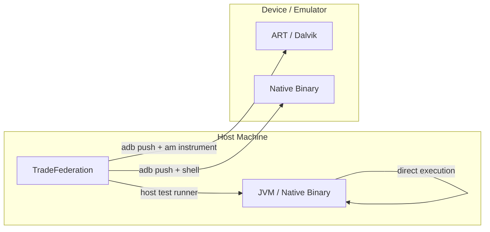

### 57.1.4  Presubmit 与 Postsubmit 的作用

Android 的 CI 流水线区分两个阶段：

- **Presubmit（提交前）**：测试在变更合并*之前*运行。这些测试必须快速且可靠。`TEST_MAPPING` 文件声明哪些测试在 presubmit 中运行。

- **Postsubmit（提交后）**：测试在变更合并*之后*运行，通常在完整构建上运行。较慢、较不稳定或资源消耗更大的测试属于这一阶段。

`TEST_MAPPING` 系统（第 57.4 节）是声明某个目录的 presubmit 和 postsubmit 测试覆盖范围的主要机制。

### 57.1.5  测试执行环境

了解测试*能够*在哪里执行，对于选择合适的模块类型至关重要。

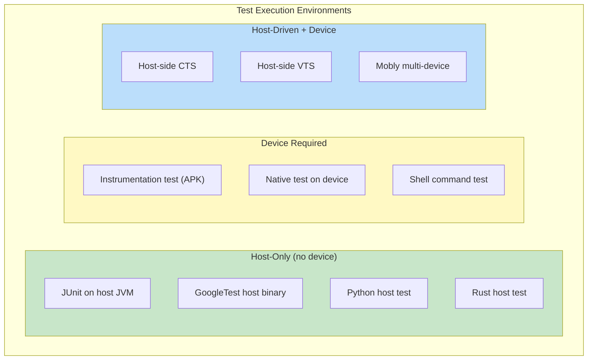

**仅主机（Host-only）**测试速度最快、最可靠。除构建机器外它们没有外部依赖，可以在 CI 中运行而无需分配设备。Ravenwood 和 Robolectric 使 Java/Kotlin 框架测试能够仅在主机上运行。

**需要设备（Device-required）**测试在实际硬件或模拟器上验证真实系统行为。对于硬件特定功能（摄像头、传感器、电话）以及验证系统集成而言，它们是必不可少的。

**主机驱动（Host-driven）**测试结合了主机侧逻辑与设备交互。运行在主机上的 Java 测试使用 `adb` 命令或 TradeFed 设备 API 来操控设备并验证行为。这种模式在 CTS 主机侧测试中很常见，因为测试需要安装/卸载应用、更改设备状态或验证跨进程行为。

### 57.1.6  测试规模注解

Android 使用规模注解对测试执行时间进行分类：

```java
import androidx.test.filters.SmallTest;
import androidx.test.filters.MediumTest;
import androidx.test.filters.LargeTest;

@SmallTest     // < 200ms, no I/O or network
@MediumTest    // < 1000ms, may use filesystem
@LargeTest     // No time limit, may use network/database
```

这些注解有多种用途：

1. TradeFed 可以按测试规模过滤，用于快速的 presubmit 运行
2. CI 流水线可以分配适当的超时时间
3. 开发人员可以快速了解测试的预期

AOSP 中使用的其他注解：

| 注解 | 用途 |
|-----------|---------|
| `@Presubmit` | 必须在 presubmit 中通过 |
| `@FlakyTest` | 已知不稳定，被排除在 presubmit 之外 |
| `@RequiresDevice` | 需要物理设备（非模拟器） |
| `@SecurityTest` | 与安全相关的测试 |
| `@AppModeFull` | 以完整（非即时）应用模式运行 |
| `@AppModeInstant` | 以即时应用模式运行 |
| `@CddTest` | 映射到某个 CDD 要求 |

### 57.1.7  测试隔离原则

Android 测试力求隔离以防止相互干扰：

1. **进程隔离**：每个 instrumentation 测试在自己的进程中运行
2. **用户隔离**：测试可以创建和销毁测试用户
3. **状态清理**：目标准备器（target preparers）在测试后恢复设备状态
4. **类加载器隔离**：Ravenwood 使用带有独立类加载器的 `IsolatedHostTest`
   按模块隔离

5. **分片隔离**：每个 TradeFed 分片获得克隆的配置对象

---

## 57.2  Trade Federation（TradeFed）

### 57.2.1  概述

Trade Federation——通常称为 TradeFed 或简称 TF——是 Android 的主要测试执行框架。它管理整个生命周期：设备分配、构建产物准备、测试执行、结果收集和重试逻辑。

源代码位置：
```
tools/tradefederation/
  core/         -- Main harness
  contrib/      -- Community-contributed modules
  prebuilts/    -- Pre-built JARs for bootstrapping
```

核心 Java 源代码树位于：
```
tools/tradefederation/core/src/com/android/tradefed/
  command/        -- CommandScheduler, CommandRunner
  config/         -- XML configuration parsing
  invoker/        -- TestInvocation, InvocationExecution
  invoker/shard/  -- ShardHelper, StrictShardHelper, DynamicShardHelper
  testtype/       -- Test runners (IRemoteTest implementations)
  targetprep/     -- Device preparers (flash, install APK, root, etc.)
  result/         -- Result reporters and listeners
  retry/          -- BaseRetryDecision, RetryStatistics
  device/         -- Device abstraction (ITestDevice)
  build/          -- Build info providers
  suite/          -- Suite-level execution
```

### 57.2.2  架构

TradeFed 的架构围绕一个由定义明确的阶段组成的流水线构建，每个阶段由可在 XML 中配置的可插拔 Java 对象表示。

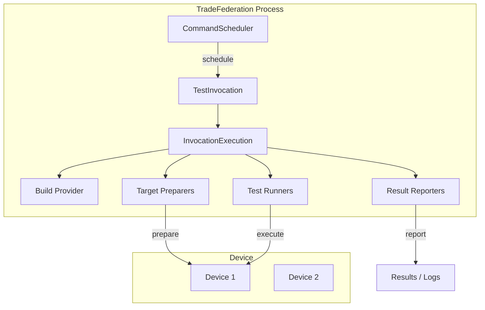

关键类与接口：

**CommandScheduler**（`tools/tradefederation/core/src/com/android/tradefed/command/CommandScheduler.java`）：
中央调度器，负责接收命令行调用、将其与可用设备匹配，并分发 `TestInvocation` 实例。它处理来自 `DeviceManager` 的设备分配，同时支持交互式控制台模式和无头批处理模式。

**TestInvocation**（`tools/tradefederation/core/src/com/android/tradefed/invoker/TestInvocation.java`）：
表示一次测试运行。它编排完整的流水线：

1. 获取构建产物（`IBuildProvider`）
2. 准备目标设备（`ITargetPreparer`）
3. 运行测试（`IRemoteTest`）
4. 收集结果（`ITestInvocationListener`）
5. 清理（各准备器自己的 `tearDown`）

**InvocationExecution**（`tools/tradefederation/core/src/com/android/tradefed/invoker/InvocationExecution.java`）：
驱动上述各阶段的具体执行逻辑。对于沙箱化调用，`SandboxedInvocationExecution` 和 `ParentSandboxInvocationExecution` 提供隔离。

### 57.2.3  配置系统

TradeFed 使用 XML 配置文件来描述测试计划。一个配置指定：

```xml
<configuration description="Example test config">
    <build_provider class="com.android.tradefed.build.BootstrapBuildProvider" />

    <target_preparer class="com.android.tradefed.targetprep.DeviceSetup" />
    <target_preparer class="com.android.tradefed.targetprep.TestAppInstallSetup">
        <option name="test-file-name" value="MyTest.apk" />
    </target_preparer>

    <test class="com.android.tradefed.testtype.AndroidJUnitTest">
        <option name="package" value="com.example.mytest" />
        <option name="runner" value="androidx.test.runner.AndroidJUnitRunner" />
    </test>

    <result_reporter class="com.android.tradefed.result.ConsoleResultReporter" />
</configuration>
```

配置由 `ConfigurationFactory`
（`tools/tradefederation/core/src/com/android/tradefed/config/ConfigurationFactory.java`）
和 `ConfigurationXmlParser` 解析。每个 `<option>` 标签通过 `OptionSetter` 注入目标对象，后者使用 Java 反射和 `@Option` 注解：

```java
// From InstrumentationTest, which AndroidJUnitTest extends
public class InstrumentationTest
        implements IDeviceTest, IRemoteTest, /* ... */ {
    @Option(name = "package",
            description = "The manifest package name of the Android test "
                + "application to run.")
    private String mPackageName = null;

    @Option(name = "runner",
            description = "The instrumentation test runner class name to use. "
                + "Will try to determine automatically if it is not specified.")
    private String mRunnerName = null;
    // ...
}
```

请注意，当 `runner` 选项未设置时，运行器会根据已安装的测试包自动检测，而不会默认使用固定的类名。

### 57.2.4  分片（Sharding）

分片将测试套件拆分到多个设备或调用上以便并行执行。TradeFed 提供了几种分片策略：

**ShardHelper**（`tools/tradefederation/core/src/com/android/tradefed/invoker/shard/ShardHelper.java`）：
创建分片调用的主要辅助类。它将配置对象克隆到每个分片以避免共享状态。源码如下：

```java
/** Helper class that handles creating the shards and scheduling them
 *  for an invocation. */
public class ShardHelper implements IShardHelper {
    public static final String LAST_SHARD_DETECTOR = "last_shard_detector";
    public static final String SHARED_TEST_INFORMATION = "shared_test_information";
    // ...
}
```

**StrictShardHelper**：确保每个分片获得确定性的、不重叠的测试用例分区。

**DynamicShardHelper**：使用基于 gRPC 的动态分片服务
（`ConfigurableGrpcDynamicShardingClient`），按需将测试分发到工作节点，
在测试持续时间差异较大时改善负载均衡。

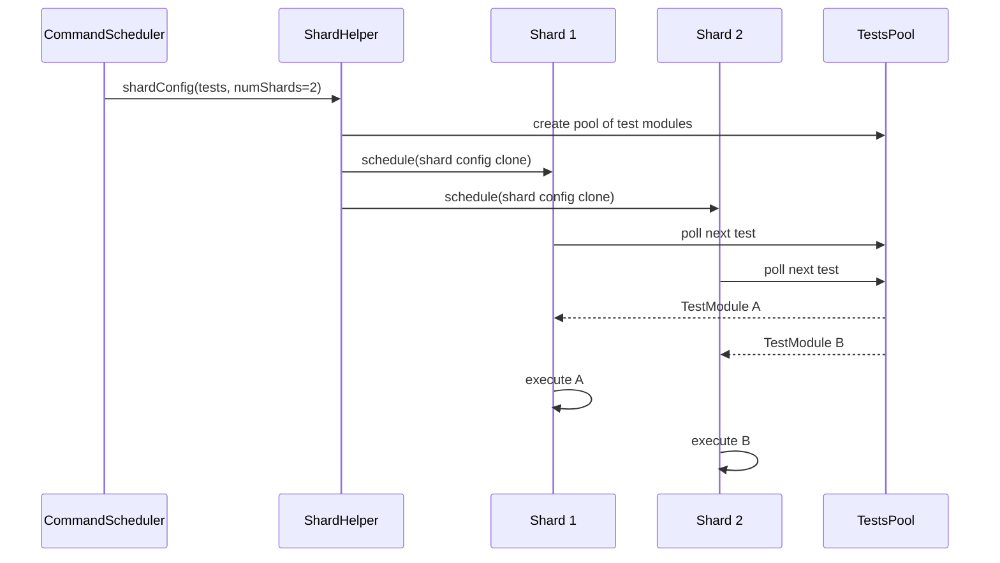

与分片相关的主要类：

- `TestsPoolPoller`：从共享的 `ITestsPool` 中拉取
- `LocalPool`：进程内池实现
- `RemoteDynamicPool`：基于 gRPC 的分布式池
- `ParentShardReplicate`：将单设备目标准备器设置复制到分片将涉及的所有设备

### 57.2.5  重试逻辑

TradeFed 内置了重试支持，用于处理不稳定测试和瞬时失败。重试子系统位于：

```
tools/tradefederation/core/src/com/android/tradefed/retry/
  BaseRetryDecision.java    -- Core retry logic
  IRetryDecision.java       -- Interface
  ResultAggregator.java     -- Aggregates results across retries
  RetryStatistics.java      -- Tracks retry counts and outcomes
```

`BaseRetryDecision` 实现了重试策略：

- **失败时重试**：只重新运行失败的测试用例
- **重试次数**：可配置的最大重试次数
- **结果聚合**：`ResultAggregator` 合并多次尝试的结果，
  对每个测试用例取最佳结果

重试决策通过 `IRetryDecision` 接入 `TestInvocation`，后者检查每个测试运行模块的结果并决定是否重试。

### 57.2.6  测试类型（运行器）

TradeFed 将源代码分为两个根目录。核心运行器契约
`IRemoteTest` 是 `invocation_interfaces` 根目录下的一个接口
（`tools/tradefederation/core/invocation_interfaces/com/android/tradefed/testtype/`）。
`IDeviceTest` 位于主 `src/` 根目录
（`tools/tradefederation/core/src/com/android/tradefed/testtype/`）。
TradeFed 内部运行器（如 `FakeTest` 和 `TfTestLauncher`）也位于该根目录下。
大多数具体的测试运行器实现位于独立的 `test_framework` 源代码根目录中，
路径为 `tools/tradefederation/core/test_framework/com/android/tradefed/testtype/`：

| 运行器类 | 用途 |
|-------------|---------|
| `AndroidJUnitTest` | Instrumentation 测试（设备上的 JUnit4/5） |
| `GTest` | 设备上的原生 GoogleTest 二进制 |
| `HostTest` | 主机 JVM 上的 JUnit 测试 |
| `IsolatedHostTest` | 隔离类加载器中的主机测试（Ravenwood） |
| `PythonBinaryHostTest` | 主机上的 Python 测试（`testtype/python/`） |
| `RustBinaryHostTest` | 主机上的 Rust 测试二进制（`testtype/rust/`） |
| `FakeTest` | 生成假结果，用于测试 TF 自身 |
| `TfTestLauncher` | 启动另一个 TF 进程 |

`IRemoteTest` 接口是所有运行器实现的契约：

```java
public interface IRemoteTest {
    void run(TestInformation testInfo, ITestInvocationListener listener)
        throws DeviceNotAvailableException;
}
```

### 57.2.7  目标准备器

目标准备器在测试运行前设置设备。与 57.2.6 节中的运行器一样，准备器也分布在两个源代码根目录中。`DeviceSetup`、`DeviceFlashPreparer` 和 `TestAppInstallSetup` 位于
`tools/tradefederation/core/src/com/android/tradefed/targetprep/`。
`RootTargetPreparer`、`StopServicesSetup` 和 `PushFilePreparer` 位于
`tools/tradefederation/core/test_framework/com/android/tradefed/targetprep/`。主要准备器：

| 准备器 | 用途 |
|----------|---------|
| `DeviceSetup` | 配置设备设置（屏幕、语言环境等） |
| `DeviceFlashPreparer` | 用构建镜像刷机设备 |
| `RootTargetPreparer` | 确保设备具有 root 权限 |
| `TestAppInstallSetup` | 安装测试 APK |
| `StopServicesSetup` | 在测试期间停止框架服务 |
| `PushFilePreparer` | 将文件推送到设备 |

`ITargetPreparer` 接口同时提供设置和清理语义——
`tearDown` 是接口自身的默认方法：

```java
public interface ITargetPreparer {
    void setUp(TestInformation testInfo) throws TargetSetupError,
        BuildError, DeviceNotAvailableException;

    default void tearDown(TestInformation testInformation, Throwable e)
        throws DeviceNotAvailableException { /* ... */ }
}
```

历史上的 `ITargetCleaner` 接口已被弃用，现在是一个空的标记接口
（`public interface ITargetCleaner extends ITargetPreparer {}`），
仅为兼容性而保留；其 `tearDown` 已移至 `ITargetPreparer`。

### 57.2.8  套件模式

TradeFed 的套件模式（`ITestSuite`、`BaseTestSuite`）是
CTS、VTS、MTS 及其他合规套件的基础。主要类：

```
tools/tradefederation/core/src/com/android/tradefed/testtype/suite/
  ITestSuite.java                -- Base suite runner
  BaseTestSuite.java             -- Configurable suite loading
  ModuleDefinition.java          -- Represents a single test module
  ModuleListener.java            -- Per-module result listener
  ModuleSplitter.java            -- Splits modules for sharding
  SuiteModuleLoader.java         -- Loads module configs from disk
  TestMappingSuiteRunner.java    -- Runs tests from TEST_MAPPING
  GranularRetriableTestWrapper.java -- Per-test-case retry
```

`ModuleDefinition` 封装了运行单个模块所需的一切：
准备器、测试和清理。`SuiteModuleLoader` 在测试用例目录中发现
`*.config` 文件并实例化 `ModuleDefinition` 对象。

### 57.2.9  调用生命周期详解

一次完整的 TradeFed 调用遵循以下详细生命周期：

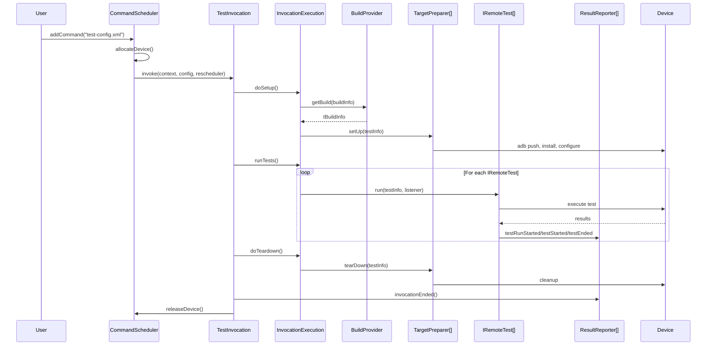

各阶段的关键细节：

**构建供给**（`IBuildProvider`）：

- `BootstrapBuildProvider`：通过查询测试设备来引导构建信息
- `LocalDeviceBuildProvider`：使用本地构建的产物
- `CommandLineBuildInfoBuilder`：根据命令行参数构造构建信息

**目标准备**（`ITargetPreparer`）：
准备器按顺序执行，它们的清理则按相反顺序执行
（栈式纪律）。常见的准备序列：

1. 刷机设备（`DeviceFlashPreparer`）
2. 等待启动完成
3. 配置设备设置（`DeviceSetup`）
4. 安装测试 APK（`TestAppInstallSetup`）
5. 推送数据文件（`PushFilePreparer`）
6. 必要时为设备授予 root 权限（`RootTargetPreparer`）

**测试执行**（`IRemoteTest`）：
一次调用中可以配置多个测试。每个测试通过
`ITestInvocationListener` 回调接口报告结果：

```java
public interface ITestInvocationListener {
    void invocationStarted(IInvocationContext context);
    void testRunStarted(String runName, int testCount);
    void testStarted(TestDescription test);
    void testEnded(TestDescription test, HashMap<String, Metric> metrics);
    void testFailed(TestDescription test, FailureDescription failure);
    void testRunEnded(long elapsedTime, HashMap<String, Metric> metrics);
    void invocationEnded(long elapsedTime);
}
```

### 57.2.10  多设备测试

TradeFed 支持多设备测试配置，即单个测试模块需要多台设备。配置使用 `<device>` 标签：

```xml
<configuration description="Multi-device test">
    <device name="device1">
        <target_preparer class="...TestAppInstallSetup">
            <option name="test-file-name" value="App1.apk" />
        </target_preparer>
    </device>
    <device name="device2">
        <target_preparer class="...TestAppInstallSetup">
            <option name="test-file-name" value="App2.apk" />
        </target_preparer>
    </device>
    <test class="com.example.MultiDeviceTest" />
</configuration>
```

测试通过 `TestInformation` 访问设备：

```java
ITestDevice device1 = testInfo.getContext().getDevice("device1");
ITestDevice device2 = testInfo.getContext().getDevice("device2");
```

### 57.2.11  沙箱模式

TradeFed 可以在沙箱中运行调用以实现隔离。沙箱使用独立的类加载器或进程，以防止测试代码影响测试框架本身。这对于在 CI 中运行不受信任的测试代码至关重要：

- `SandboxedInvocationExecution`：在沙箱内运行
- `ParentSandboxInvocationExecution`：在外部进行协调

### 57.2.12  结果报告

TradeFed 支持同时使用多个结果报告器：

| 报告器 | 输出 |
|----------|--------|
| `ConsoleResultReporter` | 终端输出 |
| `TextResultReporter` | 纯文本文件 |
| `XmlResultReporter` | JUnit XML 格式 |
| `InvocationProtoResultReporter` | Protocol buffer 格式 |
| `SuiteResultReporter` | 套件级结果摘要 |
| `LogSaverResultForwarder` | 将日志保存到存储 |

结果包括：

- 每个测试用例的通过/失败状态
- 失败时的堆栈跟踪
- 测试指标（计时、自定义指标）
- 设备日志（logcat、bugreport）
- 失败时的屏幕截图

---

## 57.3  atest

### 57.3.1  概述

`atest` 是面向开发者的命令行工具，用于自动化"构建—安装—测试"的循环。它将人类可读的测试引用转换为 TradeFederation 调用。

源代码：`tools/asuite/atest/atest_main.py`

来自模块 docstring：

```python
"""Command line utility for running Android tests through TradeFederation.

atest helps automate the flow of building test modules across the Android
code base and executing the tests via the TradeFederation test harness.

atest is designed to support any test types that can be ran by TradeFederation.
"""
```

### 57.3.2  架构

atest 的执行流程分为三个步骤，由 `Steps` 数据类控制：

```python
@dataclasses.dataclass
class Steps:
  """A dataclass that stores enabled steps."""
  build: bool
  install: bool
  test: bool
```

主入口点创建一个 `AtestMain` 对象并调用 `_run_all_steps()`，
后者负责编排：

1. **测试发现**——找到与用户引用匹配的测试模块
2. **构建**——调用构建系统编译测试及其依赖项
3. **测试**——通过 TradeFederation 执行

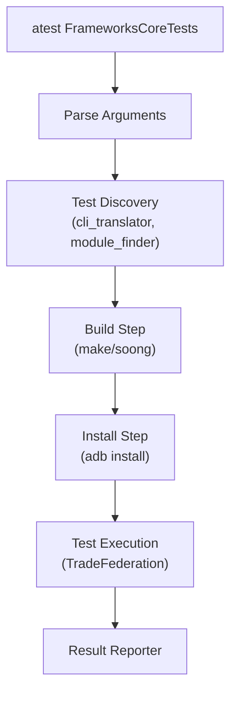

### 57.3.3  测试发现

atest 支持多种测试引用格式：

```bash
# By module name
atest FrameworksCoreTests

# By module:class
atest FrameworksCoreTests:android.os.BundleTest

# By file path
atest frameworks/base/core/tests/coretests/src/android/os/BundleTest.java

# By package
atest com.android.server.pm

# By TEST_MAPPING (current directory)
atest --test-mapping

# By class name
atest android.os.BundleTest
```

测试发现由 `tools/asuite/atest/test_finders/` 中的 finder 处理：

- `module_finder.py`——搜索 module-info.json 数据库
- `cache_finder.py`——使用之前运行的缓存结果
- `tf_integration_finder.py`——查找 TradeFed 集成配置
- `suite_plan_finder.py`——查找套件计划（CTS、VTS 等）
- `smart_test_finder/`——基于 AI/ML 的智能测试选择

`cli_translator.py` 模块协调各个 finder，并将用户输入转换为运行器可以执行的 `TestInfo` 对象。

### 57.3.4  测试执行与过滤

atest 通过额外参数将许多选项传递给 TradeFederation，使用
`tools/asuite/atest/atest_main.py` 中定义的 `_ARG_TO_CONST_MAP` 字典：

```python
_ARG_TO_CONST_MAP = {
    'all_abi': constants.ALL_ABI,
    'annotation_filter': constants.ANNOTATION_FILTER,
    'collect_tests_only': constants.COLLECT_TESTS_ONLY,
    'custom_args': constants.CUSTOM_ARGS,
    'device_only': constants.DEVICE_ONLY,
    'disable_teardown': constants.DISABLE_TEARDOWN,
    'dry_run': constants.DRY_RUN,
    'host': constants.HOST,
    'instant': constants.INSTANT,
    'iterations': constants.ITERATIONS,
    'serial': constants.SERIAL,
    'sharding': constants.SHARDING,
    'test_filter': constants.TEST_FILTER,
    'test_timeout': constants.TEST_TIMEOUT,
    # ...
}
```

主要过滤选项：

- `--test-filter`：按类名或方法名过滤
- `--annotation-filter`：按 Java 注解包含/排除
- `--include-filter` / `--exclude-filter`：TradeFed 级别的模块过滤
- `--host`：强制主机侧执行
- `--device-only`：强制设备侧执行

### 57.3.5  执行模式验证

atest 会验证不会以相互冲突的方式混合仅主机测试和仅设备测试。来自 `_validate_exec_mode()`：

```python
def _validate_exec_mode(args, test_infos: list[TestInfo], host_tests=None):
  all_device_modes = {x.get_supported_exec_mode() for x in test_infos}
  # In the case of '$atest <device-only> --host', exit.
  if (host_tests or args.host) and device_only_test_detected:
    # ... error and exit
  # In the case of '$atest <host-only>', we add --host to run on host-side.
  if not args.host and host_tests is None and not device_only_test_detected:
    args.host = host_only_test_detected
```

### 57.3.6  常用 atest 命令

```bash
# Run a single module
atest CtsNetTestCases

# Run a specific test class
atest CtsNetTestCases:android.net.cts.ConnectivityManagerTest

# Run a specific method
atest CtsNetTestCases:android.net.cts.ConnectivityManagerTest#testGetActiveNetwork

# Run tests from TEST_MAPPING in current directory
atest

# Run only host tests
atest --host FrameworksMockingServicesTests

# Run with sharding across 4 devices
atest LargeTestSuite --sharding 4

# Dry run (show TF command without executing)
atest --dry-run CtsNetTestCases

# Run with iterations for flakiness detection
atest --iterations 10 MyFlakyTest

# Run with coverage
atest --experimental-coverage MyTest
```

### 57.3.7  测试运行器注册表

atest 在 `test_runner_handler.py` 中维护测试运行器的注册表。
每个运行器处理不同的测试执行后端：

```python
_TEST_RUNNERS = {
    atest_tf_test_runner.AtestTradefedTestRunner.NAME: (
        atest_tf_test_runner.AtestTradefedTestRunner
    ),
    mobly_test_runner.MoblyTestRunner.NAME: (
        mobly_test_runner.MoblyTestRunner
    ),
    robolectric_test_runner.RobolectricTestRunner.NAME: (
        robolectric_test_runner.RobolectricTestRunner
    ),
    suite_plan_test_runner.SuitePlanTestRunner.NAME: (
        suite_plan_test_runner.SuitePlanTestRunner
    ),
    vts_tf_test_runner.VtsTradefedTestRunner.NAME: (
        vts_tf_test_runner.VtsTradefedTestRunner
    ),
}
```

各运行器：

- **AtestTradefedTestRunner**：默认运行器，为大多数测试调用 TradeFed
- **MoblyTestRunner**：用于基于 Python 的多设备测试，使用 Mobly
  框架

- **RobolectricTestRunner**：专门用于 Robolectric 测试的运行器
- **SuitePlanTestRunner**：运行完整的套件计划（cts、vts 等）
- **VtsTradefedTestRunner**：VTS 专用的 TradeFed 运行器

### 57.3.8  CLITranslator

`CLITranslator` 类（`tools/asuite/atest/cli_translator.py`）是
atest 测试发现的大脑。源代码如下：

```python
class CLITranslator:
  """CLITranslator class contains public method translate() and some
  private helper methods. The atest tool can call the translate() method
  with a list of strings, each string referencing a test to run.
  Translate() will "translate" this list of test strings into a list of
  build targets and a list of TradeFederation run commands.

  Translation steps for a test string reference:
      1. Narrow down the type of reference the test string could be,
         i.e. whether it could be referencing a Module, Class,
         Package, etc.
      2. Try to find the test files assuming the test string is one
         of these types of reference.
      3. If test files found, generate Build Targets and the
         Run Command.
  """
```

转换过程使用 `module-info.json`——由 Soong 生成的构建中所有模块的数据库。
该数据库将模块名映射到其构建路径、安装路径和测试配置文件。

### 57.3.9  _AtestMain 类

主入口点是 `atest_main.py` 中的 `_AtestMain` 类：

```python
class _AtestMain:
  """Entry point of atest script."""

  def __init__(self, argv: list[str]):
    self._argv: list[str] = argv
    self._banner_printer: banner.BannerPrinter = None
    self._steps: Steps = None
    self._results_dir: str = None
    self._mod_info: module_info.ModuleInfo = None
    self._test_infos: list[test_info.TestInfo] = None
    self._test_execution_plan: _TestExecutionPlan = None
    self._acloud_proc: subprocess.Popen = None
    self._acloud_report_file: str = None
    self._test_info_loading_duration: float = 0
    self._build_duration: float = 0
```

`run()` 方法编排完整的流程：

1. 解析参数（支持配置文件覆盖）
2. 验证环境（ANDROID_BUILD_TOP 等）
3. 如有需要，启动 acloud/AVD
4. 发现测试模块（CLITranslator）
5. 验证执行模式（主机 vs 设备）
6. 构建所需模块
7. 通过 TradeFed 执行测试
8. 报告结果

### 57.3.10  atest 中的 TEST_MAPPING 集成

当在包含 TEST_MAPPING 的目录中不带参数调用时，atest 会自动发现并运行 presubmit 测试：

```python
def is_from_test_mapping(test_infos):
  """Check that the test_infos came from TEST_MAPPING files."""
  return list(test_infos)[0].from_test_mapping
```

TEST_MAPPING 测试被拆分为设备组和主机组：

```python
def _split_test_mapping_tests(test_infos):
  """Split Test Mapping tests into 2 groups: device and host tests."""
  assert is_from_test_mapping(test_infos)
  host_test_infos = {info for info in test_infos if info.host}
  device_test_infos = {info for info in test_infos if not info.host}
  return device_test_infos, host_test_infos
```

### 57.3.11  智能测试选择

atest 支持智能测试选择（`--sts` 标志），使用 ML/启发式方法
来确定哪些测试与给定的代码变更最相关：

```python
_SMART_TEST_SELECTION_FLAG = '--sts'
```

智能测试选择：

1. 分析当前变更的 `git diff`
2. 将变更文件映射到历史上相关的测试模块
3. 只运行最有影响的测试
4. 显著减少 presubmit 测试时间

### 57.3.12  设备可用性检查

atest 在运行设备测试前验证设备可用性：

```python
def _validate_adb_devices(args, test_infos):
  """Validate the availability of connected devices via adb command."""
  if not parse_steps(args).test:
    return
  if args.no_checking_device:
    return
  all_device_modes = {x.get_supported_exec_mode() for x in test_infos}
  if constants.DEVICE_TEST in all_device_modes:
    if (not any((args.host, args.start_avd, args.acloud_create))
        and not atest_utils.get_adb_devices()):
      err_msg = (
          f'Stop running test(s): {", ".join(device_tests)} '
          f'require a device.')
      # ... exit with DEVICE_NOT_FOUND
```

### 57.3.13  多设备支持

atest 可以检测测试何时需要多台设备：

```python
def get_device_count_config(test_infos, mod_info):
  """Get the amount of desired devices from the test config."""
  max_count = 0
  for tinfo in test_infos:
    test_config, _ = test_finder_utils.get_test_config_and_srcs(
        tinfo, mod_info)
    if test_config:
      devices = atest_utils.get_config_device(test_config)
      if devices:
        max_count = max(len(devices), max_count)
  return max_count
```

```mermaid
flowchart TB
    subgraph atest["atest Architecture"]
        CLI["Command Line Interface<br>arg_parser.py"]
        Config["Config File<br>atest_configs.py"]
        Translator["CLITranslator<br>cli_translator.py"]

        subgraph Finders["Test Finders"]
            MF["ModuleFinder"]
            CF["CacheFinder"]
            TFF["TFIntegrationFinder"]
            SPF["SuitePlanFinder"]
            STF["SmartTestFinder"]
        end

        subgraph Runners["Test Runners"]
            ATF["AtestTradefedTestRunner"]
            Mobly["MoblyTestRunner"]
            Robo_R["RobolectricTestRunner"]
            Suite_R["SuitePlanTestRunner"]
            VTS_R["VtsTradefedTestRunner"]
        end

        Results["ResultReporter<br>result_reporter.py"]
    end

    CLI --> Config
    Config --> Translator
    Translator --> Finders
    Finders --> |"TestInfo"| Runners
    Runners --> Results
```

### 57.3.14  执行计划与 ACME 模式

上面的默认路径生成一个内部的 `_TestExecutionPlan`
（`tools/asuite/atest/atest_main.py`），它是"本次调用的测试将如何执行"
的抽象。`_TestExecutionPlan.create()` 选择两种具体计划之一：
TEST_MAPPING 运行使用 `_TestMappingExecutionPlan`，
显式模块/类引用使用 `_TestModuleExecutionPlan`。
每个计划暴露 `required_build_targets()`、`requires_device_update()`
和 `execute()`。主循环可以用它们来决定构建什么、是否需要刷设备，
以及如何运行。运行器代码不需要知道测试是如何被选择的。

Android 17 在此之上增加了一个称为 **ACME** 的声明式选择模型。
开发者（或 CI 触发器）不再指定模块名。开发者指定在 protobuf 中定义的
*测试触发器*和*执行计划*（`test_configs_proto`，
以 `test_configs_pb2` 导入）。然后 atest 将这些解析为要运行的模块。
入口点注册在 `tools/asuite/atest/arg_parser.py` 中，
由 `tools/asuite/atest/acme/` 下的模块处理：

| 标志 | 处理器 | 含义 |
|------|---------|---------|
| `--run-affected-triggers` | `acme/run_affected_triggers_mode.py` | 运行受本地修改文件影响的每个测试触发器 |
| `--test-execution-plans` | `acme/run_direct_mode.py` | 直接运行命名的 `TestExecutionPlan` |
| `--test-triggers` | `acme/run_direct_mode.py` | 运行命名触发器引用的执行计划 |
| `--test-workflows` | `acme/run_direct_mode.py` | 运行命名的 workflow |

`acme_utils.py` 遍历 `test_configs.triggers`，
`get_execution_plans_for_test_triggers()` 将触发器名称映射到它们引用的
workflow 和执行计划。受影响触发器模式复用
`TEST_MAPPING`/`test_mapping` 机制来计算一个 diff 触及了哪些触发器。
开发者可以用它在本地准确复现 presubmit 将为其变更运行的测试，
而无需手写模块列表。

在测试框架一侧，Android 17 增加了一个配套的 TradeFed 套件运行器。
`ExecutionPlanSuiteRunner`
（`tools/tradefederation/core/src/com/android/tradefed/testtype/suite/ExecutionPlanSuiteRunner.java`）
及其面向 atest 的子类 `AtestExecutionPlanSuiteRunner`
（`tools/tradefederation/core/test_framework/com/android/tradefed/testtype/suite/AtestExecutionPlanSuiteRunner.java`，
由 `res/config/atest-execution-plan.xml` 配置）将预计算的执行计划
作为套件运行，而不是在 TradeFed 内部重新推导模块。
在该功能稳定期间，其使用受 rollout 标志的门控（下一节）。

### 57.3.15  由 rollout 控制的功能

由于 atest 会持续发布给数千名开发者，有风险的行为变更会通过百分比
灰度发布引入，而不是硬性开关。`tools/asuite/atest/rollout_control.py`
定义了 `RolloutControlledFeature` 对象，每个对象都有一个
`rollout_percentage` 和一个用于在本地强制开启或关闭该功能的
`env_control_flag`。每个对象还可以有一个以运行 ID 为随机化键的特性，
因此单个开发者在一次运行内看到一致的行为。Android 17 包含这些受控功能，
其中还包括：

| 功能 | 环境标志 | 说明 |
|---------|----------|-------|
| Rolling TradeFed subprocess output | `ROLLING_TF_SUBPROCESS_OUTPUT` | 实时流式输出 TF 子进程输出（100%） |
| TradeFed preparer incremental setup | `TF_PREPARER_INCREMENTAL_SETUP` | 跨运行复用先前的设备状态（100%） |
| Atest indexing parallelization | `ATEST_INDEXING_PARALLEL` | 并行解析 module-info/index 文件 |
| `AtestExecutionPlanSuiteRunner` | `USE_ATEST_EXECUTION_PLAN_SUITE_RUNNER` | 通过新的 TF 执行计划运行器运行 |
| Auto rebuild module info | `AUTO_REBUILD_MODULE_INFO` | 自动重建过期的 `module-info.json` |
| Early device check | `EARLY_DEVICE_CHECK` | 当设备测试没有设备时快速失败 |

要忽略灰度百分比强制启用某项功能，请设置其环境标志
（例如 `ATEST_INDEXING_PARALLEL=true atest ...`）。
这就是 Android 17 可见的提速——并行索引和增量准备器设置——背后的机制，
无需让每位开发者一次性全部采用。

---

## 57.4  TEST_MAPPING

### 57.4.1  用途与格式

`TEST_MAPPING` 文件是与源代码放在一起的 JSON 文件，声明当该目录（或其子目录）中的文件发生变更时应运行哪些测试。它们是代码变更与 presubmit/postsubmit 测试选择之间的纽带。

### 57.4.2  JSON 结构

`TEST_MAPPING` 文件包含一个 JSON 对象，其键是*测试组*
（通常为 `presubmit`、`postsubmit`，或自定义名称）。值是测试对象的数组。

来自 `system/libbase/TEST_MAPPING` 的**简单示例**：

```json
{
  "presubmit": [
    {
      "name": "libbase_test"
    }
  ],
  "hwasan-presubmit": [
    {
      "name": "libbase_test"
    }
  ]
}
```

来自 `frameworks/base/TEST_MAPPING` 的**复杂示例**：

```json
{
  "presubmit": [
    {
      "name": "ManagedProvisioningTests"
    },
    {
      "file_patterns": [
        "ApexManager\\.java",
        "SystemServer\\.java",
        "services/tests/apexsystemservices/.*"
      ],
      "name": "ApexSystemServicesTestCases"
    },
    {
      "name": "FrameworksUiServicesTests"
    },
    {
      "name": "FrameworksCoreTests_Presubmit"
    }
  ],
  "postsubmit-managedprofile-stress": [
    {
      "name": "ManagedProfileLifecycleStressTest"
    }
  ],
  "auto-postsubmit": [
    {
      "name": "FrameworksUiServicesTests"
    },
    {
      "name": "TestablesTests"
    }
  ],
  "wear-cts-presubmit": [
    {
      "name": "CtsWidgetTestCases",
      "options": [
        {"include-filter": "android.widget.cts.RemoteViewsTest"},
        {"include-filter": "android.widget.cts.TextViewTest"}
      ]
    }
  ]
}
```

### 57.4.3  测试对象字段

| 字段 | 类型 | 说明 |
|-------|------|-------------|
| `name` | string | 模块名（必须与构建中的测试模块匹配） |
| `host` | boolean | 如果为 true，则作为主机测试运行 |
| `file_patterns` | string[] | 正则表达式模式；仅在匹配的文件发生变更时运行测试 |
| `options` | object[] | TradeFed 选项（include-filter、exclude-filter 等） |

### 57.4.4  测试组

| 测试组 | 运行时机 | 典型内容 |
|-------|-------------|----------------|
| `presubmit` | 合并前，每次 CL | 快速、可靠的测试 |
| `presubmit-large` | 合并前，更多资源 | 更大规模的集成测试 |
| `postsubmit` | 合并后 | 较慢的测试、压力测试 |
| `ravenwood-presubmit` | 合并前，仅主机 | Ravenwood 框架测试 |
| `hwasan-presubmit` | 合并前，HWASAN 构建 | 内存安全测试 |
| `auto-postsubmit` | 合并后，汽车目标 | 汽车专用测试 |
| `wear-cts-presubmit` | 合并前，Wear 目标 | Wear 专用的 CTS 子集 |
| 自定义组 | CI 定义 | 任意自定义分组 |

### 57.4.5  继承与目录遍历

TEST_MAPPING 系统会从变更文件所在位置沿目录树*向上*遍历。
在 `frameworks/base/TEST_MAPPING` 中声明的测试适用于
`frameworks/base/` 下任何位置的变更。这使得单个文件即可提供广泛的测试覆盖，
同时子目录可以添加自己更具体的测试。

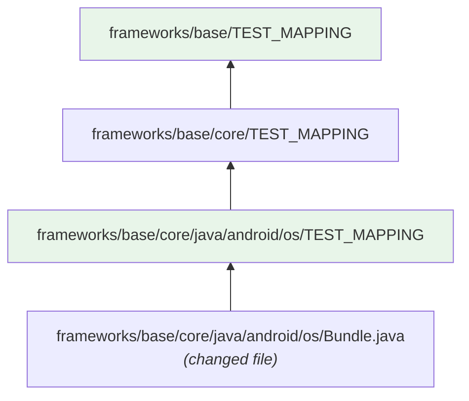

### 57.4.6  TestMappingSuiteRunner

TradeFed 的 `TestMappingSuiteRunner`
（`tools/tradefederation/core/src/com/android/tradefed/testtype/suite/TestMappingSuiteRunner.java`）
加载并执行来自 TEST_MAPPING 文件的测试。它：

1. 收集变更路径的所有 TEST_MAPPING 文件
2. 按请求的测试组过滤（presubmit、postsubmit 等）
3. 应用 file_patterns 过滤
4. 将模块名解析为测试配置
5. 通过标准套件流水线执行

### 57.4.7  TEST_MAPPING 最佳实践

1. **保持 presubmit 快速**：只包含能在 5 分钟内完成的测试
2. **使用 file_patterns**：对于大型目录，将测试范围限定到相关的变更
3. **避免重复**：如果父目录已经测试了某个模块，就不要在子目录中
    再次声明它

4. **按逻辑对测试分组**：使用自定义组面向专门的目标
    （汽车、wear 等）

5. **尽可能指定 host**：为仅主机测试添加 `"host": true`，
    以避免不必要的设备分配

6. **使用 options 进行过滤**：应用 `include-filter`，只从大型模块中运行
    相关的测试类

### 57.4.8  查找 TEST_MAPPING 文件

CI 系统和 atest 都会遍历目录树以查找 TEST_MAPPING 文件。
搜索从变更文件的目录开始，向上遍历至仓库根目录。

```python
# From cli_translator.py
# Pattern used to identify comments in TEST_MAPPING.
_COMMENTS_RE = re.compile(r'(?m)[\s\t]*(#|//).*|(\".*?\")')
```

TEST_MAPPING 支持注释（以 `//` 或 `#` 开头的行），这并非标准 JSON。
解析器会在 JSON 解析前剥离这些注释。

### 57.4.9  验证

TEST_MAPPING 文件在 presubmit 时进行验证。验证检查：

- 有效的 JSON（在剥离注释后）
- 所有引用的测试模块都存在于构建中
- 测试组名称与已知组匹配
- 选项是有效的 TradeFed 选项
- 没有循环引用

---

## 57.5  构建系统测试模块

### 57.5.1  概述

Soong 构建系统为每种受支持的测试语言和框架提供了专门的模块类型。
每种模块类型封装了：

- 编译规则
- TradeFed XML 配置的自动生成
- 测试套件成员身份
- 安装到正确的目录

### 57.5.2  android_test（Java/Kotlin Instrumentation 测试）

最常见的 Java 测试模块类型。它构建一个包含测试代码的 APK，
并通过 `am instrument` 将其安装到设备上。

```blueprint
android_test {
    name: "FrameworksCoreTests",
    srcs: ["src/**/*.java"],
    static_libs: [
        "androidx.test.runner",
        "androidx.test.rules",
        "mockito-target-minus-junit4",
        "truth",
    ],
    test_suites: ["device-tests"],
    platform_apis: true,
    certificate: "platform",
    instrumentation_for: "framework",
}
```

构建系统使用 `build/soong/tradefed/autogen.go` 中的
`AutoGenInstrumentationTestConfig()` 自动生成 `AndroidTest.xml`
（即 TradeFed 配置）。

### 57.5.3  cc_test（原生 GoogleTest）

定义于 `build/soong/cc/test.go`。通过以下方式注册：

```go
func init() {
    android.RegisterModuleType("cc_test", TestFactory)
    android.RegisterModuleType("cc_test_library", TestLibraryFactory)
    android.RegisterModuleType("cc_benchmark", BenchmarkFactory)
    android.RegisterModuleType("cc_test_host", TestHostFactory)
    android.RegisterModuleType("cc_benchmark_host", BenchmarkHostFactory)
}
```

来自源码的关键属性：

```go
type TestLinkerProperties struct {
    // if set, build against the gtest library. Defaults to true.
    Gtest *bool

    // if set, use the isolated gtest runner. Defaults to false.
    Isolated *bool
}

type TestBinaryProperties struct {
    // list of files or filegroup modules that provide data
    Data []string `android:"path,arch_variant"`

    // the name of the test configuration
    Test_config *string `android:"path,arch_variant"`

    // Add RootTargetPreparer to auto generated test config
    Require_root *bool

    // Add RunCommandTargetPreparer to stop framework
    Disable_framework *bool

    // Flag to indicate whether to create test config automatically
    Auto_gen_config *bool

    // Add parameterized mainline modules
    Test_mainline_modules []string

    // Install the test into a folder named for the module
    Per_testcase_directory *bool
}
```

当 `gtest` 为 true（默认值）时，构建系统会自动链接
`libgtest_main` 和 `libgtest`：

```go
func (test *testDecorator) linkerDeps(ctx BaseModuleContext, deps Deps) Deps {
    if test.gtest() {
        if ctx.useSdk() && ctx.Device() {
            deps.StaticLibs = append(deps.StaticLibs,
                "libgtest_main_ndk_c++", "libgtest_ndk_c++")
        } else if test.isolated(ctx) {
            deps.StaticLibs = append(deps.StaticLibs, "libgtest_isolated_main")
            deps.SharedLibs = append(deps.SharedLibs, "liblog")
        } else {
            deps.StaticLibs = append(deps.StaticLibs, "libgtest_main", "libgtest")
        }
    }
    return deps
}
```

GTest 标志根据目标平台设置：

```go
func (test *testDecorator) linkerFlags(ctx ModuleContext, flags Flags) Flags {
    if !test.gtest() {
        return flags
    }
    flags.Local.CFlags = append(flags.Local.CFlags, "-DGTEST_HAS_STD_STRING")
    if ctx.Host() {
        switch ctx.Os() {
        case android.Windows:
            flags.Local.CFlags = append(flags.Local.CFlags, "-DGTEST_OS_WINDOWS")
        case android.Linux:
            flags.Local.CFlags = append(flags.Local.CFlags, "-DGTEST_OS_LINUX")
        case android.Darwin:
            flags.Local.CFlags = append(flags.Local.CFlags, "-DGTEST_OS_MAC")
        }
    } else {
        flags.Local.CFlags = append(flags.Local.CFlags, "-DGTEST_OS_LINUX_ANDROID")
    }
    return flags
}
```

示例 `cc_test`：

```blueprint
cc_test {
    name: "libbase_test",
    defaults: ["libbase_test_defaults"],
    srcs: [
        "chrono_utils_test.cpp",
        "endian_test.cpp",
        "errors_test.cpp",
        "expected_test.cpp",
        "file_test.cpp",
        "logging_test.cpp",
        "mapped_file_test.cpp",
        "parsebool_test.cpp",
        "parsedouble_test.cpp",
        "parseint_test.cpp",
        "result_test.cpp",
        "scopeguard_test.cpp",
        "stringprintf_test.cpp",
        "strings_test.cpp",
    ],
    test_suites: ["device-tests"],
}
```

### 57.5.4  进程隔离的 GoogleTest（gtest_extras）

在 57.5.3 中看到的 `isolated: true` 属性会将默认的
`libgtest_main` 替换为 `libgtest_isolated_main`，后者是进程隔离 gtest
运行器的静态库入口点。该运行器位于
`system/testing/gtest_extras/`（约 2.3K 行运行器代码，含其自身的测试约 4.8K 行）。
原生的运行器在一个地址空间中运行每个测试方法。而隔离运行器
（`gtest_isolated/`）则为每个测试派生一个全新的子进程
（`system/testing/gtest_extras/gtest_isolated/Isolate.cpp` 中的
`fork()`）并等待其结束。它按照可配置的作业数
（`gtest_isolated/Options.h`）同时运行多个子进程。

进程隔离换来了原生单进程运行器无法提供的两样东西。首先，崩溃或破坏
全局状态的测试不再会导致二进制文件其余部分的崩溃。故障被限制在其
自己的子进程中。父进程记录终止信号（`Isolate.cpp` 通过
`WIFSIGNALED` 报告 `terminated by signal:`），其余测试继续运行。
其次，每个子进程都有一个按测试计算的墙钟时间截止期限
（`Options.h` 中的 `deadline_threshold_ms`）。挂起的测试会被终止并
报告为超时，而不是卡住整个运行。

底层套件有意演练故障和信号处理路径：bionic、ART 的 native-bridge
测试以及 jemalloc/scudo 分配器测试。因此，它们选择启用
`isolated: true` 并链接 `libgtest_isolated`。除此之外，该运行器是
即插即用的：57.5.3 中相同的由 GoogleTest 编写的 `cc_test` 源码
可以基于任一入口点构建。

### 57.5.5  cc_test_host

`cc_test` 的一个便捷变体，仅面向主机：

```go
func TestHostFactory() android.Module {
    module := NewTest(android.HostSupported)
    return module.Init()
}
```

### 57.5.6  rust_test

定义于 `build/soong/rust/test.go`。属性与 `cc_test` 类似：

```go
type TestProperties struct {
    No_named_install_directory *bool
    Test_config *string `android:"path,arch_variant"`
    Test_config_template *string `android:"path,arch_variant"`
    Test_suites []string `android:"arch_variant"`
    Data []string `android:"path,arch_variant"`
    Data_libs []string `android:"arch_variant"`
    Data_bins []string `android:"arch_variant"`
    Auto_gen_config *bool
    // if set, build with the standard Rust test harness. Defaults to true.
    Test_harness *bool
    Test_options android.CommonTestOptions
    Require_root *bool
}
```

当 `test_harness` 为 true（默认值）时，会使用 `--test` 参数调用 Rust
编译器，从而启用能够发现带有 `#[test]` 注解函数的内置测试框架。

示例：

```blueprint
rust_test {
    name: "libkeystore2_test",
    crate_name: "keystore2_test",
    srcs: ["tests/*.rs"],
    test_suites: ["general-tests"],
    static_libs: ["libkeystore2"],
}
```

### 57.5.7  python_test_host

定义于 `build/soong/python/test.go`：

```go
func init() {
    registerPythonTestComponents(android.InitRegistrationContext)
}

func registerPythonTestComponents(ctx android.RegistrationContext) {
    ctx.RegisterModuleType("python_test_host", PythonTestHostFactory)
    ctx.RegisterModuleType("python_test", PythonTestFactory)
}
```

Python 测试选项包括运行器选择：

```go
type TestOptions struct {
    android.CommonTestOptions
    // Runner for the test. Supports "tradefed" and "mobly"
    // (for multi-device tests). Default is "tradefed".
    Runner *string
    // Metadata to describe the test configuration.
    Metadata []Metadata
}
```

### 57.5.8  java_test_host

在主机 JVM 上运行的 Java 测试。常用于通过 `adb` 以编程方式与设备交互的
主机侧 CTS 测试。

```blueprint
java_test_host {
    name: "CtsAppSecurityHostTestCases",
    srcs: ["src/**/*.java"],
    libs: [
        "cts-tradefed",
        "tradefed",
        "compatibility-host-util",
    ],
    test_suites: ["cts", "general-tests"],
}
```

### 57.5.9  自动生成的测试配置

构建系统的 `tradefed` 包（`build/soong/tradefed/autogen.go`）
为测试模块自动生成 TradeFed XML 配置。关键函数是
`AutoGenTestConfig()`：

```go
type AutoGenTestConfigOptions struct {
    Name                    string
    OutputFileName          string
    TestConfigProp          *string
    TestConfigTemplateProp  *string
    TestSuites              []string
    Config                  []Config
    OptionsForAutogenerated []Option
    TestRunnerOptions       []Option
    AutoGenConfig           *bool
    UnitTest                *bool
    TestInstallBase         string
    DeviceTemplate          string
    HostTemplate            string
    HostUnitTestTemplate    string
    StandaloneTest          *bool
}

func AutoGenTestConfig(ctx android.ModuleContext,
    options AutoGenTestConfigOptions) android.Path {
    // ...
    if ctx.Device() {
        autogenTemplate(ctx, name, autogenPath,
            options.DeviceTemplate, configs, ...)
    } else {
        if Bool(options.UnitTest) {
            autogenTemplate(ctx, name, autogenPath,
                options.HostUnitTestTemplate, configs, ...)
        } else {
            autogenTemplate(ctx, name, autogenPath,
                options.HostTemplate, configs, ...)
        }
    }
    // ...
}
```

自动生成使用 `sed` 替换模板 XML 文件中的占位符：

```go
var autogenTestConfig = pctx.StaticRule("autogenTestConfig", blueprint.RuleParams{
    Command: "sed 's&{MODULE}&${name}&g;" +
        "s&{EXTRA_CONFIGS}&'${extraConfigs}'&g;" +
        "s&{EXTRA_TEST_RUNNER_CONFIGS}&'${extraTestRunnerConfigs}'&g;" +
        "s&{OUTPUT_FILENAME}&'${outputFileName}'&g;" +
        "s&{TEST_INSTALL_BASE}&'${testInstallBase}'&g' $template > $out",
    // ...
})
```

### 57.5.10  模块类型总结

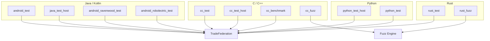

### 57.5.11  独立测试

`cc_test` 的 `standalone_test` 属性支持自带共享库依赖的
自包含测试包：

```go
// Install the test's dependencies into a folder named standalone-libs
// relative to the test's installation path.
Standalone_test *bool
```

启用后，构建系统：

1. 收集所有传递性共享库依赖
2. 将它们与测试二进制一起安装
3. 在自动生成的配置中设置 `ld-library-path`
4. 为独立目录创建打包规范

来自 `build/soong/cc/test.go`：

```go
if Bool(test.Properties.Standalone_test) {
    packagingSpecsBuilder := depset.NewBuilder[android.PackagingSpec](
        depset.TOPOLOGICAL)
    ctx.VisitDirectDepsProxy(func(dep android.ModuleProxy) {
        deps := android.OtherModuleProviderOrDefault(ctx, dep,
            android.InstallFilesProvider)
        packagingSpecsBuilder.Transitive(deps.TransitivePackagingSpecs)
    })
    for _, standaloneTestDep := range packagingSpecsBuilder.Build().ToList() {
        if standaloneTestDep.SrcPath() == nil { continue }
        if standaloneTestDep.SkipInstall() { continue }
        if standaloneTestDep.Partition() == "data" { continue }
        test.binaryDecorator.baseInstaller.installStandaloneTestDep(
            ctx, standaloneTestDep)
    }
}
```

TradeFed 配置会获得库路径：

```go
if Bool(options.StandaloneTest) {
    options.TestRunnerOptions = append(options.TestRunnerOptions, Option{
        Name:  "ld-library-path",
        Value: "{TEST_INSTALL_BASE}/" + name + "/" +
            ctx.Arch().ArchType.String() + "/standalone-libs",
    })
}
```

### 57.5.12  Benchmark 模块

`cc_benchmark` 模块类型使用 Google Benchmark 构建性能基准测试二进制：

```go
func BenchmarkFactory() android.Module {
    module := NewBenchmark(android.HostAndDeviceSupported)
    module.testModule = true
    return module.Init()
}
```

基准测试自动链接 `libgoogle-benchmark`：

```go
func (benchmark *benchmarkDecorator) linkerDeps(ctx DepsContext, deps Deps) Deps {
    deps = benchmark.binaryDecorator.linkerDeps(ctx, deps)
    deps.StaticLibs = append(deps.StaticLibs, "libgoogle-benchmark")
    return deps
}
```

基准测试会被安装到单独的目录：

```go
benchmark.binaryDecorator.baseInstaller.dir = filepath.Join(
    "benchmarktest", ctx.ModuleName())
benchmark.binaryDecorator.baseInstaller.dir64 = filepath.Join(
    "benchmarktest64", ctx.ModuleName())
```

基准测试示例：

```blueprint
cc_benchmark {
    name: "libutils_benchmark",
    srcs: ["Looper_bench.cpp", "String8_bench.cpp"],
    shared_libs: ["libutils"],
    test_suites: ["device-tests"],
}
```

### 57.5.13  测试配置模板

构建系统使用模板 XML 文件来自动生成 TradeFed 配置。
代码中引用的主要模板：

| 模板变量 | 用途 |
|------------------|-------|
| `${NativeTestConfigTemplate}` | 设备 cc_test |
| `${NativeHostTestConfigTemplate}` | 主机 cc_test |
| `${NativeBenchmarkTestConfigTemplate}` | cc_benchmark |
| `${InstrumentationTestConfigTemplate}` | android_test |
| `${RobolectricTestConfigTemplate}` | android_robolectric_test |
| `${RavenwoodTestConfigTemplate}` | android_ravenwood_test |

模板包含将被替换的占位符：

- `{MODULE}`——模块名
- `{EXTRA_CONFIGS}`——额外的 XML 配置元素
- `{EXTRA_TEST_RUNNER_CONFIGS}`——运行器专用选项
- `{OUTPUT_FILENAME}`——输出文件名
- `{TEST_INSTALL_BASE}`——安装基础目录

### 57.5.14  TestSuiteInfo 提供者

所有测试模块都会设置 `TestSuiteInfoProvider`，以便构建系统和
CI 发现测试属性：

```go
ctx.SetTestSuiteInfo(android.TestSuiteInfo{
    NameSuffix:           c.SubName(),
    TestSuites:           test.InstallerProperties.Test_suites,
    MainFile:             file,
    MainFileStem:         file.Base(),
    ConfigFile:           test.testConfig,
    ExtraConfigs:         test.extraTestConfigs,
    Data:                 test.data,
    NeedsArchFolder:      true,
    PerTestcaseDirectory: Bool(test.Properties.Per_testcase_directory),
    IsUnitTest:           Bool(test.Properties.Test_options.Unit_test),
})
```

`IsUnitTest` 标志将主机测试标记为单元测试，这会：

- 将它们加入 `host-unit-tests` 套件
- 在 CI 中启用更快的执行路径
- 允许在 atest 中使用 `--host` 过滤

---

## 57.6  CTS——兼容性测试套件

### 57.6.1  概述

兼容性测试套件（CTS）是 Android 生态系统兼容性保证的基石。
每台搭载 Google Play 的设备都必须通过 CTS。CTS 验证公开的 SDK API
是否按照其文档化的契约行事。

源代码位置：`cts/`

```
cts/
  tests/          -- Device-side test modules (96 directories)
  hostsidetests/  -- Host-side test modules (102 directories)
  apps/           -- Test helper apps (CtsVerifier, etc.)
  common/         -- Shared utilities
  libs/           -- Shared libraries
  tools/          -- CTS-specific tooling
  suite/          -- Suite configuration
  build/          -- Build configuration
```

### 57.6.2  测试组织方式

CTS 按 Android API 领域组织测试。大多数 CTS 设备侧测试包位于
`cts/tests/tests/` 之下，其中的每个目录通常映射到一个框架包或子系统：

| 目录 | API 领域 |
|-----------|----------|
| `cts/tests/tests/app/` | Activity、Service、ContentProvider |
| `cts/tests/tests/net/` | 网络 API |
| `cts/tests/tests/media/` | 媒体编解码器、播放器、录音器 |
| `cts/tests/tests/security/` | 安全/加密 API |
| `cts/tests/netlegacy22.permission/` | 旧版权限模型 |
| `cts/tests/tests/widget/` | UI 组件 |
| `cts/tests/tests/graphics/` | 图形、Canvas、OpenGL |
| `cts/tests/camera/` | Camera2 API |
| `cts/tests/tests/telecom/` | 电话/电信 |
| `cts/tests/accessibility/` | 无障碍服务 |

`cts/hostsidetests/` 下的主机侧测试验证需要主机级编排的行为，例如：

| 目录 | 用途 |
|-----------|---------|
| `cts/hostsidetests/appsecurity/` | 应用签名、权限、隔离 |
| `cts/hostsidetests/devicepolicy/` | 设备管理、托管配置文件 |
| `cts/hostsidetests/apex/` | APEX 模块测试 |
| `cts/hostsidetests/backup/` | 备份与恢复 |
| `cts/hostsidetests/car/` | 汽车功能 |
| `cts/hostsidetests/blobstore/` | Blob store API |

### 57.6.3  CTS 模块结构

一个典型的 CTS 设备测试模块：

```
cts/tests/tests/widget/
  Android.bp             -- Build rule (android_test)
  AndroidManifest.xml    -- Test APK manifest
  AndroidTest.xml        -- TradeFed configuration
  src/                   -- Test source code
  res/                   -- Test resources (if needed)
```

构建规则声明 CTS 套件成员身份
（`cts/tests/tests/widget/Android.bp`）：

```blueprint
android_test {
    name: "CtsWidgetTestCases",
    defaults: ["cts_defaults"],
    static_libs: [
        "ctstestrunner-axt",
        "compatibility-device-util-axt",
        // ...
    ],
    srcs: [
        "src/**/*.java",
        "src/**/*.kt",
    ],
    test_suites: [
        "cts",
        "general-tests",
    ],
    // ...
}
```

（请注意，部分 CTS 模块位于 `cts/` 之外——例如
`CtsNetTestCases` 定义在
`packages/modules/Connectivity/tests/cts/net/Android.bp`，
与它所测试的 Connectivity Mainline 模块放在一起。）

### 57.6.4  CtsVerifier

CtsVerifier（`cts/apps/CtsVerifier/`）是一个特殊的交互式测试应用，用于验证
无法自动化的、依赖硬件的行为：

```
cts/apps/CtsVerifier/
  AndroidManifest.xml
  src/               -- Test activities
  res/               -- UI resources
  jni/               -- Native test helpers
  assets/            -- Test data
```

CtsVerifier 覆盖：

- 传感器精度（加速度计、陀螺仪）
- 音频路由与延迟
- 摄像头图像质量
- 蓝牙、NFC、Wi-Fi 行为
- USB 连接
- 生物识别注册

操作员使用 CtsVerifier 应用手动执行每一项测试，并确认通过/失败结果。

### 57.6.5  运行 CTS

```bash
# Full CTS run
cts-tradefed run cts

# Single module
cts-tradefed run cts --module CtsNetTestCases

# Single test
cts-tradefed run cts --module CtsNetTestCases \
    --test android.net.cts.ConnectivityManagerTest

# With retry
cts-tradefed run retry --retry <session_id>

# Using atest
atest CtsNetTestCases
```

### 57.6.6  CTS 架构

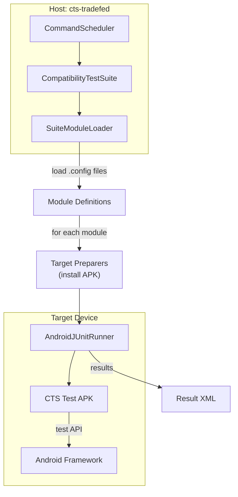

### 57.6.7  CTS 默认配置

CTS 测试使用共享的 `cts_defaults` 以确保配置一致。
来自 `cts/Android.bp`：

```blueprint
java_defaults {
    name: "cts_defaults",
    defaults: ["cts_support_defaults"],
    target: {
        android: {
            static_libs: ["platform-test-annotations"],
        },
    },
    lint: {
        strict_updatability_linting: false,
        extra_check_modules: [
            "AndroidFrameworkLintChecker",
            "CtsLintChecker",
        ],
        // ...
    },
}
```

继承的 `cts_support_defaults` 禁用了 dex 预优化和优化
（`dex_preopt: {enabled: false}`、`optimize: {enabled: false}`）。
套件成员身份（`test_suites: ["cts", "general-tests"]`）和测试运行器的
`static_libs`（如 `ctstestrunner-axt`）按模块声明，而不是在
`cts_defaults` 中声明。

### 57.6.8  CTS 跨设备分片

对于大型 CTS 运行（10,000+ 个测试用例），分片必不可少。CTS 支持：

- **静态分片**：将模块拆分为 N 个相等的分片
- **动态分片**：使用基于池的方法进行负载均衡
- **模块级分片**：每个模块在一台设备上运行
- **测试级分片**：模块内的单个测试用例拆分

```bash
# Shard across 4 devices
cts-tradefed run cts --shard-count 4

# Dynamic sharding with pool
cts-tradefed run cts --dynamic-sharding
```

另一个独立选项 `--enable-token-sharding` 使分片遵循设备令牌
（例如 SIM 卡能力）。因此，需要特定令牌的测试只会在设备提供该令牌的
分片上运行。

### 57.6.9  CTS 结果结构

CTS 生成结构化结果：

```
android-cts/results/
  YYYY.MM.DD_HH.MM.SS/
    test_result.xml           -- JUnit XML results
    test_result_failures_suite.html -- Human-readable failures
    compatibility_result.xsl  -- XSL stylesheet
    result.pb                 -- Protocol buffer results
    invocation_summary.txt    -- Summary
    device_logcat*.txt        -- Device logs
    host_log*.txt             -- Host logs
```

`test_result.xml` 是用于合规认证提交的规范结果文件。

### 57.6.10  CTS 模块开发工作流

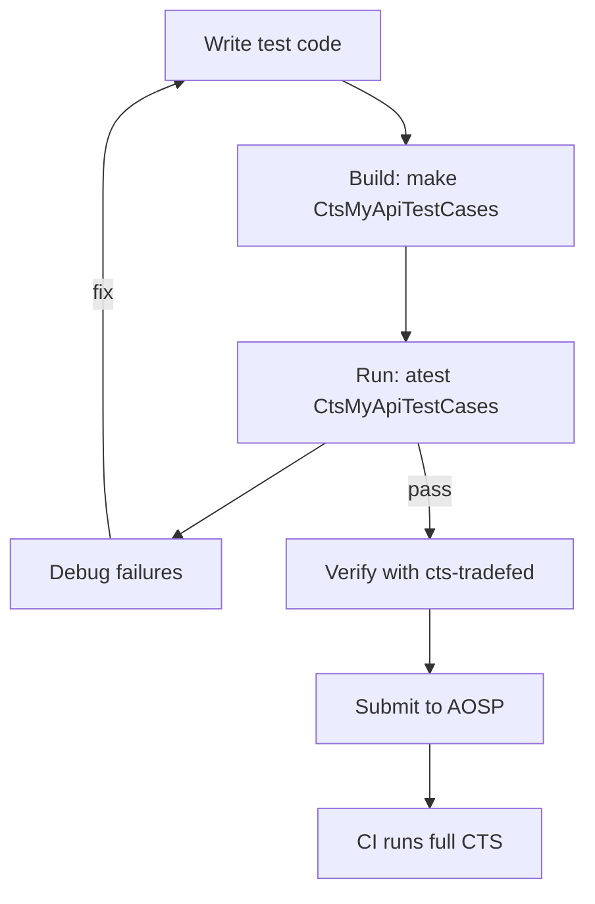

---

## 57.7  VTS——厂商测试套件

### 57.7.1  概述

厂商测试套件（VTS）验证 Android 框架与厂商实现之间跨 Treble 架构边界的契约。
CTS 测试公开的 SDK，而 VTS 测试 HAL 实现、VNDK 和内核接口。

源代码位置：
```
test/vts/          -- VTS infrastructure and tools
test/vts-testcase/ -- VTS test cases
```

### 57.7.2  测试类别

VTS 测试用例组织在 `test/vts-testcase/` 之下：

**HAL 测试**（`test/vts-testcase/hal/`）：

- `automotive/`——汽车 HAL 测试
- `neuralnetworks/`——NNAPI HAL 测试
- `thermal/`——热管理 HAL 测试
- `treble/`——Treble 合规测试
- `usb/`——USB HAL 测试

**内核测试**（`test/vts-testcase/kernel/`）：

- `abi/`——内核 ABI 稳定性
- `api/`——内核 API 合规性
- `bow/`——Block on write 测试
- `checkpoint/`——Checkpoint 支持
- `encryption/`——磁盘加密
- `f2fs/`——F2FS 文件系统测试
- `fuse_bpf/`——FUSE BPF 测试
- `gki/`——通用内核镜像测试
- `ltp/`——Linux 测试项目集成
- `virtual_ab/`——虚拟 A/B 测试
- `zram/`——ZRAM 压缩测试

**VNDK 测试**（`test/vts-testcase/vndk/`）：

- `abi/`——VNDK ABI 稳定性
- `dependency/`——VNDK 依赖验证
- `files/`——VNDK 文件列表验证
- `golden/`——金镜像对比

### 57.7.3  HAL 测试方法论

VTS HAL 测试验证厂商 HAL 实现是否符合其 HIDL/AIDL
接口定义。测试框架：

1. 通过 `hwservicemanager` 或 `servicemanager`
    发现设备上的 HAL 实例

2. 打开到每个 HAL 的客户端连接
3. 使用已知输入调用接口方法
4. 根据接口规范验证输出

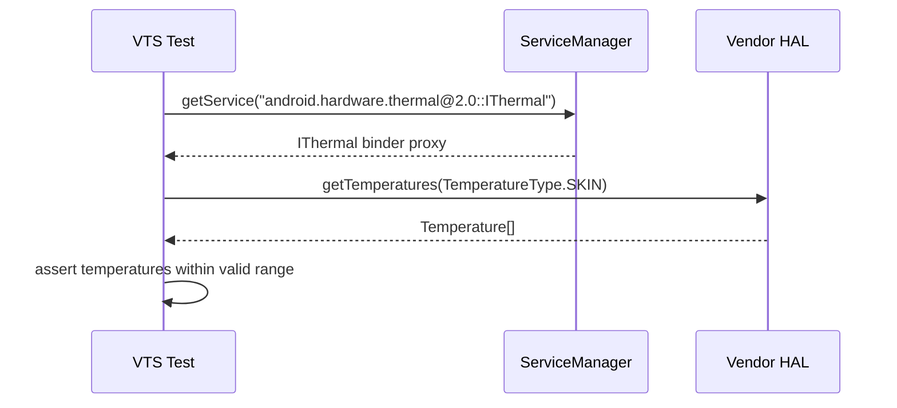

### 57.7.4  Treble 合规性

`test/vts-testcase/hal/treble/` 下的 Treble 测试验证架构分离：

- **VINTF 清单验证**：验证厂商清单是否正确
  声明了所有 HAL

- **框架-厂商分离**：确保没有未经授权的跨边界
  依赖

- **VNDK 使用**：验证厂商代码只使用 VNDK 库

### 57.7.5  内核测试

VTS 内核测试（`test/vts-testcase/kernel/`）验证内核行为：

- **GKI 测试**：验证通用内核镜像的合规性
- **ABI 测试**：确保内核 ABI 的稳定性以支持模块加载
- **LTP 集成**：在 Android 上运行 Linux 测试项目
- **系统调用测试**：验证系统调用行为符合要求

### 57.7.6  运行 VTS

```bash
# Full VTS run
vts-tradefed run vts

# Single module
vts-tradefed run vts --module VtsHalThermalV2_0TargetTest

# Using atest
atest VtsHalThermalV2_0TargetTest

# Kernel test
atest vts_generic_boot_image_test
```

### 57.7.7  VTS 与 CTS：Treble 边界

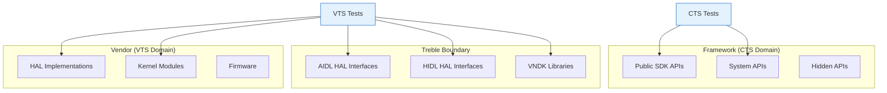

CTS 测试边界的*框架*一侧——即应用使用的 API。
VTS 测试*厂商*一侧——HAL 实现、VNDK 合规性以及内核行为。
两者共同强制 Treble 契约，使框架和厂商组件能够独立更新。

### 57.7.8  运行 VTS HAL 测试

一次典型的 VTS HAL 测试调用：

```bash
# Discover available HAL tests
vts-tradefed list modules | grep -i thermal

# Run a specific HAL test
vts-tradefed run vts --module VtsHalThermalTargetTest

# Run all HAL tests for a specific HAL
vts-tradefed run vts --include-filter 'VtsHal*Thermal*'
```

VTS HAL 测试使用 `GTest` 运行器运行 C++ 目标测试，使用
`PythonBinaryHostTest`（或 Mobly 运行器）运行基于 Python 的主机测试。
测试二进制针对 HAL 接口头文件编译，并链接 HAL 客户端库。

### 57.7.9  VINTF 清单测试

一项关键的 VTS 测试验证 VINTF（厂商接口）清单。
该清单声明设备提供了哪些 HAL：

```xml
<manifest version="2.0" type="device">
    <hal format="aidl">
        <name>android.hardware.thermal</name>
        <version>1</version>
        <fqname>IThermal/default</fqname>
    </hal>
</manifest>
```

VTS 测试验证：

- 每个声明的 HAL 在运行时确实可用
- 不存在未声明的 HAL（没有隐藏的实现）
- 版本号与接口定义匹配
- 满足框架兼容性矩阵

---

## 57.8  Ravenwood——主机侧框架测试

### 57.8.1  概述

Ravenwood 是 Android 在主机 JVM 上运行框架测试、无需设备或模拟器的解决方案。
它提供了一个轻量级环境，让 Android 框架类可以直接在 JDK 21+ 的主机 JVM 上执行。
这将测试执行时间从分钟级大幅缩短到秒级。

源代码：`build/soong/java/ravenwood.go`

### 57.8.2  模块类型：android_ravenwood_test

`android_ravenwood_test` 模块类型在 `ravenwood.go` 中注册：

```go
func RegisterRavenwoodBuildComponents(ctx android.RegistrationContext) {
    ctx.RegisterModuleType("android_ravenwood_test", ravenwoodTestFactory)
    ctx.RegisterModuleType("android_ravenwood_libgroup", ravenwoodLibgroupFactory)
}
```

工厂函数设置默认套件成员身份：

```go
func ravenwoodTestFactory() android.Module {
    module := &ravenwoodTest{}
    module.addHostAndDeviceProperties()
    module.AddProperties(&module.aaptProperties,
        &module.testProperties, &module.ravenwoodTestProperties)
    module.Module.dexpreopter.isTest = true
    module.Module.linter.properties.Lint.Test_module_type = proptools.BoolPtr(true)

    module.testProperties.Test_suites = []string{
        "general-tests",
        "ravenwood-tests",
    }
    // ...
    InitJavaModule(module, android.DeviceSupported)
    return module
}
```

### 57.8.3  架构

Ravenwood 测试声明 `android.DeviceSupported`，但在生成时被*强制*到主机
操作系统上：

```go
func (r *ravenwoodTest) GenerateAndroidBuildActions(ctx android.ModuleContext) {
    r.forceOSType = ctx.Config().BuildOS
    r.forceArchType = ctx.Config().BuildArch
    // ...
}
```

这意味着测试被编译为设备 JAR（使用 Android SDK 类），但在主机 JVM 上执行。
Ravenwood 运行时为主机上不可用的 Android 框架类提供桩/影子实现。

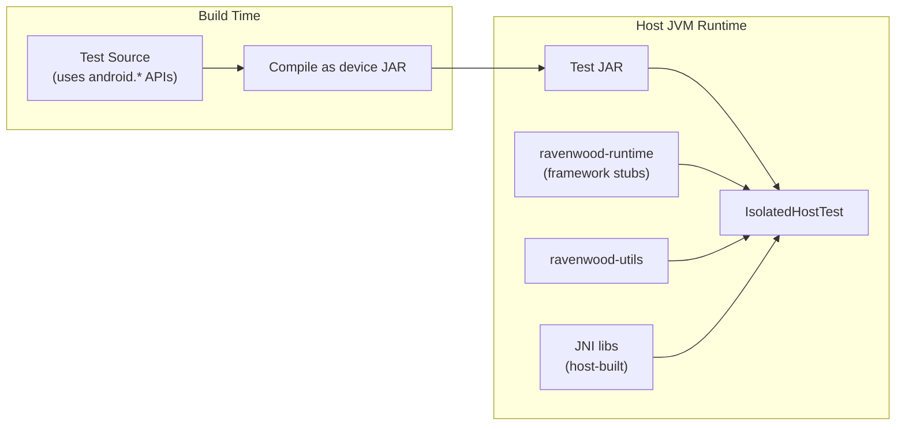

### 57.8.4  Ravenwood 属性

```go
type ravenwoodTestProperties struct {
    // Specify the name of the Instrumentation subclass to use.
    Instrumentation_class *string

    // Specify the package name of the test target apk.
    Target_package_name *string

    // Specify another android_app module here to copy it to the
    // test directory, so that the ravenwood test can access it.
    Target_resource_apk *string

    // Specify whether to build resources.
    Build_resources *bool
}
```

### 57.8.5  运行时组件

Ravenwood 依赖两个库组：

- **ravenwood-utils**：编译时所需的工具库
- **ravenwood-runtime**：提供框架类
  实现的运行时环境

两者都是 `android_ravenwood_libgroup` 模块，会将 JAR 和 JNI
库与测试一起安装：

```go
func (r *ravenwoodLibgroup) GenerateAndroidBuildActions(ctx android.ModuleContext) {
    r.forceOSType = ctx.Config().BuildOS
    r.forceArchType = ctx.Config().BuildArch

    // Install JAR libraries
    for _, lib := range r.ravenwoodLibgroupProperties.Libs {
        libJar := android.OutputFileForModule(ctx, libModule, "")
        ctx.InstallFile(installPath, libJar.Base(), libJar)
    }

    // Install JNI libraries
    for _, jniLib := range jniLibs {
        install(soInstallPath, jniLib.path)
    }

    // Install data files (e.g., framework-res.apk)
    // Install font files
    // Install aconfig flag storage files
    // ...
}
```

运行时还会安装 aconfig 标志存储文件，用于特性标志测试：

```go
if r.Name() == ravenwoodRuntimeName {
    // Binary proto file and the text proto.
    install(installPath.Join(ctx, "aconfig/metadata/aconfig/etc"),
        aadi.ParsedFlagsFile, aadi.TextProtoFlagsFile)
    // The "new" storage files.
    install(installPath.Join(ctx, "aconfig/metadata/aconfig/maps"),
        aadi.StoragePackageMap, aadi.StorageFlagMap)
    install(installPath.Join(ctx, "aconfig/metadata/aconfig/boot"),
        aadi.StorageFlagVal, aadi.StorageFlagInfo)
}
```

### 57.8.6  Ravenizer

Ravenwood 测试会经过一个称为 "Ravenizer" 的字节码转换步骤：

```go
// Always enable Ravenizer for ravenwood tests.
r.Library.ravenizer.enabled = true
```

Ravenizer 重写字节码，将框架调用重定向到 Ravenwood 的
主机兼容实现。这类似于 Robolectric 的影子系统的工作方式，但它与平台构建
集成得更加紧密。

### 57.8.7  Manifest 属性

Ravenwood 为每个测试模块生成一个属性文件。内容以纯 `key=value`
行格式，使用 `android.WriteFileRule` 写入，
然后安装为 `ravenwood.properties`：

```go
propertiesContents := fmt.Sprintf(`
targetSdkVersionInt=%d
targetSdkVersionRaw=%s
packageName=%s
targetPackageName=%s
instrumentationClass=%s
moduleName=%s
resourceApk=%s
targetResourceApk=%s
`, targetSdkVersionInt, targetSdkVersion, packageName, targetPackageName,
    instClassName, ctx.ModuleName(), resApkPath, targetResApkPath)

propertiesContents = strings.TrimPrefix(propertiesContents, "\n")

android.WriteFileRule(ctx, propertiesOutputPath, propertiesContents)
```

### 57.8.8  Ravenwood 测试示例

```blueprint
android_ravenwood_test {
    name: "CtsUtilTestCasesRavenwood",
    srcs: ["src/**/*.java"],
    static_libs: [
        "androidx.test.rules",
        "ravenwood-junit",
    ],
    sdk_version: "test_current",
    target_sdk_version: "35",
    build_resources: true,
    package_name: "android.util.cts.ravenwood",
}
```

### 57.8.9  TEST_MAPPING 中的 Ravenwood

Ravenwood 测试出现在 `ravenwood-presubmit` 组中：

```json
{
  "ravenwood-presubmit": [
    {
      "name": "CtsUtilTestCasesRavenwood",
      "host": true,
      "file_patterns": ["[Rr]avenwood"]
    }
  ]
}
```

### 57.8.10  Ravenwood 测试生命周期

Ravenwood 测试通过 TradeFed 的生命周期：

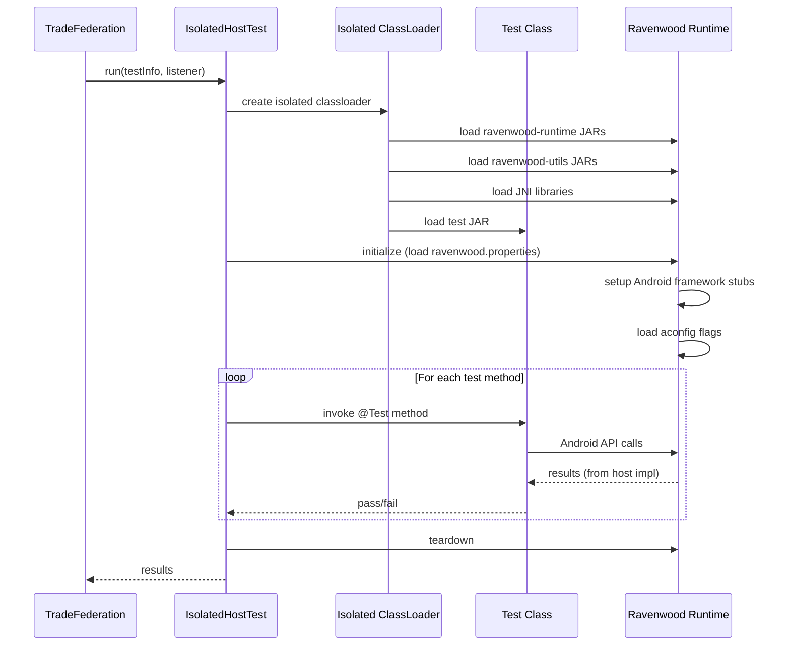

### 57.8.11  资源支持

Ravenwood 通过 `build_resources` 属性支持 Android 资源：

```go
if proptools.Bool(r.ravenwoodTestProperties.Build_resources) {
    r.aaptBuildActions(ctx)
    resourceApk = r.aapt.exportPackage
}
```

`aaptBuildActions` 方法为 Ravenwood 适配标准的 Android 应用资源
处理流水线：

```go
func (r *ravenwoodTest) aaptBuildActions(ctx android.ModuleContext) {
    usePlatformAPI := proptools.Bool(r.Module.deviceProperties.Platform_apis)
    r.aapt.usesNonSdkApis = usePlatformAPI

    aconfigTextFilePaths := getAconfigFilePaths(ctx)
    r.aapt.buildActions(ctx, aaptBuildActionOptions{
        sdkContext:                     android.SdkContext(r),
        enforceDefaultTargetSdkVersion: true,
        forceNonFinalResourceIDs:       true,
        aconfigTextFiles:               aconfigTextFilePaths,
        usesLibrary:                    &r.usesLibrary,
    })
}
```

资源 APK 与测试一起安装：

```go
if resourceApk != nil {
    installResApk := ctx.InstallFile(resApkInstallPath,
        "ravenwood-res.apk", resourceApk)
    installDeps = append(installDeps, installResApk)
    resApkName = "ravenwood-res.apk"
}
```

### 57.8.12  主机图形桩（libhostgraphics）

Ravenwood（以及其他主机侧框架测试）可以编译并链接内部调用 `libhwui` 的类。
但 `libhwui` 是为与真实的 `SurfaceFlinger`、真实的 `BufferQueue`
和真实的 `ANativeWindow` 通信而编写的。在运行于 Linux/Mac/Windows
工作站上的主机 JVM 中，这些都不存在。`libhostgraphics` 是一个静态 C++ shim，
让 `libhwui` 能够在主机上构建和链接。它为 hwui 所依赖的图形栈部分
提供了最小化的进程内替代实现。

源代码：`frameworks/base/libs/hostgraphics/`（五个 C++ 文件，
以及 `include/gui/` 和 `include/ui/` 中的 9 个头文件 shim）。

该库作为 `libhwui` 的 `Android.bp` 中 `host:` 目标下的静态依赖接入：

```blueprint
// Source: frameworks/base/libs/hwui/Android.bp:171
host: {
    static_libs: [
        "libandroidfw",
        "libhostgraphics",
        "libutils",
    ],
},
```

正是这行 `static_libs` 让"主机 hwui"成为可能。在设备上，
`libhwui` 会引入 `libgui`、`libui`、`libnativewindow`、`libnativedisplay`
和 `libsurfaceflinger`。在主机上，这些 `shared_libs` 条目不存在，
`libhostgraphics` 提供了主机构建所需的符号。

#### 五个桩编译单元

| 文件 | 桩的内容 |
|------|---------------|
| `ANativeWindow.cpp` | `ANativeWindow_*` C API。每个函数都直接转发到底层窗口的虚表（`window->perform`、`window->query`、`window->dequeueBuffer`、`incStrong`/`decStrong`），而不是经过 `libnativewindow`。 |
| `HostBufferQueue.cpp` | 一个 `HostBufferQueue` 类，基于单个 `GraphicBuffer` 同时实现 `IGraphicBufferProducer` 和 `IGraphicBufferConsumer`。`BufferQueue::createBufferQueue` 返回同一个对象作为生产者和消费者。 |
| `ADisplay.cpp` | 一个硬编码的 1080x1920@60 显示配置，通过 `apex/display.h` 的 `ADisplay_*` C API 暴露。没有 HWC，没有 VSYNC 偏移，没有多显示器逻辑。 |
| `Fence.cpp` | 定义 `Fence::NO_FENCE` 单例，因为 `libui` 的 `Fence.cpp` 没有被链接进来。 |
| `PublicFormat.cpp` | `PublicFormat`、HAL 格式和 dataspace 之间的无操作映射函数（总是返回输入值的强制转换）。 |

有趣的是 `HostBufferQueue` 的情况。在设备上，生产者（应用/hwui
一侧）和消费者（SurfaceFlinger 或 `BufferItemConsumer`）位于不同的
进程中。它们通过 Binder 通信，并交换一个由槽位索引的缓冲区环，
由栅栏保护。在主机上，没有生产者/消费者分离，也没有双缓冲。
`createBufferQueue` 将同一个对象作为两个端点返回，每个"缓冲区"
都是同一个 `GraphicBuffer`：

```cpp
// Source: frameworks/base/libs/hostgraphics/HostBufferQueue.cpp:101
void BufferQueue::createBufferQueue(sp<IGraphicBufferProducer>* outProducer,
                                    sp<IGraphicBufferConsumer>* outConsumer,
                                    bool consumerIsSurfaceFlinger) {
    sp<HostBufferQueue> obj(new HostBufferQueue());
    *outProducer = obj;
    *outConsumer = obj;
}
```

这种合并是有意为之的。主机测试只需要验证 hwui 对*某个*缓冲区
*发出了正确的绘制调用*。它们不需要验证缓冲区经受住了
经过 SurfaceFlinger 的往返。跳过生产者/消费者协议也避免了拖入
Binder、`libgui` 和 `libnativedisplay` HWC
shim，所有这些都需要各自的主机桩。

#### 头文件 shim

`include/gui/` 和 `include/ui/` 下的 9 个头文件是这个技巧的另一半。
它们*不是*设备头文件——它们是带有匹配签名的独立声明
（`Surface.h`、`BufferQueue.h`、`BufferItem.h`、
`IGraphicBufferProducer.h`、`IGraphicBufferConsumer.h`、
`ConsumerBase.h`、`BufferItemConsumer.h`、`Fence.h`、`GraphicBuffer.h`）。
`libhostgraphics_headers` `cc_library_headers` 导出它们，而
`libhwui` 的主机目标选择它们*而不是*真正的 `libgui_headers` /
`libui_headers`。因此像 `Surface surf(producer);` 这样的 hwui 代码
可以不加修改地编译，但在链接时解析到桩 `Surface` 类。

#### 设备与主机 hwui 的组成

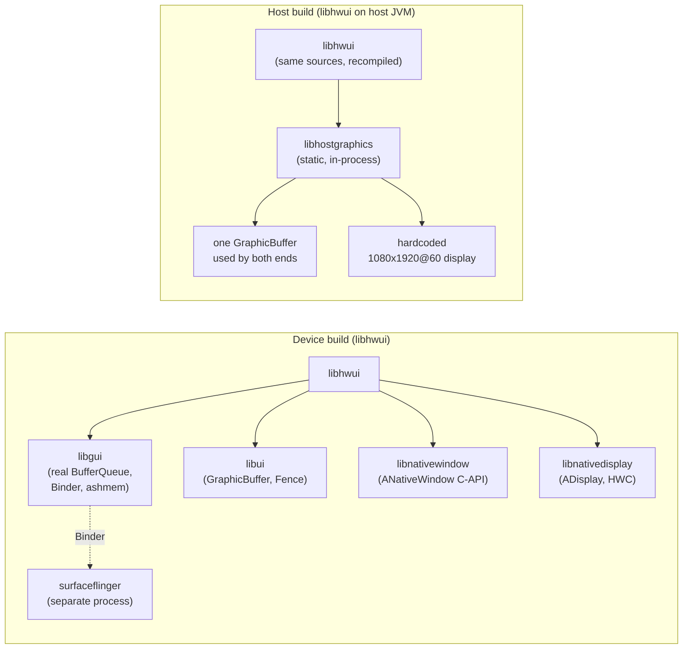

底部一行就是整个主机图形栈——没有 IPC，没有独立进程，
没有栅栏同步，一个缓冲区存活于整个测试生命周期。

#### Windows 支持

`libhostgraphics` 是少数在 Windows 构建中显式启用的框架主机库之一：

```blueprint
target: {
    windows: {
        enabled: true,
    },
},
```

这对需要在开发者 Windows 工作站上链接 `libhwui` 的 SDK 工具
（`layoutlib` 风格的渲染器、主机 APK 构建辅助工具）很重要。

#### libhostgraphics 无法测试的内容

因为缓冲区是单槽的，显示器是固定的模拟对象，hwui 的主机构建
无法演练：

- 真实的帧节奏或 VSYNC 驱动的失效
- 生产者/消费者背压（主机队列从不阻塞）
- HDR / 广色域路径选择（`PublicFormat` 总是返回
  原始强制转换）
- HWC 合成或显示器旋转
- 基于栅栏的 GPU/CPU 同步（`NO_FENCE` 是唯一存在的栅栏）

对于这些，你仍然需要设备或模拟器。`libhostgraphics` 的职责只是
让链接器满意。它让 hwui 算法核心（绘制、canvas、字体、层级遍历）的
*单元*测试能够在开发者笔记本上以毫秒级运行。

### 57.8.13  进程内系统服务

早期的 Ravenwood 只能托管叶子工具类。到 Android 17 时，它可以启动一个
轻量级的、进程内的**系统服务**。这让那些通过 `Context.getSystemService()`
或 `ServiceManager` 查找框架服务的代码能够在主机上运行。
`RavenwoodSystemServer`
（`frameworks/base/ravenwood/junit-impl-src/android/platform/test/ravenwood/RavenwoodSystemServer.java`）
在运行器启动时向 `ServiceManager` 和 `LocalServices` 注册假的或代理的
实现，覆盖以下服务：

- `PLATFORM_COMPAT_SERVICE` / `PLATFORM_COMPAT_NATIVE_SERVICE`（应用兼容性变更门控）
- `INPUT_SERVICE`、`INPUT_METHOD_SERVICE`、`AUTOFILL_SERVICE`
- `USER_SERVICE`、`ACTIVITY_SERVICE`、`ACTIVITY_TASK_SERVICE`
- `WINDOW_SERVICE`、`DISPLAY_SERVICE`
- content 服务（`ContentResolver.CONTENT_SERVICE_NAME`）和 dream 服务

这些并非真实的服务——大多数是代理，要么委托给假实现，
要么对不支持的调用抛出"未实现"。只有 `PLATFORM_COMPAT_*`
和 `INPUT_SERVICE` 无条件注册；其余的在
`maybeRegisterExperimentalServices()` 内注册，由
`isExperimentalApiEnabled()` 门控。

配套的 `RavenwoodAppDriver`
（`frameworks/base/ravenwood/junit-impl-src/android/app/RavenwoodAppDriver.java`）
在主机上建立起足够的 `ActivityThread`/`Application` 状态。
测试因此可以获得真实的 `Context`、设置提供者和兼容配置。
实际效果是 Ravenwood 现在可以覆盖的不仅是数据结构。
它覆盖与系统服务通信的框架逻辑。它仍然不需要设备，
也不再局限于无依赖的叶子类。

### 57.8.14  何时使用 Ravenwood

Ravenwood 适用于：

- 测试 `android.os.*` 工具类（Bundle、Parcel、Handler 等）
- 测试 `android.util.*` 数据结构（SparseArray、LruCache 等）
- 测试 `android.content.*` 基础类
- 测试通过进程内系统服务（57.8.13）访问系统服务的框架逻辑，
  例如应用兼容性变更门控或用户服务查找
- 测试使用 Android 特性标志（aconfig）的代码

Ravenwood 不适合：

- 需要真实 UI 渲染或 GPU 合成的测试
- 需要真实硬件（摄像头、传感器）的测试
- 依赖某个 Ravenwood 代理尚未实现的服务的测试（进程内系统服务
  只模拟了精选的一组服务，而非整个平台）
- 需要完整、真实的 Activity 生命周期和窗口的测试

---

## 57.9  Robolectric

### 57.9.1  概述

Robolectric 是在主机 JVM 上无需模拟器运行 Android 单元测试的成熟开源框架。
它提供 Android 框架类的"影子"（shadow）实现，在字节码层面拦截调用。

源代码位置：
```
external/robolectric/           -- Upstream Robolectric source
build/soong/java/robolectric.go -- Build system integration
```

### 57.9.2  模块类型：android_robolectric_test

在 `build/soong/java/robolectric.go` 中注册：

```go
func RegisterRobolectricBuildComponents(ctx android.RegistrationContext) {
    ctx.RegisterModuleType("android_robolectric_test", RobolectricTestFactory)
    ctx.RegisterModuleType("android_robolectric_runtimes", robolectricRuntimesFactory)
}
```

工厂函数：

```go
func RobolectricTestFactory() android.Module {
    module := &robolectricTest{}
    module.addHostProperties()
    module.AddProperties(
        &module.Module.deviceProperties,
        &module.robolectricProperties,
        &module.testProperties)
    module.Module.dexpreopter.isTest = true
    module.Module.linter.properties.Lint.Test_module_type = proptools.BoolPtr(true)
    module.Module.sourceProperties.Test_only = proptools.BoolPtr(true)
    module.Module.sourceProperties.Top_level_test_target = true
    module.testProperties.Test_suites = []string{"robolectric-tests"}
    InitJavaModule(module, android.DeviceSupported)
    return module
}
```

### 57.9.3  属性

```go
type robolectricProperties struct {
    // The name of the android_app module that the tests will run against.
    Instrumentation_for *string

    // Additional libraries for which coverage data should be generated
    Coverage_libs []string

    Test_options struct {
        // Timeout in seconds when running the tests.
        Timeout *int64
        // Number of shards to use when running the tests.
        Shards *int64
    }

    // Use /external/robolectric rather than /external/robolectric-shadows
    Upstream *bool

    // Use strict mode to limit access of Robolectric API directly.
    Strict_mode *bool

    Jni_libs proptools.Configurable[[]string]
}
```

### 57.9.4  默认依赖

Robolectric 测试自动获得以下库：

```go
var robolectricDefaultLibs = []string{
    "mockito-robolectric-prebuilt",
    "truth",
    "junitxml",
}

const robolectricCurrentLib = "Robolectric_all-target"
const clearcutJunitLib = "ClearcutJunitListenerAar"
```

### 57.9.5  严格模式

Robolectric 严格模式（`strict_mode: true`，默认值）限制对 Robolectric API
的直接访问，鼓励测试使用标准 Android API：

```go
func (r *robolectricTest) DepsMutator(ctx android.BottomUpMutatorContext) {
    // ...
    if proptools.BoolDefault(r.robolectricProperties.Strict_mode, true) {
        ctx.AddVariationDependencies(nil, roboRuntimeOnlyDepTag, robolectricCurrentLib)
    } else {
        ctx.AddVariationDependencies(nil, staticLibTag, robolectricCurrentLib)
    }
    // ...
}
```

在严格模式下，Robolectric 库作为仅运行时依赖添加
（而非编译时）。这阻止了测试代码直接调用 Robolectric
影子 API。

### 57.9.6  测试配置生成

Robolectric 测试获得一个特殊的配置模板：

```go
r.testConfig = tradefed.AutoGenTestConfig(ctx, tradefed.AutoGenTestConfigOptions{
    // ...
    DeviceTemplate: "${RobolectricTestConfigTemplate}",
    HostTemplate:   "${RobolectricTestConfigTemplate}",
})
```

还会注入额外的 JVM 标志：

```go
var extraTestRunnerOptions []tradefed.Option
extraTestRunnerOptions = append(extraTestRunnerOptions,
    tradefed.Option{Name: "java-flags", Value: "-Drobolectric=true"})
if proptools.BoolDefault(r.robolectricProperties.Strict_mode, true) {
    extraTestRunnerOptions = append(extraTestRunnerOptions,
        tradefed.Option{Name: "java-flags", Value: "-Drobolectric.strict.mode=true"})
}
```

### 57.9.7  运行时

`android_robolectric_runtimes` 模块为每个 SDK 级别提供预构建的 Android 框架
JAR，Robolectric 用它们来模拟不同的 API 版本：

```go
func (r *robolectricRuntimes) GenerateAndroidBuildActions(ctx android.ModuleContext) {
    files := android.PathsForModuleSrc(ctx, r.props.Jars)
    androidAllDir := android.PathForModuleInstall(ctx, "android-all")
    for _, from := range files {
        installedRuntime := ctx.InstallFile(androidAllDir, from.Base(), from)
        r.runtimes = append(r.runtimes, installedRuntime)
    }
    // Build from source for the "TREE" (current) version
    if !ctx.Config().AlwaysUsePrebuiltSdks() && r.props.Lib != nil {
        runtimeName := "android-all-current-robolectric-r0.jar"
        installedRuntime := ctx.InstallFile(androidAllDir, runtimeName,
            runtimeFromSourceJar)
        r.runtimes = append(r.runtimes, installedRuntime)
    }
}
```

### 57.9.8  影子系统

Robolectric 的影子位于 `external/robolectric/shadows/` 之下：

```
external/robolectric/shadows/
  framework/      -- Shadows for android.* framework classes
  httpclient/     -- Apache HttpClient shadows
  multidex/       -- Multidex shadows
  playservices/   -- Google Play Services shadows
  versioning/     -- SDK version handling
```

影子通过字节码插桩拦截方法调用。例如，
`android.content.Context` 的影子为 `getSharedPreferences()`、
`getContentResolver()` 等提供主机兼容的实现。

### 57.9.9  Robolectric 测试示例

```blueprint
android_robolectric_test {
    name: "SettingsRoboTests",
    srcs: ["tests/robotests/src/**/*.java"],
    instrumentation_for: "Settings",
    static_libs: [
        "Settings-testutils",
        "testng",
    ],
    java_resource_dirs: ["tests/robotests/config"],
}
```

```java
@RunWith(RobolectricTestRunner.class)
@Config(shadows = {ShadowUserManager.class})
public class SettingsActivityTest {
    @Test
    public void onCreate_shouldNotCrash() {
        ActivityController<SettingsActivity> controller =
            Robolectric.buildActivity(SettingsActivity.class);
        controller.create();
        assertThat(controller.get().isFinishing()).isFalse();
    }
}
```

### 57.9.10  Robolectric 与 Ravenwood 对比

| 方面 | Robolectric | Ravenwood |
|--------|-------------|-----------|
| 来源 | 开源（GitHub） | Google 内部项目，AOSP |
| 机制 | 影子类（字节码重写） | 真实的框架代码 + Ravenizer |
| 保真度 | 近似（影子可能漂移） | 更高（真实的框架类） |
| 框架覆盖 | 广而浅 | 较窄但更深 |
| 构建模块 | `android_robolectric_test` | `android_ravenwood_test` |
| 套件 | `robolectric-tests` | `ravenwood-tests` |
| JDK 要求 | JDK 11+ | JDK 21+ |

### 57.9.11  Robolectric 测试配置属性

`generateSameDirRoboTestConfigJar` 函数创建一个配置 JAR，
告知 Robolectric 在哪里找到应用的 manifest 和资源：

```go
func generateSameDirRoboTestConfigJar(ctx android.ModuleContext,
    outputFile android.ModuleOutPath) {

    rule := android.NewRuleBuilder(pctx, ctx)
    outputDir := outputFile.InSameDir(ctx)
    configFile := outputDir.Join(ctx,
        "com/android/tools/test_config.properties")

    rule.Command().Text("(").
        Textf(`echo "android_merged_manifest=%s-AndroidManifest.xml" &&`,
            ctx.ModuleName()).
        Textf(`echo "android_resource_apk=%s.apk"`, ctx.ModuleName()).
        Text(") >>").Output(configFile)
    rule.Command().
        BuiltTool("soong_zip").
        FlagWithArg("-C ", outputDir.String()).
        FlagWithInput("-f ", configFile).
        FlagWithOutput("-o ", outputFile)

    rule.Build("generate_test_config_samedir",
        "generate test_config.properties")
}
```

这个配置 JAR 会与测试 JAR 和插桩后的应用 JAR 合并，以便
Robolectric 在运行时找到资源。

### 57.9.12  覆盖率集成

Robolectric 测试可以为额外的库收集 JaCoCo 覆盖率：

```go
type robolectricProperties struct {
    // Additional libraries for which coverage data should be generated
    Coverage_libs []string
    // ...
}
```

覆盖率库作为依赖添加：

```go
ctx.AddVariationDependencies(nil, roboCoverageLibsTag,
    r.robolectricProperties.Coverage_libs...)
```

### 57.9.13  Robolectric 架构图

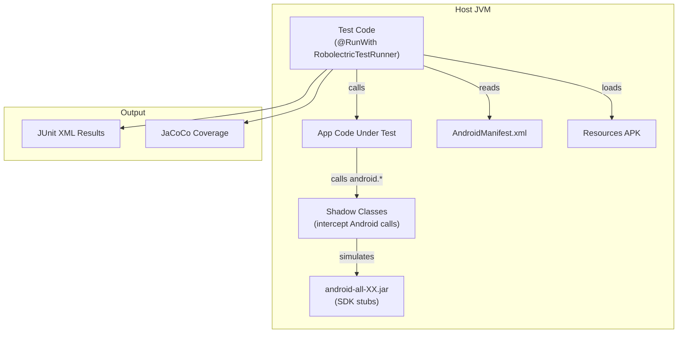

---

## 57.10  原生测试（GoogleTest）

### 57.10.1  AOSP 中的 GoogleTest

AOSP 将 Google Test（gtest）和 Google Mock（gmock）作为标准的
原生 C/C++ 测试框架包含在内。

源代码：`external/googletest/`

```
external/googletest/
  googletest/       -- Google Test framework
    include/        -- Public headers (gtest/gtest.h)
    src/            -- Implementation
  googlemock/       -- Google Mock framework
    include/        -- Public headers (gmock/gmock.h)
    src/            -- Implementation
  Android.bp        -- Build rules
```

### 57.10.2  cc_test 如何使用 GoogleTest

当 `cc_test` 模块设置 `gtest: true`（默认值）时，构建系统自动：

1. 链接 `libgtest_main` 和 `libgtest` 作为静态库
2. 添加编译器标志：`-DGTEST_HAS_STD_STRING`、平台特定的 OS define
3. 在自动生成的 XML 配置中使用 TradeFed `GTest` 运行器

来自 `build/soong/cc/test.go`：

```go
func (test *testDecorator) gtest() bool {
    return BoolDefault(test.LinkerProperties.Gtest, true)
}
```

### 57.10.3  编写 GoogleTest

```cpp
// my_module_test.cpp
#include <gtest/gtest.h>
#include "my_module.h"

class MyModuleTest : public ::testing::Test {
protected:
    void SetUp() override {
        module_ = CreateModule();
    }
    void TearDown() override {
        DestroyModule(module_);
    }
    Module* module_;
};

TEST_F(MyModuleTest, InitializeSucceeds) {
    EXPECT_EQ(module_->Initialize(), 0);
}

TEST_F(MyModuleTest, ProcessValidInput) {
    int result = module_->Process("valid_input");
    ASSERT_GE(result, 0);
    EXPECT_EQ(result, 42);
}

TEST(MyModuleStandaloneTest, NullInput) {
    EXPECT_DEATH(Process(nullptr), "");
}
```

### 57.10.4  构建规则

```blueprint
cc_test {
    name: "my_module_test",
    srcs: ["my_module_test.cpp"],
    shared_libs: ["libmy_module"],
    test_suites: ["device-tests"],
    // gtest: true,  // implicit default
}
```

### 57.10.5  GoogleMock

Google Mock（gmock）与 gtest 一起提供，用于创建模拟对象：

```cpp
#include <gmock/gmock.h>
#include <gtest/gtest.h>

class MockDatabase : public IDatabase {
public:
    MOCK_METHOD(bool, Connect, (const std::string& host), (override));
    MOCK_METHOD(Result, Query, (const std::string& sql), (override));
};

TEST(ServiceTest, HandlesConnectionFailure) {
    MockDatabase db;
    EXPECT_CALL(db, Connect(testing::_))
        .WillOnce(testing::Return(false));

    Service service(&db);
    EXPECT_EQ(service.Start(), Status::CONNECTION_FAILED);
}
```

### 57.10.6  测试安装与执行

原生测试被安装到设备的 `/data/local/tmp/nativetest/`（32 位）或
`/data/local/tmp/nativetest64/`（64 位）：

```go
func NewTestInstaller() *baseInstaller {
    return NewBaseInstaller("nativetest", "nativetest64", InstallInData)
}
```

对于厂商测试：

```go
func getTestInstallBase(useVendor bool) string {
    testInstallBase := "/data/local/tmp"
    if useVendor {
        testInstallBase = "/data/local/tests/vendor"
    }
    return testInstallBase
}
```

### 57.10.7  cc_test 中的 GTest 属性

`TestOptions` 结构体提供 TradeFed 级别的配置：

```go
type TestOptions struct {
    android.CommonTestOptions
    Run_test_as *string
    Test_suite_tag []string
    Extra_test_configs []string `android:"path,arch_variant"`
    Min_shipping_api_level *int64
    Vsr_min_shipping_api_level *int64
    Min_vndk_version *int64
    Test_runner_options []tradefed.Option
}
```

这些会转换为用于 API 级别门控的 TradeFed 模块控制器：

```go
if properties.Test_options.Min_shipping_api_level != nil {
    var options []tradefed.Option
    options = append(options, tradefed.Option{
        Name: "min-api-level",
        Value: strconv.FormatInt(
            int64(*properties.Test_options.Min_shipping_api_level), 10)})
    configs = append(configs, tradefed.Object{
        "module_controller",
        "com.android.tradefed.testtype.suite.module.ShippingApiLevelModuleController",
        options})
}
```

### 57.10.8  隔离的 GTest 运行器

隔离的 gtest 运行器在独立进程中运行每个测试，以获得更好的隔离性：

```go
func (test *testDecorator) isolated(ctx android.BaseModuleContext) bool {
    return BoolDefault(test.LinkerProperties.Isolated, false) && !ctx.Windows()
}
```

启用隔离时：
```go
if test.isolated(ctx) {
    deps.StaticLibs = append(deps.StaticLibs, "libgtest_isolated_main")
    deps.SharedLibs = append(deps.SharedLibs, "liblog")
}
```

并且 TradeFed 配置将其标记为不可分片：

```go
if isolated {
    configs = append(configs,
        tradefed.Option{Name: "not-shardable", Value: "true"})
}
```

### 57.10.9  GoogleTest 参数化测试

GoogleTest 支持参数化测试，常用于测试多种输入组合：

```cpp
class ParseIntTest : public ::testing::TestWithParam<
    std::pair<std::string, int>> {};

TEST_P(ParseIntTest, ParsesCorrectly) {
    auto [input, expected] = GetParam();
    EXPECT_EQ(ParseInt(input), expected);
}

INSTANTIATE_TEST_SUITE_P(
    IntegerParsing, ParseIntTest,
    ::testing::Values(
        std::make_pair("0", 0),
        std::make_pair("42", 42),
        std::make_pair("-1", -1),
        std::make_pair("2147483647", INT_MAX)
    ));
```

### 57.10.10  死亡测试

GoogleTest 的死亡测试宏验证代码在无效输入下正确终止：

```cpp
TEST(SecurityTest, NullPointerCausesAbort) {
    ASSERT_DEATH(ProcessUntrustedInput(nullptr, 0),
                 ".*CHECK.*input != nullptr.*");
}

TEST(SecurityTest, BufferOverflowDetected) {
    char buf[10];
    EXPECT_DEATH(memcpy(buf, large_input, 1000), "");
}
```

这些对于 Android 安全关键的原生代码尤为重要。

### 57.10.11  测试数据与夹具

`cc_test` 中的 `data` 属性将额外的文件与测试一起安装：

```blueprint
cc_test {
    name: "media_codec_test",
    srcs: ["media_codec_test.cpp"],
    data: [
        "testdata/video.mp4",
        "testdata/audio.aac",
    ],
    test_suites: ["device-tests"],
}
```

数据文件安装到与测试二进制相同的目录，可以通过相对路径访问：

```cpp
TEST_F(MediaCodecTest, DecodeVideo) {
    std::string path = GetTestDataPath() + "/video.mp4";
    auto codec = CreateCodec(path);
    ASSERT_NE(codec, nullptr);
    EXPECT_EQ(codec->Decode(), OK);
}
```

### 57.10.12  设备上的原生测试执行

当 TradeFed 在设备上运行原生测试时，流程如下：

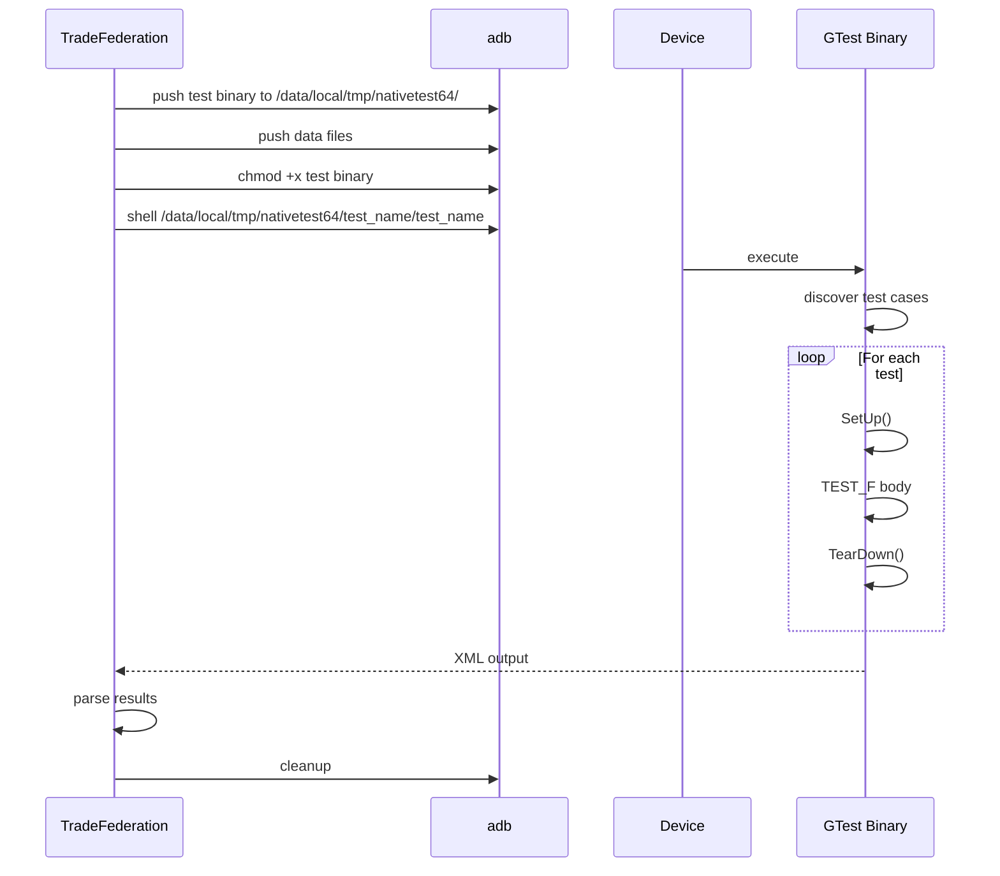

---

## 57.11  UI 测试

### 57.11.1  概述

Android 为测试用户界面提供了多个框架，每个框架针对不同的抽象层级和用例。

### 57.11.2  Espresso

Espresso 是 Google 推荐的*应用内* UI 测试框架。
它提供了用于查找视图、执行操作和断言状态的流畅 API。

```java
import static androidx.test.espresso.Espresso.onView;
import static androidx.test.espresso.action.ViewActions.click;
import static androidx.test.espresso.action.ViewActions.typeText;
import static androidx.test.espresso.assertion.ViewAssertions.matches;
import static androidx.test.espresso.matcher.ViewMatchers.withId;
import static androidx.test.espresso.matcher.ViewMatchers.withText;

@RunWith(AndroidJUnit4.class)
public class LoginActivityTest {

    @Rule
    public ActivityScenarioRule<LoginActivity> activityRule =
        new ActivityScenarioRule<>(LoginActivity.class);

    @Test
    public void loginWithValidCredentials() {
        onView(withId(R.id.username))
            .perform(typeText("user@example.com"));
        onView(withId(R.id.password))
            .perform(typeText("password123"));
        onView(withId(R.id.login_button))
            .perform(click());
        onView(withId(R.id.welcome_text))
            .check(matches(withText("Welcome!")));
    }
}
```

主要特性：

- 自动与 UI 线程同步
- 在执行操作前等待空闲
- 与被测应用运行在同一进程中
- 属于 AndroidX Test 库的一部分

### 57.11.3  UIAutomator

UIAutomator 支持*跨应用* UI 测试。与 Espresso 不同，它可以与任何可见的
UI 元素交互，包括系统 UI、通知和其他应用。

```java
import androidx.test.uiautomator.UiDevice;
import androidx.test.uiautomator.UiObject2;
import androidx.test.uiautomator.By;
import androidx.test.uiautomator.Until;

@RunWith(AndroidJUnit4.class)
public class SystemUITest {
    private UiDevice device;

    @Before
    public void setUp() {
        device = UiDevice.getInstance(
            InstrumentationRegistry.getInstrumentation());
    }

    @Test
    public void openNotificationShade() {
        device.openNotification();
        device.wait(Until.hasObject(By.pkg("com.android.systemui")), 5000);
        UiObject2 clearAll = device.findObject(
            By.text("Clear all"));
        assertThat(clearAll).isNotNull();
    }
}
```

AOSP 在以下位置提供 UIAutomator 辅助工具：
```
platform_testing/libraries/uiautomator-helpers/
```

### 57.11.4  TAPL（测试自动化平台库）

TAPL 为测试 Launcher、SystemUI 和 Settings 等系统 UI 组件提供高层抽象。
它位于：

```
platform_testing/libraries/systemui-tapl/  -- SystemUI TAPL
platform_testing/libraries/tapl-common/    -- Common TAPL utilities
```

TAPL 为系统组件创建页面对象：

```java
// Using Launcher TAPL
LauncherInstrumentation launcher = new LauncherInstrumentation();
Workspace workspace = launcher.getWorkspace();
AllApps allApps = workspace.switchToAllApps();
AppIcon calculator = allApps.getAppIcon("Calculator");
LaunchedAppState calculatorApp =
    calculator.launch("com.android.calculator2");
```

TAPL 相比原生 UIAutomator 的优势在于，它封装了系统组件的 UI
结构，当 UI 发生变化时使测试更易于维护。

### 57.11.5  Flicker 测试

Flicker 框架检测窗口过渡中的视觉回归。它在过渡期间捕获窗口管理器和
surface flinger 跟踪，并验证不变量。

源代码：`platform_testing/libraries/flicker/`

```
platform_testing/libraries/flicker/
  Android.bp
  src/              -- Flicker framework source
  test/             -- Framework self-tests
  utils/            -- Trace processing utilities
  appHelpers/       -- App helper classes
  collector/        -- Data collection
```

Flicker 测试验证以下属性：

- 过渡期间无闪烁（快速可见性变化）
- 正确的图层顺序
- 无意外的空白帧
- 正确的窗口动画

Flicker 测试针对 `FlickerBuilder` 用 Kotlin 编写
（`platform_testing/libraries/flicker/src/android/tools/flicker/FlickerBuilder.kt`）。
一个参数化运行器（`FlickerParametersRunnerFactory`，由
`FlickerJUnit4ClassRunner` 支持）执行它们。一个 `@FlickerBuilderProvider` 方法
通过 `setup {}` / `transitions {}` / `teardown {}` 块配置跟踪。
断言位于 `@Test` 方法中：

```kotlin
@RunWith(Parameterized::class)
@Parameterized.UseParametersRunnerFactory(
    FlickerParametersRunnerFactory::class)
class OpenAppFromLauncherTest(private val flicker: FlickerTest) {
    private val instrumentation =
        InstrumentationRegistry.getInstrumentation()
    private val testApp = MessagingAppHelper(instrumentation)

    @FlickerBuilderProvider
    fun buildFlicker(): FlickerBuilder {
        return FlickerBuilder(instrumentation).apply {
            setup { device.pressHome() }
            transitions { testApp.launchViaIntent(wmHelper) }
            teardown { testApp.exit(wmHelper) }
        }
    }

    @Test
    fun appWindowIsVisible() {
        flicker.assertWm {
            isAppWindowVisible(testApp.componentMatcher)
        }
    }
}
```

### 57.11.6  屏幕截图测试

屏幕截图测试捕获渲染的 UI，并与金镜像对比，以检测视觉回归。

源代码：`platform_testing/libraries/screenshot/`

```
platform_testing/libraries/screenshot/
  Android.bp
  src/                  -- Screenshot capture and comparison
  deviceless/           -- Host-side screenshot tests
  proto/                -- Protobuf definitions
  scripts/              -- Helper scripts
  update_goldens.py     -- Golden image update tool
  utils/                -- Utility functions
```

工作流程：

1. 测试渲染一个 UI 组件
2. 屏幕截图框架捕获渲染的位图
3. 位图与金镜像对比
4. 报告像素级差异

```java
@Test
public void testButtonAppearance() {
    View button = createTestButton();
    Bitmap bitmap = captureToBitmap(button);
    screenshotRule.assertBitmapAgainstGolden(
        bitmap,
        "button_default_state",
        new MSSIMMatcher()
    );
}
```

`ScreenshotTestRule.assertBitmapAgainstGolden` 入口点接收捕获的位图、
金镜像标识符和一个 `BitmapMatcher`（例如用于感知相似性的
`MSSIMMatcher` 或 `PixelPerfectMatcher`）。
更高层的 `ViewScreenshotTestRule.screenshotTest(...)` 辅助方法
封装了单个视图的捕获与对比流程。

当发生有意的视觉变更时，使用 `update_goldens.py` 更新金镜像。

### 57.11.7  UI 测试框架对比

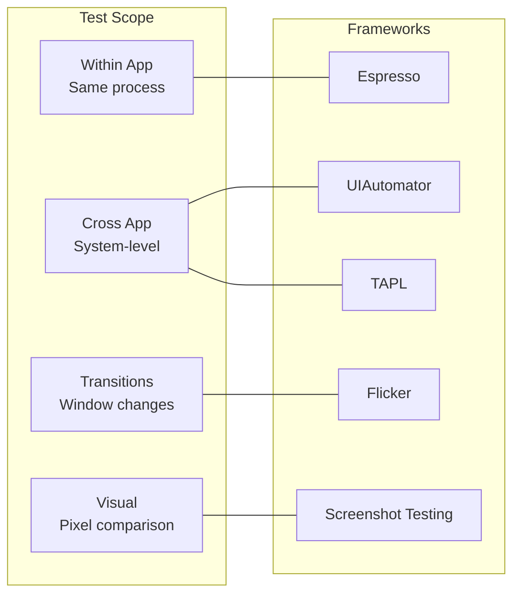

| 框架 | 范围 | 速度 | 可靠性 | 用例 |
|-----------|-------|-------|-------------|----------|
| Espresso | 应用内 | 快 | 高 | 单元级 UI 测试 |
| UIAutomator | 跨应用 | 中等 | 中等 | 系统集成 |
| TAPL | 系统 UI | 中等 | 高 | Launcher、SystemUI |
| Flicker | 过渡 | 慢 | 中等 | 动画质量 |
| 屏幕截图 | 视觉 | 中等 | 高 | 设计回归 |

### 57.11.8  Espresso 空闲资源

Espresso 的关键优势是与 UI 线程同步。
对于异步操作，Espresso 使用空闲资源：

```java
public class NetworkIdlingResource implements IdlingResource {
    private ResourceCallback callback;
    private boolean isIdle = true;

    @Override
    public String getName() { return "NetworkIdling"; }

    @Override
    public boolean isIdleNow() { return isIdle; }

    @Override
    public void registerIdleTransitionCallback(ResourceCallback callback) {
        this.callback = callback;
    }

    public void setIdle(boolean idle) {
        isIdle = idle;
        if (idle && callback != null) {
            callback.onTransitionToIdle();
        }
    }
}

// In test:
@Before
public void setUp() {
    IdlingRegistry.getInstance().register(networkIdlingResource);
}

@After
public void tearDown() {
    IdlingRegistry.getInstance().unregister(networkIdlingResource);
}
```

### 57.11.9  Flicker 测试断言

Flicker 测试在 WindowManager 和 SurfaceFlinger 跟踪上定义断言：

```java
// Common Flicker assertions:
// 1. No flickering (visibility does not change rapidly)
flicker.assertWm { wmTrace ->
    wmTrace.visibleWindowsShownMoreThanOneConsecutiveEntry(componentName)
}

// 2. App window becomes visible
flicker.assertWmEnd { wmState ->
    wmState.containsAppWindow(componentName)
}

// 3. No blank layers
flicker.assertLayers { layerTrace ->
    layerTrace.visibleLayersShownMoreThanOneConsecutiveEntry()
}

// 4. Correct layer ordering
flicker.assertLayersEnd { layerState ->
    layerState.isAbove(appLayer, wallpaperLayer)
}
```

### 57.11.10  按外形规格和环境门控 UI 测试

Android 扩展了其桌面窗口管理、大屏和汽车表面。因此，UI
测试越来越多地需要在某些外形规格上运行，而不是在其他规格上。它们
在无设备运行（Ravenwood/Robolectric）时也需要干净地跳过，
而不是失败。`LimitDevicesRule`
（`platform_testing/libraries/health/rules/src/android/platform/test/rule/LimitDevicesRule.kt`）
是 JUnit `TestRule`，它使用与 `Build.PRODUCT` 匹配的注解来强制这些约束：

| 注解 | 效果 |
|-----------|--------|
| `@AllowedDevices(...)` | 仅在列出的 `DeviceProduct` 值上运行 |
| `@DeniedDevices(...)` | 在列出的设备上跳过 |
| `@ScreenshotTestDevices(...)` | 限制为默认截图设备（`CF_PHONE`、`CF_TABLET`）或覆盖列表 |
| `@FlakyDevices(...)` | 仅在设置了 `running-flaky-tests` instrumentation 参数时在列出的设备上运行 |
| `@SkipOnDesktop` | 在桌面环境中跳过（`Build.PRODUCT` 属于桌面产品集） |
| `@SkipOnDeviceless` | 在设备外运行时跳过（Ravenwood/Robolectric） |
| `@IgnoreLimit(true)` | 完全绕过该规则（用于在任意设备上本地运行） |

目标设备由 `DeviceProduct` 枚举命名（Cuttlefish 产品
如 `CF_PHONE`、`CF_TABLET`、`CF_FOLDABLE`、`CF_DESKTOP`、`CF_AUTO`，
以及真实产品）。一个自由的 `isDesktop()` 辅助函数向测试体暴露相同的
桌面检测。测试像这样自行门控：

```kotlin
class MyLargeScreenTest {
    @get:Rule val limitDevices = LimitDevicesRule.readParamsFromInstrumentation()

    @Test
    @AllowedDevices(CF_TABLET, CF_FOLDABLE)
    @SkipOnDesktop
    fun splitScreenLayout_isCorrect() { /* ... */ }
}
```

当当前设备与注解不匹配时，该规则抛出 `AssumptionViolatedException`，
因此测试被报告为跳过而不是失败。同一个模块因此可以参与手机、平板、
可折叠设备、桌面和无设备运行，而无需按配置拆分测试。
配套的 `@SkipOnDesktop`/`@SkipOnDeviceless` 注解是 Android 17
桌面窗口和 Ravenwood 测试清扫背后的平台侧机制。一个在桌面窗口或
设备外尚无法通过的测试会被标记注解，而不是被全局禁用。
它的手机覆盖保持完整。

---

## 57.12  模拟框架

### 57.12.1  Mockito

Mockito 是 AOSP 中 Java 测试使用的主要模拟框架。

源代码：`external/mockito/`

```
external/mockito/
  Android.bp
  src/                -- Mockito source
  subprojects/        -- Sub-modules
```

Mockito 提供熟悉的 `mock()`、`when()`、`verify()` API：

```java
import static org.mockito.Mockito.*;

@RunWith(MockitoJUnitRunner.class)
public class PackageManagerTest {
    @Mock
    private PackageManager mockPm;

    @Test
    public void getInstalledPackages_returnsExpected() {
        List<PackageInfo> packages = List.of(new PackageInfo());
        when(mockPm.getInstalledPackages(anyInt())).thenReturn(packages);

        assertEquals(1, mockPm.getInstalledPackages(0).size());
        verify(mockPm).getInstalledPackages(0);
    }
}
```

Android 构建中常见的 Mockito 依赖：

- `mockito-target-minus-junit4`——用于设备测试
- `mockito-robolectric-prebuilt`——用于 Robolectric 测试
- `mockito-target-extended-minus-junit4`——扩展模拟，支持内联

### 57.12.2  Mockito-Kotlin

对于 Kotlin 测试代码，Mockito-Kotlin 提供惯用的扩展：

```kotlin
import org.mockito.kotlin.*

@Test
fun `test service binding`() {
    val mockContext: Context = mock()
    val mockConnection: ServiceConnection = mock()

    whenever(mockContext.bindService(any(), any(), anyInt()))
        .thenReturn(true)

    val result = ServiceBinder(mockContext).bind(mockConnection)
    assertTrue(result)
    verify(mockContext).bindService(any(), eq(mockConnection), eq(BIND_AUTO_CREATE))
}
```

### 57.12.3  Dexmaker

Dexmaker 在 Android 的 ART 运行时上实现运行时模拟生成，而标准 Java
字节码操作库在那里无法工作。

源代码：`external/dexmaker/`

```
external/dexmaker/
  dexmaker/                              -- Core DEX generation
  dexmaker-mockito/                      -- Mockito adapter
  dexmaker-mockito-inline/               -- Inline mocking (final classes)
  dexmaker-mockito-inline-extended/      -- Extended inline mocking
  dexmaker-mockito-inline-tests/         -- Tests
  dexmaker-mockito-inline-extended-tests/ -- Extended tests
  dexmaker-mockito-inline-dispatcher/    -- Dispatch mechanism
```

Dexmaker 解决了一个根本性的 Android 挑战。Dalvik/ART 运行时不能使用
cglib 或 ByteBuddy（标准 JVM 模拟生成库）。这是因为它们生成的是
JVM 字节码，而不是 DEX 字节码。Dexmaker 在运行时为模拟类生成 DEX 文件。

内联变体（`dexmaker-mockito-inline`）支持模拟 final 类和方法，
这对于经常声明为 final 的 Android 框架类是必不可少的。

### 57.12.4  JUnit 集成

AOSP 内置 JUnit 4（`external/junit`，以及 `external/junit-params` 中的
参数化测试扩展）；JUnit 5（Jupiter）不属于平台测试栈。
大多数平台测试使用带有 AndroidJUnit4 运行器的 JUnit 4：

```java
@RunWith(AndroidJUnit4.class)
@SmallTest
public class BundleTest {
    @Rule
    public final ExpectedException thrown = ExpectedException.none();

    @Before
    public void setUp() {
        // ...
    }

    @Test
    public void testBasicTypes() {
        Bundle bundle = new Bundle();
        bundle.putInt("key", 42);
        assertEquals(42, bundle.getInt("key"));
    }

    @After
    public void tearDown() {
        // ...
    }
}
```

AOSP 中使用的测试注解：

- `@SmallTest`——单元测试（&lt; 200ms）
- `@MediumTest`——集成测试（&lt; 1000ms）
- `@LargeTest`——端到端测试（无限制）
- `@FlakyTest`——已知不稳定的测试
- `@Presubmit`——presubmit 必需
- `@RequiresDevice`——需要物理设备

### 57.12.5  模拟 Android 系统服务

Android 测试中的一个常见模式是模拟系统服务：

```java
@RunWith(AndroidJUnit4.class)
public class ConnectivityTest {
    @Mock private ConnectivityManager mockCm;
    @Mock private Context mockContext;

    @Before
    public void setUp() {
        MockitoAnnotations.initMocks(this);
        when(mockContext.getSystemService(ConnectivityManager.class))
            .thenReturn(mockCm);
    }

    @Test
    public void testNetworkAvailable() {
        NetworkInfo networkInfo = mock(NetworkInfo.class);
        when(networkInfo.isConnected()).thenReturn(true);
        when(mockCm.getActiveNetworkInfo()).thenReturn(networkInfo);

        NetworkChecker checker = new NetworkChecker(mockContext);
        assertTrue(checker.isNetworkAvailable());
    }

    @Test
    public void testNoNetwork() {
        when(mockCm.getActiveNetworkInfo()).thenReturn(null);

        NetworkChecker checker = new NetworkChecker(mockContext);
        assertFalse(checker.isNetworkAvailable());
    }
}
```

### 57.12.6  用于 final 类的扩展 Mockito

Android 框架类通常是 `final` 的，标准 Mockito 无法模拟它们。
扩展变体使用 Dexmaker 内联模拟：

```java
// Use extended mockito for final class mocking
import static com.android.dx.mockito.inline.extended.ExtendedMockito.*;

@RunWith(AndroidJUnit4.class)
public class SettingsProviderTest {
    @Test
    public void testReadSetting() {
        // Settings.Secure is a final class
        mockitoSession()
            .mockStatic(Settings.Secure.class)
            .startMocking();

        when(Settings.Secure.getString(any(), eq("my_setting")))
            .thenReturn("mock_value");

        assertEquals("mock_value",
            Settings.Secure.getString(resolver, "my_setting"));

        finishMocking();
    }
}
```

### 57.12.7  AOSP 中的测试规则

AOSP 提供了许多自定义 JUnit 规则：

```java
// DeviceState rule for managing device configuration
@Rule
public final DeviceState deviceState = new DeviceState();

// Screen recording rule
@Rule
public final ScreenRecordRule screenRecord = new ScreenRecordRule();

// Activity scenario rule
@Rule
public ActivityScenarioRule<MyActivity> activityRule =
    new ActivityScenarioRule<>(MyActivity.class);

// Feature flag rule
@Rule
public final SetFlagsRule flagRule = new SetFlagsRule();
```

### 57.12.8  模拟架构

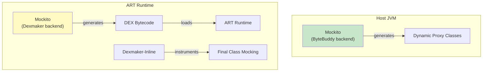

---

## 57.13  模糊测试

### 57.13.1  概述

模糊测试（fuzz testing）自动生成随机或半随机输入，以发现崩溃、内存损坏
和未定义行为。Android 的模糊测试基础设施覆盖 C/C++、Rust 和 Java。

### 57.13.2  cc_fuzz

定义于 `build/soong/cc/fuzz.go`：

```go
func init() {
    android.RegisterModuleType("cc_fuzz", LibFuzzFactory)
    android.RegisterParallelSingletonType("cc_fuzz_packaging", fuzzPackagingFactory)
    android.RegisterParallelSingletonType("cc_fuzz_presubmit_packaging",
        fuzzPackagingFactoryPresubmit)
}
```

工厂自动启用 sanitizer：

```go
func NewFuzzer(hod android.HostOrDeviceSupported) *Module {
    // ...
    module.fuzzer.Properties.FuzzFramework = fuzz.LibFuzzer

    android.AddLoadHook(module, func(ctx android.LoadHookContext) {
        extraProps := struct {
            Sanitize struct {
                Fuzzer *bool
            }
            // ...
        }{}
        extraProps.Sanitize.Fuzzer = BoolPtr(true)
        // Disable on Darwin and Linux Bionic
        extraProps.Target.Darwin.Enabled = BoolPtr(false)
        extraProps.Target.Linux_bionic.Enabled = BoolPtr(false)
        ctx.AppendProperties(&extraProps)
        // ...
    })
    return module
}
```

### 57.13.3  模糊测试框架

来自 `build/soong/fuzz/fuzz_common.go`：

```go
type Framework string

const (
    AFL              Framework = "afl"
    LibFuzzer        Framework = "libfuzzer"
    Jazzer           Framework = "jazzer"
    UnknownFramework Framework = "unknownframework"
)
```

**LibFuzzer**（默认）：LLVM 的覆盖率引导模糊测试器。
链接 `libFuzzerRuntimeLibrary`。

**AFL**（American Fuzzy Lop）：使用编译时插桩的替代模糊测试器：

```go
func (fuzzer *fuzzer) flags(ctx ModuleContext, flags Flags) Flags {
    if fuzzer.Properties.FuzzFramework == fuzz.AFL {
        flags.Local.CFlags = append(flags.Local.CFlags, []string{
            "-fsanitize-coverage=trace-pc-guard",
            "-Wno-unused-result",
            "-Wno-unused-parameter",
            "-Wno-unused-function",
        }...)
    }
    return flags
}
```

**Jazzer**：Java 模糊测试器（用于 `java_fuzz` 模块）。

### 57.13.4  Fuzz 配置

每个模糊测试器都可以包含一个配置，指定其风险画像：

```go
type Vector string

const (
    unknown_access_vector            Vector = "unknown_access_vector"
    remote                           = "remote"
    local_no_privileges_required     = "local_no_privileges_required"
    // ...
)
```

Android.bp 中的 `fuzz_config` 块：

```blueprint
cc_fuzz {
    name: "media_codec_fuzzer",
    srcs: ["media_codec_fuzzer.cpp"],
    shared_libs: ["libmedia", "libstagefright"],
    corpus: ["corpus/*"],
    dictionary: "media.dict",
    fuzz_config: {
        cc: ["security-team@google.com"],
        componentid: 155276,
        hotlists: ["4593311"],
        description: "Fuzzer for media codec parsing",
        vector: "remote",
        service_privilege: "constrained",
        users: "multi_user",
        fuzzed_code_usage: "shipped",
        use_for_presubmit: true,
    },
}
```

### 57.13.5  Fuzz 打包

`ccRustFuzzPackager` 单例收集所有 fuzz 目标并创建可分发的 ZIP 归档：

```go
func (s *ccRustFuzzPackager) GenerateBuildActions(ctx android.SingletonContext) {
    archDirs := make(map[fuzz.ArchOs][]fuzz.FileToZip)
    s.FuzzTargets = make(map[string]bool)

    ctx.VisitAllModuleProxies(func(module android.ModuleProxy) {
        // Collect fuzz modules, their shared libraries, corpus, config
        // ...
        files = s.PackageArtifacts(ctx, module, &fuzzInfo, archDir, builder)
        files = append(files,
            GetSharedLibsToZip(ccModule.FuzzSharedLibraries, ...))
        files = append(files,
            fuzz.FileToZip{SourceFilePath: android.OutputFileForModule(
                ctx, module, "unstripped")})
        // ...
    })
    s.CreateFuzzPackage(ctx, archDirs, fuzz.Cc, pctx)
    ctx.Phony(s.phonyName, s.Packages...)
}
```

`make haiku` 目标构建并打包所有模糊测试器。

### 57.13.6  rust_fuzz

Rust fuzz 目标使用 `libfuzzer-sys` 或 LLVM 的 libFuzzer 后端：

```blueprint
rust_fuzz {
    name: "binder_parcel_fuzzer",
    srcs: ["fuzz/parcel_fuzzer.rs"],
    rustlibs: ["libbinder_rs"],
    fuzz_config: {
        vector: "local_no_privileges_required",
    },
}
```

### 57.13.7  java_fuzz

Java 模糊测试使用 Jazzer 框架：

```blueprint
java_fuzz {
    name: "xml_parser_fuzzer",
    srcs: ["XmlParserFuzzer.java"],
    libs: ["framework"],
    fuzz_config: {
        description: "Fuzzer for XML parsing",
    },
}
```

### 57.13.8  Sanitizer

模糊测试器在启用 sanitizer 时效果最佳。构建系统支持：

| Sanitizer | 标志 | 检测内容 |
|-----------|------|---------|
| ASan | `-fsanitize=address` | 缓冲区溢出、释放后使用 |
| HWASan | `-fsanitize=hwaddress` | 与 ASan 相同，更低开销（ARM64） |
| UBSan | `-fsanitize=undefined` | 未定义行为 |
| MSan | `-fsanitize=memory` | 未初始化内存读取 |
| TSan | `-fsanitize=thread` | 数据竞争 |
| CFI | `-fsanitize=cfi` | 控制流完整性违规 |

当启用 `Fuzzer` sanitizer 时，构建会添加适当的覆盖率插桩：

```go
func (fuzzBin *fuzzBinary) linkerDeps(ctx DepsContext, deps Deps) Deps {
    if ctx.Config().Getenv("FUZZ_FRAMEWORK") == "AFL" {
        deps.HeaderLibs = append(deps.HeaderLibs, "libafl_headers")
    } else {
        deps.StaticLibs = append(deps.StaticLibs,
            config.LibFuzzerRuntimeLibrary())
        if module, ok := ctx.Module().(*Module); ok {
            if module.IsSanitizerEnabled(Hwasan) {
                deps.StaticLibs = append(deps.StaticLibs,
                    config.LibFuzzerRuntimeInterceptors())
            }
        }
    }
    // ...
}
```

### 57.13.9  Fuzz 目标架构

```mermaid
flowchart TB
    subgraph Build["Build Phase"]
        FuzzSrc["Fuzz Target Source"]
        Corpus["Corpus Files"]
        Dict["Dictionary"]
        Config["Fuzz Config"]
    end
    subgraph Engine["Fuzz Engine"]
        LibFuzzer["libFuzzer / AFL"]
        Sanitizer["ASan / HWASan / UBSan"]
        Coverage["Coverage Feedback"]
    end
    subgraph Execution["Execution"]
        Mutator["Input Mutator"]
        Target["Fuzz Target Function"]
        Crash["Crash Reporter"]
    end

    FuzzSrc --> |"compile"| Target
    Corpus --> Mutator
    Dict --> Mutator
    LibFuzzer --> Mutator
    Mutator --> |"mutated input"| Target
    Target --> |"coverage info"| Coverage
    Coverage --> |"feedback"| Mutator
    Target --> |"crash"| Crash
    Sanitizer --> |"detect"| Crash
```

### 57.13.10  Fuzz 语料库管理

语料库（corpus）是模糊测试器用作变异起点的种子输入集合。
良好的语料库管理对模糊测试器的效果至关重要。

```blueprint
cc_fuzz {
    name: "xml_parser_fuzzer",
    srcs: ["xml_parser_fuzzer.cpp"],
    corpus: ["corpus/*"],     // Initial seed corpus
    dictionary: "xml.dict",    // Token dictionary
}
```

字典文件包含模糊测试器应尝试的 token：

```
# xml.dict
"<xml"
"</xml>"
"encoding="
"UTF-8"
"version="
"<![CDATA["
"]]>"
"&amp;"
"&lt;"
```

### 57.13.11  Fuzz 配置详解

fuzz 配置为模糊测试基础设施指定元数据：

```go
type FuzzConfig struct {
    // Contacts
    Cc []string
    // Human-readable description
    Description string
    // Attack vector
    Vector Vector
    // Service privilege level
    Service_privilege ServicePrivilege
    // User modes affected
    Users UserData
    // Usage: shipped, future_version, experimental
    Fuzzed_code_usage FuzzedCodeUsage
    // Component ID in bug tracker
    Componentid *int64
    // Hotlist IDs
    Hotlists []string
    // Include in presubmit fuzzing
    Use_for_presubmit *bool
    // ...
}
```

`Vector` 字段对攻击面进行分类：

| Vector | 含义 |
|--------|---------|
| `remote` | 可从网络访问（例如媒体编解码器） |
| `local_no_privileges_required` | 任何应用均可访问 |
| `local_privileges_required` | 需要特权/签名权限 |
| `local_with_developer_options` | 仅在启用开发者选项时可访问 |
| `host_access` | 仅可在 PC 主机上调用（构建工具） |

### 57.13.12  持续模糊测试基础设施

Android 在后台持续运行模糊测试器。CI 基础设施：

1. 使用 sanitizer 构建所有 `cc_fuzz` 和 `rust_fuzz` 目标
2. 将模糊测试器分发到模糊测试集群
3. 长时间运行每个模糊测试器（数小时到数周）
4. 向安全团队报告新的崩溃
5. 最小化导致崩溃的输入
6. 在代码变更时检查回归

`make haiku` 目标打包所有模糊测试器以供集群使用：

```go
func (s *ccRustFuzzPackager) GenerateBuildActions(
    ctx android.SingletonContext) {
    // ...
    s.CreateFuzzPackage(ctx, archDirs, fuzz.Cc, pctx)
    ctx.Phony(s.phonyName, s.Packages...)
    ctx.DistForGoals([]string{s.phonyName}, s.Packages...)
}
```

`haiku-presubmit` 变体仅打包标记为
`use_for_presubmit: true` 的模糊测试器，用于更快的 presubmit 运行：

```go
func fuzzPackagingFactoryPresubmit() android.Singleton {
    fuzzPackager := &ccRustFuzzPackager{
        onlyIncludePresubmits: true,
        phonyName:             "haiku-presubmit",
    }
    return fuzzPackager
}
```

### 57.13.13  编写有效的 Fuzz 目标

编写有效 fuzz 目标的指南：

```cpp
// GOOD: Focused on a single parser
extern "C" int LLVMFuzzerTestOneInput(const uint8_t* data, size_t size) {
    // Create a FuzzedDataProvider for structured fuzzing
    FuzzedDataProvider fdp(data, size);

    // Consume structured data from fuzz input
    std::string format = fdp.ConsumeRandomLengthString(256);
    int width = fdp.ConsumeIntegralInRange<int>(1, 8192);
    int height = fdp.ConsumeIntegralInRange<int>(1, 8192);
    std::vector<uint8_t> image_data =
        fdp.ConsumeRemainingBytes<uint8_t>();

    // Exercise the code under test
    ImageDecoder decoder;
    decoder.SetFormat(format);
    decoder.Decode(image_data.data(), image_data.size(), width, height);

    return 0;
}
```

关键原则：

1. **单一入口点**：每个模糊测试器一个 `LLVMFuzzerTestOneInput`
2. **结构化模糊测试**：使用 `FuzzedDataProvider` 处理复杂输入
3. **无全局状态**：每次调用都应该是独立的
4. **快速执行**：每次迭代保持在 1ms 以下
5. **覆盖所有错误路径**：在传递给被测系统（SUT）之前不要验证输入
6. **无内存泄漏**：模糊测试器运行数百万次迭代

---

## 57.14  代码覆盖率（JaCoCo）

### 57.14.1  概述

JaCoCo（Java 代码覆盖率）衡量测试执行期间执行了哪些 Java/Kotlin
代码路径。AOSP 通过 `build/soong/java/jacoco.go`
在构建系统层面集成 JaCoCo。

外部 JaCoCo 库位于 `external/jacoco/`。

### 57.14.2  构建系统集成

JaCoCo 构建规则定义于 `build/soong/java/jacoco.go`：

```go
var (
    jacoco = pctx.AndroidStaticRule("jacoco", blueprint.RuleParams{
        Command: `rm -rf $tmpDir && mkdir -p $tmpDir && ` +
            `${config.Zip2ZipCmd} -i $in -o $strippedJar $stripSpec && ` +
            `${config.JavaCmd} ${config.JavaVmFlags} ` +
            `  -jar ${config.JacocoCLIJar} ` +
            `  instrument --quiet --dest $tmpDir $strippedJar && ` +
            `${config.MergeZipsCmd} --ignore-duplicates -j $out $tmpJar $in`,
        CommandDeps: []string{
            "${config.Zip2ZipCmd}",
            "${config.JavaCmd}",
            "${config.JacocoCLIJar}",
            "${config.MergeZipsCmd}",
        },
    }, "strippedJar", "stripSpec", "tmpDir", "tmpJar")
)
```

### 57.14.3  插桩流水线

JaCoCo 插桩流水线分为三个步骤：

1. **剥离**：使用带有 include/exclude 过滤器的 `zip2zip`
    从输入 JAR 中提取相关类

2. **插桩**：对剥离后的 JAR 运行 `jacoco instrument` 以插入
    覆盖率探针

3. **合并**：将插桩后的类与原始 JAR 合并，
    优先使用插桩版本

```go
func jacocoInstrumentJar(ctx android.ModuleContext,
    instrumentedJar, strippedJar android.WritablePath,
    inputJar android.Path, stripSpec string) {

    tmpJar := android.PathForModuleOut(ctx, "jacoco", "tmp", strippedJar.Base())
    ctx.Build(pctx, android.BuildParams{
        Rule:           jacoco,
        Description:    "jacoco",
        Output:         instrumentedJar,
        ImplicitOutput: strippedJar,
        Input:          inputJar,
        Args: map[string]string{
            "strippedJar": strippedJar.String(),
            "stripSpec":   stripSpec,
            "tmpDir":      filepath.Dir(tmpJar.String()),
            "tmpJar":      tmpJar.String(),
        },
    })
}
```

### 57.14.4  过滤器规范

JaCoCo 过滤器控制哪些类被插桩。过滤器语法使用带通配符的
Java 包表示法：

```go
func jacocoFilterToSpec(filter string) (string, error) {
    recursiveWildcard := strings.HasSuffix(filter, "**")
    nonRecursiveWildcard := false
    if !recursiveWildcard {
        nonRecursiveWildcard = strings.HasSuffix(filter, "*")
        filter = strings.TrimSuffix(filter, "*")
    } else {
        filter = strings.TrimSuffix(filter, "**")
    }
    spec := strings.Replace(filter, ".", "/", -1)
    if recursiveWildcard {
        spec += "**/*.class"
    } else if nonRecursiveWildcard {
        spec += "*.class"
    } else {
        spec += ".class"
    }
    return spec, nil
}
```

在 `Android.bp` 中，模块指定覆盖率过滤器：

```blueprint
java_library {
    name: "my_library",
    srcs: ["src/**/*.java"],
    jacoco: {
        include_filter: ["com.android.mypackage.**"],
        exclude_filter: ["com.android.mypackage.test.**"],
    },
}
```

### 57.14.5  依赖变异器

`jacocoDepsMutator` 自动将 `jacocoagent` 依赖添加到
可插桩模块：

```go
func jacocoDepsMutator(ctx android.BottomUpMutatorContext) {
    type instrumentable interface {
        shouldInstrument(ctx android.BaseModuleContext) bool
        shouldInstrumentInApex(ctx android.BaseModuleContext) bool
        setInstrument(value bool)
    }
    j, ok := ctx.Module().(instrumentable)
    if !ctx.Module().Enabled(ctx) || !ok {
        return
    }
    if j.shouldInstrument(ctx) && ctx.ModuleName() != "jacocoagent" {
        ctx.AddFarVariationDependencies(
            ctx.Module().Target().Variations(), libTag, "jacocoagent")
    }
}
```

### 57.14.6  报告 ZIP 生成

`BuildJacocoZip()` 函数将所有模块的插桩类收集到一个 ZIP 中，
用于报告生成：

```go
func BuildJacocoZip(ctx BuildJacocoZipContext,
    modules []android.ModuleProxy,
    outputFile android.WritablePath) {

    jacocoZipBuilder := android.NewRuleBuilder(pctx, ctx)
    jacocoZipCmd := jacocoZipBuilder.Command().
        BuiltTool("soong_zip").
        FlagWithOutput("-o ", outputFile).
        Flag("-L 0")

    for _, m := range modules {
        if javaInfo, ok := android.OtherModuleProvider(ctx, m,
            JavaInfoProvider); ok && javaInfo.JacocoInfo.ReportClassesFile != nil {
            jacoco := javaInfo.JacocoInfo
            jacocoZipCmd.FlagWithArg("-e ",
                fmt.Sprintf("out/target/common/obj/%s/%s_intermediates/"+
                    "jacoco-report-classes.jar",
                    jacoco.Class, jacoco.ModuleName)).
                FlagWithInput("-f ", jacoco.ReportClassesFile)
        }
    }
    // ...
}
```

### 57.14.7  设备测试覆盖率

设备测试覆盖率可以通过环境变量包含：

```go
func BuildJacocoZipWithPotentialDeviceTests(ctx android.ModuleContext,
    modules []android.ModuleProxy,
    outputFile android.WritablePath) {

    if !ctx.Config().IsEnvTrue("JACOCO_PACKAGING_INCLUDE_DEVICE_TESTS") {
        BuildJacocoZip(ctx, modules, outputFile)
        return
    }
    // Merge device test coverage with regular coverage
    // ...
}
```

`device_tests_jacoco_zip` 单例从 `device-tests` 套件中的所有模块收集
JaCoCo 数据：

```go
func (d *deviceTestsJacocoZipSingleton) GenerateBuildActions(
    ctx android.SingletonContext) {

    var deviceTestModules []android.ModuleProxy
    ctx.VisitAllModuleProxies(func(m android.ModuleProxy) {
        if tsm, ok := android.OtherModuleProvider(ctx, m,
            android.TestSuiteInfoProvider); ok {
            if slices.Contains(tsm.TestSuites, "device-tests") {
                deviceTestModules = append(deviceTestModules, m)
            }
        }
    })
    jacocoZip := DeviceTestsJacocoReportZip(ctx)
    BuildJacocoZip(ctx, deviceTestModules, jacocoZip)
}
```

### 57.14.8  带覆盖率运行

```bash
# Build with coverage enabled
EMMA_INSTRUMENT=true make MyModule

# Run tests with atest coverage flag
atest --experimental-coverage MyTestModule

# Generate coverage report
java -jar jacoco-cli.jar report \
    coverage.exec \
    --classfiles out/target/common/obj/ \
    --html coverage-report/
```

### 57.14.9  覆盖率架构

```mermaid
flowchart LR
    subgraph Build["Build Phase"]
        Source["Java Source"]
        Compile["javac"]
        Instrument["JaCoCo Instrument"]
    end
    subgraph Test["Test Phase"]
        InstrJAR["Instrumented JAR"]
        Runtime["JaCoCo Agent"]
        ExecFile["coverage.exec"]
    end
    subgraph Report["Report Phase"]
        CLI["JaCoCo CLI"]
        HTML["HTML Report"]
        XML["XML Report"]
    end

    Source --> Compile --> Instrument
    Instrument --> InstrJAR
    InstrJAR --> Runtime
    Runtime --> |"probe data"| ExecFile
    ExecFile --> CLI
    CLI --> HTML
    CLI --> XML
```

### 57.14.10  原生代码覆盖率

对于 C/C++ 代码，AOSP 支持使用 LLVM 基于源码的覆盖率
（`-fprofile-instr-generate -fcoverage-mapping`）和 GCC 兼容的
gcov 格式。

原生覆盖率通过构建标志启用：

```bash
# Enable native coverage
NATIVE_COVERAGE=true make my_module
```

覆盖率数据可以使用以下方式收集：

```bash
# Pull coverage data from device
adb pull /data/misc/trace/ coverage_data/

# Generate report
llvm-cov show binary -instr-profile=coverage.profdata
```

### 57.14.11  CI 中的覆盖率

CI 流水线集成覆盖率收集：

1. **构建阶段**：使用 JaCoCo / LLVM 覆盖率插桩模块
2. **测试阶段**：运行测试，收集 `.exec` 文件（Java）或 `.profdata`（原生）
3. **报告阶段**：生成 HTML/XML 报告
4. **门控阶段**：如果覆盖率低于阈值则阻止合并

```mermaid
flowchart LR
    Build["Instrumented Build"] --> Test["Test Execution"]
    Test --> Collect["Collect Coverage Data"]
    Collect --> Report["Generate Report"]
    Report --> Gate["Coverage Gate"]
    Gate --> |"pass"| Merge["Allow Merge"]
    Gate --> |"fail"| Block["Block Merge"]
```

---

## 57.15  平台测试库

### 57.15.1  概述

AOSP 在 `platform_testing/libraries/` 下提供了丰富的共享测试库
（Android 17 中有 38 个子目录）。这些库封装了常见模式，减少了样板代码，
并提供设备交互辅助工具。

### 57.15.2  目录清单

```
platform_testing/libraries/
  androidbuildinternal/        -- Build-server result proto helpers
  annotations/                 -- Custom test annotations
  app-helpers/                 -- App interaction helpers
  audio-test-harness/          -- Audio testing framework
  aupt-lib/                    -- Automated User Performance Testing
  automotive/                  -- Automotive test utilities
  automotive-helpers/          -- Automotive helper functions
  car-helpers/                 -- Car-specific test helpers
  collectors-helper/           -- Metric collector helpers
  compatibility-common-util/   -- CTS/VTS shared utilities
  desktop-test-lib/            -- Desktop mode testing
  device-collectors/           -- Device-side metric collectors
  flag-helpers/                -- Feature flag test helpers
  flicker/                     -- Window transition testing (57.11.5)
  health/                      -- Device health checks (incl. LimitDevicesRule)
  junit-rules/                 -- Custom JUnit rules
  junitxml/                    -- JUnit XML result format
  launcher-helper/             -- Launcher interaction helpers
  media/                       -- Media test scenario libraries
  media-helper/                -- Media test utilities
  metrics-helper/              -- Metrics collection and reporting
  motion/                      -- Motion/gesture testing
  notes-role-test-helper/      -- Notes role testing
  power-helper/                -- Power measurement helpers
  rdroidtest/                  -- Custom Rust test harness (runtime ignore)
  runner/                      -- Custom test runners
  screenshot/                  -- Screenshot testing (57.11.6)
  sdv/                         -- Software Defined Vehicle test helpers
  sts-common-util/             -- STS shared utilities
  system-helpers/              -- System interaction helpers
  systemui-helper/             -- SystemUI test helpers
  systemui-tapl/               -- SystemUI TAPL (57.11.4)
  tapl-common/                 -- Common TAPL utilities
  timeresult-helper/           -- Time-based result helpers
  tradefed-error-prone/        -- Error-prone rules for TF
  uiautomator-accessibility/   -- Accessibility-driven UIAutomator helpers
  uiautomator-helpers/         -- UIAutomator extensions
  uinput-device-test-helper/   -- Synthetic input device helpers
```

Android 17 代码树在集合中新增了 `androidbuildinternal/`、`media/`、
`sdv/`（Software Defined Vehicle，第 62 章"设备外形规格"§62.7 有介绍）
和 `uiautomator-accessibility/`。这些新增体现了汽车/SDV 测试面
以及无障碍驱动的 UI 辅助层的扩展。

### 57.15.3  关键库

**device-collectors/**：提供与测试一起运行以收集性能数据的指标收集器：

- CPU 使用率
- 内存分配
- 电池耗电
- JankStats（帧计时）
- 方法跟踪

**collectors-helper/**：设备收集器的辅助工具，简化指标收集的
设置和清理。

**junit-rules/**：用于常见 Android 测试模式的自定义 JUnit 规则：

- `ConditionalIgnore` / `ConditionalIgnoreRule`——当条件成立时
  跳过测试
- `IgnoreOnPortrait`——在纵向设备上跳过测试

**flag-helpers/**：使用 Android 特性标志进行测试的工具：
```java
@EnableFlags(Flags.FLAG_NEW_FEATURE)
@Test
public void testNewFeature_enabled() {
    // Test code that exercises the new feature
}

@DisableFlags(Flags.FLAG_NEW_FEATURE)
@Test
public void testNewFeature_disabled() {
    // Test code that exercises the old behavior
}
```

**health/**：验证测试前后设备状态的设备健康检查工具
（电量、磁盘空间、网络连接）。其 `rules/` 子目录还托管通用测试规则，
如在测试期间录制屏幕的 `ScreenRecordRule`。

**runner/**：参数化 JUnit 运行器（`ParameterizedAndroidJunit4`、
`AndroidParameterizedRunner`、`RobolectricParameterizedRunner`，
构建为 `platform-parametric-runner-lib`），让同一个参数化测试类
既能在设备上运行，也能在 Robolectric 下运行。

**sts-common-util/**：安全测试套件测试的共享工具，包括
漏洞利用辅助工具和漏洞验证工具。

### 57.15.4  使用平台测试库

这些库可作为构建依赖使用：

```blueprint
android_test {
    name: "MyIntegrationTest",
    srcs: ["src/**/*.java"],
    static_libs: [
        "platform-test-annotations",
        "platform-test-rules",
        "collector-device-lib",
        "launcher-helper-lib",
        "uiautomator-helpers",
    ],
    test_suites: ["device-tests"],
}
```

### 57.15.5  设备收集器

设备收集器（`platform_testing/libraries/device-collectors/`）在测试执行期间
收集指标。设备侧收集器是 `BaseMetricListener` 的子类
（包 `android.device.collectors`），它们将实际测量委托给
`platform_testing/libraries/collectors-helper/` 下
`com.android.helpers` 包中的 `ICollectorHelper` 实现。
在 TradeFed 一侧，`<metrics_collector>` XML 标签命名了主机侧的
`IMetricCollector` 实现，作为它们的补充：

```xml
<metrics_collector
    class="com.android.tradefed.device.metric.FilePullerDeviceMetricCollector">
    <option name="pull-pattern-keys" value="perfetto_file_path" />
</metrics_collector>
```

常见的收集器辅助工具（`com.android.helpers`）：

- **CpuUsageHelper**：测量测试期间的 CPU 利用率
- **DumpsysMeminfoHelper** / **FreeMemHelper**：跟踪内存使用模式
- **BatteryUsageStatsHelper**：记录电池消耗
- **JankCollectionHelper**：测量帧计时和卡顿
- **PerfettoHelper**：捕获系统级 Perfetto 跟踪
- **AppStartupHelper**：测量应用冷启动/温启动/热启动时间

### 57.15.6  AUPT（自动化用户体验性能测试）

AUPT（`platform_testing/libraries/aupt-lib/`）为长时间运行的用户体验
性能测试提供框架：

```java
public class SettingsJourney extends AuptTestCase {
    @Override
    protected void setUp() throws Exception {
        super.setUp();
        mDevice = UiDevice.getInstance(getInstrumentation());
    }

    public void testBrowseSettings() throws Exception {
        // Simulate user navigating through Settings
        mDevice.pressHome();
        openSettings();
        navigateToDisplay();
        navigateToSound();
        navigateToSecurity();
        // Metrics collected automatically throughout
    }
}
```

AUPT 在整个用户旅程中自动收集内存、CPU 和电池指标。

### 57.15.7  注解库

`platform_testing/libraries/annotations/` 库为 Android 测试提供自定义注解：

```java
// HermeticTest.java: no account, network, or harness setup required
@Retention(RetentionPolicy.RUNTIME)
@Target({ElementType.METHOD, ElementType.TYPE})
public @interface HermeticTest {
}
```

同一目录中的其他注解包括 `@Presubmit` 和
`@Postsubmit`（测试组调度）、`@PlatinumTest`（高可靠性
测试）、`@AsbSecurityTest`（Android 安全公告测试），以及
`@RequiresFlagsEnabled` / `@RequiresFlagsDisabled`（特性标志
约束）。

### 57.15.8  Compatibility Common Util

`compatibility-common-util` 库为 CTS/VTS 提供共享工具：

- `DevicePropertyInfo`——收集 `ro.*` 构建属性，用于结果报告的
  设备信息部分
- `DynamicConfig`——加载运行时推送的每模块动态配置值
- `ReportLog` / `MetricsXmlSerializer`——性能结果的结构化指标日志
- `InvocationResult` / `IInvocationResult`、`ModuleResult` / `IModuleResult`、
  `CaseResult`——套件调用的结果对象模型
- `ResultHandler`——解析和写入 `test_result.xml` 结果文件
- `AbiUtils`——ABI 名称解析和过滤辅助工具

### 57.15.9  库依赖图

```mermaid
graph TB
    Test["Your Test Module"]
    Test --> |"static_libs"| Runner["platform-parametric-runner-lib"]
    Test --> |"static_libs"| Annotations["platform-test-annotations"]
    Test --> |"static_libs"| Rules["platform-test-rules"]
    Test --> |"static_libs"| Collectors["collector-device-lib"]
    Test --> |"static_libs"| UIA["uiautomator-helpers"]
    Test --> |"static_libs"| SysUI["systemui-helper"]
    Test --> |"static_libs"| Flags["flag-junit"]
    Collectors --> |"depends"| Jank["jank-helper"]
    Collectors --> |"depends"| Memory["memory-helper"]
    Collectors --> |"depends"| Perfetto["perfetto-helper"]
    SysUI --> |"depends"| TaplCommon["tapl-common"]
```

---

## 57.16  其他测试套件

### 57.16.1  MTS（Mainline 测试套件）

MTS 验证可更新的 Mainline 模块。每个 Mainline 模块（网络、
媒体、权限等）都可以通过 Google Play 独立更新，MTS 确保更新不会破坏兼容性。

MTS 测试模块使用带 `mts` 前缀的变体声明其套件成员身份：

```blueprint
android_test {
    name: "CtsNetTestCases",
    test_suites: [
        "cts",
        "mts-tethering",
        "general-tests",
        // ...
    ],
}
```

当存在任何 `mts-*` 前缀时，构建系统会自动将 `mts` 添加为兼容套件：

```go
func (test *testDecorator) moduleInfoJSON(ctx android.ModuleContext,
    moduleInfoJSON *android.ModuleInfoJSON) {
    if android.PrefixInList(moduleInfoJSON.CompatibilitySuites, "mts-") &&
        !android.InList("mts", moduleInfoJSON.CompatibilitySuites) {
        moduleInfoJSON.CompatibilitySuites = append(
            moduleInfoJSON.CompatibilitySuites, "mts")
    }
}
```

MTS 测试使用 `Test_mainline_modules` 参数化，以测试特定的模块组合：

```blueprint
cc_test {
    name: "resolv_integration_test",
    test_mainline_modules: [
        "CaptivePortalLoginGoogle.apk+NetworkStackGoogle.apk+" +
        "com.google.android.resolv.apex",
    ],
}
```

### 57.16.2  CTS-root

CTS-root 包含需要在设备上具有 root 权限的 CTS 测试模块。
这些测试验证只有提升权限才能访问的行为，
但它们仍然是兼容性契约的一部分。

```bash
cts-root-tradefed run cts-root
```

### 57.16.3  Catbox

Catbox 是汽车合规测试套件。它运行与 Android Automotive OS 相关的
CTS 测试子集以及汽车专用测试：

```bash
catbox-tradefed run catbox
```

Catbox 验证的汽车专用 API 包括：

- Car 服务 API
- 车辆 HAL 交互
- 汽车 UI 要求
- 多显示器支持

### 57.16.4  DittoSuite

DittoSuite 是用于存储 I/O 性能的基准和压力测试框架。它生成可配置的
工作负载来测量：

- 顺序和随机读写吞吐量
- IOPS（每秒输入/输出操作数）
- 延迟分布
- 压力下的存储行为

### 57.16.5  套件层次结构

```mermaid
graph TB
    subgraph Compliance["Compliance Suites"]
        CTS["CTS<br>(App compatibility)"]
        VTS["VTS<br>(Vendor/HAL)"]
        GTS["GTS<br>(Google services)"]
    end
    subgraph Security["Security Suites"]
        STS["STS<br>(Security patches)"]
    end
    subgraph Mainline["Mainline Suites"]
        MTS["MTS<br>(Module updates)"]
    end
    subgraph Specialized["Specialized Suites"]
        CTS_ROOT["CTS-root<br>(Root-required)"]
        CATBOX["Catbox<br>(Automotive)"]
        DITTO["DittoSuite<br>(Storage perf)"]
    end
    subgraph Development["Development Suites"]
        GENERAL["general-tests<br>(Presubmit)"]
        DEVICE["device-tests<br>(Device-side)"]
        ROBO["robolectric-tests<br>(Host Robolectric)"]
        RAVEN["ravenwood-tests<br>(Host Ravenwood)"]
    end

    CTS --> CTS_ROOT
    CTS --> CATBOX
```

---

## 57.17  实战：在每个层级编写测试

本动手章节逐步介绍在 Android 测试金字塔的每个层级编写测试。
被测系统是一个假设的 `StringUtils` 模块。

### 57.17.1  练习 1：主机侧单元测试（cc_test_host）

为 C++ 工具库创建一个原生主机侧单元测试。

**步骤 1：创建测试源代码**

```cpp
// frameworks/libs/stringutils/tests/string_utils_test.cpp
#include <gtest/gtest.h>
#include "string_utils.h"

TEST(StringUtilsTest, TrimRemovesLeadingSpaces) {
    EXPECT_EQ(trim("  hello"), "hello");
}

TEST(StringUtilsTest, TrimRemovesTrailingSpaces) {
    EXPECT_EQ(trim("hello  "), "hello");
}

TEST(StringUtilsTest, TrimPreservesMiddleSpaces) {
    EXPECT_EQ(trim("  hello world  "), "hello world");
}

TEST(StringUtilsTest, TrimHandlesEmptyString) {
    EXPECT_EQ(trim(""), "");
}

TEST(StringUtilsTest, TrimHandlesAllSpaces) {
    EXPECT_EQ(trim("   "), "");
}
```

**步骤 2：创建构建规则**

```blueprint
// frameworks/libs/stringutils/tests/Android.bp
cc_test_host {
    name: "string_utils_test",
    srcs: ["string_utils_test.cpp"],
    static_libs: ["libstringutils"],
    test_suites: ["general-tests"],
    test_options: {
        unit_test: true,
    },
}
```

**步骤 3：运行它**

```bash
atest string_utils_test
```

### 57.17.2  练习 2：Ravenwood 框架测试

在主机 JVM 上测试一个 Android 框架工具类。

**步骤 1：创建测试源代码**

```java
// frameworks/base/core/tests/ravenwood/src/android/util/SparseArrayRavenwoodTest.java
package android.util;

import static org.junit.Assert.*;

import android.util.SparseArray;
import org.junit.Test;
import org.junit.runner.RunWith;
import org.junit.runners.JUnit4;

@RunWith(JUnit4.class)
public class SparseArrayRavenwoodTest {

    @Test
    public void testPutAndGet() {
        SparseArray<String> array = new SparseArray<>();
        array.put(1, "one");
        array.put(2, "two");
        assertEquals("one", array.get(1));
        assertEquals("two", array.get(2));
    }

    @Test
    public void testSize() {
        SparseArray<String> array = new SparseArray<>();
        assertEquals(0, array.size());
        array.put(1, "one");
        assertEquals(1, array.size());
    }

    @Test
    public void testRemove() {
        SparseArray<String> array = new SparseArray<>();
        array.put(1, "one");
        array.remove(1);
        assertNull(array.get(1));
    }
}
```

**步骤 2：创建构建规则**

```blueprint
android_ravenwood_test {
    name: "SparseArrayRavenwoodTest",
    srcs: ["src/**/*.java"],
    static_libs: [
        "ravenwood-junit",
    ],
    sdk_version: "test_current",
    auto_gen_config: true,
}
```

**步骤 3：运行它**

```bash
atest --host SparseArrayRavenwoodTest
```

### 57.17.3  练习 3：设备 Instrumentation 测试

编写一个测试真实设备行为的测试。

**步骤 1：创建测试源代码**

```java
// packages/apps/MyApp/tests/src/com/example/myapp/MainActivityTest.java
package com.example.myapp;

import static org.junit.Assert.*;
import android.content.Intent;
import androidx.test.core.app.ActivityScenario;
import androidx.test.ext.junit.runners.AndroidJUnit4;
import androidx.test.filters.SmallTest;
import org.junit.Test;
import org.junit.runner.RunWith;

@RunWith(AndroidJUnit4.class)
@SmallTest
public class MainActivityTest {

    @Test
    public void testActivityLaunches() {
        try (ActivityScenario<MainActivity> scenario =
                ActivityScenario.launch(MainActivity.class)) {
            scenario.onActivity(activity -> {
                assertNotNull(activity);
                assertFalse(activity.isFinishing());
            });
        }
    }
}
```

**步骤 2：创建构建规则**

```blueprint
android_test {
    name: "MyAppTests",
    srcs: ["tests/src/**/*.java"],
    instrumentation_for: "MyApp",
    static_libs: [
        "androidx.test.runner",
        "androidx.test.rules",
        "androidx.test.ext.junit",
        "truth",
    ],
    test_suites: ["device-tests", "general-tests"],
}
```

**步骤 3：创建 TEST_MAPPING**

```json
{
  "presubmit": [
    {
      "name": "MyAppTests"
    }
  ]
}
```

**步骤 4：运行它**

```bash
atest MyAppTests
```

### 57.17.4  练习 4：CTS 风格的合规测试

编写一个作为 CTS 模块验证 API 行为的测试。

**步骤 1：创建测试源代码**

```java
// cts/tests/myapi/src/android/myapi/cts/MyApiTest.java
package android.myapi.cts;

import static org.junit.Assert.*;
import android.myapi.MyApiManager;
import android.content.Context;
import androidx.test.InstrumentationRegistry;
import androidx.test.ext.junit.runners.AndroidJUnit4;
import org.junit.Before;
import org.junit.Test;
import org.junit.runner.RunWith;

@RunWith(AndroidJUnit4.class)
public class MyApiTest {
    private MyApiManager mManager;

    @Before
    public void setUp() {
        Context context = InstrumentationRegistry.getTargetContext();
        mManager = context.getSystemService(MyApiManager.class);
        assertNotNull("MyApiManager must be available", mManager);
    }

    @Test
    public void testGetVersion_returnsNonNegative() {
        int version = mManager.getVersion();
        assertTrue("Version must be non-negative, got: " + version,
            version >= 0);
    }
}
```

**步骤 2：创建带有 CTS 套件的构建规则**

```blueprint
android_test {
    name: "CtsMyApiTestCases",
    defaults: ["cts_defaults"],
    srcs: ["src/**/*.java"],
    test_suites: [
        "cts",
        "general-tests",
    ],
    static_libs: [
        "ctstestrunner-axt",
        "compatibility-device-util-axt",
    ],
    sdk_version: "test_current",
}
```

### 57.17.5  练习 5：原生 Fuzz 目标

为解析函数编写一个模糊测试器。

**步骤 1：创建 fuzz 目标**

```cpp
// frameworks/libs/stringutils/fuzz/string_parser_fuzzer.cpp
#include <stdint.h>
#include <stddef.h>
#include "string_parser.h"

extern "C" int LLVMFuzzerTestOneInput(const uint8_t* data, size_t size) {
    // Create a null-terminated string from the fuzz input
    std::string input(reinterpret_cast<const char*>(data), size);

    // Exercise the parser with fuzz input
    ParseResult result;
    parse_string(input.c_str(), &result);

    return 0;
}
```

**步骤 2：创建构建规则**

```blueprint
cc_fuzz {
    name: "string_parser_fuzzer",
    srcs: ["string_parser_fuzzer.cpp"],
    static_libs: ["libstringutils"],
    corpus: ["corpus/*"],
    fuzz_config: {
        description: "Fuzzer for string parser",
        vector: "local_no_privileges_required",
        service_privilege: "constrained",
    },
}
```

**步骤 3：运行它**

```bash
# Build all fuzzers
make haiku

# Run the specific fuzzer
$ANDROID_HOST_OUT/fuzz/x86_64/string_parser_fuzzer/string_parser_fuzzer \
    corpus/
```

### 57.17.6  练习 6：Robolectric 测试

在没有设备的情况下测试 Activity 的行为。

**步骤 1：创建测试源代码**

```java
// packages/apps/Settings/tests/robotests/src/com/android/settings/
// SettingsActivityRoboTest.java
package com.android.settings;

import static org.junit.Assert.*;
import android.content.Intent;
import org.junit.Test;
import org.junit.runner.RunWith;
import org.robolectric.Robolectric;
import org.robolectric.RobolectricTestRunner;
import org.robolectric.android.controller.ActivityController;

@RunWith(RobolectricTestRunner.class)
public class SettingsActivityRoboTest {

    @Test
    public void testOnCreate_doesNotCrash() {
        ActivityController<SettingsActivity> controller =
            Robolectric.buildActivity(SettingsActivity.class);
        controller.create();
        assertFalse(controller.get().isFinishing());
    }

    @Test
    public void testStartedWithIntent_handlesNull() {
        ActivityController<SettingsActivity> controller =
            Robolectric.buildActivity(SettingsActivity.class, null);
        controller.create().start().resume();
        assertNotNull(controller.get());
    }
}
```

**步骤 2：构建规则**

```blueprint
android_robolectric_test {
    name: "SettingsRoboTests",
    srcs: ["tests/robotests/src/**/*.java"],
    instrumentation_for: "Settings",
    java_resource_dirs: ["tests/robotests/config"],
}
```

**步骤 3：运行它**

```bash
atest SettingsRoboTests
```

### 57.17.7  练习 7：屏幕截图测试

编写一个屏幕截图测试以捕获视觉回归。

**步骤 1：创建测试源代码**

```kotlin
// packages/apps/MyApp/tests/screenshot/src/com/example/myapp/
// ButtonScreenshotTest.kt
package com.example.myapp

import android.widget.Button
import androidx.test.ext.junit.runners.AndroidJUnit4
import androidx.test.platform.app.InstrumentationRegistry
import platform.test.screenshot.DeviceEmulationSpec
import platform.test.screenshot.Displays
import platform.test.screenshot.GoldenPathManager
import platform.test.screenshot.ViewScreenshotTestRule
import platform.test.screenshot.matchers.MSSIMMatcher
import org.junit.Rule
import org.junit.Test
import org.junit.runner.RunWith

@RunWith(AndroidJUnit4::class)
class ButtonScreenshotTest {

    @get:Rule
    val screenshotRule = ViewScreenshotTestRule(
        DeviceEmulationSpec.forDisplays(Displays.Phone).first(),
        GoldenPathManager(
            InstrumentationRegistry.getInstrumentation().context),
        MSSIMMatcher()
    )

    @Test
    fun testPrimaryButton_defaultState() {
        screenshotRule.screenshotTest("primary_button_default") { activity ->
            Button(activity).apply {
                text = "Save"
                isEnabled = true
            }
        }
    }

    @Test
    fun testPrimaryButton_disabledState() {
        screenshotRule.screenshotTest("primary_button_disabled") { activity ->
            Button(activity).apply {
                text = "Save"
                isEnabled = false
            }
        }
    }
}
```

**步骤 2：构建规则**

```blueprint
android_test {
    name: "MyAppScreenshotTests",
    srcs: ["tests/screenshot/src/**/*.kt"],
    static_libs: [
        "platform-screenshot-diff-core",
        "androidx.test.runner",
    ],
    asset_dirs: ["tests/screenshot/goldens"],
    test_suites: ["device-tests"],
}
```

**步骤 3：设计变更时更新金镜像**

运行测试。从设备拉取失败产物。这些是
`.textpb` diff proto 和实际的 `.png` 截图。然后将更新脚本指向
包含它们的目录：

```bash
python3 platform_testing/libraries/screenshot/update_goldens.py \
    --source-directory /path/to/pulled/results \
    --android-build-top "$ANDROID_BUILD_TOP"
```

### 57.17.8  练习 8：Robolectric 结合 Mockito

结合 Robolectric 的环境与 Mockito 进行隔离测试。

**步骤 1：创建测试**

```java
package com.android.settings.wifi;

import static org.junit.Assert.*;
import static org.mockito.Mockito.*;

import android.content.Context;
import android.net.wifi.WifiManager;
import org.junit.Before;
import org.junit.Test;
import org.junit.runner.RunWith;
import org.mockito.Mock;
import org.mockito.MockitoAnnotations;
import org.robolectric.RobolectricTestRunner;
import org.robolectric.RuntimeEnvironment;

@RunWith(RobolectricTestRunner.class)
public class WifiControllerRoboTest {
    @Mock private WifiManager mockWifiManager;
    private Context context;
    private WifiController controller;

    @Before
    public void setUp() {
        MockitoAnnotations.initMocks(this);
        context = RuntimeEnvironment.getApplication();
        controller = new WifiController(context, mockWifiManager);
    }

    @Test
    public void testToggleWifi_enablesWhenDisabled() {
        when(mockWifiManager.isWifiEnabled()).thenReturn(false);
        controller.toggleWifi();
        verify(mockWifiManager).setWifiEnabled(true);
    }

    @Test
    public void testToggleWifi_disablesWhenEnabled() {
        when(mockWifiManager.isWifiEnabled()).thenReturn(true);
        controller.toggleWifi();
        verify(mockWifiManager).setWifiEnabled(false);
    }

    @Test
    public void testGetWifiState_returnsCorrectString() {
        when(mockWifiManager.getWifiState())
            .thenReturn(WifiManager.WIFI_STATE_ENABLED);
        assertEquals("Enabled", controller.getWifiStateString());
    }
}
```

### 57.17.9  练习 9：多层次测试策略

对于一个新的系统服务，在每个层级创建测试。

**层级 1：Ravenwood 单元测试（主机，无需设备）**
```blueprint
android_ravenwood_test {
    name: "MyServiceUnitTestsRavenwood",
    srcs: ["tests/ravenwood/src/**/*.java"],
    // Tests pure logic, data structures, state machines
}
```

**层级 2：Robolectric 测试（主机，带影子）**
```blueprint
android_robolectric_test {
    name: "MyServiceRoboTests",
    srcs: ["tests/robo/src/**/*.java"],
    instrumentation_for: "MyServiceApp",
    // Tests service behavior with simulated framework
}
```

**层级 3：设备集成测试**
```blueprint
android_test {
    name: "MyServiceIntegrationTests",
    srcs: ["tests/integration/src/**/*.java"],
    test_suites: ["device-tests", "general-tests"],
    // Tests real Binder calls, permissions, multi-process
}
```

**层级 4：CTS 合规测试**
```blueprint
android_test {
    name: "CtsMyServiceTestCases",
    defaults: ["cts_defaults"],
    srcs: ["tests/cts/src/**/*.java"],
    test_suites: ["cts", "general-tests"],
    // Tests public API contract
}
```

**层级 5：Fuzz 目标**
```blueprint
cc_fuzz {
    name: "my_service_input_fuzzer",
    srcs: ["fuzz/input_fuzzer.cpp"],
    // Fuzzes native code in the service
}
```

```mermaid
flowchart TB
    subgraph Pyramid["Multi-Level Test Strategy"]
        L5["Level 5: Fuzz Targets<br>cc_fuzz, rust_fuzz<br><i>Find crashes</i>"]
        L4["Level 4: CTS Compliance<br>android_test (cts suite)<br><i>API contracts</i>"]
        L3["Level 3: Device Integration<br>android_test<br><i>Real system behavior</i>"]
        L2["Level 2: Robolectric<br>android_robolectric_test<br><i>Shadow-based testing</i>"]
        L1["Level 1: Ravenwood / Host Unit<br>android_ravenwood_test / cc_test_host<br><i>Pure logic, fastest</i>"]
    end
    L5 --- L4
    L4 --- L3
    L3 --- L2
    L2 --- L1
    style L1 fill:#c8e6c9
    style L2 fill:#dcedc8
    style L3 fill:#fff9c4
    style L4 fill:#ffe0b2
    style L5 fill:#ffccbc
```

### 57.17.10  测试检查清单

向 AOSP 模块添加测试时使用此检查清单：

- [ ] **存在单元测试**：覆盖所有公共函数/方法
- [ ] **优先主机**：测试能否在没有设备的情况下运行？使用
      `cc_test_host`、`android_ravenwood_test` 或 `android_robolectric_test`

- [ ] **TEST_MAPPING 已更新**：将测试添加到 `presubmit` 组
- [ ] **已声明 test_suites**：模块至少指定 `general-tests`
- [ ] **auto_gen_config**：让构建系统生成 TradeFed XML
- [ ] **安全关键代码已模糊测试**：创建了 `cc_fuzz` 或 `rust_fuzz` 目标
- [ ] **已测量覆盖率**：为覆盖率报告设置了 JaCoCo 过滤器
- [ ] **无不稳定性**：测试在 100+ 次连续运行中可靠通过
- [ ] **快速执行**：单元测试在 &lt; 1 秒内完成
- [ ] **最小化设备依赖**：仅在真正必要时使用设备

### 57.17.11  常见陷阱与解决方案

| 陷阱 | 症状 | 解决方案 |
|---------|---------|----------|
| 缺少 test_suites | CI 未拾取测试 | 将 `"general-tests"` 添加到 test_suites |
| 无 TEST_MAPPING | 无 presubmit 覆盖 | 在目录中创建 TEST_MAPPING |
| 本可主机却仅设备 | presubmit 慢 | 转换为 Ravenwood 或 Robolectric |
| 不稳定的时间断言 | 间歇性失败 | 使用轮询/等待代替 sleep |
| 硬编码设备路径 | 在不同设备上失败 | 使用 context/environment API |
| 缺少 auto_gen_config | 测试无法被 TF 运行 | 提供 AndroidTest.xml 或设置 auto_gen_config: true |
| 运行器错误 | 测试执行但失败 | 验证运行器与测试框架匹配 |
| 无 data 属性 | 测试找不到测试文件 | 将数据文件添加到 data 属性 |
| 共享可变状态 | 测试相互干扰 | 在 @Before 中使用新状态，在 @After 中清理 |
| 缺少权限 | SecurityException | 使用 require_root 或正确的测试 manifest |

### 57.17.12  测试决策流程图

```mermaid
flowchart TB
    Start["Need to test code"] --> Q1{"Does it need<br>a real device?"}
    Q1 --> |"No"| Q2{"Java/Kotlin or<br>C/C++?"}
    Q1 --> |"Yes"| Q3{"UI testing<br>needed?"}

    Q2 --> |"Java"| Q4{"Framework APIs<br>needed?"}
    Q2 --> |"C/C++"| CCHost["cc_test_host"]

    Q4 --> |"Yes, high fidelity"| Raven["android_ravenwood_test"]
    Q4 --> |"Yes, broad coverage"| Robo["android_robolectric_test"]
    Q4 --> |"No"| JTH["java_test_host"]

    Q3 --> |"Within app"| Espresso["Espresso<br>(android_test)"]
    Q3 --> |"Cross app"| UIAuto["UIAutomator<br>(android_test)"]
    Q3 --> |"Transitions"| Flicker["Flicker<br>(platform_testing)"]
    Q3 --> |"No"| Q5{"Compliance<br>test?"}

    Q5 --> |"API contract"| CTS_T["CTS module<br>(android_test)"]
    Q5 --> |"HAL/vendor"| VTS_T["VTS module<br>(cc_test)"]
    Q5 --> |"No"| DeviceTest["android_test /<br>cc_test"]

    style Raven fill:#c8e6c9
    style Robo fill:#c8e6c9
    style CCHost fill:#c8e6c9
    style JTH fill:#c8e6c9
```

### 57.17.13  端到端工作流：从代码变更到测试执行

本节追踪从开发者进行代码变更到测试在 CI 中执行的完整路径。

```mermaid
sequenceDiagram
    participant Dev as Developer
    participant Repo as Code Repository
    participant CI as CI System
    participant TM as TEST_MAPPING Parser
    participant Soong as Soong Build System
    participant TF as TradeFederation
    participant Device as Test Device

    Dev->>Repo: Upload CL (code change)
    CI->>Repo: Detect changed files
    CI->>TM: Walk directory tree for TEST_MAPPING
    TM-->>CI: List of presubmit tests
    CI->>Soong: Build test modules + dependencies
    Soong->>Soong: Compile, link, generate TF configs
    Soong-->>CI: Test APKs, binaries, configs
    CI->>TF: Create invocation with test plan
    TF->>TF: CommandScheduler.addCommand()
    TF->>TF: Allocate device(s)
    TF->>Device: Prepare (flash, install, configure)
    loop For each test module
        TF->>Device: Execute tests
        Device-->>TF: Results
    end
    TF->>TF: Aggregate results, apply retry
    TF-->>CI: Pass/Fail report
    CI-->>Dev: Presubmit result
    alt All tests pass
        CI->>Repo: Allow merge
    else Tests fail
        CI->>Dev: Block merge, show failures
    end
```

**步骤 1：变更检测**
CI 系统识别 CL 中哪些文件发生了变更，并通过目录向上遍历
将它们映射到 TEST_MAPPING 文件。

**步骤 2：测试选择**
解析 TEST_MAPPING 文件，并收集 `presubmit` 组的测试。
`file_patterns` 与变更文件匹配以限定测试范围。

**步骤 3：构建**
Soong 编译所需的测试模块及其所有依赖项。
它为每个测试模块自动生成 TradeFed XML 配置。

**步骤 4：执行**
TradeFederation 接收测试计划并：

- 从设备池分配设备
- 运行目标准备器（安装 APK、推送文件等）
- 执行每个测试模块
- 通过 ITestInvocationListener 收集结果
- 对失败应用重试逻辑

**步骤 5：报告**
结果被聚合并报告回 CI 系统，后者
更新 CL 状态。

### 57.17.14  性能优化提示

1. **最小化构建噪音**：在 atest 中使用 `--build-output logged` 将
   构建输出写入日志文件而不是流式输出。唯一有效的值是
   `streamed` 和 `logged`。

2. **使用 --host**：对于仅主机测试始终添加 `--host` 以跳过设备设置
3. **利用缓存**：atest 缓存测试发现结果；除非必要，避免使用
   `--clear-cache`

4. **并行分片**：对跨多台设备的大测试套件使用 `--sharding N`

5. **增量测试**：使用 `atest --test-mapping` 仅运行与你的变更
   相关的测试

6. **跳过安装**：迭代时（在初始构建之后）使用 `atest -t <module>`
   仅运行测试步骤。`-b`、`-i` 和 `-t` 标志分别选择
   构建、安装和测试步骤。

---

## 总结

Android 的测试基础设施是一个贯穿从内核到 UI 整个技术栈的综合生态系统，
支持数百家制造商的数十亿台设备。本章的关键要点：

1. **TradeFederation** 是统一所有测试执行的核心测试框架。
   其由准备器、运行器和报告器组成的可插拔架构，
   支持平台中的每种测试类型。

2. **构建系统**提供专门的模块类型（`cc_test`、`android_test`、
   `rust_test` 等），它们自动生成 TradeFed 配置、管理
   依赖项，并正确安装测试。

3. **TEST_MAPPING** 将代码变更与测试执行连接起来，实现有针对性的
   presubmit 测试，无需手动配置。

4. **主机侧测试**（Ravenwood、Robolectric、主机 GTest）通过消除设备依赖
   提供快速的反馈循环。新代码应尽可能优先采用主机侧测试。

5. **合规套件**（CTS、VTS、MTS）强制实施使 Android 生态系统能够在
   多样化硬件上运行的契约。

6. **模糊测试**是一等公民，构建系统支持 `cc_fuzz`、
   `rust_fuzz` 和 `java_fuzz` 目标，它们与 LLVM sanitizer 集成，
   以进行全面的漏洞发现。

7. **atest** 弥合了开发者与测试基础设施之间的差距，
   提供一个处理构建、安装和运行代码树中任何测试的简单 CLI。

任何 AOSP 模块的最佳测试策略都遵循金字塔。最大化快速的主机侧单元测试。
为需要真实硬件的行为添加有针对性的设备集成测试。确保你的组件
符合相关的测试套件。

### 测试基础设施组件图

```mermaid
graph TB
    subgraph BuildSystem["Build System (Soong)"]
        CCTest["cc_test / cc_test_host"]
        AndroidTest["android_test"]
        RustTest["rust_test"]
        PythonTest["python_test_host"]
        RavenTest["android_ravenwood_test"]
        RoboTest["android_robolectric_test"]
        CCFuzz["cc_fuzz"]
        Autogen["tradefed/autogen.go<br>Auto-gen XML config"]
    end

    subgraph Harness["Test Harness (TradeFed)"]
        Scheduler["CommandScheduler"]
        Invocation["TestInvocation"]
        Sharding["ShardHelper"]
        Retry["BaseRetryDecision"]
        Runners["Test Runners<br>(GTest, JUnit, Python, ...)"]
        Preparers["Target Preparers"]
        Reporters["Result Reporters"]
    end

    subgraph Discovery["Test Discovery"]
        TestMapping["TEST_MAPPING"]
        Atest["atest"]
        Finders["Test Finders<br>(Module, Cache, TF, Suite)"]
    end

    subgraph Suites["Compliance Suites"]
        CTS_S["CTS"]
        VTS_S["VTS"]
        MTS_S["MTS"]
        STS_S["STS"]
    end

    subgraph Frameworks["Test Frameworks"]
        GTest_F["GoogleTest (C++)"]
        JUnit_F["JUnit 4 (Java)"]
        Mockito_F["Mockito + Dexmaker"]
        Espresso_F["Espresso (UI)"]
        UIA_F["UIAutomator"]
        Flicker_F["Flicker"]
        Screenshot_F["Screenshot Testing"]
        Robolectric_F["Robolectric (Shadows)"]
        Ravenwood_F["Ravenwood (Host JVM)"]
        Fuzzing_F["libFuzzer / AFL / Jazzer"]
    end

    subgraph Coverage["Coverage"]
        JaCoCo_C["JaCoCo (Java)"]
        LLVM_C["LLVM Coverage (C++)"]
    end

    BuildSystem --> Autogen
    Autogen --> Harness
    Discovery --> Harness
    Harness --> Frameworks
    Harness --> Suites
    Frameworks --> Coverage
```

### 快速参考：模块类型选择

| 我想测试... | 语言 | 模块类型 | 需要设备？ |
|-------------------|----------|-------------|---------------|
| 纯逻辑 / 数据结构 | Java/Kotlin | `android_ravenwood_test` | 否 |
| Activity/Fragment 行为 | Java/Kotlin | `android_robolectric_test` | 否 |
| 公开 SDK API 契约 | Java/Kotlin | `android_test` (CTS) | 是 |
| 应用 UI 行为 | Java/Kotlin | `android_test` + Espresso | 是 |
| 跨应用 / 系统 UI | Java/Kotlin | `android_test` + UIAutomator | 是 |
| 原生库逻辑 | C/C++ | `cc_test_host` | 否 |
| 原生系统行为 | C/C++ | `cc_test` | 是 |
| HAL 实现 | C/C++ | `cc_test` (VTS) | 是 |
| Rust 库 | Rust | `rust_test` | 视情况 |
| Python 自动化 | Python | `python_test_host` | 否 |
| 安全模糊测试 | C/C++ | `cc_fuzz` | 否（主机） |
| 安全模糊测试 | Rust | `rust_fuzz` | 否（主机） |
| 安全模糊测试 | Java | `java_fuzz` | 否（主机） |
| 主机驱动的设备测试 | Java | `java_test_host` | 是（远程） |
| 性能基准测试 | C/C++ | `cc_benchmark` | 是 |
| 窗口过渡 | Java | Flicker 库 | 是 |
| 视觉回归 | Java | Screenshot 库 | 是 |

---

### 引用的关键源文件

| 文件 | 章节 |
|------|---------|
| `tools/tradefederation/core/src/com/android/tradefed/` | 57.2 |
| `tools/tradefederation/core/src/com/android/tradefed/invoker/TestInvocation.java` | 57.2.2 |
| `tools/tradefederation/core/src/com/android/tradefed/invoker/shard/ShardHelper.java` | 57.2.4 |
| `tools/tradefederation/core/src/com/android/tradefed/command/CommandScheduler.java` | 57.2.2 |
| `tools/tradefederation/core/src/com/android/tradefed/retry/BaseRetryDecision.java` | 57.2.5 |
| `tools/asuite/atest/atest_main.py` | 57.3 |
| `tools/asuite/atest/test_finders/` | 57.3.3 |
| `system/libbase/TEST_MAPPING` | 57.4.2 |
| `frameworks/base/TEST_MAPPING` | 57.4.2 |
| `build/soong/cc/test.go` | 57.5.3, 57.10 |
| `build/soong/rust/test.go` | 57.5.5 |
| `build/soong/python/test.go` | 57.5.6 |
| `build/soong/tradefed/autogen.go` | 57.5.8 |
| `cts/` | 57.6 |
| `cts/apps/CtsVerifier/` | 57.6.4 |
| `test/vts/` | 57.7 |
| `test/vts-testcase/` | 57.7.2 |
| `build/soong/java/ravenwood.go` | 57.8 |
| `build/soong/java/robolectric.go` | 57.9 |
| `external/robolectric/` | 57.9 |
| `external/googletest/` | 57.10 |
| `build/soong/cc/fuzz.go` | 57.13.2 |
| `build/soong/fuzz/fuzz_common.go` | 57.13.3 |
| `build/soong/java/jacoco.go` | 57.14 |
| `external/jacoco/` | 57.14 |
| `external/mockito/` | 57.12.1 |
| `external/dexmaker/` | 57.12.3 |
| `platform_testing/libraries/` | 57.15 |
| `platform_testing/libraries/flicker/` | 57.11.5 |
| `platform_testing/libraries/screenshot/` | 57.11.6 |
| `platform_testing/libraries/systemui-tapl/` | 57.11.4 |
