# 第 39 章：USB 与 ADB

Android 中的 USB 连接能力同时服务于三类截然不同的使用者。
开发者通过 ADB 调试应用程序。最终用户通过 MTP 传输照片。配件制造商则通过
USB 主机模式连接游戏手柄。

每一类使用者都使用协议栈中的不同部分。该协议栈从用户空间的 Java 服务
一直延伸到 Linux 内核的 USB gadget 与主机控制器驱动。本章追踪从 USB 线缆
上的每一个字节开始，经过 HAL，进入框架服务，最终到达应用层的过程。
本章全程给出真实的 AOSP 源码路径。

---

## 39.1 USB 框架概览

### 39.1.1 整体图景

Android 的 USB 子系统包含四个垂直层级。第一层是公开的 SDK API
（`UsbManager`）。第二层是系统服务（`UsbService` 及其各个子管理器）。
第三层是硬件抽象层（IUsb 与 IUsbGadget AIDL HAL）。第四层是 Linux 内核
USB 子系统（gadget 驱动、主机控制器驱动、configfs、functionfs）。

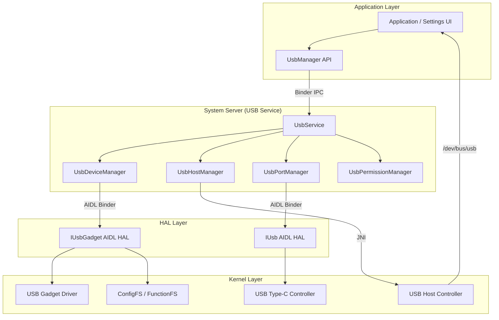

### 39.1.2 关键组件

| 组件 | 类型 | 源码路径 | 作用 |
|-----------|------|-------------|------|
| `UsbManager` | SDK API | `frameworks/base/core/java/android/hardware/usb/UsbManager.java` | 面向应用的公开 API |
| `UsbService` | 系统服务 | `frameworks/base/services/usb/.../UsbService.java` | 中央协调器 |
| `UsbDeviceManager` | 内部管理器 | `frameworks/base/services/usb/.../UsbDeviceManager.java` | Gadget 模式状态机 |
| `UsbHostManager` | 内部管理器 | `frameworks/base/services/usb/.../UsbHostManager.java` | 主机模式设备枚举 |
| `UsbPortManager` | 内部管理器 | `frameworks/base/services/usb/.../UsbPortManager.java` | Type-C 端口管理 |
| `UsbPermissionManager` | 内部管理器 | `frameworks/base/services/usb/.../UsbPermissionManager.java` | 按用户跟踪权限 |
| `IUsb` | AIDL HAL | `hardware/interfaces/usb/aidl/.../IUsb.aidl` | 端口状态、角色切换 |
| `IUsbGadget` | AIDL HAL | `hardware/interfaces/usb/gadget/aidl/.../IUsbGadget.aidl` | Gadget 功能配置 |
| `adbd` | 原生守护进程 | `packages/modules/adb/daemon/main.cpp` | ADB 守护进程 |
| MTP Native | 原生库 | `frameworks/av/media/mtp/` | MTP 协议实现 |
| MTP Service | Java 服务 | `packages/services/Mtp/` | MTP 文档提供者 |

### 39.1.3 双模式架构：Gadget 与主机

单个 USB Type-C 端口可以运行于两种截然不同的模式，具体由通过 USB 供电
（Power Delivery）协议协商出的数据角色决定：

1. **设备/Gadget 模式（UFP）**：Android 设备作为外围设备出现在主机
   （通常是 PC）面前。此模式支持 MTP 文件传输、ADB 调试、PTP 照片传输、
   RNDIS 网络共享、MIDI 以及 USB 配件（AOA）。内核的 USB gadget 框架
   （`configfs`）对外暴露复合 USB 功能。

2. **主机模式（DFP）**：Android 设备充当 USB 主机。已连接的 USB 外围设备
   （键盘、鼠标、存储设备、音频设备）会被枚举，并通过 `UsbManager` API
   提供给应用程序使用。

`UsbPortManager` 通过 `IUsb` HAL 监听端口状态变化，并协调这两种模式之间的
模式切换。

### 39.1.4 UsbManager —— 公开 API

`UsbManager`（源码：`frameworks/base/core/java/android/hardware/usb/UsbManager.java`）
是带有 `@SystemService` 注解的入口点，应用程序通过它与 USB 交互。它提供：

**设备（gadget）模式操作：**

- 查询并设置当前 USB 功能（MTP、PTP 等）
- 访问 USB 配件信息
- 打开 USB 配件连接

**主机模式操作：**

- 枚举已连接的 USB 设备（`getDeviceList()`）
- 请求与某台设备通信的权限
- 打开设备连接（`openDevice()`）

**功能常量**定义了可用的 gadget 配置：

```java
// From UsbManager.java -- function bitmask values
public static final long FUNCTION_NONE = 0;
public static final long FUNCTION_ADB = 1;
public static final long FUNCTION_ACCESSORY = 1 << 1;
public static final long FUNCTION_MTP = 1 << 2;
public static final long FUNCTION_MIDI = 1 << 3;
public static final long FUNCTION_PTP = 1 << 4;
public static final long FUNCTION_RNDIS = 1 << 5;
public static final long FUNCTION_AUDIO_SOURCE = 1 << 6;
public static final long FUNCTION_UVC = 1 << 7;
public static final long FUNCTION_NCM = 1 << 10;
```

这些值都是普通字面量。不过，每个常量的 javadoc 都要求它必须等于
`hardware/interfaces/usb/gadget/aidl/android/hardware/usb/gadget/GadgetFunction.aidl`
中定义的 `GadgetFunction` AIDL parcelable 中相应常量的值。

### 39.1.5 UsbService —— 中央协调器

`UsbService`（源码：`frameworks/base/services/usb/java/com/android/server/usb/UsbService.java`）
实现了 `IUsbManager`，并运行在 `system_server` 中。它是所有 USB 操作的
Binder 端点，并将工作委托给各个专门的子管理器：

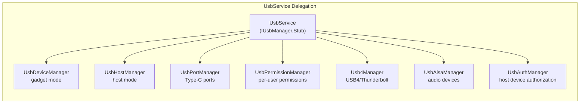

只有当 `enableUsbHostAuthorization` 标志被设置时，才会构造
`UsbAuthManager`（参见
`frameworks/base/services/usb/java/com/android/server/usb/UsbService.java`
中 `mAuthManager = new UsbAuthManager(...)` 调用附近）。它桥接到一个新的
进程外 Rust 守护进程。第 39.10 节将对此进行介绍。

该服务的生命周期遵循标准的 `SystemService` 模式：

1. **构造**：在 `system_server` 启动期间，`UsbService` 被实例化。
2. **`systemReady()`**：触发所有子管理器的初始化。`UsbHostManager` 启动一个
   原生线程来监控 `/dev/bus/usb` 的设备插拔事件。`UsbPortManager` 则向 HAL
   查询当前端口状态。
3. **运行期**：处理来自应用程序的 Binder 调用，广播 USB 状态变化，并按
   用户资料管理权限与设置。

### 39.1.6 系统属性与 Sysfs 路径

`UsbDeviceManager` 通过若干内核接口和系统属性来监控并控制 USB 状态：

| 接口 | 路径 | 用途 |
|-----------|------|---------|
| USB 状态 sysfs | `/sys/class/android_usb/android0/state` | 传统 gadget 状态 |
| USB 功能 sysfs | `/sys/class/android_usb/android0/functions` | 传统功能配置 |
| UDC 控制器 | `sys.usb.controller`（系统属性） | ConfigFS UDC 名称 |
| USB 配置 | `persist.sys.usb.config`（系统属性） | 持久化 USB 配置 |
| RNDIS 地址 | `/sys/class/android_usb/android0/f_rndis/ethaddr` | 网络共享 MAC |
| MIDI ALSA | `/sys/class/android_usb/android0/f_midi/alsa` | MIDI 设备信息 |
| UEvent 匹配 | `DEVPATH=/devices/virtual/android_usb/android0` | 传统状态变化 |
| UEvent 匹配 | `SUBSYSTEM=udc` | 现代 UDC 状态变化 |
| FunctionFS | `/dev/usb-ffs/adb/` | ADB FunctionFS 端点 |

---

## 39.2 UsbDeviceManager：Gadget 模式状态机

### 39.2.1 概览

`UsbDeviceManager`（源码：`frameworks/base/services/usb/java/com/android/server/usb/UsbDeviceManager.java`）
是 USB 框架中最复杂的组件。它负责管理 Android 设备作为 USB 外围设备的呈现。
它处理功能切换（MTP、PTP、RNDIS、配件、MIDI、ADB）以及由线缆事件触发的
状态转换。它还处理屏幕锁定状态、用户偏好与内核级 USB 配置之间微妙的协调。

该类实现了 `ActivityTaskManagerInternal.ScreenObserver`，以便对锁屏
（keyguard）状态变化作出反应——这是一个关键细节，因为对用户数据的 MTP 访问
需要屏幕处于解锁状态。

### 39.2.2 架构

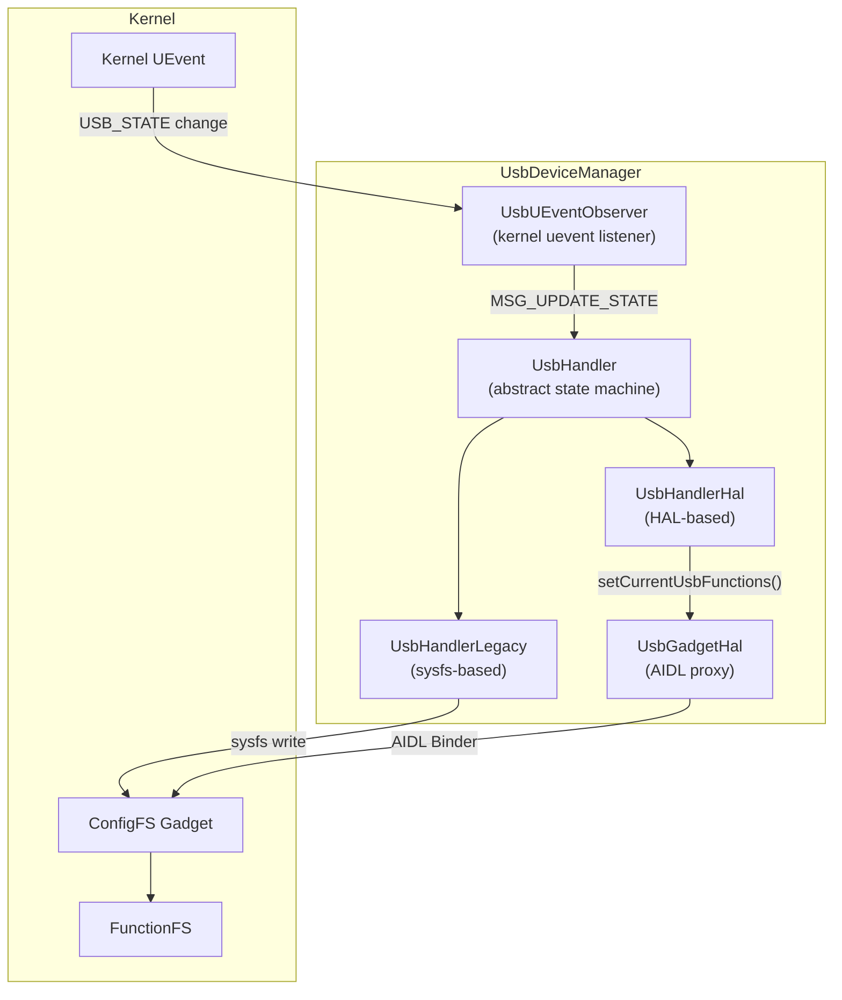

### 39.2.3 双重处理器策略

`UsbDeviceManager` 在构造时会在两个具体处理器实现之间进行选择：

```java
// From UsbDeviceManager constructor
if (mUsbGadgetHal == null) {
    // Initialize the legacy UsbHandler
    mHandler = new UsbHandlerLegacy(FgThread.get().getLooper(),
            mContext, this, alsaManager, permissionManager);
} else {
    // Initialize HAL based UsbHandler
    mHandler = new UsbHandlerHal(FgThread.get().getLooper(),
            mContext, this, alsaManager, permissionManager);
}
```

- **`UsbHandlerHal`**：用于可使用 `IUsbGadget` AIDL HAL 的现代设备。它调用
  HAL 上的 `setCurrentUsbFunctions()` 来请求配置变更。HAL 实现负责处理
  内核级的 ConfigFS 操作。

- **`UsbHandlerLegacy`**：面向不具备 gadget HAL 的旧设备的回退方案。它直接
  向 sysfs 文件和系统属性写入数据，以切换 USB 功能。

### 39.2.4 基于消息的状态机

`UsbHandler` 通过 Android 的 `Handler` 消息队列来处理 USB 状态转换。这将所有
状态变化都串行化到前台线程上，从而避免竞态条件：

| 消息 ID | 常量 | 触发条件 |
|------------|----------|---------|
| 0 | `MSG_UPDATE_STATE` | 内核报告连接/断开/已配置 |
| 1 | `MSG_ENABLE_ADB` | 开发者设置中 ADB 开关发生变化 |
| 2 | `MSG_SET_CURRENT_FUNCTIONS` | 应用程序请求更改功能 |
| 3 | `MSG_SYSTEM_READY` | 系统服务已就绪 |
| 4 | `MSG_BOOT_COMPLETED` | 启动完成广播 |
| 5 | `MSG_USER_SWITCHED` | 当前活动用户发生变化 |
| 6 | `MSG_UPDATE_USER_RESTRICTIONS` | 用户策略发生变化 |
| 7 | `MSG_UPDATE_PORT_STATE` | Type-C 端口状态发生变化 |
| 8 | `MSG_ACCESSORY_MODE_ENTER_TIMEOUT` | 配件协商的 10 秒超时 |
| 9 | `MSG_UPDATE_CHARGING_STATE` | 电池充电状态发生变化 |
| 10 | `MSG_UPDATE_HOST_STATE` | 主机模式设备插拔 |
| 11 | `MSG_LOCALE_CHANGED` | 语言发生变化（通知更新） |
| 12 | `MSG_SET_SCREEN_UNLOCKED_FUNCTIONS` | 屏幕解锁时的功能偏好 |
| 13 | `MSG_UPDATE_SCREEN_LOCK` | 锁屏显示/隐藏 |
| 14 | `MSG_SET_CHARGING_FUNCTIONS` | 切换到仅充电模式 |
| 15 | `MSG_SET_FUNCTIONS_TIMEOUT` | 功能切换超时 |
| 16 | `MSG_GET_CURRENT_USB_FUNCTIONS` | 查询当前 gadget 功能 |
| 17 | `MSG_FUNCTION_SWITCH_TIMEOUT` | Gadget 重新枚举超时 |
| 18 | `MSG_GADGET_HAL_REGISTERED` | HAL 服务已可用 |
| 19 | `MSG_RESET_USB_GADGET` | 重置 gadget 硬件 |
| 20 | `MSG_ACCESSORY_HANDSHAKE_TIMEOUT` | AOA 握手超时 |
| 21 | `MSG_INCREASE_SENDSTRING_COUNT` | 收到 AOA 字符串描述符 |
| 22 | `MSG_UPDATE_USB_SPEED` | USB 速度协商完成 |
| 23 | `MSG_UPDATE_HAL_VERSION` | HAL 版本信息已更新 |
| 24 | `MSG_USER_UNLOCKED_AFTER_BOOT` | 启动后的首次解锁 |

### 39.2.5 USB 状态转换

内核通过 UEvent 消息报告 USB 状态变化。`UsbUEventObserver` 处理这些消息，
并将其转换为处理器消息：

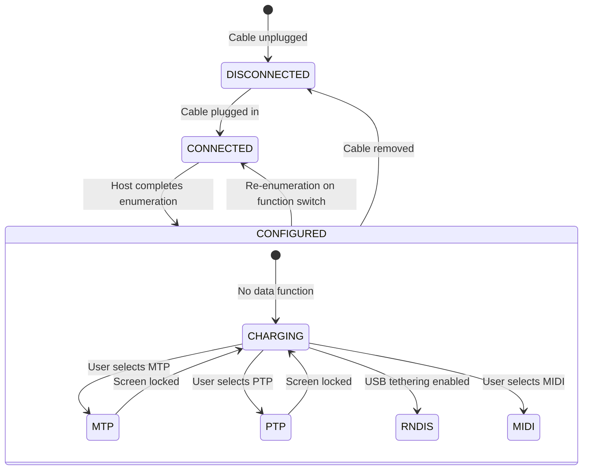

`UsbHandler` 中的 `updateState()` 方法将内核状态字符串映射为内部状态：

```java
// From UsbHandler.updateState()
if ("DISCONNECTED".equals(state)) {
    connected = 0; configured = 0;
} else if ("CONNECTED".equals(state)) {
    connected = 1; configured = 0;
} else if ("CONFIGURED".equals(state)) {
    connected = 1; configured = 1;
}
```

### 39.2.6 功能切换

当用户（或系统）请求更改 USB 功能时，状态机将执行一个多步骤的过程：

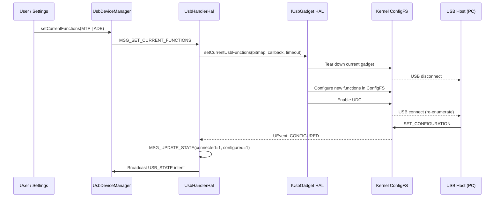

### 39.2.7 去抖与超时

功能切换会导致瞬时的 USB 断开。状态机施加去抖处理，以防止虚假的断开事件
干扰功能切换：

```java
// Debounce delays from UsbDeviceManager
private static final int DEVICE_STATE_UPDATE_DELAY_EXT = 3000;  // 3 seconds
private static final int DEVICE_STATE_UPDATE_DELAY = 1000;       // 1 second
private static final int HOST_STATE_UPDATE_DELAY = 1000;         // 1 second
private static final int ACCESSORY_REQUEST_TIMEOUT = 10 * 1000;  // 10 seconds
private static final int ACCESSORY_HANDSHAKE_TIMEOUT = 10 * 1000; // 10 seconds
```

在调用 `resetUsbGadget()` 之后，会通过 `mResetUsbGadgetDisableDebounce`
标志临时禁用去抖，确保 gadget 重置后的第一次断开被立即处理。

### 39.2.8 屏幕锁定交互

MTP 需要访问用户存储，当屏幕锁定时这部分数据必须受到保护。
`UsbDeviceManager` 与锁屏协调：

1. 当屏幕锁定（`onKeyguardStateChanged(true)`）时，处理器会收到
   `MSG_UPDATE_SCREEN_LOCK`。
2. 如果 MTP 或 PTP 处于活动状态，处理器会切换到仅充电功能。
3. 用户偏好的功能存储在 `SharedPreferences` 中，键为
   `usb-screen-unlocked-config-<userId>`。
4. 当屏幕解锁时，先前保存的功能会被恢复。

### 39.2.9 接口拒绝列表

`UsbDeviceManager` 维护了一个静态的 USB 接口类集合，用于判断所连接的主机模式
设备是否可能是底座或独立的配件。当某台主机模式设备暴露出这些接口类之一时，
`MSG_UPDATE_HOST_STATE` 处理器会设置 `mHideUsbNotification`，从而抑制
“通过 USB 为此设备充电”的通知。该集合并不会拒绝应用程序对这些接口的访问
—— 主机设备访问是由 `UsbUserPermissionManager` 和
`UsbProfileGroupSettingsManager`（第 39.8.6 节）控制的：

```java
// From UsbDeviceManager static initializer
sDenyInterfaces.add(UsbConstants.USB_CLASS_AUDIO);
sDenyInterfaces.add(UsbConstants.USB_CLASS_COMM);
sDenyInterfaces.add(UsbConstants.USB_CLASS_HID);
sDenyInterfaces.add(UsbConstants.USB_CLASS_PRINTER);
sDenyInterfaces.add(UsbConstants.USB_CLASS_MASS_STORAGE);
sDenyInterfaces.add(UsbConstants.USB_CLASS_HUB);
sDenyInterfaces.add(UsbConstants.USB_CLASS_CDC_DATA);
sDenyInterfaces.add(UsbConstants.USB_CLASS_CSCID);
sDenyInterfaces.add(UsbConstants.USB_CLASS_CONTENT_SEC);
sDenyInterfaces.add(UsbConstants.USB_CLASS_VIDEO);
sDenyInterfaces.add(UsbConstants.USB_CLASS_WIRELESS_CONTROLLER);
```

### 39.2.10 MTP 服务绑定

当 MTP 或 PTP 功能被激活时，处理器会绑定到 MTP 服务：

```java
// Constants from UsbHandler
protected static final String MTP_PACKAGE_NAME = "com.android.mtp";
protected static final String MTP_SERVICE_CLASS_NAME = "com.android.mtp.MtpService";
```

`ServiceConnection` 在整个 MTP 会话期间保持维护，并在功能从 MTP/PTP 切换
离开时解除绑定。这一绑定除了启动服务之外还有一个关键作用：它防止
Activity Manager 冻结 MTP 进程。如果没有该绑定，系统可能会冻结 MTP 服务的
进程以回收资源，从而破坏正在进行的 USB 传输会话。

绑定生命周期遵循 MTP 功能状态：

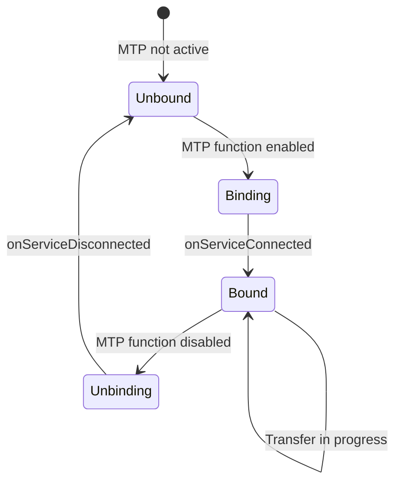

### 39.2.11 MIDI 功能发现

当 MIDI gadget 功能被激活时，`UsbDeviceManager` 必须发现合成 MIDI 设备对应的
ALSA 卡号与设备号。这涉及两种方法：

**现代方法**（基于 sysfs 的识别）：
```java
// Navigate the sysfs hierarchy under the UDC controller
File soundDir = new File("/sys/class/udc/" + controllerName + "/gadget/sound");
File[] cardDirs = FileUtils.listFilesOrEmpty(soundDir,
    (dir, file) -> file.startsWith("card"));
File[] midis = FileUtils.listFilesOrEmpty(cardDirs[0],
    (dir, file) -> file.startsWith("midi"));

// Parse card and device numbers from "midiC<card>D<device>"
Pattern pattern = Pattern.compile("midiC(\\d+)D(\\d+)");
Matcher matcher = pattern.matcher(midis[0].getName());
if (matcher.matches()) {
    mMidiCard = Integer.parseInt(matcher.group(1));
    mMidiDevice = Integer.parseInt(matcher.group(2));
}
```

**传统方法**（ALSA 文件）：
```java
// Read from the legacy sysfs path
Scanner scanner = new Scanner(new File(MIDI_ALSA_PATH));
mMidiCard = scanner.nextInt();
mMidiDevice = scanner.nextInt();
```

所发现的卡号/设备号组合会传递给 `UsbAlsaManager`，以便在 Android MIDI 服务
中注册该外围 MIDI 设备。

### 39.2.12 USB 状态广播

处理器将 USB 状态变化广播给所有感兴趣的接收者：

```java
protected void updateUsbStateBroadcastIfNeeded(long functions) {
    Intent intent = new Intent(UsbManager.ACTION_USB_STATE);
    intent.addFlags(Intent.FLAG_RECEIVER_REPLACE_PENDING
            | Intent.FLAG_RECEIVER_INCLUDE_BACKGROUND
            | Intent.FLAG_RECEIVER_FOREGROUND);
    intent.putExtra(UsbManager.USB_CONNECTED, mConnected);
    intent.putExtra(UsbManager.USB_HOST_CONNECTED, mHostConnected);
    intent.putExtra(UsbManager.USB_CONFIGURED, mConfigured);
    intent.putExtra(UsbManager.USB_DATA_UNLOCKED,
            isUsbTransferAllowed() && isUsbDataTransferActive(mCurrentFunctions));

    // Add active function flags
    long remainingFunctions = functions;
    while (remainingFunctions != 0) {
        intent.putExtra(UsbManager.usbFunctionsToString(
                Long.highestOneBit(remainingFunctions)), true);
        remainingFunctions -= Long.highestOneBit(remainingFunctions);
    }

    // Only broadcast if state actually changed
    if (!isUsbStateChanged(intent)) return;
    sendStickyBroadcast(intent);
}
```

`ACTION_USB_STATE` 广播是粘性的：后注册的接收者会立即收到最后一次广播的
状态。该 intent 为每个活动功能都包含了布尔型 extra，使接收者能够检查特定
功能的状态。

### 39.2.13 用户限制的强制执行

由企业管理的设备可以通过 `UserManager.DISALLOW_USB_FILE_TRANSFER` 来限制
USB 文件传输：

```java
protected boolean isUsbTransferAllowed() {
    UserManager userManager = (UserManager) mContext.getSystemService(
            Context.USER_SERVICE);
    return !userManager.hasUserRestriction(
            UserManager.DISALLOW_USB_FILE_TRANSFER);
}
```

当该限制生效时：

- MTP 与 PTP 功能被抑制
- USB 通知显示“仅充电”
- 应用程序无法切换到数据传输功能

### 39.2.14 配件握手跟踪

处理器跟踪 AOA 握手过程的详细时序信息，用于调试与分析：

```java
private long mAccessoryConnectionStartTime = 0L;  // When GET_PROTOCOL received
private int mSendStringCount = 0;                   // Number of SEND_STRING uevents
private boolean mStartAccessory = false;             // Whether START received

// Broadcast handshake details for debugging
private void broadcastUsbAccessoryHandshake() {
    Intent intent = new Intent(UsbManager.ACTION_USB_ACCESSORY_HANDSHAKE)
        .putExtra(UsbManager.EXTRA_ACCESSORY_UEVENT_TIME,
                mAccessoryConnectionStartTime)
        .putExtra(UsbManager.EXTRA_ACCESSORY_STRING_COUNT,
                mSendStringCount)
        .putExtra(UsbManager.EXTRA_ACCESSORY_START,
                mStartAccessory)
        .putExtra(UsbManager.EXTRA_ACCESSORY_HANDSHAKE_END,
                SystemClock.elapsedRealtime());
    sendStickyBroadcast(intent);
}
```

### 39.2.15 RNDIS 网络共享集成

当 RNDIS（USB 网络共享）被激活时：

1. 处理器配置 `RNDIS` gadget 功能。
2. 由 `ro.serialno` 生成一个本地管理（locally-administered）的 MAC 地址：

    ```java
    // First byte is 0x02 to signify a locally administered address
    address[0] = 0x02;
    String serial = SystemProperties.get("ro.serialno", "1234567890ABCDEF");
    // XOR the USB serial across the remaining 5 bytes
    for (int i = 0; i < serialLength; i++) {
        address[i % (ETH_ALEN - 1) + 1] ^= (int) serial.charAt(i);
    }
    ```

3. 该地址被写入 `/sys/class/android_usb/android0/f_rndis/ethaddr`。
4. 网络共享服务接管由此产生的 `rndis0` 网络接口的 IP 配置。

---

## 39.3 USB HAL：IUsb 与 IUsbGadget

### 39.3.1 HAL 架构概览

Android 的 USB HAL 被拆分为两个不同的 AIDL 接口，各自管理 USB 硬件的不同
方面：

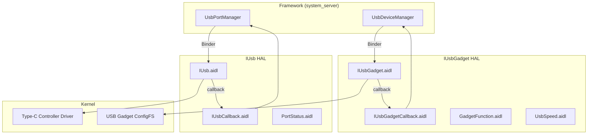

### 39.3.2 IUsb AIDL 接口

源码：`hardware/interfaces/usb/aidl/android/hardware/usb/IUsb.aidl`

`IUsb` 接口管理 USB Type-C 端口硬件。它被标记为 `@VintfStability`
（VINTF 稳定），并声明为 `oneway`（异步）：

```
@VintfStability
oneway interface IUsb {
    void enableContaminantPresenceDetection(in String portName,
            in boolean enable, long transactionId);
    void enableUsbData(in String portName, boolean enable, long transactionId);
    void enableUsbDataWhileDocked(in String portName, long transactionId);
    void queryPortStatus(long transactionId);
    void setCallback(in IUsbCallback callback);
    void switchRole(in String portName, in PortRole role, long transactionId);
    void limitPowerTransfer(in String portName, boolean limit, long transactionId);
    void resetUsbPort(in String portName, long transactionId);
    void queryStaticPortInformation(in String portName, long transactionId);
}
```

关键操作：

| 方法 | 用途 |
|--------|---------|
| `queryPortStatus()` | 获取所有 Type-C 端口的当前状态 |
| `queryStaticPortInformation()` | 获取在运行时永不改变的每端口固定能力 |
| `switchRole()` | 触发 DR_SWAP 或 PR_SWAP 以切换角色 |
| `enableUsbData()` | 启用/禁用 USB 数据信号 |
| `enableContaminantPresenceDetection()` | 水分/碎屑检测 |
| `setCallback()` | 注册以接收异步通知 |
| `limitPowerTransfer()` | 控制供电 |
| `resetUsbPort()` | 重置行为异常的端口 |

### 39.3.3 PortStatus：全面的端口状态

源码：`hardware/interfaces/usb/aidl/android/hardware/usb/PortStatus.aidl`

`PortStatus` parcelable 传达 USB Type-C 端口的完整状态：

```
@VintfStability
parcelable PortStatus {
    String portName;
    PortDataRole currentDataRole;      // HOST or DEVICE
    PortPowerRole currentPowerRole;    // SOURCE or SINK
    PortMode currentMode;              // UFP, DFP, AUDIO_ACCESSORY, DEBUG_ACCESSORY
    boolean canChangeMode;
    boolean canChangeDataRole;         // PD DR_SWAP supported
    boolean canChangePowerRole;        // PD PR_SWAP supported
    PortMode[] supportedModes;
    ContaminantProtectionMode[] supportedContaminantProtectionModes;
    boolean supportsEnableContaminantPresenceProtection;
    ContaminantProtectionStatus contaminantProtectionStatus;
    ContaminantDetectionStatus contaminantDetectionStatus;
    UsbDataStatus[] usbDataStatus;
    boolean powerTransferLimited;
    PowerBrickStatus powerBrickStatus;
    boolean supportsComplianceWarnings;
    ComplianceWarning[] complianceWarnings;
    PlugOrientation plugOrientation;   // Cable orientation (CC1 vs CC2)
    AltModeData[] supportedAltModes;   // DisplayPort Alt Mode, etc.
}
```

### 39.3.4 IUsbGadget AIDL 接口

源码：`hardware/interfaces/usb/gadget/aidl/android/hardware/usb/gadget/IUsbGadget.aidl`

`IUsbGadget` 接口控制 USB gadget（设备模式）配置：

```
@VintfStability
oneway interface IUsbGadget {
    void setCurrentUsbFunctions(in long functions,
            in IUsbGadgetCallback callback,
            in long timeoutMs, long transactionId);
    void getCurrentUsbFunctions(in IUsbGadgetCallback callback,
            long transactionId);
    void getUsbSpeed(in IUsbGadgetCallback callback, long transactionId);
    void reset(in IUsbGadgetCallback callback, long transactionId);
}
```

### 39.3.5 GadgetFunction 位掩码

源码：`hardware/interfaces/usb/gadget/aidl/android/hardware/usb/gadget/GadgetFunction.aidl`

功能以位掩码的形式组合：

| 常量 | 值 | 说明 |
|----------|-------|-------------|
| `NONE` | `0` | 无功能（下拉 gadget） |
| `ADB` | `1` | Android 调试桥 |
| `ACCESSORY` | `1 << 1` | Android Open Accessory |
| `MTP` | `1 << 2` | 媒体传输协议 |
| `MIDI` | `1 << 3` | USB MIDI 设备 |
| `PTP` | `1 << 4` | 图片传输协议 |
| `RNDIS` | `1 << 5` | USB 网络共享（RNDIS） |
| `AUDIO_SOURCE` | `1 << 6` | AOAv2 音频源 |
| `UVC` | `1 << 7` | USB 视频类别 |
| `NCM` | `1 << 10` | 网络控制模型 |

多个功能可以复合。例如，`MTP | ADB` = `5`（二进制
`0b00000101`）会同时配置 MTP 与 ADB。

### 39.3.6 HAL 版本演进

USB HAL 经历了多个 HIDL 与 AIDL 版本的演进：

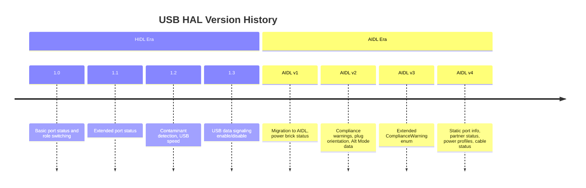

源码目录：

- HIDL：`hardware/interfaces/usb/1.0/`、`1.1/`、`1.2/`、`1.3/`
- AIDL：`hardware/interfaces/usb/aidl/`
- Gadget HIDL：`hardware/interfaces/usb/gadget/1.0/`、`1.1/`、`1.2/`
- Gadget AIDL：`hardware/interfaces/usb/gadget/aidl/`

### 39.3.7 默认 HAL 实现

源码：`hardware/interfaces/usb/aidl/default/`

默认 HAL 实现提供了一份参考实现，厂商可以将其作为起点。它通常通过以下方式
与内核交互：

1. `/sys/class/typec/` 下的 **Sysfs 文件**，用于端口状态
2. `/config/usb_gadget/` 下的 **ConfigFS**，用于 gadget 功能配置
3. **内核 UEvent**，用于异步状态通知
4. **Debugfs**，用于测试与开发

### 39.3.8 UsbPortManager 与 HAL 的交互

`UsbPortManager`（源码：`frameworks/base/services/usb/java/com/android/server/usb/UsbPortManager.java`）
是 `IUsb` HAL 在框架侧的使用者：

```java
// From UsbPortManager constructor
public UsbPortManager(Context context) {
    mContext = context;
    mUsbPortHal = UsbPortHalInstance.getInstance(this, null);
}

public void systemReady() {
    mSystemReady = true;
    if (mUsbPortHal != null) {
        mUsbPortHal.systemReady();
        mUsbPortHal.queryPortStatus(++mTransactionId);
    }
}
```

端口角色组合以位掩码的形式跟踪：

```java
// Role combinations from UsbPortManager
private static final int COMBO_SOURCE_HOST =
        UsbPort.combineRolesAsBit(POWER_ROLE_SOURCE, DATA_ROLE_HOST);
private static final int COMBO_SOURCE_DEVICE =
        UsbPort.combineRolesAsBit(POWER_ROLE_SOURCE, DATA_ROLE_DEVICE);
private static final int COMBO_SINK_HOST =
        UsbPort.combineRolesAsBit(POWER_ROLE_SINK, DATA_ROLE_HOST);
private static final int COMBO_SINK_DEVICE =
        UsbPort.combineRolesAsBit(POWER_ROLE_SINK, DATA_ROLE_DEVICE);
```

### 39.3.9 命令行 USB 诊断工具：usb_info_tools

`system/usb_info_tools/` 项目提供了两个小巧的 Rust 诊断二进制程序。
`typec_connector_class`
（`system/usb_info_tools/typec_connector_class_helper/`）遍历内核位于
`/sys/class/typec` 下的 USB Type-C Connector Class，并打印每个端口的数据/供电
角色与 PD 状态。当需要把 `UsbPortManager` 报告的内容与 HAL 读取的原始 sysfs
进行对照时，这十分方便。`dumpsys_to_lsusb`
（`system/usb_info_tools/dumpsys_to_lsusb/`）解析 `dumpsys usb` 的输出，并以
`lsusb` 风格的详细视图和树状视图呈现。关于这些工具所融入的更广泛的设备端调试
工作流，请参见第 58 章。

---

## 39.4 ADB 架构

### 39.4.1 概览

Android 调试桥（ADB）是与 Android 设备通信的主要开发者工具。它支持 shell
访问、文件传输、应用安装、日志收集、端口转发，以及数十种其他调试与开发操作。
ADB 是一个 Mainline 模块，这意味着它可以在完整平台 OTA 之外，通过 Google Play
系统更新独立地进行更新。

ADB 采用客户端-服务端架构，包含三个组件：

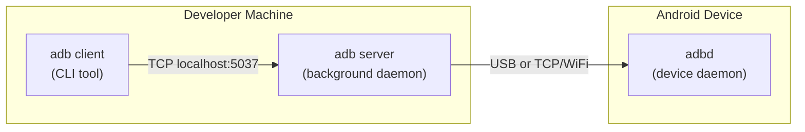

源码：`packages/modules/adb/`

### 39.4.2 三组件架构

**1. ADB 客户端（`adb`）**：开发者调用的命令行工具。它通过 TCP（默认端口
5037）连接到本地的 ADB 服务端。如果没有服务端在运行，客户端会启动一个。

源码：`packages/modules/adb/client/main.cpp`

**2. ADB 服务端**：运行在开发者机器上的后台进程，负责管理与所有设备的连接。
它：

- 通过 USB 扫描与 mDNS 发现设备
- 对来自多个 `adb` 客户端的连接进行多路复用
- 处理设备认证
- 将命令路由到相应的设备

**3. ADB 守护进程（`adbd`）**：运行在 Android 设备上。它：

- 监听通过 USB（FunctionFS）和/或 TCP 传入的连接
- 使用 RSA 密钥对认证连接
- 派生 shell 进程、处理文件传输、管理端口转发
- 在生产版本上以降低的权限（UID `shell`）运行

源码：`packages/modules/adb/daemon/main.cpp`

### 39.4.3 ADB 协议

ADB 协议是一种简单的基于消息的协议，包含八种消息类型，定义于
`packages/modules/adb/adb.h`：

```c
#define A_SYNC 0x434e5953  // 'SYNC' - synchronization
#define A_CNXN 0x4e584e43  // 'CNXN' - connection
#define A_OPEN 0x4e45504f  // 'OPEN' - open stream
#define A_OKAY 0x59414b4f  // 'OKAY' - stream ready
#define A_CLSE 0x45534c43  // 'CLSE' - close stream
#define A_WRTE 0x45545257  // 'WRTE' - write data
#define A_AUTH 0x48545541  // 'AUTH' - authentication
#define A_STLS 0x534C5453  // 'STLS' - start TLS
```

每条消息都有一个固定的 24 字节头部：

```c
// From types.h
struct amessage {
    uint32_t command;     // command identifier constant
    uint32_t arg0;        // first argument
    uint32_t arg1;        // second argument
    uint32_t data_length; // length of payload (0 is allowed)
    uint32_t data_check;  // checksum of data payload
    uint32_t magic;       // command ^ 0xffffffff
};
```

### 39.4.4 连接建立

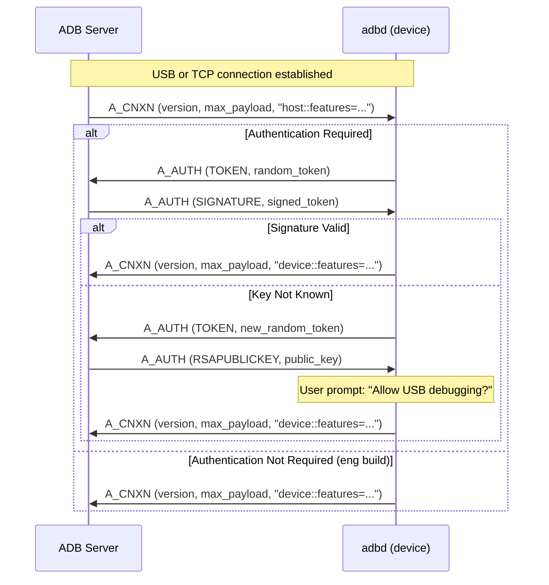

协议版本已经演进：
```c
#define A_VERSION_MIN 0x01000000       // original
#define A_VERSION_SKIP_CHECKSUM 0x01000001  // skip checksum (Dec 2017)
#define A_VERSION 0x01000001           // current
```

### 39.4.5 传输类型

ADB 支持多种传输类型，定义于 `packages/modules/adb/adb.h`：

```c
enum TransportType {
    kTransportUsb,    // Physical USB connection
    kTransportLocal,  // TCP/IP connection (emulator or network)
    kTransportAny,    // Any available transport
    kTransportHost,   // Service in the ADB server itself
};
```

**连接状态**跟踪每种传输的生命周期：

```c
enum ConnectionState {
    kCsConnecting = 0,  // Haven't received a response yet
    kCsAuthorizing,     // Authorizing with keys from ADB_VENDOR_KEYS
    kCsUnauthorized,    // Fell back to user prompt
    kCsNoPerm,          // Insufficient permissions
    kCsDetached,        // USB device detached from server
    kCsOffline,         // Peer detected but no comm started
    kCsBootloader,      // fastboot OS
    kCsDevice,          // Android OS (adbd)
    kCsHost,            // What device sees from its end
    kCsRecovery,        // Recovery mode (adbd)
    kCsSideload,        // Sideload mode (minadbd)
    kCsRescue,          // Rescue mode (minadbd)
};
```

### 39.4.6 `atransport` 类

源码：`packages/modules/adb/transport.h`

`atransport` 类是到远程设备连接的核心抽象：

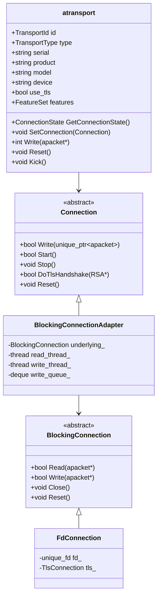

### 39.4.7 USB 传输（设备侧）

源码：`packages/modules/adb/daemon/usb.cpp`

在设备上，`adbd` 通过 Linux FunctionFS 使用 USB 进行通信：

```c
// USB FunctionFS endpoints
#define USB_FFS_ADB_PATH "/dev/usb-ffs/adb/"
#define USB_FFS_ADB_EP0  USB_FFS_ADB_PATH "ep0"   // Control endpoint
#define USB_FFS_ADB_OUT  USB_FFS_ADB_PATH "ep1"    // OUT (host to device)
#define USB_FFS_ADB_IN   USB_FFS_ADB_PATH "ep2"    // IN (device to host)
```

USB 传输使用异步 I/O（Linux AIO）以提升性能：

```c
static constexpr size_t kUsbReadQueueDepth = 8;
static constexpr size_t kUsbReadSize = 16384;     // 16KB per read
static constexpr size_t kUsbWriteQueueDepth = 8;
static constexpr size_t kUsbWriteSize = 16384;    // 16KB per write
```

之所以存在 16KB 的限制，是因为并非所有 USB 控制器都支持更大的操作。每个提交的
操作都会分配该大小的内核缓冲区。因此，队列深度被保持得较浅（8 个条目）。这既
最小化了内存占用，同时该深度也足以让 USB 协议栈保持饱和。

FunctionFS 事件驱动着 USB 传输状态机：

```c
// FunctionFS event types handled by adbd
FUNCTIONFS_BIND      // Function bound to UDC
FUNCTIONFS_UNBIND    // Function unbound from UDC
FUNCTIONFS_ENABLE    // Host configured the gadget
FUNCTIONFS_DISABLE   // Host deconfigured the gadget
FUNCTIONFS_SETUP     // Control request from host
FUNCTIONFS_SUSPEND   // USB suspend signaled
FUNCTIONFS_RESUME    // USB resume signaled
```

I/O 子系统使用一个模板化的 `IoBlock` 结构来管理异步操作：

```cpp
template <class Payload>
struct IoBlock {
    bool pending = false;
    struct iocb control = {};
    Payload payload;
    TransferId id() const { return TransferId::from_value(control.aio_data); }
};

using IoReadBlock = IoBlock<Block>;
using IoWriteBlock = IoBlock<std::shared_ptr<Block>>;
```

ADB 在 USB 总线上以特定的类/子类代码标识自身，主机侧的 ADB 服务端使用这些
代码来发现具备 ADB 能力的设备：
```c
#define ADB_CLASS     0xff   // Vendor-specific class
#define ADB_SUBCLASS  0x42   // ADB subclass
#define ADB_PROTOCOL  0x1    // ADB protocol

// USB Debug Bridge Class (USB 3.x)
#define ADB_DBC_CLASS     0xDC  // Debug Device Class
#define ADB_DBC_SUBCLASS  0x2   // Debug subclass
```

### 39.4.7.1 USB 传输（主机侧）

源码：`packages/modules/adb/client/usb_linux.cpp`、
`packages/modules/adb/client/usb_libusb.cpp`

在主机上，ADB 服务端通过以下两种方式之一发现并与设备通信：

1. **直接 USB I/O**（`usb_linux.cpp`）：扫描 `/dev/bus/usb/`，并使用
   `usbdevfs` 的 ioctl 进行直接的设备通信。这是传统方式。

2. **libusb**（`usb_libusb.cpp`）：使用 libusb 库实现可移植的 USB 访问。
   提供热插拔通知支持。

主机 USB 传输会扫描匹配 ADB 类/子类/协议标识符的 USB 接口。然后它会声明该接口，
并打开用于数据传输的批量端点。

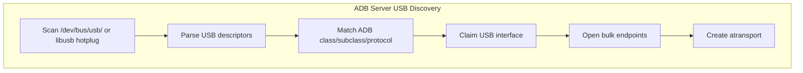

### 39.4.8 认证

源码：`packages/modules/adb/daemon/auth.cpp`

ADB 认证使用 RSA-2048 密钥对：

1. 守护进程（adbd）生成一个 20 字节的随机令牌。
2. 守护进程将令牌发送给服务端。
3. 服务端使用其私钥对令牌签名。
4. 守护进程根据已知的公钥验证签名。
5. 如果验证失败，守护进程会提示用户接受该密钥。

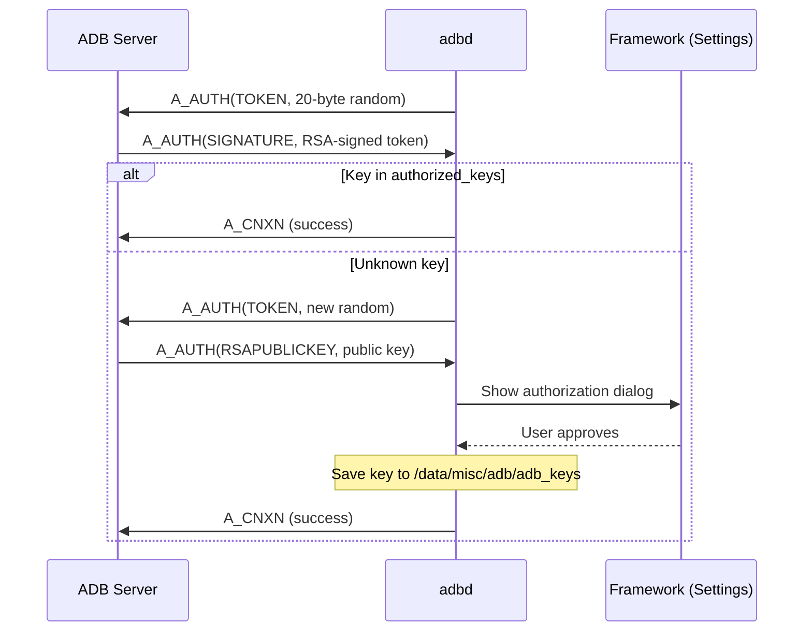

认证上下文通过 `adbd_auth` 管理：
```c
static AdbdAuthContext* auth_ctx;
static RSA* rsa_pkey = nullptr;
bool auth_required = true;  // Set to false on eng builds
```

### 39.4.9 adbd 权限管理

源码：`packages/modules/adb/daemon/main.cpp`

在生产版本上，`adbd` 使用 `minijail` 降低权限：

```c
// Groups added for various functionality
gid_t groups[] = {
    AID_ADB,          // USB driver access
    AID_LOG,          // System logs (logcat)
    AID_INPUT,        // Input diagnostics (getevent)
    AID_INET,         // Network diagnostics (ping)
    AID_NET_BT,       // Bluetooth diagnostics
    AID_NET_BT_ADMIN, // Bluetooth admin
    AID_SDCARD_R,     // SD card read
    AID_SDCARD_RW,    // SD card write
    AID_NET_BW_STATS, // Network bandwidth stats
    AID_READPROC,     // /proc cross-UID reading
    AID_UHID,         // HID command support
    AID_EXT_DATA_RW,  // External data access
    AID_EXT_OBB_RW,   // OBB file access
    AID_READTRACEFS,  // Trace filesystem
};
```

是否降低权限取决于构建类型：
```c
// ro.debuggable: 1 on eng and userdebug builds
// ro.secure: 1 on userdebug and user builds
// service.adb.root: set by "adb root" command
bool drop = ro_secure;
if (ro_debuggable && adb_root) drop = false;
if (adb_unroot) drop = true;
```

### 39.4.10 特性协商

ADB 对等方在连接握手期间通过连接横幅交换特性集。`transport.h` 中定义的
关键特性：

| 特性 | 说明 |
|---------|-------------|
| `shell_v2` | Shell 协议版本 2（多路复用的 stdin/stdout/stderr） |
| `cmd` | 可用 `cmd` 命令 |
| `stat_v2` | 扩展的 stat 信息 |
| `ls_v2` | 扩展的目录列表 |
| `push_sync` | 支持 `push --sync` |
| `apex` | APK/APEX 安装 |
| `abb` | Android Binder Bridge（交互式） |
| `abb_exec` | Android Binder Bridge（原始管道） |
| `sendrecv_v2` | 文件同步 v2 协议 |
| `sendrecv_v2_brotli` | 同步 v2 的 Brotli 压缩 |
| `sendrecv_v2_lz4` | 同步 v2 的 LZ4 压缩 |
| `sendrecv_v2_zstd` | 同步 v2 的 Zstd 压缩 |
| `sendrecv_v2_dry_run_send` | 试运行发送模式 |
| `delayed_ack` | 用于提升吞吐量的延迟确认 |
| `devraw` | 原始设备访问服务 |

### 39.4.11 WiFi ADB

从 Android 11 开始，ADB 支持通过 Wi-Fi 进行无线连接。`adbd` 守护进程监听
TCP 端口 5555（或配置的端口），并使用 mDNS 进行服务发现：

```c
// From daemon/main.cpp
if (access(USB_FFS_ADB_EP0, F_OK) == 0) {
    usb_init();  // Listen on USB
    is_usb = true;
}

// Also listen on TCP if configured
std::string prop_port = android::base::GetProperty("service.adb.tcp.port", "");
if (sscanf(prop_port.c_str(), "%d", &port) == 1 && port > 0) {
    addrs.push_back(android::base::StringPrintf("tcp:%d", port));
    addrs.push_back(android::base::StringPrintf("vsock:%d", port));
    setup_adb(addrs);
}
```

WiFi ADB 使用 TLS 进行加密通信，并通过二维码或 6 位配对码处理配对。

---

## 39.5 ADB 命令深入解析

### 39.5.1 命令架构

ADB 命令遵循一种一致的模式。客户端向服务端发送一个服务请求字符串。服务端
要么在本地处理它，要么将其转发给设备守护进程。守护进程将服务字符串映射到
处理器。

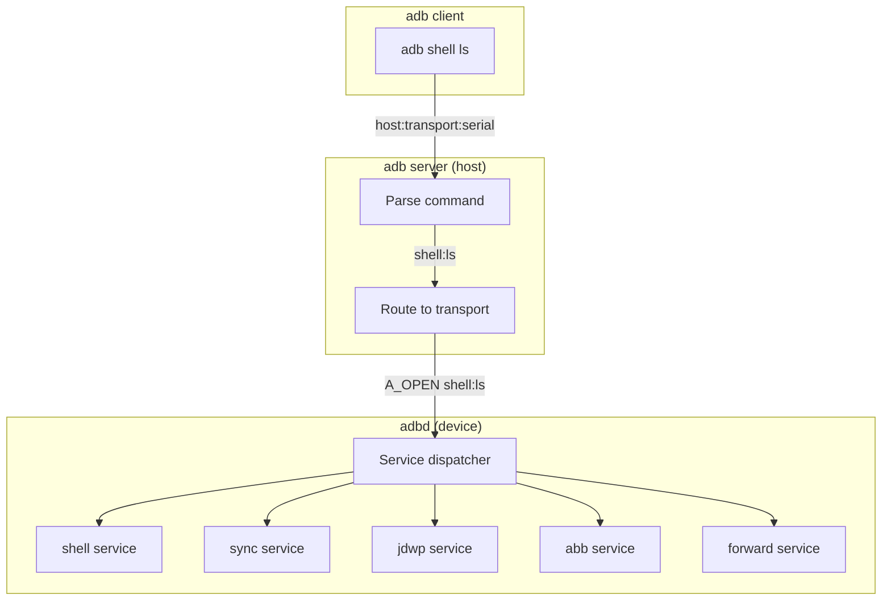

### 39.5.2 Shell 命令（`adb shell`）

源码：`packages/modules/adb/daemon/shell_service.cpp`

shell 服务使用 Shell 协议 v2，它在单条流上对 stdin、stdout、stderr 以及退出
状态进行多路复用：

```c
// From shell_protocol.h
enum Id : uint8_t {
    kIdStdin = 0,           // Input to shell
    kIdStdout = 1,          // Standard output
    kIdStderr = 2,          // Standard error
    kIdExit = 3,            // Exit status
    kIdCloseStdin = 4,      // Close stdin
    kIdWindowSizeChange = 5, // Terminal resize
    kIdInvalid = 255,
};
```

每个 shell 协议数据包都有一个 5 字节的头部（1 字节 ID + 4 字节长度）：

```
+--------+--------+--------+--------+--------+--------...--------+
|   ID   |       Length (32-bit LE)          |     Payload       |
+--------+--------+--------+--------+--------+--------...--------+
```

Shell v2 支持：

- 独立的 stdout/stderr 流
- 正确的退出码传递
- 为交互式 shell 分配 PTY
- 窗口尺寸变化通知

**交互式 shell 与命令执行：**

当运行 `adb shell`（不带参数）时，会派生一个基于 PTY 的交互式 shell。在生产
版本上，该 shell 进程以 `shell` 用户（UID 2000）运行；如果已在可调试版本上
执行 `adb root`，则以 `root` 运行。

当运行 `adb shell <command>` 时，该命令会在子进程中执行，并捕获其
stdin/stdout/stderr。shell 协议确保了输出流的清晰分离：

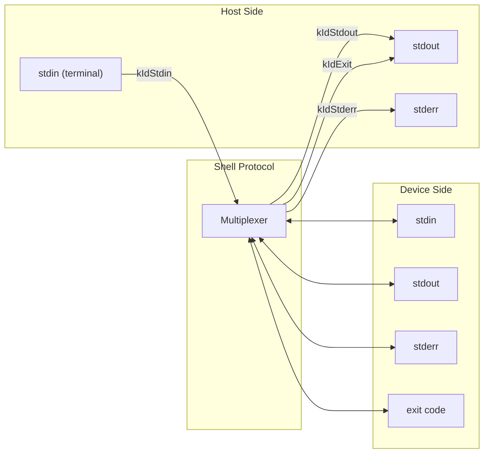

**窗口尺寸传播：**

当交互式 shell 会话期间终端窗口被调整尺寸时，客户端会发送一个
`kIdWindowSizeChange` 数据包，其中以 ASCII 字符串包含新的尺寸。守护进程更新
PTY 的 `winsize` 结构，使 shell 进程收到 `SIGWINCH` 信号。

### 39.5.3 文件传输（`adb push` / `adb pull`）

源码：`packages/modules/adb/client/file_sync_client.cpp`、
`packages/modules/adb/daemon/file_sync_service.cpp`

文件传输使用 sync 协议，定义于 `packages/modules/adb/file_sync_protocol.h`：

```c
// Sync protocol message IDs
#define ID_LSTAT_V1 MKID('S', 'T', 'A', 'T')
#define ID_STAT_V2  MKID('S', 'T', 'A', '2')
#define ID_LIST_V1  MKID('L', 'I', 'S', 'T')
#define ID_LIST_V2  MKID('L', 'I', 'S', '2')
#define ID_SEND_V1  MKID('S', 'E', 'N', 'D')
#define ID_SEND_V2  MKID('S', 'N', 'D', '2')
#define ID_RECV_V1  MKID('R', 'E', 'C', 'V')
#define ID_RECV_V2  MKID('R', 'C', 'V', '2')
#define ID_DONE     MKID('D', 'O', 'N', 'E')
#define ID_DATA     MKID('D', 'A', 'T', 'A')
#define ID_OKAY     MKID('O', 'K', 'A', 'Y')
#define ID_FAIL     MKID('F', 'A', 'I', 'L')
#define ID_QUIT     MKID('Q', 'U', 'I', 'T')
```

**推送操作流程：**

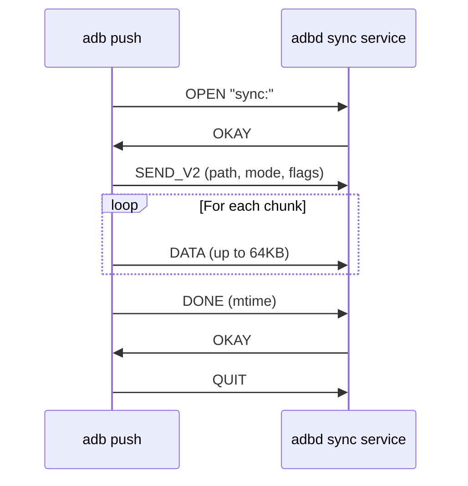

**Sync v2 特性：**

- **压缩**：支持 Brotli、LZ4 和 Zstd 压缩
- **试运行模式**：在不实际写入文件的情况下测试一次推送
- **扩展 stat**：完整的 `struct stat` 信息（device、inode、uid、gid、
  atime、mtime、ctime）

`sync_data` 结构将数据块限制为 64KB：
```c
#define SYNC_DATA_MAX (64 * 1024)

struct __attribute__((packed)) sync_data {
    uint32_t id;
    uint32_t size;
};  // followed by `size` bytes of data.
```

### 39.5.4 软件包安装（`adb install`）

源码：`packages/modules/adb/client/adb_install.cpp`

`adb install` 执行以下步骤：

1. 将 APK 推送到设备上的临时位置
2. 调用 `pm install` 或使用流式安装协议
3. 清理临时文件

对于**流式安装**（现代设备上的默认方式）：

1. 打开 `exec:cmd package` 服务
2. 将 APK 直接流式传输给 Package Manager
3. 设备存储上不需要中间文件

**增量安装**（`adb install --incremental`）使用更复杂的方法。APK 中只有所需的
块会按需传输。这大大缩短了大型应用的安装时间。

### 39.5.5 日志收集（`adb logcat`）

`adb logcat` 在设备上打开一个 `shell:logcat` 服务。输出通过 shell 协议实时
回传。设备上的 logcat 二进制程序通过 `logdr` socket 经由 liblog 读取用户空间
`logd` 守护进程的环形缓冲区。内核消息位于一个独立的 `kernel` 缓冲区中，由
logd 本身代理。

### 39.5.6 端口转发（`adb forward` / `adb reverse`）

源码：`packages/modules/adb/adb.h`、`packages/modules/adb/adb_listeners.cpp`

**Forward**（`adb forward tcp:8080 tcp:8080`）：在主机上创建监听器，将连接
隧道到设备。

**Reverse**（`adb reverse tcp:8080 tcp:8080`）：在设备上创建监听器，将连接
隧道到主机。

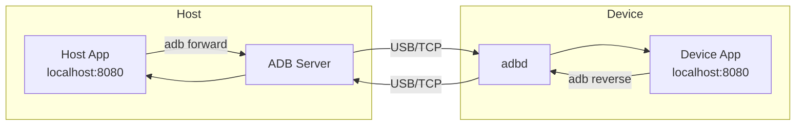

Forward 与 reverse 配置在 `atransport` 内的 `reverse_forwards_` 映射中按传输
进行跟踪：
```cpp
// Track remote addresses against local addresses
std::unordered_map<std::string, std::string> reverse_forwards_;
```

### 39.5.7 ABB：Android Binder Bridge

源码：`packages/modules/adb/daemon/abb.cpp`、
`packages/modules/adb/daemon/abb_service.cpp`

ABB 提供了一条从 `adb` 命令直接通往系统服务的 Binder IPC 路径，绕过了 shell。
它通过显式的 `adb abb` 命令访问（在
`packages/modules/adb/client/commandline.cpp` 中受 `abb` 特性控制）。在内部，
`adb install` 也会访问它。当设备支持 `abb_exec` 时，该命令会发送
`abb_exec:package ...`，而不是 `exec:cmd package`。普通的
`adb shell cmd <service>` 仍然经由 shell 服务和 `cmd` 二进制程序：

```
adb abb <service> <arguments>
     |
     v
  abb_exec:<service> <arguments>
     |
     v
  ServiceManager.getService(<service>)
     |
     v
  Direct Binder call
```

这比派生 shell 进程并调用 `cmd` 二进制程序要快得多。

### 39.5.8 JDWP 服务

源码：`packages/modules/adb/daemon/jdwp_service.cpp`

JDWP（Java 调试线协议）服务支持 Java 调试器的连接。当一个可调试的应用启动时，
其运行时会向 `adbd` 的 JDWP 服务注册。`adb jdwp` 命令列出所有具有活动 JDWP
连接的 PID，而 `adb forward tcp:PORT jdwp:PID` 则为调试器连接创建一条隧道。

---

## 39.6 MTP：媒体传输协议

### 39.6.1 概览

MTP（媒体传输协议）是在 Android 设备与计算机之间传输媒体文件的标准协议。与
USB 大容量存储（它暴露一个原始块设备）不同，MTP 提供对象级的文件访问。设备
保留对文件系统的控制。它可以同时向主机计算机和本地应用程序提供文件。

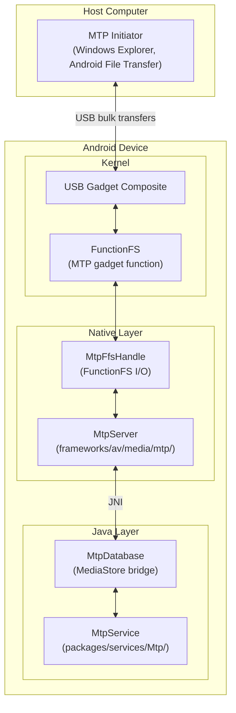

### 39.6.2 MTP 架构

MTP 实现跨越三层：

**原生 MTP 库**（`frameworks/av/media/mtp/`）：

- `MtpServer.cpp/h`：主 MTP 协议引擎
- `MtpFfsHandle.cpp/h`：FunctionFS 传输（现代）
- `MtpFfsCompatHandle.cpp/h`：兼容模式 FunctionFS 传输
- `MtpDevHandle.cpp/h`：传统 `/dev/mtp_usb` 传输
- `MtpDataPacket.cpp/h`：数据容器序列化
- `MtpRequestPacket.cpp/h`：命令容器解析
- `MtpResponsePacket.cpp/h`：响应容器构造
- `MtpEventPacket.cpp/h`：事件通知数据包
- `MtpStorage.cpp/h`：存储抽象（映射到文件系统路径）
- `MtpObjectInfo.cpp/h`：对象元数据
- `MtpProperty.cpp/h`：MTP 属性描述符

**MTP 服务**（`packages/services/Mtp/`）：

- `MtpService.java`：管理 MTP 服务器生命周期的 Android Service
- `MtpDatabase.java`：主机侧 MTP 对象元数据的本地 SQLite 缓存
  （第 39.6.11 节）
- `MtpDocumentsProvider.java`：Storage Access Framework 集成
- `MtpReceiver.java`：USB 状态变化的广播接收器
- `MtpManager.java`：主机侧 MTP 设备管理

**框架集成**（`frameworks/base/`）：

- 当 MTP 功能处于活动状态时，`UsbDeviceManager` 绑定到 `MtpService`
- `android.mtp.MtpDatabase`
  （`frameworks/base/media/java/android/mtp/MtpDatabase.java`）—— 与
  `packages/services/Mtp/` 中的类不同 —— 是 MTP 操作与 MediaStore 之间的
  桥梁；`MediaProvider` 向其提供文件元数据

### 39.6.3 MTP 服务器初始化与运行循环

源码：`frameworks/av/media/mtp/MtpServer.cpp`

`MtpServer` 构造函数根据 FunctionFS 的可用性选择合适的 USB 传输：

```cpp
// Transport selection in MtpServer constructor
bool ffs_ok = access(FFS_MTP_EP0, W_OK) == 0;
if (ffs_ok) {
    bool aio_compat = android::base::GetBoolProperty(
            "sys.usb.ffs.aio_compat", false);
    mHandle = aio_compat
            ? new MtpFfsCompatHandle(controlFd)
            : new MtpFfsHandle(controlFd);
} else {
    mHandle = new MtpDevHandle();  // Legacy /dev/mtp_usb
}
```

存在三种传输实现：

1. **`MtpFfsHandle`**：使用异步 I/O 的现代 FunctionFS —— 性能最高
2. **`MtpFfsCompatHandle`**：为原生 AIO 存在问题的设备提供的兼容模式
   FunctionFS
3. **`MtpDevHandle`**：传统内核 MTP 设备节点（`/dev/mtp_usb`）

主服务器循环（`MtpServer::run()`）处理 MTP 事务：

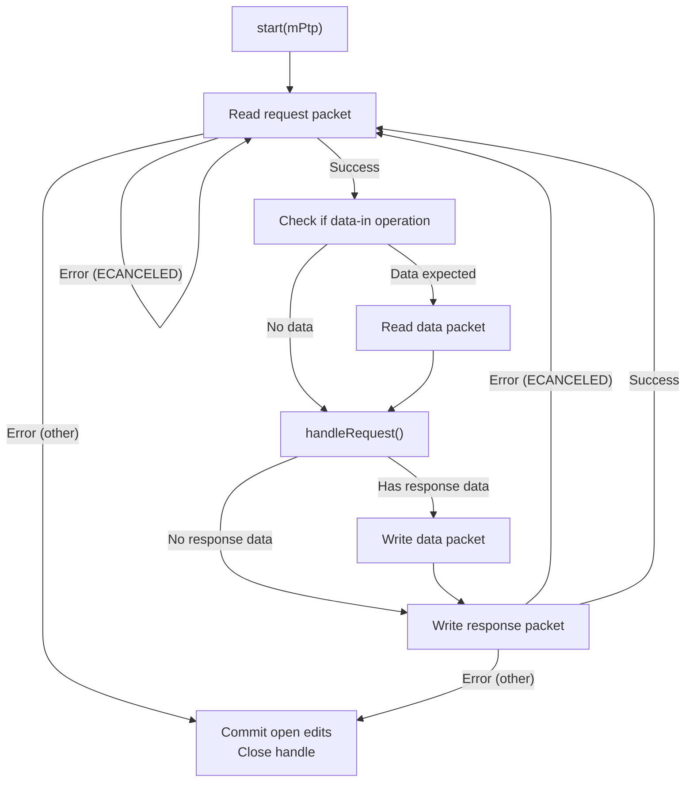

运行循环识别数据输入操作（主机向设备发送数据）：
```cpp
bool dataIn = (operation == MTP_OPERATION_SEND_OBJECT_INFO
            || operation == MTP_OPERATION_SET_OBJECT_REFERENCES
            || operation == MTP_OPERATION_SET_OBJECT_PROP_VALUE
            || operation == MTP_OPERATION_SET_DEVICE_PROP_VALUE);
```

当服务器退出时（由于 USB 断开或功能变化），它会提交所有待处理的编辑，以防止
数据丢失：
```cpp
int count = mObjectEditList.size();
for (int i = 0; i < count; i++) {
    ObjectEdit* edit = mObjectEditList[i];
    commitEdit(edit);
    delete edit;
}
mObjectEditList.clear();
mHandle->close();
```

### 39.6.4 存储管理

`MtpServer` 管理多个存储位置。在典型的 Android 设备上：

- **内部存储**（存储 ID `0x00010001`）：`/storage/emulated/<user>/`
- **SD 卡**（存储 ID `0x00020001`）：`/storage/<sdcard-uuid>/`

存储的添加/移除操作会触发 MTP 事件发送给主机：

```cpp
void MtpServer::addStorage(MtpStorage* storage) {
    std::lock_guard<std::mutex> lg(mMutex);
    mStorages.push_back(storage);
    sendStoreAdded(storage->getStorageID());
}

void MtpServer::removeStorage(MtpStorage* storage) {
    std::lock_guard<std::mutex> lg(mMutex);
    auto iter = std::find(mStorages.begin(), mStorages.end(), storage);
    if (iter != mStorages.end()) {
        sendStoreRemoved(storage->getStorageID());
        mStorages.erase(iter);
    }
}
```

当以 ID `0`（通配符）查询存储时，返回第一个存储。当以 `0xFFFFFFFF` 查询时，
任何存储都匹配。这遵循了 MTP 规范中跨所有存储的聚合操作。

### 39.6.5 MTP 协议细节

MTP（媒体传输协议）是一种面向会话的协议，最初由微软作为 PTP（图片传输协议，
也称为 ISO 15740）的扩展而开发。通信通过三个 USB 端点进行：

1. **Bulk OUT**（主机到设备）：来自发起方的命令和数据
2. **Bulk IN**（设备到主机）：给发起方的响应和数据
3. **Interrupt IN**（设备到主机）：异步事件通知

每个 MTP 事务都使用容器数据包：

```
Container Format (12-byte header):
+--------+--------+--------+--------+
|   Container Length (32-bit LE)    |
+--------+--------+--------+--------+
|Container|  Operation/Response     |
|  Type   |      Code              |
+--------+--------+--------+--------+
|   Transaction ID (32-bit LE)      |
+--------+--------+--------+--------+
|   Parameters / Data (variable)    |
+--------+--------+--------+--------+
```

来自 `frameworks/av/media/mtp/mtp.h` 的容器类型：
```c
#define MTP_CONTAINER_TYPE_COMMAND      1
#define MTP_CONTAINER_TYPE_DATA         2
#define MTP_CONTAINER_TYPE_RESPONSE     3
#define MTP_CONTAINER_TYPE_EVENT        4
```

### 39.6.6 支持的 MTP 操作

AOSP 中的 `MtpServer` 支持以下操作码（来自
`frameworks/av/media/mtp/MtpServer.cpp`）：

| 操作码 | 名称 | 说明 |
|---------------|------|-------------|
| `0x1001` | `GET_DEVICE_INFO` | 查询设备能力 |
| `0x1002` | `OPEN_SESSION` | 启动 MTP 会话 |
| `0x1003` | `CLOSE_SESSION` | 结束 MTP 会话 |
| `0x1004` | `GET_STORAGE_IDS` | 列出可用存储 |
| `0x1005` | `GET_STORAGE_INFO` | 查询存储容量/可用空间 |
| `0x1006` | `GET_NUM_OBJECTS` | 统计存储中的对象数 |
| `0x1007` | `GET_OBJECT_HANDLES` | 列出对象句柄 |
| `0x1008` | `GET_OBJECT_INFO` | 查询对象元数据 |
| `0x1009` | `GET_OBJECT` | 下载对象数据 |
| `0x100A` | `GET_THUMB` | 下载缩略图 |
| `0x100B` | `DELETE_OBJECT` | 删除一个对象 |
| `0x100C` | `SEND_OBJECT_INFO` | 创建新对象（元数据） |
| `0x100D` | `SEND_OBJECT` | 上传对象数据 |
| `0x1010` | `RESET_DEVICE` | 重置 MTP 状态 |
| `0x1014` | `GET_DEVICE_PROP_DESC` | 设备属性描述符 |
| `0x1015` | `GET_DEVICE_PROP_VALUE` | 读取设备属性 |
| `0x1016` | `SET_DEVICE_PROP_VALUE` | 写入设备属性 |
| `0x1019` | `MOVE_OBJECT` | 将对象移动到新的父节点 |
| `0x101A` | `COPY_OBJECT` | 复制对象 |
| `0x101B` | `GET_PARTIAL_OBJECT` | 范围读取 |
| `0x9801` | `GET_OBJECT_PROPS_SUPPORTED` | 列出支持的属性 |
| `0x9802` | `GET_OBJECT_PROP_DESC` | 属性描述符 |
| `0x9803` | `GET_OBJECT_PROP_VALUE` | 读取对象属性 |
| `0x9804` | `SET_OBJECT_PROP_VALUE` | 写入对象属性 |
| `0x9805` | `GET_OBJECT_PROP_LIST` | 批量属性读取 |

### 39.6.7 用于直接文件 I/O 的 Android 扩展

Android 通过自定义操作扩展了标准 MTP 协议，以实现高效的直接文件编辑：

```c
// From mtp.h -- Android extensions
#define MTP_OPERATION_GET_PARTIAL_OBJECT_64  0x95C1  // 64-bit offset read
#define MTP_OPERATION_SEND_PARTIAL_OBJECT    0x95C2  // Host-to-device write
#define MTP_OPERATION_TRUNCATE_OBJECT        0x95C3  // Truncate to 64-bit length
#define MTP_OPERATION_BEGIN_EDIT_OBJECT       0x95C4  // Begin edit session
#define MTP_OPERATION_END_EDIT_OBJECT         0x95C5  // Commit edit changes
```

这些扩展使文档编辑器之类的应用程序能够就地修改文件，而无需经历完整的
下载-修改-上传循环：

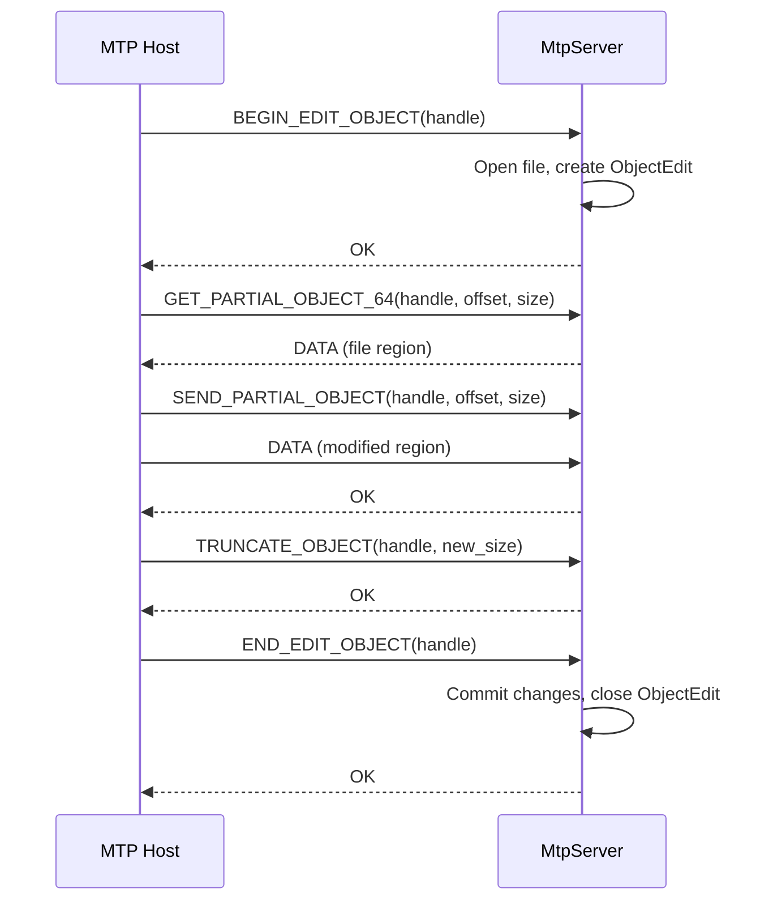

### 39.6.8 FunctionFS 传输

源码：`frameworks/av/media/mtp/MtpFfsHandle.h`

`MtpFfsHandle` 类使用 Linux FunctionFS 实现 USB 传输，提供高性能的异步 I/O：

```cpp
class MtpFfsHandle : public IMtpHandle {
protected:
    android::base::unique_fd mControl;   // Control endpoint (ep0)
    android::base::unique_fd mBulkIn;    // Bulk IN (device to host)
    android::base::unique_fd mBulkOut;   // Bulk OUT (host to device)
    android::base::unique_fd mIntr;      // Interrupt IN (events)

    aio_context_t mCtx;                  // Linux AIO context

    struct io_buffer mIobuf[NUM_IO_BUFS]; // Double-buffered I/O
    // ...
};
```

追加到 MTP 数据传输之前的数据头：
```c
struct mtp_data_header {
    __le32 length;           // Packet length including header
    __le16 type;             // Container type (2 = data)
    __le16 command;          // MTP command code
    __le32 transaction_id;   // Transaction ID
};
```

### 39.6.9 MTP 事件通知

MTP 服务器通过中断端点向主机发送异步事件：

```c
// Supported events from MtpServer.cpp
static const MtpEventCode kSupportedEventCodes[] = {
    MTP_EVENT_OBJECT_ADDED,       // 0x4002 - New file created
    MTP_EVENT_OBJECT_REMOVED,     // 0x4003 - File deleted
    MTP_EVENT_STORE_ADDED,        // 0x4004 - Storage mounted
    MTP_EVENT_STORE_REMOVED,      // 0x4005 - Storage unmounted
    MTP_EVENT_DEVICE_PROP_CHANGED,// 0x4006 - Device property changed
    MTP_EVENT_OBJECT_INFO_CHANGED,// 0x4007 - Object metadata changed
};
```

当设备上有文件被添加或移除（例如由相机应用）时，`MtpDatabase` 会通知
`MtpServer`。该服务器向主机发送相应的事件。然后主机可以刷新其目录列表。

### 39.6.10 PTP 模式

PTP（图片传输协议）是 MTP 中专注于图像传输的一个子集。当选择 PTP 模式而不是
MTP 时，`MtpServer` 会以 `ptp` 标志设为 `true` 进行初始化：

```cpp
MtpServer::MtpServer(IMtpDatabase* database, int controlFd, bool ptp, ...)
    :   mDatabase(database),
        mPtp(ptp),  // true for PTP mode
        // ...
```

在 PTP 模式下，服务器会限制：

- 对象格式仅限于图像类型（JPEG、TIFF、PNG 等）
- 操作仅限于标准 PTP 子集
- 属性仅限于与照片相关的元数据

PTP 模式适用于连接到照片自助终端以及不支持完整 MTP 扩展集的旧软件。

### 39.6.11 MTP 文档提供者

源码：`packages/services/Mtp/src/com/android/mtp/MtpDocumentsProvider.java`

当 Android 设备充当 MTP **主机**（访问另一台 MTP 设备上的文件）时，
`MtpDocumentsProvider` 将 MTP 设备集成到 Storage Access Framework 中。任何兼容
SAF 的应用都可以浏览已连接 MTP 设备上的文件。

主机侧 MTP 协议栈中的关键类：

- `MtpDocumentsProvider`：SAF 提供者实现
- `MtpManager`：管理 MTP 设备连接
- `MtpDatabase`：在本地缓存 MTP 对象元数据
- `DocumentLoader`：处理目录内容的后台加载
- `PipeManager`：管理大文件的传输管道

---

## 39.7 USB 配件模式（AOA）

### 39.7.1 Android Open Accessory 协议概览

Android Open Accessory（AOA）协议允许外部 USB 设备（配件）与 Android 应用
程序通信。与标准的 USB 主机模式（Android 作为主机）不同，在配件模式中，外部
设备是 USB 主机，Android 设备是外围设备。

这特别适用于：

- 车载主机（Android Auto）
- 桌面扩展坞
- 游戏手柄
- 工业设备
- 乐器

### 39.7.2 AOA 握手协议

```mermaid
sequenceDiagram
    participant ACC as USB Accessory (Host)
    participant DEV as Android Device (Peripheral)

    Note over ACC,DEV: Device initially in normal USB mode

    ACC->>DEV: GET_PROTOCOL (vendor request 51)
    DEV->>ACC: Protocol version (1 or 2)

    ACC->>DEV: SEND_STRING(0, manufacturer)
    ACC->>DEV: SEND_STRING(1, model)
    ACC->>DEV: SEND_STRING(2, description)
    ACC->>DEV: SEND_STRING(3, version)
    ACC->>DEV: SEND_STRING(4, URI)
    ACC->>DEV: SEND_STRING(5, serial)

    ACC->>DEV: START_ACCESSORY (vendor request 53)

    Note over DEV: Device disconnects, re-enumerates<br/>with accessory VID/PID

    DEV-->>ACC: Re-enumerate as accessory<br/>(VID=0x18D1, PID=0x2D00/0x2D01)

    ACC->>DEV: Open bulk endpoints
    ACC->>DEV: Application data exchange
```

### 39.7.3 UsbDeviceManager 中的配件检测

源码：`frameworks/base/services/usb/java/com/android/server/usb/UsbDeviceManager.java`

`UsbUEventObserver` 监控内核 UEvent 以跟踪配件握手的进展：

```java
// UEvent patterns for accessory protocol
private static final String ACCESSORY_START_MATCH =
        "DEVPATH=/devices/virtual/misc/usb_accessory";

// In UsbUEventObserver.onUEvent():
String accessory = event.get("ACCESSORY");
if ("GETPROTOCOL".equals(accessory)) {
    // Accessory sent GET_PROTOCOL control request
    mHandler.setAccessoryUEventTime(SystemClock.elapsedRealtime());
    resetAccessoryHandshakeTimeoutHandler();
} else if ("SENDSTRING".equals(accessory)) {
    // Accessory sent string descriptor
    mHandler.sendEmptyMessage(MSG_INCREASE_SENDSTRING_COUNT);
    resetAccessoryHandshakeTimeoutHandler();
} else if ("START".equals(accessory)) {
    // Accessory sent START_ACCESSORY
    startAccessoryMode();
}
```

### 39.7.4 配件模式激活

当收到 `START_ACCESSORY` 时，`UsbDeviceManager` 将 gadget 切换到配件功能：

```java
private void startAccessoryMode() {
    if (!mHasUsbAccessory) return;

    mAccessoryStrings = nativeGetAccessoryStrings();

    // Mandatory strings must be set
    boolean enableAccessory = (mAccessoryStrings != null &&
            mAccessoryStrings[UsbAccessory.MANUFACTURER_STRING] != null &&
            mAccessoryStrings[UsbAccessory.MODEL_STRING] != null);

    long functions = UsbManager.FUNCTION_NONE;
    if (enableAccessory) {
        functions |= UsbManager.FUNCTION_ACCESSORY;
    }

    if (functions != UsbManager.FUNCTION_NONE) {
        // Set timeout for host to complete configuration
        mHandler.sendMessageDelayed(
                mHandler.obtainMessage(MSG_ACCESSORY_MODE_ENTER_TIMEOUT),
                ACCESSORY_REQUEST_TIMEOUT);
        setCurrentFunctions(functions, operationId);
    }
}
```

### 39.7.5 用户空间 AOA 实现

Android 17 包含一个用户空间 AOA 实现，作为内核 `f_accessory` gadget 驱动的
替代方案。其启用条件是构建标志与设备属性的乘积，在 `UsbDeviceManager`
构造函数（`frameworks/base/services/usb/java/com/android/server/usb/UsbDeviceManager.java`）
中求值：

```java
boolean deviceEnabledUserspaceAoa =
        SystemProperties.getBoolean(DEVICE_UAOA_ENABLED_PROPERTY, false);
boolean featureEnabledUserspaceAoa =
        android.hardware.usb.flags.Flags.enableAoaUserspaceImplementation();

mEnableAoaUserspaceImplementation =
        featureEnabledUserspaceAoa && deviceEnabledUserspaceAoa;
```

`DEVICE_UAOA_ENABLED_PROPERTY` 为 `ro.usb.userspace.aoa.enabled` —— 也就是启动
`aoad` 守护进程的同一个属性（第 39.11 节）。当该标志和属性都被设置时，
`UsbDeviceManager` 会连接到 `aoad` 并查询其 `AoaInitializationStatus`。如果
守护进程无法打开配件控制端点，则用户空间 AOA 会被禁用，转而使用内核驱动。在
成功移交后，`UsbDeviceManager` 还会通过向内核的 `android_kernel_aoa_enabled`
开关写入 `0`，在较旧的内核（低于 6.6）上禁用内核内的 AOA 驱动。

这段代码较早的开发版本会在 `system_server` 中通过原生辅助函数直接从
FunctionFS 读取配件字符串描述符。该辅助函数已被移除。协议工作现在完全位于
`aoad` 守护进程中。因此，`UsbDeviceManager` 仅保留传统的内核驱动路径
（`nativeGetAccessoryStrings()`），其余情况则经由 `aoad` 路由。完整的守护进程
架构见第 39.11 节。

### 39.7.6 AOA 版本 2（音频）

AOAv2 增加了音频流支持。当配件请求音频时，`AUDIO_SOURCE` gadget 功能会与
`ACCESSORY` 一起被启用：

```java
// GadgetFunction bitmask values
ACCESSORY    = 1 << 1;   // AOA data
AUDIO_SOURCE = 1 << 6;   // AOAv2 audio
```

音频以标准 USB 音频类设备的形式呈现给主机。这使得配件无需特殊驱动即可接收
来自 Android 设备的音频输出。

### 39.7.7 应用程序集成

应用程序通过其清单注册以接收 USB 配件 intent：

```xml
<activity android:name=".MyAccessoryActivity">
    <intent-filter>
        <action android:name="android.hardware.usb.action.USB_ACCESSORY_ATTACHED"/>
    </intent-filter>
    <meta-data
        android:name="android.hardware.usb.action.USB_ACCESSORY_ATTACHED"
        android:resource="@xml/accessory_filter"/>
</activity>
```

过滤器 XML 指定要匹配哪些配件：
```xml
<resources>
    <usb-accessory manufacturer="Example Corp"
                   model="GamePad"
                   version="1.0"/>
</resources>
```

在运行时，应用程序使用 `UsbManager` 打开配件连接：
```java
UsbManager usbManager = getSystemService(UsbManager.class);
UsbAccessory[] accessories = usbManager.getAccessoryList();
if (accessories != null) {
    ParcelFileDescriptor fd = usbManager.openAccessory(accessories[0]);
    FileInputStream input = new FileInputStream(fd.getFileDescriptor());
    FileOutputStream output = new FileOutputStream(fd.getFileDescriptor());
    // Read/write accessory data
}
```

---

## 39.8 USB 主机模式

### 39.8.1 概览

在 USB 主机模式中，Android 设备充当 USB 主机，提供供电并枚举已连接的 USB
外围设备。这使得可以使用：

- USB 键盘和鼠标
- USB 存储设备（U 盘）
- USB 音频设备（DAC、耳机）
- USB 摄像头
- USB 以太网适配器
- USB MIDI 控制器
- 自定义 USB 设备（使用由应用程序管理的协议）

### 39.8.2 UsbHostManager

源码：`frameworks/base/services/usb/java/com/android/server/usb/UsbHostManager.java`

`UsbHostManager` 管理以主机模式连接到 Android 设备的 USB 设备。它运行一个监控
USB 总线的原生线程：

```java
public void systemReady() {
    synchronized (mLock) {
        Runnable runnable = this::monitorUsbHostBus;
        new Thread(null, runnable, "UsbService host thread").start();
    }
}

// Native methods
private native void monitorUsbHostBus();
private native ParcelFileDescriptor nativeOpenDevice(String deviceAddress);
```

### 39.8.3 设备枚举

```mermaid
sequenceDiagram
    participant Kernel as Linux USB Core
    participant JNI as UsbHostManager JNI
    participant UHM as UsbHostManager
    participant Settings as UsbProfileGroupSettingsManager
    participant App as Application

    Kernel->>JNI: USB device connected
    JNI->>UHM: usbDeviceAdded(address, class, subclass, descriptors)
    UHM->>UHM: Parse USB descriptors
    UHM->>UHM: Check deny lists

    alt Device allowed
        UHM->>UHM: Build UsbDevice object
        UHM->>Settings: deviceAttached(newDevice)
        Settings->>App: ACTION_USB_DEVICE_ATTACHED broadcast
    else Device denied
        UHM->>UHM: Log and ignore
    end

    Note over Kernel,App: Later, device removed
    Kernel->>JNI: USB device disconnected
    JNI->>UHM: usbDeviceRemoved(address)
    UHM->>Settings: usbDeviceRemoved(device)
    Settings->>App: ACTION_USB_DEVICE_DETACHED broadcast
```

### 39.8.4 描述符解析

当 USB 设备连接时，原始描述符由 `UsbDescriptorParser` 解析，以构建一个
`android.hardware.usb.UsbDevice` 对象：

```java
// From UsbHostManager.usbDeviceAdded()
UsbDescriptorParser parser = new UsbDescriptorParser(deviceAddress, descriptors);
logUsbDevice(parser);  // Log VID:PID, manufacturer, product, serial

UsbDevice.Builder newDeviceBuilder = parser.toAndroidUsbDeviceBuilder();
UsbDevice newDevice = newDeviceBuilder.build(serialNumberReader);
mDevices.put(deviceAddress, newDevice);
```

解析器检查 USB 描述符以对设备进行分类：

- `parser.hasAudioInterface()` —— USB 音频设备
- `parser.hasHIDInterface()` —— HID 设备（键盘、鼠标）
- `parser.hasStorageInterface()` —— 大容量存储设备
- `parser.isInputHeadset()` / `parser.isOutputHeadset()` —— 音频耳机
- `parser.isDock()` —— 桌面扩展坞

### 39.8.5 拒绝列表

`UsbHostManager` 维护两个层级的拒绝列表：

**1. 总线级拒绝列表**：通过设备的资源覆盖配置：
```java
mHostDenyList = context.getResources().getStringArray(
        com.android.internal.R.array.config_usbHostDenylist);
```

**2. 类级拒绝列表**：阻止某些 USB 类被应用程序访问：
```java
private boolean isDenyListed(int clazz, int subClass) {
    if (clazz == UsbConstants.USB_CLASS_HUB) return true;
    return clazz == UsbConstants.USB_CLASS_HID
            && subClass == UsbConstants.USB_INTERFACE_SUBCLASS_BOOT;
}
```

### 39.8.6 USB 权限

源码：`frameworks/base/services/usb/java/com/android/server/usb/UsbPermissionManager.java`

访问 USB 设备需要明确的权限。（在启用了 USB 主机设备授权的构建版本上，设备
必须首先在内核级别被*授权*。之后它才会被枚举为框架可以授予权限的
`UsbDevice`。参见第 39.10 节。此处描述的权限是较旧的按应用/按设备的门控，一旦
设备被授权，它仍然适用。）权限模型的工作方式如下：

```mermaid
graph TD
    subgraph "Permission Granting"
        MANIFEST["Manifest filter match<br/>(auto-grant)"]
        DIALOG["User permission dialog<br/>(manual grant)"]
        PRIV["Privileged system app<br/>(pre-granted)"]
    end

    subgraph "UsbPermissionManager"
        UPERM2["UsbPermissionManager"]
        UUPM["UsbUserPermissionManager<br/>(per-user)"]
    end

    MANIFEST --> UPERM2
    DIALOG --> UPERM2
    PRIV --> UPERM2
    UPERM2 --> UUPM
```

应用程序可以通过两种方式请求权限：

**1. Intent 过滤器匹配**（自动）：
```xml
<activity android:name=".UsbDeviceActivity">
    <intent-filter>
        <action android:name="android.hardware.usb.action.USB_DEVICE_ATTACHED"/>
    </intent-filter>
    <meta-data
        android:name="android.hardware.usb.action.USB_DEVICE_ATTACHED"
        android:resource="@xml/device_filter"/>
</activity>
```

配合设备过滤器：
```xml
<resources>
    <usb-device vendor-id="1234" product-id="5678"/>
</resources>
```

**2. 运行时权限请求**（编程方式）：
```java
UsbManager usbManager = getSystemService(UsbManager.class);
UsbDevice device = ...;
if (!usbManager.hasPermission(device)) {
    PendingIntent permissionIntent = PendingIntent.getBroadcast(
            this, 0, new Intent(ACTION_USB_PERMISSION), 0);
    usbManager.requestPermission(device, permissionIntent);
}
```

### 39.8.7 打开 USB 设备

一旦权限被授予，应用程序通过文件描述符与 USB 设备通信：

```java
UsbDeviceConnection connection = usbManager.openDevice(device);
// Claim an interface
connection.claimInterface(usbInterface, true);

// Bulk transfer
byte[] buffer = new byte[64];
int bytesRead = connection.bulkTransfer(endpoint, buffer, buffer.length, TIMEOUT);

// Control transfer
connection.controlTransfer(
    UsbConstants.USB_DIR_IN | UsbConstants.USB_TYPE_VENDOR,
    REQUEST_CODE, VALUE, INDEX, buffer, buffer.length, TIMEOUT);
```

在底层，`UsbHostManager.openDevice()` 调用 `nativeOpenDevice()`，后者返回一个
指向 USB 设备节点（例如 `/dev/bus/usb/001/003`）的 `ParcelFileDescriptor`。

### 39.8.7.1 USB 传输类型

`UsbDeviceConnection` 类支持控制、批量和中断传输：

| 传输类型 | 方法 | 最大尺寸 | 使用场景 |
|--------------|--------|----------|----------|
| 控制 | `controlTransfer()` | 每个 setup 4KB | 设备配置、厂商命令 |
| 批量 | `bulkTransfer()` | 可变 | 数据量大的传输（存储、打印机） |
| 中断 | 在中断端点上调用 `bulkTransfer()` | 64B（FS）/ 1024B（HS） | HID 事件、状态轮询 |

不支持等时端点。`system/core/libusbhost/usbhost.c` 中的 `usb_request_new()`
只接受批量和中断端点，对其他任何类型都返回 NULL。因此
`UsbRequest.initialize()` 在等时端点上会失败。等时音频/视频流则改为经由 ALSA
USB-audio 路径（第 39.8.8 节）。

对于异步传输，应用程序使用 `UsbRequest`：

```java
UsbRequest request = new UsbRequest();
request.initialize(connection, endpoint);
ByteBuffer buffer = ByteBuffer.allocate(64);
request.queue(buffer, 64);

// Wait for completion
UsbRequest completed = connection.requestWait();
if (completed == request) {
    // Process data in buffer
    buffer.flip();
    int bytesReceived = buffer.remaining();
}
```

### 39.8.7.2 USB 设备类模型

`UsbDevice` 对象提供了 USB 设备的层次化视图：

```mermaid
graph TD
    DEV["UsbDevice<br/>VID:PID, class, serial"]
    CFG1["UsbConfiguration 0<br/>attributes, maxPower"]
    CFG2["UsbConfiguration 1"]
    IF1["UsbInterface 0<br/>class, subclass, protocol"]
    IF2["UsbInterface 1"]
    EP1["UsbEndpoint 0<br/>IN, BULK, 512B"]
    EP2["UsbEndpoint 1<br/>OUT, BULK, 512B"]
    EP3["UsbEndpoint 2<br/>IN, INTERRUPT, 8B"]

    DEV --> CFG1
    DEV --> CFG2
    CFG1 --> IF1
    CFG1 --> IF2
    IF1 --> EP1
    IF1 --> EP2
    IF2 --> EP3
```

应用程序遍历这一层次结构以找到所需的接口和端点：

```java
for (int i = 0; i < device.getConfigurationCount(); i++) {
    UsbConfiguration config = device.getConfiguration(i);
    for (int j = 0; j < config.getInterfaceCount(); j++) {
        UsbInterface iface = config.getInterface(j);
        if (iface.getInterfaceClass() == UsbConstants.USB_CLASS_VENDOR_SPEC) {
            for (int k = 0; k < iface.getEndpointCount(); k++) {
                UsbEndpoint ep = iface.getEndpoint(k);
                if (ep.getDirection() == UsbConstants.USB_DIR_IN) {
                    inEndpoint = ep;
                } else {
                    outEndpoint = ep;
                }
            }
        }
    }
}
```

### 39.8.8 USB 音频集成

`UsbAlsaManager`（源码：
`frameworks/base/services/usb/java/com/android/server/usb/UsbAlsaManager.java`）
负责处理 USB 音频设备：

```mermaid
graph LR
    USB_AUDIO["USB Audio Device"] --> UHM2["UsbHostManager"]
    UHM2 --> UALSA2["UsbAlsaManager"]
    UALSA2 --> ALSA["ALSA Subsystem"]
    UALSA2 --> MIDI2["UsbAlsaMidiDevice"]
    ALSA --> AUDIO_HAL["Audio HAL"]
    AUDIO_HAL --> AUDIOFLINGER["AudioFlinger"]
```

当 USB 音频设备连接时：

1. `UsbHostManager` 调用 `mUsbAlsaManager.usbDeviceAdded()`
2. `UsbAlsaManager` 创建一个代表 ALSA 声卡的 `UsbAlsaDevice`
3. 音频 HAL 会收到关于新输出/输入设备的通知
4. AudioFlinger 将音频路由到/来自该 USB 设备

### 39.8.9 USB MIDI

对于 USB MIDI 设备，`UsbHostManager` 会创建 `UsbDirectMidiDevice` 实例：

```java
if (parser.containsUniversalMidiDeviceEndpoint()) {
    UsbDirectMidiDevice midiDevice = UsbDirectMidiDevice.create(
            mContext, newDevice, parser, true, uniqueUsbDeviceIdentifier);
    midiDevices.add(midiDevice);

    // If also MIDI 1.0 compatible, create legacy device
    if (parser.containsLegacyMidiDeviceEndpoint()) {
        midiDevice = UsbDirectMidiDevice.create(
                mContext, newDevice, parser, false, uniqueUsbDeviceIdentifier);
        midiDevices.add(midiDevice);
    }
}
```

会生成一个唯一的 3 位代码，以关联相关的 MIDI 设备：
```java
private String generateNewUsbDeviceIdentifier() {
    String code;
    do {
        code = "";
        for (int i = 0; i < 3; i++) {
            code += mRandom.nextInt(10);
        }
    } while (mMidiUniqueCodes.contains(code));
    mMidiUniqueCodes.add(code);
    return code;
}
```

### 39.8.10 连接跟踪

`UsbHostManager` 维护一份连接/断开事件的滚动日志，用于调试：

```java
static final int MAX_CONNECT_RECORDS = 32;

class ConnectionRecord {
    long mTimestamp;
    String mDeviceAddress;
    final int mMode;  // CONNECT, CONNECT_BADPARSE, CONNECT_BADDEVICE, DISCONNECT
    final byte[] mDescriptors;
}
```

这些记录可通过 `dumpsys usb` 访问，并包含用于详细分析的原始 USB 描述符。

---

## 39.9 内部细节：ConfigFS 与 Linux USB Gadget 框架

### 39.9.1 ConfigFS Gadget 架构

现代 Android 设备使用 Linux 基于 ConfigFS 的 USB gadget 框架来管理复合 USB
设备配置。它取代了较旧的 `android_usb` 驱动，并提供了更灵活、可由用户空间
配置的方法。

```mermaid
graph TD
    subgraph "User Space"
        HAL["IUsbGadget HAL"]
        INIT["init (property triggers)"]
    end

    subgraph "ConfigFS (/config/usb_gadget/)"
        G1["g1/ (gadget instance)"]
        STRINGS["strings/0x409/<br/>manufacturer, product, serial"]
        CONFIGS["configs/b.1/<br/>configuration"]
        FUNCS["functions/<br/>ffs.adb, ffs.mtp, ...]"]
        UDC["UDC (controller binding)"]
    end

    subgraph "FunctionFS"
        FFS_ADB["/dev/usb-ffs/adb/"]
        FFS_MTP["/dev/usb-ffs/mtp/"]
    end

    subgraph "Kernel USB Stack"
        COMPOSITE["USB Composite Driver"]
        UDC_DRIVER["UDC Hardware Driver"]
    end

    HAL --> G1
    INIT --> G1
    G1 --> STRINGS
    G1 --> CONFIGS
    G1 --> FUNCS
    G1 --> UDC
    FUNCS --> FFS_ADB
    FUNCS --> FFS_MTP
    UDC --> COMPOSITE
    COMPOSITE --> UDC_DRIVER
```

### 39.9.2 Gadget 配置过程

当 HAL 收到 `setCurrentUsbFunctions()` 调用时，典型的 ConfigFS 操作序列如下：

```
1. Write "" to UDC                    # Unbind from controller
2. Unlink functions from configs/b.1/ # Remove current functions
3. Create/configure new functions     # e.g., mkdir functions/ffs.mtp
4. Link functions to configs/b.1/     # symlink functions/ffs.mtp -> configs/b.1/f1
5. Write controller name to UDC       # Bind to controller, trigger enumeration
```

该序列会引发一次对主机可见的 USB 断开/重连周期。

### 39.9.3 FunctionFS 端点架构

每个 FunctionFS 实例都会创建一个文件系统，用户空间守护进程使用它来实现 USB
功能：

```
/dev/usb-ffs/adb/
    ep0       # Control endpoint (descriptors, events)
    ep1       # Bulk OUT (host to device)
    ep2       # Bulk IN (device to host)

/dev/usb-ffs/mtp/
    ep0       # Control endpoint
    ep1       # Bulk IN (device to host)
    ep2       # Bulk OUT (host to device)
    ep3       # Interrupt IN (events)
```

用户空间守护进程（例如 `adbd` 或 MTP 服务器）：

1. 打开 `ep0` 并写入 USB 描述符（设备、配置、接口、端点描述符）
2. 读取 `ep0` 以获取控制事件（BIND、UNBIND、ENABLE、DISABLE、SETUP）
3. 打开 `ep1`、`ep2` 等端点用于数据传输
4. 在数据端点上执行读/写操作

### 39.9.4 复合设备描述符

当多个功能处于活动状态时（例如 MTP + ADB），gadget 会将自己呈现为一个 USB
复合设备：

```
USB Device Descriptor:
    idVendor:   0x18D1 (Google Inc.)
    idProduct:  0x4EE2 (MTP + ADB)

USB Configuration Descriptor:
    bNumInterfaces: 2

    Interface 0: MTP
        bInterfaceClass:    0x06 (Still Image)
        bInterfaceSubClass: 0x01
        bInterfaceProtocol: 0x01
        Endpoint: Bulk IN
        Endpoint: Bulk OUT
        Endpoint: Interrupt IN

    Interface 1: ADB
        bInterfaceClass:    0xFF (Vendor Specific)
        bInterfaceSubClass: 0x42
        bInterfaceProtocol: 0x01
        Endpoint: Bulk IN
        Endpoint: Bulk OUT
```

VID:PID 组合会随活动的功能组合而变化：

| 功能 | PID | 说明 |
|-----------|-----|-------------|
| MTP | `0x4EE1` | 仅 MTP |
| MTP + ADB | `0x4EE2` | 带调试的 MTP |
| PTP | `0x4EE5` | 仅 PTP |
| PTP + ADB | `0x4EE6` | 带调试的 PTP |
| RNDIS | `0x4EE3` | USB 网络共享 |
| RNDIS + ADB | `0x4EE4` | 带调试的网络共享 |
| Accessory | `0x2D00` | AOA 配件 |
| Accessory + ADB | `0x2D01` | 带调试的 AOA |
| MIDI | `0x4EE8` | 仅 MIDI |
| MIDI + ADB | `0x4EE9` | 带调试的 MIDI |
| ADB only | `0x4EE7` | 仅调试 |

### 39.9.5 USB 速度协商

USB 连接速度在物理层协商期间确定，并通过 `IUsbGadget` HAL 报告
（`hardware/interfaces/usb/gadget/aidl/android/hardware/usb/gadget/UsbSpeed.aidl`）：

```
@VintfStability
@Backing(type="int")
enum UsbSpeed {
    UNKNOWN = -1,
    LOWSPEED = 0,          // USB 1.0, 1.5 Mbps
    FULLSPEED = 1,         // USB 1.1, 12 Mbps
    HIGHSPEED = 2,         // USB 2.0, 480 Mbps
    SUPERSPEED = 3,        // USB 3.0, 5 Gbps
    SUPERSPEED_10Gb = 4,   // USB 3.1 Gen 2, 10 Gbps
    SUPERSPEED_20Gb = 5,   // USB 3.2 Gen 2x2, 20 Gbps
    USB4_GEN2_10Gb = 6,
    USB4_GEN2_20Gb = 7,
    USB4_GEN3_20Gb = 8,
    USB4_GEN3_40Gb = 9,
}
```

协商得到的速度会影响最大传输尺寸和吞吐量。ADB 文件传输的性能通常为：

- USB 2.0 High Speed：实际 30-40 MB/s
- USB 3.0 SuperSpeed：实际 100-200 MB/s
- USB 3.1/3.2：受限于设备存储速度

### 39.9.6 污染物检测

现代 USB-C 端口包含污染物（水分/碎屑）检测。当检测到污染物时：

1. HAL 报告 `ContaminantDetectionStatus.DETECTED`
2. `UsbPortManager` 发布一条通知，警告用户
3. 可能会禁用 USB 数据，以防止电气损坏
4. 端口以降低的功率继续充电
5. 当污染物清除后，恢复正常运行

```mermaid
stateDiagram-v2
    [*] --> Clean: No contaminant
    Clean --> Detected: Moisture/debris sensed
    Detected --> Clean: Contaminant cleared
    Detected --> Disabled: USB data disabled

    state Clean {
        [*] --> Normal: Full USB operation
    }

    state Detected {
        [*] --> Warning: Notification shown
        Warning --> PowerOnly: Data disabled, charging reduced
    }

    Disabled --> Clean: User action / dry out
```

---

## 39.10 USB 主机设备授权（Android 17）

### 39.10.1 为什么需要一个新的授权层

第 39.8 节中的主机模式权限模型回答的是“*这个应用*是否可以与*这台设备*
通信”的问题。它没有回答一个更基本的问题，而这个问题在桌面和大屏形态上变得
日益紧迫。这个问题是：“此刻，这台机器是否应该让*任何* USB 设备接入？”答案
取决于谁已登录、以及屏幕是否锁定。

处于登录界面的笔记本式 Android 设备不应静默枚举攻击者的 USB 键盘——它会
注入按键（“juice jacking”/BadUSB）。一台接在扩展坞上的桌面设备应当能够信任
其扩展坞的内部集线器，但它仍应对刚插上的存储棒提出质询。

Android 17 引入了**USB 主机设备授权**来精确实施这一策略，执行点位于内核
原本会授权新接入设备的环节。该决策（允许、拒绝、暂缓，或询问用户）由一个新的
进程外 Rust 守护进程做出。声明式策略驱动该守护进程。框架提供当前的“系统状态”
（已启动、已登录、屏幕锁定、已设置），并把任何交互式提示转达给用户。

整个特性由 `usb_desktop` aconfig 命名空间中的 `enable_usb_host_authorization`
标志控制（`frameworks/base/services/usb/java/com/android/server/usb/flags/usb_flags.aconfig`），
这反映出它主要是一项桌面/大屏加固。在关闭该标志的手机构建版本上，这一切都不会
运行，主机设备的行为与早期版本一致。

### 39.10.2 组件

```mermaid
graph TD
    subgraph "Kernel"
        UDEV["USB device attach<br/>(sysfs authorized node)"]
        UEVENTD["ueventd USB add/remove"]
    end

    subgraph "usbauthservice (Rust daemon, service usb_auth)"
        MGR["AuthorizationManager<br/>(state + device lists)"]
        RULES["Policy rules<br/>(rules.rs)"]
        AUTHZ["authorize_device()<br/>(authorization.rs)"]
    end

    subgraph "system_server"
        UAUTH["UsbAuthManager.java"]
        UHM3["UsbHostManager"]
    end

    subgraph "SystemUI"
        UI["UsbAuthorizationActivity<br/>(ask dialog)"]
    end

    UEVENTD -->|"device add/remove"| MGR
    MGR --> AUTHZ
    AUTHZ --> RULES
    AUTHZ -->|"allow/deny: write authorized"| UDEV
    UAUTH -->|"setSystemState() / setAuthorizationStatus()"| MGR
    MGR -->|"events: ask / check-persisted"| UAUTH
    UAUTH --> UI
    UI -->|"user choice"| UAUTH
    UHM3 -->|"usbDeviceAdded()"| UAUTH
```

各组成部分：

| 组件 | 类型 | 源码路径 | 作用 |
|-----------|------|-------------|------|
| `usbauthservice` | Rust 守护进程 | `frameworks/native/services/usbauthservice/usbauthservice.rs` | 注册 Binder 服务 `usb_auth`；拥有策略与决策 |
| 策略引擎 | Rust | `frameworks/native/services/usbauthservice/rules.rs`、`authorization.rs`、`manager.rs` | 解析规则语言，根据活动状态评估设备 |
| `IUsbAuthManager` | 内部 AIDL | `frameworks/base/core/java/android/hardware/usb/IUsbAuthManager.aidl` | 框架到守护进程的控制界面 |
| `IUsbAuthEventsListener` | 内部 AIDL | `frameworks/base/core/java/android/hardware/usb/IUsbAuthEventsListener.aidl` | 守护进程到框架的回调（oneway） |
| `UsbAuthManager` | Java | `frameworks/base/services/usb/java/com/android/server/usb/UsbAuthManager.java` | 连接到 `usb_auth`，将 Android 事件映射为系统状态，驱动 UI |
| `UsbAuthorizationActivity` | SystemUI | `frameworks/base/packages/SystemUI/src/com/android/systemui/usb/UsbAuthorizationActivity.kt` | 面向用户的“允许此 USB 设备？”对话框 |

守护进程的 `usbauthservice.rc`
（`frameworks/native/services/usbauthservice/usbauthservice.rc`）声明了
`usb_auth` 服务，以 `user system` / `group system` 运行，`class late_start`。
它是一个基于 Tokio 的 Rust 二进制程序，监听 ueventd 的 USB 插拔事件，而不是
轮询。

### 39.10.3 AIDL 界面

该接口是框架内部的 AIDL 包，而不是稳定的 VINTF HAL。该包在 Soong 中命名为
`android.hardware.usb.auth`。它在 `frameworks/base/core/java/Android.bp` 中
以 Rust 后端声明为 `unstable`。每个文件都是 `@hide`。`IUsbAuthManager` 暴露：

```
interface IUsbAuthManager {
    List<UsbAuthDeviceInfo> getAuthorizedUsbDevices();
    List<UsbAuthDeviceInfo> getDeferredUsbDevices();
    List<UsbAuthDeviceInfo> getDevicesAwaitingAuthorization();
    List<UsbAuthDeviceInfo> getDevicesAwaitingPersistedAuthorization();
    UsbAuthorizationStatus getAuthorizationStatus(in UsbAuthDeviceInfo device);
    void setAuthorizationStatus(in UsbAuthDeviceInfo device,
            in UsbAuthorizationStatus status);
    void setSystemState(in UsbAuthorizationSystemState state);
    boolean registerForUsbAuthorizationEvents(in IUsbAuthEventsListener listener);
    void unregisterForUsbAuthorizationEvents(in IUsbAuthEventsListener listener);
}
```

oneway 回调接口传递守护进程的异步决策：

```
oneway interface IUsbAuthEventsListener {
    void onDeviceAskForAuthorization(in UsbAuthDeviceInfo device);
    void onDeviceCheckPersistedAuthorization(in UsbAuthDeviceInfo device);
    void onDeviceAuthorizationStatusChanged(in UsbAuthDeviceInfo device,
            in UsbAuthorizationStatus status,
            in UsbAuthorizationSystemState systemState);
}
```

`UsbAuthDeviceInfo`
（`frameworks/base/core/java/android/hardware/usb/UsbAuthDeviceInfo.aidl`）携带
策略用于匹配的标识属性。它们是 sysfs 路径、总线与设备号，以及厂商/产品 ID。
它们还包括设备级的 `bDeviceClass`/`bDeviceSubClass`/`bDeviceProtocol`、第一个
接口的 `bInterfaceClass`/`SubClass`/`Protocol`、`bcdDevice`、序列号，以及厂商
与产品字符串。

两个小型枚举补全了该契约。`UsbAuthorizationStatus`
（`UsbAuthorizationStatus.aidl`）为 `DENIED = 0`、`AUTHORIZED = 1`、
`DENIED_AND_DEFERRED = 2`。`UsbAuthorizationSystemState`
（`UsbAuthorizationSystemState.aidl`）为 `BOOTED = 0`、`LOGGED_IN = 1`、
`SCREEN_LOCKED = 2`、`SET_UP = 3`。这四个状态必须与 `rules.rs` 中守护进程的
`ALL_SYSTEM_STATES` 常量保持同步——守护进程的 `README.md` 明确指出了这一点。

### 39.10.4 策略语言与决策流程

守护进程加载一份文本策略，其规则按顺序评估；首个匹配者胜出，并回退到默认规则。
每条规则是一个**动作**，可选地由**设备属性**和**系统条件**加以约束：

```
<action> [<device matchers>] [when <state condition>]
```

六个动作（`rules.rs` 中的 `Action`）为 `allow`、`allow-persisted`、`ask`、
`deny`、`defer` 和 `remove`。设备匹配器在 `rules.rs` 中解析，并在
`authorization.rs` 中应用。它们包括 `with-id <vid:pid>`、
`with-interface <class:subclass:protocol>`（其中 `*` 为通配符，与
`any-of` / `one-of` / `none-of` / `equals` 组合使用）、`with-bcd-device-range`、
`via-port`、`name`、`serial` 和 `internal-device`。条件匹配系统状态，例如
`when LoggedIn` 或 `when one-of { Booted, ScreenLocked }`。

一旦设备匹配，每个动作的作用如下：

| 动作 | 效果 |
|--------|--------|
| `allow` | 向设备的 sysfs `authorized` 节点写入 `1`；设备被枚举 |
| `deny` / `remove` | 向 sysfs 写入 `0`；设备不被枚举 |
| `defer` | 现在写入 `0`，但在每次系统状态变化时重新评估该设备（状态为 `DENIED_AND_DEFERRED`） |
| `ask` | 不写 sysfs；触发 `onDeviceAskForAuthorization`，以便框架提示用户 |
| `allow-persisted` | 不写 sysfs；触发 `onDeviceCheckPersistedAuthorization`，以便框架查询已记住的决策（无 UI） |

```mermaid
graph TD
    ADD["ueventd: USB device added"] --> EVAL["Match against active-state rules"]
    EVAL -->|"allow"| WAUTH["Write authorized=1<br/>status AUTHORIZED"]
    EVAL -->|"deny / remove"| WDENY["Write authorized=0<br/>status DENIED"]
    EVAL -->|"defer"| WDEFER["Write authorized=0<br/>re-check on state change"]
    EVAL -->|"ask"| ASKUI["Callback onDeviceAskForAuthorization"]
    EVAL -->|"allow-persisted"| ASKP["Callback onDeviceCheckPersistedAuthorization"]
    ASKUI -->|"user allows"| WAUTH
    ASKUI -->|"user denies"| WDENY
    ASKP -->|"trusted before"| WAUTH
    ASKP -->|"not trusted"| WDEFER
```

“交互式”部分被刻意分离：守护进程从不自行显示 UI 或处理 PIN。对于 `ask`
设备，它只是通知框架。在 `UsbAuthManager` 中，框架会启动 SystemUI 的
`UsbAuthorizationActivity` 对话框。用户的选择经由
`UsbService.setAuthorizationResponse(...)` 回传到
`UsbAuthManager.setAuthorizationResponse(...)`，最终到达
`IUsbAuthManager.setAuthorizationStatus(...)`。此时守护进程写入 sysfs
`authorized` 节点。因此守护进程是一个纯粹的策略/决策引擎，而框架拥有面向
人的“交互式 PIN/提示”体验。

注意一个安全细节。如果设备的启动盘恰好位于 USB 上，守护进程会强制将其标记为
`internal-device`。因此，一条限制性策略永远无法撤销系统正在运行所用的存储的
授权（`manager.rs`）。

### 39.10.5 静态策略与交互式策略

两个策略作为 `prebuilt_etc` 文件发布，安装于 `/etc/usb_auth/` 之下：

- `frameworks/native/services/usbauthservice/config/desktop_auth_policy.conf`
  -> `usb_auth/policy.conf`：**静态**策略。代表性规则直接允许 HID 和集线器
  接口以及内部设备。其他规则在设置/启动期间按 VID:PID 允许特定的以太网
  适配器。还有一条规则在 `LoggedIn` 后允许一切，另一条在 `ScreenLocked`
  时使用 `defer`。

- `frameworks/native/services/usbauthservice/config/desktop_interactive_auth_policy.conf`
  -> `usb_auth/interactive_policy.conf`：**交互式**策略。它更为严格。例如，
  只有普通集线器被无条件允许，而登录界面上的 HID 变为 `ask`。此前已受信任
  的设备使用 `allow-persisted`，其他任何设备的默认值为 `defer`。它还可以
  `import-allowlist` 厂商规则，可选地仅 `when debuggable`。

守护进程仅在启用主机授权时选择交互式策略。否则它会加载静态策略。如果交互式
策略加载失败，守护进程会回退到静态策略（`manager.rs`）。文件以 `desktop_*`
命名，因为如前所述，这是一项桌面连接特性。

### 39.10.6 框架集成

`UsbService` 仅在 `enableUsbHostAuthorization()` 为真时才会构造
`UsbAuthManager`（并通过 `setAuthManager` 将其交给 `UsbHostManager`）。由此：

1. `UsbHostManager.usbDeviceAdded()` 会为每个接入的设备调用
   `mAuthManager.usbDeviceAdded(deviceAddress)`；在授权开启的情况下，主机枚举
   以设备首先被授权为前提。
2. `UsbAuthManager` 注册一个 `IUsbAuthEventsListener`，并将 Android 生命周期
   事件转换为 `setSystemState(...)` 调用。这些事件是屏幕锁定/解锁、用户登录
   状态，以及特殊的修复/工厂模式。它们分别映射为 `SCREEN_LOCKED`、
   `LOGGED_IN`、`BOOTED` 和 `SET_UP`
   （`UsbAuthManager.java` 中的 `onUpdateScreenLockedState`、
   `onUpdateLoggedInState`、`pinAuthorizationMode`）。
3. 当守护进程请求时，`UsbAuthManager` 驱动 SystemUI 对话框；当有设备等待解锁
   时，还会发布一条屏幕锁定提醒通知。

结果是有了一个单一的、由策略驱动的门控，它能适应上下文。同一把键盘在锁屏界面
会受到质询，一旦所有者登录就会被信任。

---

## 39.11 `aoad` 守护进程与 `system/usb` 拆分（Android 17）

### 39.11.1 一个新的顶级 USB 仓库

Android 17 从平台中切出了一个专门的 `system/usb` git 项目。它的第一个居民是
**`aoad`**，即用户空间 Android Open Accessory 守护进程。它将 AOA 协议处理从
内核的 `f_accessory` 驱动中移出，同时也从框架的原生 `system_server` 代码中
移出。新的归属是一个与 FunctionFS 对话的独立进程。该仓库的布局为：

```
system/usb/
    aoa/
        aidl/   # android.hardware.usb.aoa interface
        daemon/ # aoad (C++)
    tests/      # host-side stability tests moved here from CTS
```

`aoad`（`system/usb/aoa/daemon/main.cpp`）是一个 C++ 二进制程序，它会把自己
注册为 `aoad` Binder 服务。它的 `aoad.rc`
（`system/usb/aoa/daemon/aoad.rc`）以 `disabled` 状态发布该服务。服务以
`user system` / `group system usb uhid` 运行，seclabel 为 `u:r:aoad:s0`。它由
属性触发器 `ro.usb.userspace.aoa.enabled=true` 启动。这与 `UsbDeviceManager`
决定是否使用用户空间 AOA 时检查的属性相同（第 39.7.5 节）。

### 39.11.2 IUsbAoa 接口

守护进程实现了 `android.hardware.usb.aoa.IUsbAoa`
（`system/usb/aoa/aidl/android/hardware/usb/aoa/IUsbAoa.aidl`）：

```
interface IUsbAoa {
    void setCallback(in IUsbAoaCallback callback);
    AoaInitializationStatus getInitializationStatus();
    ParcelFileDescriptor openAccessory();
    ParcelFileDescriptor openAccessoryForInputStream();
    ParcelFileDescriptor openAccessoryForOutputStream();
    int getMaxPacketSize();
    AccessoryMetadata getAccessoryStrings();
    boolean isStartRequested();
}
```

oneway 的 `IUsbAoaCallback` 通过单个 `onAccessoryStateChanged(in AccessoryHandshakeState state)`
来报告握手进度。`AccessoryHandshakeState` 枚举对应于 AOA 控制请求：`UNKNOWN = 0`、
`GET_PROTOCOL = 1`、`SEND_STRING = 2`、`START = 3`。`AccessoryMetadata` 携带
六个 AOA 字符串（厂商、型号、描述、版本、URI、序列号），而
`AoaInitializationStatus` 报告 FunctionFS 目录是否存在。它还报告一个
`openControlResult` 代码。框架使用该代码来判断移交是否成功。

### 39.11.3 守护进程做什么

`aoad` 拥有 AOA gadget 的 FunctionFS 端点。在启动时，
`UsbAoaService::initialize()`
（`system/usb/aoa/daemon/UsbAoaService.cpp`）会检查 FunctionFS 目录、打开配件
控制端点，并在成功时启动一个监控线程。端点路径与 USB 描述符（厂商特定的
类/子类，全速/高速/超速变体）位于
`system/usb/aoa/daemon/AoaDescriptors.h`。

```mermaid
graph TD
    subgraph "USB Host (Accessory)"
        ACC["Car dock / controller<br/>(USB host)"]
    end

    subgraph "aoad (system/usb)"
        VCRM["VendorControlRequestMonitor<br/>(epoll on ctrl ep0)"]
        SVC["UsbAoaService<br/>(IUsbAoa)"]
        BRIDGE["AccessoryLegacyBridgeThread<br/>(Linux AIO data pump)"]
    end

    subgraph "FunctionFS"
        EP0C["ctrl ep0<br/>(vendor control requests)"]
        EP12["aoa ep1/ep2<br/>(bulk IN/OUT)"]
    end

    subgraph "system_server"
        UDM3["UsbDeviceManager"]
        APP3["App socket FD"]
    end

    ACC -->|"GET_PROTOCOL / SEND_STRING / START"| EP0C
    EP0C --> VCRM
    VCRM -->|"notifyStateChange()"| SVC
    SVC -->|"IUsbAoaCallback"| UDM3
    UDM3 -->|"openAccessory()"| SVC
    SVC --> BRIDGE
    BRIDGE <--> EP12
    BRIDGE <-->|"socketpair FD"| APP3
```

两个工作组件完成实际的工作：

- **`VendorControlRequestMonitor`**
  （`system/usb/aoa/daemon/VendorControlRequestMonitor.cpp`）通过 epoll 监视
  FunctionFS 控制端点（`ep0`），并解码 AOA 厂商的 `bRequest` 代码。这些代码是
  `ACCESSORY_GET_PROTOCOL`（51）、`ACCESSORY_SEND_STRING`（52）、
  `ACCESSORY_START`（53），以及 HID-over-AOA 集合（54-57）和
  `ACCESSORY_SET_AUDIO_MODE`（58）。随着握手推进，它会回调到服务，由服务触发
  `onAccessoryStateChanged`。它还通过 `/dev/uhid` 注册 AOA HID 配件（因此
  `.rc` 中才有 `uhid` 组）。

- **`AccessoryLegacyBridgeThread`**
  （`system/usb/aoa/daemon/AccessoryLegacyBridgeThread.cpp`）是数据泵。
  `openAccessory()` 会创建一个 `socketpair`，并派生这个线程，在 FunctionFS
  批量端点（使用 Linux AIO）与面向应用的 socket 之间搬运字节。socketpair 的
  应用侧会作为 `ParcelFileDescriptor` 返回给框架。这保留了旧内核
  `/dev/usb_accessory` 节点所暴露的同一个单 FD 配件流契约。正因如此它才被称为
  “传统桥接”。

### 39.11.4 框架如何驱动 aoad

`UsbDeviceManager` 是使用者。当该标志与 `ro.usb.userspace.aoa.enabled` 都被
设置时，用户空间 AOA 会被启用。在这种情况下，
`UsbDeviceManager.getUsbAoaService()` 会查找 `aoad` Binder 服务，并使用
`IUsbAoaCallback.Stub` 调用 `setCallback(...)`。它还会链接到守护进程的死亡，
以便在 `aoad` 崩溃时能够回退。参见
`frameworks/base/services/usb/java/com/android/server/usb/UsbDeviceManager.java`
中的 `IUsbAoa`/`IUsbAoaCallback` 导入与 `getUsbAoaService()`。

使用者随后使用 `getInitializationStatus()` 来确认控制端点已打开。它使用
`openAccessory()` 获取要交给配件应用的数据 FD。它使用
`getAccessoryStrings()` / `getMaxPacketSize()` 获取过去要从内核读取的元数据。

关键在于，当移交成功时，`UsbDeviceManager` 会在低于 6.6 的内核上禁用内核内的
AOA 驱动（较新的内核能干净地协调）。因此，两种实现绝不会同时驱动 gadget。如果
`aoad` 报告失败的 `openControlResult`，框架会将
`mEnableAoaUserspaceImplementation` 还原为 `false`，然后由经典内核路径接管。
用户空间路径是一个严格的升级，可以安全地降级。该路径的主机侧稳定性测试现在位于
`system/usb/tests/hostside/`。作为拆分的一部分，它们已从 CTS 移出。

---

## 39.12 DeviceAsWebcam：UVC 网络摄像头 Gadget

功能表中的 `UVC` gadget 功能（第 39.3.5 节）让 Android 设备以标准 USB 网络摄像头
的身份出现在主机面前。驱动它的用户空间部分位于
`packages/services/DeviceAsWebcam/`——这是一个通过 USB 将设备自身摄像头画面
向外流式传输的服务。当用户选择网络摄像头角色时，`UsbDeviceManager` 通过
`IUsbGadget` HAL 拉起 `UVC` gadget 功能，其方式与其他任何功能完全相同。内核的
`g_uvc` 驱动会暴露一个 V4L2 输出节点（`/dev/video*`），该服务将帧写入其中。

原生侧
（`packages/services/DeviceAsWebcam/interface/jni/UVCProvider.cpp`）打开该
节点，通过其控制端点协商 UVC 格式与帧间隔，并将摄像头帧泵送给主机。这些帧来自
平台 Camera2 管线。它不会重新实现采集。因此，本章的 gadget 机制（ConfigFS、
FunctionFS、`IUsbGadget` 功能位掩码）提供了 USB 传输，而 DeviceAsWebcam 提供了
视频。关于帧在此服务上游是如何被采集的，请参见第 64 章。

---

## 39.13 动手实践：实验

### 39.13.1 探索 USB 状态机

实时监控 USB 状态变化：

```bash
# Watch USB state changes via logcat
adb logcat -s UsbDeviceManager:* UsbService:*

# Check current USB configuration
adb shell getprop sys.usb.config
adb shell getprop sys.usb.state
adb shell getprop sys.usb.controller

# Check persistent USB config
adb shell getprop persist.sys.usb.config
```

### 39.13.2 切换 USB 功能

```bash
# Switch to MTP mode
adb shell svc usb setFunctions mtp

# Switch to PTP mode
adb shell svc usb setFunctions ptp

# Switch to RNDIS (tethering)
adb shell svc usb setFunctions rndis

# Switch to MIDI mode
adb shell svc usb setFunctions midi

# Check current functions
adb shell svc usb getFunctions

# Reset USB gadget
adb shell svc usb resetUsbGadget
```

### 39.13.3 检查 USB HAL 状态

```bash
# Dump USB service state
adb shell dumpsys usb

# Check USB port status
adb shell dumpsys usb | grep -A 20 "USB Port State"

# Check HAL version
adb shell dumpsys usb | grep "hal version"

# List USB gadget HAL
adb shell service list | grep usb
```

### 39.13.4 探索 ADB 协议

```bash
# Check ADB version and protocol
adb version

# List connected devices with details
adb devices -l

# Check device features
adb shell getprop ro.adb.secure
adb shell getprop service.adb.root
adb shell getprop ro.debuggable

# View ADB authentication keys
adb shell ls -la /data/misc/adb/

# Enable wireless ADB
adb tcpip 5555
adb connect <device-ip>:5555

# Check which UDC the gadget is bound to
adb shell cat /config/usb_gadget/g1/UDC

# Check the negotiated USB speed
adb shell cat /sys/class/udc/*/current_speed
```

### 39.13.5 测试文件传输性能

```bash
# Create a test file
dd if=/dev/urandom of=/tmp/testfile bs=1M count=100

# Push with timing
time adb push /tmp/testfile /data/local/tmp/

# Pull with timing
time adb pull /data/local/tmp/testfile /tmp/pulled_file

# Compare transfer speeds
# USB 2.0 HS: ~35-40 MB/s
# USB 3.x: ~100+ MB/s (device dependent)
```

### 39.13.6 从设备侧探索 MTP

```bash
# Check MTP server status
adb shell dumpsys usb | grep -i mtp

# Monitor MTP operations (storage adds/removes appear here too)
adb logcat -s MtpServer:* MtpService:*

# Check FunctionFS endpoints for MTP
adb shell ls -la /dev/usb-ffs/mtp/
```

### 39.13.7 探索 USB 主机模式

```bash
# List connected USB devices (host mode)
adb shell cat /proc/bus/usb/devices 2>/dev/null || \
adb shell lsusb 2>/dev/null || \
adb shell "for f in /sys/bus/usb/devices/*/product; do \
    echo $(dirname $f): $(cat $f 2>/dev/null); done"

# Check USB host deny list
adb shell dumpsys usb | grep -A 5 "deny"

# Monitor USB host events
adb logcat -s UsbHostManager:*

# Examine USB descriptors of connected device
adb shell dumpsys usb dump-descriptors
```

### 39.13.8 构建并测试 USB HAL 变更

```bash
# Build the default USB HAL
cd $AOSP_ROOT  # Navigate to the AOSP source tree
source build/envsetup.sh
lunch <target>

# Build USB HAL
m android.hardware.usb-service.example

# Build USB Gadget HAL
m android.hardware.usb.gadget-service.example

# Run USB VTS tests
atest VtsHalUsbV1_0TargetTest
atest VtsHalUsbGadgetV2_0HostTest
```

### 39.13.9 通过 WiFi 进行 ADB 配对

```bash
# On the device: Enable wireless debugging in Developer Options

# On the host: Pair with the device
adb pair <device-ip>:<pairing-port>
# Enter the 6-digit pairing code shown on device

# Connect after pairing
adb connect <device-ip>:<connection-port>

# Verify connection
adb devices -l
```

### 39.13.10 端口转发实验

```bash
# Forward local port to device port
adb forward tcp:8080 tcp:8080

# Reverse: forward device port to host port
adb reverse tcp:3000 tcp:3000

# List all forwards
adb forward --list
adb reverse --list

# Remove forwards
adb forward --remove tcp:8080
adb reverse --remove-all
```

### 39.13.11 调查 USB 配件模式

```bash
# Check FunctionFS readiness
adb shell getprop sys.usb.ffs.ready
adb shell ls -la /dev/usb_accessory 2>/dev/null

# Monitor accessory events
adb logcat -s UsbDeviceManager:* | grep -i accessory

# Check AOA userspace implementation status
adb shell getprop ro.usb.userspace.aoa.enabled
```

### 39.13.12 使用 ftrace 追踪 USB 协议栈

```bash
# Enable USB tracing (requires root)
adb root
adb shell "echo 1 > /sys/kernel/debug/tracing/events/gadget/enable"
adb shell "echo 1 > /sys/kernel/debug/tracing/events/usb/enable"

# Plug/unplug USB cable, then read trace
adb shell cat /sys/kernel/debug/tracing/trace

# Disable tracing
adb shell "echo 0 > /sys/kernel/debug/tracing/events/gadget/enable"
adb shell "echo 0 > /sys/kernel/debug/tracing/events/usb/enable"
```

### 39.13.13 导出 ADB 协议流量

```bash
# Set ADB trace categories
export ADB_TRACE=all  # or: usb, transport, adb, packets

# Run adb with tracing enabled
ADB_TRACE=packets adb shell echo hello

# On device, enable adbd tracing (named tags, not a hex mask)
adb shell setprop persist.adb.trace_mask all
# ... or a tag list, e.g. "usb,transport,packets"
adb shell stop adbd && adb shell start adbd
```

### 39.13.14 探索 ConfigFS Gadget 配置

在支持 configfs gadget 的设备上，你可以直接检查 USB gadget 配置：

```bash
# View the gadget configuration tree
adb shell ls -la /config/usb_gadget/

# Examine the primary gadget
adb shell ls -la /config/usb_gadget/g1/

# View gadget strings (manufacturer, product, serial)
adb shell cat /config/usb_gadget/g1/strings/0x409/manufacturer
adb shell cat /config/usb_gadget/g1/strings/0x409/product
adb shell cat /config/usb_gadget/g1/strings/0x409/serialnumber

# View VID/PID
adb shell cat /config/usb_gadget/g1/idVendor
adb shell cat /config/usb_gadget/g1/idProduct

# View active configuration
adb shell ls /config/usb_gadget/g1/configs/b.1/
adb shell cat /config/usb_gadget/g1/configs/b.1/strings/0x409/configuration

# View active functions (symlinks)
adb shell ls -la /config/usb_gadget/g1/configs/b.1/ | grep "^l"

# View available functions
adb shell ls /config/usb_gadget/g1/functions/

# View the UDC (USB Device Controller)
adb shell cat /config/usb_gadget/g1/UDC
```

### 39.13.15 监控 USB Type-C 端口状态

```bash
# View Type-C port information
adb shell dumpsys usb | grep -A 30 "USB Port State"

# Monitor Type-C sysfs
adb shell ls /sys/class/typec/
adb shell cat /sys/class/typec/port0/data_role 2>/dev/null
adb shell cat /sys/class/typec/port0/power_role 2>/dev/null
adb shell cat /sys/class/typec/port0/port_type 2>/dev/null

# Check USB Power Delivery status
adb shell cat /sys/class/typec/port0/power_operation_mode 2>/dev/null

# Watch for UEvents (requires root)
adb root
adb shell udevadm monitor --kernel --subsystem-match=typec 2>/dev/null || \
    adb shell "cat /dev/uevent_monitor 2>/dev/null" || \
    echo "Use logcat to monitor UEvents"
```

### 39.13.16 对 USB 数据吞吐量进行基准测试

```bash
# Test raw ADB transfer speed
dd if=/dev/zero bs=1M count=256 > /tmp/zero_256m

# Push benchmark
echo "Push benchmark:"
time adb push /tmp/zero_256m /data/local/tmp/benchmark

# Pull benchmark
echo "Pull benchmark:"
time adb pull /data/local/tmp/benchmark /tmp/benchmark_pull

# Clean up
adb shell rm /data/local/tmp/benchmark
rm /tmp/zero_256m /tmp/benchmark_pull

# Check USB speed from device perspective
adb shell dumpsys usb | grep -i speed
adb shell cat /sys/class/udc/*/current_speed 2>/dev/null
```

### 39.13.17 探索 ADB 密钥管理

```bash
# View authorized keys on device
adb shell cat /data/misc/adb/adb_keys

# View your ADB public key on host
cat ~/.android/adbkey.pub

# View the RSA key fingerprint
openssl rsa -in ~/.android/adbkey -pubout 2>/dev/null | \
    openssl md5 -c

# Revoke all USB debugging authorizations (on device):
# Settings > Developer Options > Revoke USB debugging authorizations
# (clears /data/misc/adb/adb_keys)
```

### 39.13.18 编写一个简单的 USB 主机应用

创建一个枚举 USB 设备的最小应用程序：

```java
// USB enumeration activity
public class UsbEnumerator extends Activity {
    @Override
    protected void onCreate(Bundle savedInstanceState) {
        super.onCreate(savedInstanceState);

        UsbManager usbManager = getSystemService(UsbManager.class);
        HashMap<String, UsbDevice> deviceList = usbManager.getDeviceList();

        for (UsbDevice device : deviceList.values()) {
            Log.i("USB", String.format("Device: %s", device.getDeviceName()));
            Log.i("USB", String.format("  VID:PID = %04x:%04x",
                    device.getVendorId(), device.getProductId()));
            Log.i("USB", String.format("  Manufacturer: %s",
                    device.getManufacturerName()));
            Log.i("USB", String.format("  Product: %s",
                    device.getProductName()));
            Log.i("USB", String.format("  Class: 0x%02x Subclass: 0x%02x",
                    device.getDeviceClass(), device.getDeviceSubclass()));

            for (int i = 0; i < device.getConfigurationCount(); i++) {
                UsbConfiguration config = device.getConfiguration(i);
                Log.i("USB", String.format("  Config %d: %d interfaces",
                        i, config.getInterfaceCount()));

                for (int j = 0; j < config.getInterfaceCount(); j++) {
                    UsbInterface iface = config.getInterface(j);
                    Log.i("USB", String.format(
                            "    Interface %d: class=0x%02x endpoints=%d",
                            j, iface.getInterfaceClass(),
                            iface.getEndpointCount()));
                }
            }
        }
    }
}
```

### 39.13.19 调试 USB 连接问题

常见的 USB 调试技巧：

```bash
# Check if USB is properly initialized
adb shell getprop sys.usb.state
adb shell getprop sys.usb.config
adb shell getprop init.svc.adbd

# Verify FunctionFS is available
adb shell ls -la /dev/usb-ffs/

# Check kernel USB messages
adb shell dmesg | grep -i usb | tail -30

# View USB controller information
adb shell cat /sys/class/udc/*/state 2>/dev/null
adb shell cat /sys/class/udc/*/device/uevent 2>/dev/null

# Reset USB gadget (if functions are stuck)
adb shell svc usb resetUsbGadget

# Force ADB restart
adb kill-server
adb start-server
adb devices
```

### 39.13.20 检查 MTP 对象树

```bash
# Use Android's mtp-send/receive tools (if available)
# Or monitor MTP operations via logcat:
adb logcat -s MtpServer:V MtpDatabase:V MtpService:V

# In another terminal, connect the device as MTP to a computer
# and browse files -- watch the MTP operations in logcat

# Common MTP operation codes to watch for:
# 0x1001 = GET_DEVICE_INFO
# 0x1002 = OPEN_SESSION
# 0x1007 = GET_OBJECT_HANDLES
# 0x1008 = GET_OBJECT_INFO
# 0x1009 = GET_OBJECT (file download)
# 0x100D = SEND_OBJECT (file upload)
# 0x100B = DELETE_OBJECT
```

### 39.13.21 检查 USB 主机设备授权

在启用了 `enable_usb_host_authorization` 的构建版本上（桌面/大屏形态），检查
新的守护进程与策略：

```bash
# Is the usb_auth daemon running?
adb shell service list | grep usb_auth
adb shell ps -A | grep usbauthservice

# View the deployed authorization policies
adb shell cat /etc/usb_auth/policy.conf
adb shell cat /etc/usb_auth/interactive_policy.conf

# Watch authorization decisions as the system state changes
adb logcat -s UsbAuthManager:* usbauthservice:*

# A device's kernel authorization gate (1 = authorized, 0 = blocked/deferred)
adb shell cat /sys/bus/usb/devices/1-1/authorized 2>/dev/null
```

### 39.13.22 检查用户空间 AOA 守护进程

```bash
# Is userspace AOA selected on this device?
adb shell getprop ro.usb.userspace.aoa.enabled

# Is the aoad daemon registered?
adb shell service list | grep aoad

# Watch the AOA handshake driven by aoad
adb logcat -s UsbDeviceManager:* aoad:*

# FunctionFS endpoints aoad uses for the accessory control + bulk paths
adb shell ls -la /dev/usb-ffs/ctrl/ 2>/dev/null
adb shell ls -la /dev/usb-ffs/aoa/ 2>/dev/null
```

---

## 总结

本章在 AOSP 中追踪了完整的 USB、ADB 与 MTP 协议栈：

**USB 框架（第 39.1 节）**：`UsbService` 通过专门的子管理器协调 USB 操作。
`UsbManager` 提供公开 API。该服务将工作委托给 `UsbDeviceManager`
（gadget 模式）、`UsbHostManager`（主机模式）以及 `UsbPortManager`
（Type-C 端口）。

**UsbDeviceManager（第 39.2 节）**：一个复杂的、基于消息的状态机管理 USB
gadget 功能切换。它协调屏幕锁定状态、用户偏好、内核 UEvent 以及 gadget HAL。
它使用谨慎的去抖来处理功能变更期间瞬时的断开/重连事件。

**USB HAL（第 39.3 节）**：两个 AIDL 接口——`IUsb`（端口管理）与
`IUsbGadget`（gadget 配置）——对厂商特定的 USB 硬件进行了抽象。HAL 报告全面的
端口状态，包括 Type-C 角色、污染物检测、合规警告以及 DisplayPort Alt Mode。

**ADB 架构（第 39.4 节）**：三组件 ADB 架构（客户端、服务端、守护进程）通过
USB 或 TCP 上的一种简单消息协议进行通信。基于 RSA 的认证保护连接，而特性协商
则使协议得以演进。

**ADB 命令（第 39.5 节）**：Shell v2 协议对 stdin/stdout/stderr 进行多路复用。
文件同步 v2 支持压缩（Brotli、LZ4、Zstd）。ABB 提供快速的、基于 Binder 的服务
访问。端口转发实现了双向隧道。

**MTP 服务（第 39.6 节）**：MTP 协议栈跨越原生代码
（`frameworks/av/media/mtp/`）与 Java 服务（`packages/services/Mtp/`）。Android
用直接文件 I/O 操作扩展了标准 MTP，并使用 FunctionFS 实现高性能的 USB 传输。

**USB 配件模式（第 39.7 节）**：AOA 协议使外部 USB 主机能够通过定义好的握手
序列与 Android 应用程序通信。AOAv2 增加了音频流。新的用户空间 AOA 实现提供了
超越内核驱动的灵活性。

**USB 主机模式（第 39.8 节）**：`UsbHostManager` 通过 JNI 原生代码监控 USB
总线。它解析设备描述符并维护拒绝列表。权限模型要求应用程序访问 USB 设备时
必须获得用户的明确同意。

**USB 主机设备授权（第 39.10 节）**：Android 17 增加了一个桌面/大屏加固层。
一个新的 Rust 守护进程（`usbauthservice`，服务 `usb_auth`）依据声明式策略评估
每一个接入的主机设备。该策略取决于系统状态（已启动、已登录、屏幕锁定、已设置）。
守护进程写入内核的 sysfs `authorized` 节点，以允许、拒绝或暂缓该设备。它还会
请求框架（`UsbAuthManager` 加上一个 SystemUI 对话框）提示用户。

**`aoad` 守护进程（第 39.11 节）**：AOA 协议处理从内核和 `system_server` 中移出。
它进入了新的 `system/usb` 仓库中一个独立的 `aoad` C++ 守护进程。该守护进程暴露
`android.hardware.usb.aoa.IUsbAoa`。它监控 FunctionFS 控制端点以获取 AOA 握手。
它将批量端点桥接到一个面向应用的文件描述符。`UsbDeviceManager` 依据一个标志
加上 `ro.usb.userspace.aoa.enabled` 来控制移交。

### 关键源码路径参考

| 组件 | 路径 |
|-----------|------|
| USB 公开 API | `frameworks/base/core/java/android/hardware/usb/` |
| USB 系统服务 | `frameworks/base/services/usb/java/com/android/server/usb/` |
| USB HAL（AIDL） | `hardware/interfaces/usb/aidl/` |
| USB Gadget HAL | `hardware/interfaces/usb/gadget/aidl/` |
| ADB 模块 | `packages/modules/adb/` |
| ADB 守护进程 | `packages/modules/adb/daemon/` |
| ADB 客户端 | `packages/modules/adb/client/` |
| MTP 原生库 | `frameworks/av/media/mtp/` |
| MTP 服务 | `packages/services/Mtp/` |
| USB 主机认证守护进程 | `frameworks/native/services/usbauthservice/` |
| USB 认证 AIDL | `frameworks/base/core/java/android/hardware/usb/IUsbAuthManager.aidl` |
| USB 认证框架桥接 | `frameworks/base/services/usb/java/com/android/server/usb/UsbAuthManager.java` |
| 用户空间 AOA 守护进程（aoad） | `system/usb/aoa/daemon/` |
| AOA AIDL | `system/usb/aoa/aidl/android/hardware/usb/aoa/` |
