# 第 25 章：View 系统

Android 的 **View 系统**是客户端的渲染与事件处理框架，它将声明式 XML（或编程式构建）转换为屏幕上可交互的像素。它驻留在应用进程中——与第 23 章讨论的服务端 WindowManagerService 相对——并通过桥接对象 `ViewRootImpl` 与服务端通信。

每一次按钮按压、滚动手势、键盘导航事件和无障碍查询都会流经视图层级。每一帧动画都由 `Choreographer` 编排，经 `ViewRootImpl` 的 `performTraversals()` 汇聚，最终由 HWUI 在专用渲染线程上栅格化。

本章对视图系统进行一次详尽的、源码级别的全景讲解。我们将追踪从 XML 膨胀到硬件加速渲染的完整生命周期。我们将逐字剖析触摸分发算法的细节。我们还将研究焦点、无障碍、窗口内嵌（insets）和自定义视图背后的机制。

---

## 25.1 View 层级：View、ViewGroup、ViewRootImpl

### 25.1.1 基础类

Android 视图系统建立在三大支柱之上：

1. **`View`** —— 原子构建块。屏幕上每一个可见元素（Button、TextView、ImageView、自定义控件）都是 `View` 的子类。`View.java` 是 Android 框架中最大的文件之一，负责测量、布局、绘制、触摸事件、焦点、无障碍、动画等。

2. **`ViewGroup`** —— 组合容器。`ViewGroup extends View`，可以容纳一个有序的子 `View` 列表。`LinearLayout`、`FrameLayout`、`ConstraintLayout` 和 `RecyclerView` 等布局都是 `ViewGroup` 的子类。

3. **`ViewRootImpl`** —— 桥接器。每个窗口的视图层级顶部各有一个 `ViewRootImpl` 实例，它将应用的视图树连接到 `system_server` 中的 `WindowManagerService`。它持有 `Surface`，管理 `Choreographer` 回调，并通过 `performTraversals()` 驱动整个测量-布局-绘制循环。

```
Source: frameworks/base/core/java/android/view/ViewGroup.java (line 142)

    public abstract class ViewGroup extends View implements ViewParent, ViewManager {
        ...
        private View mFocused;
        private View mDefaultFocus;
        View mFocusedInCluster;
        ...
    }
```

### 25.1.2 类层级

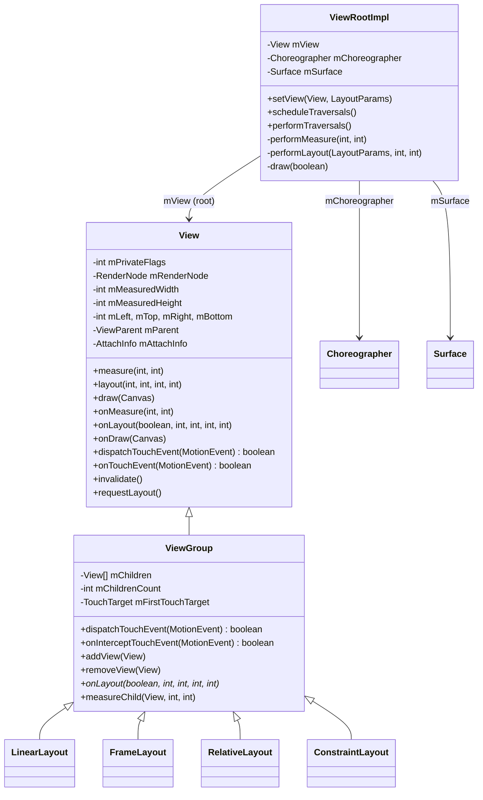

### 25.1.3 窗口与 View 的关系

Android 中每个窗口恰好对应一个 `ViewRootImpl` 实例。当调用 `WindowManagerImpl.addView()` 时（例如 Activity 的 `DecorView` 首次显示时），会执行如下调用链：

```
WindowManagerImpl.addView(decorView, layoutParams)
  -> WindowManagerGlobal.addView()
       -> new ViewRootImpl(context, display)
       -> viewRootImpl.setView(decorView, layoutParams, panelParent)
```

在 `ViewRootImpl.setView()` 内部（第 1649 行）：

```
Source: frameworks/base/core/java/android/view/ViewRootImpl.java

    public void setView(View view, WindowManager.LayoutParams attrs,
            View panelParentView, int userId) {
        checkThreadCompat();
        synchronized (this) {
            if (mView == null) {
                mView = view;
                ...
                // Schedule the first layout -before- adding to the window
                // manager, to make sure we do the relayout before receiving
                // any other events from the system.
                requestLayout();
                InputChannel inputChannel = null;
                if ((mWindowAttributes.inputFeatures
                        & WindowManager.LayoutParams.INPUT_FEATURE_NO_INPUT_CHANNEL) == 0) {
                    inputChannel = new InputChannel();
                }
                ...
```

这段代码的要点：

- `ViewRootImpl` 将根视图存储在 `mView` 中。
- `requestLayout()` 在窗口添加到服务端*之前*被调用，因此第一次测量/布局遍历发生在任何输入事件到达之前。
- 创建了一个 `InputChannel`，用于接收来自 system_server 中运行的 `InputDispatcher` 的输入事件。

### 25.1.4 AttachInfo 结构

当一个 `View` 附加到窗口时，它会收到一个 `AttachInfo` 对象，其中包含树中每个视图共享的、按窗口维护的状态：

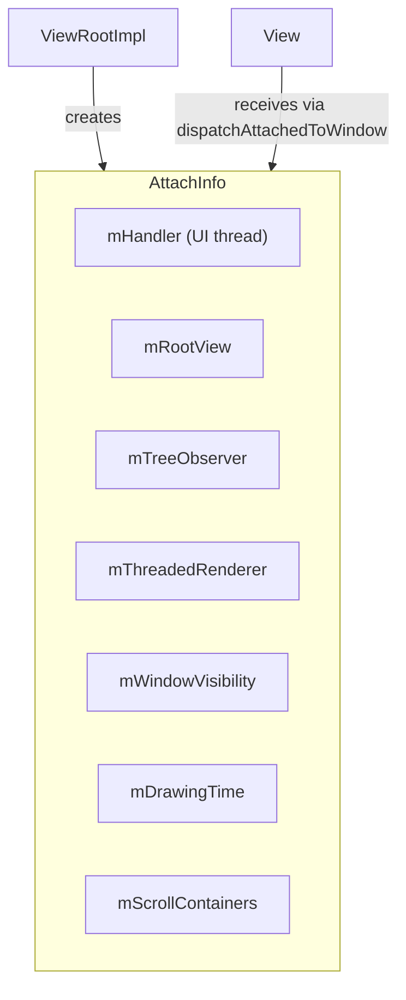

层级中的每个视图都持有这个唯一 `AttachInfo` 的引用。它让视图能够访问用于发送消息的 handler，以及用于硬件加速的渲染器。它还提供对窗口可见性状态和用于布局变化回调的树观察者的访问。

### 25.1.5 View 标识与 View 树

每个视图都有一个数字 ID（在 XML 中通过 `android:id` 设置，或在代码中通过 `setId()` 设置）和一个可选的临时名称。`findViewById()` 方法在视图树中执行深度优先搜索，按 ID 定位视图：

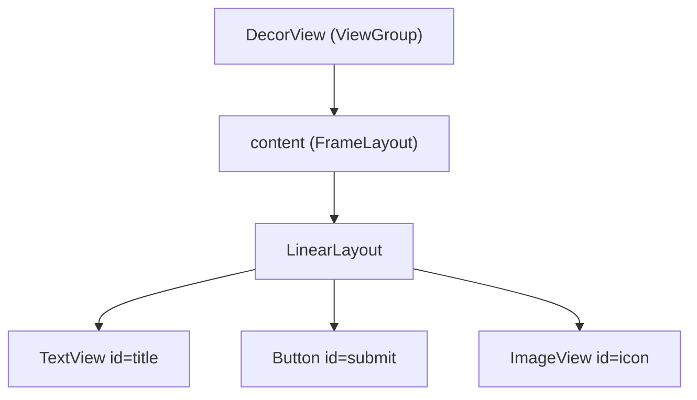

该树以数组形式存储在每个 `ViewGroup` 内部：

```
Source: frameworks/base/core/java/android/view/ViewGroup.java

    private View[] mChildren;
    private int mChildrenCount;
```

子视图按数组顺序绘制（索引 0 最先绘制，位于后续子视图之下），不过 `getChildDrawingOrder()` 可以自定义这一顺序。

### 25.1.6 Private Flags：内部状态机

`View` 通过存储在 `mPrivateFlags`、`mPrivateFlags2`、`mPrivateFlags3` 和 `mPrivateFlags4` 中的一组私有标志位掩码来维护自身状态。这些标志控制着视图生命周期的几乎每一个方面：

| 标志 | 字段 | 十六进制 | 含义 |
|------|-------|------|------|
| `PFLAG_WANTS_FOCUS` | mPrivateFlags | `0x00000001` | 视图在布局期间请求了焦点 |
| `PFLAG_FOCUSED` | mPrivateFlags | `0x00000002` | 视图当前持有焦点 |
| `PFLAG_SELECTED` | mPrivateFlags | `0x00000004` | 视图处于选中状态 |
| `PFLAG_HAS_BOUNDS` | mPrivateFlags | `0x00000010` | 视图已分配边界 |
| `PFLAG_DRAWN` | mPrivateFlags | `0x00000020` | 视图至少已被绘制过一次 |
| `PFLAG_DRAW_ANIMATION` | mPrivateFlags | `0x00000040` | 视图正在播放动画 |
| `PFLAG_SKIP_DRAW` | mPrivateFlags | `0x00000080` | 视图没有绘制内容 |
| `PFLAG_REQUEST_TRANSPARENT_REGIONS` | mPrivateFlags | `0x00000200` | 请求透明区域 |
| `PFLAG_DRAWABLE_STATE_DIRTY` | mPrivateFlags | `0x00000400` | Drawable 状态需要刷新 |
| `PFLAG_MEASURED_DIMENSION_SET` | mPrivateFlags | `0x00000800` | 已调用 setMeasuredDimension() |
| `PFLAG_FORCE_LAYOUT` | mPrivateFlags | `0x00001000` | 强制下一次测量/布局 |
| `PFLAG_LAYOUT_REQUIRED` | mPrivateFlags | `0x00002000` | 测量后需要布局 |
| `PFLAG_PRESSED` | mPrivateFlags | `0x00004000` | 视图处于按下状态（触摸按下） |
| `PFLAG_DRAWING_CACHE_VALID` | mPrivateFlags | `0x00008000` | 绘制缓存有效 |
| `PFLAG_DIRTY` | mPrivateFlags | `0x00200000` | 视图需要重绘 |
| `PFLAG_INVALIDATED` | mPrivateFlags | `0x80000000` | 视图已被失效 |
| `PFLAG_PREPRESSED` | mPrivateFlags | `0x02000000` | 预按下状态（点击延迟） |

单个帧内这些标志的生命周期：

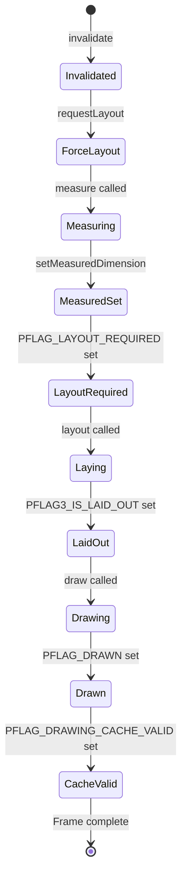

理解这些标志对调试至关重要——当一个视图拒绝绘制时，这些标志会揭示它在流水线中的确切卡点。`View.toString()` 方法输出一种紧凑表示：

```
// Example output from View.toString() debug mode:
// V.E..... ........ 0,0-1080,1920 #7f080001 android:id/content
// | | flags: V=VISIBLE, E=ENABLED, F=FOCUSED, etc.
```

### 25.1.7 View 坐标系

视图使用多种容易混淆的坐标系：

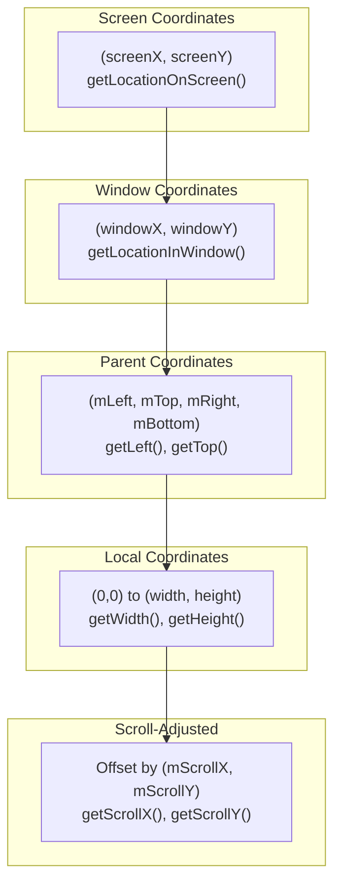

| 坐标系 | 原点 | 使用方 |
|-------------------|--------|------|
| Screen（屏幕） | 物理显示屏左上角 | `getLocationOnScreen()`、无障碍 |
| Window（窗口） | 窗口表面左上角 | `getLocationInWindow()`、触摸事件 |
| Parent（父级） | 视图在父级中的位置 | `mLeft`、`mTop`、`getX()`、`getY()` |
| Local（本地） | 视图内容区左上角 | `onDraw()`、`onTouchEvent()` |
| Scroll（滚动） | 按滚动位置偏移 | `onDraw()` 中的 Canvas |

`getX()` 和 `getY()` 返回包含平移的视觉位置：`getX() = mLeft + getTranslationX()`。这对正在播放动画的视图很重要——`getLeft()` 返回布局位置，而 `getX()` 返回实际的视觉位置。

### 25.1.8 ViewTreeObserver

每个视图层级都有一个 `ViewTreeObserver`，它为全局布局事件提供回调：

| 回调 | 触发时机 |
|----------|------------|
| `OnGlobalLayoutListener` | 布局遍历完成后 |
| `OnPreDrawListener` | 绘制前一刻；可以取消本次绘制 |
| `OnDrawListener` | 每次绘制遍历期间 |
| `OnScrollChangedListener` | 任意视图滚动时 |
| `OnGlobalFocusChangeListener` | 焦点在视图之间移动时 |
| `OnWindowAttachListener` | 视图树附加/脱离窗口时 |
| `OnWindowFocusChangeListener` | 窗口获得/失去焦点时 |
| `OnTouchModeChangeListener` | 触摸模式变化时 |

`OnGlobalLayoutListener` 常用于在视图完成布局后测量视图，因为 `getWidth()` / `getHeight()` 在布局前返回 0：

```java
view.getViewTreeObserver().addOnGlobalLayoutListener(
    new ViewTreeObserver.OnGlobalLayoutListener() {
        @Override
        public void onGlobalLayout() {
            // View has been measured and laid out
            int width = view.getWidth();
            int height = view.getHeight();
            // Remove listener to avoid repeated calls
            view.getViewTreeObserver()
                .removeOnGlobalLayoutListener(this);
        }
    });
```

---

## 25.2 测量-布局-绘制循环

Android 视图系统的核心渲染循环是**测量-布局-绘制**循环，由 `ViewRootImpl.performTraversals()` 驱动。当 UI 需要更新时，该方法每帧调用一次，由 `Choreographer` 在下一个 VSYNC 时触发。

### 25.2.1 三个阶段

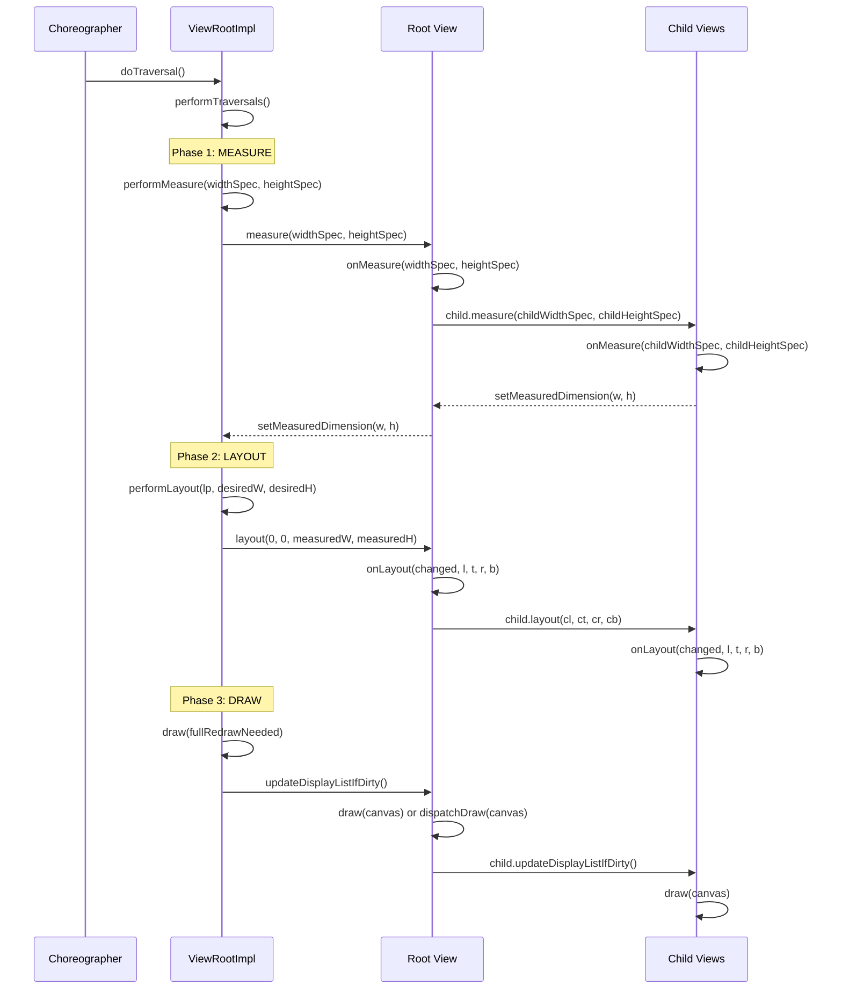

### 25.2.2 MeasureSpec：约束协议

测量系统通过 `MeasureSpec` 在父级与子级之间传递约束。它是一个打包的 32 位整数，将**模式**和**尺寸**编码在同一个 `int` 中：

```
Source: frameworks/base/core/java/android/view/View.java (line 31989)

    public static class MeasureSpec {
        private static final int MODE_SHIFT = 30;
        private static final int MODE_MASK  = 0x3 << MODE_SHIFT;

        public static final int UNSPECIFIED = 0 << MODE_SHIFT;  // 0x00000000
        public static final int EXACTLY     = 1 << MODE_SHIFT;  // 0x40000000
        public static final int AT_MOST     = 2 << MODE_SHIFT;  // 0x80000000

        public static int makeMeasureSpec(int size, int mode) {
            return (size & ~MODE_MASK) | (mode & MODE_MASK);
        }

        public static int getMode(int measureSpec) {
            return (measureSpec & MODE_MASK);
        }

        public static int getSize(int measureSpec) {
            return (measureSpec & ~MODE_MASK);
        }
    }
```

三种模式及其含义：

| 模式 | 值 | 含义 | 触发方 |
|------|-------|------|-------------|
| `EXACTLY` | `0x40000000` | 子视图必须精确等于该尺寸 | `match_parent` 或显式 dp/px |
| `AT_MOST` | `0x80000000` | 子视图最大可以为该尺寸 | `wrap_content` |
| `UNSPECIFIED` | `0x00000000` | 无约束；由子视图决定 | ScrollView 测量其子视图时 |

高两位存储模式，其余 30 位存储尺寸。最大可测量维度为 2^30 - 1 = 1,073,741,823 像素。

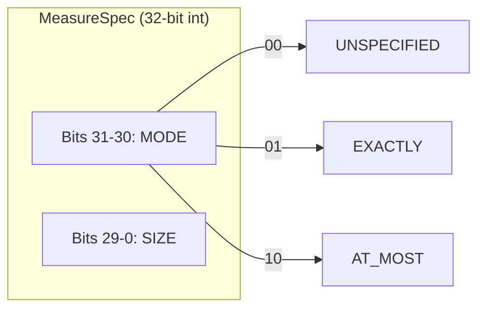

### 25.2.3 View.measure() —— 入口

`View.measure()` 声明为 `final`——子类不能覆盖它。子类改为覆盖 `onMeasure()`。`measure()` 方法处理：

1. **测量缓存**——一个以宽高 MeasureSpec 拼接结果为键的 `LongSparseLongArray`。如果之前使用过相同约束且视图没有被强制布局，则直接复用缓存的尺寸，而不调用 `onMeasure()`。

2. **强制布局标志**——无论缓存状态如何，`PFLAG_FORCE_LAYOUT` 都强制进行一次新的测量。

3. **光学边界**——针对具有光学内嵌（例如 9-patch 背景中的阴影）的视图的调整。

```
Source: frameworks/base/core/java/android/view/View.java (line 28787)

    public final void measure(int widthMeasureSpec, int heightMeasureSpec) {
        ...
        long key = (long) widthMeasureSpec << 32 |
                   (long) heightMeasureSpec & 0xffffffffL;
        if (mMeasureCache == null) mMeasureCache = new LongSparseLongArray(2);

        final boolean forceLayout =
            (mPrivateFlags & PFLAG_FORCE_LAYOUT) == PFLAG_FORCE_LAYOUT;
        ...
        if (forceLayout || needsLayout) {
            mPrivateFlags &= ~PFLAG_MEASURED_DIMENSION_SET;
            resolveRtlPropertiesIfNeeded();
            int cacheIndex = ...;
            if (cacheIndex < 0) {
                onMeasure(widthMeasureSpec, heightMeasureSpec);
            } else {
                long value = mMeasureCache.valueAt(cacheIndex);
                setMeasuredDimensionRaw((int)(value >> 32), (int)value);
            }
            // Verify setMeasuredDimension() was called
            if ((mPrivateFlags & PFLAG_MEASURED_DIMENSION_SET)
                    != PFLAG_MEASURED_DIMENSION_SET) {
                throw new IllegalStateException(
                    getClass().getName() + "#onMeasure() did not set the "
                    + "measured dimension by calling setMeasuredDimension()");
            }
            mPrivateFlags |= PFLAG_LAYOUT_REQUIRED;
        }
        ...
    }
```

约定是严格的：如果你覆盖了 `onMeasure()`，就**必须**调用 `setMeasuredDimension()`。未调用会抛出 `IllegalStateException`。

### 25.2.4 默认的 onMeasure()

基类 `View.onMeasure()` 只是取背景尺寸与最小尺寸中的较大者：

```
Source: frameworks/base/core/java/android/view/View.java (line 28917)

    protected void onMeasure(int widthMeasureSpec, int heightMeasureSpec) {
        setMeasuredDimension(
            getDefaultSize(getSuggestedMinimumWidth(), widthMeasureSpec),
            getDefaultSize(getSuggestedMinimumHeight(), heightMeasureSpec));
    }
```

`getDefaultSize()` 对 EXACTLY 和 AT_MOST 返回规格尺寸，对 UNSPECIFIED 返回建议最小值。这就是为什么一个裸的自定义 `View` 在 `wrap_content` 下会填满父级，除非覆盖 `onMeasure()`。

### 25.2.5 ViewGroup 测量

`ViewGroup` 并不直接覆盖 `onMeasure()`——它是抽象的。它改为向子类提供辅助方法：

- **`measureChild(child, parentWidthSpec, parentHeightSpec)`**——从父级规格减去内边距后生成子级规格，然后调用 `child.measure()`。
- **`measureChildWithMargins(child, parentWidthSpec, widthUsed, parentHeightSpec, heightUsed)`**——与 `measureChild` 类似，但还会考虑子级的外边距以及已被其他子级占用的空间。
- **`getChildMeasureSpec(parentSpec, padding, childDimension)`**——核心算法，将父级的约束与子级的 `LayoutParams` 尺寸结合起来，生成子级的 `MeasureSpec`。

规格组合表：

| 父级模式 | 子级 LayoutParams | 结果模式 | 结果尺寸 |
|-------------|-------------------|-------------|-------------|
| EXACTLY | exact dp | EXACTLY | 子级尺寸 |
| EXACTLY | match_parent | EXACTLY | 父级尺寸 - 内边距 |
| EXACTLY | wrap_content | AT_MOST | 父级尺寸 - 内边距 |
| AT_MOST | exact dp | EXACTLY | 子级尺寸 |
| AT_MOST | match_parent | AT_MOST | 父级尺寸 - 内边距 |
| AT_MOST | wrap_content | AT_MOST | 父级尺寸 - 内边距 |
| UNSPECIFIED | exact dp | EXACTLY | 子级尺寸 |
| UNSPECIFIED | match_parent | UNSPECIFIED | 父级尺寸 - 内边距 |
| UNSPECIFIED | wrap_content | UNSPECIFIED | 父级尺寸 - 内边距 |

### 25.2.6 View.layout() —— 定位

测量完成后，`performLayout()` 将根视图定位在 (0, 0)：

```
Source: frameworks/base/core/java/android/view/ViewRootImpl.java (line 5554)

    host.layout(0, 0, host.getMeasuredWidth(), host.getMeasuredHeight());
```

`View.layout()`（第 26040 行）存储位置并调用 `onLayout()`：

```
Source: frameworks/base/core/java/android/view/View.java

    public void layout(int l, int t, int r, int b) {
        if ((mPrivateFlags3 & PFLAG3_MEASURE_NEEDED_BEFORE_LAYOUT) != 0) {
            onMeasure(mOldWidthMeasureSpec, mOldHeightMeasureSpec);
            mPrivateFlags3 &= ~PFLAG3_MEASURE_NEEDED_BEFORE_LAYOUT;
        }

        int oldL = mLeft;
        int oldT = mTop;
        int oldB = mBottom;
        int oldR = mRight;

        boolean changed = isLayoutModeOptical(mParent) ?
                setOpticalFrame(l, t, r, b) : setFrame(l, t, r, b);

        if (changed || (mPrivateFlags & PFLAG_LAYOUT_REQUIRED)
                == PFLAG_LAYOUT_REQUIRED) {
            onLayout(changed, l, t, r, b);
            ...
            // Notify OnLayoutChangeListeners
            if (li != null && li.mOnLayoutChangeListeners != null) {
                for (OnLayoutChangeListener listener : listenersCopy) {
                    listener.onLayoutChange(this, l, t, r, b,
                                            oldL, oldT, oldR, oldB);
                }
            }
        }
        mPrivateFlags &= ~PFLAG_FORCE_LAYOUT;
        mPrivateFlags3 |= PFLAG3_IS_LAID_OUT;
    }
```

注意重新测量的保护逻辑：如果视图是从测量缓存中读取的（`PFLAG3_MEASURE_NEEDED_BEFORE_LAYOUT`），`onMeasure()` 会在布局前再次调用，以确保得到新鲜的测量结果。

### 25.2.7 View.draw() —— 七个步骤

`View.draw()`（第 25493 行）按精确定义的顺序执行绘制：

```
Source: frameworks/base/core/java/android/view/View.java

    public void draw(@NonNull Canvas canvas) {
        /*
         * Draw traversal performs several drawing steps which must
         * be executed in the appropriate order:
         *
         *      1. Draw the background
         *      2. If necessary, save the canvas' layers to prepare
         *         for fading
         *      3. Draw view's content
         *      4. Draw children
         *      5. If necessary, draw the fading edges and restore layers
         *      6. Draw decorations (scrollbars for instance)
         *      7. If necessary, draw the default focus highlight
         */

        drawBackground(canvas);         // Step 1
        ...
        onDraw(canvas);                 // Step 3
        dispatchDraw(canvas);           // Step 4
        ...
        onDrawForeground(canvas);       // Step 6
        drawDefaultFocusHighlight(canvas); // Step 7
    }
```

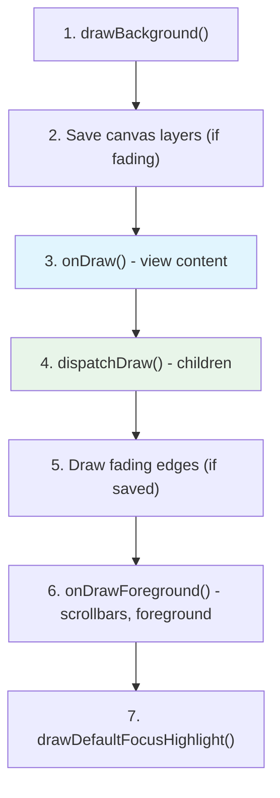

对 `ViewGroup` 而言，`dispatchDraw()` 遍历子视图并对每个子视图调用 `drawChild()`，后者进而调用 `child.draw(canvas, this, ...)`。

### 25.2.8 PFLAG_SKIP_DRAW 优化

许多 `ViewGroup` 子类（如 `LinearLayout`、`FrameLayout`）自身没有任何自定义绘制——它们只是包含子视图。当一个 `ViewGroup` 没有背景、没有前景也没有自定义绘制时，框架会设置 `PFLAG_SKIP_DRAW`，而 `updateDisplayListIfDirty()` 会完全绕过 `draw()`，直接调用 `dispatchDraw()`：

```
Source: frameworks/base/core/java/android/view/View.java (line 24358, in updateDisplayListIfDirty())

    if ((mPrivateFlags & PFLAG_SKIP_DRAW) == PFLAG_SKIP_DRAW) {
        dispatchDraw(canvas);
        drawAutofilledHighlight(canvas);
        if (mOverlay != null && !mOverlay.isEmpty()) {
            mOverlay.getOverlayView().draw(canvas);
        }
    } else {
        draw(canvas);
    }
```

这一优化意义重大：在典型的深层视图层级中，许多中间 `ViewGroup` 节点会跳过大部分绘制流水线。

### 25.2.9 requestLayout() 和 invalidate()

两个方法会触发重新渲染，但它们的用途不同：

**`requestLayout()`**——表示视图的尺寸或位置可能已改变。它沿父链向上遍历，在每个祖先上设置 `PFLAG_FORCE_LAYOUT`，直到到达 `ViewRootImpl`，后者调用 `scheduleTraversals()`。这会触发完整的测量-布局-绘制循环。

```
Source: frameworks/base/core/java/android/view/View.java (line 28723)

    public void requestLayout() {
        if (mMeasureCache != null) mMeasureCache.clear();
        ...
        // If this view is currently requesting layout while a layout pass is
        // running, route the request through ViewRootImpl so it can be deferred.
        ...
        mPrivateFlags |= PFLAG_FORCE_LAYOUT;
        mPrivateFlags |= PFLAG_INVALIDATED;

        if (mParent != null && !mParent.isLayoutRequested()) {
            mParent.requestLayout();
        }
    }
```

沿父链向上传播并进入完整测量-布局-绘制循环的过程：

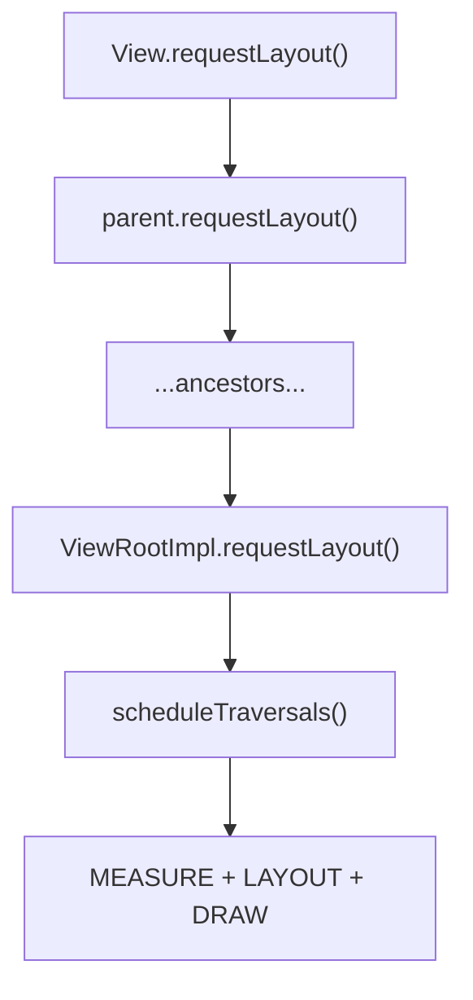

**`invalidate()`**——表示视图的外观已改变，但尺寸和位置没有改变。它将一个脏矩形向上传播到 `ViewRootImpl`，只触发一次绘制遍历（不进行测量或布局）。

```
Source: frameworks/base/core/java/android/view/View.java (line 21431, 21453)

    public void invalidate() {
        invalidate(true);
    }

    void invalidateInternal(int l, int t, int r, int b,
            boolean invalidateCache, boolean fullInvalidate) {
        ...
        mPrivateFlags |= PFLAG_DIRTY;
        if (invalidateCache) {
            mPrivateFlags |= PFLAG_INVALIDATED;
            mPrivateFlags &= ~PFLAG_DRAWING_CACHE_VALID;
        }
        // Propagate the damage rectangle to the parent view.
        final ViewParent p = mParent;
        if (p != null && ai != null && l < r && t < b) {
            final Rect damage = ai.mTmpInvalRect;
            damage.set(l, t, r, b);
            p.invalidateChild(this, damage);
        }
    }
```

损伤矩形向上传播到 `ViewRootImpl`，触发仅绘制的遍历：

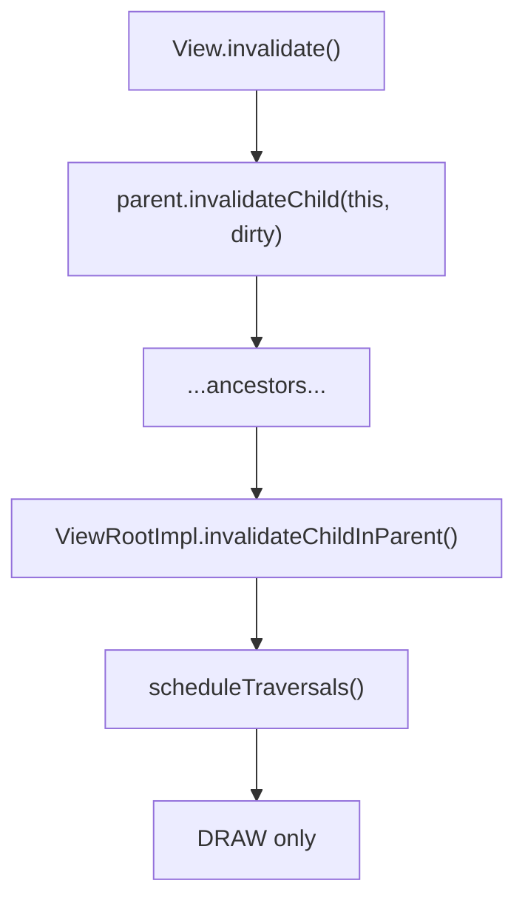

### 25.2.10 performTraversals() —— 编排器

`ViewRootImpl.performTraversals()`（第 3924 行）是视图系统中最大的单一方法，跨越数百行。它编排整个渲染流水线。在 Android 17 中，它接收帧的 VSYNC 时间戳（`performTraversals(long frameTimeNanos)`）。这让动画、Choreographer 和帧率投票工作可以绑定到单一一致的帧时间：

```
Source: frameworks/base/core/java/android/view/ViewRootImpl.java

    private void performTraversals(long frameTimeNanos) {
        final View host = mView;
        if (host == null || !mAdded) return;
        ...
        mIsInTraversal = true;
        mWillDrawSoon = true;
        ...
        // Phase 0: Determine desired window size
        if (mFirst) {
            desiredWindowWidth = ...;  // From display or frame
            desiredWindowHeight = ...;
            host.dispatchAttachedToWindow(mAttachInfo, 0);
            dispatchApplyInsets(host);
        }
        ...
        // Phase 1: MEASURE
        if (layoutRequested) {
            windowSizeMayChange |= measureHierarchy(host, lp,
                resources, desiredWindowWidth, desiredWindowHeight, ...);
        }
        ...
        // Phase 1.5: Relayout window if size changed
        if (windowShouldResize || ...) {
            relayoutResult = relayoutWindow(params, ...);
            ...
        }
        ...
        // Phase 2: LAYOUT
        if (didLayout) {
            performLayout(lp, desiredWindowWidth, desiredWindowHeight);
        }
        ...
        // Phase 3: DRAW
        if (!cancelAndRedraw) {
            ... // perform the draw
        }
        ...
        mIsInTraversal = false;
    }
```

关键的微妙之处在于 `performTraversals()` 可能调用 `measureHierarchy()` *两次*，且两次都在重新布局之前。第一次调用服务于待处理的布局请求。第二次调用在 `dispatchApplyInsets()` 之后，此时适配系统窗口触发了一次新的布局请求。在 `relayoutWindow()` 返回之后，任何重新测量都直接通过 `performMeasure()` 完成，这确保了视图在其最后一次测量时能看到最终的窗口尺寸。

### 25.2.11 performMeasure、performLayout 与 draw

这些是添加了跟踪信息的薄包装器：

```
Source: frameworks/base/core/java/android/view/ViewRootImpl.java (line 5472)

    private void performMeasure(int childWidthMeasureSpec,
            int childHeightMeasureSpec) {
        if (mView == null) return;
        Trace.traceBegin(Trace.TRACE_TAG_VIEW, "measure");
        try {
            mView.measure(childWidthMeasureSpec, childHeightMeasureSpec);
        } finally {
            Trace.traceEnd(Trace.TRACE_TAG_VIEW);
        }
        mMeasuredWidth = mView.getMeasuredWidth();
        mMeasuredHeight = mView.getMeasuredHeight();
    }
```

```
Source: frameworks/base/core/java/android/view/ViewRootImpl.java (line 5538)

    private void performLayout(WindowManager.LayoutParams lp,
            int desiredWindowWidth, int desiredWindowHeight) {
        mInLayout = true;
        final View host = mView;
        ...
        host.layout(0, 0, host.getMeasuredWidth(),
                          host.getMeasuredHeight());
        mInLayout = false;
        // Handle requestLayout() calls that occurred during layout
        int numViewsRequestingLayout = mLayoutRequesters.size();
        if (numViewsRequestingLayout > 0) {
            // Second pass for views that called requestLayout during layout
            ...
            host.layout(0, 0, host.getMeasuredWidth(),
                              host.getMeasuredHeight());
        }
    }
```

第二次布局遍历处理的是这样一种情况：视图在 `onLayout()` 期间调用了 `requestLayout()`。这会记录一条警告，但出于向后兼容的考虑仍被容忍。

---

## 25.3 触摸事件分发

Android 中的触摸分发机制是框架中最微妙的部分之一。理解它需要跟踪事件从 system_server 中的 `InputDispatcher` 经 `ViewRootImpl` 到达最深层的子视图的全过程。

### 25.3.1 MotionEvent 剖析

在追踪分发链之前，我们必须先理解 `MotionEvent`——承载所有触摸信息的对象：

```
Source: frameworks/base/core/java/android/view/MotionEvent.java (line 199)

    public final class MotionEvent extends InputEvent implements Parcelable {
```

单个 `MotionEvent` 可以同时包含**多个指针**（手指）的数据。每个指针具有：

- **Pointer ID（指针 ID）**——触摸生命周期内稳定的标识符（在 MOVE 事件之间保持不变）。
- **Pointer Index（指针索引）**——在当前事件的指针数组中的位置（可能在事件之间变化）。
- **X, Y 坐标**——在接收视图的坐标空间中的位置。
- **Pressure、Size、Touch Major/Minor**——物理特征。
- **Tool Type（工具类型）**——`TOOL_TYPE_FINGER`、`TOOL_TYPE_STYLUS`、`TOOL_TYPE_MOUSE`、`TOOL_TYPE_ERASER` 或 `TOOL_TYPE_PALM`。

**Action codes（动作码）：**

| Action | Value | Meaning |
|--------|-------|---------|
| `ACTION_DOWN` | 0 | 第一根手指触摸屏幕 |
| `ACTION_UP` | 1 | 最后一根手指抬起 |
| `ACTION_MOVE` | 2 | 一根或多根手指移动 |
| `ACTION_CANCEL` | 3 | 手势被取消（例如被父级拦截） |
| `ACTION_OUTSIDE` | 4 | 触摸发生在窗口边界之外 |
| `ACTION_POINTER_DOWN` | 5 + (index &lt;&lt; 8) | 额外的手指按下 |
| `ACTION_POINTER_UP` | 6 + (index &lt;&lt; 8) | 非最后一根手指抬起 |
| `ACTION_HOVER_MOVE` | 7 | 指针未接触时移动 |
| `ACTION_HOVER_ENTER` | 9 | 指针进入视图边界 |
| `ACTION_HOVER_EXIT` | 10 | 指针离开视图边界 |

`ACTION_POINTER_DOWN` 和 `ACTION_POINTER_UP` 动作将指针索引编码在高 8 位中。使用 `getActionMasked()` 去除索引，使用 `getActionIndex()` 获取索引：

```java
int actionMasked = event.getActionMasked();  // e.g., ACTION_POINTER_DOWN
int pointerIndex = event.getActionIndex();   // e.g., 1
int pointerId = event.getPointerId(pointerIndex);  // Stable ID
```

**Batching（批处理）**：为了效率，VSYNC 帧之间的多个 `ACTION_MOVE` 采样被批量打包进一个 `MotionEvent`。最新坐标位于主事件中；历史采样可以通过以下方式访问：

```java
int historySize = event.getHistorySize();
for (int h = 0; h < historySize; h++) {
    float historicalX = event.getHistoricalX(h);
    float historicalY = event.getHistoricalY(h);
    long historicalTime = event.getHistoricalEventTime(h);
}
```

### 25.3.2 ViewConfiguration 触摸常量

`ViewConfiguration` 提供密度缩放的常量，控制整个框架中的触摸行为：

```
Source: frameworks/base/core/java/android/view/ViewConfiguration.java (line 50)
```

| 常量 | 默认值 | 用途 |
|----------|:------------:|---------|
| `TAP_TIMEOUT` | 100 ms | 确认点击（而非滚动）前的延迟 |
| `DOUBLE_TAP_TIMEOUT` | 300 ms | 双击事件之间的最大间隔 |
| `DOUBLE_TAP_MIN_TIME` | 40 ms | 最小间隔（过滤意外双击） |
| `DEFAULT_LONG_PRESS_TIMEOUT` | 400 ms | 长按触发前的持续时间 |
| `PRESSED_STATE_DURATION` | 64 ms | 按下视觉反馈的持续时间 |
| `DEFAULT_MULTI_PRESS_TIMEOUT` | 300 ms | 多按检测的间隔 |
| `DEFAULT_KEY_REPEAT_TIMEOUT_MS` | 400 ms | 按键开始重复前的延迟 |
| `DEFAULT_KEY_REPEAT_DELAY_MS` | 50 ms | 按键重复之间的间隔 |
| `SCROLL_BAR_FADE_DURATION` | 250 ms | 滚动条淡出动画时间 |
| `SCROLL_BAR_DEFAULT_DELAY` | 300 ms | 滚动条开始淡出前的延迟 |

缩放（密度相关）常量：

| 方法 | 默认值 (mdpi) | 用途 |
|--------|:--------------:|---------|
| `getScaledTouchSlop()` | 8 dp | 识别拖动前的最小移动距离 |
| `getScaledDoubleTapSlop()` | 100 dp | 双击事件之间的最大距离 |
| `getScaledMinimumFlingVelocity()` | 50 dp/s | 抛掷手势的最小速度 |
| `getScaledMaximumFlingVelocity()` | 8000 dp/s | 封顶后的最大抛掷速度 |
| `getScaledOverscrollDistance()` | 0 dp | 过度滚动距离 |
| `getScaledOverflingDistance()` | 6 dp | 过度抛掷距离 |
| `getScaledPagingTouchSlop()` | 16 dp | 翻页手势的 Slop 值 |

这些常量在 `View.onTouchEvent()`、`ScrollView.onInterceptTouchEvent()`、`RecyclerView`、`ViewPager` 等处被广泛使用，以使手势识别在不同屏幕密度下表现一致。

### 25.3.3 MotionEvent 之旅

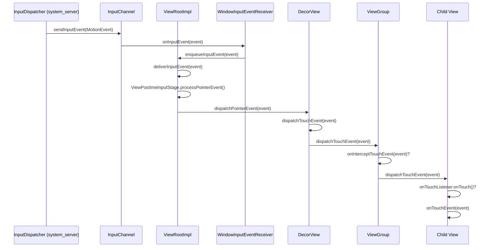

### 25.3.4 ViewRootImpl 输入流水线

`ViewRootImpl` 通过一串 **InputStage** 对象处理输入事件，每个对象负责不同类别：

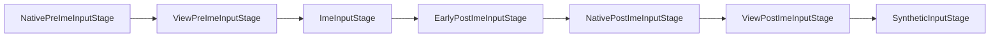

触摸事件流经 `ViewPostImeInputStage`，后者调用 `mView.dispatchPointerEvent(event)`，最终调用根视图的 `dispatchTouchEvent()`。

### 25.3.5 View.dispatchTouchEvent()

对叶子 `View` 对象而言，分发很直接：

```
Source: frameworks/base/core/java/android/view/View.java (line 16932)

    public boolean dispatchTouchEvent(MotionEvent event) {
        if (event.isTargetAccessibilityFocus()) {
            if (!isAccessibilityFocusedViewOrHost()) {
                return false;
            }
            event.setTargetAccessibilityFocus(false);
        }
        boolean result = false;
        ...
        if (onFilterTouchEventForSecurity(event)) {
            result = performOnTouchCallback(event);
        }
        ...
        return result;
    }
```

`performOnTouchCallback()` 实现了优先级链：

1. **滚动条拖动**——如果事件落在滚动条上，则处理它。
2. **`OnTouchListener.onTouch()`**——如果已设置且视图启用，则调用监听器。若它返回 `true`，事件即被消费。
3. **`onTouchEvent()`**——对点击、长按等的默认处理。

```
Source: frameworks/base/core/java/android/view/View.java (line 16978)

    private boolean performOnTouchCallback(MotionEvent event) {
        boolean handled = false;
        if ((mViewFlags & ENABLED_MASK) == ENABLED
                && handleScrollBarDragging(event)) {
            handled = true;
        }
        ListenerInfo li = mListenerInfo;
        if (li != null && li.mOnTouchListener != null
                && (mViewFlags & ENABLED_MASK) == ENABLED) {
            handled = li.mOnTouchListener.onTouch(this, event);
        }
        if (handled) return true;
        return onTouchEvent(event);
    }
```

### 25.3.6 ViewGroup.dispatchTouchEvent() —— 完整算法

`ViewGroup.dispatchTouchEvent()`（第 2756 行）实现了完整的触摸分发算法。这是 Android 中最关键的事件处理代码：

**Step 1：在 ACTION_DOWN 时重置**

```
Source: frameworks/base/core/java/android/view/ViewGroup.java

    if (actionMasked == MotionEvent.ACTION_DOWN) {
        cancelAndClearTouchTargets(ev);
        resetTouchState();
    }
```

每个新手势都从干净状态开始——旧的触摸目标被清除。

**Step 2：检查拦截**

```
    final boolean intercepted;
    if (actionMasked == MotionEvent.ACTION_DOWN
            || mFirstTouchTarget != null) {
        final boolean disallowIntercept =
            (mGroupFlags & FLAG_DISALLOW_INTERCEPT) != 0;
        if (!disallowIntercept) {
            intercepted = onInterceptTouchEvent(ev);
        } else {
            intercepted = false;
        }
    } else {
        // No touch targets and not a DOWN -- keep intercepting
        intercepted = true;
    }
```

拦截检查只在 `ACTION_DOWN` 时，或在已有子视图正在接收事件时运行。子视图可以调用 `parent.requestDisallowInterceptTouchEvent(true)` 来阻止父级拦截（例如，垂直 `ScrollView` 内的水平 `ViewPager`）。

**Step 3：查找触摸目标（在 DOWN 时）**

```
    if (!canceled && !intercepted) {
        if (actionMasked == MotionEvent.ACTION_DOWN
                || (split && actionMasked == MotionEvent.ACTION_POINTER_DOWN)
                || actionMasked == MotionEvent.ACTION_HOVER_MOVE) {
            ...
            // Scan children from front to back
            for (int i = childrenCount - 1; i >= 0; i--) {
                final View child = ...;
                if (!child.canReceivePointerEvents()
                        || !isTransformedTouchPointInView(x, y, child, null)) {
                    continue;
                }
                ...
                if (dispatchTransformedTouchEvent(ev, false, child, idBits)) {
                    // Child wants the touch -- add to touch targets
                    newTouchTarget = addTouchTarget(child, idBitsToAssign);
                    alreadyDispatchedToNewTouchTarget = true;
                    break;
                }
            }
        }
    }
```

子视图按**从前到后**的顺序扫描（Z 序最高者优先，即子视图数组中索引最大的）。第一个从 `dispatchTransformedTouchEvent()` 返回 `true` 的子视图成为触摸目标。

**Step 4：分发到触摸目标**

```
    if (mFirstTouchTarget == null) {
        // No child consumed it -- handle as ordinary view
        handled = dispatchTransformedTouchEvent(ev, canceled, null,
                TouchTarget.ALL_POINTER_IDS);
    } else {
        // Dispatch to existing touch targets
        TouchTarget target = mFirstTouchTarget;
        while (target != null) {
            final TouchTarget next = target.next;
            if (alreadyDispatchedToNewTouchTarget
                    && target == newTouchTarget) {
                handled = true;
            } else {
                final boolean cancelChild = ... || intercepted;
                if (dispatchTransformedTouchEvent(ev, cancelChild,
                        target.child, target.pointerIdBits)) {
                    handled = true;
                }
            }
            target = next;
        }
    }
```

`TouchTarget` 链表支持多点触控：不同的指针可以路由到不同的子视图。

### 25.3.7 完整分发流程

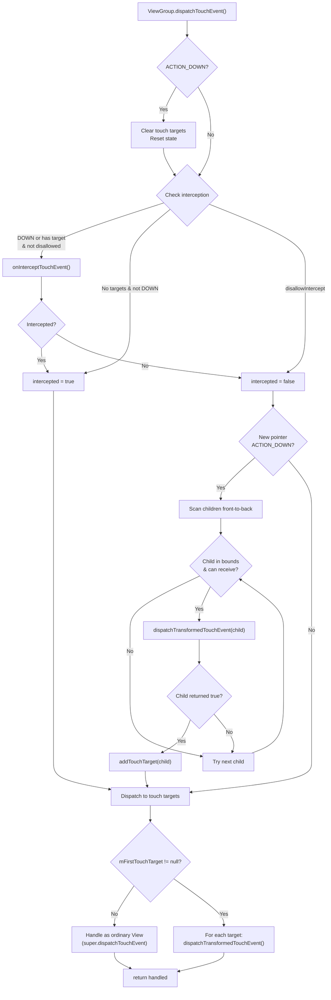

### 25.3.8 onInterceptTouchEvent()

默认的 `ViewGroup.onInterceptTouchEvent()` 几乎总是返回 `false`：

```
Source: frameworks/base/core/java/android/view/ViewGroup.java (line 3421)

    public boolean onInterceptTouchEvent(MotionEvent ev) {
        if (ev.isFromSource(InputDevice.SOURCE_MOUSE)
                && ev.getAction() == MotionEvent.ACTION_DOWN
                && ev.isButtonPressed(MotionEvent.BUTTON_PRIMARY)
                && isOnScrollbarThumb(ev.getXDispatchLocation(0),
                        ev.getYDispatchLocation(0))) {
            return true;
        }
        return false;
    }
```

`ScrollView` 和 `RecyclerView` 等滚动容器覆盖此方法以检测滚动手势，并从其子视图中拦截它们。

### 25.3.9 onTouchEvent() —— 点击与长按处理

`View.onTouchEvent()`（第 18447 行）实现了对点击、长按和触摸反馈的内置手势识别：

```
Source: frameworks/base/core/java/android/view/View.java

    public boolean onTouchEvent(MotionEvent event) {
        final boolean clickable = ((viewFlags & CLICKABLE) == CLICKABLE
                || (viewFlags & LONG_CLICKABLE) == LONG_CLICKABLE)
                || (viewFlags & CONTEXT_CLICKABLE) == CONTEXT_CLICKABLE;

        if ((viewFlags & ENABLED_MASK) == DISABLED) {
            // A disabled view still consumes events if clickable
            return clickable;
        }

        if (mTouchDelegate != null) {
            if (mTouchDelegate.onTouchEvent(event)) return true;
        }

        if (clickable || (viewFlags & TOOLTIP) == TOOLTIP) {
            switch (action) {
                case MotionEvent.ACTION_UP:
                    // Check for tap, schedule performClick()
                    if (!mHasPerformedLongPress && !mIgnoreNextUpEvent) {
                        removeLongPressCallback();
                        if (!focusTaken) {
                            if (mPerformClick == null) {
                                mPerformClick = new PerformClick();
                            }
                            if (!post(mPerformClick)) {
                                performClickInternal();
                            }
                        }
                    }
                    break;

                case MotionEvent.ACTION_DOWN:
                    // Start long-press detection
                    if (isInScrollingContainer) {
                        mPrivateFlags |= PFLAG_PREPRESSED;
                        // Delayed pressed feedback
                        postDelayed(mPendingCheckForTap,
                            getTapTimeoutMillis());
                    } else {
                        setPressed(true, x, y);
                        checkForLongClick(getLongPressTimeoutMillis(),
                            x, y, ...);
                    }
                    break;

                case MotionEvent.ACTION_CANCEL:
                    // Reset all state
                    ...
                    break;

                case MotionEvent.ACTION_MOVE:
                    // Check if still inside view bounds
                    ...
                    break;
            }
            return true;
        }
        return false;
    }
```

关键行为：

- **PREPRESSED** 状态：在滚动容器内部，按下视觉反馈被延迟 `ViewConfiguration.getTapTimeout()`（100ms），以区分点击与滚动开始。
- **长按**检测：一个 `CheckForLongPress` Runnable 以 `ViewConfiguration.getLongPressTimeout()` 被 post，其默认值为 `DEFAULT_LONG_PRESS_TIMEOUT = 400` 毫秒（可通过 `Settings.Secure.LONG_PRESS_TIMEOUT` 无障碍设置覆盖）。
- **点击**通过 `PerformClick` Runnable 被 post 而非直接调用，使得视图的视觉状态能在点击处理器运行前更新。

### 25.3.10 多点触控与指针拆分

当设置了 `FLAG_SPLIT_MOTION_EVENTS`（自 API 11 起为默认）时，`ViewGroup` 可以将不同的指针 ID 路由到不同的子视图。`TouchTarget` 链表按目标存储指针 ID 位掩码：

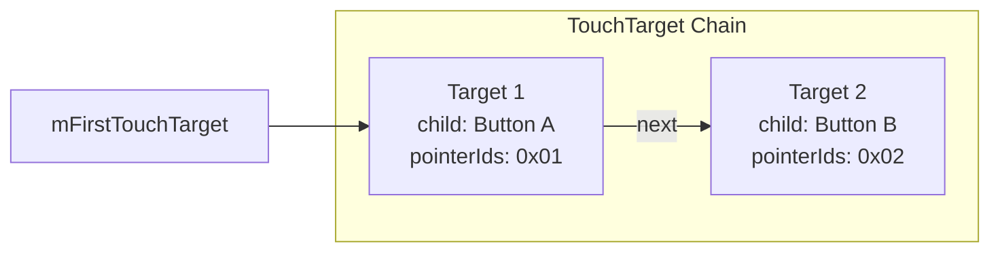

分发时，`dispatchTransformedTouchEvent()` 会拆分 `MotionEvent`，为每个目标子视图创建一个仅包含相关指针的新事件。

### 25.3.11 嵌套滚动

现代 Android 使用**嵌套滚动**协议在父级与子级之间协调滚动：

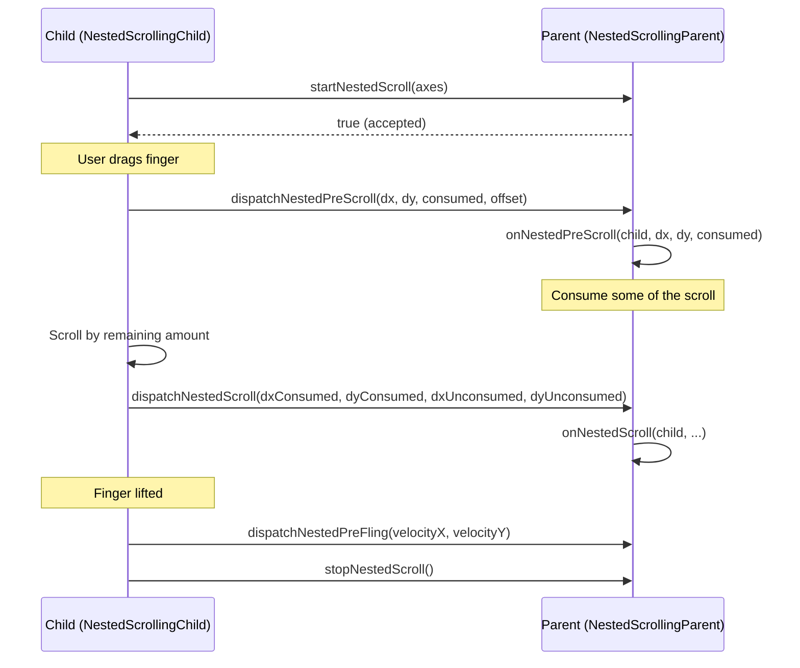

该协议允许，例如，`CoordinatorLayout` 内部的 `RecyclerView` 与折叠式工具栏共享滚动。

---

## 25.4 ViewRootImpl：通往 WMS 的桥

`ViewRootImpl` 是客户端视图系统中最重要的类。它实现了 `ViewParent`，作为视图层级的最终父级，并通过 Binder 接口与 WindowManagerService 通信。

### 25.4.1 生命周期

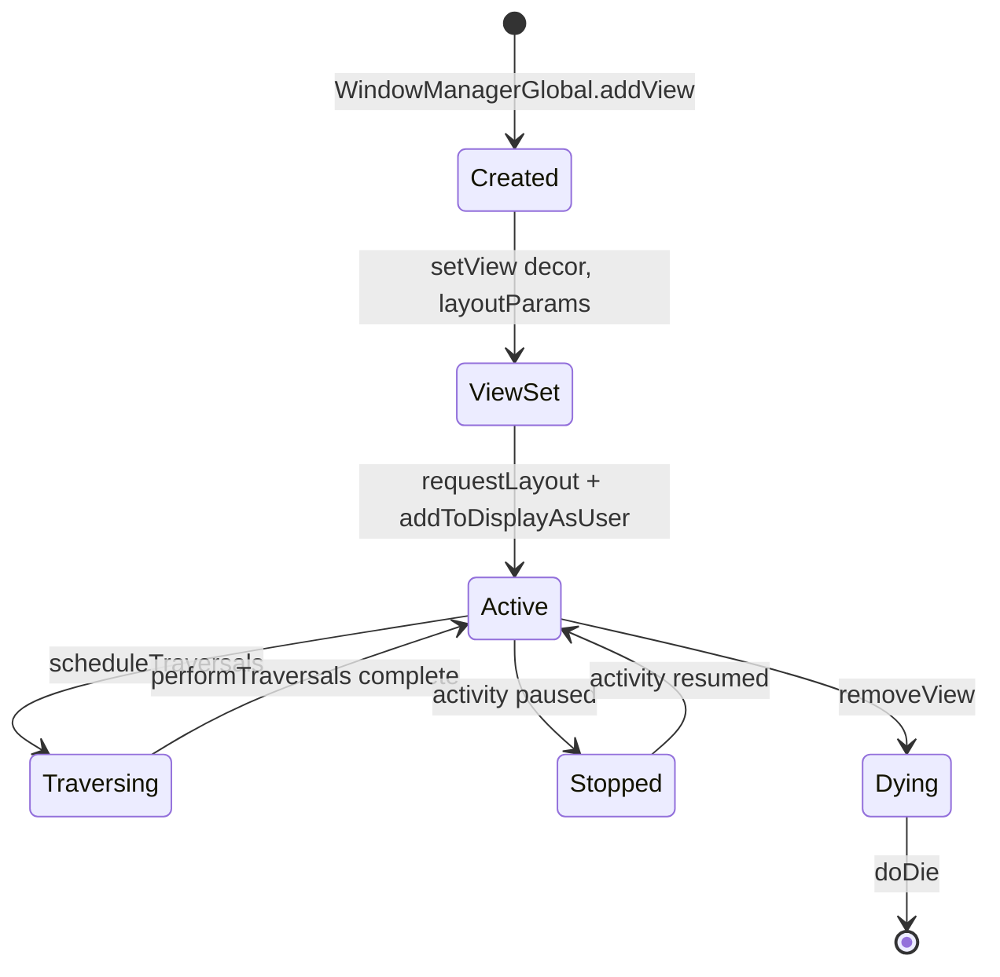

### 25.4.2 scheduleTraversals() 与 Choreographer

`scheduleTraversals()` 是通往渲染流水线的入口：

```
Source: frameworks/base/core/java/android/view/ViewRootImpl.java (line 3307)

    void scheduleTraversals() {
        checkThreadCompat();
        if (!mTraversalScheduled) {
            mTraversalScheduled = true;
            // ...
            postTraversalBarrier();
            mChoreographer.postVsyncCallback(
                    Choreographer.CALLBACK_TRAVERSAL, mTraversalCallback);
            notifyRendererOfFramePending();
            pokeDrawLockIfNeeded();
        }
    }
```

这里发生三个关键动作：

1. **同步屏障**——`postTraversalBarrier()`（第 3355 行）调用 `mQueue.postSyncBarrier()`，在 `MessageQueue` 中插入一个屏障，阻止同步消息运行。只有异步消息（如 VSYNC 回调）才能继续。这确保遍历发生在任何其他 handler 消息之前。

2. **Choreographer 回调**——遍历以 `CALLBACK_TRAVERSAL` 类型被 post，它在 Choreographer 的帧处理中于输入和动画回调之后运行。

3. **渲染器通知**——`notifyRendererOfFramePending()` 告知 HWUI 即将有帧到来，使其可以提前准备。

### 25.4.3 Choreographer 帧处理

`Choreographer` 通过五种回调类型协调所有与帧相关的工作，并按严格顺序执行：

```
Source: frameworks/base/core/java/android/view/Choreographer.java (line 1201)

    mFrameInfo.markInputHandlingStart();
    doCallbacks(Choreographer.CALLBACK_INPUT);

    mFrameInfo.markAnimationsStart();
    doCallbacks(Choreographer.CALLBACK_ANIMATION);
    doCallbacks(Choreographer.CALLBACK_INSETS_ANIMATION);

    mFrameInfo.markPerformTraversalsStart();
    doCallbacks(Choreographer.CALLBACK_TRAVERSAL);

    doCallbacks(Choreographer.CALLBACK_COMMIT);
```

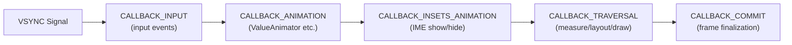

| 回调类型 | 值 | 用途 |
|---------------|-------|---------|
| `CALLBACK_INPUT` | 0 | 处理待处理的输入事件 |
| `CALLBACK_ANIMATION` | 1 | 运行 `ValueAnimator` 帧更新 |
| `CALLBACK_INSETS_ANIMATION` | 2 | 内嵌动画更新（如 IME 过渡） |
| `CALLBACK_TRAVERSAL` | 3 | `performTraversals()`——测量、布局、绘制 |
| `CALLBACK_COMMIT` | 4 | 帧提交；抖动校正 |

顺序很重要：输入最先处理，因此动画和遍历能反映最新的用户交互。

### 25.4.4 doTraversal() 桥接

当 Choreographer 触发 `CALLBACK_TRAVERSAL` 时，它会调用 `mTraversalCallback`：

```
Source: frameworks/base/core/java/android/view/ViewRootImpl.java (line 3347)

    void doTraversal(long frameTimeNanos) {
        if (mTraversalScheduled) {
            mTraversalScheduled = false;
            removeTraversalBarrier();
            performTraversals(frameTimeNanos);
        }
    }
```

在 Android 17 中，`doTraversal()` 携带由 `Choreographer` 提供的 VSYNC 帧时间（从帧数据中提取）。它将该时间转发给 `performTraversals(long)`。正因如此，整个遍历——包括帧率投票——都基于单一、一致的帧时间戳工作。

同步屏障在 `performTraversals()` 运行*之前*被移除，使得遍历完成后正常消息可以继续处理。

### 25.4.5 窗口重新布局

在 `performTraversals()` 期间，如果窗口尺寸发生变化，ViewRootImpl 会调用 `relayoutWindow()`，这是一次到 `WindowManagerService` 的 Binder 调用：

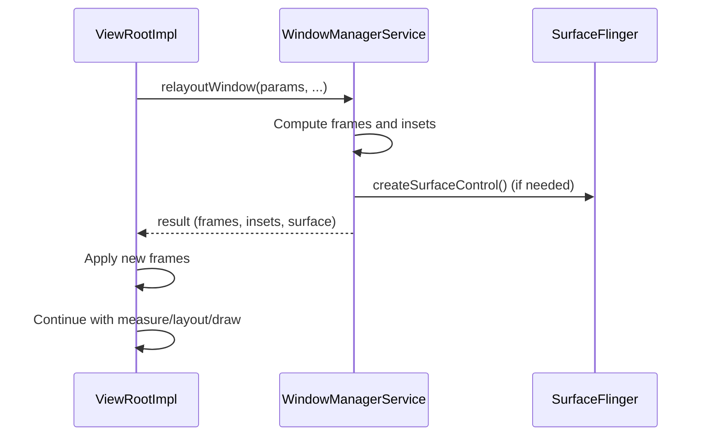

结果包含新的窗口矩形、insets，以及如果窗口是新建或重建时可能的一个新 `Surface`。

### 25.4.6 布局期间的 requestLayout

`ViewRootImpl` 处理在一次进行中的布局遍历期间调用 `requestLayout()` 的病态情况：

```
Source: frameworks/base/core/java/android/view/ViewRootImpl.java (line 5519)

    boolean requestLayoutDuringLayout(final View view) {
        if (!mLayoutRequesters.contains(view)) {
            mLayoutRequesters.add(view);
        }
        if (!mHandlingLayoutInLayoutRequest) {
            return true;  // First pass: let it proceed
        } else {
            return false;  // Second pass: post to next frame
        }
    }
```

在 `performLayout()` 中，第一次 `host.layout()` 调用之后，任何在布局期间调用了 `requestLayout()` 的视图都会被收集起来，并触发**第二次布局遍历**。如果任何视图在第二次遍历期间*仍然*请求布局，它们的请求会被 post 到下一帧，以防止无限循环。

### 25.4.7 输入事件交付流水线详解

`ViewRootImpl` 中的输入流水线值得更深入的考察。当输入事件从 `InputDispatcher` 到达时，它会穿过一串 `InputStage` 对象。每个阶段可以：

1. **Forward（转发）**事件到下一阶段。
2. **Finish（终结）**事件（标记为已处理）。

这些阶段在 `setView()` 中被构建：

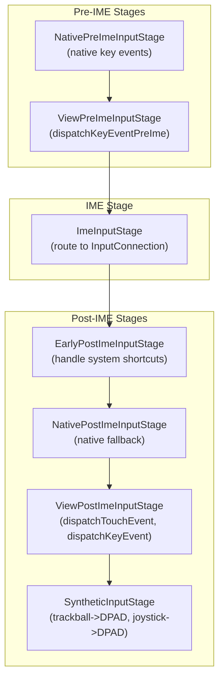

对于触摸事件，`ViewPostImeInputStage` 是关键阶段。它的 `processPointerEvent()` 方法调用：

1. `mView.dispatchPointerEvent(event)`——分发到视图层级。
2. `maybeUpdatePointerIcon()` 和 `maybeUpdateTooltip()`——为新的指针位置刷新鼠标指针图标和任何悬停提示。
3. 如果某个视图在分发期间请求了无缓冲输入（`mAttachInfo.mUnbufferedDispatchRequested`），则通过 `scheduleConsumeBatchedInputImmediately()` 切换到无缓冲输入分发。它还会对已处理的事件应用可变刷新率触摸增强。

对于按键事件，该流水线允许 IME 在视图层级看到按键之前消费它们。这就是为什么在 `EditText` 中输入不会触发 `Activity` 上的 `onKeyDown()`——IME 阶段会先拦截按键。

### 25.4.8 同步屏障机制

同步屏障是一个微妙但承担关键负载的机制。以下是详细时间线：

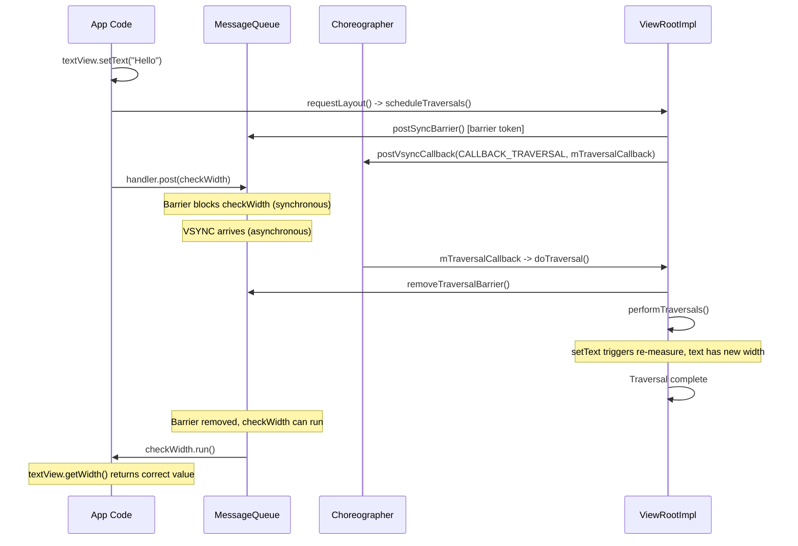

这保证了在 `scheduleTraversals()` *之后* post 到 handler 的任何 `Runnable` 都会在遍历完成后*执行*。AOSP 源码在 `scheduleTraversals()` 内部（约第 3315 行）有一条注释，明确称这一行为对“公共 API 的正确性承担关键负载”。该注释包含一个 `textView.setText(...)` / `getHandler().post(...)` 的完整示例，演示了这一契约。

### 25.4.9 帧率投票

`ViewRootImpl` 参与可变刷新率（VRR）和自适应刷新率（ARR）显示屏的帧率投票。Android 17 对此做了大幅扩展（见第 25.13 节）。应用可以通过公共 API `View.setRequestedFrameRate(float)` 提示其期望的刷新率：

```
Source: frameworks/base/core/java/android/view/View.java (line 35127)

    public void setRequestedFrameRate(float frameRate) { ... }
```

```java
// Request a specific high frame rate (a positive value is treated as Hz)
view.setRequestedFrameRate(120f);

// Or vote by category using the float sentinels on View:
view.setRequestedFrameRate(View.REQUESTED_FRAME_RATE_CATEGORY_HIGH);

// Reset to "no opinion" (the default)
view.setRequestedFrameRate(View.REQUESTED_FRAME_RATE_CATEGORY_DEFAULT);
```

`View` 侧的类别常量是*负浮点哨兵值*，与投票最终解析成的*整数* `Surface.FRAME_RATE_CATEGORY_*` 值不同：

```
Source: frameworks/base/core/java/android/view/View.java (line 5958)

    public static final float REQUESTED_FRAME_RATE_CATEGORY_DEFAULT       = Float.NaN;
    public static final float REQUESTED_FRAME_RATE_CATEGORY_NO_PREFERENCE  = -1;
    public static final float REQUESTED_FRAME_RATE_CATEGORY_LOW           = -2;
    public static final float REQUESTED_FRAME_RATE_CATEGORY_NORMAL        = -3;
    public static final float REQUESTED_FRAME_RATE_CATEGORY_HIGH          = -4;
```

在 `performTraversals()` 期间，`ViewRootImpl` 将逐视图投票汇总为 `mPreferredFrameRateCategory` / `mPreferredFrameRate`（在 `ViewRootImpl.java` 约第 1228 行声明的字段）。在向 SurfaceFlinger 报告之前，它会将它们解析为以下某个 `Surface` 整数类别：

| `Surface` 类别 | 值 | 典型用途 |
|--------------------|-------|-------------|
| `FRAME_RATE_CATEGORY_NO_PREFERENCE` | 1 | 无偏好 |
| `FRAME_RATE_CATEGORY_LOW` | 2 | 静态内容、时钟小组件 |
| `FRAME_RATE_CATEGORY_NORMAL` | 3 | 一般 UI 交互 |
| `FRAME_RATE_CATEGORY_HIGH_HINT` | 4 | 提示偏向高（中间档） |
| `FRAME_RATE_CATEGORY_HIGH` | 5 | 活跃滚动、动画 |

这些整数值定义在 `frameworks/base/core/java/android/view/Surface.java`（第 315-346 行）。该机制在屏幕内容静止时降低刷新率以减少功耗，同时在滚动和动画时仍能提升刷新率。

---

## 25.5 硬件加速：RenderNode 与 HWUI

自 Android 3.0 起（自 4.0 起对大多数窗口强制启用），Android 通过 **HWUI** 库（用 C++ 编写于 `frameworks/base/libs/hwui/`）使用**硬件加速渲染**。Java 侧的 API 围绕 `RenderNode` 和 `ThreadedRenderer` 构建。

### 25.5.1 架构概览

```mermaid
graph TB
    subgraph "UI Thread (App Process)"
        View["View Hierarchy"]
        Record["Record display lists<br/>(RecordingCanvas)"]
        RN["RenderNode tree"]
    end

    subgraph "Render Thread (App Process)"
        TR["ThreadedRenderer<br/>(HardwareRenderer)"]
        CanvasCtx["CanvasContext"]
        Pipeline["Vulkan/GL Pipeline"]
    end

    subgraph "SurfaceFlinger"
        SF["Compositor"]
        Display["Physical Display"]
    end

    View -->|"draw()"| Record
    Record --> RN
    RN -->|"syncAndDrawFrame()"| TR
    TR --> CanvasCtx
    CanvasCtx --> Pipeline
    Pipeline -->|"Buffer Queue"| SF
    SF --> Display
```

### 25.5.2 RenderNode —— 显示列表节点

每个 `View` 都有一个存储在 `mRenderNode` 中的 `RenderNode`。一个 `RenderNode` 持有：

- 一个**显示列表**——由 `RecordingCanvas` 捕获的一系列记录的绘制操作（绘制矩形、绘制文本、绘制位图等）。
- **属性**——变换（平移、旋转、缩放）、alpha、裁剪、高程、轴心点等。这些可以在*不*重新录制显示列表的情况下更改。

```
Source: frameworks/base/core/java/android/view/View.java (line 5804, 6034)

    final RenderNode mRenderNode;

    // In constructor:
    mRenderNode = RenderNode.create(getClass().getName(),
        new ViewAnimationHostBridge(this));
```

### 25.5.3 updateDisplayListIfDirty() —— 录制绘制命令

当视图需要重绘时，`updateDisplayListIfDirty()` 重新录制其显示列表：

```
Source: frameworks/base/core/java/android/view/View.java (line 24306)

    public RenderNode updateDisplayListIfDirty() {
        final RenderNode renderNode = mRenderNode;
        if (!canHaveDisplayList()) return renderNode;

        if ((mPrivateFlags & PFLAG_DRAWING_CACHE_VALID) == 0
                || !renderNode.hasDisplayList()
                || mRecreateDisplayList) {

            if (renderNode.hasDisplayList() && !mRecreateDisplayList) {
                // Just need children to refresh their display lists
                mPrivateFlags |= PFLAG_DRAWN | PFLAG_DRAWING_CACHE_VALID;
                dispatchGetDisplayList();
                return renderNode;
            }

            mRecreateDisplayList = true;
            int width = mRight - mLeft;
            int height = mBottom - mTop;

            final RecordingCanvas canvas =
                renderNode.beginRecording(width, height);
            try {
                if ((mPrivateFlags & PFLAG_SKIP_DRAW) == PFLAG_SKIP_DRAW) {
                    dispatchDraw(canvas);
                } else {
                    draw(canvas);
                }
            } finally {
                renderNode.endRecording();
                setDisplayListProperties(renderNode);
            }
        }
        return renderNode;
    }
```

关键认识：`RecordingCanvas` 并不真正绘制到位图上。相反，它将绘制命令录制进 `RenderNode` 的显示列表。之后，在渲染线程上，HWUI 使用 Vulkan 或 OpenGL 重放这些命令。

### 25.5.4 属性动画：无需重绘

因为 `RenderNode` 将变换属性与显示列表分开存储，属性动画可以在不重新录制显示列表的情况下更新平移、alpha、旋转等。这就是为什么 `View.setTranslationX()`、`View.setAlpha()`、`View.setRotation()` 等如此高效——它们直接更新 `RenderNode` 属性，而渲染线程在合成期间应用它们。

```mermaid
graph LR
    subgraph "Invalidate path (re-record)"
        INV["View.invalidate()"] --> UDLID["updateDisplayListIfDirty()"]
        UDLID --> BEGIN["beginRecording()"]
        BEGIN --> DRAW["draw(canvas)"]
        DRAW --> END["endRecording()"]
    end

    subgraph "Property animation path (no re-record)"
        ANIM["setTranslationX(100)"] --> PROP["mRenderNode.setTranslationX(100)"]
        PROP --> DIRTY["damageInParent()"]
        DIRTY --> FRAME["Next frame: just replay with new transform"]
    end
```

### 25.5.5 ThreadedRenderer

`ThreadedRenderer`（`ThreadedRenderer.java` 第 67 行）继承 `HardwareRenderer` 并管理渲染线程：

```
Source: frameworks/base/core/java/android/view/ThreadedRenderer.java

    /**
     * Threaded renderer that proxies the rendering to a render thread.
     *
     * The UI thread can block on the RenderThread, but RenderThread must
     * never block on the UI thread.
     *
     * ThreadedRenderer creates an instance of RenderProxy. RenderProxy in
     * turn creates and manages a CanvasContext on the RenderThread.
     */
    public final class ThreadedRenderer extends HardwareRenderer {
```

这种分离是根本性的：

- **UI 线程**：测量、布局、录制显示列表。
- **渲染线程**：执行 OpenGL/Vulkan 命令，管理 GPU。

### 25.5.6 ViewRootImpl 中的 draw() 方法

`ViewRootImpl.draw()`（第 6161 行）决定使用硬件渲染还是软件渲染：

```
Source: frameworks/base/core/java/android/view/ViewRootImpl.java

    private boolean draw(boolean fullRedrawNeeded,
            @Nullable SurfaceSyncGroup activeSyncGroup, ...) {
        Surface surface = mSurface;
        if (!mRenderTargetIsValid) return false;
        ...
        if (!dirty.isEmpty() || mIsAnimating || accessibilityFocusDirty) {
            if (isHardwareEnabled()) {
                // Hardware path
                mAttachInfo.mThreadedRenderer.invalidateRoot();
                dirty.setEmpty();
                ...
                mAttachInfo.mThreadedRenderer.draw(mView, mAttachInfo, ...);
                ...
            } else {
                // Software path (fallback)
                drawSoftware(surface, mAttachInfo, ...);
            }
        }
    }
```

在硬件加速路径中：

1. 根 `RenderNode` 被失效。
2. `ThreadedRenderer.draw()` 调用 `updateRootDisplayList()`，后者调用 `mView.updateDisplayListIfDirty()` 以重建脏的显示列表。
3. `syncAndDrawFrame()` 将显示列表树同步到渲染线程并启动 GPU 渲染。

### 25.5.7 软件渲染回退

当硬件加速不可用时（例如，对 `LAYER_TYPE_SOFTWARE` 视图或某些 Canvas 操作），`drawSoftware()` 会锁定 `Surface`。这会得到一个由 CPU 侧位图缓冲支持的 `Canvas`：

```mermaid
graph TB
    subgraph "Hardware Accelerated"
        HW1["RecordingCanvas"] --> HW2["RenderNode (display list)"]
        HW2 --> HW3["Render Thread"]
        HW3 --> HW4["GPU (Vulkan/GL)"]
        HW4 --> HW5["Buffer Queue"]
    end

    subgraph "Software Rendering"
        SW1["Surface.lockCanvas()"] --> SW2["Bitmap-backed Canvas"]
        SW2 --> SW3["CPU rasterization"]
        SW3 --> SW4["Surface.unlockCanvasAndPost()"]
        SW4 --> SW5["Buffer Queue"]
    end

    HW5 --> SF["SurfaceFlinger"]
    SW5 --> SF
```

### 25.5.8 层类型

视图支持三种层类型：

| 层类型 | 值 | 行为 |
|------------|-------|----------|
| `LAYER_TYPE_NONE` | 0 | 无离屏缓冲（默认） |
| `LAYER_TYPE_SOFTWARE` | 1 | 渲染到 CPU 位图 |
| `LAYER_TYPE_HARDWARE` | 2 | 渲染到 GPU 纹理 |

硬件层适用于需要动画的复杂视图（例如 alpha 淡入淡出、平移）。视图被一次性渲染为纹理。然后每帧使用不同的变换属性对该纹理进行合成。这避免了重新录制显示列表。

---

## 25.6 窗口 Insets 与开孔

### 25.6.1 WindowInsets

`WindowInsets` 封装了窗口中被系统 UI（状态栏、导航栏、IME、显示屏开孔）部分遮挡的区域：

```
Source: frameworks/base/core/java/android/view/WindowInsets.java (line 80)

    public final class WindowInsets {
        private final Insets[] mTypeInsetsMap;
        private final Insets[] mTypeMaxInsetsMap;
        private final boolean[] mTypeVisibilityMap;
        private final DisplayCutout mDisplayCutout;
        private final RoundedCorners mRoundedCorners;
        private final DisplayShape mDisplayShape;
        ...
    }
```

### 25.6.2 Inset 类型

`WindowInsets.Type` 类（第 1891 行）将所有 inset 类别定义为位标志：

```
Source: frameworks/base/core/java/android/view/WindowInsets.java

    public static final class Type {
        static final int STATUS_BARS           = 1 << 0;
        static final int NAVIGATION_BARS       = 1 << 1;
        static final int CAPTION_BAR           = 1 << 2;
        static final int IME                   = 1 << 3;
        static final int SYSTEM_GESTURES       = 1 << 4;
        static final int MANDATORY_SYSTEM_GESTURES = 1 << 5;
        static final int TAPPABLE_ELEMENT      = 1 << 6;
        static final int DISPLAY_CUTOUT        = 1 << 7;
        static final int SYSTEM_OVERLAYS       = 1 << 8;
    }
```

```mermaid
graph TD
    subgraph "WindowInsets Type Flags"
        SB["STATUS_BARS (bit 0)"]
        NB["NAVIGATION_BARS (bit 1)"]
        CB["CAPTION_BAR (bit 2)"]
        IME["IME (bit 3)"]
        SG["SYSTEM_GESTURES (bit 4)"]
        MSG["MANDATORY_SYSTEM_GESTURES (bit 5)"]
        TE["TAPPABLE_ELEMENT (bit 6)"]
        DC["DISPLAY_CUTOUT (bit 7)"]
        SO["SYSTEM_OVERLAYS (bit 8)"]
    end
```

### 25.6.3 Insets 分发链

Insets 从 `ViewRootImpl` 沿视图层级向下流动：

```mermaid
sequenceDiagram
    participant WMS as WindowManagerService
    participant VRI as ViewRootImpl
    participant DV as DecorView
    participant CFL as ContentFrameLayout
    participant AppView as App View

    WMS-->>VRI: New insets state
    VRI->>VRI: dispatchApplyInsets(host)
    VRI->>DV: dispatchApplyWindowInsets(insets)
    DV->>DV: onApplyWindowInsets(insets)
    Note over DV: Consume status bar insets
    DV->>CFL: dispatchApplyWindowInsets(remaining)
    CFL->>AppView: dispatchApplyWindowInsets(remaining)
    AppView->>AppView: onApplyWindowInsets(remaining)
```

分发使用 `View.dispatchApplyWindowInsets()`：

```
Source: frameworks/base/core/java/android/view/View.java (line 13081)

    public WindowInsets dispatchApplyWindowInsets(WindowInsets insets) {
        try {
            mPrivateFlags3 |= PFLAG3_APPLYING_INSETS;
            if (mListenerInfo != null
                    && mListenerInfo.mOnApplyWindowInsetsListener != null) {
                return mListenerInfo.mOnApplyWindowInsetsListener
                    .onApplyWindowInsets(this, insets);
            } else {
                return onApplyWindowInsets(insets);
            }
        } finally {
            mPrivateFlags3 &= ~PFLAG3_APPLYING_INSETS;
        }
    }
```

监听器优先于默认的 `onApplyWindowInsets()`。这正是 Jetpack 库中 `ViewCompat.setOnApplyWindowInsetsListener()` 所使用的机制。

### 25.6.4 边到边渲染与现代 Insets API

从 Android 15 起，系统强制实施边到边（edge-to-edge）渲染。应用必须使用现代 API 显式处理 insets：

```java
// Modern approach (API 30+)
ViewCompat.setOnApplyWindowInsetsListener(view, (v, insets) -> {
    Insets systemBars = insets.getInsets(
        WindowInsetsCompat.Type.systemBars());
    v.setPadding(systemBars.left, systemBars.top,
                 systemBars.right, systemBars.bottom);
    return WindowInsetsCompat.CONSUMED;
});
```

### 25.6.5 显示屏开孔

`DisplayCutout`（定义在 `DisplayCutout.java`，第 68 行）描述显示屏上存在摄像头刘海、打孔或其他硬件侵入的非功能区域：

```mermaid
graph TD
    subgraph "Display with Cutout"
        StatusBar["Status Bar Area"]
        Cutout["Display Cutout<br/>(camera notch)"]
        Content["App Content Area"]
        NavBar["Navigation Bar"]
    end

    subgraph "DisplayCutout API"
        SafeInsets["getSafeInsetTop/Bottom/Left/Right()"]
        BoundingRects["getBoundingRects()"]
        WaterfallInsets["getWaterfallInsets()"]
    end

    Cutout --> SafeInsets
    Cutout --> BoundingRects
```

`layoutInDisplayCutoutMode` 属性控制窗口与开孔的交互方式：

| 模式 | 行为 |
|------|----------|
| `DEFAULT` | 竖屏时内容不布局在开孔区域 |
| `SHORT_EDGES` | 内容延伸到短边上的开孔内 |
| `NEVER` | 内容从不延伸到开孔区域 |
| `ALWAYS` | 内容始终延伸到开孔区域 |

### 25.6.6 WindowInsetsAnimation

Inset 变化（例如 IME 显示/隐藏）可以被动画化。视图注册 `WindowInsetsAnimation.Callback` 来参与：

```mermaid
sequenceDiagram
    participant System as System/IME
    participant VRI as ViewRootImpl
    participant View as App View

    System->>VRI: Insets changing (IME showing)
    VRI->>View: onPrepare(animation)
    Note over View: Snapshot current state

    VRI->>View: onStart(animation, bounds)
    Note over View: Prepare for animation

    loop Each frame
        VRI->>View: onProgress(insets, runningAnimations)
        Note over View: Interpolate layout
    end

    VRI->>View: onEnd(animation)
    Note over View: Finalize state
```

### 25.6.7 圆角与显示屏形状

现代设备具有圆角显示屏。`WindowInsets` 内部的 `RoundedCorners` 对象提供圆角半径，而 `DisplayShape` 提供显示屏的实际形状路径：

```java
WindowInsets insets = view.getRootWindowInsets();
RoundedCorner topLeft = insets.getRoundedCorner(
    RoundedCorner.POSITION_TOP_LEFT);
if (topLeft != null) {
    int radius = topLeft.getRadius();
    Point center = topLeft.getCenter();
}
```

---

## 25.7 焦点与键盘导航

### 25.7.1 焦点模型

Android 的焦点系统支持两种模式：

1. **触摸模式**——没有视图拥有可见焦点；点击直接激活视图。只有 `focusableInTouchMode` 的视图才能获得焦点。
2. **非触摸模式**（D-pad、键盘、轨迹球）——单个视图拥有可见焦点，以高亮指示。方向键在视图之间移动焦点。

```mermaid
stateDiagram-v2
    [*] --> TouchMode: Screen touched
    [*] --> NonTouchMode: D-pad/keyboard input

    TouchMode --> NonTouchMode: D-pad pressed
    NonTouchMode --> TouchMode: Screen touched

    state TouchMode {
        NoVisibleFocus: No visible focus ring
        FocusableInTouchMode: Only focusableInTouchMode views get focus
    }

    state NonTouchMode {
        VisibleFocus: Focus ring visible
        ArrowNavigation: D-pad moves focus
    }
```

### 25.7.2 使用 FocusFinder 进行焦点搜索

当用户按下方向键时，`View.focusSearch()` 委托给 `FocusFinder`，后者实现一种空间算法来查找下一个可聚焦视图：

```
Source: frameworks/base/core/java/android/view/View.java (line 15022)

    public View focusSearch(@FocusRealDirection int direction) {
        if (mParent != null) {
            return mParent.focusSearch(this, direction);
        } else {
            return null;
        }
    }
```

`FocusFinder`（`FocusFinder.java` 第 38 行）使用以下算法：

1. 收集层级中所有可聚焦视图。
2. 对每个候选，基于其与当前聚焦视图的空间关系计算一个**距离度量**。
3. 该度量考虑：
   - 候选是否处于搜索方向上。
   - “光束（beam）”——从当前焦点沿搜索方向投射的矩形。
   - 两个矩形边/中心之间的距离。
4. 最近的候选胜出。

```mermaid
graph TB
    subgraph "Focus Search Algorithm"
        Current["Currently focused view"]
        Beam["Project beam in direction"]
        Candidates["Collect focusable candidates"]
        InBeam["Filter: candidates in beam"]
        Closest["Select closest by weighted distance"]
    end

    Current --> Beam
    Beam --> Candidates
    Candidates --> InBeam
    InBeam --> Closest
```

### 25.7.3 焦点方向常量

| 常量 | 值 | 方向 |
|----------|-------|-----------|
| `FOCUS_LEFT` | 17 | 向左 |
| `FOCUS_UP` | 33 | 向上 |
| `FOCUS_RIGHT` | 66 | 向右 |
| `FOCUS_DOWN` | 130 | 向下 |
| `FOCUS_FORWARD` | 2 | 标签顺序中的下一个 |
| `FOCUS_BACKWARD` | 1 | 标签顺序中的上一个 |

### 25.7.4 ViewGroup 焦点策略

`ViewGroup` 通过 `setDescendantFocusability()` 提供三种焦点策略：

```
Source: frameworks/base/core/java/android/view/ViewGroup.java (line 3446)

    public boolean requestFocus(int direction,
            Rect previouslyFocusedRect) {
        int descendantFocusability = getDescendantFocusability();
        boolean result;
        switch (descendantFocusability) {
            case FOCUS_BLOCK_DESCENDANTS:
                result = super.requestFocus(direction, ...);
                break;
            case FOCUS_BEFORE_DESCENDANTS:
                result = super.requestFocus(direction, ...)
                    || onRequestFocusInDescendants(direction, ...);
                break;
            case FOCUS_AFTER_DESCENDANTS:
                result = onRequestFocusInDescendants(direction, ...)
                    || super.requestFocus(direction, ...);
                break;
        }
        return result;
    }
```

| 策略 | 行为 |
|----------|----------|
| `FOCUS_BEFORE_DESCENDANTS` | 父级尝试在子级之前获取焦点（默认） |
| `FOCUS_AFTER_DESCENDANTS` | 优先将焦点提供给子级 |
| `FOCUS_BLOCK_DESCENDANTS` | 子级永远无法获得焦点 |

### 25.7.5 键盘导航集群

API 26 引入了**键盘导航集群**，用于对相关视图分组。普通的 Tab / Shift+Tab 按标签顺序移动焦点，并停留在当前集群内。Ctrl+Tab（反向为 Ctrl+Shift+Tab）通过 `ViewRootImpl.performKeyboardGroupNavigation()` 在集群之间跳转。方向键执行常规的方向焦点搜索：

```mermaid
graph LR
    subgraph ClusterA["Cluster A (Toolbar)"]
        Back["Back"]
        Title["Title"]
        Menu["Menu"]
    end

    subgraph ClusterB["Cluster B (Content)"]
        Item1["Item 1"]
        Item2["Item 2"]
        Item3["Item 3"]
    end

    subgraph ClusterC["Cluster C (FAB)"]
        FAB["FAB Button"]
    end

    ClusterA -->|Ctrl+Tab| ClusterB
    ClusterB -->|Ctrl+Tab| ClusterC
    ClusterC -->|Ctrl+Tab| ClusterA
```

Ctrl+Shift+Tab 沿相反方向在集群之间移动。`ViewGroup` 通过设置 `android:keyboardNavigationCluster="true"` 即可成为集群。

### 25.7.6 默认焦点

在集群内（或整个层级中），视图可以通过 `android:focusedByDefault="true"` 标记为**默认焦点**。当焦点进入集群时，首先到达默认焦点视图。

---

## 25.8 无障碍集成

### 25.8.1 无障碍桥

Android 的无障碍系统从视图层级构建一棵并行的 `AccessibilityNodeInfo` 对象树。无障碍服务（TalkBack、Switch Access 等）读取并与这棵树交互：

```mermaid
graph TB
    subgraph "App Process"
        ViewTree["View Hierarchy"]
        ANI["AccessibilityNodeInfo tree"]
    end

    subgraph "system_server"
        AMS_a["AccessibilityManagerService"]
    end

    subgraph "Accessibility Service Process"
        TalkBack["TalkBack / Switch Access"]
    end

    ViewTree -->|"createAccessibilityNodeInfo()"| ANI
    ANI -->|Binder| AMS_a
    AMS_a -->|Binder| TalkBack
    TalkBack -->|"performAction()"| AMS_a
    AMS_a -->|"performAccessibilityAction()"| ViewTree
```

### 25.8.2 createAccessibilityNodeInfo()

每个视图按需创建其无障碍表示：

```
Source: frameworks/base/core/java/android/view/View.java (line 9564)

    public AccessibilityNodeInfo createAccessibilityNodeInfo() {
        if (mAccessibilityDelegate != null) {
            return mAccessibilityDelegate
                .createAccessibilityNodeInfo(this);
        } else {
            return createAccessibilityNodeInfoInternal();
        }
    }

    public AccessibilityNodeInfo createAccessibilityNodeInfoInternal() {
        AccessibilityNodeProvider provider = getAccessibilityNodeProvider();
        if (provider != null) {
            return provider.createAccessibilityNodeInfo(
                AccessibilityNodeProvider.HOST_VIEW_ID);
        } else {
            AccessibilityNodeInfo info = AccessibilityNodeInfo.obtain(this);
            onInitializeAccessibilityNodeInfo(info);
            return info;
        }
    }
```

### 25.8.3 onInitializeAccessibilityNodeInfo()

基类实现从视图状态中设置许多属性：

```
Source: frameworks/base/core/java/android/view/View.java (line 9620)

    @CallSuper
    public void onInitializeAccessibilityNodeInfo(
            AccessibilityNodeInfo info) {
        // Sets: parent, bounds, package, class, content description,
        // enabled, clickable, focusable, focused, long-clickable,
        // selected, context-clickable, etc.
    }
```

子类覆盖此方法以添加领域特定信息：

- `TextView` 添加文本内容、选择、输入类型。
- `SeekBar` 添加范围信息（最小值、最大值、当前值）。
- `RecyclerView` 添加集合信息（行/列数）。

### 25.8.4 AccessibilityNodeProvider

某些视图表示复杂的虚拟层级（例如自定义日历网格、自定义数字选择器）。对这些视图，`AccessibilityNodeProvider` 暴露不对应真实 `View` 对象的虚拟子节点：

```mermaid
graph TD
    subgraph "Custom Calendar View"
        RealView["CalendarView (single View)"]
        VP1["Virtual: Day 1"]
        VP2["Virtual: Day 2"]
        VP3["Virtual: ..."]
        VP30["Virtual: Day 30"]
    end

    RealView -->|AccessibilityNodeProvider| VP1
    RealView -->|AccessibilityNodeProvider| VP2
    RealView -->|AccessibilityNodeProvider| VP3
    RealView -->|AccessibilityNodeProvider| VP30
```

### 25.8.5 无障碍操作

视图暴露无障碍服务可以执行的操作：

| 操作 | 描述 |
|--------|-------------|
| `ACTION_CLICK` | 执行点击 |
| `ACTION_LONG_CLICK` | 执行长按 |
| `ACTION_SCROLL_FORWARD` | 向前滚动内容 |
| `ACTION_SCROLL_BACKWARD` | 向后滚动内容 |
| `ACTION_SET_TEXT` | 在可编辑视图中设置文本 |
| `ACTION_SELECT` | 选中该视图 |
| `ACTION_FOCUS` | 请求输入焦点 |
| `ACTION_ACCESSIBILITY_FOCUS` | 请求无障碍焦点 |

可以添加自定义操作以支持领域特定的交互：

```java
info.addAction(new AccessibilityAction(
    R.id.action_archive, "Archive message"));
```

### 25.8.6 内容描述与实时区域

两个关键的无障碍属性：

- **`contentDescription`**——为没有固有文本的视图（例如 ImageButton）提供的文字标签。TalkBack 会朗读它。
- **`accessibilityLiveRegion`**——标记内容会动态变化且应被播报的视图：
  - `ACCESSIBILITY_LIVE_REGION_NONE`（默认）——不播报。
  - `ACCESSIBILITY_LIVE_REGION_POLITE`——空闲时播报。
  - `ACCESSIBILITY_LIVE_REGION_ASSERTIVE`——立即播报。

### 25.8.7 无障碍事件

视图发送无障碍事件以通知服务状态变化：

```mermaid
sequenceDiagram
    participant View
    participant VRI as ViewRootImpl
    participant AMgr as AccessibilityManager
    participant AMS_a as AccessibilityManagerService
    participant Service as TalkBack

    View->>AMgr: sendAccessibilityEvent(TYPE_VIEW_CLICKED)
    AMgr->>AMS_a: sendAccessibilityEvent(event)
    AMS_a->>Service: onAccessibilityEvent(event)
    Service->>Service: Announce "Button, double-tap to activate"
```

常见事件类型：

- `TYPE_VIEW_CLICKED`——视图被点击。
- `TYPE_VIEW_FOCUSED`——视图获得焦点。
- `TYPE_VIEW_TEXT_CHANGED`——可编辑视图中的文本发生变化。
- `TYPE_WINDOW_CONTENT_CHANGED`——视图层级发生变化。
- `TYPE_VIEW_SCROLLED`——可滚动视图发生了滚动。

---

## 25.9 LayoutInflater：从 XML 到 View

### 25.9.1 概览

`LayoutInflater` 在运行时将 XML 布局资源转换为 `View` 对象。它是 `res/layout/` 中的声明式 XML 文件与内存中编程式视图层级之间的桥梁。

```
Source: frameworks/base/core/java/android/view/LayoutInflater.java (line 74)

    public abstract class LayoutInflater {
        protected final Context mContext;
        private Factory mFactory;
        private Factory2 mFactory2;
        private Factory2 mPrivateFactory;
        ...
    }
```

### 25.9.2 膨胀过程

```mermaid
sequenceDiagram
    participant App as Application Code
    participant LI as LayoutInflater
    participant XML as XmlPullParser
    participant Factory as Factory/Factory2
    participant View as View instance

    App->>LI: inflate(R.layout.activity_main, root)
    LI->>LI: inflate(parser, root, attachToRoot)
    LI->>XML: advanceToRootNode()
    LI->>XML: getName() -> "LinearLayout"

    alt Is <merge> tag
        LI->>LI: rInflate(parser, root, ...)
    else Normal tag
        LI->>LI: createViewFromTag(root, name, attrs)
        alt Factory2 set
            LI->>Factory: onCreateView(parent, name, context, attrs)
        else Factory set
            LI->>Factory: onCreateView(name, context, attrs)
        else No factory
            LI->>LI: onCreateView(name, attrs) or createView(name, prefix, attrs)
        end
        Factory-->>LI: View or null
        LI->>LI: rInflateChildren(parser, temp, attrs, true)
        Note over LI: Recursively inflate children
    end

    LI->>LI: Apply LayoutParams from root if provided
    LI-->>App: Inflated View hierarchy
```

### 25.9.3 inflate() 方法

```
Source: frameworks/base/core/java/android/view/LayoutInflater.java (line 509)

    public View inflate(XmlPullParser parser, ViewGroup root,
            boolean attachToRoot) {
        synchronized (mConstructorArgs) {
            ...
            final String name = parser.getName();

            if (TAG_MERGE.equals(name)) {
                if (root == null || !attachToRoot) {
                    throw new InflateException(
                        "<merge /> can be used only with a valid "
                        + "ViewGroup root and attachToRoot=true");
                }
                rInflate(parser, root, inflaterContext, attrs, false);
            } else {
                final View temp = createViewFromTag(
                    root, name, inflaterContext, attrs);
                ViewGroup.LayoutParams params = null;
                if (root != null) {
                    params = root.generateLayoutParams(
                        inflaterContext, attrs);
                    if (!attachToRoot) {
                        temp.setLayoutParams(params);
                    }
                }
                rInflateChildren(parser, temp, attrs, true);
                if (root != null && attachToRoot) {
                    root.addView(temp, params);
                }
                if (root == null || !attachToRoot) {
                    result = temp;
                }
            }
            return result;
        }
    }
```

关键行为：

- 如果提供了 `root` 且 `attachToRoot` 为 `true`，膨胀出的视图会通过 `addView()` 添加到 `root`。
- 如果提供了 `root` 但 `attachToRoot` 为 `false`，`root` 仅用于生成正确的 `LayoutParams`。
- 如果 `root` 为 `null`，膨胀出的视图不会获得任何 `LayoutParams`——这是常见的 bug 来源。

### 25.9.4 View 构建

`createViewFromTag()` 将标签名解析为 `View` 类并实例化它。解析顺序：

1. **`Factory2.onCreateView()`**——如果设置了 `Factory2`（例如由 `AppCompatActivity` 设置），它获得第一次机会。XML 中的 `<Button>` 就是这样在运行时变成 `AppCompatButton` 的。
2. **`Factory.onCreateView()`**——旧式回调。
3. **`mPrivateFactory`**——由系统用于内部视图。
4. **`onCreateView()`**——通过前置 `"android.view."` 或 `"android.widget."` 来处理不带包名前缀的视图。
5. **`createView()`**——使用反射查找与 `(Context, AttributeSet)` 匹配的构造器，并将其缓存在 `sConstructorMap` 中。

```
Source: frameworks/base/core/java/android/view/LayoutInflater.java

    static final Class<?>[] mConstructorSignature = new Class[] {
        Context.class, AttributeSet.class};

    private static final HashMap<String, Constructor<? extends View>>
        sConstructorMap = new HashMap<>();
```

构造器缓存（`sConstructorMap`）是静态的，在进程中所有 `LayoutInflater` 实例之间共享，使后续膨胀更快。

### 25.9.5 特殊标签

| 标签 | 行为 |
|-----|----------|
| `<merge>` | 将子元素直接平铺到父级中，避免额外的嵌套层级 |
| `<include>` | 内联包含另一个布局文件 |
| `<requestFocus>` | 为父级视图请求焦点 |
| `<tag>` | 在父级视图上设置 tag |
| `<blink>` | 1995 年的彩蛋——创建一个闪烁的容器 |

### 25.9.6 异步布局膨胀

`AsyncLayoutInflater`（来自 Jetpack）在后台线程执行膨胀，通过回调将结果交付给 UI 线程。这避免了复杂布局导致主线程卡顿：

```java
AsyncLayoutInflater inflater = new AsyncLayoutInflater(this);
inflater.inflate(R.layout.complex_layout, container,
    (view, resId, parent) -> {
        parent.addView(view);
    });
```

限制：异步膨胀不能用于在构造期间访问 `Looper` 的视图。它也不能用于 `<merge>` 标签，或使用需要 UI 线程的 `Factory` 回调的布局。

### 25.9.7 rInflate() 与递归处理

递归膨胀由 `rInflate()` 和 `rInflateChildren()` 处理：

```mermaid
flowchart TD
    Start["rInflateChildren(parser, parent, attrs)"] --> Loop{"More XML elements?"}
    Loop -->|Yes| ReadTag["Read tag name"]
    ReadTag --> IsRequestFocus{Is requestFocus?}
    IsRequestFocus -->|Yes| RF["Set pendingRequestFocus = true,<br/>consume child elements"]
    RF --> Loop
    IsRequestFocus -->|No| IsTag{Is tag?}
    IsTag -->|Yes| ParseTag["parseViewTag(parser, parent, attrs)"]
    ParseTag --> Loop
    IsTag -->|No| IsInclude{Is include?}
    IsInclude -->|Yes| ProcessInclude["parseInclude(parser, context, parent, attrs)"]
    ProcessInclude --> Loop
    IsInclude -->|No| IsMerge{Is merge?}
    IsMerge -->|Yes| Error["throw InflateException<br/>(merge only at root)"]
    IsMerge -->|No| CreateChild["createViewFromTag(parent, name, context, attrs)"]
    CreateChild --> GenParams["parent.generateLayoutParams(attrs)"]
    GenParams --> Recurse["rInflateChildren(parser, child, attrs)"]
    Recurse --> AddChild["parent.addView(child, params)"]
    AddChild --> Loop
    Loop -->|No| PRF{"pendingRequestFocus?"}
    PRF -->|Yes| RDF["parent.restoreDefaultFocus()"]
    RDF --> Done["return"]
    PRF -->|No| Done
```

每个子元素都会触发递归下潜。`XmlPullParser` 会自动跟踪深度，因此递归自然匹配 XML 嵌套。

### 25.9.8 include 标签与布局复用

`<include>` 标签将另一个布局文件内联合并进来。include 的处理过程：

1. 读取 `layout` 属性以获取被引用的布局资源。
2. 获取被包含布局的 `XmlResourceParser`。
3. 应用任何覆盖属性（例如，`<include>` 上的 `android:layout_width` 覆盖被包含布局的根元素）。
4. 将被包含布局递归膨胀到当前父级中。

```xml
<!-- main_layout.xml -->
<LinearLayout ...>
    <include
        layout="@layout/toolbar"
        android:layout_width="match_parent"
        android:layout_height="wrap_content" />
    <!-- More views -->
</LinearLayout>

<!-- toolbar.xml -->
<Toolbar
    android:layout_width="match_parent"
    android:layout_height="?attr/actionBarSize" />
```

重要：`<include>` 不会创建额外的视图节点——被包含布局的根元素直接替换 `<include>` 标签。

### 25.9.9 merge 标签与层级扁平化

`<merge>` 标签用于消除被包含布局中不必要的根 `ViewGroup`：

```xml
<!-- Without merge: adds extra FrameLayout -->
<FrameLayout>
    <TextView ... />
    <Button ... />
</FrameLayout>

<!-- With merge: children added directly to parent -->
<merge>
    <TextView ... />
    <Button ... />
</merge>
```

当一个 `<merge>` 布局被包含进父级时，其子元素会被直接添加到父级，没有中间容器。这减少了视图层级的深度并提升了测量/布局性能。

约束：`<merge>` 只能作为布局文件的根标签使用，且在膨胀时要求 `attachToRoot=true`。

### 25.9.10 膨胀期间的主题覆盖

每个视图标签都可以指定一个 `android:theme` 属性，为该子树创建一个 `ContextThemeWrapper`：

```xml
<Button
    android:theme="@style/ThemeOverlay.AppCompat.Dark"
    android:text="Dark Button" />
```

在膨胀期间，如果发现 `theme` 属性，膨胀器会创建一个新的 `ContextThemeWrapper` 并将其用于构建视图。这允许同一布局的不同部分使用不同的主题（例如，浅色 Activity 中的深色工具栏）。

### 25.9.11 预编译布局（已移除）

大约在 Android 10 时期，AOSP 试验过*预编译布局*。在构建时，一个工具会生成直接膨胀布局的代码。这跳过了运行时的 `XmlPullParser` 和基于反射的视图构建。在运行时，`LayoutInflater` 会调用生成的膨胀器，如果它不可用则回退到 XML 解析。

该特性从未变得广泛有用，后来已从平台中**移除**。当前源码中的痕迹是 `frameworks/base/core/java/android/view/LayoutInflater.java`（约第 930 行）中 `@hide` 方法 `tryCreateView(View, String, Context, AttributeSet)` 上的一条注释。注释称该方法“最初用于预编译布局的内部使用，而预编译布局此后已被移除”。因此，在 Android 17 中，每一次膨胀都会经过本节所述的标准 `XmlPullParser` 路径：

```mermaid
graph LR
    XML["XML Layout Resource"] --> Parser["XmlResourceParser<br/>(runtime)"]
    Parser --> Inflater["LayoutInflater.inflate()"]
    Inflater --> Factory["Factory2 / createViewFromTag()"]
    Factory --> ViewTree["View Hierarchy"]
```

对膨胀性能而言，实际结论没有改变。框架依赖静态的 `sConstructorMap` 缓存（第 25.9.4 节）以及 View Binding（第 25.9.12 节）等工具。它没有预编译布局的快速路径。

### 25.9.12 View Binding 与 Data Binding

现代 Android 开发通常通过以下方式避免原始的 `findViewById()`：

- **View Binding**——为每个布局文件生成一个绑定类，包含对所有带 ID 视图的类型化引用。无反射，无运行时开销。
- **Data Binding**——生成绑定代码，观察 `LiveData` 或 `Observable` 对象并自动更新视图。

这两个编译期工具生成的代码在底层都会调用 `LayoutInflater.inflate()`，然后进行类型转换并缓存视图引用。

---

## 25.10 自定义 View

### 25.10.1 自定义 View 契约

创建自定义 `View` 需要理解并实现正确的回调。最小契约：

```mermaid
graph TD
    subgraph "Must Implement"
        Constructor["Constructor(Context, AttributeSet)"]
        OnMeasure["onMeasure(widthSpec, heightSpec)"]
        OnDraw["onDraw(Canvas)"]
    end

    subgraph "Often Override"
        OnLayout["onLayout() (ViewGroups only)"]
        OnTouch["onTouchEvent(MotionEvent)"]
        OnSizeChanged["onSizeChanged(w, h, oldW, oldH)"]
        SaveRestore["onSaveInstanceState() / onRestoreInstanceState()"]
    end

    subgraph "Performance"
        Invalidate["invalidate() for visual changes"]
        RequestLayout["requestLayout() for size changes"]
    end
```

### 25.10.2 构造器模式

自定义视图至少需要两个构造器才能让 XML 膨胀正常工作：

```java
public class PieChart extends View {
    private Paint mPaint;
    private RectF mOvalBounds;

    // Programmatic construction
    public PieChart(Context context) {
        this(context, null);
    }

    // XML inflation
    public PieChart(Context context, @Nullable AttributeSet attrs) {
        this(context, attrs, 0);
    }

    // XML inflation with default style
    public PieChart(Context context, @Nullable AttributeSet attrs,
            int defStyleAttr) {
        super(context, attrs, defStyleAttr);
        init(context, attrs);
    }

    private void init(Context context, AttributeSet attrs) {
        mPaint = new Paint(Paint.ANTI_ALIAS_FLAG);
        mOvalBounds = new RectF();

        // Read custom attributes
        if (attrs != null) {
            TypedArray a = context.obtainStyledAttributes(
                attrs, R.styleable.PieChart);
            mPaint.setColor(a.getColor(
                R.styleable.PieChart_sliceColor, Color.RED));
            a.recycle();
        }
    }
}
```

### 25.10.3 自定义 onMeasure()

默认的 `onMeasure()` 会让 `wrap_content` 视图填满父级。自定义视图应正确地自我测量：

```java
@Override
protected void onMeasure(int widthMeasureSpec, int heightMeasureSpec) {
    int desiredWidth = 200;  // Intrinsic size in pixels
    int desiredHeight = 200;

    int width = resolveSize(desiredWidth, widthMeasureSpec);
    int height = resolveSize(desiredHeight, heightMeasureSpec);

    setMeasuredDimension(width, height);
}
```

`View.resolveSize()` 是一个辅助方法，返回：

- 对 `EXACTLY` 返回规格尺寸。
- 对 `AT_MOST` 返回期望尺寸与规格尺寸中的较小者。
- 对 `UNSPECIFIED` 返回期望尺寸。

一个处理全部三种模式的更详细实现：

```java
private int measureDimension(int desiredSize, int measureSpec) {
    int result;
    int specMode = MeasureSpec.getMode(measureSpec);
    int specSize = MeasureSpec.getSize(measureSpec);

    switch (specMode) {
        case MeasureSpec.EXACTLY:
            result = specSize;  // Parent says exactly this size
            break;
        case MeasureSpec.AT_MOST:
            result = Math.min(desiredSize, specSize);  // Up to this size
            break;
        case MeasureSpec.UNSPECIFIED:
        default:
            result = desiredSize;  // Whatever you want
            break;
    }
    return result;
}
```

### 25.10.4 自定义 onDraw()

`Canvas` 和 `Paint` 对象是核心的绘制原语：

```java
@Override
protected void onDraw(Canvas canvas) {
    super.onDraw(canvas);

    int width = getWidth();
    int height = getHeight();
    int radius = Math.min(width, height) / 2;
    int cx = width / 2;
    int cy = height / 2;

    // Draw background circle
    mPaint.setColor(Color.LTGRAY);
    mPaint.setStyle(Paint.Style.FILL);
    canvas.drawCircle(cx, cy, radius, mPaint);

    // Draw pie slice
    mPaint.setColor(mSliceColor);
    mOvalBounds.set(cx - radius, cy - radius,
                    cx + radius, cy + radius);
    canvas.drawArc(mOvalBounds, -90, mSweepAngle, true, mPaint);

    // Draw text label
    mPaint.setColor(Color.BLACK);
    mPaint.setTextSize(48);
    mPaint.setTextAlign(Paint.Align.CENTER);
    canvas.drawText(mLabel, cx, cy, mPaint);
}
```

### 25.10.5 Canvas 绘制原语

| 方法 | 描述 |
|--------|-------------|
| `drawRect(left, top, right, bottom, paint)` | 绘制矩形 |
| `drawCircle(cx, cy, radius, paint)` | 绘制圆形 |
| `drawArc(oval, startAngle, sweepAngle, useCenter, paint)` | 绘制弧线 |
| `drawLine(startX, startY, stopX, stopY, paint)` | 绘制直线 |
| `drawPath(path, paint)` | 绘制任意路径 |
| `drawText(text, x, y, paint)` | 绘制文本 |
| `drawBitmap(bitmap, left, top, paint)` | 绘制位图 |
| `drawRoundRect(rect, rx, ry, paint)` | 绘制圆角矩形 |

### 25.10.6 Paint 配置

`Paint` 控制绘制操作如何渲染：

| 属性 | 效果 |
|----------|--------|
| `setColor(int)` | 填充/描边颜色 |
| `setStyle(Style)` | `FILL`、`STROKE` 或 `FILL_AND_STROKE` |
| `setStrokeWidth(float)` | 描边宽度（像素） |
| `setAntiAlias(boolean)` | 启用抗锯齿 |
| `setTextSize(float)` | 文本大小（像素） |
| `setTypeface(Typeface)` | 字体族 |
| `setShader(Shader)` | 渐变或位图着色器 |
| `setMaskFilter(MaskFilter)` | 模糊或浮雕滤镜 |
| `setPathEffect(PathEffect)` | 虚线、拐角等效果 |
| `setXfermode(Xfermode)` | Porter-Duff 合成模式 |
| `setShadowLayer(radius, dx, dy, color)` | 投影 |

### 25.10.7 自定义视图中的 invalidate() 与 requestLayout()

这两者之间的选择对性能至关重要：

```mermaid
graph TB
    Change{"What changed?"}
    Change -->|"Only appearance<br/>(color, text, animation)"| INV["invalidate()"]
    Change -->|"Size or position<br/>(content length, visibility)"| RL["requestLayout()"]

    INV --> DrawOnly["Redraw only<br/>(fast)"]
    RL --> FullCycle["Measure + Layout + Draw<br/>(slower)"]
```

**最佳实践**：在自定义视图中更新属性时：

```java
public void setSweepAngle(float angle) {
    if (mSweepAngle != angle) {
        mSweepAngle = angle;
        invalidate();  // Only visual change -- no size change
    }
}

public void setLabel(String label) {
    if (!Objects.equals(mLabel, label)) {
        mLabel = label;
        requestLayout();  // Text might change measured size
        invalidate();
    }
}
```

### 25.10.8 保存与恢复状态

自定义视图应在配置变化之间保存其状态：

```java
@Override
protected Parcelable onSaveInstanceState() {
    Parcelable superState = super.onSaveInstanceState();
    Bundle bundle = new Bundle();
    bundle.putParcelable("super", superState);
    bundle.putFloat("sweepAngle", mSweepAngle);
    return bundle;
}

@Override
protected void onRestoreInstanceState(Parcelable state) {
    Bundle bundle = (Bundle) state;
    super.onRestoreInstanceState(bundle.getParcelable("super"));
    mSweepAngle = bundle.getFloat("sweepAngle");
    invalidate();
}
```

### 25.10.9 自定义 ViewGroup

创建自定义 `ViewGroup` 需要实现 `onLayout()` 来定位子元素：

```java
public class SimpleFlowLayout extends ViewGroup {

    @Override
    protected void onMeasure(int widthMeasureSpec, int heightMeasureSpec) {
        int maxWidth = MeasureSpec.getSize(widthMeasureSpec);
        int currentX = getPaddingLeft();
        int currentY = getPaddingTop();
        int lineHeight = 0;

        for (int i = 0; i < getChildCount(); i++) {
            View child = getChildAt(i);
            if (child.getVisibility() == GONE) continue;

            measureChild(child, widthMeasureSpec, heightMeasureSpec);
            int childWidth = child.getMeasuredWidth();
            int childHeight = child.getMeasuredHeight();

            if (currentX + childWidth > maxWidth - getPaddingRight()) {
                // Wrap to next line
                currentX = getPaddingLeft();
                currentY += lineHeight;
                lineHeight = 0;
            }

            currentX += childWidth;
            lineHeight = Math.max(lineHeight, childHeight);
        }

        int totalHeight = currentY + lineHeight + getPaddingBottom();
        setMeasuredDimension(
            resolveSize(maxWidth, widthMeasureSpec),
            resolveSize(totalHeight, heightMeasureSpec));
    }

    @Override
    protected void onLayout(boolean changed,
            int l, int t, int r, int b) {
        int maxWidth = r - l;
        int currentX = getPaddingLeft();
        int currentY = getPaddingTop();
        int lineHeight = 0;

        for (int i = 0; i < getChildCount(); i++) {
            View child = getChildAt(i);
            if (child.getVisibility() == GONE) continue;

            int childWidth = child.getMeasuredWidth();
            int childHeight = child.getMeasuredHeight();

            if (currentX + childWidth > maxWidth - getPaddingRight()) {
                currentX = getPaddingLeft();
                currentY += lineHeight;
                lineHeight = 0;
            }

            child.layout(currentX, currentY,
                         currentX + childWidth,
                         currentY + childHeight);
            currentX += childWidth;
            lineHeight = Math.max(lineHeight, childHeight);
        }
    }
}
```

### 25.10.10 attrs.xml 中的自定义属性

自定义视图在 `res/values/attrs.xml` 中定义自己的 XML 属性：

```xml
<!-- res/values/attrs.xml -->
<declare-styleable name="PieChart">
    <attr name="sliceColor" format="color" />
    <attr name="showLabel" format="boolean" />
    <attr name="labelText" format="string" />
    <attr name="sliceAngle" format="float" />
    <attr name="animationDuration" format="integer" />
</declare-styleable>
```

在构造器中读取它们：

```java
private void init(Context context, AttributeSet attrs) {
    TypedArray a = context.obtainStyledAttributes(
        attrs, R.styleable.PieChart);
    try {
        mSliceColor = a.getColor(
            R.styleable.PieChart_sliceColor, Color.RED);
        mShowLabel = a.getBoolean(
            R.styleable.PieChart_showLabel, true);
        mLabelText = a.getString(
            R.styleable.PieChart_labelText);
        mSliceAngle = a.getFloat(
            R.styleable.PieChart_sliceAngle, 90f);
        mAnimDuration = a.getInteger(
            R.styleable.PieChart_animationDuration, 300);
    } finally {
        a.recycle();  // MUST recycle TypedArray
    }
}
```

在 XML 中的用法：

```xml
<com.example.PieChart
    xmlns:app="http://schemas.android.com/apk/res-auto"
    android:layout_width="200dp"
    android:layout_height="200dp"
    app:sliceColor="#FF5722"
    app:showLabel="true"
    app:labelText="45%"
    app:sliceAngle="162" />
```

支持的属性格式：

| 格式 | 示例 | Java 类型 |
|--------|---------|-----------|
| `boolean` | `true` / `false` | `boolean` |
| `color` | `#FF0000` / `@color/red` | `int` (ARGB) |
| `dimension` | `16dp` / `24sp` | `float`（像素） |
| `float` | `0.5` | `float` |
| `fraction` | `50%` / `50%p` | `float` |
| `integer` | `42` | `int` |
| `string` | `"Hello"` | `String` |
| `reference` | `@drawable/icon` | 资源 ID（`int`） |
| `enum` | 定义的值 | `int` |
| `flag` | 可组合的值 | `int`（位域） |

### 25.10.11 自定义视图中的触摸处理

需要处理触摸手势的自定义视图应使用 `GestureDetector` 或直接实现 `onTouchEvent()`：

```java
public class SwipeView extends View {
    private GestureDetectorCompat mDetector;
    private float mOffsetX = 0;

    public SwipeView(Context context, AttributeSet attrs) {
        super(context, attrs);
        mDetector = new GestureDetectorCompat(context,
            new GestureDetector.SimpleOnGestureListener() {
                @Override
                public boolean onScroll(MotionEvent e1, MotionEvent e2,
                        float distanceX, float distanceY) {
                    mOffsetX -= distanceX;
                    invalidate();
                    return true;
                }

                @Override
                public boolean onFling(MotionEvent e1, MotionEvent e2,
                        float velocityX, float velocityY) {
                    // Start fling animation
                    return true;
                }

                @Override
                public boolean onDown(MotionEvent e) {
                    return true;  // Must return true to receive events
                }
            });
    }

    @Override
    public boolean onTouchEvent(MotionEvent event) {
        return mDetector.onTouchEvent(event);
    }

    @Override
    protected void onDraw(Canvas canvas) {
        canvas.translate(mOffsetX, 0);
        // Draw content at offset position
    }
}
```

自定义触摸处理的关键规则：

1. **从 `GestureDetector` 的 `onDown()` 或 `onTouchEvent()` 的 `ACTION_DOWN` 返回 `true`**。返回 `false` 意味着视图不想要该手势的后续事件。

2. **当你的视图接管某个手势时，调用 `parent.requestDisallowInterceptTouchEvent(true)`**，以防止父级抢走它。

3. **处理 `ACTION_CANCEL`**——始终重置你的手势状态。父级可以在任何时候拦截，向子级发送 `CANCEL`。

4. **如果不使用 `GestureDetector`，使用 `VelocityTracker`** 进行抛掷检测：

```java
VelocityTracker tracker = VelocityTracker.obtain();
tracker.addMovement(event);
if (event.getAction() == MotionEvent.ACTION_UP) {
    tracker.computeCurrentVelocity(1000);  // pixels per second
    float vx = tracker.getXVelocity();
    float vy = tracker.getYVelocity();
    tracker.recycle();
}
```

### 25.10.12 自定义 Drawable 与 Drawable-View 关系

视图可以有一个背景 `Drawable`、一个前景 `Drawable`，以及任意数量在 `onDraw()` 中绘制的自定义 drawable。`View` 与 `Drawable` 之间的关系是双向的：

```mermaid
graph LR
    View -->|"setBackground()"| Drawable
    Drawable -->|"setCallback(this)"| View
    Drawable -->|"invalidateSelf()"| View
    View -->|"invalidateDrawable()"| Redraw
```

当一个 `Drawable` 需要重绘时（例如一帧动画），它会调用 `invalidateSelf()`，后者调用视图上的 `Drawable.Callback.invalidateDrawable()`。视图随后调用 `invalidate()` 触发重绘。

这一回调机制很重要：如果你持有一个 `Drawable` 的引用却没有将其回调设置为某个视图，动画 drawable 将不会更新。反之，如果 drawable 的回调引用了一个已分离的视图，它可能会泄漏该视图。

### 25.10.13 复合视图 vs 自定义布局

复杂自定义 UI 有两种途径：

**复合视图（Compound View）**——继承 `LinearLayout`（或类似），在构造器中膨胀一个 XML 布局，并暴露一个高层 API：

```java
public class UserCard extends LinearLayout {
    private ImageView mAvatar;
    private TextView mName;

    public UserCard(Context context, AttributeSet attrs) {
        super(context, attrs);
        inflate(context, R.layout.user_card, this);
        mAvatar = findViewById(R.id.avatar);
        mName = findViewById(R.id.name);
    }

    public void setUser(String name, Bitmap avatar) {
        mName.setText(name);
        mAvatar.setImageBitmap(avatar);
    }
}
```

**自定义布局（Custom Layout）**——继承 `ViewGroup` 并实现 `onMeasure()` / `onLayout()`，以完全控制子元素定位（如上文 `SimpleFlowLayout` 示例所示）。

| 方面 | 复合视图 | 自定义布局 |
|--------|--------------|--------------|
| 复杂度 | 低 | 高 |
| 灵活性 | 受限于 XML 布局 | 完全控制 |
| 性能 | 额外的嵌套层 | 最优 |
| 可复用性 | 良好 | 极佳 |
| 使用场景 | 简单组合 | 复杂排列 |

### 25.10.14 自定义视图的性能最佳实践

1. **避免在 `onDraw()` 中分配对象**——在构造器或 `init()` 中预先创建 `Paint`、`Path`、`RectF` 对象。

2. **使用 `clipRect()` 限制绘制范围**——当视图只有一部分脏时，canvas 裁剪矩形会限制需要渲染的区域。

3. **动画时使用硬件层**——在动画期间设置 `setLayerType(LAYER_TYPE_HARDWARE, null)`，结束后设为 `LAYER_TYPE_NONE`。

4. **尽量减少过度绘制**——避免堆叠不透明背景。使用 `canvas.clipRect()` 或 `RenderNode` 裁剪来防止在不透明的兄弟视图之下绘制。

5. **使用 GPU 渲染分析器进行分析**——使用开发者选项中的“Profile GPU rendering”来识别慢帧。

6. **避免深层层级**——每一层都会增加测量/布局成本。优先使用 `ConstraintLayout` 或扁平的自定义布局。

---

## 25.11 关键源文件速查

| 概念 | 主要文件 | 关键方法/类 |
|---------|-------------|-----------------|
| View 测量 | `View.java:28787` | `measure()`、`onMeasure()` |
| View 布局 | `View.java:26040` | `layout()`、`onLayout()` |
| View 绘制 | `View.java:25493` | `draw()`、`onDraw()` |
| MeasureSpec | `View.java:31989` | `MeasureSpec` 内部类 |
| 触摸分发（View） | `View.java:16932` | `dispatchTouchEvent()` |
| 触摸分发（ViewGroup） | `ViewGroup.java:2756` | `dispatchTouchEvent()` |
| 触摸拦截 | `ViewGroup.java:3421` | `onInterceptTouchEvent()` |
| 触摸处理 | `View.java:18447` | `onTouchEvent()` |
| 遍历编排 | `ViewRootImpl.java:3924` | `performTraversals(long)` |
| 安排遍历 | `ViewRootImpl.java:3307` | `scheduleTraversals()` |
| 测量入口 | `ViewRootImpl.java:5472` | `performMeasure()` |
| 布局入口 | `ViewRootImpl.java:5538` | `performLayout()` |
| 绘制入口 | `ViewRootImpl.java:6161` | `draw()` |
| 显示列表录制 | `View.java:24306` | `updateDisplayListIfDirty()` |
| 失效 | `View.java:21431` | `invalidate()` |
| 布局请求 | `View.java:28723` | `requestLayout()` |
| Choreographer 帧 | `Choreographer.java:1201` | `doCallbacks()` |
| 帧率请求 | `View.java:35127` | `setRequestedFrameRate()` |
| 窗口 insets | `WindowInsets.java:80` | `WindowInsets`、`Type` |
| Insets 分发 | `View.java:13081` | `dispatchApplyWindowInsets()` |
| 无障碍 | `View.java:9564` | `createAccessibilityNodeInfo()` |
| 布局膨胀 | `LayoutInflater.java:509` | `inflate()` |
| ThreadedRenderer | `ThreadedRenderer.java:67` | `ThreadedRenderer` |
| 焦点搜索 | `FocusFinder.java:38` | `FocusFinder` |
| ViewRootImpl 设置 | `ViewRootImpl.java:1649` | `setView()` |

---

## 25.12 Android 17 View 系统更新

视图系统已经成熟，因此 Android 17 的变化是演进性的，而非结构性的。在 `frameworks/base` 中，针对视图、输入和 HWUI 代码，16→17 的差异主要有三条线索。第一条是更深入的自适应刷新率（ARR）帧率方案。第二条是同步窗口 insets 动画成为默认。第三条是持续投入将 HWUI 渲染工作移出应用进程。本节将这些内容整合进上文讲过的机制中。

### 25.12.1 自适应刷新率与 View Velocity API

第 25.4.9 节介绍了帧率投票。Android 17 将其构建为一条完整的**自适应刷新率（ARR）**流水线。该流水线让工具包能为每一帧选择一个合理的刷新率，而不是始终让面板以峰值运行。相关部分都在 `frameworks/base/core/java/android/view/View.java` 中：

- **`setRequestedFrameRate(float)`**（第 35127 行）——应用的显式投票，要么是一个正的 Hz 值，要么是负的 `REQUESTED_FRAME_RATE_CATEGORY_*` 哨兵值之一（第 5958 行）。
- **`setFrameContentVelocity(float)`** / **`getFrameContentVelocity()`**（第 35083 行）——*View Velocity* API。滚动容器报告其内容移动的速度（像素/秒）。HWUI 和平台将该速度映射到一个帧率类别。快速抛掷获得高刷新率，缓慢漂移获得较低的刷新率。

```
Source: frameworks/base/core/java/android/view/View.java (line 35083)

    @FlaggedApi(FLAG_VIEW_VELOCITY_API)
    public void setFrameContentVelocity(float pixelsPerSecond) { ... }
```

`ViewRootImpl` 将这些信号汇总为 `mPreferredFrameRateCategory`、`mPreferredFrameRate` 以及 `mIsFrameRateBoosting` 标志（字段声明在 `frameworks/base/core/java/android/view/ViewRootImpl.java` 约第 1228 行）。在遍历期间，它会将它们解析为整数 `Surface.FRAME_RATE_CATEGORY_*` 值。然后向 SurfaceFlinger 报告。这也是 `performTraversals()` 和 `doTraversal()` 现在要携带 VSYNC `frameTimeNanos` 的原因（第 25.2.10 和 25.4.4 节）。帧时间将速度到速率的映射固定到单一、一致的帧上。

逐帧决策的流程：

```mermaid
graph TD
    Vote["View votes:<br/>setRequestedFrameRate() /<br/>setFrameContentVelocity()"] --> Agg["ViewRootImpl aggregates<br/>(mPreferredFrameRateCategory,<br/>mPreferredFrameRate)"]
    Agg --> Resolve["Resolve to Surface<br/>FRAME_RATE_CATEGORY_* (0-5)"]
    Resolve --> SF["Report to SurfaceFlinger<br/>during traversal"]
    SF --> Panel["Display driver picks<br/>refresh rate"]
```

在多刷新率（MRR）面板上，平台会跳过 `setFrameRateCategory` 调用（由 `hasArrSupport` 检查门控）。因此，同样的工具包代码在无法改变刷新率的硬件上是空操作。

### 25.12.2 同步窗口 Insets 动画

第 25.6.6 节的 inset 动画回调 API 描述了视图如何随 IME 或系统栏滑入滑出而插值其布局。在 Android 17 中，平台添加了**同步 insets 动画**。系统窗口的几何形状与应用的动画帧一起推进。因此，IME 及其向上推挤的内容在过渡期间保持视觉上的锁定，而不是相互漂移。

默认开启的行为通过 `usesSyncedInsetsAnimationByDefault()` 暴露给 inset 控制器宿主：

```
Source: frameworks/base/core/java/android/view/InsetsController.java (line 244)

    /**
     * @return {@code true} if the default synchronized insets animation is
     *         enabled for this host, {@code false} otherwise.
     */
    default boolean usesSyncedInsetsAnimationByDefault() {
        return false;
    }
```

完美同步的动画取决于渲染流水线能否跟上。因此在没有高端图形能力的设备上，该特性被禁用。对于驱动自己的 inset 动画且不希望走同步路径的应用，还有一个 Activity 级别的退出选项。从应用的角度看，第 25.6.6 节中的 `WindowInsetsAnimation.Callback` 契约没有改变——同步发生在回调之下，位于 `InsetsController` 和 `ViewRootImpl` 内部。

### 25.12.3 HWUI：将渲染移出应用进程

第 25.5 节描述了 HWUI 在应用进程内部的 UI 线程/渲染线程分离。Android 17 延续了一项更长期的努力，即将部分工作完全推*出*应用进程。某些 `RenderNode` 层是远程渲染的（在 SurfaceFlinger 中），而不是在应用自己的渲染线程上。目标是更好的隔离，以及在不把每个层都经由应用往返传输的情况下合成应用录制的显示列表。

这项工作在 libgui aconfig 标志 `out_of_process_rendering` 后面分阶段推进，该标志声明于 `frameworks/native/libs/gui/libgui_flags.aconfig`，并被 `frameworks/base/libs/hwui/hwui/OutOfProcessRendering.cpp` 消费。它还涉及 `CanvasContext` / 渲染流水线抽象（例如，它允许在没有 `Surface` 的情况下绘制，并将一个单独的渲染尺寸传递给 HWUI）。对应用开发者而言，表面保持不变。你仍然用 `RecordingCanvas` 将显示列表录制进 `RenderNode`（第 25.5.3 节）。`ThreadedRenderer` 仍然驱动 `syncAndDrawFrame()`。GPU 工作最终在哪里执行，正逐渐成为平台可以在不改变录制 API 的情况下重新安置的实现细节。

本次发布中一个较小但可见的 HWUI 变化是，`ViewRootImpl` 通过 HWUI *间接*抽象了圆角半径回调，而不是直接计算它。这使 `RoundedCorners` / `DisplayShape` 数据（第 25.6.7 节）与渲染流水线实际裁剪的内容保持一致。

### 25.12.4 哪些没有改变

有必要明确连续性，因为基础跨越各个版本保持不变。测量-布局-绘制契约（第 25.2 节）在 Android 17 中没有改变。`MeasureSpec` 位打包和 `ViewGroup.dispatchTouchEvent()` 算法（第 25.3.6 节）也没有改变。`InputStage` 流水线（第 25.4.7 节）也没有改变。`RenderNode` 显示列表模型（第 25.5 节）和类型化的 `WindowInsets.Type` 标志（第 25.6.2 节）同样如此。上述差异都是叠加在那个稳定核心之上的改进，这就是为什么本章的大部分内容在各个版本中始终保持准确。

---

## 25.13 动手实验

### 实验 25.1：追踪测量-布局-绘制循环

创建一个自定义 `View`，记录每个生命周期回调：

```java
public class TracingView extends View {
    private static final String TAG = "TracingView";

    public TracingView(Context context, AttributeSet attrs) {
        super(context, attrs);
    }

    @Override
    protected void onMeasure(int widthMeasureSpec, int heightMeasureSpec) {
        Log.d(TAG, "onMeasure: width=" +
            MeasureSpec.toString(widthMeasureSpec) +
            " height=" + MeasureSpec.toString(heightMeasureSpec));
        super.onMeasure(widthMeasureSpec, heightMeasureSpec);
        Log.d(TAG, "  -> measured: " + getMeasuredWidth()
            + "x" + getMeasuredHeight());
    }

    @Override
    protected void onLayout(boolean changed,
            int left, int top, int right, int bottom) {
        Log.d(TAG, "onLayout: changed=" + changed +
            " l=" + left + " t=" + top +
            " r=" + right + " b=" + bottom);
    }

    @Override
    protected void onDraw(Canvas canvas) {
        Log.d(TAG, "onDraw: canvas=" + canvas.getWidth()
            + "x" + canvas.getHeight());
        canvas.drawColor(Color.CYAN);
    }
}
```

**预期的 logcat 输出**（首次显示时）：
```
D/TracingView: onMeasure: width=EXACTLY 1080 height=AT_MOST 1920
D/TracingView:   -> measured: 1080x1920
D/TracingView: onLayout: changed=true l=0 t=0 r=1080 b=1920
D/TracingView: onDraw: canvas=1080x1920
```

**练习**：将该视图添加到一个 `ScrollView` 中，观察高度的测量规格模式如何变为 `UNSPECIFIED`。

---

### 实验 25.2：观察触摸分发

创建一个带有嵌套 `ViewGroup` 拦截器的布局：

```java
public class LoggingLinearLayout extends LinearLayout {
    private final String mName;

    public LoggingLinearLayout(Context context, String name) {
        super(context);
        mName = name;
    }

    @Override
    public boolean dispatchTouchEvent(MotionEvent ev) {
        Log.d("Touch", mName + ".dispatchTouchEvent: "
            + MotionEvent.actionToString(ev.getAction()));
        return super.dispatchTouchEvent(ev);
    }

    @Override
    public boolean onInterceptTouchEvent(MotionEvent ev) {
        Log.d("Touch", mName + ".onInterceptTouchEvent: "
            + MotionEvent.actionToString(ev.getAction()));
        return false;  // Change to true to see interception
    }

    @Override
    public boolean onTouchEvent(MotionEvent ev) {
        Log.d("Touch", mName + ".onTouchEvent: "
            + MotionEvent.actionToString(ev.getAction()));
        return false;
    }
}
```

构建层级：Outer -> Inner -> Button。观察分发顺序：

```
D/Touch: Outer.dispatchTouchEvent: ACTION_DOWN
D/Touch: Outer.onInterceptTouchEvent: ACTION_DOWN
D/Touch: Inner.dispatchTouchEvent: ACTION_DOWN
D/Touch: Inner.onInterceptTouchEvent: ACTION_DOWN
D/Touch: [Button handles ACTION_DOWN]
D/Touch: Outer.dispatchTouchEvent: ACTION_UP
D/Touch: Outer.onInterceptTouchEvent: ACTION_UP
D/Touch: Inner.dispatchTouchEvent: ACTION_UP
D/Touch: Inner.onInterceptTouchEvent: ACTION_UP
D/Touch: [Button handles ACTION_UP -> onClick]
```

**练习**：让 Outer 的 `onInterceptTouchEvent()` 在 `ACTION_MOVE` 时返回 `true`，观察子级如何收到 `ACTION_CANCEL`。

---

### 实验 25.3：可视化硬件加速

比较复杂路径的软件和硬件渲染：

```java
public class PerformanceTestView extends View {
    private Path mComplexPath;
    private Paint mPaint;
    private long mLastDrawTimeNs;

    @Override
    protected void onDraw(Canvas canvas) {
        long start = System.nanoTime();

        // Draw 1000 circles
        for (int i = 0; i < 1000; i++) {
            float x = (float)(Math.random() * getWidth());
            float y = (float)(Math.random() * getHeight());
            mPaint.setColor(Color.argb(128,
                (int)(Math.random() * 255),
                (int)(Math.random() * 255),
                (int)(Math.random() * 255)));
            canvas.drawCircle(x, y, 20, mPaint);
        }

        mLastDrawTimeNs = System.nanoTime() - start;
        Log.d("Perf", "Draw time: " +
            (mLastDrawTimeNs / 1_000_000.0) + " ms" +
            " hardware=" + canvas.isHardwareAccelerated());
    }
}
```

**练习**：在 `LAYER_TYPE_NONE`、`LAYER_TYPE_SOFTWARE` 和 `LAYER_TYPE_HARDWARE` 之间切换层类型并比较帧时间。使用 `adb shell dumpsys gfxinfo <package>` 查看帧统计信息。

---

### 实验 25.4：Insets 处理

构建一个边到边 Activity 并处理 insets：

```java
public class InsetsActivity extends Activity {
    @Override
    protected void onCreate(Bundle savedInstanceState) {
        super.onCreate(savedInstanceState);

        // Go edge-to-edge
        getWindow().setDecorFitsSystemWindows(false);

        View root = new View(this);
        root.setBackgroundColor(Color.WHITE);
        setContentView(root);

        root.setOnApplyWindowInsetsListener((v, insets) -> {
            Insets systemBars = insets.getInsets(
                WindowInsets.Type.systemBars());
            Insets ime = insets.getInsets(WindowInsets.Type.ime());
            Insets cutout = insets.getInsets(
                WindowInsets.Type.displayCutout());

            Log.d("Insets", "System bars: " + systemBars);
            Log.d("Insets", "IME: " + ime);
            Log.d("Insets", "Cutout: " + cutout);

            v.setPadding(
                Math.max(systemBars.left, cutout.left),
                Math.max(systemBars.top, cutout.top),
                Math.max(systemBars.right, cutout.right),
                Math.max(systemBars.bottom, Math.max(ime.bottom,
                         cutout.bottom)));

            return WindowInsets.CONSUMED;
        });
    }
}
```

**练习**：显示一个软键盘，观察 IME insets 如何变化。尝试使用 `WindowInsetsAnimation.Callback` 相应地对内容做动画。

---

### 实验 25.5：使用 Systrace 进行焦点导航

测试方向性焦点导航：

```xml
<LinearLayout
    android:orientation="vertical"
    android:keyboardNavigationCluster="true">

    <Button android:id="@+id/btn1"
        android:text="Button 1"
        android:nextFocusDown="@+id/btn3" />

    <Button android:id="@+id/btn2"
        android:text="Button 2" />

    <Button android:id="@+id/btn3"
        android:text="Button 3"
        android:focusedByDefault="true" />
</LinearLayout>
```

**练习**：连接一个物理键盘，或使用 `adb shell input keyevent` 发送 `KEYCODE_DPAD_DOWN`（20）和 `KEYCODE_TAB`（61）。通过 logcat 观察焦点移动。使用 `adb shell dumpsys activity <package>` 检查当前焦点状态。

---

### 实验 25.6：构建自定义 AnalogClock 视图

将所有概念组合成一个自定义模拟时钟：

```java
public class AnalogClockView extends View {
    private Paint mHourPaint, mMinutePaint, mSecondPaint, mTickPaint;
    private float mHour, mMinute, mSecond;
    private Handler mHandler = new Handler(Looper.getMainLooper());

    private Runnable mTickRunnable = new Runnable() {
        @Override
        public void run() {
            Calendar cal = Calendar.getInstance();
            mHour = cal.get(Calendar.HOUR_OF_DAY) % 12
                  + cal.get(Calendar.MINUTE) / 60f;
            mMinute = cal.get(Calendar.MINUTE)
                    + cal.get(Calendar.SECOND) / 60f;
            mSecond = cal.get(Calendar.SECOND)
                    + cal.get(Calendar.MILLISECOND) / 1000f;
            invalidate();  // Only visual change
            mHandler.postDelayed(this, 16);  // ~60fps
        }
    };

    public AnalogClockView(Context context, AttributeSet attrs) {
        super(context, attrs);
        initPaints();
    }

    private void initPaints() {
        mHourPaint = new Paint(Paint.ANTI_ALIAS_FLAG);
        mHourPaint.setStrokeWidth(8);
        mHourPaint.setStrokeCap(Paint.Cap.ROUND);

        mMinutePaint = new Paint(Paint.ANTI_ALIAS_FLAG);
        mMinutePaint.setStrokeWidth(4);
        mMinutePaint.setStrokeCap(Paint.Cap.ROUND);

        mSecondPaint = new Paint(Paint.ANTI_ALIAS_FLAG);
        mSecondPaint.setColor(Color.RED);
        mSecondPaint.setStrokeWidth(2);

        mTickPaint = new Paint(Paint.ANTI_ALIAS_FLAG);
        mTickPaint.setStrokeWidth(2);
    }

    @Override
    protected void onMeasure(int widthMeasureSpec, int heightMeasureSpec) {
        int desired = 400;
        int width = resolveSize(desired, widthMeasureSpec);
        int height = resolveSize(desired, heightMeasureSpec);
        int size = Math.min(width, height);
        setMeasuredDimension(size, size);
    }

    @Override
    protected void onDraw(Canvas canvas) {
        int cx = getWidth() / 2;
        int cy = getHeight() / 2;
        int radius = Math.min(cx, cy) - 10;

        // Draw tick marks
        for (int i = 0; i < 12; i++) {
            float angle = (float)(i * Math.PI / 6);
            float startR = radius * 0.85f;
            float endR = radius * 0.95f;
            canvas.drawLine(
                cx + startR * (float)Math.sin(angle),
                cy - startR * (float)Math.cos(angle),
                cx + endR * (float)Math.sin(angle),
                cy - endR * (float)Math.cos(angle),
                mTickPaint);
        }

        // Draw hour hand
        float hourAngle = (float)(mHour * Math.PI / 6);
        canvas.drawLine(cx, cy,
            cx + radius * 0.5f * (float)Math.sin(hourAngle),
            cy - radius * 0.5f * (float)Math.cos(hourAngle),
            mHourPaint);

        // Draw minute hand
        float minuteAngle = (float)(mMinute * Math.PI / 30);
        canvas.drawLine(cx, cy,
            cx + radius * 0.7f * (float)Math.sin(minuteAngle),
            cy - radius * 0.7f * (float)Math.cos(minuteAngle),
            mMinutePaint);

        // Draw second hand
        float secondAngle = (float)(mSecond * Math.PI / 30);
        canvas.drawLine(cx, cy,
            cx + radius * 0.8f * (float)Math.sin(secondAngle),
            cy - radius * 0.8f * (float)Math.cos(secondAngle),
            mSecondPaint);
    }

    @Override
    protected void onAttachedToWindow() {
        super.onAttachedToWindow();
        mHandler.post(mTickRunnable);
    }

    @Override
    protected void onDetachedFromWindow() {
        super.onDetachedFromWindow();
        mHandler.removeCallbacks(mTickRunnable);
    }

    // Accessibility: announce time
    @Override
    public void onInitializeAccessibilityNodeInfo(
            AccessibilityNodeInfo info) {
        super.onInitializeAccessibilityNodeInfo(info);
        info.setContentDescription(
            String.format("%d:%02d", (int)mHour, (int)mMinute));
    }
}
```

**练习**：

1. 添加 `onSaveInstanceState()` / `onRestoreInstanceState()`，以便在旋转时保持显示模式（模拟/数字）。

2. 添加自定义 XML 属性（`app:hourHandColor`、`app:showSeconds`），并在构造器中通过 `TypedArray` 读取它们。

3. 让视图通过 `ACCESSIBILITY_LIVE_REGION_POLITE` 播报时间变化，以便 TalkBack 定期读取时间。

4. 使用 `Choreographer.postFrameCallback()` 代替 `Handler.postDelayed()`，以获得与 VSYNC 同步的更流畅动画。

5. 使用 `adb shell dumpsys gfxinfo <package> framestats` 分析该视图，并识别是否有任何帧超过 16ms 的预算。

---

### 实验 25.7：Systrace / Perfetto 分析

在滚动 `RecyclerView` 时录制一条 Perfetto trace：

```bash
# Record a 5-second trace with view-related categories
adb shell perfetto -o /data/misc/perfetto-traces/view_trace.perfetto-trace \
    --txt -c - <<EOF
duration_ms: 5000
buffers: { size_kb: 65536 }
data_sources: {
    config {
        name: "linux.ftrace"
        ftrace_config {
            ftrace_events: "sched/sched_switch"
            ftrace_events: "power/suspend_resume"
            atrace_categories: "view"
            atrace_categories: "gfx"
            atrace_categories: "input"
            atrace_apps: "com.example.app"
        }
    }
}
EOF
```

在 `ui.perfetto.dev` 中打开该 trace 并查找：

1. UI 线程上的 **measure** / **layout** / **draw** 切片。
2. RenderThread 上的 **DrawFrame** 切片。
3. 显示输入到显示延迟的 **deliverInputEvent**。
4. 显示帧回调执行顺序的 **Choreographer#doFrame**。

**练习**：在 `onBindViewHolder()` 中引入一个刻意的 20ms 休眠，观察 trace 中的卡顿。然后将慢速工作移到后台线程，验证卡顿消失。

---

### 实验 25.8：LayoutInflater Factory

拦截视图创建，将所有 `Button` 实例替换为自定义样式的按钮：

```java
LayoutInflater inflater = getLayoutInflater();
inflater.setFactory2(new LayoutInflater.Factory2() {
    @Override
    public View onCreateView(View parent, String name,
            Context context, AttributeSet attrs) {
        if ("Button".equals(name)) {
            Log.d("Factory", "Intercepting Button creation");
            Button button = new Button(context, attrs);
            button.setAllCaps(false);
            button.setBackgroundColor(Color.MAGENTA);
            return button;
        }
        return null;  // Fall through to default
    }

    @Override
    public View onCreateView(String name, Context context,
            AttributeSet attrs) {
        return null;
    }
});
```

**练习**：研究 `AppCompatActivity` 如何使用 `Factory2` 将 `Button` 替换为 `AppCompatButton`、将 `TextView` 替换为 `AppCompatTextView` 等。阅读 AndroidX 源码中的 `AppCompatViewInflater.java`。

---

### 实验 25.9：测量视图层级的性能

比较不同布局策略的性能：

```java
public class MeasureBenchmark {
    // Strategy 1: Deep nested LinearLayouts
    private View createDeepHierarchy(Context ctx, int depth) {
        if (depth == 0) {
            TextView tv = new TextView(ctx);
            tv.setText("Leaf");
            return tv;
        }
        LinearLayout ll = new LinearLayout(ctx);
        ll.setOrientation(LinearLayout.VERTICAL);
        ll.addView(createDeepHierarchy(ctx, depth - 1));
        return ll;
    }

    // Strategy 2: Flat ConstraintLayout
    private View createFlatHierarchy(Context ctx, int count) {
        ConstraintLayout cl = new ConstraintLayout(ctx);
        for (int i = 0; i < count; i++) {
            TextView tv = new TextView(ctx);
            tv.setId(View.generateViewId());
            tv.setText("Item " + i);
            cl.addView(tv);
        }
        return cl;
    }

    public void benchmark(Context ctx) {
        // Measure a depth-20 hierarchy
        View deep = createDeepHierarchy(ctx, 20);
        long start = System.nanoTime();
        int wSpec = View.MeasureSpec.makeMeasureSpec(1080,
            View.MeasureSpec.EXACTLY);
        int hSpec = View.MeasureSpec.makeMeasureSpec(1920,
            View.MeasureSpec.EXACTLY);
        deep.measure(wSpec, hSpec);
        long deepTime = System.nanoTime() - start;

        // Measure a flat 20-child hierarchy
        View flat = createFlatHierarchy(ctx, 20);
        start = System.nanoTime();
        flat.measure(wSpec, hSpec);
        long flatTime = System.nanoTime() - start;

        Log.d("Benchmark", "Deep (20 levels): "
            + (deepTime / 1000) + " us");
        Log.d("Benchmark", "Flat (20 children): "
            + (flatTime / 1000) + " us");
    }
}
```

**练习**：运行此基准测试并比较。然后将深度/数量增加到 50 和 100。绘制结果图，观察测量时间如何随扁平层级线性扩展。而嵌套层级可能呈指数增长，尤其是在每一层都使用 `wrap_content` 时。

---

### 实验 25.10：使用开发者选项调试绘制

Android 提供了几个用于调试视图系统的开发者选项：

1. **显示布局边界**（`Settings > Developer Options > Show layout bounds`）：为每个视图绘制洋红色裁剪边界、蓝色外边距和绿色内边距。

2. **Profile GPU rendering**（`Developer Options > Profile GPU rendering`）：显示一个柱状图覆盖层，包含逐帧计时，分解为：
   - **绿色**：输入处理
   - **蓝色**：绘制（录制显示列表）
   - **浅蓝色**：同步与上传（将显示列表同步到渲染线程）
   - **红色**：命令提交（向 GPU 提交绘制命令）
   - **橙色**：交换缓冲区

3. **Debug GPU overdraw**（`Developer Options > Debug GPU overdraw`）：按像素被绘制的次数为其着色：
   - **无色**：绘制一次（最优）
   - **蓝色**：绘制两次（可接受）
   - **绿色**：绘制 3 次（令人担忧）
   - **粉色**：绘制 4 次（有问题）
   - **红色**：绘制 5 次及以上（严重）

```bash
# Enable layout bounds programmatically (for debugging)
adb shell setprop debug.layout true
adb shell service call activity 1599295570

# Capture a GPU rendering dump
adb shell dumpsys gfxinfo com.example.app framestats

# Enable overdraw debugging
adb shell setprop debug.hwui.overdraw show
```

**练习**：运行一个带有复杂布局的应用，识别过度绘制热点。通过以下方式修复：

- 移除不必要的背景。
- 在自定义视图中使用 `canvas.clipRect()`。
- 在继承了不需要的背景的视图上设置 `android:background="@null"`。

---

### 实验 25.11：实现基于 VelocityTracker 的抛掷

构建一个跟踪手指速度并执行抛掷动画的视图：

```java
public class FlingView extends View {
    private float mPosX, mPosY;
    private VelocityTracker mVelocityTracker;
    private Scroller mScroller;
    private float mLastTouchX, mLastTouchY;

    public FlingView(Context context, AttributeSet attrs) {
        super(context, attrs);
        mScroller = new Scroller(context);
    }

    @Override
    public boolean onTouchEvent(MotionEvent event) {
        switch (event.getActionMasked()) {
            case MotionEvent.ACTION_DOWN:
                if (!mScroller.isFinished()) {
                    mScroller.abortAnimation();
                }
                if (mVelocityTracker == null) {
                    mVelocityTracker = VelocityTracker.obtain();
                } else {
                    mVelocityTracker.clear();
                }
                mVelocityTracker.addMovement(event);
                mLastTouchX = event.getX();
                mLastTouchY = event.getY();
                return true;

            case MotionEvent.ACTION_MOVE:
                mVelocityTracker.addMovement(event);
                float dx = event.getX() - mLastTouchX;
                float dy = event.getY() - mLastTouchY;
                mPosX += dx;
                mPosY += dy;
                mLastTouchX = event.getX();
                mLastTouchY = event.getY();
                invalidate();
                return true;

            case MotionEvent.ACTION_UP:
                mVelocityTracker.addMovement(event);
                mVelocityTracker.computeCurrentVelocity(1000);
                float vx = mVelocityTracker.getXVelocity();
                float vy = mVelocityTracker.getYVelocity();

                ViewConfiguration vc =
                    ViewConfiguration.get(getContext());
                if (Math.abs(vx) > vc.getScaledMinimumFlingVelocity()
                        || Math.abs(vy)
                            > vc.getScaledMinimumFlingVelocity()) {
                    mScroller.fling(
                        (int)mPosX, (int)mPosY,
                        (int)vx, (int)vy,
                        Integer.MIN_VALUE, Integer.MAX_VALUE,
                        Integer.MIN_VALUE, Integer.MAX_VALUE);
                    invalidate();
                }
                mVelocityTracker.recycle();
                mVelocityTracker = null;
                return true;

            case MotionEvent.ACTION_CANCEL:
                if (mVelocityTracker != null) {
                    mVelocityTracker.recycle();
                    mVelocityTracker = null;
                }
                return true;
        }
        return false;
    }

    @Override
    public void computeScroll() {
        if (mScroller.computeScrollOffset()) {
            mPosX = mScroller.getCurrX();
            mPosY = mScroller.getCurrY();
            invalidate();
        }
    }

    @Override
    protected void onDraw(Canvas canvas) {
        canvas.drawColor(Color.WHITE);
        Paint p = new Paint(Paint.ANTI_ALIAS_FLAG);
        p.setColor(Color.BLUE);
        canvas.drawCircle(mPosX + getWidth() / 2f,
                          mPosY + getHeight() / 2f, 50, p);
    }
}
```

**练习**：

1. 通过使用 `OverScroller` 代替 `Scroller` 并通过 `setFriction()` 设置摩擦力来添加摩擦。

2. 添加边界约束，使圆在视图边缘反弹。

3. 记录速度值并与 `getScaledMinimumFlingVelocity()` 和 `getScaledMaximumFlingVelocity()` 进行比较。

4. 在 `computeScroll()` 中使用 `postInvalidateOnAnimation()` 代替 `invalidate()`，以获得与 VSYNC 同步的更新。

---

### 实验 25.12：使用 ViewOverlay 实现临时效果

`ViewOverlay` 允许在视图之上绘制，而无需修改视图层级。这对于临时视觉效果很有用：

```java
// Add a red circle overlay
Drawable circle = new ShapeDrawable(new OvalShape());
((ShapeDrawable) circle).getPaint().setColor(Color.RED);
circle.setBounds(100, 100, 200, 200);
view.getOverlay().add(circle);

// Animate and remove
ObjectAnimator fade = ObjectAnimator.ofInt(
    circle, "alpha", 255, 0);
fade.setDuration(1000);
fade.addListener(new AnimatorListenerAdapter() {
    @Override
    public void onAnimationEnd(Animator animation) {
        view.getOverlay().remove(circle);
    }
});
fade.start();
```

`ViewGroupOverlay` 继承 `ViewOverlay` 以支持添加整个 `View` 对象。框架在共享元素过渡期间内部使用它。在动画期间，正在过渡的视图会被重新父化到窗口 `DecorView` 的 overlay 上。

**练习**：使用 `ViewGroupOverlay` 在两个不同的父 `ViewGroup` 对象之间动画一个 `View`，而无需重新父化。

---

### 实验 25.13：窗口 Insets 动画

实现一个同步的键盘动画：

```java
public class InsetsAnimActivity extends Activity {
    @Override
    protected void onCreate(Bundle savedInstanceState) {
        super.onCreate(savedInstanceState);

        getWindow().setDecorFitsSystemWindows(false);

        LinearLayout root = new LinearLayout(this);
        root.setOrientation(LinearLayout.VERTICAL);

        EditText editText = new EditText(this);
        editText.setHint("Type here...");

        View spacer = new View(this);
        spacer.setLayoutParams(new LinearLayout.LayoutParams(
            LinearLayout.LayoutParams.MATCH_PARENT, 0, 1f));

        root.addView(spacer);
        root.addView(editText);
        setContentView(root);

        // Animate content with keyboard
        root.setWindowInsetsAnimationCallback(
            new WindowInsetsAnimation.Callback(
                WindowInsetsAnimation.Callback
                    .DISPATCH_MODE_CONTINUE_ON_SUBTREE) {

                private int mStartBottom;
                private int mEndBottom;

                @Override
                public void onPrepare(
                        @NonNull WindowInsetsAnimation animation) {
                    mStartBottom = root.getPaddingBottom();
                }

                @NonNull
                @Override
                public WindowInsetsAnimation.Bounds onStart(
                        @NonNull WindowInsetsAnimation animation,
                        @NonNull WindowInsetsAnimation.Bounds bounds) {
                    mEndBottom = root.getRootWindowInsets()
                        .getInsets(WindowInsets.Type.ime()).bottom;
                    return bounds;
                }

                @NonNull
                @Override
                public WindowInsets onProgress(
                        @NonNull WindowInsets insets,
                        @NonNull List<WindowInsetsAnimation>
                            runningAnimations) {
                    WindowInsetsAnimation imeAnim = null;
                    for (WindowInsetsAnimation anim
                            : runningAnimations) {
                        if ((anim.getTypeMask()
                                & WindowInsets.Type.ime()) != 0) {
                            imeAnim = anim;
                            break;
                        }
                    }
                    if (imeAnim != null) {
                        float fraction =
                            imeAnim.getInterpolatedFraction();
                        int bottom = (int)(mStartBottom
                            + (mEndBottom - mStartBottom) * fraction);
                        root.setPadding(0, 0, 0, bottom);
                    }
                    return insets;
                }

                @Override
                public void onEnd(
                        @NonNull WindowInsetsAnimation animation) {
                    // Final state applied
                }
            });
    }
}
```

**练习**：修改动画，使其在键盘出现时也通过 `setTranslationY()` 将 `EditText` 向上平移，以获得视差效果。

---

## 总结

本章对 Android View 系统进行了全面的源码级讲解，涵盖：

- **View 层级**（第 25.1 节）：构成每个 Android UI 基础的 `View` / `ViewGroup` / `ViewRootImpl` 三件套。

- **测量-布局-绘制**（第 25.2 节）：由 `performTraversals()` 驱动的三阶段渲染流水线，以 `MeasureSpec` 作为约束协议，以 `requestLayout()` / `invalidate()` 作为触发机制。

- **触摸分发**（第 25.3 节）：`dispatchTouchEvent()` / `onInterceptTouchEvent()` / `onTouchEvent()` 链，它通过层级路由触摸事件，并带有多点触控拆分和嵌套滚动。

- **ViewRootImpl**（第 25.4 节）：通往 `WindowManagerService` 的桥，管理 `Choreographer` 集成、同步屏障、窗口重新布局以及整个帧生命周期。

- **硬件加速**（第 25.5 节）：`RenderNode` 显示列表、`ThreadedRenderer`、UI 线程 / 渲染线程的分离，以及属性动画为何很快。

- **窗口 Insets**（第 25.6 节）：现代 insets API，带有类型化的 inset 类别、显示屏开孔、圆角和 inset 动画。

- **焦点导航**（第 25.7 节）：触摸模式与非触摸模式、`FocusFinder` 空间算法、键盘集群和焦点策略。

- **无障碍**（第 25.8 节）：`AccessibilityNodeInfo` 树的生成、虚拟节点提供者、操作、事件和内容描述。

- **LayoutInflater**（第 25.9 节）：XML 解析、`Factory` / `Factory2` 钩子、通过反射缓存构建视图以及特殊标签。

- **自定义 View**（第 25.10 节）：完整的自定义视图契约、`Canvas` / `Paint` 原语、性能最佳实践和自定义 `ViewGroup` 布局。

- **Android 17 更新**（第 25.12 节）：扩展的自适应刷新率流水线和 View Velocity API、默认的同步窗口 insets 动画，以及 HWUI 向进程外渲染的迁移。所有这些都是对其余稳定核心的改进。

视图系统是每一行应用 UI 代码最终执行的地方。理解其内部机制对于构建高性能的 Android 应用，以及诊断复杂 UI 中出现的微妙布局和渲染问题至关重要。这些内部机制范围广泛，从 `MeasureSpec` 的位打包，到 `Choreographer` 的 VSYNC 同步，再到 `RenderNode` 的显示列表录制。

---
