# 第 56 章：虚拟化

Android 虚拟化框架（Android Virtualization Framework，AVF）为 Android 设备带来了由硬件支持的虚拟机，使机密计算工作负载即使在宿主操作系统层面也保持隔离。AVF 构建于 pKVM（protected KVM）、crosvm 和 Microdroid 之上，为在受保护虚拟机（pVM）中运行可信代码创建了完整的生态系统。
本章逐一考察栈中的每一层。这些层分别是 EL2 虚拟机管理程序、虚拟机固件、基于 Rust 的虚拟机监视器，以及轻量级客户机操作系统。
最后一层是将所有这些组件联系在一起的用户态服务架构。

---

## 56.1 Android 虚拟化框架（AVF）

### 56.1.1 概述与动机

Android 虚拟化框架提供了安全且私密的执行环境，其能力超越了传统的 Android 应用沙箱。应用沙箱由 Linux 内核强制执行进程级隔离，而 AVF 则通过 CPU 虚拟化扩展提供硬件强制的隔离。受保护虚拟机的内存即使对于已被攻陷的 Android 宿主内核来说也是不可访问的。

该框架位于 `packages/modules/Virtualization/README.md` 的 README 阐述了其核心价值主张：

> Android 虚拟化框架（AVF）为执行代码提供安全且私密的执行环境。对于需要比 Android 应用沙箱所提供的更强的隔离保证的安全导向用例，AVF 是理想的选择。

AVF 面向几个关键用例：

1. **机密计算**——运行机器学习模型或敏感算法，其中的代码和数据不得被宿主所观测。

2. **可信编译**——`composd` 服务使用 AVF 在虚拟机内编译 ART 产物，确保编译器本身未被篡改。

3. **远程密钥配置**——RKP VM 在由远程服务器证明的隔离环境中处理加密密钥操作。

4. **隔离服务**——需要对其执行环境有强有力保证的第三方工作负载。

### 56.1.2 高层架构

AVF 被构建为一个分层系统，各组件之间边界清晰：

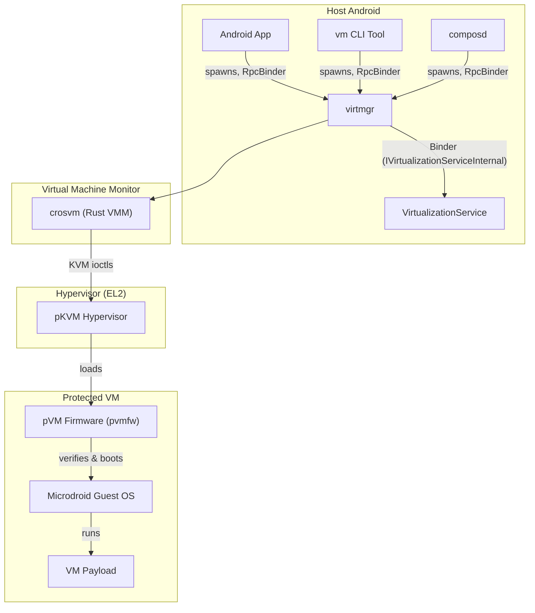

### 56.1.3 com.android.virt APEX

AVF 以 `com.android.virt` APEX 模块的形式交付，使其能够独立于主 Android 平台进行更新。该 APEX 包含：

- `vm` 命令行工具
- `VirtualizationService` 和 `virtmgr` 守护进程
- Microdroid 内核和系统镜像
- `crosvm` 二进制文件
- Java 和原生客户端库

有两个密切相关的组件位于此 APEX 之外。`composd` 编译编排守护进程在单独的 `com.android.compos` APEX 中发布。`pvmfw.bin` 是一个独立的固件镜像（在产品输出中安装于 `system/etc/pvmfw.bin`）。引导加载程序会加载它。
它不会从 APEX 中解包。

要从源码安装该 APEX：

```sh
banchan com.android.virt aosp_arm64
UNBUNDLED_BUILD_SDKS_FROM_SOURCE=true m apps_only dist
adb install out/dist/com.android.virt.apex
adb reboot
```

### 56.1.4 受保护虚拟机与非受保护虚拟机

AVF 支持两种虚拟机模式：

| 属性 | 非受保护虚拟机 | 受保护虚拟机（pVM） |
|---|---|---|
| 内存隔离 | 标准 KVM 隔离 | pKVM 强制：宿主无法访问客户机内存 |
| 固件 | 无 pvmfw | pvmfw 在引导前验证客户机 |
| DICE 链 | 不可用 | 从 ROM 到载荷的完整 DICE 链 |
| 远程证明 | 不支持 | 通过 RKP VM 支持 |
| Cuttlefish 支持 | 是 | 否（需要硬件 pKVM） |
| 调试支持 | 完全 | 受限（由调试策略控制） |

`vm info` 命令报告设备支持哪些模式：

```
Both protected and non-protected VMs are supported.
Hypervisor version: 1.0
/dev/kvm exists.
```

在 `packages/modules/Virtualization/android/vm/src/main.rs` 中，info 命令的实现查询设备能力：

```rust
fn command_info(service: &dyn IVirtualizationService) -> Result<(), Error> {
    let non_protected_vm_supported = hypervisor_props::is_vm_supported()?;
    let protected_vm_supported = hypervisor_props::is_protected_vm_supported()?;
    match (non_protected_vm_supported, protected_vm_supported) {
        (false, false) => println!("VMs are not supported."),
        (false, true) => println!("Only protected VMs are supported."),
        (true, false) => println!("Only non-protected VMs are supported."),
        (true, true) => println!("Both protected and non-protected VMs are supported."),
    }
    // ...
}
```

### 56.1.5 支持的设备

如 `packages/modules/Virtualization/docs/getting_started.md` 中所述，AVF 支持：

- **Pixel 7 / 7 Pro**（`aosp_panther`、`aosp_cheetah`）——pKVM 默认启用
- **Pixel 6 / 6 Pro**（`aosp_oriole`、`aosp_raven`）——pKVM 需要显式启用
- **Pixel Fold**（`aosp_felix`）
- **Pixel Tablet**（`aosp_tangorpro`）
- **Cuttlefish**（`aosp_cf_x86_64_phone`）——仅支持非受保护虚拟机

对于 Pixel 6 设备，必须显式启用 pKVM：

```shell
adb reboot bootloader
fastboot flashing unlock
fastboot oem pkvm enable
fastboot reboot
```

### 56.1.6 DICE 证明链

设备标识符合成引擎（Device Identifier Composition Engine，DICE）提供了一条从设备 ROM 经由每个引导阶段直到正在运行的虚拟机载荷的加密信任链。每个阶段对下一个阶段进行度量，从而创建一条可以证明虚拟机身份的证书链。


如 `packages/modules/Virtualization/docs/pvm_dice_chain.md` 中所述：

> 虚拟机 DICE 链是一条加密链接的证书链，它捕获了虚拟机整个执行环境的度量值。
>
> 这条链应植根于设备的 ROM，并涵盖虚拟机加载和引导过程中涉及的所有组件。

供应商从 ROM 到 ABL 构建该链，然后将其移交给 pvmfw。移交格式为 CBOR 编码。以下为三个字段的示意性 CDDL。下面的标签是描述性的，并非源代码标识符。Rust 端将其解析为 `BccHandover`，并在 `packages/modules/Virtualization/guest/pvmfw/src/dice/chain.rs` 中通过 `DiceChainInfo` / `DiceChainEntry` 对其进行遍历：

```
DiceHandover = {
  1 : bstr .size 32,     ; CDI_Attest
  2 : bstr .size 32,     ; CDI_Seal
  3 : DiceChain,         ; Android DICE chain
}
```

CDI（复合设备标识符，Compound Device Identifier）值有两个用途：

- **CDI_Attest**——用于派生用于身份证明的证明密钥对
- **CDI_Seal**——用于派生用于加密持久化数据的密封密钥

### 56.1.7 远程证明

虚拟机远程证明使 pVM 能够向第三方证明其可信度。如 `packages/modules/Virtualization/docs/vm_remote_attestation.md` 中所述，该机制涉及两个阶段：

1. **RKP VM 证明**——轻量级 RKP VM 接受远程 RKP 服务器的证明，服务器验证 DICE 链植根于真实设备。

2. **pVM 证明**——现已可信的 RKP VM 验证客户端 pVM 的 DICE 链，确认它们在真实的虚拟机环境中运行预期的代码。

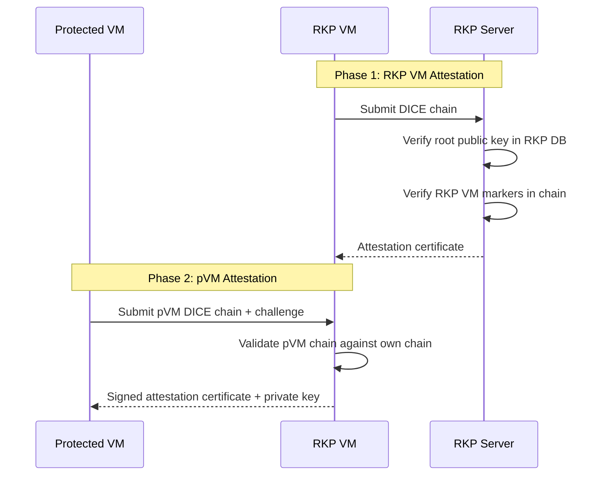

成功证明的输出包括一张带有自定义 OID 扩展（`1.3.6.1.4.1.11129.2.1.29.1`）的叶子证书，该扩展描述了虚拟机载荷：

```
AttestationExtension ::= SEQUENCE {
    attestationChallenge       OCTET_STRING,
    isVmSecure                 BOOLEAN,
    vmPayloadComponents        SEQUENCE OF VmComponent,
    vmTenantComponents         SEQUENCE OF VmComponent,
}
```

### 56.1.8 源代码仓库结构

位于 `packages/modules/Virtualization/` 的 AVF 仓库按如下方式组织：

```
packages/modules/Virtualization/
    android/
        composd/                 # Compilation orchestration service
        virtualizationservice/   # Core VirtualizationService daemon
        virtmgr/                 # VM manager (per-VM process)
        vm/                      # vm CLI tool
        MicrodroidDemoApp/       # Demo application
        VmAttestationDemoApp/    # Attestation demo
        fd_server/               # File descriptor server
    build/
        microdroid/              # Microdroid OS build files
    guest/
        pvmfw/                   # pVM Firmware
        service_vm/              # Service VM (RKP)
        kernel/                  # Microdroid kernel config
        encryptedstore/          # Encrypted storage support
    libs/
        framework-virtualization/ # Java API
        libvm_payload/            # VM Payload native API
        libvmbase/                # Common VM base library
        libvmclient/              # VM client library
        libhypervisor_backends/   # Hypervisor abstraction
    docs/                        # Documentation
    tests/                       # Test suites
```

---

## 56.2 pKVM 虚拟机管理程序

### 56.2.1 架构概述

pKVM（protected KVM）是一个轻量级虚拟机管理程序，运行于 ARM 异常级别 2（EL2）。它扩展了标准 Linux KVM，以提供即使宿主内核被攻陷也依然成立的内存隔离保证。与传统虚拟机管理程序不同，pKVM 旨在拥有极小的可信计算基（TCB）。它不管理设备，也不调度虚拟机。相反，它只专注于内存访问控制。

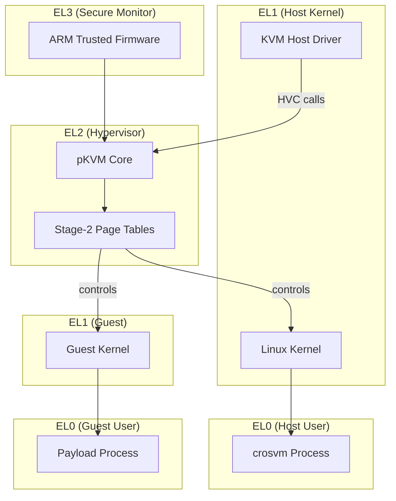

### 56.2.2 内存隔离模型

pKVM 的根本安全属性是：受保护虚拟机的内存对宿主不可访问。这通过由 EL2 虚拟机管理程序独占控制的 ARM Stage-2 页表来强制执行：

1. **宿主内存**——映射在宿主的 Stage-2 表中，从所有客户机的 Stage-2 表中取消映射。

2. **客户机内存**——映射在客户机的 Stage-2 表中，从宿主的 Stage-2 表中取消映射。宿主无法读取、写入或执行客户机内存。

3. **共享内存**——显式共享的区域映射在宿主和客户机的 Stage-2 表中。用于 virtio 通信。

这种设计意味着，即使宿主上发生了内核级漏洞利用，也无法读取 pVM 的私有内存。虚拟机管理程序会拦截并验证所有内存映射操作。

### 56.2.3 pKVM 虚拟机管理程序接口

位于 `packages/modules/Virtualization/guest/pvmfw/README.md` 的 pvmfw 文档规定了可供客户机使用的虚拟机管理程序调用：

**内存管理：**

- `MEMINFO`（功能 ID `0xc6000002`）——查询内存粒度信息
- `MEM_SHARE`（功能 ID `0xc6000003`）——与客户机共享内存区域
- `MEM_UNSHARE`（功能 ID `0xc6000004`）——撤销宿主对共享区域的访问权

**MMIO 防护：**

- `MMIO_GUARD_INFO`（功能 ID `0xc6000005`）——查询 MMIO 防护信息
- `MMIO_GUARD_ENROLL`（功能 ID `0xc6000006`）——启用 MMIO 防护
- `MMIO_GUARD_MAP`（功能 ID `0xc6000007`）——映射一个 MMIO 区域
- `MMIO_GUARD_UNMAP`（功能 ID `0xc6000008`）——取消映射一个 MMIO 区域

**标准 ARM 接口：**

- ARM SMCCC v1.1——调用约定
- PSCI v1.0——电源状态协调（复位、关机）
- TRNG v1.0——真随机数生成

### 56.2.4 Stage-2 页表管理

当 pKVM 启动一个受保护虚拟机时，它会创建一组专用的 Stage-2 页表。关键操作如下：

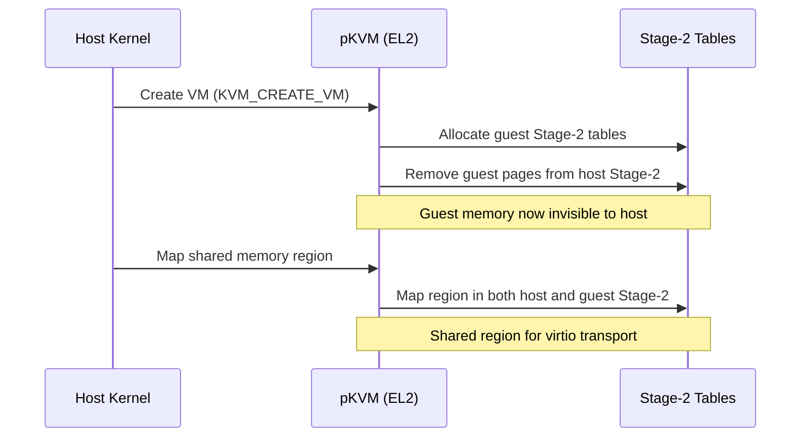

### 56.2.5 pKVM 加载 pvmfw

当虚拟机监视器（VMM）请求一个受保护虚拟机时，pKVM 会将 pvmfw 从受保护内存区域加载到客户机的地址空间中。该区域由 Android 引导加载程序（ABL）预先准备，并通过设备树保留内存节点来描述：

```
reserved-memory {
    pkvm_guest_firmware {
        compatible = "linux,pkvm-guest-firmware-memory";
        reg = <0x0 0x80000000 0x40000>;
        no-map;
    }
}
```

关于 pvmfw 加载的要点：

1. 虚拟机管理程序不解释 pvmfw——它只保护并加载预先准备好的二进制文件。

2. pvmfw 二进制文件在客户机地址空间中必须按 4KiB 对齐。
3. 配置数据被附加到 pvmfw，并包含在同一受保护区域内。
4. 一旦加载，pvmfw 即成为虚拟机的入口点，在任何客户机代码之前执行。

### 56.2.6 内存共享协议

为了进行 virtio 通信，客户机内存必须与客户机显式共享。共享协议使用超级调用：

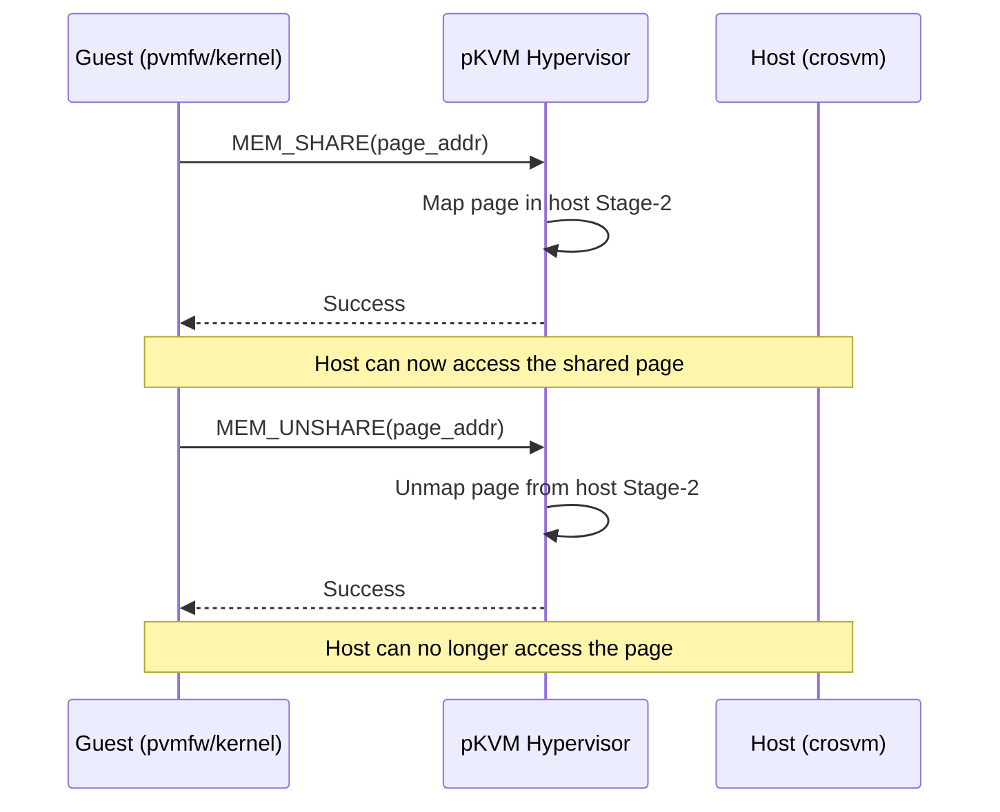

客户机负责确保敏感数据永远不会被放入共享内存区域。pvmfw 固件在将 virtio 传输的初始内存共享工作移交给客户机内核之前处理这些工作。

### 56.2.7 MMIO 防护

MMIO 防护机制防止客户机访问任意 MMIO 区域。这一点很重要，因为在虚拟机中，MMIO 访问通常会被虚拟机管理程序捕获并转发给 VMM。恶意的 VMM 可能会呈现伪造的设备响应。有了 MMIO 防护：

1. 客户机必须显式加入 MMIO 防护（`MMIO_GUARD_ENROLL`）。
2. 只有已映射的 MMIO 区域（`MMIO_GUARD_MAP`）才会向 VMM 生成陷阱。
3. 访问未映射的 MMIO 区域会触发中止，而不是陷阱。

这限制了来自可能被攻陷的 VMM 的攻击面。

---

## 56.3 crosvm：虚拟机监视器

### 56.3.1 概述

crosvm 是一个基于 Rust 的虚拟机监视器（VMM），起源于 ChromiumOS，后被 Android 采用用于 AVF。它管理虚拟机的生命周期，提供虚拟硬件设备，并充当宿主内核与客户机之间的接口。

`external/crosvm/ARCHITECTURE.md` 文档描述了其核心设计原则：

> crosvm 的主要特征是：
>
> - 每个虚拟设备一个进程，在 Linux 上使用 fork 创建
> - 每个进程都使用 minijail 进行沙箱化
> - 支持多种 CPU 架构、操作系统和虚拟机管理程序
> - 使用 Rust 编写，以保证安全性与健壮性

### 56.3.2 启动序列

一次 crosvm 虚拟机会话遵循定义良好的启动序列，如 `external/crosvm/ARCHITECTURE.md` 中所述：

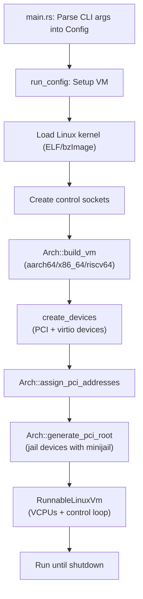

来自 `external/crosvm/src/main.rs` 的顶层 `run_vm` 函数：

```rust
fn run_vm(cmd: RunCommand, log_config: LogConfig) -> Result<CommandStatus> {
    let cfg = match TryInto::<Config>::try_into(cmd) {
        Ok(cfg) => cfg,
        Err(e) => {
            eprintln!("{}", e);
            return Err(anyhow!("{}", e));
        }
    };
    // ...
    let exit_state = crate::sys::run_config(cfg)?;
    Ok(CommandStatus::from(exit_state))
}
```

### 56.3.3 退出状态

如 `external/crosvm/src/main.rs` 中所定义，crosvm 定义了特定的退出码来区分不同的虚拟机终止条件：

```rust
#[repr(i32)]
enum CommandStatus {
    /// Exit with success. Also used to mean VM stopped successfully.
    SuccessOrVmStop = 0,
    /// VM requested reset.
    VmReset = 32,
    /// VM crashed.
    VmCrash = 33,
    /// VM exit due to kernel panic in guest.
    GuestPanic = 34,
    /// Invalid argument was given to crosvm.
    InvalidArgs = 35,
    /// VM exit due to vcpu stall detection.
    WatchdogReset = 36,
}
```

这些退出码使 `virtmgr` 能够确定虚拟机为何终止，并向虚拟机所有者报告相应的终止原因。

### 56.3.4 架构支持

crosvm 支持三种 CPU 架构，每种都有专门的模块：

| 架构 | 源代码目录 | 关键组件 |
|---|---|---|
| AArch64 | `external/crosvm/aarch64/src/` | FDT 生成、GIC 设置、PSCI |
| x86_64 | `external/crosvm/x86_64/src/` | ACPI 表、CPUID、GDT、引导参数 |
| RISC-V 64 | `external/crosvm/riscv64/src/` | FDT 生成、SBI 接口 |

每种架构都实现了带有以下关键方法的 `Arch` 特性：

- `build_vm()`——创建特定于架构的虚拟机配置
- `assign_pci_addresses()`——分配 PCI 总线地址
- `generate_pci_root()`——构建 PCI 设备树

x86_64 模块包含 ARM 上不需要的额外组件：

```
external/crosvm/x86_64/src/
    acpi.rs        # ACPI table generation
    bootparam.rs   # Linux boot parameter structure
    bzimage.rs     # bzImage kernel loading
    cpuid.rs       # CPUID emulation
    fdt.rs         # Flattened Device Tree
    gdb.rs         # GDB stub for debugging
    gdt.rs         # Global Descriptor Table
    interrupts.rs  # Interrupt handling
    mpspec.rs      # Multiprocessor specification
```

### 56.3.5 每设备一进程的沙箱化

crosvm 最与众不同的架构特征是其每设备一进程的模型。每个虚拟设备都在一个独立的 fork 进程中运行，并使用 minijail 进行沙箱化：

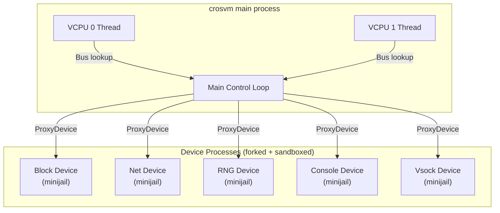

正如架构文档中所描述的：

> 在设备创建例程期间，每个设备都会被创建，然后被包装在一个 `ProxyDevice` 中；后者会在内部 `fork`（但不 `exec`）并使用 minijail 对设备进行沙箱化，同时在主进程中丢弃该沙箱。设备与主进程之间唯一可行的交互方式是通过 `BusDevice` 的代理特性方法、诸如客户机内存之类的共享内存映射，以及该设备的安全策略专门允许的文件描述符。

### 56.3.6 Minijail 沙箱化

每个设备进程都使用 minijail 配合 Linux 命名空间和 seccomp 过滤器进行沙箱化。Seccomp 策略因架构而异：

```
external/crosvm/jail/seccomp/
    aarch64/           # ARM64 seccomp policies
    x86_64/            # x86_64 seccomp policies
    riscv64/           # RISC-V seccomp policies
```

每个设备都有自己的 seccomp 策略文件，其中只将该设备所需的系统调用列入白名单。策略文件包含一个公共基础（`common_device.policy`），并添加特定于设备的系统调用。

这种沙箱化提供了纵深防御。即使恶意客户机攻陷了某个虚拟设备进程，攻击者也会被限制在一个隔离命名空间内、最小的系统调用集合中。

### 56.3.7 虚拟机管理程序抽象层

crosvm 通过一个抽象层支持多种虚拟机管理程序后端：

```
external/crosvm/hypervisor/src/
    lib.rs          # Trait definitions
    kvm/            # Linux KVM backend
    geniezone/      # MediaTek GenieZone
    gunyah/         # Qualcomm Gunyah
    halla/          # (development backend)
    haxm/           # Intel HAXM (for Windows)
    whpx/           # Windows Hypervisor Platform
```

在 Android 上，主要后端是 KVM（包括用于受保护虚拟机的 pKVM）。`external/crosvm/hypervisor/src/` 中的虚拟机管理程序模块提供：

```
hypervisor/src/
    aarch64.rs      # ARM64-specific hypervisor traits
    x86_64.rs       # x86_64-specific hypervisor traits
    riscv64.rs      # RISC-V specific hypervisor traits
    caps.rs         # Capability detection
```

### 56.3.8 设备模型

crosvm 的设备模型建立在一个特性层次结构之上：

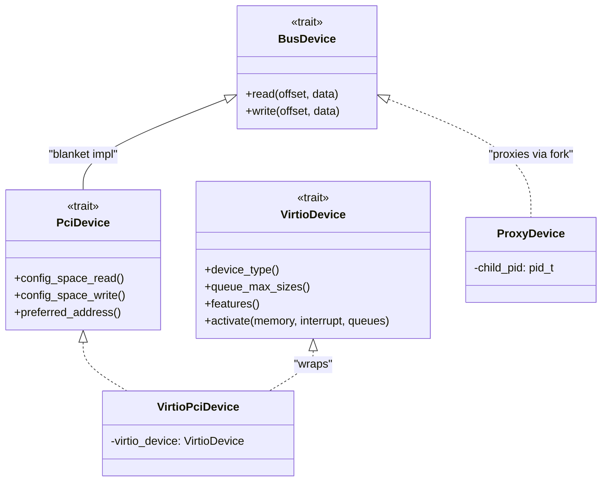

正如 ARCHITECTURE.md 所解释的：

> crosvm 设备模型的根源是 `Bus` 结构及其友元 `BusDevice` 特性。`Bus` 结构是一个虚拟计算机总线，用于模拟内存映射 I/O 总线，以及 x86 虚拟机的 I/O 端口。

virtio 设备实现包括：

| 设备 | 源文件 | 用途 |
|---|---|---|
| Block | `devices/src/virtio/block/` | 磁盘 I/O |
| Net | `devices/src/virtio/net.rs` | 网络 I/O |
| Console | `devices/src/virtio/console/` | 串行控制台 |
| RNG | `devices/src/virtio/rng.rs` | 随机数生成 |
| Vsock | `devices/src/virtio/vsock/` | 宿主-客户机套接字通信 |
| Balloon | `devices/src/virtio/balloon.rs` | 内存气球 |
| SCSI | `devices/src/virtio/scsi/` | SCSI 设备模拟 |
| Sound | `devices/src/virtio/snd/` | 音频设备 |
| GPU | `devices/src/virtio/gpu/` | 图形渲染 |
| IOMMU | `devices/src/virtio/iommu.rs` | I/O 内存管理 |
| Pmem | `devices/src/virtio/pmem.rs` | 持久内存 |
| Filesystem | `devices/src/virtio/fs/` | 共享文件系统（virtio-fs） |
| TPM | `devices/src/virtio/tpm.rs` | 可信平台模块 |

### 56.3.9 GuestMemory 架构

客户机内存管理是一个关键子系统。ARCHITECTURE.md 描述了五种相关的类型：

- **`GuestMemory`**——对所有客户机内存的引用。可以被克隆，但底层内存始终相同。使用 `MemoryMapping` 和 `SharedMemory` 实现。对于非受保护虚拟机，它被映射到宿主地址空间中，但是非连续的。

- **`SharedMemory`**——包装一个 `memfd`。可以使用 `MemoryMapping` 进行映射。不能被克隆。

- **`VolatileMemory`**——用于访问非连续内存的通用特性。`GuestMemory` 实现了此特性。

- **`VolatileSlice`**——类似于 Rust 切片，但数据会异步变化。适用于散射-聚合表条目。

- **`MemoryMapping`**——`mmap`/`munmap` 的安全包装器。提供 RAII 语义。禁止通过 Rust 引用访问；请使用 `VolatileSlice`。

对于受保护虚拟机，客户机内存不会被映射到宿主地址空间中——pKVM 虚拟机管理程序会阻止这一点。用于 virtio 传输的共享内存区域是例外。

### 56.3.10 虚拟机控制套接字

crosvm 使用 Unix 域套接字进行主进程与设备进程之间的进程间通信。来自架构文档：

> 对于设备需要对全局虚拟机状态执行的操作（例如映射到客户机内存地址空间），存在虚拟机控制套接字。有几种类型，按套接字将处理的请求和响应类型划分。这还提供了基本的安全权限分离，以防某个设备被恶意客户机攻陷。

控制套接字类型处理：

- 内存映射请求
- MSI 路由分配
- 客户机内存注册/注销
- 虚拟机状态变更（暂停、恢复、重置）

外部控制可通过 `--socket` 参数实现，经由 `crosvm_control` 库或 `crosvm stop` 等 CLI 子命令访问。

### 56.3.11 WaitContext 事件循环

大多数 crosvm 线程使用 `WaitContext` 作为其事件循环。这是对 `epoll`（Linux）和 `WaitForMultipleObjects`（Windows）的跨平台抽象：

```rust
// Conceptual event loop (simplified)
#[derive(EventToken)]
enum Token {
    VirtioQueue,
    InterruptResample,
    Kill,
}

let wait_ctx = WaitContext::new()?;
wait_ctx.add(&queue_evt, Token::VirtioQueue)?;
wait_ctx.add(&interrupt_resample, Token::InterruptResample)?;
wait_ctx.add(&kill_evt, Token::Kill)?;

loop {
    let events = wait_ctx.wait()?;
    for event in events {
        match event.token {
            Token::VirtioQueue => { /* process queue */ },
            Token::InterruptResample => { /* resample interrupt */ },
            Token::Kill => return Ok(()),
        }
    }
}
```

### 56.3.12 代码组织

如 `external/crosvm/ARCHITECTURE.md` 中所述，crosvm 代码库被组织为若干 Rust crate：

```
external/crosvm/
    src/                  # Top-level binary frontend
    aarch64/              # ARM64 architecture support
    x86_64/               # x86_64 architecture support
    riscv64/              # RISC-V 64 architecture support
    base/                 # Cross-platform safe wrappers
    cros_async/           # Async runtime (io_uring + epoll)
    devices/              # Virtual device implementations
    disk/                 # Disk image manipulation (raw, qcow)
    hypervisor/           # Hypervisor abstraction layer (KVM wrapper in src/kvm/)
    jail/                 # Minijail sandboxing helpers
    jail/seccomp/         # Per-architecture seccomp policies
    kernel_loader/        # Kernel image loading
    kvm_sys/              # KVM ioctl structures
    net_util/             # TUN/TAP device creation
    common/sync/          # Custom Mutex/Condvar
    vfio_sys/             # VFIO structures for device passthrough
    vhost/                # Vhost device wrappers
    virtio_sys/           # Virtio kernel interface
    vm_control/           # VM IPC definitions
    vm_memory/            # VM memory objects
```

---

## 56.4 Microdroid

### 56.4.1 概述

Microdroid 是一个极简的 Android 发行版，专为在 AVF 虚拟机内部运行而设计。如 `packages/modules/Virtualization/build/microdroid/README.md` 中所述：

> Microdroid 是 Android 的一个（非常）轻量级的版本，旨在运行于设备端虚拟机上。它与常规 Android 使用相同的源代码构建，但体积要小得多；没有系统服务、没有 HAL、没有 GUI 等。它仅用于承载无头和原生工作负载。

### 56.4.2 Microdroid 移除了什么

与完整的 Android 相比，Microdroid 几乎剥离了所有内容：

| 组件 | 完整 Android | Microdroid |
|---|---|---|
| 系统服务 | 有 | 无 |
| 硬件抽象层 | 全套 | 无 |
| GUI/SurfaceFlinger | 有 | 无 |
| 包管理器 | 有 | 无 |
| 电话 | 有 | 无 |
| 蓝牙 | 有 | 无 |
| WiFi 协议栈 | 有 | 无 |
| 相机 | 有 | 无 |
| 音频服务 | 有 | 无 |
| SELinux 策略 | 完整 | 最小 |
| Init 脚本 | 数百个 | 一个（init.rc） |

Microdroid 保留的内容：

- Linux 内核
- Bionic libc
- Init 进程（最小配置）
- APEX 守护进程（虚拟机模式下）
- `microdroid_manager`（载荷编排）
- Tombstoned（崩溃报告）
- 基本文件系统支持

### 56.4.3 虚拟机配置

Microdroid 虚拟机通过 JSON 文件进行配置。来自 `packages/modules/Virtualization/build/microdroid/microdroid.json` 的基础配置：

```json
{
  "kernel": "/apex/com.android.virt/etc/fs/microdroid_kernel",
  "disks": [
    {
      "partitions": [
        {
          "label": "vbmeta_a",
          "path": "/apex/com.android.virt/etc/fs/microdroid_vbmeta.img"
        },
        {
          "label": "system_a",
          "path": "/apex/com.android.virt/etc/fs/microdroid.img"
        }
      ],
      "writable": false
    }
  ],
  "memory_mib": 256,
  "console_input_device": "hvc0",
  "platform_version": "~1.0"
}
```

该配置指定：

- **内核**——Microdroid 内核二进制文件的路径
- **磁盘**——磁盘镜像，包括 `vbmeta_a`（用于验证引导）和 `system_a`（只读系统镜像，`microdroid.img`）

- **内存**——默认 256 MiB 分配
- **控制台**——用于 virtio 控制台 I/O 的 `hvc0`

### 56.4.4 引导过程

Microdroid 的引导过程受到严格控制：

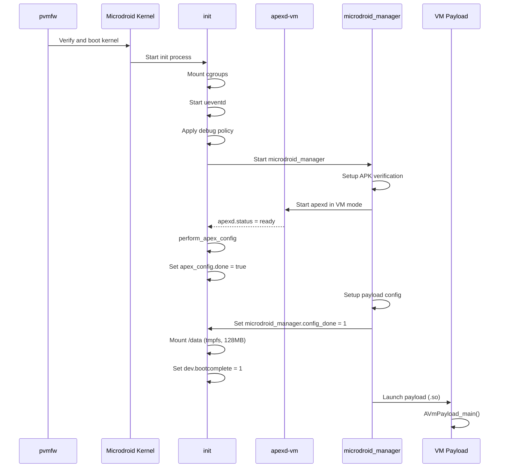

来自 `packages/modules/Virtualization/build/microdroid/init.rc` 的 init.rc 揭示了引导编排：

```
on init
    mkdir /mnt/apk 0755 root root
    mkdir /mnt/extra-apk 0755 root root
    mkdir /mnt/tenant-apk 0755 root root

    # Microdroid_manager starts apkdmverity/zipfuse/apexd
    start microdroid_manager

    # Wait for apexd to finish activating APEXes
    wait_for_prop apexd.status ready
    perform_apex_config

    # Notify microdroid_manager that APEX config is done
    setprop apex_config.done true
```

### 56.4.5 文件系统布局

Microdroid 使用来自 `packages/modules/Virtualization/build/microdroid/fstab.microdroid` 的极简文件系统布局：

```
/dev/block/by-name/system /system erofs noatime,ro wait,slotselect,avb=vbmeta,first_stage_mount
/dev/block/by-name/microdroid-vendor /vendor ext4 noatime,ro,errors=panic wait,first_stage_mount,avb_hashtree_digest=/proc/device-tree/avf/vendor_hashtree_descriptor_root_digest
```

关键文件系统特征：

- **根目录**——只读，在 post-fs 之后重新挂载
- **/system**——只读 `erofs`，通过 AVB 验证引导（`avb=vbmeta`）
- **/vendor**——可选，通过 hashtree 摘要验证
- **/data**——tmpfs（128 MiB），临时性
- **/mnt/apk**——载荷 APK 的挂载点
- **/mnt/encryptedstore**——加密的持久存储

### 56.4.6 供应商镜像支持

Microdroid 支持可选的供应商分区，用于特定于设备的模块。受保护虚拟机和非受保护虚拟机的供应商镜像验证过程有所不同：

**非受保护虚拟机：**
`virtualizationmanager` 创建一个包含供应商 hashtree 摘要的 DTBO，并通过 crosvm 将其传递给虚拟机。该摘要从宿主 Android 设备树中 `/avf/reference/` 下获取。

**受保护虚拟机：**
pvmfw 配置数据中包含的虚拟机引用 DT 被用于额外的验证。引导加载程序将供应商 hashtree 摘要附加到虚拟机引用 DT 中。pvmfw 验证：如果虚拟机的设备树中存在匹配的属性，其值必须与引用完全一致。

来自 Microdroid README：

> 对于 pVM，pvmfw 配置数据中包含的虚拟机引用 DT 额外用于验证供应商 hashtree 摘要。引导加载程序应根据 fstab.microdroid 将供应商 hashtree 摘要附加到虚拟机引用 DT 中。

### 56.4.7 虚拟机载荷 API

虚拟机载荷 API 为在 Microdroid 虚拟机内部运行的代码提供了接口。它是在 `packages/modules/Virtualization/libs/libvm_payload/` 中定义的 C API：

```c
// Entry point for VM payload code
extern "C" int AVmPayload_main() {
    printf("Hello Microdroid!\n");
    // Use VM Payload APIs here
}
```

可用的 API 包括：

- `AVmPayload_requestAttestation()`——请求远程证明
- `AVmPayload_runVsockRpcServer()`——在 vsock 上承载一个 binder 服务器
- 密钥派生和密封函数
- NDK 子集：libc、日志、NdkBinder

构建虚拟机载荷需要两个构建模块：

```blueprint
// The payload shared library
cc_library_shared {
    name: "MyMicrodroidPayload",
    srcs: ["**/*.cpp"],
    sdk_version: "current",
}

// The host app that contains the payload
android_app {
    name: "MyApp",
    srcs: ["**/*.java"],
    jni_libs: ["MyMicrodroidPayload"],
    use_embedded_native_libs: true,
    sdk_version: "current",
}
```

### 56.4.8 平台先决条件

Microdroid 需要：

1. **64 位目标**——x86_64 或 arm64。不支持 32 位。
2. **com.android.virt APEX**——必须预装在设备上。
3. **KVM 支持**——`/dev/kvm` 必须存在。
4. **对于受保护虚拟机**——pKVM 虚拟机管理程序必须处于活动状态。

要将 APEX 添加到产品中，请在产品 makefile 中包含它：

```makefile
$(call inherit-product, packages/modules/Virtualization/build/apex/product_packages.mk)
```

### 56.4.9 加密存储

Microdroid 支持加密的持久存储，供需要在重启后保留数据的虚拟机使用。加密存储由宿主上的文件支持，并在虚拟机内的 `/mnt/encryptedstore` 处挂载。

来自 init.rc：

```
on property:microdroid_manager.encrypted_store.status=mounted
    restorecon /mnt/encryptedstore
    # Performance tuning for storage
    write /proc/sys/vm/compaction_proactiveness 0
    write /sys/module/dm_verity/parameters/prefetch_cluster 0
    write /proc/sys/vm/swappiness 100
    setprop microdroid_manager.encrypted_store.status ready
```

加密密钥从虚拟机的 DICE 链派生。这确保了只有相同的虚拟机实例（具有相同的代码和配置）才能解密数据。

---

## 56.5 pVM 固件

### 56.5.1 目的与威胁模型

pVM 固件（pvmfw）是在受保护虚拟机内部执行的第一段代码。它充当虚拟机的信任根，在允许任何客户机代码运行之前验证客户机环境。

来自 `packages/modules/Virtualization/guest/pvmfw/README.md`：

> 由于 pVM 由运行在不可信宿主上的 VMM 管理，它所配置的虚拟机同样不可信。此外，尽管上述隔离使 pVM 能够保护其机密免受宿主侵害，但这并不能帮助它们在引导过程中完成配置。特别是，威胁模型将禁止宿主拥有对这些机密的任何访问权，从而阻止 VMM 将它们传递给 pVM。

威胁模型假设：

- 宿主操作系统可能已被完全攻陷
- VMM（crosvm）可能是恶意的
- 虚拟机管理程序（pKVM）和 pvmfw 本身是可信的
- 设备硬件（包括直到 pvmfw 加载之前的固件）是可信的

### 56.5.2 源代码架构

pvmfw 源代码位于 `packages/modules/Virtualization/guest/pvmfw/src/`，是一个 `no_std` Rust 二进制文件：

```rust
// packages/modules/Virtualization/guest/pvmfw/src/main.rs
#![no_main]
#![no_std]

extern crate alloc;

mod arch;
mod bootargs;
mod config;
mod device_assignment;
mod dice;
mod entry;
mod fdt;
mod gpt;
mod instance;
mod memory;
mod rollback;
```

`no_std` 约束意味着 pvmfw 在没有标准库的情况下运行。默认情况下它没有堆分配器（它使用一个配置好的分配器），没有文件系统，也没有操作系统服务。这最大限度地缩小了可信计算基。

### 56.5.3 入口点与引导流程

位于 `packages/modules/Virtualization/guest/pvmfw/src/entry.rs` 的入口点定义了引导参数和初始化序列：

```rust
pub struct BootArgs {
    /// Address of FDT
    pub fdt: Option<usize>,
    /// Address of first byte in payload image
    pub payload_start: Option<usize>,
    /// Size of payload in bytes
    pub payload_size: Option<usize>,
    /// Address of Linux x86 boot params structure
    pub boot_params: Option<usize>,
}
```

平台特定的参数解析处理 AArch64 与 x86_64 之间的差异：

```rust
pub fn from_vmbase_args(argv: &[usize]) -> Self {
    cfg_if::cfg_if! {
        if #[cfg(target_arch = "aarch64")] {
            Self {
                fdt: argv.first().copied(),
                payload_start: argv.get(1).copied(),
                payload_size: argv.get(2).copied(),
                boot_params: None,
            }
        } else if #[cfg(target_arch = "x86_64")] {
            Self {
                fdt: None,
                payload_start: None,
                payload_size: None,
                boot_params: argv.get(1).copied(),
            }
        }
    }
}
```

### 56.5.4 主验证流程

位于 `packages/modules/Virtualization/guest/pvmfw/src/main.rs` 的 main 函数编排完整的验证过程：

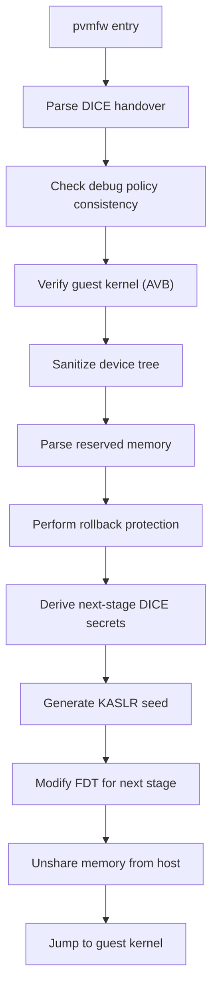

源代码中的核心 `main` 函数签名：

```rust
fn main<'a>(
    untrusted_fdt: &mut Fdt,
    signed_kernel: &[u8],
    ramdisk: Option<&[u8]>,
    config: &mut Entries,
) -> Result<(&'a [u8], bool), RebootReason> {
    info!("pVM firmware");
    // ...
}
```

各个配置数据块不再是独立的参数。这些数据块分别是当前的 DICE 移交、调试策略、虚拟机 DTBO、虚拟机引用 DT 和保留内存。它们通过 `config: &mut Entries` 参数访问，即解析后的 pvmfw 配置数据条目集合（见 56.9 节）。

### 56.5.5 验证引导

pvmfw 使用 Android 验证引导（AVB）来验证客户机内核和可选的 ramdisk。验证使用一个内嵌的公钥：

```rust
/// Trusted public key, used during verification of the signed kernel & ramdisk.
const PUBLIC_KEY: &[u8] = include_bytes!(
    concat!(env!("OUT_DIR"), "/pvmfw_embedded_key_pub.bin")
);
```

内嵌的 `PUBLIC_KEY` 只是可信密钥切片中的第一个条目。在验证之前，`main()` 会用 `TrustedKeys` 配置条目中携带的任何额外密钥扩展该切片。

验证引导过程：

```rust
fn perform_verified_boot<'a>(
    signed_kernel: &[u8],
    ramdisk: Option<&[u8]>,
    trusted_keys: &'a [&'a [u8]],
) -> Result<(VerifiedBootData<'a>, bool, usize), RebootReason> {
    let verified_boot_data = verify_payload(signed_kernel, ramdisk, trusted_keys)
        .map_err(|e| {
            error!("Failed to verify the payload: {e}");
            RebootReason::PayloadVerificationError
        })?;
    let debuggable = verified_boot_data.debug_level != DebugLevel::None;
    let guest_page_size = verified_boot_data.page_size.unwrap_or(SIZE_4KB);
    Ok((verified_boot_data, debuggable, guest_page_size))
}
```

### 56.5.6 DICE 派生

验证完成后，pvmfw 会派生下一阶段的 DICE 机密。位于 `packages/modules/Virtualization/guest/pvmfw/src/dice/mod.rs` 的 DICE 模块处理此事：

```rust
// DICE Configuration Descriptor keys
const COMPONENT_NAME_KEY: i64 = -70002;
const SECURITY_VERSION_KEY: i64 = -70005;
const RKP_VM_MARKER_KEY: i64 = -70006;
const INSTANCE_HASH_KEY: i64 = -71003;
```

派生过程：

1. 解析传入的 DICE 移交（CDI + 证书链）
2. 从验证引导数据计算部分 DICE 输入
3. 纳入实例哈希（用于每个虚拟机的差异化）
4. 执行回滚保护
5. 派生下一阶段的 CDI 和证书

```rust
fn perform_dice_derivation(
    dice_handover_bytes: &[u8],
    dice_context: DiceContext,
    dice_inputs: PartialInputs,
    salt: &[u8; HIDDEN_SIZE],
    defer_rollback_protection: bool,
    next_dice_handover: &mut [u8],
) -> Result<(), RebootReason> {
    dice_inputs
        .write_next_handover(
            dice_handover_bytes.as_ref(),
            salt,
            defer_rollback_protection,
            next_dice_handover,
            dice_context,
        )
        .map_err(|e| {
            error!("Failed to derive next-stage DICE secrets: {e:?}");
            RebootReason::SecretDerivationError
        })?;
    Ok(())
}
```

特定于实例的盐确保了具有相同载荷的不同虚拟机实例会获得不同的机密：

```rust
fn salt_from_instance_id(fdt: &Fdt) -> Result<Option<Hidden>, RebootReason> {
    let Some(id) = read_instance_id(fdt).map_err(|e| {
        error!("Failed to get instance-id in DT: {e}");
        RebootReason::InvalidFdt
    })?
    else {
        return Ok(None);
    };
    let mut ctx = Sha512::new();  // bssl_crypto::digest::Sha512
    ctx.update(b"InstanceId:");
    ctx.update(id);
    Ok(Some(ctx.digest()))
}
```

### 56.5.7 重启原因

pvmfw 定义了特定的重启原因，有助于诊断引导失败。来自 `packages/modules/Virtualization/guest/pvmfw/src/entry.rs`：

```rust
pub enum RebootReason {
    InvalidDiceHandover,       // "PVM_FIRMWARE_INVALID_DICE_HANDOVER"
    InvalidConfig,             // "PVM_FIRMWARE_INVALID_CONFIG_DATA"
    InternalError,             // "PVM_FIRMWARE_INTERNAL_ERROR"
    InvalidFdt,                // "PVM_FIRMWARE_INVALID_FDT"
    InvalidPayload,            // "PVM_FIRMWARE_INVALID_PAYLOAD"
    InvalidRamdisk,            // "PVM_FIRMWARE_INVALID_RAMDISK"
    PayloadVerificationError,  // "PVM_FIRMWARE_PAYLOAD_VERIFICATION_FAILED"
    SecretDerivationError,     // "PVM_FIRMWARE_SECRET_DERIVATION_FAILED"
}
```

每个原因都会在重启前写入一个专用控制台：

```rust
const REBOOT_REASON_CONSOLE: usize = 1;
console_writeln!(REBOOT_REASON_CONSOLE, "{}", reboot_reason.as_avf_reboot_string())
    .unwrap();
reboot()
```

### 56.5.8 配置数据格式

pvmfw 接收由引导加载程序附加到其二进制文件的配置数据。配置使用来自 `packages/modules/Virtualization/guest/pvmfw/src/config/mod.rs` 的带版本号的头格式：

```rust
#[repr(C, packed)]
#[derive(Clone, Copy, Debug, FromBytes, Immutable, KnownLayout)]
struct Header {
    /// Magic number; must be `Header::MAGIC`.
    magic: u32,
    /// Version of the header format.
    version: Version,
    /// Total size of the configuration data.
    total_size: u32,
    /// Feature flags; currently reserved and must be zero.
    flags: u32,
}
```

配置数据的内存布局：

```
+===============================+
|          pvmfw.bin            |
+~~~~~~~~~~~~~~~~~~~~~~~~~~~~~~~+
|  (Padding to 4KiB alignment)  |
+===============================+ <-- HEAD
|      Magic (= 0x666d7670)     |
+-------------------------------+
|           Version             |
+-------------------------------+
|   Total Size = (TAIL - HEAD)  |
+-------------------------------+
|            Flags              |
+-------------------------------+
|     Entry 0: DICE chain       |
|     Entry 1: Debug Policy     |
|     Entry 2: VM DTBO (v1.1)   |
|     Entry 3: VM ref DT (v1.2) |
|     Entry 4: Reserved Mem (v1.3)|
+-------------------------------+
|      Blob data follows...     |
+===============================+ <-- TAIL
```

### 56.5.9 配置版本

配置格式历经五个版本演变：

**版本 1.0：**

- Entry 0：DICE 链移交（必选）
- Entry 1：调试策略 DTBO（可选）

**版本 1.1：**

- Entry 2：虚拟机设备分配 DTBO（可选，用于设备直通）

**版本 1.2：**

- Entry 3：虚拟机引用 DT（可选，用于传递安全属性）

**版本 1.3：**

- Entry 4：保留内存（可选，用于向特定客户机传递机密数据）

**版本 1.4：**

- Entry 5：额外回滚信息（`ExtraRollback`，可选）

`Entry` 枚举还定义了一个 `TrustedKeys` 条目（entry 6），它尚未在 `entry_count()` 中关联到某个配置版本。每个数据块通过条目数组中的偏移量和大小来引用。缺失的可选条目用零大小表示。

### 56.5.10 VBMeta 属性

AVF 定义了 pvmfw 所识别的特定 AVB VBMeta 描述符属性：

- **`com.android.virt.cap`**——能力列表（以管道符分隔）：
  - `remote_attest`——硬编码的回滚保护索引
  - `secretkeeper_protection`——将回滚保护推迟到客户机
  - `supports_uefi_boot`——将虚拟机引导为 EFI 载荷（实验性）
  - `trusty_security_vm`——跳过回滚保护
- **`com.android.virt.page_size`**——客户机页大小（KiB，默认值：4）
- **`com.android.virt.name`**——虚拟机名称，用于 DICE 证书中：
  - `"rkp_vm"`——保留给远程密钥配置虚拟机
  - `"desktop-trusty"`——保留给 Trusty 桌面 TEE 虚拟机

### 56.5.11 移交给客户机内核

所有验证和派生完成后，pvmfw 会准备好客户机环境并跳转到内核：

1. 从宿主取消共享所有非必要内存
2. 取消共享除 UART（如果可调试）之外的所有 MMIO 区域
3. 刷新保留内存（DICE 移交、保留内存）
4. 计算内核入口点
5. 跳转到载荷

DICE 链通过设备树保留内存节点传递给客户机：

```
/ {
    reserved-memory {
        dice {
            compatible = "google,open-dice";
            no-map;
            reg = <0x0 0x7fe0000>, <0x0 0x1000>;
        };
    };
};
```

### 56.5.12 内存布局

pvmfw 在由 crosvm 受保护虚拟机配置定义的固定内存布局中运行：

| 地址 | 大小 | 用途 |
|---|---|---|
| `0x7fc0_0000` | 可变 | pvmfw 二进制文件 + 配置数据 |
| `0x7fe0_0000` | 2 MiB | 暂存内存 |
| `0x3f8` | MMIO | 用于日志的 16550 UART |
| PCI 总线 | MMIO | virtio 设备 |

### 56.5.13 开发工作流

为了快速迭代，pvmfw 可以构建并推送到设备，而无需重新刷写设备分区：

```shell
m pvmfw-tool pvmfw_bin
PVMFW_BIN=${ANDROID_PRODUCT_OUT}/system/etc/pvmfw.bin
DICE=${ANDROID_BUILD_TOP}/packages/modules/Virtualization/tests/pvmfw/assets/dice.dat

# Create pvmfw with test DICE chain
pvmfw-tool custom_pvmfw ${PVMFW_BIN} ${DICE}

# Push to device and set system property
adb push custom_pvmfw /data/local/tmp/pvmfw
adb root
adb shell setprop hypervisor.pvmfw.path /data/local/tmp/pvmfw

# Run a protected VM with the custom pvmfw
adb shell /apex/com.android.virt/bin/vm run-microdroid --protected
```

要完全不用 pvmfw 运行（用于调试早期引导问题）：

```shell
adb shell 'setprop hypervisor.pvmfw.path "none"'
```

---

## 56.6 虚拟机服务架构

### 56.6.1 服务概述

AVF 用户态服务架构由若干协作组件组成，它们管理虚拟机的生命周期、安全和通信：

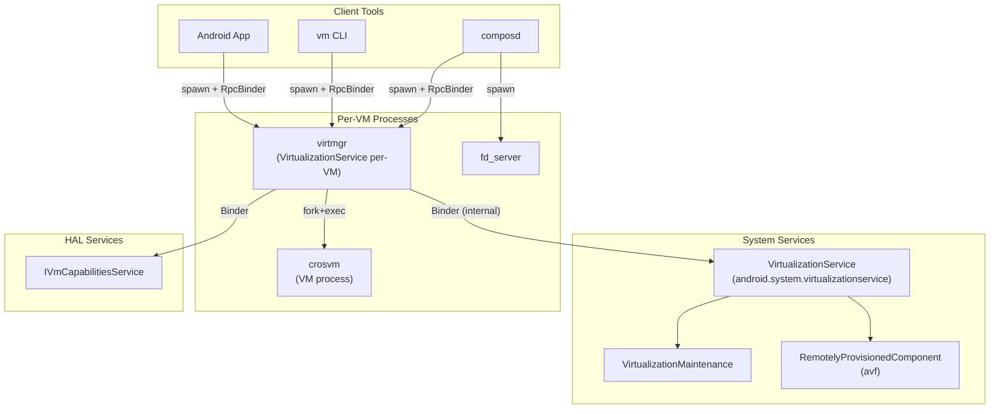

### 56.6.2 VirtualizationService

`VirtualizationService` 是管理全局虚拟机资源的中心守护进程。来自 `packages/modules/Virtualization/android/virtualizationservice/src/main.rs`：

```rust
fn try_main() -> Result<()> {
    // ...
    ProcessState::start_thread_pool();

    let service = VirtualizationServiceInternal::init();
    let internal_service =
        BnVirtualizationServiceInternal::new_binder(
            service.clone(), BinderFeatures::default()
        );
    register(INTERNAL_SERVICE_NAME, internal_service)?;

    if is_remote_provisioning_hal_declared().unwrap_or(false) {
        let remote_provisioning_service = remote_provisioning::new_binder();
        register(REMOTELY_PROVISIONED_COMPONENT_SERVICE_NAME,
                 remote_provisioning_service)?;
    }

    if cfg!(llpvm_changes) {
        let maintenance_service =
            BnVirtualizationMaintenance::new_binder(
                service.clone(), BinderFeatures::default()
            );
        register(MAINTENANCE_SERVICE_NAME, maintenance_service)?;
    }

    ProcessState::join_thread_pool();
    // ...
}
```

该服务注册多达三个 Binder 接口：

1. **`android.system.virtualizationservice`**——用于虚拟机管理的内部 API
2. **`android.hardware.security.keymint.IRemotelyProvisionedComponent/avf`**——
    远程密钥配置（如果已声明）

3. **`android.system.virtualizationmaintenance`**——虚拟机维护操作

### 56.6.3 全局状态管理

`VirtualizationServiceInternal` 单例管理全局唯一的资源：

```rust
pub struct VirtualizationServiceInternal {
    state: Arc<Mutex<GlobalState>>,
    display_service_set: Arc<Condvar>,
    shutdown_monitor: Arc<Mutex<ShutdownMonitor>>,
}
```

关键托管资源包括：

- **CID 分配**——每个虚拟机在 2048-65535 范围内获得一个唯一的 vsock CID：

```rust
const GUEST_CID_MIN: Cid = 2048;
const GUEST_CID_MAX: Cid = 65535;
```

- **临时目录**——位于 `/data/misc/virtualizationservice/` 下的每个虚拟机的工作目录

- **Tombstone 接收器**——收集来自虚拟机的崩溃转储
- **显示服务**——可选的显示转发

### 56.6.4 AIDL 接口

VirtualizationService 暴露了一个丰富的 AIDL 接口。关键类型来自 `packages/modules/Virtualization/android/virtmgr/src/aidl.rs`：

```rust
// VM configuration types
pub use VirtualMachineConfig::VirtualMachineConfig;
pub use VirtualMachineAppConfig::VirtualMachineAppConfig;
pub use VirtualMachineRawConfig::VirtualMachineRawConfig;
pub use VirtualMachineState::VirtualMachineState;

// VM lifecycle
pub use IVirtualMachine::IVirtualMachine;
pub use IVirtualMachineCallback::IVirtualMachineCallback;
pub use IVirtualizationService::IVirtualizationService;

// Security
pub use ISecretkeeper::ISecretkeeper;
pub use IAuthGraphKeyExchange::IAuthGraphKeyExchange;
pub use Certificate::Certificate;
```

### 56.6.5 虚拟机生命周期

虚拟机经历由服务管理的、定义良好的生命周期：

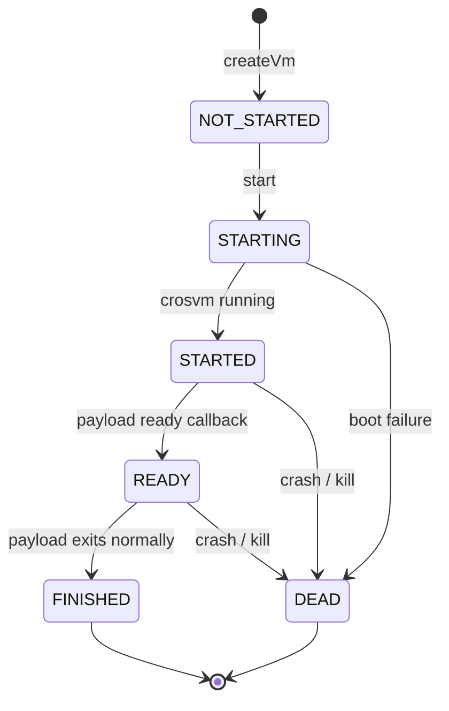

来自 AIDL 定义的虚拟机状态：

```rust
fn state_to_str(vm_state: VirtualMachineState) -> &'static str {
    match vm_state {
        VirtualMachineState::NOT_STARTED => "NOT_STARTED",
        VirtualMachineState::STARTING => "STARTING",
        VirtualMachineState::STARTED => "STARTED",
        VirtualMachineState::READY => "READY",
        VirtualMachineState::FINISHED => "FINISHED",
        VirtualMachineState::DEAD => "DEAD",
        _ => "(invalid state)",
    }
}
```

### 56.6.6 虚拟机创建流程

创建和启动虚拟机的完整流程：

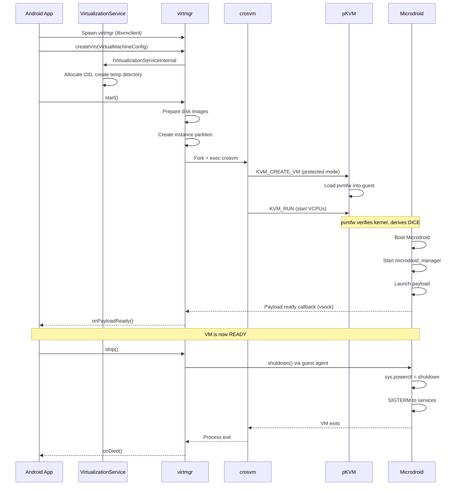

### 56.6.7 vm CLI 工具

位于 `packages/modules/Virtualization/android/vm/src/main.rs` 的 `vm` 命令行工具提供对虚拟机操作的 shell 访问：

```rust
#[derive(Parser)]
enum Opt {
    /// Check if the feature is enabled on device.
    CheckFeatureEnabled { feature: String },
    /// Run a virtual machine with a config in APK
    RunApp { config: RunAppConfig },
    /// Run a virtual machine with Microdroid inside
    RunMicrodroid { config: RunMicrodroidConfig },
    /// Run a virtual machine
    Run { config: RunCustomVmConfig },
    /// List running virtual machines
    List,
    /// Print information about virtual machine support
    Info,
    /// Create a new empty partition
    CreatePartition { path, size, partition_type },
    /// Creates or update the idsig file
    CreateIdsig { apk, path },
    /// Connect to the serial console of a VM
    Console { cid: Option<i32> },
}
```

常用操作：

```shell
# Run Microdroid with default configuration
adb shell /apex/com.android.virt/bin/vm run-microdroid

# Run a protected Microdroid VM
adb shell /apex/com.android.virt/bin/vm run-microdroid --protected

# Run with custom memory and CPU topology
adb shell /apex/com.android.virt/bin/vm run-microdroid \
    --mem 512 --cpu-topology match_host

# List running VMs
adb shell /apex/com.android.virt/bin/vm list

# Get VM support information
adb shell /apex/com.android.virt/bin/vm info
```

### 56.6.8 虚拟机配置类型

支持两种配置类型：

**AppConfig**——用于从 APK 运行载荷：

```rust
VirtualMachineConfig::AppConfig(VirtualMachineAppConfig {
    name: "VmRunApp".to_string(),
    apk: apk_fd.into(),
    idsig: idsig_fd.into(),
    instanceImage: open_parcel_file(&instance, true)?.into(),
    instanceId: instance_id,
    payload: Payload::PayloadConfig(VirtualMachinePayloadConfig {
        payloadBinaryName: "MyPayload.so".to_string(),
        extraApks: vec![],
    }),
    debugLevel: DebugLevel::FULL,
    protectedVm: true,
    memoryMib: 256,
    cpuOptions: CpuOptions { cpuTopology: CpuTopology::MatchHost(true) },
    osName: "microdroid".to_string(),
    hugePages: false,
    // ...
})
```

**RawConfig**——用于从 JSON 文件运行自定义虚拟机配置：

```rust
let config_file = File::open(&config_path)?;
let vm_config = VmConfig::load(&config_file)?.to_parcelable()?;
VirtualMachineConfig::RawConfig(vm_config)
```

### 56.6.9 composd：可信编译服务

`composd` 服务编排虚拟机内 ART 产物的可信编译。来自 `packages/modules/Virtualization/android/composd/src/composd_main.rs`：

```rust
fn try_main() -> Result<()> {
    // ...
    let virtmgr = vmclient::VirtualizationService::new()
        .context("Failed to spawn VirtualizationService")?;
    let virtualization_service = virtmgr.connect()
        .context("Failed to connect to VirtualizationService")?;

    let instance_manager = Arc::new(InstanceManager::new(virtualization_service));
    let composd_service = service::new_binder(instance_manager);
    register_lazy_service("android.system.composd", composd_service.as_binder())
        .context("Registering composd service")?;
    // ...
}
```

composd 架构：

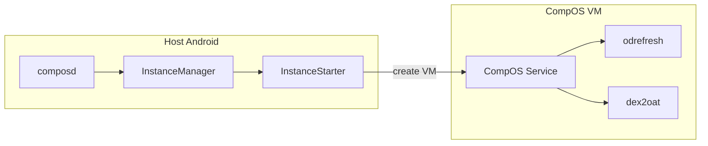

composd 使用虚拟机在可信环境中运行 dex2oat 编译。这确保了编译后的产物未被篡改。输出使用从虚拟机 DICE 链派生的密钥进行签名。

### 56.6.10 关机协议

虚拟机关机遵循 `packages/modules/Virtualization/docs/shutdown.md` 中定义的优雅协议：

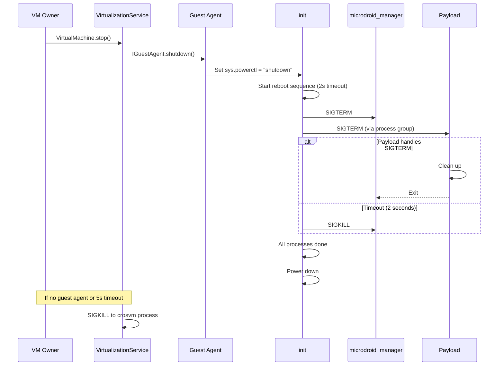

优雅关机的超时层级：

1. **载荷**接收 SIGTERM，应立即清理
2. **init** 在 SIGKILL 之前等待 2 秒（`ro.build.shutdown_timeout`）
3. **VirtualizationService** 在调用客户机代理后等待 5 秒，
    然后直接杀死 crosvm 进程

### 56.6.11 Service VM

Service VM 是一个用于远程密钥配置的专用虚拟机。来自 `packages/modules/Virtualization/guest/service_vm/README.md`：

> Service VM 是一个轻量级的裸机虚拟机，专为运行供其他虚拟机使用的各种服务而设计。

关键特征：

- 同时只运行一个实例
- 实例 ID 在更新之间保持不变
- 通过 `libvmbase` 与 pvmfw 共享公共代码
- 通过 virtio-vsock 处理 CBOR 编码的请求

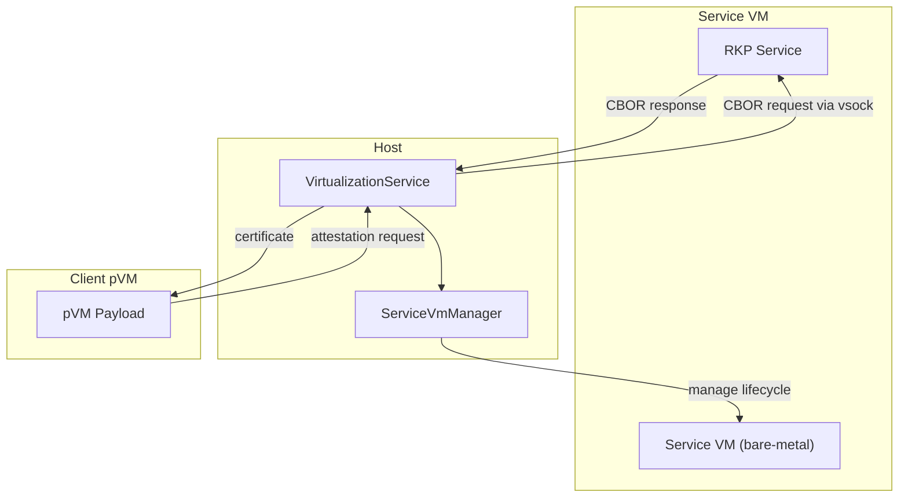

### 56.6.12 实例 ID 与 CID 管理

每个虚拟机获得两个标识符：

- **实例 ID**——一个 64 字节的随机标识符，在虚拟机重启之间保持不变。它存储在一个文件中，并被纳入 DICE 派生以获得一致的机密。

- **CID**——一个从 2048-65535 范围内分配的 32 位 vsock 上下文 ID。用于宿主-客户机通信。

来自 `packages/modules/Virtualization/android/vm/src/run.rs` 的实例 ID 分配：

```rust
let instance_id = {
    let id_file = config.instance_id;
    if id_file.exists() {
        let mut id = [0u8; 64];
        let mut instance_id_file = File::open(id_file)?;
        instance_id_file.read_exact(&mut id)?;
        id
    } else {
        let id = service.allocateInstanceId()
            .context("Failed to allocate instance_id")?;
        let mut instance_id_file = File::create(id_file)?;
        instance_id_file.write_all(&id)?;
        id
    }
};
```

### 56.6.13 Tombstone 收集

VirtualizationService 运行一个 tombstone 接收器，它监听来自虚拟机通过 vsock 发送的崩溃转储。接收器端口由 AIDL 接口定义：

```rust
use virtualmachineservice::IVirtualMachineService::VM_TOMBSTONES_SERVICE_PORT;
```

当虚拟机崩溃时，客户机中的 tombstoned 客户端将崩溃转储发送到宿主。在那里，它使用标准的 Android tombstone 基础架构进行存储。

---

## 56.7 硬件能力

### 56.7.1 IVmCapabilitiesService HAL

`IVmCapabilitiesService` HAL 使供应商特定的能力能够被授予虚拟机。它定义于 `hardware/interfaces/virtualization/capabilities_service/aidl/android/hardware/virtualization/capabilities/IVmCapabilitiesService.aidl`：

```java
@VintfStability
interface IVmCapabilitiesService {
    /**
     * Grant access for the VM represented by the given vm_fd to the given
     * vendor-owned tee services. The names in |vendorTeeServices| must match
     * the ones defined in the tee_service_contexts files.
     */
    void grantAccessToVendorTeeServices(
            in ParcelFileDescriptor vmFd, in String[] vendorTeeServices);
}
```

如 `hardware/interfaces/virtualization/capabilities_service/README.md` 中所述：

> IVmCapabilitiesService HAL 用于这样一个流程：授予 pVM 发出供应商特定 SMC 的能力。

### 56.7.2 实现结构

该 HAL 有两个实现（default 和 noop），以及 `aidl/` 接口定义和 `vts/` 测试：

```
hardware/interfaces/virtualization/capabilities_service/
    aidl/        # Interface definition
    default/     # Reference implementation for partners
    noop/        # No-op implementation for Cuttlefish/testing
    vts/         # VTS (Vendor Test Suite) tests
```

位于 `hardware/interfaces/virtualization/capabilities_service/default/src/aidl.rs` 的**默认实现**：

```rust
pub struct VmCapabilitiesService {}

impl IVmCapabilitiesService for VmCapabilitiesService {
    fn grantAccessToVendorTeeServices(
        &self,
        vm_fd: &ParcelFileDescriptor,
        tee_services: &[String]
    ) -> binder::Result<()> {
        info!("received {vm_fd:?} {tee_services:?}");
        // TODO(b/360102915): implement
        Ok(())
    }
}
```

位于 `hardware/interfaces/virtualization/capabilities_service/noop/src/aidl.rs` 的**无操作实现**：

```rust
pub struct NoOpVmCapabilitiesService {}

impl IVmCapabilitiesService for NoOpVmCapabilitiesService {
    fn grantAccessToVendorTeeServices(
        &self,
        vm_fd: &ParcelFileDescriptor,
        tee_services: &[String]
    ) -> binder::Result<()> {
        info!("received {vm_fd:?} {tee_services:?}");
        Ok(())
    }
}
```

### 56.7.3 服务注册

默认服务作为惰性 Binder 服务注册，来自 `hardware/interfaces/virtualization/capabilities_service/default/src/main.rs`：

```rust
const SERVICE_NAME: &str =
    "android.hardware.virtualization.capabilities.IVmCapabilitiesService/default";

fn try_main() -> Result<()> {
    android_logger::init_once(
        android_logger::Config::default()
            .with_tag("IVmCapabilitiesService")
            .with_max_level(LevelFilter::Info)
            .with_log_buffer(android_logger::LogId::System),
    );

    ProcessState::start_thread_pool();
    let service_impl = VmCapabilitiesService::init();
    let service = BnVmCapabilitiesService::new_binder(
        service_impl, BinderFeatures::default()
    );
    register_lazy_service(SERVICE_NAME, service.as_binder())
        .with_context(|| format!("failed to register {SERVICE_NAME}"))?;
    ProcessState::join_thread_pool();
    bail!("thread pool unexpectedly ended");
}
```

### 56.7.4 TEE 服务访问流程

能力授予流程允许虚拟机发出供应商特定的 SMC（Secure Monitor Call，安全监控器调用）指令，以与可信执行环境通信：

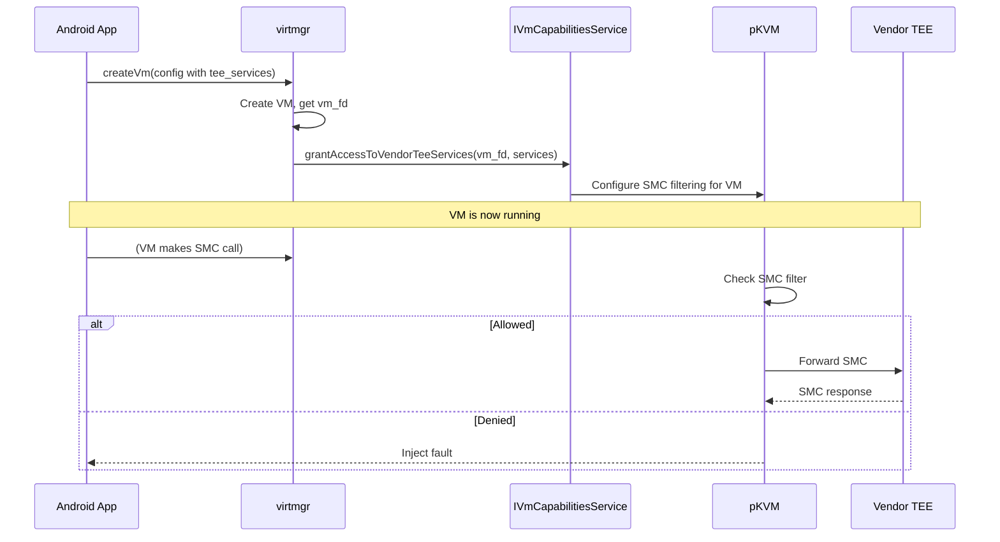

### 56.7.5 设备分配

AVF 使用 VFIO-platform 支持硬件设备分配。这使虚拟机能够直接访问物理硬件设备，而无需宿主干预。

来自 `packages/modules/Virtualization/docs/device_assignment.md`：

> 设备分配允许虚拟机在没有宿主/虚拟机管理程序干预的情况下直接访问硬件。AVF 使用 `vfio-platform` 进行设备分配，并且需要宿主内核支持。

设备分配流程要求：

1. 一个描述可分配设备的虚拟机 DTBO
2. 带有 IOMMU 引用的物理设备节点
3. VFIO-platform 内核驱动支持

`vm` CLI 通过 `--devices` 标志支持设备分配：

```shell
adb shell /apex/com.android.virt/bin/vm run-microdroid \
    --devices /sys/bus/platform/devices/example-device
```

设备是否存在由 `vm info` 命令检查：

```rust
if Path::new("/dev/vfio/vfio").exists() {
    println!("/dev/vfio/vfio exists.");
}
if Path::new("/sys/bus/platform/drivers/vfio-platform").exists() {
    println!("VFIO-platform is supported.");
}
```

### 56.7.6 虚拟机管理程序属性

AVF 通过由 `hypervisor_props` 库管理的系统属性查询虚拟机管理程序能力：

```rust
let non_protected_vm_supported = hypervisor_props::is_vm_supported()?;
let protected_vm_supported = hypervisor_props::is_protected_vm_supported()?;
if let Some(version) = hypervisor_props::version()? {
    println!("Hypervisor version: {version}");
}
```

关键系统属性：

- `ro.boot.hypervisor.vm.supported`——是否支持非受保护虚拟机
- `ro.boot.hypervisor.protected_vm.supported`——是否支持 pVM
- `ro.boot.hypervisor.version`——虚拟机管理程序版本字符串
- `hypervisor.pvmfw.path`——pvmfw 二进制文件的覆盖路径

---

## 56.8 回滚保护

### 56.8.1 概述

回滚保护防止攻击者运行较旧的、存在漏洞的虚拟机载荷版本，并访问为较新版本配置的机密。pvmfw 实现了多种回滚保护策略，根据虚拟机类型和平台能力进行选择。

来自 `packages/modules/Virtualization/guest/pvmfw/src/rollback.rs`：

```rust
pub fn perform_rollback_protection<'a>(
    fdt: &Fdt,
    verified_boot_data: &VerifiedBootData,
    dice_inputs: &PartialInputs,
    cdi_seal: &[u8],
    rollback_config: Option<&RollbackConfig<'a>>,
    extra_keys: &[&'a [u8]],
) -> Result<(bool, Hidden, bool), RebootReason> {
    let instance_hash = dice_inputs.instance_hash;
    if let Some(fixed) =
        get_fixed_rollback_protection(verified_boot_data, rollback_config, extra_keys)
    {
        perform_fixed_rollback_protection(verified_boot_data, fixed)?;
        Ok((false, instance_hash.unwrap(), false))
    } else if (should_defer_rollback_protection(fdt)?
        && verified_boot_data.has_capability(Capability::SecretkeeperProtection))
        || verified_boot_data.has_capability(Capability::TrustySecurityVm)
    {
        perform_deferred_rollback_protection(verified_boot_data)?;
        Ok((false, instance_hash.unwrap(), true))
    } else if cfg!(feature = "instance-img") {
        perform_legacy_rollback_protection(fdt, dice_inputs, cdi_seal, instance_hash)
    } else {
        force_new_instance()
    }
}
```

### 56.8.2 回滚保护策略

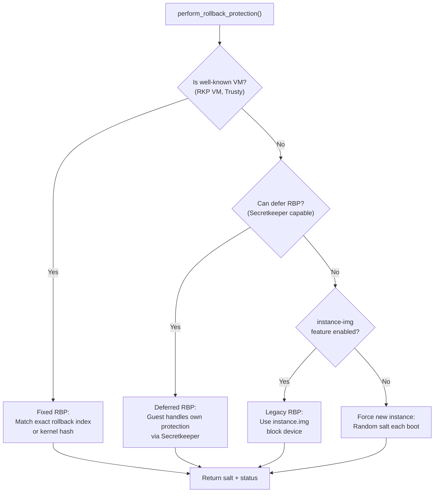

**固定回滚保护**——用于具有特定身份的知名系统虚拟机：

```rust
pub(crate) enum FixedRollbackCriterion<'a> {
    /// Image must match one of the allowed kernel hashes.
    KernelHash { digests: &'a [Digest] },
    /// Image must match the exact rollback index and public key.
    RollbackIndexPublicKey { index: u64, public_key: &'a [u8] },
    /// Reserved name not supported on this platform.
    Reserved { name: &'a str },
}
```

RKP VM 使用回滚索引 + 公钥验证：

```rust
match verified_boot_data.name.as_deref()? {
    VerifiedBootData::RKP_VM_NAME =>
        Some(FixedRollbackCriterion::RollbackIndexPublicKey {
            index: platform_security_patch_timestamp::TIMESTAMP,
            public_key: PUBLIC_KEY,
        }),
    VerifiedBootData::DESKTOP_TRUSTY_VM_NAME => {
        // Platform-specific: kernel hash verification
    }
    _ => None,
}
```

**延迟回滚保护**——客户机通过 Secretkeeper 自行处理回滚保护。pvmfw 只验证回滚索引为正：

```rust
fn perform_deferred_rollback_protection(
    verified_boot_data: &VerifiedBootData,
) -> Result<(), RebootReason> {
    info!("Deferring rollback protection");
    if verified_boot_data.rollback_index == 0 {
        error!("Expected positive rollback_index, found 0");
        Err(RebootReason::InvalidPayload)
    } else {
        Ok(())
    }
}
```

**传统回滚保护**——使用 instance.img 块设备存储已记录的 DICE 度量值。在后续引导时，pvmfw 将当前度量值与已记录的条目进行比较：

```rust
fn ensure_dice_measurements_match_entry(
    dice_inputs: &PartialInputs,
    entry: &EntryBody,
) -> Result<(), InstanceError> {
    if entry.code_hash != dice_inputs.code_hash {
        Err(InstanceError::RecordedCodeHashMismatch)
    } else if entry.auth_hash != dice_inputs.auth_hash {
        Err(InstanceError::RecordedAuthHashMismatch)
    } else if entry.mode() != dice_inputs.mode {
        Err(InstanceError::RecordedDiceModeMismatch)
    } else {
        Ok(())
    }
}
```

---

## 56.9 配置数据深入解析

### 56.9.1 配置解析器实现

位于 `packages/modules/Virtualization/guest/pvmfw/src/config/mod.rs` 的 pvmfw 配置解析器对引导加载程序附加的配置数据实现了严格的验证：

```rust
impl Header {
    const MAGIC: u32 = u32::from_ne_bytes(*b"pvmf");
    const VERSION_1_0: Version = Version { major: 1, minor: 0 };
    const VERSION_1_1: Version = Version { major: 1, minor: 1 };
    const VERSION_1_2: Version = Version { major: 1, minor: 2 };
    const VERSION_1_3: Version = Version { major: 1, minor: 3 };
    const VERSION_1_4: Version = Version { major: 1, minor: 4 };
}
```

解析器验证：

1. 魔数（`0x666d7670` = 小端序的 "pvmf"）
2. 版本兼容性
3. 总大小适合保留区域
4. 所有条目偏移量和大小都在边界内
5. 条目按顺序排列（无重叠）

### 56.9.2 条目类型

配置条目被定义为一个带有计数哨兵的枚举：

```rust
#[derive(Clone, Copy, Debug)]
pub enum Entry {
    DiceHandover,    // Entry 0: DICE chain (mandatory)
    DebugPolicy,     // Entry 1: Debug policy DTBO (optional)
    VmDtbo,          // Entry 2: Device assignment DTBO (v1.1)
    VmBaseDtbo,      // Entry 3: VM reference DT (v1.2)
    ReservedMem,     // Entry 4: Reserved memory (v1.3)
    ExtraRollback,   // Entry 5: Extra rollback info (v1.4)
    TrustedKeys,     // Entry 6: Trusted keys (defined, not yet versioned)
    _VARIANT_COUNT,  // Sentinel for counting
}
```

main 接收的条目结构：

```rust
#[derive(Default)]
pub struct Entries<'a> {
    pub dice_handover: Option<&'a mut [u8]>,  // Mutable: will be zeroized
    pub debug_policy: Option<&'a [u8]>,        // Read-only
    pub vm_dtbo: Option<&'a mut [u8]>,         // Mutable: DTBO processing
    pub vm_ref_dt: Option<&'a [u8]>,           // Read-only
    pub reserved_mem: Option<&'a mut [u8]>,    // Mutable: will be zeroized
    pub trusted_keys: Option<&'a [u8]>,        // Read-only
    pub extra_rollback: Option<&'a [u8]>,      // Read-only
}
```

注意谨慎的所有权设计：可变引用用于包含机密的条目（DICE 移交、保留内存），以便在使用后可以将其清零。只读引用用于只需检查的条目。

### 56.9.3 版本协商

解析器通过将未知的次版本号视为已知的最新版本来处理前向兼容性：

```rust
pub fn entry_count(&self) -> Result<usize> {
    let last_entry = match self.version {
        Self::VERSION_1_0 => Entry::DebugPolicy,
        Self::VERSION_1_1 => Entry::VmDtbo,
        Self::VERSION_1_2 => Entry::VmBaseDtbo,
        Self::VERSION_1_3 => Entry::ReservedMem,
        Self::VERSION_1_4 => Entry::ExtraRollback,
        v @ Version { major: 1, .. } => {
            const LATEST: Version = Header::VERSION_1_4;
            warn!("Parsing unknown config data version {v} as version {LATEST}");
            return Ok(Entry::COUNT);
        }
        v => return Err(Error::UnsupportedVersion(v)),
    };
    Ok(last_entry as usize + 1)
}
```

这意味着，带有未知 1.x 次版本号的配置将按已知的最新版本（当前为 1.4）进行解析。超出已知集合的任何新条目都会被静默忽略。主版本号变更（2.x）将被拒绝。

### 56.9.4 错误处理

配置模块为每种失败模式定义了精确的错误变体：

```rust
pub enum Error {
    BufferTooSmall,
    HeaderMisaligned,
    InvalidMagic,
    UnsupportedVersion(Version),
    InvalidSize(usize),
    MissingEntry(Entry),
    EntryOutOfBounds(Entry, Range<usize>, Range<usize>),
    EntryOutOfOrder,
}
```

每个错误都会产生一条清晰的诊断消息。`InvalidMagic` 错误有特殊处理——它触发传统的 DICE 移交路径，以兼容 Android T：

```rust
match config::Config::new(data) {
    Ok(valid) => Some(Self::Config(valid)),
    Err(config::Error::InvalidMagic) if cfg!(feature = "compat-raw-dice-handover") => {
        warn!("Assuming the appended data to be a raw DICE handover");
        Some(Self::LegacyDiceHandover(&mut data[..DICE_CHAIN_SIZE]))
    }
    Err(e) => {
        error!("Invalid configuration data at {data_ptr:?}: {e}");
        None
    }
}
```

---

## 56.10 pvmfw 中的设备树处理

### 56.10.1 FDT 净化

由 VMM 提供的设备树是不可信的，必须在使用前进行净化。pvmfw 采用基于模板的方法，从一个已知良好的 FDT 模板开始，并有选择地从不可信的 FDT 中复制经过验证的属性。

来自 `packages/modules/Virtualization/guest/pvmfw/src/fdt.rs`：

```rust
// Architecture-specific FDT templates
#[cfg(target_arch = "aarch64")]
const FDT_TEMPLATE: &Fdt = unsafe {
    Fdt::unchecked_from_slice(pvmfw_fdt_template::RAW)
};

#[cfg(target_arch = "x86_64")]
const FDT_TEMPLATE: &Fdt = unsafe {
    Fdt::unchecked_from_slice(pvmfw_fdt_template::RAW_X86_64)
};
```

FDT 验证会捕获几种错误条件：

```rust
pub enum FdtValidationError {
    /// Invalid CPU count.
    InvalidCpuCount(usize),
    /// Invalid VCpufreq Range.
    InvalidVcpufreq(u64, u64),
    /// Forbidden /avf/untrusted property.
    ForbiddenUntrustedProp(&'static CStr),
}
```

### 56.10.2 为下一阶段修改设备树

净化之后，pvmfw 修改 FDT 以将信息传递给客户机内核：

1. **DICE 链**——作为 `/reserved-memory/dice` 节点添加，带有 `compatible = "google,open-dice"`

2. **KASLR 种子**——内核地址空间布局随机化的随机种子
3. **引导参数**——调试级别、实例状态
4. **保留内存**——机密数据区域
5. **设备分配信息**——如果配置了设备直通

保留内存 DICE 节点格式：

```
/ {
    reserved-memory {
        #address-cells = <0x02>;
        #size-cells = <0x02>;
        ranges;
        dice {
            compatible = "google,open-dice";
            no-map;
            reg = <0x0 0x7fe0000>, <0x0 0x1000>;
        };
    };
};
```

### 56.10.3 FDT 处的安全边界

FDT 代表一个关键的信任边界。VMM 构建 FDT 以描述虚拟平台，但在受保护虚拟机威胁模型中，VMM 是不可信的。因此 pvmfw 必须：

- 未经验证就**绝不信任**来自不可信 FDT 的设备地址或大小
- 未经边界检查就**绝不信任** CPU 数量或内存布局
- **验证**对安全至关重要的属性（如 DICE 链位置）是否正确构造

- 在移交给客户机内核之前，用净化后的版本**替换**不可信的 FDT

这就是为什么 pvmfw 从一个模板 FDT 开始，而不是原地修改 VMM 提供的 FDT。这确保了客户机接收到的设备树只包含已知安全的内容。

---

## 56.11 vmbase：公共虚拟机基础库

### 56.11.1 目的

位于 `packages/modules/Virtualization/libs/libvmbase/` 的 `vmbase` 库为在 crosvm 虚拟机中运行的裸机 Rust 二进制文件提供共享的底层基础设施。pvmfw 和 Service VM 都构建于 vmbase 之上。

来自 vmbase README：

> 此目录包含一个 Rust crate 和一个静态库，可用于编写在 crosvm 下的 aarch64 虚拟机中运行（经由 VirtualizationService）的 `no_std` Rust 二进制文件，例如 pVM 固件、虚拟机引导加载程序或内核。

### 56.11.2 提供的基础设施

vmbase 提供：

- **入口点**——使用恒等映射初始化 MMU，启用缓存，准备镜像，并分配栈

- **异常向量**——调用用户定义的异常处理程序
- **UART 驱动**——通过 MMIO 地址 `0x3f8` 处的 `println!` 进行控制台日志记录
- **电源管理**——通过 PSCI 调用实现 `shutdown()` 和 `reboot()`
- **堆分配**——用于 `no_std` 二进制文件的可配置堆
- **页表操作**——内存管理单元设置
- **PSCI 调用**——电源状态协调接口封装器

### 56.11.3 源代码组织

```
packages/modules/Virtualization/libs/libvmbase/src/
    acpi/              # ACPI table support
    acpi.rs            # ACPI utilities
    arch/              # Architecture-specific code
    arch.rs            # Architecture abstraction
    bionic.rs          # Bionic compatibility shims
    bzimage.rs         # bzImage (Linux) boot support
    console.rs         # Console output
    entry.rs           # Entry point macros
    fdt/               # Flattened Device Tree support
    fdt.rs             # FDT utilities
    heap.rs            # Heap allocator
    layout.rs          # Memory layout definitions
    lib.rs             # Crate root
    linker.rs          # Linker support
    logger.rs          # Logging infrastructure
    memory/            # Memory management
    memory.rs          # Memory tracking
    mmu.rs             # Memory Management Unit
    power.rs           # PSCI power management
    rand.rs            # Random number generation
    uart.rs            # UART driver
    util.rs            # Utilities
    virtio/            # VirtIO device support
    virtio.rs          # VirtIO abstractions
```

### 56.11.4 使用 vmbase 构建自定义二进制文件

一个最小化的 vmbase 二进制文件需要：

```rust
#![no_main]
#![no_std]

use vmbase::main;
use log::{info, LevelFilter};

main!(main);

pub fn main(argv: &[usize]) {
    log::set_max_level(LevelFilter::Info);
    info!("Hello world");
}
```

`main!` 宏需要一个接收 `argv: &[usize]` 的函数；vmbase 自己的入口代码会在 `main` 运行之前初始化日志记录器。因此，应用程序只需使用 `log::set_max_level()` 调整日志级别。

构建系统结合使用 `rust_ffi_static` 和 `cc_binary` 规则，并配以自定义链接器脚本：

```soong
rust_ffi_static {
    name: "libvmbase_example",
    defaults: ["vmbase_ffi_defaults"],
    crate_name: "vmbase_example",
    srcs: ["src/main.rs"],
    rustlibs: ["libvmbase"],
}
```

入口点宏使用以下内容包装用户函数：

1. 控制台驱动初始化（`0x3f8` 处的 UART）
2. 栈设置
3. 返回时的 PSCI `SYSTEM_OFF` 调用

### 56.11.5 vmbase 中的内存管理

pvmfw 中的 `memory.rs` 模块使用 vmbase 的内存跟踪：

```rust
pub(crate) struct MemorySlices<'a> {
    pub fdt: &'a mut libfdt::Fdt,
    pub kernel: &'a [u8],
    pub ramdisk: Option<&'a [u8]>,
    pub preserved_memory: Option<&'a [u8]>,
    pub boot_params: Option<&'a mut bzimage::boot_params>,
}
```

内存区域使用显式的只读或读写权限进行映射：

```rust
fn map_data_slice_mut<'a>(addr: usize, size: usize)
    -> Result<&'a mut [u8], MemoryTrackerError>
{
    let nonzero_size = size.try_into().map_err(|_| {
        error!("Invalid size specified for the range: {size:#x}");
        MemoryTrackerError::SizeTooSmall
    })?;
    map_data(addr, nonzero_size)?;
    let mut_slice = unsafe {
        slice::from_raw_parts_mut(addr as *mut u8, size)
    };
    Ok(mut_slice)
}

fn map_data_slice<'a>(addr: usize, size: usize)
    -> Result<&'a [u8], MemoryTrackerError>
{
    let nonzero_size = size.try_into().map_err(|e| {
        error!("Invalid size specified for the range: {e}");
        MemoryTrackerError::SizeTooSmall
    })?;
    map_rodata(addr, nonzero_size)?;
    let slice = unsafe {
        slice::from_raw_parts(addr as *const u8, size)
    };
    Ok(slice)
}
```

这种分离确保内核镜像和 ramdisk 通过 `map_data_slice()`（由 `map_rodata` 支持）以只读方式映射。只有 pvmfw 必须修改的区域才通过 `map_data_slice_mut()` 以读写方式映射。这些区域是 FDT，以及在 x86_64 上的引导参数和 setup data。

---

## 56.12 设备分配详解

### 56.12.1 架构

设备分配（也称为设备直通）允许虚拟机在没有宿主/虚拟机管理程序数据路径干预的情况下直接访问物理硬件设备。AVF 为此使用 VFIO-platform。

来自 `packages/modules/Virtualization/docs/device_assignment.md`：

> 设备分配允许虚拟机在没有宿主/虚拟机管理程序干预的情况下直接访问硬件。AVF 使用 `vfio-platform` 进行设备分配，并且需要宿主内核支持。

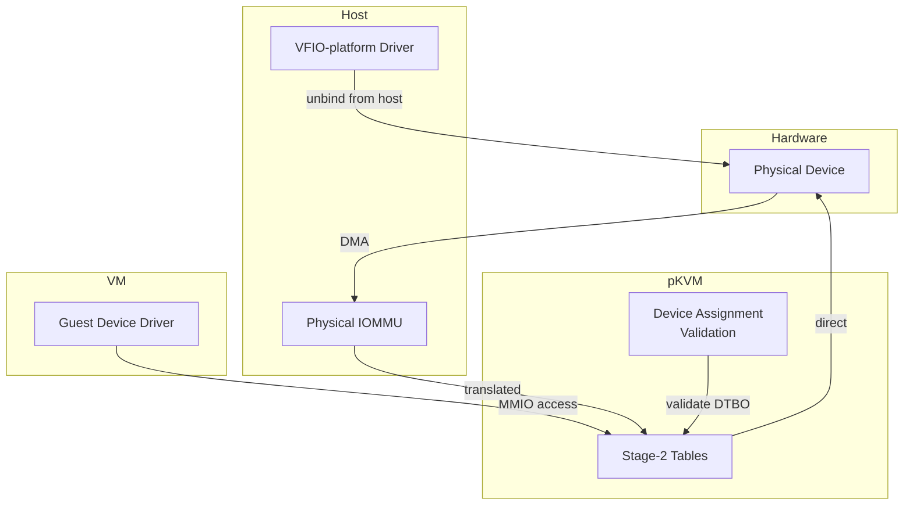

### 56.12.2 虚拟机 DTBO 结构

虚拟机设备树二进制覆盖层（DTBO）描述可分配的设备。它有两个部分：

**可覆盖设备**（应用于虚拟机 DT）：
```dts
// Devices visible to the VM
&{/} {
    my_device@12340000 {
        compatible = "vendor,my-device";
        reg = <0x0 0x12340000 0x0 0x1000>;
        interrupts = <0 42 4>;
    };
};
```

**物理设备描述**（不应用，用于验证）：
```dts
/host {
    // Physical IOMMU
    iommu@0 {
        #iommu-cells = <1>;
        android,pvmfw,token = <0x0 0x12345678>;
    };

    // Physical device
    phys_device@abcd0000 {
        reg = <0x0 0xabcd0000 0x0 0x1000>;
        iommus = <&iommu 0x1>;
        android,pvmfw,target = <&my_device>;
    };
};
```

### 56.12.3 pvmfw 设备分配验证

位于 `packages/modules/Virtualization/guest/pvmfw/src/device_assignment.rs` 的 pvmfw 设备分配模块针对物理平台验证 DTBO：

```rust
pub enum DeviceAssignmentError {
    InvalidDtbo,
    InvalidSymbols,
    MalformedReg,
    MissingReg(u64, u64),
    ExtraReg(u64, u64),
    InvalidReg(u64),
    InvalidRegToken(u64, u64),
    InvalidRegSize(u64, u64),
    InvalidInterrupts,
    MalformedIommus,
    InvalidIommus,
    InvalidPhysIommu,
    InvalidPvIommu,
    TooManyPvIommu,
    DuplicatedIommuIds,
    DuplicatedPvIommuIds,
    UnsupportedPathFormat,
    // ... additional error variants
}
```

验证确保：

1. 物理寄存器地址与虚拟机管理程序报告的一致
2. IOMMU 令牌有效且一致
3. 设备节点引用有效的可覆盖目标
4. 不存在重复的 IOMMU 或设备条目

### 56.12.4 IOMMU 令牌验证

虚拟机 DTBO 中的每个 IOMMU 都携带一个令牌——一个虚拟机管理程序特定的 64 位值，用于唯一标识一个物理 IOMMU。pvmfw 针对虚拟机管理程序报告的内容验证这些令牌：

```mermaid
sequenceDiagram
    participant ABL as Bootloader
    participant pKVM as pKVM
    participant PVMFW as pvmfw

    ABL->>pKVM: Provide VM DTBO with IOMMU tokens
    Note over ABL,pKVM: Tokens must be constant across boots

    pKVM->>PVMFW: Load pvmfw + config (includes VM DTBO)
    PVMFW->>pKVM: Query device IOMMU bindings
    pKVM-->>PVMFW: Physical IOMMU tokens

    PVMFW->>PVMFW: Validate DTBO tokens match pKVM tokens
    alt Tokens match
        PVMFW->>PVMFW: Apply DTBO to VM device tree
    else Tokens mismatch
        PVMFW->>PVMFW: Reject device assignment
    end
```

---

## 56.13 crosvm 中的异步 I/O

### 56.13.1 cros_async 运行时

crosvm 包含自己的异步运行时（`cros_async`），它提供两个执行器后端：

- **io_uring**——使用 Linux io_uring 进行高性能异步 I/O
- **epoll**——回退到基于 epoll 的轮询

来自 `external/crosvm/ARCHITECTURE.md` 中的代码组织说明：

> `cros_async` - 用于 async/await 编程的运行时。此 crate 提供了一个基于 `io_uring` 的 `Future` 执行器和一个基于 `epoll` 的执行器。

执行器类型可以在虚拟机启动时配置：

```rust
if let Some(async_executor) = cfg.async_executor {
    cros_async::Executor::set_default_executor_kind(async_executor)
        .context("Failed to set the default async executor")?;
}
```

### 56.13.2 Virtio 队列处理

每个 virtio 设备的工作线程都使用异步运行时进行队列处理。一般模式（根据架构文档简化）：

```rust
// Worker thread for a virtio device (conceptual)
async fn process_queue(
    queue: Queue,
    mem: GuestMemory,
    interrupt: Interrupt,
) -> Result<()> {
    loop {
        // Wait for the guest to submit descriptors
        let desc_chain = queue.next_async(&mem).await?;

        // Process the request
        let response = handle_request(&desc_chain, &mem)?;

        // Write response and signal completion
        queue.add_used(&mem, desc_chain.index, response.len());
        interrupt.signal_used_queue(queue.vector());
    }
}
```

### 56.13.3 VirtIO 传输

对于受保护虚拟机，virtio 传输通过共享内存区域运行。客户机必须使用 pKVM 超级调用将用于 virtio 环的内存与客户机显式共享：

```mermaid
graph LR
    subgraph "Guest Memory (Protected)"
        PRIV["Private Data"]
    end

    subgraph "Shared Memory"
        VRING["Virtio Rings\n(descriptor table,\navailable ring,\nused ring)"]
        BUFFERS["Data Buffers\n(for I/O)"]
    end

    subgraph "Host/crosvm"
        DEV["Device Backend"]
    end

    PRIV -.->|"Copy to shared"| BUFFERS
    VRING <-->|"MMIO trap"| DEV
    BUFFERS <-->|"DMA"| DEV
```

---

## 56.14 网络与显示支持

### 56.14.1 网络支持

AVF 通过 `vmnic` 和 `vmtethering` 服务为虚拟机提供可选的网络支持。网络能力由一个特性标志进行控制：

```rust
// From vm CLI configuration
#[cfg(network)]
#[arg(short, long)]
network_supported: bool,
```

启用后，虚拟机配置包括：

```rust
custom_config.networkSupported = config.common.network_supported();
```

网络协议栈使用 virtio-net 进行客户机-宿主通信，由 `VmTethering` 服务在宿主端处理 NAT/网络共享。

### 56.14.2 显示支持

位于 `packages/modules/Virtualization/android/TerminalApp/` 的 `TerminalApp` 提供了一个用于虚拟机交互的终端界面。显示转发使用向 VirtualizationService 注册的 `display_service`：

```rust
pub struct VirtualizationServiceInternal {
    state: Arc<Mutex<GlobalState>>,
    display_service_set: Arc<Condvar>,
    // ...
}
```

---

## 56.15 运行带图形加速的 Linux

Android 虚拟化框架（AVF）支持在虚拟机内运行完整的 Linux 发行版（Debian），并带有硬件加速图形。这使得桌面 Linux 体验——包括 GUI 应用程序、浏览器和开发工具——可以在同一设备上与 Android 应用并行运行。

### 56.15.1 架构概述

Linux 虚拟机栈结合了几个组件：

```mermaid
graph TB
    subgraph Android["Android Host"]
        TA["TerminalApp<br/>DisplayActivity"]
        SV["SurfaceView<br/>Display output"]
        IF["InputForwarder<br/>Touch/keyboard/mouse"]
        VMS["VmLauncherService<br/>VM lifecycle"]
        ADS["Android Display<br/>Backend (C++)"]

        TA --> SV
        TA --> IF
        TA --> VMS
        VMS --> ADS
    end

    subgraph VM["Linux Guest VM (Debian)"]
        KERN["Linux Kernel<br/>virtio drivers"]
        DESK["Desktop Environment<br/>GUI applications"]
        KERN --> DESK
    end

    subgraph crosvm["crosvm VMM"]
        VGPU["virtio-gpu<br/>gfxstream / 2D"]
        VINP["virtio-input<br/>evdev forwarding"]
        VNET["virtio-net<br/>Network"]
        VBLK["virtio-blk<br/>Root filesystem"]
    end

    SV <-->|"ANativeWindow<br/>surface buffer"| ADS
    ADS <-->|"ICrosvmAndroid<br/>DisplayService"| VGPU
    IF -->|"VirtualMachine<br/>sendKeyEvent()"| VINP
    KERN <--> VGPU
    KERN <--> VINP
    KERN <--> VNET
    KERN <--> VBLK
```

### 56.15.2 TerminalApp：Linux 虚拟机前端

位于 `packages/modules/Virtualization/android/TerminalApp/` 的 TerminalApp 是 Linux 虚拟机的 Android 端 UI。它管理完整的生命周期：

#### 虚拟机启动流程

```mermaid
sequenceDiagram
    participant User
    participant TA as TerminalApp
    participant VMS as VmLauncherService
    participant VMM as VirtualMachineManager
    participant CV as crosvm

    User->>TA: Open Terminal App
    TA->>VMS: startService(displayInfo)
    VMS->>VMS: Parse vm_config.json
    VMS->>VMS: Configure GPU (gfxstream or 2D)
    VMS->>VMM: create("debian", config)
    VMM->>CV: Launch crosvm with virtio devices
    CV-->>VMS: VM running
    VMS->>TA: VmLauncherServiceCallback.onVmStart
    TA->>TA: Start DisplayActivity
    TA->>VMS: Connect display surface
    Note over TA,CV: Display output flows<br/>Guest → virtio-gpu → crosvm → Android Surface
```

```kotlin
// Source: packages/modules/Virtualization/android/TerminalApp/java/.../VmLauncherService.kt:67
// VmLauncherService manages VM lifecycle, GPU config, disk management
// Launches Debian VM with display, audio, input, and network
```

#### 显示配置

虚拟机显示会适配 Android 设备的屏幕：

```kotlin
// Source: packages/modules/Virtualization/android/TerminalApp/java/.../VmLauncherService.kt:541
data class DisplayInfo(
    val width: Int,      // Device display width
    val height: Int,     // Device display height
    val dpi: Int,        // Pixel density
    val refreshRate: Int // Display refresh rate
) : Parcelable
```

### 56.15.3 图形加速模式

Linux 虚拟机支持两种 GPU 渲染模式：

| 模式 | 后端 | 渲染 | 性能 | 用例 |
|---|---|---|---|---|
| **Gfxstream** | `gfxstream` | 通过 Vulkan 使用宿主 GPU | 接近原生 | 具有 GPU 支持的设备 |
| **Lavapipe** | `2d` | 软件（基于 CPU） | 慢但通用 | 回退 / 测试 |

#### Gfxstream 配置

当硬件 GPU 加速可用时，虚拟机使用 gfxstream 将客户机的 Vulkan 命令转发给宿主 GPU：

```kotlin
// Source: packages/modules/Virtualization/android/TerminalApp/java/.../VmLauncherService.kt:355
if (GraphicsManager.getInstance(this).isGfxstreamEnabled()) {
    builder.setGpuConfig(
        GpuConfig.Builder()
            .setBackend("gfxstream")
            .setRendererUseEgl(false)
            .setRendererUseGles(false)
            .setRendererUseGlx(false)
            .setRendererUseSurfaceless(true)
            .setRendererUseVulkan(true)
            .setContextTypes(arrayOf("gfxstream-vulkan", "gfxstream-composer"))
            .setRendererFeatures(
                "VulkanDisableCoherentMemoryAndEmulate:enabled;VulkanAllocateHostVisibleAsUdmabuf:enabled;ExternalBlob:enabled"
            )
            .build()
    )
}
```

GPU 配置支持以下参数：

```java
// Source: packages/modules/Virtualization/.../VirtualMachineCustomImageConfig.java:1040
class GpuConfig {
    String backend;           // "gfxstream" or "2d"
    String[] contextTypes;    // ["gfxstream-vulkan", "gfxstream-composer"]
    boolean rendererUseEgl;
    boolean rendererUseGles;
    boolean rendererUseGlx;
    boolean rendererUseSurfaceless;
    boolean rendererUseVulkan;
    String rendererFeatures;  // Feature flags
    String pciAddress;        // GPU PCI address
}
```

#### 图形加速选择

`GraphicsManager` 让用户可以在硬件和软件渲染之间进行选择：

```kotlin
// Source: packages/modules/Virtualization/android/TerminalApp/java/.../GraphicsManager.kt
// Checks R.bool.gfxstream_supported (default: false, overridable per device)
// Persists selection in SharedPreferences
```

设备制造商通过覆盖资源来启用 gfxstream：

```xml
<!-- Source: packages/modules/Virtualization/android/TerminalApp/res/values/config.xml:20 -->
<bool name="gfxstream_supported">false</bool>
<!-- Device overlay sets to true when host GPU supports gfxstream -->
```

### 56.15.4 显示转发流水线

显示流水线将 Linux 客户机的帧缓冲桥接到 Android 的 `SurfaceView`：

```mermaid
graph LR
    subgraph Guest["Linux Guest"]
        MESA["Mesa / virtio-gpu<br/>DRM driver"]
    end

    subgraph crosvm["crosvm"]
        VGPU["virtio-gpu device"]
        ADB["Android Display<br/>Backend"]
    end

    subgraph Android["Android"]
        ANW["ANativeWindow"]
        SC["SurfaceControl"]
        SF["SurfaceFlinger"]
        SCREEN["Screen"]
    end

    MESA -->|"virtio-gpu<br/>commands"| VGPU
    VGPU -->|"Render to<br/>surface"| ADB
    ADB -->|"Lock buffer<br/>draw pixels<br/>post buffer"| ANW
    ANW --> SC
    SC --> SF
    SF --> SCREEN
```

#### ICrosvmAndroidDisplayService AIDL

crosvm GPU 后端通过一个 Binder 接口与 Android 通信：

```java
// Source: packages/modules/Virtualization/libs/android_display_backend/aidl/
//         android/crosvm/ICrosvmAndroidDisplayService.aidl
interface ICrosvmAndroidDisplayService {
    void setSurface(in Surface surface, boolean forCursor);
    void setCursorStream(in ParcelFileDescriptor stream);
    void removeSurface(boolean forCursor);
}
```

显示后端管理两个表面——用于桌面的 **MAIN** 和用于鼠标指针的 **CURSOR**：

```kotlin
// Source: packages/modules/Virtualization/android/TerminalApp/java/.../DisplayProvider.kt
// Manages Surface lifecycle for MAIN and CURSOR
// Cursor position streamed via socket (8-byte x,y coordinates per update)
```

#### Android 显示后端（C++）

原生后端与 Android 的图形栈交互：

```cpp
// Source: packages/modules/Virtualization/libs/android_display_backend/
//         crosvm_android_display_client.cpp:81
class AndroidDisplaySurface {
    // Lock ANativeWindow buffer for GPU rendering
    // Post rendered frame via SurfaceControl
    // Direct AHardwareBuffer sharing for zero-copy display
    // Pixel format: HAL_PIXEL_FORMAT_BGRA_8888
};
```

### 56.15.5 输入转发

Android 输入事件（触摸、键盘、鼠标、触控板）作为 evdev 事件转发给 Linux 客户机：

#### 按键码转换

```kotlin
// Source: packages/modules/Virtualization/android/TerminalApp/java/
//         .../DisplaySurfaceView.kt:37-110
// 60+ Android key codes mapped to Linux evdev scan codes:
//   KEYCODE_A     → 0x1E (KEY_A)
//   KEYCODE_ENTER → 0x1C (KEY_ENTER)
//   KEYCODE_ESC   → 0x01 (KEY_ESC)
//   KEYCODE_TAB   → 0x0F (KEY_TAB)
// Special handling for SHIFT+key combinations
```

#### 输入模式检测

`InputForwarder` 自动适配输入设备：

```kotlin
// Source: packages/modules/Virtualization/android/TerminalApp/java/
//         .../InputForwarder.kt:115-142
// Detects physical keyboard presence → switches guest between tablet and
//   desktop mode via sendTabletModeEvent()
// Touch-only → touch events scaled to VM display dimensions
// Trackpad → separate mouse input path
```

触摸坐标从 Android SurfaceView 尺寸缩放到虚拟机配置的显示分辨率。

### 56.15.6 Debian 虚拟机配置

Linux 虚拟机通过一个映射到 `VirtualMachineCustomImageConfig` 的 JSON 文件进行配置：

```json
// Source: packages/modules/Virtualization/build/debian/vm_config.json
{
    "name": "debian",
    "kernel": "$PAYLOAD_DIR/vmlinuz",
    "initrd": "$PAYLOAD_DIR/initrd.img",
    "disks": [
        { "image": "$PAYLOAD_DIR/root_part", "writable": true, "partitions": [...] }
    ],
    "params": "root=/dev/vda1 ds=nocloud arm64.nompam 8250.nr_uarts=4 console=ttyS0",
    "cpu_topology": "match_host",
    "memory_mib": 4096,
    "hugepages": true,
    "network": true,
    "auto_memory_balloon": true,
    "gpu": { "backend": "2d" },
    "protected": false,
    "debuggable": true
}
```

`VirtualMachineCustomImageConfig` 还理解一个 `input` 部分（带有 `keyboard`、`mouse`、`multi_touch`、`trackpad` 和 `switches` 键），尽管随附的 Debian 配置并未设置它。

#### Debian 镜像构建

构建系统从零开始创建 Debian 虚拟机镜像：

```
packages/modules/Virtualization/build/debian/
├── build.sh                   # Main build script (Docker wrapper)
├── build_internal.sh          # Build steps run inside the container
├── build_rootfs_in_chroot.sh  # Debian rootfs construction in a chroot
├── build_cidata.sh            # cloud-init cidata ISO generation
├── cloud-init_config/         # cloud-init configuration
├── localdebs/                 # Custom .deb packages
├── ttyd/                      # Terminal-over-web support
└── vm_config.json             # VM configuration template
```

支持的架构：**aarch64 (arm64)** 和 **x86_64**

生成的镜像包括一个 Linux 内核、initrd 和一个带有 Debian 用户空间的可写根分区。虚拟机使用 `cpu_topology: "match_host"` 将设备的实际 CPU 拓扑暴露给客户机。

### 56.15.7 特性标志

Linux 虚拟机 GUI 支持由 aconfig 特性标志控制：

```
// Source: packages/modules/Virtualization/build/avf_flags.aconfig:13-19
flag {
    name: "terminal_gui_support"
    is_exported: true
    namespace: "virtualization"
    description: "Flag for GUI support in terminal"
    bug: "386296118"
}
```

```
// Source: packages/modules/Virtualization/build/avf_flags.aconfig:27-33
flag {
    name: "terminal_storage_balloon"
    is_exported: true
    namespace: "virtualization"
    description: "Flag for storage ballooning support in terminal"
    bug: "382174138"
}
```

请注意，`terminal_gui_support` 在 `avf_flags.aconfig` 中声明，但在 TerminalApp 代码中的任何地方目前都未被引用——它尚未控制任何行为。

### 56.15.8 Virtio GPU 能力

crosvm virtio-gpu 实现支持多个能力集，这些能力集决定了客户机 GPU 驱动的通信方式：

```rust
// Source: external/crosvm/devices/src/virtio/gpu/protocol.rs:423
VIRTIO_GPU_CAPSET_CROSS_DOMAIN = 0x5  // Cross-domain buffer sharing
```

| 能力 | 用途 |
|---|---|
| VIRGL | Virgl3D — OpenGL 命令转发 |
| GFXSTREAM | Gfxstream — Vulkan/GLES 命令转发 |
| CROSS_DOMAIN | 跨域缓冲区共享（宿主 ↔ 客户机） |

virtio-gpu 设备上的特性标志：

| 特性 | 描述 |
|---|---|
| `RESOURCE_BLOB` | 块内存资源（零拷贝缓冲区） |
| `FENCE_PASSING` | 同步围栏转发 |
| `CONTEXT_INIT` | 带有能力选择的上下文初始化 |
| `RESOURCE_UUID` | 基于 UUID 的缓冲区标识 |

跨域能力使 Android 宿主和 Linux 客户机之间能够直接共享 AHardwareBuffer。客户机的显示输出随后出现在 Android 的 SurfaceFlinger 合成中，无需额外的拷贝。

### 56.15.9 用例

#### Android 设备上的桌面 Linux

主要用例是在 Android 平板电脑和折叠屏设备上运行完整的 Linux 桌面环境。开发者可以与 Android 应用一起使用熟悉的 Linux 工具（VS Code、终端、编译器）：

```mermaid
graph LR
    subgraph Device["Android Device"]
        ANDROID["Android Apps<br/>(Play Store, Settings)"]
        LINUX["Linux VM<br/>(Debian Desktop, VS Code,<br/>Terminal, Browser)"]
        ANDROID -.->|"Shared network"| LINUX
    end
```

#### 开发环境

原生 Linux 开发工具无需双启动或外部机器即可在 Android 硬件上运行。编译器、IDE、容器运行时和数据库在隔离的虚拟机中运行，并通过 gfxstream GPU 加速获得接近原生的性能。

#### 安全隔离

Linux 虚拟机运行在 pKVM 的 Stage-2 页表保护之下（见 56.2 节）。这确保了被攻陷的客户机无法访问 Android 的内存，反之亦然。这提供了比容器更强的隔离。

---

## 56.16 安全分析

### 56.16.1 信任边界

AVF 在组件之间定义了清晰的信任边界：

```mermaid
graph TB
    subgraph "Fully Trusted"
        HW["Device Hardware"]
        ROM["ROM / UDS"]
        PKVM["pKVM Hypervisor"]
        PVMFW["pvmfw"]
    end

    subgraph "Partially Trusted (after attestation)"
        GUEST_KERNEL["Microdroid Kernel"]
        GUEST_OS["Microdroid OS"]
        PAYLOAD["VM Payload"]
    end

    subgraph "Untrusted"
        HOST_KERNEL["Host Linux Kernel"]
        CROSVM_HOST["crosvm"]
        HOST_APPS["Host Applications"]
    end

    ROM -->|"DICE chain"| PKVM
    PKVM -->|"loads & protects"| PVMFW
    PVMFW -->|"verifies"| GUEST_KERNEL
    GUEST_KERNEL --> GUEST_OS
    GUEST_OS --> PAYLOAD

    HOST_KERNEL -.->|"cannot access\nguest memory"| GUEST_KERNEL
    CROSVM_HOST -.->|"cannot access\nguest secrets"| PVMFW
```

### 56.16.2 攻击面分析

**宿主到客户机的攻击（由 pKVM 缓解）：**

- 直接内存访问：被 Stage-2 页表阻止
- DMA 攻击：被 IOMMU 和 MMIO 防护阻止
- 侧信道：通过缓存/TLB 隔离部分缓解

**VMM 到客户机的攻击（由 pvmfw 缓解）：**

- 恶意设备树：由 pvmfw 使用模板 FDT 进行净化
- 伪造设备：MMIO 防护限制可访问的设备
- 回滚攻击：多种 RBP 策略防止机密重用

**客户机到宿主的攻击（由 crosvm 沙箱化缓解）：**

- 设备逃逸：每设备一进程，配合 seccomp + 命名空间
- Virtio 攻击：每个设备都有最小的系统调用允许列表
- 资源耗尽：内存限制、CPU 配额

### 56.16.3 Rust 安全保证

pvmfw 和 crosvm 都用 Rust 编写，提供：

- **内存安全**——没有缓冲区溢出、释放后使用或双重释放
- **线程安全**——数据竞争在编译时被阻止
- **无未定义行为**——除非在显式标记的 `unsafe` 块中
- **零成本抽象**——安全且无运行时开销

pvmfw 代码库使用 `#![no_std]` 来最小化可信计算基，并且 `unsafe` 块仅限于：

- 硬件寄存器访问
- 汇编指令（HVC 调用、内存屏障）
- 用于 FDT 解析的原始指针操作
- 阶段间内存移交

### 56.16.4 DICE 链完整性

DICE 链在引导阶段之间提供加密绑定。密钥派生遵循 Open DICE 规范：

```
CDI_Attest_pub, CDI_Attest_priv = KDF_ASYM(KDF(CDI_Attest))
```

来自 `packages/modules/Virtualization/docs/pvm_dice_chain.md` 的要求：

> - KDF：你必须使用 RFC 5869 中规定的 HKDF-SHA-512。
> - KDF_ASYM：你必须使用以下支持的算法之一：
>   * Ed25519
>   * 使用 NIST P-256 的 ECDSA（RFC 6979）
>   * 使用 NIST P-384 的 ECDSA（RFC 6979）

供应商引导加载程序与 pvmfw 之间的密钥派生的任何不匹配都会破坏证书链，导致远程证明、Secretkeeper 和 Trusted HAL 认证失败。

---

## 56.17 性能考量

### 56.17.1 内存开销

每个虚拟机需要：

- **Microdroid 基础**——约 256 MiB 最小值（可配置）
- **pvmfw**——约 640 KiB 堆 + 48 KiB 栈
- **crosvm 开销**——每个设备进程的内存
- **页表**——客户机的 Stage-2 表

### 56.17.2 大页

AVF 支持透明大页（THP）以提高内存性能：

```rust
/// Ask the kernel for transparent huge-pages (THP). This is only a hint
/// and the kernel will allocate THP-backed memory only if globally enabled
/// by the system and if any can be found.
#[arg(short, long)]
hugepages: bool,
```

### 56.17.3 CPU 拓扑

`--cpu-topology` 选项控制 vCPU 分配：

```rust
fn parse_cpu_topology(s: &str) -> Result<CpuTopology, String> {
    match s {
        "one_cpu" => Ok(CpuTopology::CpuCount(1)),
        "match_host" => Ok(CpuTopology::MatchHost(true)),
        _ if s.starts_with("cpu_count=") => {
            let val = s.strip_prefix("cpu_count=").unwrap();
            Ok(CpuTopology::CpuCount(val.parse().map_err(|e|
                format!("Invalid CPU Count: {e}"))?))
        }
        _ => Err(format!("Invalid cpu topology {s}")),
    }
}
```

`match_host` 在客户机中镜像宿主的 CPU 拓扑，这对性能敏感的工作负载和正确的 NUMA 行为至关重要。

### 56.17.4 I/O 性能调优

Microdroid 在 init.rc 中应用了若干 I/O 优化：

```
# Disable proactive compaction
write /proc/sys/vm/compaction_proactiveness 0
# Disable dm-verity prefetch (reduces I/O)
write /sys/module/dm_verity/parameters/prefetch_cluster 0
# Maximize swappiness
write /proc/sys/vm/swappiness 100
# Increase watermark scale factor for memory reclaim
write /proc/sys/vm/watermark_scale_factor 600
```

### 56.17.5 内存与存储气球：与 Android 共存

完整的 Debian 桌面（56.15 节）非常消耗内存和磁盘，而且它运行在手机上——这台手机还必须保持 Android 的响应速度。让两者共享固定预算的技术是**气球（ballooning）**。这是一个*标准的虚拟化概念*，而不是新的 Android 子系统。virtio **balloon** 是客户机内部的一个驱动。宿主可以给它*充气*：客户机分配页面并将它们交还给宿主，从而缩小客户机可用的内存。宿主也可以给它*放气*：宿主将内存归还给客户机。

crosvm 在 `devices/src/virtio/balloon.rs` 中实现了该设备；**存储气球**是将同样的想法应用于稀疏磁盘镜像。这两者对 Android 来说都不是新鲜事物。

Android 贡献的是由应用生命周期驱动气球的*策略*。因此，Linux 虚拟机一旦不再使用，就会立即归还资源：

- **`MemBalloonController`**（`android/TerminalApp/.../MemBalloonController.kt`）是 Terminal 应用上的一个生命周期观察器。在 `onResume` 时，它将气球放气到 0——“向虚拟机提供最大可用内存”——因此前台的 Linux 桌面以满内存运行。在 `onStop`（进入后台）时，它通过 `vm.setMemoryBalloonByPercent()` 以 `INFLATION_STEP_PERCENT` 为步长，从 `INITIAL_PERCENT` 逐步充气到 `MAX_PERCENT`，将 RAM 交还给 Android。
- **`StorageBalloonWorker`** 为磁盘执行类似的工作，由 `terminal_storage_balloon` 标志（“终端中存储气球支持的标志”）控制；虚拟机配置也带有 `auto_memory_balloon`。
- **`IGuestAgent.trimAsync()`** 是 `IGuestAgent` 接口（56.30 节）上的一个方法。该接口在 17 中移到了 `virtualizationcommon` 包，但 `trimAsync` 本身早于这一变动。该方法使宿主能够额外请求客户机在 Android 内存压力下*修剪*自己的内存（丢弃缓存、回收）。这在粗粒度气球之上工作。

```mermaid
graph TD
    FG["Terminal app foreground<br/>(Linux desktop active)"] -->|"onResume"| DEFLATE["Deflate balloon to 0%<br/>(guest gets maximum RAM)"]
    BG["Terminal app backgrounded"] -->|"onStop"| INFLATE["Inflate balloon INITIAL% -> MAX%<br/>in steps (reclaim guest RAM)"]
    PRESSURE["Android memory pressure"] -->|"IGuestAgent.trimAsync()"| TRIM["Guest trims caches / reclaims"]
    DEFLATE --> GUEST["Maximum memory for the guest OS"]
    INFLATE --> HOST["Pages returned to Android"]
    TRIM --> HOST
    style DEFLATE fill:#4CAF50,color:#fff
    style INFLATE fill:#FF9800,color:#fff
    style HOST fill:#2196F3,color:#fff
```

与大页（56.17.2）和上述 I/O 调优相结合，气球使一个重量级客户机操作系统成为一个合作的公民。它不会成为内存大户。这就是 pKVM 托管的操作系统融合故事的性能方面。

---

## 56.18 Vsock 通信

### 56.18.1 概述

AVF 使用 vsock（虚拟机套接字）进行宿主与客户机虚拟机之间的通信。Vsock 提供了一个类似于 TCP/UDP 的套接字接口，但运行在一个不需要网络配置的虚拟传输之上。

### 56.18.2 CID 分配

每个虚拟机获得一个唯一的 CID（上下文 ID）用于 vsock 寻址。VirtualizationService 管理 CID 分配：

```rust
const GUEST_CID_MIN: Cid = 2048;
const GUEST_CID_MAX: Cid = 65535;
const SYSPROP_LAST_CID: &str = "virtualizationservice.state.last_cid";
```

特殊的 CID 值：

- `VMADDR_CID_HYPERVISOR` (0)——虚拟机管理程序
- `VMADDR_CID_LOCAL` (1)——本地回环
- `VMADDR_CID_HOST` (2)——宿主
- 2048-65535——由 VirtualizationService 管理的客户机虚拟机

### 56.18.3 通信通道

AVF 将 vsock 用于多个内部通信通道：

```mermaid
graph LR
    subgraph "Guest VM"
        MM["microdroid_manager"]
        PAYLOAD["VM Payload"]
        ADBD["adbd"]
    end

    subgraph "Host"
        VS["VirtualizationService"]
        VIRTMGR["virtmgr"]
        ADB["adb"]
    end

    MM <-->|"vsock: lifecycle\ncallbacks"| VIRTMGR
    PAYLOAD <-->|"vsock: Binder RPC"| VS
    ADBD <-->|"vsock: 5555"| ADB
    MM <-->|"vsock: tombstones"| VS
```

### 56.18.4 基于 Vsock 的 Binder

虚拟机载荷 API 允许在 vsock 上承载 Binder RPC 服务器：

```c
// Host a Binder server in the VM, accessible from the host.
// Never returns; on_ready is invoked once the server is up.
__attribute__((noreturn)) void AVmPayload_runVsockRpcServer(
    AIBinder* _Nonnull service,
    uint32_t port,
    void (*_Nullable on_ready)(void* _Nullable param),
    void* _Nullable param);
```

这使宿主应用与虚拟机载荷之间能够进行结构化的 RPC 通信，而无需网络协议栈。

---

## 56.19 加密存储

### 56.19.1 架构

Microdroid 为需要在重启后保留数据的虚拟机提供加密的持久存储。存储由宿主端文件支持，但使用从虚拟机 DICE 链派生的密钥进行加密。

```mermaid
graph TB
    subgraph "Host"
        FILE["Encrypted store file\n(/data/...)"]
    end

    subgraph "crosvm"
        VIRTIO_BLK["virtio-blk\n(encrypted store disk)"]
    end

    subgraph "Microdroid"
        DM_CRYPT["dm-crypt"]
        MOUNT["/mnt/encryptedstore"]
        MM["microdroid_manager"]
    end

    FILE --> VIRTIO_BLK
    VIRTIO_BLK --> DM_CRYPT
    DM_CRYPT --> MOUNT
    MM -->|"derive key\nfrom DICE CDI_Seal"| DM_CRYPT
```

### 56.19.2 密钥派生

加密密钥从虚拟机的 `CDI_Seal` 值派生，它是 DICE 链的一部分。这确保了：

1. 只有相同的虚拟机（相同的代码、相同的配置）才能解密数据
2. 不同的虚拟机实例无法访问另一个实例的数据
3. 回滚后的虚拟机版本无法访问来自较新版本的数据
4. 宿主无法解密数据（它永远看不到密钥）

### 56.19.3 存储生命周期

```mermaid
sequenceDiagram
    participant App as Host App
    participant VS as VirtualizationService
    participant CV as crosvm
    participant MM as microdroid_manager
    participant FS as Encrypted Store

    App->>VS: Create VM with encryptedStorageImage
    VS->>CV: Pass storage file as virtio-blk disk
    CV->>MM: VM boots, disk available

    MM->>MM: Derive encryption key from CDI_Seal
    MM->>FS: Setup dm-crypt on virtio-blk device
    MM->>FS: Mount at /mnt/encryptedstore

    MM->>MM: Set microdroid_manager.encrypted_store.status=mounted
    Note over MM,FS: init.rc restorecon and tuning

    MM->>MM: Set microdroid_manager.encrypted_store.status=ready
    Note over MM,FS: Payload can now use /mnt/encryptedstore
```

### 56.19.4 存储大小管理

存储可以预分配或调整大小：

```rust
let storage = if let Some(ref path) = config.storage {
    if !path.exists() {
        command_create_partition(
            service,
            path,
            config.microdroid.storage_size.unwrap_or(10 * 1024 * 1024),
            PartitionType::ENCRYPTEDSTORE,
        )?;
    } else if let Some(storage_size) = config.microdroid.storage_size {
        set_encrypted_storage(service, path, storage_size)?;
    }
    Some(open_parcel_file(path, true)?)
} else {
    None
};
```

默认大小为 10 MiB，可通过 `--storage-size` 配置。

---

## 56.20 可更新虚拟机与 Secretkeeper

### 56.20.1 更新问题

当虚拟机的代码更新时，由于代码度量值不同，DICE 链会发生变化。这意味着 CDI 值会改变，任何用旧 CDI 加密的数据都无法被新版本解密。

### 56.20.2 Secretkeeper 协议

Secretkeeper 通过提供一个在虚拟机更新之间持久存在的安全密钥-值存储来解决此问题。虚拟机将其机密存储在 Secretkeeper 中，而不是直接用 DICE 派生的密钥进行加密。

```mermaid
sequenceDiagram
    participant VM_v1 as VM (version 1)
    participant SK as Secretkeeper HAL
    participant VM_v2 as VM (version 2)

    Note over VM_v1,SK: Initial provisioning
    VM_v1->>SK: Store secret (key=vm_id, value=data_key)
    SK->>SK: Verify VM identity via DICE chain
    SK->>SK: Store encrypted with platform key

    Note over VM_v2,SK: After update
    VM_v2->>SK: Retrieve secret (key=vm_id)
    SK->>SK: Verify VM identity (new DICE chain)
    SK->>SK: Check rollback protection
    SK-->>VM_v2: Return data_key
    VM_v2->>VM_v2: Decrypt persistent data with data_key
```

pvmfw 集成处理支持 Secretkeeper 的虚拟机：

```rust
if verified_boot_data.has_capability(Capability::SecretkeeperProtection) {
    perform_deferred_rollback_protection(verified_boot_data)?;
    Ok((false, instance_hash.unwrap(), true))
}
```

### 56.20.3 用于 Secretkeeper 的虚拟机引用 DT

虚拟机引用 DT（pvmfw 配置版本 1.2）提供了一种机制，可将 Secretkeeper 公钥安全地传递给虚拟机：

> 虚拟机引用 DT 的用例包括：
>
> - 将 Secretkeeper HAL 实现的公钥传递给每个虚拟机。
> - 传递供应商 hashtree 摘要，以运行带有已验证供应商镜像的 Microdroid。

引导加载程序将 Secretkeeper 公钥添加到宿主设备树中 `/avf/reference/` 下。如果相同的属性出现在虚拟机的设备树中，pvmfw 会验证其值与引用匹配。

---

## 56.21 Early VM（引导时虚拟机）

### 56.21.1 概念

AVF 支持在设备引导期间、在完整的 Android 用户空间可用之前启动的早期虚拟机。这些记录在 `packages/modules/Virtualization/docs/early_vm.md` 中。

早期虚拟机用于：

- 首次引导时就必须可用的安全关键服务
- 需要在 Android init 完成之前启动的 TEE 服务
- 需要可信执行环境的硬件初始化

### 56.21.2 引导序列集成

```mermaid
graph TB
    ABL["Android Bootloader"] --> KERNEL["Linux Kernel Boot"]
    KERNEL --> PKVM["pKVM Initialization"]
    PKVM --> EARLY_VM["Early VM Start"]
    EARLY_VM --> INIT["Android init"]
    INIT --> VS["VirtualizationService"]
    VS --> REGULAR_VM["Regular VM Start"]
```

---

## 56.22 调试深入解析

### 56.22.1 调试策略

调试策略控制受保护虚拟机可用哪些调试功能。它作为 pvmfw 配置数据（entry 1）中的 DTBO 传递。

调试策略仅在 DICE 链指示调试模式时应用：

```rust
// The bootloader should never pass us a debug policy when the boot is secure
if debug_policy.is_some() && !dice_debug_mode {
    warn!("Ignoring debug policy, DICE handover does not indicate Debug mode");
    debug_policy = None;
}
```

### 56.22.2 调试级别

`vm` CLI 支持两个调试级别：

```rust
fn parse_debug_level(s: &str) -> Result<DebugLevel, String> {
    match s {
        "none" => Ok(DebugLevel::NONE),
        "full" => Ok(DebugLevel::FULL),
        _ => Err(format!("Invalid debug level {s}")),
    }
}
```

- **`none`**——生产模式。无控制台输出、无日志、无 ADB。
- **`full`**——调试模式。控制台输出、日志、Microdroid 中的 ADB 访问。

### 56.22.3 早期控制台（earlycon）

为了调试早期引导问题，可以启用 earlycon，以便在正常控制台驱动初始化之前获取内核输出：

```rust
if config.debug.enable_earlycon() {
    if cfg!(target_arch = "aarch64") {
        custom_config.extraKernelCmdlineParams
            .push(String::from("earlycon=uart8250,mmio,0x3f8"));
    } else if cfg!(target_arch = "x86_64") {
        custom_config.extraKernelCmdlineParams
            .push(String::from("earlycon=uart8250,io,0x3f8"));
    }
    custom_config.extraKernelCmdlineParams
        .push(String::from("keep_bootcon"));
}
```

对于受保护虚拟机，pvmfw 控制 UART 访问。可调试的载荷在 pvmfw 移交后保持 UART 映射：

```rust
// Keep UART MMIO_GUARD-ed for debuggable payloads, to enable earlycon.
let keep_uart = cfg!(debuggable_vms_improvements) && debuggable_payload;
```

### 56.22.4 GDB 调试

crosvm 支持对客户机内核进行 GDB 远程调试：

```rust
/// Port at which crosvm will start a gdb server to debug guest kernel.
/// Note: this is only supported on Android kernels android14-5.15 and higher.
#[arg(long)]
gdb: Option<NonZeroU16>,
```

用法：

```shell
# Start VM with GDB server
adb shell /apex/com.android.virt/bin/vm run-microdroid \
    --debug full --gdb 1234

# Forward the port
adb forward tcp:1234 tcp:1234

# Connect with GDB
gdb-multiarch vmlinux -ex "target remote :1234"
```

### 56.22.5 设备树转储

`--dump-device-tree` 选项捕获虚拟机的设备树以供检查：

```rust
#[arg(long)]
dump_device_tree: Option<PathBuf>,
```

这对于调试设备分配问题或验证 pvmfw 生成的净化后的 FDT 非常有用。

### 56.22.6 虚拟机回调调试

`vm` CLI 实现了打印虚拟机生命周期事件的回调：

```rust
struct Callback {}

impl vmclient::VmCallback for Callback {
    fn on_payload_started(&self, _cid: i32) {
        eprintln!("payload started");
    }

    fn on_payload_ready(&self, _cid: i32) {
        eprintln!("payload is ready");
    }

    fn on_payload_finished(&self, _cid: i32, exit_code: i32) {
        eprintln!("payload finished with exit code {exit_code}");
    }

    fn on_error(&self, _cid: i32, error_code: ErrorCode, message: &str) {
        eprintln!("VM encountered an error: code={error_code:?}, message={message}");
    }
}
```

---

## 56.23 测试基础设施

### 56.23.1 测试套件

AVF 包含几个测试套件：

| 测试套件 | 用途 |
|---|---|
| `MicrodroidHostTestCases` | 宿主端集成测试 |
| `MicrodroidTestApp` | 虚拟机内测试应用 |
| `MicrodroidTests` | DICE 链验证、引导验证 |
| pvmfw 单元测试 | 固件级单元测试 |
| crosvm e2e 测试 | 端到端虚拟机测试 |
| VTS 测试 | HAL 合规性供应商测试套件 |

### 56.23.2 DICE 链验证测试

`protectedVmHasValidDiceChain` 测试验证：

1. 所有 DICE 链字段都符合 DICE 的 Android Profile
2. 该链是一条有效的证书链，其中每个证书的主题公钥都能验证下一个证书的签名

来自 `packages/modules/Virtualization/docs/pvm_dice_chain.md`：

> 该测试从受保护模式下的 Microdroid 虚拟机内部检索 DICE 链，并使用 hwtrust 库检查以下属性。

### 56.23.3 运行特定测试

```shell
# Run all Microdroid host tests
atest MicrodroidHostTestCases

# Run specific DICE chain test
atest MicrodroidTests#protectedVmHasValidDiceChain

# Run with verbose output
atest MicrodroidHostTestCases -v

# Run VTS tests for capabilities HAL
atest VtsVmCapabilitiesServiceTest
```

### 56.23.4 测试虚拟机配置

测试使用 `EmptyPayloadApp` 作为基线虚拟机载荷：

```rust
fn find_empty_payload_apk_path() -> Result<PathBuf, Error> {
    const GLOB_PATTERN: &str =
        "/apex/com.android.virt/app/**/EmptyPayloadApp*.apk";
    let mut entries: Vec<PathBuf> = glob(GLOB_PATTERN)
        .context("failed to glob")?
        .filter_map(|e| e.ok())
        .collect();
    match entries.pop() {
        Some(path) => Ok(path),
        None => Err(anyhow!("No apks match {}", GLOB_PATTERN)),
    }
}
```

---

## 56.24 构建系统集成

### 56.24.1 APEX 构建

`com.android.virt` APEX 使用 `banchan` 构建目标构建：

```shell
banchan com.android.virt aosp_arm64
UNBUNDLED_BUILD_SDKS_FROM_SOURCE=true m apps_only dist
```

### 56.24.2 Microdroid 镜像构建

Microdroid 系统镜像作为 APEX 的一部分构建。构建配置文件位于 `packages/modules/Virtualization/build/microdroid/`：

- `microdroid.json`——虚拟机配置模板
- `init.rc`——Init 进程配置
- `fstab.microdroid`——文件系统挂载表
- `build.prop`——系统属性
- `cgroups.json`——Cgroup 配置
- `bootconfig.*`——特定于架构的引导配置
- `microdroid_manifest.xml`——Android 清单
- `microdroid_group` / `microdroid_passwd`——用户/组定义

### 56.24.3 pvmfw 构建

pvmfw 使用 vmbase 基础设施作为裸机二进制文件构建：

```
packages/modules/Virtualization/guest/pvmfw/
    Android.bp       # Build rules
    src/             # Rust source code
    platform_arm64.dts   # ARM64 device tree source
    platform_x86_64.dts  # x86_64 device tree source
    avb/             # AVB verification keys
    testdata/        # Test data
```

构建生成 `pvmfw.bin`，它被包含在 APEX 中，并可选地写入设备上一个专用的 `pvmfw` 分区。

### 56.24.4 产品配置

要在产品中启用 AVF，请在产品 makefile 中添加：

```makefile
$(call inherit-product, packages/modules/Virtualization/build/apex/product_packages.mk)
```

对于支持受保护虚拟机的设备，可能需要额外配置：

```makefile
PRODUCT_BUILD_PVMFW_IMAGE := true
PRODUCT_AVF_REMOTE_ATTESTATION_DISABLED := false
```

---

## 56.25 特性标志与条件编译

### 56.25.1 pvmfw 中的 Cargo 特性标志

pvmfw 使用 Rust `cfg` 属性根据目标平台条件编译特性：

```rust
// instance.img-based rollback protection
} else if cfg!(feature = "instance-img") {
    perform_legacy_rollback_protection(fdt, dice_inputs, cdi_seal, instance_hash)
}

// Legacy raw DICE handover compatibility (Android T)
Err(config::Error::InvalidMagic) if cfg!(feature = "compat-raw-dice-handover") => {
    warn!("Assuming the appended data to be a raw DICE handover");
    Some(Self::LegacyDiceHandover(&mut data[..DICE_CHAIN_SIZE]))
}

// Debuggable VM improvements
let keep_uart = cfg!(debuggable_vms_improvements) && debuggable_payload;

// DICE chain changes
let bytes_for_next = if cfg!(dice_changes) {
    Cow::Borrowed(bytes)
} else {
    Cow::Owned(truncated_bytes)
};
```

### 56.25.2 vm CLI 中的构建时特性标志

`vm` CLI 使用 `cfg` 块来控制并非在所有平台上都可用的特性：

```rust
// Network support
#[cfg(network)]
#[arg(short, long)]
network_supported: bool,

// Vendor modules
#[cfg(vendor_modules)]
#[arg(long)]
vendor: Option<PathBuf>,

// Device assignment
#[cfg(device_assignment)]
#[arg(long)]
devices: Vec<PathBuf>,

// Secure services this VM wants to access (always compiled in)
#[arg(long)]
tee_services: Vec<String>,

// Debuggable VM improvements
#[cfg(debuggable_vms_improvements)]
#[arg(long)]
enable_earlycon: bool,

// VM-to-host services
#[cfg(vm_to_host_services)]
#[arg(long)]
host_services: Vec<String>,
```

每个特性标志都配有一个运行时访问器，当特性未被编译进来时，它会返回一个默认值：

```rust
impl CommonConfig {
    fn network_supported(&self) -> bool {
        cfg_if::cfg_if! {
            if #[cfg(network)] {
                self.network_supported
            } else {
                false
            }
        }
    }
}
```

### 56.25.3 VirtualizationService 特性标志

VirtualizationService 使用 `cfg` 处理 LLPVM（长寿命受保护虚拟机）维护服务：

```rust
if cfg!(llpvm_changes) {
    let maintenance_service =
        BnVirtualizationMaintenance::new_binder(
            service.clone(), BinderFeatures::default()
        );
    register(MAINTENANCE_SERVICE_NAME, maintenance_service)?;
}
```

### 56.25.4 crosvm 特性标志

crosvm 广泛使用 Cargo 特性来控制可选组件：

```rust
#[cfg(feature = "composite-disk")]
use disk::create_composite_disk;

#[cfg(feature = "qcow")]
use disk::QcowFile;

#[cfg(feature = "gpu")]
use devices::virtio::vhost_user_backend::run_gpu_device;

#[cfg(feature = "net")]
use devices::virtio::vhost_user_backend::run_net_device;

#[cfg(feature = "audio")]
use devices::virtio::vhost_user_backend::run_snd_device;

#[cfg(feature = "balloon")]
use vm_control::BalloonControlCommand;

#[cfg(feature = "pci-hotplug")]
use vm_control::client::do_net_add;

#[cfg(feature = "scudo")]
#[global_allocator]
static ALLOCATOR: scudo::GlobalScudoAllocator = scudo::GlobalScudoAllocator;
```

对于 Android 构建，`scudo` 分配器被启用以进行加固的内存分配，GPU/音频特性通常被禁用，因为 Microdroid 虚拟机是无头的。

---

## 56.26 与其他虚拟化解决方案的比较

### 56.26.1 AVF 与传统虚拟机管理程序

| 方面 | AVF/pKVM | 类型 1 虚拟机管理程序（如 Xen） | 类型 2（如 QEMU/KVM） |
|---|---|---|---|
| TCB 大小 | 最小（EL2 处的 pKVM） | 大（完整的虚拟机管理程序） | 非常大（宿主操作系统 + QEMU） |
| 宿主信任 | 不可信（对于 pVM） | 部分可信 | 完全可信 |
| 内存隔离 | Stage-2 强制执行 | Stage-2 强制执行 | Stage-2 强制执行 |
| DICE 证明 | 内置 | 非标准 | 非标准 |
| 设备模型 | crosvm（Rust，沙箱化） | 各种 | QEMU（C，单体式） |
| 客户机操作系统 | Microdroid（极简 Android） | 任意 | 任意 |
| 主要用例 | 机密移动计算 | 服务器虚拟化 | 桌面/服务器虚拟机 |

### 56.26.2 AVF 与 ARM CCA

ARM 机密计算架构（CCA）引入 Realm 作为用于机密计算的硬件特性。pKVM 在可用时被设计为与 CCA 兼容：

```mermaid
graph TB
    subgraph "Current (pKVM)"
        EL2_PKVM["EL2: pKVM Hypervisor"]
        NS_HOST["Non-Secure: Host"]
        NS_GUEST["Non-Secure: Protected VM"]
    end

    subgraph "Future (ARM CCA)"
        EL2_RMM["EL2: Realm Management Monitor"]
        NS_HOST2["Non-Secure: Host"]
        REALM["Realm: Protected VM"]
    end
```

pvmfw README 认可了这种向前兼容性：

> pVM 概念并非 Google 独有。满足隔离/内存访问限制的合作伙伴定义的虚拟机（SoC/OEM）也是 pVM。

---

## 56.27 AVF 多租户

在 Android 16 之前，一个 Microdroid 虚拟机承载由单个应用拥有的单个载荷。Android 17（26Q2 版本）增加了多租户。几个互不信任的载荷可以共享一个虚拟机并彼此保持隔离。当机密工作负载希望组合来自多个所有者的代码时（例如，一个 APK 载荷加上一个平台 APEX），这一点很重要。每个所有者就不再需要自己的虚拟机，因此该工作负载避免了每个虚拟机的引导、内存和证明成本。

### 56.27.1 签名的 TenancyConfig

信任模型是*虚拟机所有者签名的可信共存声明*。虚拟机所有者编写一个 `TenancyConfig`，其中列出了允许进入虚拟机的每个租户。pVM 实例会拒绝其中未描述的任何载荷。来自 `packages/modules/Virtualization/docs/multitenancy.md`：

> 我们引入了 TenancyConfig，这是虚拟机所有者签名的可信共存声明。这本质上是对允许进入虚拟机的每个租户的描述，任何未在此描述的其他载荷都应被 pVM 实例丢弃。此配置将由用例所有者签名，并反映在 pVM 证书（DICE 链）中。

具体而言，`TenancyConfig` 是嵌入在 APK 中的载荷配置 JSON 文件，通常通过 `VirtualMachineConfig#setPayloadConfigPath` 设置。该配置是已签名载荷的一部分，因此它被度量到 DICE 链中（56.1.6 节）。因此，被接纳的租户集合成为虚拟机可验证身份的一部分。不可信的宿主无法篡改它。

### 56.27.2 租户配置模式

配置模式位于 `packages/modules/Virtualization/libs/libmicrodroid_payload_metadata/config/src/lib.rs`。顶层 `VmPayloadConfig` 获得一个 `tenants: Vec<TenantConfig>` 字段（第 45 行）。每个 `TenantConfig` 是一个枚举，由 `package` 字段标记为 APK 租户或 APEX 租户（第 151-158 行）：

```rust
#[serde(tag = "package")]
pub enum TenantConfig {
    #[serde(rename = "apex")]
    Apex(TenantConfiguration),
    #[serde(rename = "apk")]
    Apk(TenantConfiguration),
}
```

两个变体都带有一个 `TenantConfiguration`（第 203-222 行）：

```rust
pub struct TenantConfiguration {
    pub name: String,                         // tenant package name
    pub uid: u32,                             // unique, in [10000, 65534]
    pub task: Option<Task>,                   // optional entry point
    pub min_version: u64,                     // minimum rollback_index/version_code
    pub expected_authority: ExpectedAuthority,// signing authority
    pub cgroup_config: Option<CgroupConfig>,  // optional memory cgroup limits
}
```

`expected_authority` 是一个按构建类型划分的映射（第 162-172 行），因此同一个配置可以在 `dev-keys`、`test-keys` 和 `release-keys` 构建中工作：

```rust
pub struct ExpectedAuthority {
    #[serde(rename = "dev-keys")]     pub dev_key: String,
    #[serde(rename = "test-keys")]    pub test_key: String,
    #[serde(rename = "release-keys")] pub release_key: String,
}
```

在运行时，`ExpectedAuthority::resolve_authority()`（第 182-198 行）读取 `ro.build.tags` 系统属性并选择匹配的权威字符串。当标签不存在时，它回退到 `release-keys` 值。该权威是签名证书（对于 APK 租户）或签名公钥（对于 APEX 租户）的十六进制编码的 SHA-512 哈希值。

下图展示了签名的配置如何塑造一个多租户虚拟机。

```mermaid
graph TB
    OWNER["VM owner authors<br/>TenancyConfig (JSON)"]
    OWNER -->|"signed, set via<br/>setPayloadConfigPath"| APK["Owner APK payload"]
    APK -->|"measured into DICE"| DICE["pVM DICE chain"]
    APK --> MM["microdroid_manager<br/>(in-guest)"]
    T1["Tenant APK<br/>com.android.microdroid.test"] --> MM
    T2["Tenant APEX<br/>com.android.virt"] --> MM
    MM -->|"validate against<br/>TenancyConfig"| CHECK{"All tenants<br/>match config?"}
    CHECK -->|"yes"| RUN["Tenants run<br/>(isolated by uid/SELinux)"]
    CHECK -->|"no"| REJECT["Payload rejected"]
```

### 56.27.3 microdroid_manager 中的租户验证

验证在客户机内部、`microdroid_manager` 中运行，位于 `packages/modules/Virtualization/guest/microdroid_manager/src/tenant_config.rs`。`validate_tenants_against_tenant_config()` 函数（第 32-119 行）强制执行四个不变式，这些不变式记录在该文件顶部：

1. 提供的租户 APK 和 APEX 必须与配置中描述的集合完全匹配，按包名比较（第 42-68 行）。数量不匹配会以 `PayloadInvalidConfig` 失败。
2. 配置中的租户顺序无关紧要；查找通过在第 37-40 行构建的 `HashMap` 按名称进行。
3. 租户的 `rollback_index`（当不存在回滚索引时为 `version_code`）必须至少为 `min_version`（第 101-107 行），从而阻止回滚到存在漏洞的构建。
4. 签名权威必须与 `expected_authority` 匹配。对于 APK，权威是 `hex::encode(&apk_data.cert_hash)`（第 96 行）；对于 APEX，它是 `hex::encode(Sha512::hash(&apex_data.public_key))`（第 84 行）。空的预期权威被视为“任意”，并跳过检查（第 110 行）。

由于 `expected_authority` 在模式中现在是强制性的（一个反序列化测试强制执行这一点），租户无法在不固定其签名者的情况下被接纳。第 217-218 行的注释解释了原因。Microdroid 不会在防重放的实例规范中持久化权威数据。因此，权威必须在每次引导时随签名的配置一起传递。

这个多租户 pVM 模型的一个具体的 Android 17 使用者是 **AiSeal**，这是该平台用于设备端 AI 宿主载荷的密封环境。其虚拟机内原生宿主服务位于 `frameworks/native/services/aisealhostservice/`。该服务加载一个 `VmPayloadConfig` 加上一个租户的 `AiSealPayloadConfig`。宿主通过 vsock 访问这些租户的 `exported_services`（`aisealhostservice/src/config.rs`、`aisealhostservice/src/main.rs`）。

虚拟机默认受到保护。这由 `service.aiseal.protected_vm` 属性控制（`config.rs` 中的 `AISEAL_PROTECTED_VM_FLAG`，默认值为 `true`）。当受保护虚拟机不可用时（例如在 Cuttlefish 上，56.1.5 节），该属性可以选择一个非受保护虚拟机。AiSeal 框架和 API 表面，连同其按用户密钥处理，将在第 51 章中介绍。

## 56.28 作为受保护虚拟机的 Trusty

Android 17 允许 Trusty——参考可信执行环境操作系统——作为一个 pVM 运行，而不仅仅是在 TrustZone 的安全世界中运行。"Trusty pVM"是一个由 AVF 管理的受保护虚拟机。它运行 Trusty 内核及其内置的可信应用。pKVM 像 Microdroid 一样将它与宿主隔离。该设计记录在 `packages/modules/Virtualization/guest/trusty/docs/trusty_vm.md` 中。

### 56.28.1 为什么要在 pVM 中运行 TEE

将 TEE 工作负载移入 pVM 为它提供了 pKVM 强制的内存边界和基于 DICE 的身份，而无需消耗稀缺的安全世界资源。为了在 AVF 环境中工作，Trusty 内核扩展了几项能力（trusty_vm.md，第 10-35 行）：

- 基于 PCI 的 **Virtio-vsock**，用于宿主到虚拟机的通信。
- 基于 virtio-msg over FF-A 的 **Virtio-vsock**，这是一个让 Trusty pVM 通过 Firmware Framework for Arm（FF-A）与 TrustZone 安全分区通信的通道。FF-A 内存共享使宿主内核无法接触通信缓冲区，因此该通道能抵御宿主信息泄露攻击。
- **设备树解析**，包括承载 DICE 链的 pvmfw 内存区域，该链赋予 pVM 可验证的身份。
- 用于 CPU 开/关管理的 **PSCI** 和用于熵的 **ARM TRNG**。

### 56.28.2 构建和签名 Trusty 载荷

Trusty pVM 镜像是一个单一的签名 ELF。Trusty 内核及其所有 TA 都被内置其中，因为 Trusty pVM 尚未动态加载 TA（trusty_vm.md，第 228-231 行）。该镜像由一连串 Soong 规则生成（trusty_vm.md，第 37-121 行）：

1. 一个 `genrule`（例如 `trusty_security_vm_arm64.bin`）将 Trusty 编译为原始二进制文件。
2. 一个 `avb_add_hash_footer` 规则（`trusty_security_vm_signed_bin`）对其进行签名并添加 pvmfw 页脚。关键参数是 `private_key`（在 AOSP 中为 `:avb_testkey_rsa4096`，生产环境重新签名）和作为 AVB 域分隔符的 `partition_name: "boot"`。其他参数是用于可复现构建的固定公有 `salt`、从 `platform_security_patch_timestamp` 设置的 `rollback_index`，以及带有 `com.android.virt.cap` 和 `com.android.virt.name` 的 `props`。
3. 一条 `cc_genrule`/`cc_object`/`cc_binary` 链将已签名的数据块包装在 crosvm 可以加载的 ELF 中，通过 `prebuilt_etc` 安装为 `trusty_security_vm.elf`。

`com.android.virt.name` 属性是签名内唯一的 AVF 管理值。正如 trusty_vm.md 所述（第 96-101 行），这防止了恶意宿主让两个 Trusty 虚拟机为基于 DICE 的认证而相互冒充。即使使用相同的密钥对两个虚拟机进行签名，这一点也成立。

### 56.28.3 启动器及其 CLI

pVM 由位于 `packages/modules/Virtualization/guest/trusty/security_vm/launcher` 的 `trusty_security_vm_launcher` 二进制文件启动，这是一个 Rust 服务，通常在设备引导时从一个 `.rc` 文件调用。其参数解析位于 `.../launcher/src/main.rs`。它构建的 `VmConfig` 加上 `run_vm()` 入口点位于 `.../launcher/src/lib.rs` 中（`vm_launcher` crate，结构体在第 35 行，`run_vm` 在第 74 行）。

CLI 标志（main.rs，第 35-83 行）包括 `--kernel`（签名的 ELF）、`--protected`、`--name`、`--memory-size-mib`、`--rpc-services-config`（可重复）、`--cpu-topology`（`one-cpu` 或 `match-host`）、`--vm-instance-id` 和 `--allow-ffa`。FF-A 标志是特殊的。设置后，启动器将其转换为单个 TEE 服务请求。该请求是 main.rs 第 33 行定义的 `guest_ffa_tee_service` 常量（第 138-141 行）：

```rust
let tee_services = match args.allow_ffa {
    true => vec![GUEST_FFA_TEE_SERVICE.to_owned()],
    false => Vec::new(),
};
```

下图展示了 Trusty pVM 的启动和服务暴露流程。

```mermaid
sequenceDiagram
    participant Init as "init (.rc service)"
    participant Launcher as "trusty_security_vm_launcher"
    participant VS as "VirtualizationService"
    participant Trusty as "Trusty pVM"
    participant Client as "Host client"

    Init->>Launcher: "start with --kernel, --protected, --allow-ffa"
    Launcher->>VS: "run_vm(VmConfig)"
    VS->>Trusty: "boot signed ELF as pVM"
    Launcher->>VS: "createAccessorBinder(rpc service, vsock port)"
    Launcher->>Launcher: "register IAccessor in servicemanager"
    Client->>Launcher: "look up IAccessor/<iface>/<instance>"
    Client->>Trusty: "BinderRPC over vsock"
```

由于 `--allow-ffa` 需要 `CAP_IPC_OWNER`，启用 FF-A 的启动器目前在其 `.rc` 文件中以 `user root` 运行；非 FF-A 的 Trusty pVM 以 `user system` 运行（trusty_vm.md，第 166-177 行）。这个 root 要求是一个已知的临时措施，有待改进。

### 56.28.4 实例身份、RPC 服务与早期引导

Trusty pVM 使用一个静态定义的 64 字节实例 ID，由 `gen_instance_id_for_vm_with_trusted_hal.py` 根据一个 JSON 配置（例如 `.../launcher/security_vm_instance_id_config.json`）构建（trusty_vm.md，第 181-220 行）。对于安全虚拟机，该配置将其标记为持久（`"is_vm_persistent": true`），将其固定到 `"system"` 分区，并分配一个固定的 `vm_primary_uuid`。宿主总是提供实例 ID，它只是 DICE 链的一个输入，其本身永远不是安全保证。

启动器充当 pVM 通过 BinderRPC 实现的 AIDL 服务的访问器。每个服务在 `--rpc-services-config` JSON 条目中描述，带有 `port`、`accessor_name` 和 `internal_rpc_service_name`（main.rs `RpcServiceConfig`，第 178-183 行）。匹配的 `IAccessor` 实例在 `.rc` 文件中声明，以便宿主进程可以发现它们。`register_accessor_service()`（main.rs，第 192-206 行）调用 `createAccessorBinder` 并将结果注册到服务管理器中。

必须在 `/data` 挂载之前运行的安全虚拟机使用早期引导。它们从早期虚拟机范围中获得一个固定的 CID。安装在 `/system_ext/etc/avf/` 下的 `early_vms.xml` 将它们映射到各自的启动器。`early_virtmgr` 为它们提供服务（trusty_vm.md，第 291-310 行；另见 56.6.11 节）。

## 56.29 pVM 的 TEE 服务访问

上面 56.28 节的 Trusty FF-A 通道是一个更通用的 Android 17 机制的实例。受保护虚拟机预先声明它们可以访问哪些可信执行环境服务。宿主不能悄悄授予 pVM 安全世界访问权；访问由 SELinux 控制，对于供应商服务，则由一个 HAL 控制。

### 56.29.1 在配置上声明 TEE 服务

TEE 服务通过虚拟机 raw config 请求。AIDL 字段是 `packages/modules/Virtualization/android/virtualizationservice/aidl/android/system/virtualizationservice/VirtualMachineRawConfig.aidl`（第 141 行）中的 `String[] teeServices`，在 `VirtualMachineAppConfig.aidl`（第 149 行）中有镜像。

原生客户端通过 Android 17 引入的 libavf LLNDK——`AVirtualMachineRawConfig_addTeeService`——来填充它。其声明位于 `packages/modules/Virtualization/libs/libavf/include/android/virtualization.h`（第 238-239 行，`__INTRODUCED_IN(37)`）。实现位于 `.../libs/libavf/src/lib.rs`（第 326-339 行）。它验证 UTF-8 字符串并将其推入 `config.teeServices`。头文件记录了这些约束：

> TEE 服务仅支持受保护虚拟机。尝试使用 TEE 服务创建非受保护虚拟机会导致 `AVirtualMachine_createRaw` 失败。
> ... 供应商定义的 TEE 服务必须以 `vendor.` 为前缀。

服务名称必须与某个 `tee_service_contexts` SELinux 文件（例如 `/system/etc/selinux/plat_tee_service_contexts` 或等效的供应商文件）中的标签匹配。这使得 TEE 服务名称成为受策略控制的能力，而不是自由格式的字符串。

### 56.29.2 SELinux 控制与供应商 HAL 移交

当虚拟机被创建时，`virtmgr` 执行该策略。在 `packages/modules/Virtualization/android/virtmgr/src/virtualmachine.rs`（第 704-726 行）中，它首先拒绝在非受保护虚拟机上使用 TEE 服务，然后调用 `check_tee_service_permission(&caller_secontext, &config.teeServices)`。该函数在 `.../virtmgr/src/selinux.rs`（第 231-242 行）中，通过 `TeeServiceSelinuxBackend`（它包装了 `selinux_android_tee_service_context_handle`，第 125-142 行）将每个服务名称解析为其 SELinux 上下文。然后，它使用 `tee_service` 类和 `use` 权限将调用者与该上下文进行检查：

```rust
for tee_service in tee_services {
    let tee_service_ctx = backend.lookup(tee_service)?;
    check_access(caller_ctx, &tee_service_ctx, "tee_service", "use")
        .with_context(|| format!("permission denied for {tee_service:?}"))?;
}
```

内置服务和带 `vendor.` 前缀的服务随后分道扬镳。唯一的内置服务是 `guest_ffa_tee_service`。crosvm 将其转换为 `--ffa=auto` 参数（`.../virtmgr/src/crosvm.rs`，第 1176-1189 行）。这就是 56.28 节中的 Trusty FF-A 路径。

供应商服务需要 `IVmCapabilitiesService` HAL（56.7.1 节）。`virtmgr` 将它们分离出来（virtualmachine.rs，第 714-719 行），如果 HAL 不存在则拒绝启动（第 721-726 行）。

当存在供应商服务时，虚拟机以挂起状态启动（`start_suspended: !vendor_tee_services.is_empty()`，第 817 行）。然后 `virtmgr` 在 HAL 上调用 `grantAccessToVendorTeeServices(vm_pfd, vendor_tee_services)`（`handle_vendor_tee_services_internal`，第 1504-1516 行）。之后它才使用 `resume_full()`（第 1519 行）恢复虚拟机。这就是 56.7.4 节中已经展示的能力授予序列背后的具体实现机制。

## 56.30 客户机内 Linux 虚拟机管理

56.15 节中带图形加速的 Linux 虚拟机需要一个小型的客户机内代理，以便宿主可以管理客户机的生命周期。Android 17 增加了 `linux_vm_manager`，这是一个宿主工具 Rust 二进制文件，它运行在 Debian 客户机*内部*，并通过 vsock 将管理接口暴露回宿主。其源代码位于 `packages/modules/Virtualization/guest/linux_vm_manager/`。

### 56.30.1 通过 vsock 回连宿主

启动时（`.../linux_vm_manager/src/main.rs`），管理器通过 RPC-binder vsock 连接拨叫宿主的 `IVirtualMachineService`。它使用 `vsock::get_local_cid()` 读取自己的 CID 并连接到 `VMADDR_CID_HOST`（`get_vms_rpc_binder`，第 31-40 行）：

```rust
let port = vsock::get_local_cid().context("Could not determine local CID")?;
let session = RpcSession::new();
session.set_max_incoming_threads(1);
session.setup_vsock_client(VMADDR_CID_HOST, port)
```

然后它启动一个 `DebianService` RPC 服务器，并通过 `service.registerGuestAgent(&guest_agent)` 在宿主上注册一个客户机内 `GuestAgent`（main.rs，第 53-61 行）。该管理器有意不是一个静态可执行文件。其 `Android.bp` 警告说，`static_executable: true` 会以 `SIGSEGV` 使 binder 运行时崩溃。该管理器引入了 AVF 其他地方已经在使用的辅助 crate（`forwarder_guest_launcher`、`shutdown_runner`、`storage_balloon_agent`）。这些 crate 让客户机能够转发端口、气球存储并干净地关机。

### 56.30.2 IGuestAgent 接口

该代理实现了 `IGuestAgent`，其定义在 `packages/modules/Virtualization/android/virtualizationservice/aidl/android/system/virtualizationcommon/IGuestAgent.aidl` 中。Linux 虚拟机管理器的实现在 `.../linux_vm_manager/src/guest_agent.rs`（第 32-39 行）中，目前接入了优雅关机路径：

```rust
impl IGuestAgent for GuestAgent {
    fn shutdownAsync(&self) -> BinderResult<()> {
        shutdown_runner::power_off().map_err(|e| { /* ... */ })
    }
}
```

`registerGuestAgent` 是 `IVirtualMachineService` 的方法 1（`.../aidl/android/system/virtualmachineservice/IVirtualMachineService.aidl`，第 37 行）；宿主通过 `IVirtualMachine.getGuestAgent()` 暴露已注册的代理，并通过 `IVirtualMachineCallback.onGuestAgentRegistered(cid, guestAgent)` 通知回调。然后宿主驱动客户机。它通过相同的 vsock binder 通道调用 `IGuestAgent` 方法，例如 `shutdownAsync()`、`trimAsync()` 和用户生命周期钩子（`userUnlocked`、`userLocked`、`userRemoved`）。请注意，`linux_vm_manager` 针对 `_non_microdroid` AIDL 变体（`android.system.virtualmachineservice_non_microdroid`、`android.system.virtualizationcommon_non_microdroid`）构建，反映了它运行在完整的 Linux 客户机中而不是 Microdroid 中。

下图展示了客户机内代理与宿主的回连通信。

```mermaid
graph LR
    subgraph "Host (Android)"
        VMS["IVirtualMachineService"]
        VM["IVirtualMachine.getGuestAgent()"]
    end
    subgraph "Linux guest (Debian)"
        LVM["linux_vm_manager"]
        GA["GuestAgent<br/>(IGuestAgent impl)"]
        DS["DebianService<br/>RPC server"]
    end
    LVM -->|"vsock to VMADDR_CID_HOST"| VMS
    LVM -->|"registerGuestAgent(GA)"| VMS
    VMS --> VM
    VM -->|"shutdownAsync()/trimAsync()"| GA
    LVM --> GA
    LVM --> DS
```

## 56.31 动手试试

### 56.31.1 检查设备支持

首先，验证你的设备是否支持虚拟化：

```shell
# Check for KVM support
adb shell ls -la /dev/kvm

# Check VM support via the vm tool
adb shell /apex/com.android.virt/bin/vm info
```

在受支持设备上的预期输出：

```
Both protected and non-protected VMs are supported.
Hypervisor version: 1.0
/dev/kvm exists.
/dev/vfio/vfio does not exist.
VFIO-platform is not supported.
Assignable devices: []
Available OS list: ["microdroid"]
Debug policy: none
```

### 56.31.2 运行 Microdroid 虚拟机

运行虚拟机最简单的方法是使用 shell 辅助脚本：

```shell
# Run a non-protected Microdroid VM
packages/modules/Virtualization/android/vm/vm_shell.sh start-microdroid

# Run a protected Microdroid VM with auto-connect
packages/modules/Virtualization/android/vm/vm_shell.sh \
    start-microdroid --auto-connect -- --protected
```

或者直接使用 `vm` 工具：

```shell
# Run Microdroid directly
adb shell /apex/com.android.virt/bin/vm run-microdroid

# Run protected with debug output
adb shell /apex/com.android.virt/bin/vm run-microdroid \
    --protected \
    --debug full \
    --console /data/local/tmp/virt/console.txt \
    --log /data/local/tmp/virt/log.txt
```

### 56.31.3 构建载荷应用

创建一个最小化的虚拟机载荷：

**原生载荷（C++）：**

```cpp
// my_payload.cpp
#include <stdio.h>

extern "C" int AVmPayload_main() {
    printf("Hello from Microdroid VM!\n");
    // Payload code runs here
    return 0;
}
```

**构建规则（Android.bp）：**

```blueprint
cc_library_shared {
    name: "MyMicrodroidPayload",
    srcs: ["my_payload.cpp"],
    shared_libs: ["libvm_payload#current"],
    sdk_version: "current",
}

android_app {
    name: "MyPayloadApp",
    srcs: ["**/*.java"],
    jni_libs: ["MyMicrodroidPayload"],
    use_embedded_native_libs: true,
    sdk_version: "current",
}
```

**运行载荷：**

```shell
# Build and install
TARGET_BUILD_APPS=MyPayloadApp m apps_only dist
adb install out/dist/MyPayloadApp.apk

# Get the installed APK path
APK_PATH=$(adb shell pm path com.example.mypayloadapp | cut -d: -f2)

# Run the VM
TEST_ROOT=/data/local/tmp/virt
adb shell /apex/com.android.virt/bin/vm run-app \
    --log $TEST_ROOT/log.txt \
    --console $TEST_ROOT/console.txt \
    $APK_PATH \
    $TEST_ROOT/MyPayloadApp.apk.idsig \
    $TEST_ROOT/instance.img \
    --instance-id-file $TEST_ROOT/instance_id \
    --payload-binary-name MyMicrodroidPayload.so
```

### 56.31.4 Java API 用法

要从 Android 应用以编程方式管理虚拟机：

```java
// Create VM configuration
VirtualMachineConfig config = new VirtualMachineConfig.Builder(context)
    .setPayloadBinaryName("MyMicrodroidPayload.so")
    .setDebugLevel(VirtualMachineConfig.DEBUG_LEVEL_FULL)
    .setProtectedVm(true)
    .setMemoryBytes(256 * 1024 * 1024)  // 256 MiB
    .build();

// Create and start the VM
VirtualMachineManager vmm = context.getSystemService(VirtualMachineManager.class);
VirtualMachine vm = vmm.getOrCreate("my-vm", config);
vm.setCallback(executor, new VirtualMachineCallback() {
    @Override
    public void onPayloadStarted(VirtualMachine vm) {
        Log.i(TAG, "Payload started");
    }

    @Override
    public void onPayloadReady(VirtualMachine vm) {
        Log.i(TAG, "Payload ready");
    }

    @Override
    public void onPayloadFinished(VirtualMachine vm, int exitCode) {
        Log.i(TAG, "Payload finished: " + exitCode);
    }

    @Override
    public void onError(VirtualMachine vm, int errorCode, String message) {
        Log.e(TAG, "VM error: " + message);
    }
});
vm.run();
```

### 56.31.5 运行测试

AVF 包含全面的测试套件：

```shell
# Run the main Microdroid host tests
atest MicrodroidHostTestCases

# Run the Microdroid app tests
atest MicrodroidTestApp

# Verify DICE chain validity (pVM required)
atest MicrodroidTests#protectedVmHasValidDiceChain
```

### 56.31.6 调试虚拟机

**控制台输出：**

```shell
# Direct console to a file
adb shell /apex/com.android.virt/bin/vm run-microdroid \
    --console /data/local/tmp/console.txt

# Read console output
adb shell cat /data/local/tmp/console.txt
```

**GDB 调试：**

```shell
# Start VM with GDB server
adb shell /apex/com.android.virt/bin/vm run-microdroid \
    --debug full --gdb 1234

# Connect GDB (from host)
adb forward tcp:1234 tcp:1234
gdb-multiarch -ex "target remote :1234"
```

**早期控制台（earlycon）：**

```shell
# Enable earlycon for early boot debugging
adb shell /apex/com.android.virt/bin/vm run-microdroid \
    --debug full --enable-earlycon
```

**列出正在运行的虚拟机：**

```shell
adb shell /apex/com.android.virt/bin/vm list
```

**设备树转储：**

```shell
# Dump the VM's device tree for inspection
adb shell /apex/com.android.virt/bin/vm run-microdroid \
    --dump-device-tree /data/local/tmp/vm_dt.dtb
```

### 56.31.7 自定义虚拟机配置

对于高级用例，你可以创建一个自定义虚拟机配置：

```json
{
    "name": "my-custom-vm",
    "kernel": "/data/local/tmp/Image",
    "initrd": "/data/local/tmp/initramfs.img",
    "params": "console=hvc0 earlycon=uart8250,mmio,0x3f8",
    "disks": [
        {
            "partitions": [
                {
                    "label": "rootfs",
                    "path": "/data/local/tmp/rootfs.img"
                }
            ],
            "writable": false
        }
    ],
    "protected": false,
    "memory_mib": 512,
    "platform_version": "~1.0"
}
```

运行方式：

```shell
adb push my_vm_config.json /data/local/tmp/
adb shell /apex/com.android.virt/bin/vm run /data/local/tmp/my_vm_config.json
```

### 56.31.8 检查 AVF 组件

**APEX 内容：**

```shell
# List what's inside the AVF APEX
adb shell ls -la /apex/com.android.virt/

# Check the pvmfw binary
adb shell ls -la /apex/com.android.virt/etc/pvmfw.bin

# Check the Microdroid images
adb shell ls -la /apex/com.android.virt/etc/fs/
```

**系统属性：**

```shell
# Check hypervisor status
adb shell getprop ro.boot.hypervisor.vm.supported
adb shell getprop ro.boot.hypervisor.protected_vm.supported
adb shell getprop ro.boot.hypervisor.version

# Check AVF features (names from IVirtualizationService.aidl)
adb shell /apex/com.android.virt/bin/vm check-feature-enabled com.android.kvm.VENDOR_MODULES
adb shell /apex/com.android.virt/bin/vm check-feature-enabled com.android.kvm.NETWORK
adb shell /apex/com.android.virt/bin/vm check-feature-enabled com.android.kvm.LLPVM_CHANGES
```

### 56.31.9 从源码构建 AVF

要从 AOSP 源码构建完整的 AVF 栈：

```shell
# Set up build environment
source build/envsetup.sh
lunch aosp_cf_x86_64_phone-userdebug  # or aosp_panther-userdebug for Pixel 7

# Build the entire system (including AVF)
m

# Or build just the AVF APEX for faster iteration
banchan com.android.virt aosp_arm64  # or aosp_x86_64
UNBUNDLED_BUILD_SDKS_FROM_SOURCE=true m apps_only dist

# Install the APEX
adb install out/dist/com.android.virt.apex
adb reboot
```

### 56.31.10 故障排查

**虚拟机无法启动：**

- 检查 `/dev/kvm` 是否存在：`adb shell ls -la /dev/kvm`
- 验证 APEX 已安装：`adb shell pm list packages | grep virt`
- 检查 logcat：`adb logcat -s VirtualizationService:* virtmgr:* crosvm:*`

**受保护虚拟机失败：**

- 验证 pKVM 已启用：`adb shell getprop ro.boot.hypervisor.protected_vm.supported`
- 检查 pvmfw 路径：`adb shell getprop hypervisor.pvmfw.path`
- 在控制台输出中检查 pvmfw 重启原因

**性能问题：**

- 使用 `--hugepages` 获取透明大页支持
- 使用 `--cpu-topology match_host` 匹配宿主 CPU 拓扑
- 使用 `--boost-uclamp` 获得基准测试稳定性

### 56.31.11 远程证明演示

位于 `packages/modules/Virtualization/android/VmAttestationDemoApp/` 的 `VmAttestationDemoApp`
展示了 pVM 载荷如何请求远程证明：

```cpp
// Inside VM payload
extern "C" int AVmPayload_main() {
    // Generate a challenge (typically from a remote server)
    uint8_t challenge[32];
    // ... fill challenge from server ...

    // Request attestation
    AVmAttestationResult* result = nullptr;
    int status = AVmPayload_requestAttestation(challenge, sizeof(challenge), &result);
    if (status != 0) {
        // Attestation failed
        return status;
    }

    // Use the attestation result
    // - Get the certificate chain
    // - Get the attested private key
    // - Send certificate to remote server for verification

    AVmPayload_freeAttestationResult(result);
    return 0;
}
```

设备内的证明流程：

```mermaid
sequenceDiagram
    participant Payload as pVM Payload
    participant MM as microdroid_manager
    participant VS as VirtualizationService
    participant SVM as Service VM (RKP)
    participant RKP as RKP Server

    Payload->>MM: AVmPayload_requestAttestation(challenge)
    MM->>VS: Forward attestation request
    VS->>SVM: Start Service VM (if not running)
    VS->>SVM: Send CSR + pVM DICE chain
    SVM->>SVM: Validate pVM DICE chain
    SVM->>RKP: Submit RKP VM DICE chain + CSR
    RKP->>RKP: Verify RKP VM identity
    RKP-->>SVM: Signed certificate chain
    SVM-->>VS: Attestation result
    VS-->>MM: Certificate chain + key
    MM-->>Payload: AVmAttestationResult
```

---

## 总结

Android 虚拟化框架代表了 Android 安全架构的一次根本性转变，将硬件支持的机密计算带到了移动设备上。各个关键组件协同工作，创建了一个完整的虚拟化生态系统：

- 位于 EL2 的 **pKVM** 提供了基础性的内存隔离保证
- **pvmfw** 在每个受保护虚拟机内部建立信任根
- **crosvm** 以每设备沙箱化方式管理虚拟机
- **Microdroid** 为虚拟机载荷提供极简的 Android 运行时
- **VirtualizationService** 从用户态编排整个生命周期
- **DICE 证明** 提供从 ROM 到载荷的加密信任链

该框架以纵深防御为设计理念：即使宿主内核被攻陷，受保护虚拟机的机密也依然安全。crosvm 和 pvmfw 的 Rust 实现在安全性最关键的组件中提供了内存安全保证。

### 关键源代码路径

| 组件 | 路径 |
|---|---|
| AVF 模块 | `packages/modules/Virtualization/` |
| VirtualizationService | `packages/modules/Virtualization/android/virtualizationservice/` |
| virtmgr | `packages/modules/Virtualization/android/virtmgr/` |
| vm CLI | `packages/modules/Virtualization/android/vm/` |
| composd | `packages/modules/Virtualization/android/composd/` |
| pvmfw | `packages/modules/Virtualization/guest/pvmfw/` |
| Service VM | `packages/modules/Virtualization/guest/service_vm/` |
| Microdroid 构建 | `packages/modules/Virtualization/build/microdroid/` |
| 虚拟机载荷 API | `packages/modules/Virtualization/libs/libvm_payload/` |
| Java API | `packages/modules/Virtualization/libs/framework-virtualization/` |
| crosvm | `external/crosvm/` |
| 虚拟机能力 HAL | `hardware/interfaces/virtualization/capabilities_service/` |
| DICE 链文档 | `packages/modules/Virtualization/docs/pvm_dice_chain.md` |
| 远程证明文档 | `packages/modules/Virtualization/docs/vm_remote_attestation.md` |
| 关机文档 | `packages/modules/Virtualization/docs/shutdown.md` |
| 设备分配文档 | `packages/modules/Virtualization/docs/device_assignment.md` |
