# 第 45 章：WebView

WebView 是 Android 的可嵌入浏览器组件，允许应用直接在自身 UI 中显示网页内容。在表象之下，它是一个极其复杂的子系统。它是一层薄薄的 Android 框架门面，把每一项操作都委托给一个可更新的、基于 Chromium 的提供方（provider）包。该提供方包运行在它自己的一组进程中。

本章追踪整个技术栈。它从应用开发者书写的 XML `<WebView>` 标签开始，接着经过工厂（factory）与提供方抽象进入多进程的 Chromium 引擎，最后落脚于安全沙箱以及让 WebView 无需完整升级操作系统即可保持更新的更新机制。

---

## 45.1 WebView 架构

### 45.1.1 历史背景

Android 的 WebView 经历了三个主要架构时代：

1. **WebKit 时代（Android 1.0 -- 4.3）**：WebView 是一个基于 WebKit 渲染引擎的单块式、进程内组件。它作为平台镜像的一部分发布，只能通过完整的 OTA 系统更新来升级。

2. **Chromium 迁移（Android 4.4 -- 6.0）**：从 KitKat（API 19）开始，Android 用 Chromium 的 content 层替换了 WebKit 后端。起初 Chromium 代码仍然编译进系统镜像，但这一架构引入了提供方抽象，为未来的解耦奠定了基础。

3. **可更新的 WebView（Android 7.0+）**：从 Nougat 起，WebView 变成了一个可通过 Play Store 或系统更新器单独更新的 APK。框架中只包含薄薄的代理类；真正的实现位于 WebView 提供方包中（通常是 `com.google.android.webview` 或 `com.android.webview`）。

4. **APEX 封装的提供方选择（Android 17）**：Android 17 引入了一个被启动的 APEX 外壳 `com.android.webview.bootstrap`。它专门保留给 WebView 提供方选择逻辑使用。这使得该逻辑最终能够以 Mainline 模块的形式发布和更新，而不是作为平台镜像的一部分。该 APEX 目前只是一个空外壳。`WebViewUpdateService` 机制及其客户端包装器仍然位于平台中（`frameworks/base`）。围绕 `SystemInterface` 边界代码已经做过重构，为这次迁移做准备。

    提供方 APK 本身仍是一个单独的可更新包。45.9 节将详细讲解这一变更以及 17 中其他 WebView 特有的更新。

### 45.1.2 高层组件图

下图展示了应用使用 WebView 时涉及的主要组件：

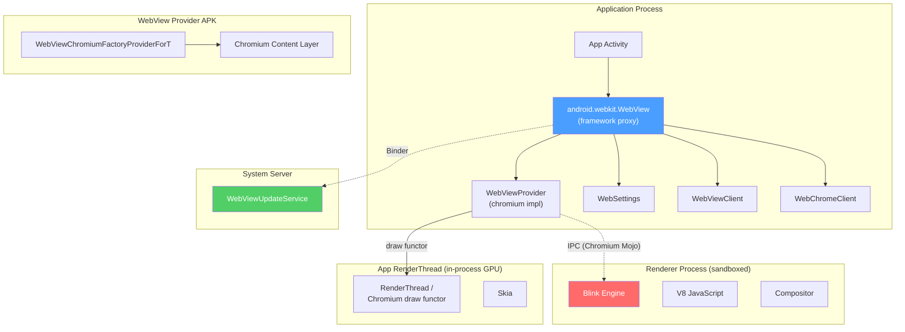

### 45.1.3 多进程模型

现代 Android WebView 使用一种源自 Chromium 的多进程架构：

- **浏览器进程**：这就是应用自身的进程。Chromium 的“浏览器”逻辑运行在应用的主线程以及同一进程内的一组 IO/工作线程上。它负责导航决策、Cookie 管理、权限提示，以及与 Android 框架的通信。

- **渲染进程**：一个独立的、被沙箱化的进程，运行 Blink 渲染引擎和 V8 JavaScript 引擎。同一个应用中的多个 WebView 实例可以共享同一个渲染器，但渲染器崩溃会被隔离，不会影响到浏览器进程。渲染器从 **WebView Zygote** 派生而来，这是一个专门的子 zygote，会预加载 WebView 提供方代码以加快进程创建速度。

- **GPU 进程**：负责 GPU 加速的合成与光栅化。在启用硬件加速时，WebView 共享应用的 GPU 线程，通过一种与 Android `RenderThread` 集成的“functor（函子）”机制进行绘制。

多进程模型由框架控制。`WebViewDelegate.isMultiProcessEnabled()` 方法目前无条件返回 `true`：

```
Source: frameworks/base/core/java/android/webkit/WebViewDelegate.java

    public boolean isMultiProcessEnabled() {
        return true;
    }
```

### 45.1.4 进程隔离与 WebView Zygote

渲染进程通过一个专门的 **WebView Zygote** 创建，而不是通过主应用 Zygote。这个子 zygote 是专为 WebView 定制的：

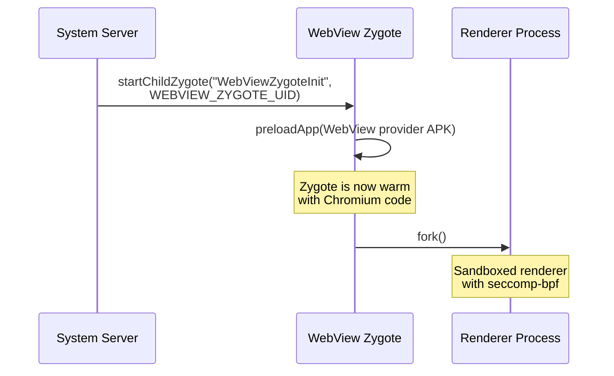

`WebViewZygote` 类管理这个子 zygote 的生命周期：

```
Source: frameworks/base/core/java/android/webkit/WebViewZygote.java

    sZygote = Process.ZYGOTE_PROCESS.startChildZygote(
            "com.android.internal.os.WebViewZygoteInit",
            "webview_zygote",
            Process.WEBVIEW_ZYGOTE_UID,
            Process.WEBVIEW_ZYGOTE_UID,
            sharedAppGid,
            runtimeFlags,
            "webview_zygote",  // seInfo
            abi,
            TextUtils.join(",", Build.SUPPORTED_ABIS),
            null,
            Process.FIRST_ISOLATED_UID,
            Integer.MAX_VALUE,  // TODO(b/123615476) deal with user-id ranges properly
            sPackage.applicationInfo);
```

关键观察点：

- 该 zygote 以专用 UID（`WEBVIEW_ZYGOTE_UID`）运行。
- 它会预加载 WebView APK，使得派生出来的渲染进程能快速启动。
- 当 WebView 提供方发生变化（例如一次更新）时，旧的 zygote 会被杀死，并以更新后的包重新启动一个新的 zygote。

### 45.1.5 绘制集成

WebView 通过一种**绘制函子（draw functor）**机制与 Android 的硬件加速渲染管线集成。WebView 并没有走记录显示列表（display list）操作的标准 `View.onDraw()` 路径，而是向 `RenderThread` 注册一个原生函子：

```
Source: frameworks/base/core/java/android/webkit/WebViewDelegate.java

    public void drawWebViewFunctor(@NonNull Canvas canvas, int functor) {
        if (!(canvas instanceof RecordingCanvas)) {
            throw new IllegalArgumentException(canvas.getClass().getName()
                    + " is not a RecordingCanvas canvas");
        }
        ((RecordingCanvas) canvas).drawWebViewFunctor(functor);
    }
```

这个函子是一个原生函数指针（在 Chromium 代码中通过 `AwDrawFn_CreateFunctor` 创建），`RenderThread` 在 GPU 合成阶段会调用它。这使得 WebView 内容可以与原生 Android UI 元素一起合成，而不需要在进程之间进行昂贵的像素拷贝。

### 45.1.6 WebView 类层次结构与包结构

`android.webkit` 包包含所有面向公众的 WebView 类。下面是主要类的完整集合及其职责：

| 类 | 职责 |
|---|---|
| `WebView` | 主视图控件；对 `WebViewProvider` 的薄代理 |
| `WebSettings` | 每个实例的配置（抽象类，实现位于提供方） |
| `WebViewClient` | 导航与错误事件回调 |
| `WebChromeClient` | 浏览器界面（chrome）UI 事件回调 |
| `WebViewFactory` | 单例工厂；加载并缓存提供方 |
| `WebViewFactoryProvider` | 顶层提供方工厂的接口 |
| `WebViewProvider` | 每个 WebView 后端的接口 |
| `WebViewDelegate` | 授予提供方访问框架内部能力的桥接 |
| `SelectionActionMenuClient` | 自定义 WebView 文本选择菜单的 OEM 钩子（Android 17 新增） |
| `WebViewLibraryLoader` | 带 RELRO 优化的原生库加载 |
| `WebViewZygote` | 管理用于渲染进程的子 zygote |
| `WebViewUpdateService` | 系统更新服务的遗留客户端 |
| `WebViewUpdateManager` | 系统更新服务的现代客户端 |
| `WebViewProviderInfo` | 描述一个候选 WebView 提供方包 |
| `WebViewProviderResponse` | 来自更新服务的、带状态的响应 |
| `WebViewRenderProcess` | 渲染进程的句柄 |
| `WebViewRenderProcessClient` | 渲染进程响应能力的回调 |
| `CookieManager` | Cookie 管理单例 |
| `WebStorage` | Web 存储（localStorage、sessionStorage）管理 |
| `GeolocationPermissions` | 地理位置权限管理 |
| `TracingController` | 性能跟踪集成 |
| `TracingConfig` | 跟踪配置（类别、模式） |
| `ServiceWorkerController` | Service Worker 管理 |
| `JavascriptInterface` | 暴露 Java 方法的注解 |
| `SafeBrowsingResponse` | Safe Browsing 命中时的响应动作 |
| `RenderProcessGoneDetail` | 关于渲染器崩溃的信息 |
| `ConsoleMessage` | JavaScript 控制台消息表示 |
| `ValueCallback<T>` | 异步操作的通用回调 |
| `WebResourceRequest` | 传入资源请求的详情 |
| `WebResourceResponse` | 自定义资源响应 |
| `WebResourceError` | 资源加载错误详情 |
| `WebMessage` | Web Messaging API 的消息 |
| `WebMessagePort` | Web Messaging API 的端口 |
| `WebBackForwardList` | 导航历史快照 |
| `WebHistoryItem` | 导航历史中的单条记录 |

AIDL 接口文件定义了客户端与系统服务之间的 Binder IPC 契约：

| AIDL 文件 | 用途 |
|---|---|
| `IWebViewUpdateService.aidl` | 更新服务的 Binder 接口 |
| `WebViewProviderInfo.aidl` | 可打包（Parcelable）的提供方信息 |
| `WebViewProviderResponse.aidl` | 可打包（Parcelable）的提供方响应 |

### 45.1.7 配置与特性开关

WebView 的行为受若干开关机制影响：

1. **`flags.aconfig`**：`android.webkit` 包定义了用于渐进式特性发布的 aconfig 开关。Android 17 的开关集合（`frameworks/base/core/java/android/webkit/flags.aconfig`）为：
    - `update_service_ipc_wrapper`（`FLAG_UPDATE_SERVICE_IPC_WRAPPER`）：控制 `WebViewUpdateManager` 包装类
    - `mainline_apis`：`WebViewBootstrap` Mainline 模块所需的新 API（见 45.9.1）
    - `selection_action_menu_client`：用于 OEM 自定义 WebView 文本选择菜单的新 API（`SelectionActionMenuClient`，17 新增）
    - `file_system_access`（`FLAG_FILE_SYSTEM_ACCESS`）：在 WebView 中启用 File System Access API
    - `user_agent_reduction`（`FLAG_USER_AGENT_REDUCTION`）：启用 User-Agent 字符串缩减
    - `deprecate_start_safe_browsing`（`FLAG_DEPRECATE_START_SAFE_BROWSING`）：弃用显式的 `startSafeBrowsing()` 调用，因为它现在已是空操作

    服务端在 `frameworks/base/services/core/java/com/android/server/webkit/flags.aconfig` 中声明了一个开关 `update_service_v2`，它选定了 `WebViewUpdateServiceImpl2`。在 Android 17 中该开关已完全铺开，遗留实现已被移除（见 45.4.1）。

2. **`@ChangeId` 注解**：受 `targetSdkVersion` 控制兼容性变更：
    - `ENABLE_SIMPLIFIED_DARK_MODE`（API 33+）：算法式深色模式
    - `ENABLE_USER_AGENT_REDUCTION`（Baklava 之后）：缩减后的 UA 字符串
    - `ENABLE_FILE_SYSTEM_ACCESS`（Baklava 之后）：File System Access API

3. **Chromium 命令行开关**：提供方可以接受 Chromium 风格的开关用于测试和调试。这些通常通过开发者选项或 `adb` 设置：
   ```bash
   adb shell "echo 'chrome --enable-features=SomeFeature' > \
       /data/local/tmp/webview-command-line"
   ```

4. **Android 系统属性**：`WebViewDelegate` 通过 `SystemProperties.addChangeCallback()` 监控系统属性以启用跟踪。

---

## 45.2 WebViewFactory

`WebViewFactory` 类是创建和加载 WebView 实现的入口点。它是一个 `@SystemApi` 类，对普通应用开发者隐藏，但它是连接 Android 框架与 Chromium 提供方的核心协调者。

```
Source: frameworks/base/core/java/android/webkit/WebViewFactory.java
```

### 45.2.1 类概览

`WebViewFactory` 是一个 `final` 类，所有方法均为静态方法。它的关键职责：

| 职责 | 方法 |
|---|---|
| 获取/缓存提供方单例 | `getProvider()` |
| 加载提供方类 | `getProviderClass()` |
| 加载原生库 | `loadWebViewNativeLibraryFromPackage()` |
| 预留 zygote 地址空间 | `prepareWebViewInZygote()` |
| 处理提供方变更 | `onWebViewProviderChanged()` |
| 检查 WebView 支持情况 | `isWebViewSupported()` |
| 访问更新服务 | `getUpdateService()` |

### 45.2.2 Chromium 工厂类

工厂中硬编码了 Chromium 提供方实现类的名称：

```java
private static final String CHROMIUM_WEBVIEW_FACTORY =
        "com.android.webview.chromium.WebViewChromiumFactoryProviderForT";

private static final String CHROMIUM_WEBVIEW_FACTORY_METHOD = "create";
```

这个类名在运行时通过 WebView 提供方 APK 的类加载器解析。末尾的 "ForT" 表示提供方必须实现的 API 兼容层级（Tiramisu/API 33+），而不是指操作系统版本。Android 17 仍然加载 `WebViewChromiumFactoryProviderForT`：该后缀只有在框架新增一个强制性的提供方入口点时才会推进，而这种情况自 Tiramisu 以来一直没有发生。运行在 Android 17 上的新提供方 APK 实现的是同一个 `create(WebViewDelegate)` 契约。

```
Source: frameworks/base/core/java/android/webkit/WebViewFactory.java (lines 57-60)
```

### 45.2.3 提供方初始化序列

当应用首次创建一个 `WebView` 时，完整的初始化序列涉及多个协调步骤：

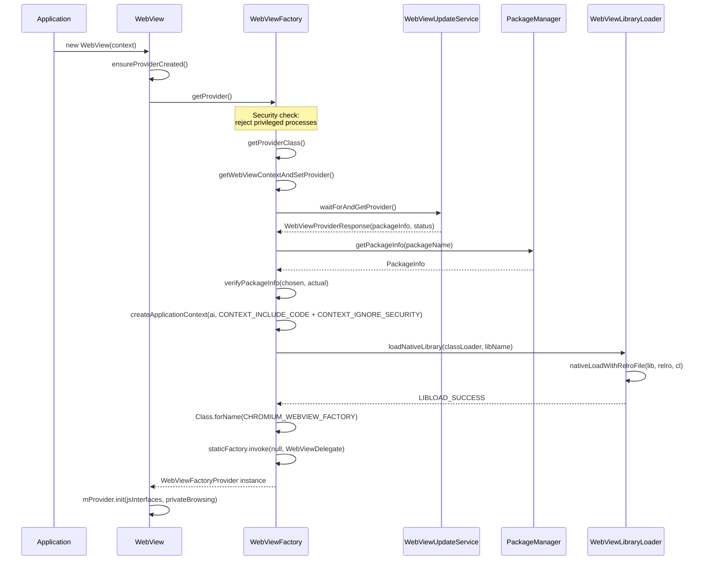

### 45.2.4 安全守卫：拒绝特权进程

WebView 明确拒绝在特权系统进程中加载。`getProvider()` 方法会检查调用方的 UID（Android 17 保留了同样的五 UID 拒绝名单）：

```
Source: frameworks/base/core/java/android/webkit/WebViewFactory.java (lines 342-346)
```

```java
final int appId = UserHandle.getAppId(android.os.Process.myUid());
if (appId == android.os.Process.ROOT_UID
        || appId == android.os.Process.SYSTEM_UID
        || appId == android.os.Process.PHONE_UID
        || appId == android.os.Process.NFC_UID
        || appId == android.os.Process.BLUETOOTH_UID) {
    throw new UnsupportedOperationException(
            "For security reasons, WebView is not allowed in privileged processes");
}
```

这是一项关键的安全措施。WebView 会加载并执行任意 Web 内容（包括 JavaScript）。在特权进程（system_server、电话、蓝牙、NFC）中运行它会使来自 Web 的攻击获得系统级能力。

### 45.2.5 包验证

在加载提供方之前，`WebViewFactory` 会对 WebView 包执行严格的验证：

1. **包名匹配**：更新服务返回的包名必须与从 `PackageManager` 获取的包名一致。

2. **版本号检查**：实际安装的版本必须不低于更新服务报告的版本（防止降级攻击）。

3. **签名验证**：已安装包的签名必须与所选包的签名一致。这里使用基于 `ArraySet` 的比较，以实现顺序无关性。

4. **库标志检查**：包必须声明一个 `com.android.webview.WebViewLibrary` 元数据条目，指向原生 `.so` 文件。

```java
private static void verifyPackageInfo(PackageInfo chosen, PackageInfo toUse)
        throws MissingWebViewPackageException {
    if (!chosen.packageName.equals(toUse.packageName)) { ... }
    if (chosen.getLongVersionCode() > toUse.getLongVersionCode()) { ... }
    if (getWebViewLibrary(toUse.applicationInfo) == null) { ... }
    if (!signaturesEquals(chosen.signatures, toUse.signatures)) { ... }
}
```

### 45.2.6 启动时间戳

`WebViewFactory` 通过 `StartupTimestamps` 内部类记录 WebView 加载每个阶段的详细计时信息。这些时间戳通过 `WebViewDelegate.getStartupTimestamps()` 暴露给提供方，并用于性能监控：

| 时间戳 | 阶段 |
|---|---|
| `mWebViewLoadStart` | 整体加载开始 |
| `mCreateContextStart/End` | 创建 WebView APK 上下文 |
| `mAddAssetsStart/End` | 注册资源路径 |
| `mGetClassLoaderStart/End` | 获取 APK 类加载器 |
| `mNativeLoadStart/End` | 使用 RELRO 加载原生 `.so` |
| `mProviderClassForNameStart/End` | 解析工厂类 |

### 45.2.7 RELRO 共享

WebView 加载中的一个关键优化是 **RELRO（Relocation Read-Only，重定位只读）共享**。Chromium 原生库（`libwebviewchromium.so`）体积很大（通常 50-100 MB）。当这个库被加载时，动态链接器必须处理重定位——即对共享库中绝对地址的修复。由于该库被加载在相同的预保留地址上，这些重定位在每个进程中产生的结果都相同。

`WebViewLibraryLoader` 类负责协调这一优化：

```
Source: frameworks/base/core/java/android/webkit/WebViewLibraryLoader.java
```

1. **地址空间预留**发生在 Zygote 中，在任何应用被 fork 之前：
   ```java
   static void reserveAddressSpaceInZygote() {
       System.loadLibrary("webviewchromium_loader");
       long addressSpaceToReserve;
       if (VMRuntime.getRuntime().is64Bit()) {
           addressSpaceToReserve = 1 * 1024 * 1024 * 1024; // 1 GB on 64-bit
       } else if (VMRuntime.getRuntime().vmInstructionSet().equals("arm")) {
           addressSpaceToReserve = 130 * 1024 * 1024; // 130 MB on ARM32
       } else {
           addressSpaceToReserve = 190 * 1024 * 1024; // 190 MB on x86 emu
       }
       sAddressSpaceReserved = nativeReserveAddressSpace(addressSpaceToReserve);
   }
   ```

2. **RELRO 文件创建**发生在一个隔离进程（`RelroFileCreator`）中，它加载该库、处理重定位，并将结果写入一个共享文件：
    - 32 位：`/data/misc/shared_relro/libwebviewchromium32.relro`
    - 64 位：`/data/misc/shared_relro/libwebviewchromium64.relro`

3. **RELRO 文件消费**：当应用加载 WebView 时，它会映射预先计算好的 RELRO 文件，而不是重新处理重定位。这同时节省了时间和内存。RELRO 页面在所有使用 WebView 的进程之间以只读方式共享。

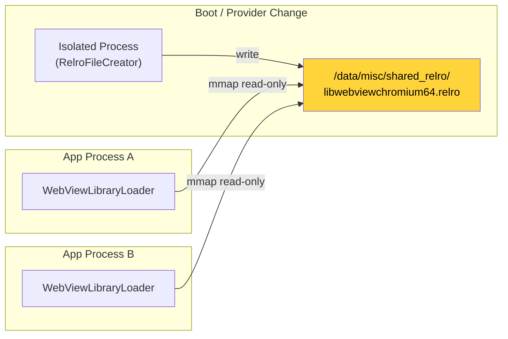

---

## 45.3 WebView 提供方

### 45.3.1 提供方抽象

Android 的 WebView 架构使用**提供方（provider）模式**将公共 API 与实现解耦。三个接口定义了这一契约：

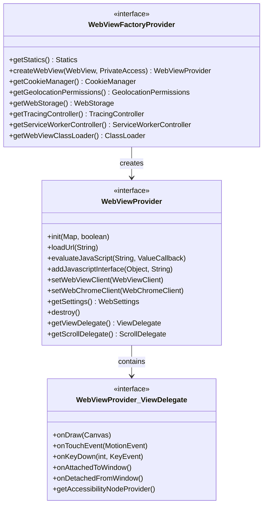

**`WebViewFactoryProvider`** 是顶层工厂。它在每个进程中是单例，通过反射从 `WebViewChromiumFactoryProviderForT.create()` 静态方法创建。它提供：

- 创建 `WebViewProvider` 实例（每个 `WebView` 控件一个）的工厂方法
- `CookieManager`、`WebStorage`、`GeolocationPermissions` 等的单例访问器
- 一个用于静态工具方法的 `Statics` 子接口

**`WebViewProvider`** 是每实例的后端。`android.webkit.WebView` 上的每个公共方法都委托给此接口上的相应方法。它还包含两个子接口：

- `ViewDelegate`：处理 `View` 级别的回调（绘制、触摸、按键事件、无障碍）
- `ScrollDelegate`：处理滚动计算

### 45.3.2 WebView 中的委托模式

`android.webkit.WebView` 类是一个薄代理。它的构造函数调用 `ensureProviderCreated()`，从而触发 45.2 节中描述的整个工厂加载序列：

```java
private void ensureProviderCreated() {
    checkThread();
    if (mProvider == null) {
        mProvider = getFactory().createWebView(this, new PrivateAccess());
    }
}
```

然后每个公共方法都直接委托：

```java
public void loadUrl(@NonNull String url) {
    checkThread();
    mProvider.loadUrl(url);
}

public void evaluateJavascript(@NonNull String script,
        @Nullable ValueCallback<String> resultCallback) {
    checkThread();
    mProvider.evaluateJavaScript(script, resultCallback);
}
```

`checkThread()` 调用强制规定 WebView 只能在创建它的线程上访问（通常是主/UI 线程）。在 Android 17 中，这种强制是**无条件的**：无论应用的 `targetSdkVersion` 如何，在错误线程上调用方法总是会抛出 `RuntimeException`。在较早的版本中，抛出异常受 `sEnforceThreadChecking` 字段控制（只有面向 API 18+ 的应用会得到异常；更早的应用只是记录一条警告）。Android 17 移除了该字段以及支持它的 `always_enforce_thread_checking` 开关，因此不再有兼容性退路：

```
Source: frameworks/base/core/java/android/webkit/WebView.java (checkThread(), lines 2643-2657)
```

### 45.3.3 WebViewChromium：具体实现

具体的提供方实现位于 WebView APK 中，而不是框架中。类 `com.android.webview.chromium.WebViewChromiumFactoryProviderForT`（通过反射加载）封装了 Chromium 的 content 层。这个类：

1. 初始化 Chromium 浏览器进程（命令行开关、特性列表、现场实验）
2. 创建 Chromium `BrowserContext`（带有 Cookie、存储、缓存的 profile）
3. 实例化 `WebViewChromium`（每实例的 `WebViewProvider` 实现）
4. 建立 GPU 进程连接
5. 通过 WebView Zygote 管理渲染进程池

### 45.3.4 预置 vs. 可更新的提供方

WebView 提供方可能来自两个来源：

| 来源 | 包名（典型） | 更新渠道 |
|---|---|---|
| AOSP 预置 | `com.android.webview` | 仅系统镜像 |
| Google（GMS） | `com.google.android.webview` | Play Store / Mainline |
| 独立 Chrome | `com.android.chrome` | Play Store |

在安装了 Google Play Services 的设备上，系统通常预装 `com.google.android.webview` 作为默认提供方，`com.android.webview` 作为后备。`WebViewProviderInfo` 类描述每个候选者：

```
Source: frameworks/base/core/java/android/webkit/WebViewProviderInfo.java

    public final String packageName;
    public final String description;
    public final boolean availableByDefault;
    public final boolean isFallback;
    public final Signature[] signatures;
```

`availableByDefault` 标志标记主提供方。`isFallback` 标志标记一个只有在主提供方不可用（被卸载、被禁用或无效）时才应使用的提供方。`signatures` 数组确保只有使用预期密钥签名的包才能充当 WebView 提供方。

### 45.3.5 WebViewDelegate：通往框架内部的桥

`WebViewDelegate` 类为 Chromium 实现提供对 Android 框架内部的受控访问——这些内部能力不属于公共 SDK：

```
Source: frameworks/base/core/java/android/webkit/WebViewDelegate.java
```

通过此委托暴露的关键能力：

- **绘制函子注册**：`drawWebViewFunctor()` 让 WebView 挂钩到硬件加速渲染管线
- **跟踪集成**：`isTraceTagEnabled()` 和 `setOnTraceEnabledChangeListener()` 将 WebView 跟踪连接到 Android 的 systrace 基础设施
- **资源管理**：`getPackageId()` 解析 WebView APK 的资源包 ID，以便正确寻址来自 WebView APK 的资源
- **应用上下文**：`getApplication()` 提供对宿主应用的访问
- **数据目录**：`getDataDirectorySuffix()` 支持多进程数据隔离
- **启动指标**：`getStartupTimestamps()` 提供用于性能分析的计时数据

---

## 45.4 WebView 更新机制

### 45.4.1 WebViewUpdateService

`WebViewUpdateService` 是一个系统服务，管理当前激活的 WebView 提供方是哪一个，并在提供方更新时协调切换。它运行在 `system_server` 中，通过 Binder IPC 访问。

```
Source: frameworks/base/services/core/java/com/android/server/webkit/WebViewUpdateServiceImpl2.java
```

服务实现（`WebViewUpdateServiceImpl2`）跟踪：

- 所有已配置的 WebView 提供方列表（来自设备配置）
- 当前激活的提供方
- RELRO 准备状态
- 影响提供方选择的包安装/删除事件

`WebViewUpdateServiceImpl2` 是 Android 17 中唯一的实现。它过去是在 `android.webkit.update_service_v2` aconfig 开关之后被选中的，该开关后来已被清理。`WebViewUpdateService` 现在无条件构造 `new WebViewUpdateServiceImpl2(new SystemImpl(context))`，因此不再有更旧的 `WebViewUpdateServiceImpl` 后备。

```
Source: frameworks/base/services/core/java/com/android/server/webkit/WebViewUpdateService.java (lines 64, 73)
```

该服务通过 `SystemInterface`（由 `SystemImpl` 实现）委托所有平台查询。这正是更新逻辑可测试的原因。它也让该逻辑能够打包进 45.9.1 节所述的 Mainline 外壳中：

```
Source: frameworks/base/services/core/java/com/android/server/webkit/SystemInterface.java
Source: frameworks/base/services/core/java/com/android/server/webkit/SystemImpl.java
```

### 45.4.2 提供方选择算法

当系统需要选择 WebView 提供方时（在启动时或包变更后），`WebViewUpdateServiceImpl2.findPreferredWebViewPackage()` 方法会选择最佳的可用包：

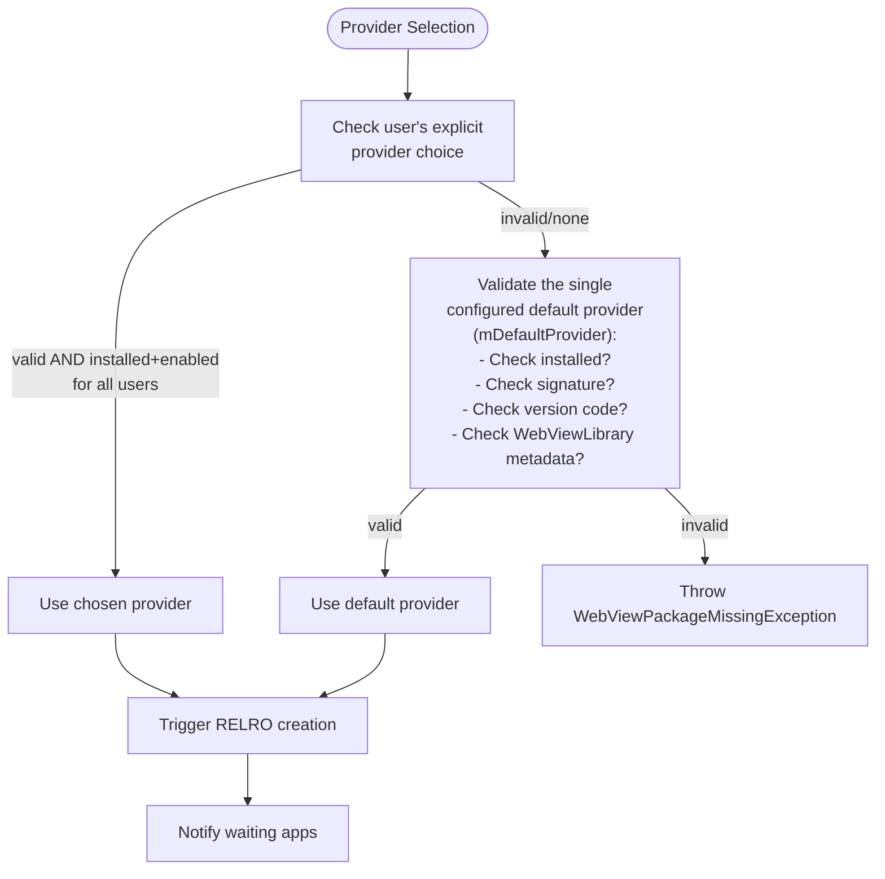

验证检查包括：

| 检查项 | 常量 | 描述 |
|---|---|---|
| SDK 版本 | `VALIDITY_INCORRECT_SDK_VERSION` | 提供方目标 SDK 正确 |
| 版本号 | `VALIDITY_INCORRECT_VERSION_CODE` | 满足最低版本 |
| 签名 | `VALIDITY_INCORRECT_SIGNATURE` | 与配置的签名匹配 |
| 库标志 | `VALIDITY_NO_LIBRARY_FLAG` | 具有 `WebViewLibrary` 元数据 |

### 45.4.3 客户端 IPC 包装器

应用通过 `WebViewUpdateManager` 与更新服务交互，这是一个使用 `Context.getSystemService()` 的现代包装器：

```
Source: frameworks/base/core/java/android/webkit/WebViewUpdateManager.java
```

关键操作：

```java
// Block until the WebView provider is ready
WebViewProviderResponse waitForAndGetProvider();

// Get the current provider package
PackageInfo getCurrentWebViewPackage();

// List all configured providers
WebViewProviderInfo[] getAllWebViewPackages();

// List currently valid providers
WebViewProviderInfo[] getValidWebViewPackages();

// Switch provider (requires WRITE_SECURE_SETTINGS)
String changeProviderAndSetting(String newProvider);

// Get the default provider
WebViewProviderInfo getDefaultWebViewPackage();
```

服务注册发生在 `WebViewBootstrapFrameworkInitializer` 中：

```java
SystemServiceRegistry.registerForeverStaticService(
        Context.WEBVIEW_UPDATE_SERVICE,
        WebViewUpdateManager.class,
        (b) -> new WebViewUpdateManager(
                IWebViewUpdateService.Stub.asInterface(b)));
```

### 45.4.4 包变更处理

当 WebView 提供方包被安装、更新或删除时，更新服务会收到包广播并进行处理：

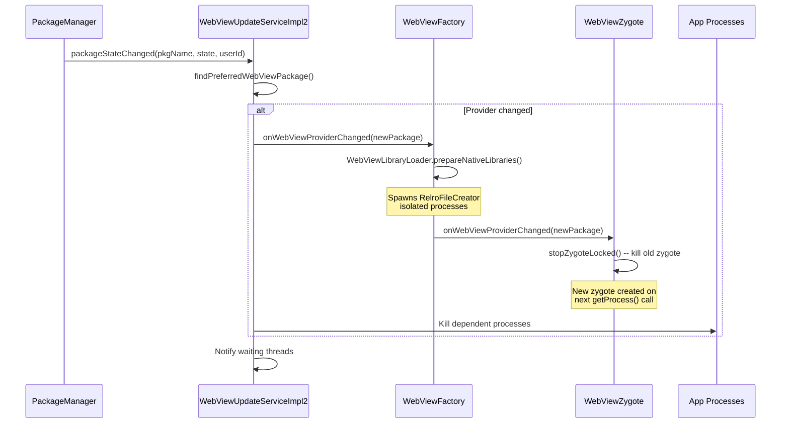

RELRO 准备的等待超时是 1000 毫秒（`WAIT_TIMEOUT_MS`），特意短于 5000ms 的 `KEY_DISPATCHING_TIMEOUT`，以避免 ANR（应用无响应）对话框。

### 45.4.5 Mainline 模块集成

从 Android 10 开始，WebView 提供方可以通过 Google Play 系统更新作为 **Mainline 模块**更新。历史上它使用相同的包更新机制，但交付方式是 Mainline 特有的：

- WebView 提供方以 APK 模块（而非 APEX）形式交付
- 如果更新引发问题，可以回滚
- 更新适用于设备上的所有用户
- 无需重启；应用在下次创建 WebView 时会采用新版本

Android 17 在此之上准备了第二块模块化工作。*提供方* APK 仍像以前一样是 APK。一个新的被启动的 APEX `com.android.webview.bootstrap` 被保留给*提供方选择机制*（`WebViewUpdateService`、其 `WebViewUpdateServiceImpl2` 逻辑，以及 `WebViewUpdateManager` 客户端包装器）。该 APEX 目前是一个空外壳，这些代码仍然在平台中发布。45.9 节将讲解这个外壳，以及框架代码为何围绕 `SystemInterface` 边界重新组织以支持未来的迁移。

### 45.4.6 后备与恢复

更新服务包含一个修复机制。如果当前提供方变得不可用（例如被卸载或被禁用），服务会尝试恢复：

1. 如果当前提供方是默认提供方且变得缺失，触发修复
2. 修复机制通过 `installExistingPackageForAllUsers()` 和 `enablePackageForAllUsers()` 为所有用户重新安装并重新启用*默认*提供方（`mDefaultProvider`）。`WebViewUpdateServiceImpl2` 中没有单独的后备提供方修复路径
3. `mAttemptedToRepairBefore` 标志防止无限修复循环
4. 所有依赖旧提供方的进程都会被杀死，以便它们用新提供方重启

---

## 45.5 WebView API

### 45.5.1 WebView 类

`android.webkit.WebView` 继承自 `AbsoluteLayout`（出于历史向后兼容原因），并实现了若干监听器接口：

```
Source: frameworks/base/core/java/android/webkit/WebView.java
```

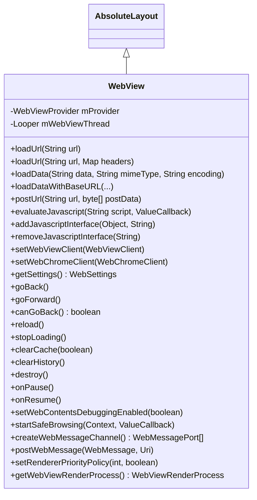

#### 内容加载方法

WebView 提供多种加载内容的方式：

| 方法 | 用例 |
|---|---|
| `loadUrl(String)` | 加载 URL（http、https、file、data、javascript） |
| `loadUrl(String, Map)` | 加载 URL 并附带自定义 HTTP 头 |
| `loadData(String, String, String)` | 通过 data: URL 加载内联 HTML |
| `loadDataWithBaseURL(...)` | 加载内联 HTML 并指定自定义 base URL |
| `postUrl(String, byte[])` | 向 URL 发送 HTTP POST |

`loadDataWithBaseURL` 方法对安全性尤为重要。它为加载的内容设置**来源（origin）**。该来源管辖页面中运行的任何 JavaScript 的同源策略。

#### JavaScript 执行

有两种 JavaScript 交互机制：

1. **evaluateJavascript()**：在当前页面上下文中执行任意 JavaScript，并可选择接收结果：
   ```java
   webView.evaluateJavascript("document.title", value -> {
       // value is the JSON-encoded result
   });
   ```

2. **addJavascriptInterface()**：向 JavaScript 暴露一个 Java 对象，允许双向通信（见 45.5.5 节）。

#### 导航

WebView 维护一个前进/后退导航栈：

- `canGoBack()` / `goBack()` -- 向后导航
- `canGoForward()` / `goForward()` -- 向前导航
- `canGoBackOrForward(int)` / `goBackOrForward(int)` -- 按步数导航
- `copyBackForwardList()` -- 导航历史快照

#### 生命周期管理

WebView 遵循 Android 的 Activity 生命周期：

- `onPause()` -- 暂停动画、地理位置（但不暂停 JavaScript 定时器）
- `onResume()` -- 恢复已暂停的 WebView
- `pauseTimers()` / `resumeTimers()` -- 全局暂停/恢复所有 JavaScript 定时器
- `destroy()` -- 释放所有内部资源；WebView 必须先从视图层次结构中移除

### 45.5.2 WebSettings

`WebSettings` 控制 WebView 实例的行为。它是一个抽象类，具体实现由 Chromium 后端提供。

```
Source: frameworks/base/core/java/android/webkit/WebSettings.java
```

关键设置类别：

#### JavaScript 与内容

| 设置 | 默认值 | 描述 |
|---|---|---|
| `setJavaScriptEnabled(boolean)` | `false` | 启用/禁用 JavaScript 执行 |
| `setDomStorageEnabled(boolean)` | `false` | 启用 HTML5 DOM Storage |
| `setDatabaseEnabled(boolean)` | `false` | 启用 HTML5 Web SQL Database |
| `setMediaPlaybackRequiresUserGesture(boolean)` | `true` | 媒体播放需要用户手势 |
| `setAllowFileAccess(boolean)` | varies | 允许 `file://` URL 访问 |
| `setAllowContentAccess(boolean)` | `true` | 允许 `content://` URL 访问 |

#### 显示与布局

| 设置 | 默认值 | 描述 |
|---|---|---|
| `setTextZoom(int)` | `100` | 文本大小百分比 |
| `setUseWideViewPort(boolean)` | `false` | 启用 viewport 元标签支持 |
| `setLoadWithOverviewMode(boolean)` | `false` | 缩小以按宽度适配内容 |
| `setSupportZoom(boolean)` | `true` | 启用缩放支持 |
| `setBuiltInZoomControls(boolean)` | `false` | 启用双指缩放 |
| `setDisplayZoomControls(boolean)` | `true` | 显示屏幕上的缩放按钮 |

#### 缓存

| 模式 | 常量 | 行为 |
|---|---|---|
| 默认 | `LOAD_DEFAULT` | 缓存有效时用缓存，否则用网络 |
| 缓存优先 | `LOAD_CACHE_ELSE_NETWORK` | 即使过期也用缓存，否则用网络 |
| 不缓存 | `LOAD_NO_CACHE` | 总是从网络加载 |
| 仅缓存 | `LOAD_CACHE_ONLY` | 从不使用网络 |

#### 混合内容

`setMixedContentMode()` 方法控制 HTTPS 页面如何处理 HTTP 子资源：

| 模式 | 常量 | 安全级别 |
|---|---|---|
| 总是允许 | `MIXED_CONTENT_ALWAYS_ALLOW` | 最不安全 |
| 从不允许 | `MIXED_CONTENT_NEVER_ALLOW` | 最安全 |
| 兼容模式 | `MIXED_CONTENT_COMPATIBILITY_MODE` | 遵循浏览器默认 |

#### 深色模式

```java
public static final long ENABLE_SIMPLIFIED_DARK_MODE = 214741472L;
```

从 Android 13（Tiramisu）开始，WebView 通过 `setAlgorithmicDarkeningAllowed()` 支持网页内容的算法式加深。这使 WebView 能够自动为不原生支持 `prefers-color-scheme` 的网页应用深色主题。

#### User-Agent 缩减

```java
@ChangeId
@EnabledAfter(targetSdkVersion = android.os.Build.VERSION_CODES.BAKLAVA)
public static final long ENABLE_USER_AGENT_REDUCTION = 371034303L;
```

对于面向 post-Baklava 的应用，默认 User-Agent 被缩减为 `Linux; Android 10; K`，版本为 `0.0.0`，以缩小指纹识别面。这遵循了 Chromium 范围内更广泛的 User-Agent Reduction 计划。

### 45.5.3 WebViewClient

`WebViewClient` 处理导航事件和错误。应用通过 `WebView.setWebViewClient()` 设置它。如果没有设置客户端，默认行为会把 URL 处理委托给系统（通过 `ActivityManager`）。

```
Source: frameworks/base/core/java/android/webkit/WebViewClient.java
```

按生命周期组织的关键回调：

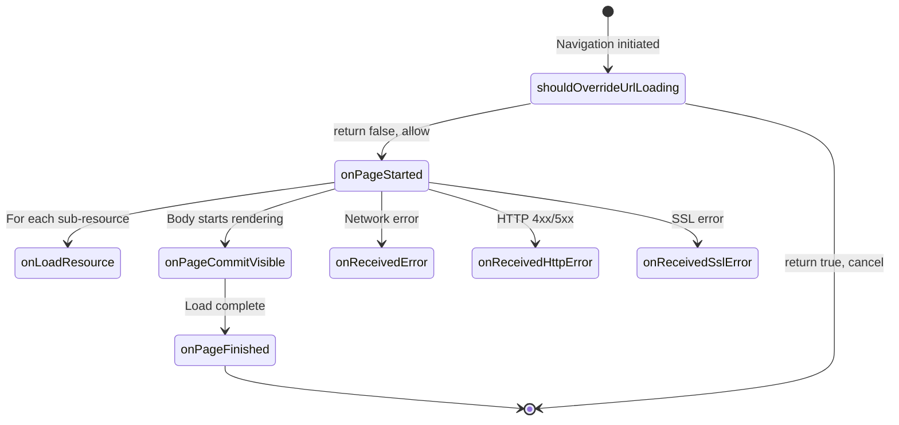

#### 导航控制

```java
// Modern version (API 24+)
public boolean shouldOverrideUrlLoading(WebView view, WebResourceRequest request) {
    return shouldOverrideUrlLoading(view, request.getUrl().toString());
}
```

返回 `true` 取消导航并让应用处理它（例如打开外部浏览器）。返回 `false` 允许 WebView 正常继续。

来自源码的重要注意事项：

- 对 POST 请求不会调用
- 对由 `loadUrl()` 发起的导航不会调用
- 可能对子框架和非 HTTP 协议被调用

#### 资源拦截

```java
public WebResourceResponse shouldInterceptRequest(WebView view,
        WebResourceRequest request) {
    return null; // Return null to let WebView load normally
}
```

这个强大的回调允许应用拦截任何资源请求并返回自定义数据。用例包括：

- 提供本地资源以支持离线
- 注入自定义 CSS 或 JavaScript
- 实现自定义缓存策略
- URL 改写

**线程安全提示**：此方法在后台线程上调用，而不是 UI 线程。

#### 错误处理

| 回调 | 何时调用 |
|---|---|
| `onReceivedError(WebView, WebResourceRequest, WebResourceError)` | 网络/DNS/连接失败 |
| `onReceivedHttpError(WebView, WebResourceRequest, WebResourceResponse)` | HTTP 状态码 >= 400 |
| `onReceivedSslError(WebView, SslErrorHandler, SslError)` | SSL 证书错误 |

SSL 错误回调值得特别关注。默认行为是 `handler.cancel()`，这是安全的选择。源代码明确警告：

> 不要就 SSL 错误向用户提示。用户不太可能做出知情的安全决策，而且 WebView 没有提供
> 以有意义的方式展示错误详情的界面。

#### 渲染进程管理

```java
public boolean onRenderProcessGone(WebView view, RenderProcessGoneDetail detail) {
    return false;
}
```

当渲染进程崩溃或被系统杀死时，此回调通知应用。多个 `WebView` 实例可能共享一个渲染器，因此该回调会对每个受影响的 WebView 触发。返回 `false`（默认）会导致应用崩溃。返回 `true` 表示应用已处理该情况（例如通过清理 WebView 并重新创建）。

#### Safe Browsing

```java
public void onSafeBrowsingHit(WebView view, WebResourceRequest request,
        @SafeBrowsingThreat int threatType, SafeBrowsingResponse callback) {
    callback.showInterstitial(/* allowReporting */ true);
}
```

当 Safe Browsing 检测到恶意 URL 时，此回调让应用决定如何响应。威胁类型包括：

| 常量 | 值 | 描述 |
|---|---|---|
| `SAFE_BROWSING_THREAT_UNKNOWN` | 0 | 未知威胁 |
| `SAFE_BROWSING_THREAT_MALWARE` | 1 | 检测到恶意软件 |
| `SAFE_BROWSING_THREAT_PHISHING` | 2 | 钓鱼/欺诈内容 |
| `SAFE_BROWSING_THREAT_UNWANTED_SOFTWARE` | 3 | 不需要的软件 |
| `SAFE_BROWSING_THREAT_BILLING` | 4 | 账单欺诈（API 29+） |

### 45.5.4 WebChromeClient

`WebChromeClient` 处理浏览器界面（chrome）事件——即 Web 内容区域本身之外的 UI 元素和交互。

```
Source: frameworks/base/core/java/android/webkit/WebChromeClient.java
```

关键回调类别：

#### 页面元数据

| 回调 | 用途 |
|---|---|
| `onProgressChanged(WebView, int)` | 加载进度（0--100） |
| `onReceivedTitle(WebView, String)` | 文档标题变更 |
| `onReceivedIcon(WebView, Bitmap)` | 收到网站图标 |

#### JavaScript 对话框

WebChromeClient 处理 JavaScript 的 `alert()`、`confirm()` 和 `prompt()` 对话框：

```java
public boolean onJsAlert(WebView view, String url, String message, JsResult result) {
    return false; // false = show default dialog
}

public boolean onJsConfirm(WebView view, String url, String message, JsResult result) {
    return false;
}

public boolean onJsPrompt(WebView view, String url, String message,
        String defaultValue, JsPromptResult result) {
    return false;
}
```

返回 `false` 显示默认的系统对话框。返回 `true` 会抑制它，应用必须调用 `result.confirm()` 或 `result.cancel()` 以恢复 JavaScript 执行。

如果完全没有设置 `WebChromeClient`，JavaScript 对话框将被静默抑制。

#### 全屏视频

```java
public void onShowCustomView(View view, CustomViewCallback callback) {}
public void onHideCustomView() {}
```

当视频元素进入全屏（例如用户点击全屏按钮）时，WebView 会创建一个包含视频的独立 `View`。WebView 把这个视图传给 `onShowCustomView()`。应用应把这个视图添加到全屏窗口中。退出全屏时，会调用 `onHideCustomView()`。

#### 窗口管理

```java
public boolean onCreateWindow(WebView view, boolean isDialog,
        boolean isUserGesture, Message resultMsg) {
    return false; // false = don't create window
}
```

当 JavaScript 调用 `window.open()` 时，此回调要求应用创建一个新的 WebView。应用应检查 `isUserGesture` 以阻止并非由用户操作发起的弹出窗口。

#### 权限

```java
public void onGeolocationPermissionsShowPrompt(String origin,
        GeolocationPermissions.Callback callback) {}

public void onPermissionRequest(PermissionRequest request) {
    request.deny(); // Default: deny all permissions
}
```

`onPermissionRequest` 回调处理对摄像头、麦克风及其他敏感能力的请求。默认行为是拒绝所有此类请求。

#### 文件选择器

```java
public boolean onShowFileChooser(WebView webView,
        ValueCallback<Uri[]> filePathCallback,
        FileChooserParams fileChooserParams) {
    return false;
}
```

`FileChooserParams` 类定义了文件选择的模式：

| 模式 | 常量 | 描述 |
|---|---|---|
| 打开单个 | `MODE_OPEN` | 选择一个现有文件 |
| 打开多个 | `MODE_OPEN_MULTIPLE` | 选择多个文件 |
| 打开文件夹 | `MODE_OPEN_FOLDER` | 选择目录（File System Access API） |
| 保存 | `MODE_SAVE` | 创建/覆盖文件 |

`MODE_OPEN_FOLDER` 和 `MODE_SAVE` 模式是新的 File System Access API 支持的一部分，对面向 post-Baklava 的应用由 `ENABLE_FILE_SYSTEM_ACCESS` change ID 控制。

#### 控制台消息

```java
public boolean onConsoleMessage(ConsoleMessage consoleMessage) {
    onConsoleMessage(consoleMessage.message(), consoleMessage.lineNumber(),
            consoleMessage.sourceId());
    return false;
}
```

JavaScript 的 `console.log()`、`console.warn()` 和 `console.error()` 调用会被转发到此回调，使宿主应用能够捕获和处理 Web 控制台输出。

### 45.5.5 JavascriptInterface

`@JavascriptInterface` 注解标记那些应暴露给在 WebView 中运行的 JavaScript 的 Java 方法：

```
Source: frameworks/base/core/java/android/webkit/JavascriptInterface.java

@Retention(RetentionPolicy.RUNTIME)
@Target({ElementType.METHOD})
public @interface JavascriptInterface {
}
```

该注解在运行时保留，意味着 WebView 实现可以通过反射发现被注解的方法。从 API 17 开始，只有带有此注解的方法才能从 JavaScript 访问。这是一个关键安全修复。它防止 JavaScript 通过反射调用任意 Java 方法。

使用模式：

```java
class WebAppInterface {
    @JavascriptInterface
    public void showToast(String message) {
        Toast.makeText(context, message, Toast.LENGTH_SHORT).show();
    }
}

webView.addJavascriptInterface(new WebAppInterface(), "Android");
// JavaScript can now call: Android.showToast("Hello from JS!")
```

在 `WebView.addJavascriptInterface()` 源码中记录的安全注意事项：

1. Java 对象暴露给 WebView 中的**所有框架（frame）**，包括第三方 iframe。没有办法将其限制到特定来源。

2. JavaScript 在**私有后台线程**上调用 Java 方法，而不是 UI 线程。线程安全是开发者的责任。

3. 对于面向 API 17+ 的应用，只有带 `@JavascriptInterface` 注解的方法可访问。对于更早的应用，所有公共方法（包括从 `Object` 继承的方法）都会被暴露，这允许通过 `getClass().forName(...)` 进行任意代码执行。

4. Java 对象字段永远无法从 JavaScript 访问（只有方法）。

### 45.5.6 Web Messaging API

WebView 还支持用于结构化通信的 HTML5 MessageChannel API：

```java
// Create a message channel
WebMessagePort[] ports = webView.createWebMessageChannel();

// Send one port to the web page (postWebMessage delegates internally to
// WebViewProvider.postMessageToMainFrame())
webView.postWebMessage(
    new WebMessage("init", new WebMessagePort[]{ports[1]}),
    Uri.parse("https://example.com"));

// Receive messages from the web page
ports[0].setWebMessageCallback(new WebMessagePort.WebMessageCallback() {
    public void onMessage(WebMessagePort port, WebMessage message) {
        // Handle message from JS
    }
});
```

这是比 `addJavascriptInterface` 更结构化、更安全的替代方案，因为消息可以被验证，并且通道端点受到显式控制。

### 45.5.7 WebResourceRequest 与 WebResourceResponse

`WebResourceRequest` 类提供有关传入资源请求的详细信息，用于 `WebViewClient.shouldInterceptRequest()` 和 `WebViewClient.shouldOverrideUrlLoading()`：

```java
public interface WebResourceRequest {
    Uri getUrl();                        // The request URL
    boolean isForMainFrame();            // true if this is the main frame
    boolean isRedirect();                // true if this is a redirect
    boolean hasGesture();                // true if initiated by user gesture
    String getMethod();                  // HTTP method (GET, POST, etc.)
    Map<String, String> getRequestHeaders(); // HTTP request headers
}
```

`WebResourceResponse` 允许应用为被拦截的请求提供自定义响应：

```java
WebResourceResponse response = new WebResourceResponse(
    "text/html",           // MIME type
    "UTF-8",               // encoding
    new ByteArrayInputStream(htmlBytes)  // data stream
);
response.setStatusCodeAndReasonPhrase(200, "OK");
response.setResponseHeaders(Map.of(
    "Cache-Control", "max-age=3600",
    "Content-Type", "text/html; charset=UTF-8"
));
```

这使得以下强大模式成为可能：

1. **离线优先**：网络不可用时提供缓存内容
2. **资源加载**：通过类似 HTTP 的 URL 提供本地资源，以符合同源策略
3. **内容过滤**：阻止或替换特定资源（广告、跟踪器）
4. **URL 改写**：透明地将请求重定向到不同的服务器

#### 错误类型与错误代码

`WebViewClient` 为资源加载失败定义了一组完整的错误代码：

| 常量 | 值 | 描述 |
|---|---|---|
| `ERROR_UNKNOWN` | -1 | 通用错误 |
| `ERROR_HOST_LOOKUP` | -2 | DNS 解析失败 |
| `ERROR_UNSUPPORTED_AUTH_SCHEME` | -3 | 不支持的身份验证方案 |
| `ERROR_AUTHENTICATION` | -4 | 服务器身份验证失败 |
| `ERROR_PROXY_AUTHENTICATION` | -5 | 代理身份验证失败 |
| `ERROR_CONNECT` | -6 | 与服务器的连接失败 |
| `ERROR_IO` | -7 | 读/写错误 |
| `ERROR_TIMEOUT` | -8 | 连接超时 |
| `ERROR_REDIRECT_LOOP` | -9 | 重定向次数过多 |
| `ERROR_UNSUPPORTED_SCHEME` | -10 | 不支持的 URI 方案 |
| `ERROR_FAILED_SSL_HANDSHAKE` | -11 | SSL 握手失败 |
| `ERROR_BAD_URL` | -12 | URL 格式错误 |
| `ERROR_FILE` | -13 | 通用文件错误 |
| `ERROR_FILE_NOT_FOUND` | -14 | 文件未找到 |
| `ERROR_TOO_MANY_REQUESTS` | -15 | 请求次数过多 |
| `ERROR_UNSAFE_RESOURCE` | -16 | 被 Safe Browsing 拦截 |

### 45.5.8 WebView 生命周期最佳实践

正确的生命周期管理对 WebView 应用至关重要。框架文档和源代码揭示了若干模式：

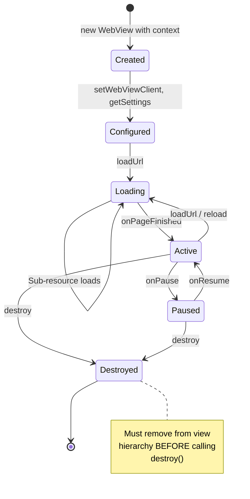

关键生命周期规则：

1. **只在 UI 线程上创建**：WebView 必须在具有 Looper 的线程上创建（通常是主线程）。构造函数保存 `Looper.myLooper()` 并对所有后续调用强制执行线程亲和性。

2. **进入后台时暂停**：当 Activity 进入后台时调用 `onPause()` 以降低功耗。这会暂停动画和地理位置，但不会暂停 JavaScript 定时器。

3. **全局暂停定时器**：调用 `pauseTimers()` 可停止所有 WebView 实例的所有 JavaScript 定时器。这是一个全局操作，应在整个应用进入后台时使用。

4. **正确销毁**：在调用 `destroy()` 之前，将 WebView 从其父视图中移除。`destroy()` 之后，不得再对 WebView 调用任何方法。

5. **处理进程死亡**：渲染进程可能随时被系统杀死（尤其是在内存压力下）。应用必须处理 `onRenderProcessGone()` 以避免崩溃。

### 45.5.9 CookieManager

`CookieManager` 单例管理进程内所有 `WebView` 实例的 Cookie：

```
Source: frameworks/base/core/java/android/webkit/CookieManager.java
```

```java
// Get the singleton
CookieManager cookieManager = CookieManager.getInstance();

// Set a cookie
cookieManager.setCookie("https://example.com", "key=value; Max-Age=3600");

// Get cookies
String cookies = cookieManager.getCookie("https://example.com");

// Third-party cookie control (per WebView)
cookieManager.setAcceptThirdPartyCookies(webView, false);

// Flush to persistent storage
cookieManager.flush();
```

第三方 Cookie 策略的默认值：

- 面向 KitKat（API 19）及以下的应用：**允许**第三方 Cookie
- 面向 Lollipop（API 21）及更高版本的应用：**阻止**第三方 Cookie

### 45.5.10 WebViewRenderProcess 与 WebViewRenderProcessClient

这些类提供对渲染进程的编程控制：

```
Source: frameworks/base/core/java/android/webkit/WebViewRenderProcess.java
Source: frameworks/base/core/java/android/webkit/WebViewRenderProcessClient.java
```

**WebViewRenderProcess** 提供一个用于终止渲染器的句柄：

```java
public abstract boolean terminate();
```

**WebViewRenderProcessClient** 接收响应能力通知：

```java
public abstract void onRenderProcessUnresponsive(
        @NonNull WebView view, @Nullable WebViewRenderProcess renderer);

public abstract void onRenderProcessResponsive(
        @NonNull WebView view, @Nullable WebViewRenderProcess renderer);
```

如果渲染器未能在合理时间内处理输入事件或导航，不响应检测器就会触发。只要渲染器保持不响应，回调会以至少 5 秒的间隔重复。

---

## 45.6 Chromium 集成

### 45.6.1 Content 层

WebView 使用 Chromium 的 **content 层**——位于平台特定外壳之上、Chrome 浏览器 UI 之下的公共嵌入 API。content 层提供：

- 页面导航与加载
- Blink 渲染引擎（HTML、CSS、布局）
- V8 JavaScript 引擎
- 网络栈（Chromium 自己的，而非 Android 的 `HttpURLConnection`）
- 用于 GPU 加速渲染的合成器
- 用于进程间通信的 Mojo IPC

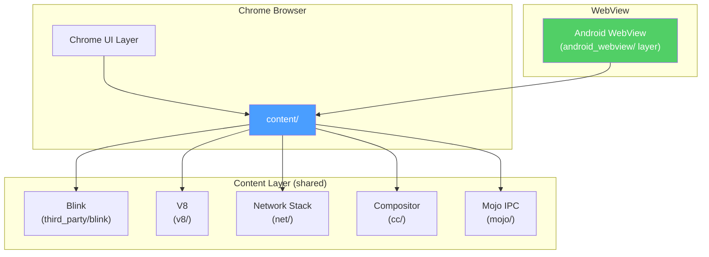

Chromium 源码树中的 `android_webview/` 层（`Aw*` 类前缀来自其 `android_webview` 命名空间）将 content API 适配到 Android 的 WebView 契约。它实现 `WebViewProvider`，处理绘制函子集成，管理 WebView 特定的合成器模式，并把 Android 的 `WebSettings` 桥接到 Chromium 的内部 content 设置。

### 45.6.2 GPU 进程与硬件加速

WebView 的 GPU 集成在 Chromium 嵌入方中是独特的，因为它必须共享应用的 GPU 上下文。与 Chrome（有自己的 GPU 进程）不同，WebView 挂钩到 Android 的 `RenderThread`：

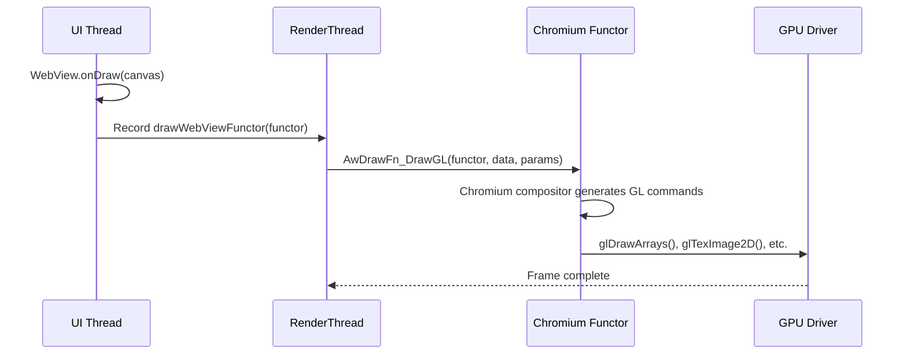

绘制函子（`AwDrawFn_CreateFunctor` / `AwDrawFn_DrawGL`，在 Vulkan 路径上为 `AwDrawFn_DrawVk`；参见 `frameworks/base/native/webview/plat_support/draw_fn.h`）是一个原生回调，通过 `WebViewDelegate.drawWebViewFunctor()` 注册。这避免了单独 GPU 进程的开销，并允许 WebView 内容与原生 Android 视图在同一遍 GPU 合成中组合。

### 45.6.3 渲染进程沙箱化

渲染进程在受限沙箱中运行，具有多层隔离：

1. **UID 隔离**：每个渲染器从 `FIRST_ISOLATED_UID` 范围获得一个隔离 UID，防止访问其他应用的数据。

2. **SELinux 策略**：渲染器在 `isolated_app` SELinux 域中运行，该域限制文件系统访问、网络操作和系统调用。`webview_zygote` 是 zygote 进程本身的域；其策略只允许它将 fork 出的渲染器 dyntransition 到 `isolated_app`（`system/sepolicy/private/webview_zygote.te`、`system/sepolicy/private/isolated_app.te`）。

3. **seccomp-bpf**：BPF 过滤器限制渲染器可以发起的系统调用集，阻止 `mount`、`reboot`、`ptrace` 等危险调用。

4. **进程能力**：渲染器在启动后丢弃所有 Linux 能力。

5. **命名空间隔离**：与所有 zygote 派生的进程一样，渲染器通过 `unshare(CLONE_NEWNS)` 获得一个不共享的挂载命名空间（`frameworks/base/core/jni/com_android_internal_os_Zygote.cpp`）。Android 不会给它单独的 PID 或网络命名空间。网络隔离来自缺少网络组成员身份的隔离 UID，而不是来自网络命名空间。

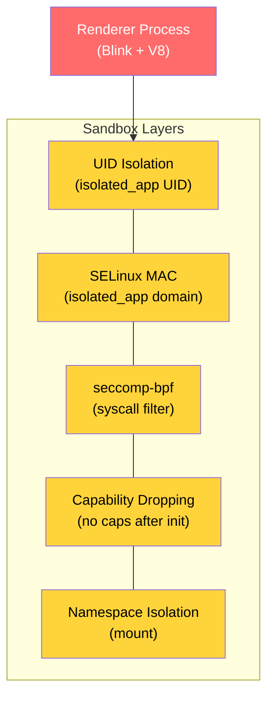

### 45.6.4 网络栈

WebView 使用 Chromium 自己的网络栈，而不是 Android 的。这提供：

- HTTP/2 和 HTTP/3（QUIC）支持
- 连接池与多路复用
- 使用 Chromium 自己的证书验证的 TLS 1.3
- 兼容 Cronet 的网络 API
- Chromium Cookie 数据库中的 Cookie 存储

网络栈运行在浏览器（应用）进程中，而不是渲染器中。这意味着来自 Web 内容的网络请求会跨过 Mojo IPC 边界，从渲染器到浏览器。请求在浏览器进程中执行，响应被发送回来。

### 45.6.5 Mojo IPC

浏览器与渲染器进程之间的通信使用 Chromium 的 **Mojo** IPC 框架。Mojo 提供：

- 类型化的消息接口（定义在 `.mojom` 文件中）
- 用于大数据传输的共享内存区域
- 用于流式传输的数据管道
- 基于能力的安全性（接口句柄无法伪造）

WebView 使用的关键 Mojo 接口包括：

| 接口 | 方向 | 用途 |
|---|---|---|
| `blink.mojom.LocalFrame` | 浏览器 -> 渲染器 | 框架管理 |
| `blink.mojom.FrameHost` | 渲染器 -> 浏览器 | 导航请求 |
| `content.mojom.Renderer` | 浏览器 -> 渲染器 | 进程控制 |
| `network.mojom.URLLoader` | 任意方向 | 资源加载 |

### 45.6.6 V8 JavaScript 引擎集成

WebView 使用作为 Chromium 一部分发布的 V8 JavaScript 引擎。V8 运行在渲染进程中并提供：

- **JIT 编译**：V8 在运行时使用其 TurboFan 优化编译器将 JavaScript 编译为优化的机器代码。在 WebView 中，JIT 默认启用，但渲染器沙箱限制可执行页面的内存映射，以防止 JIT 喷洒攻击。

- **垃圾回收**：V8 的 Orinoco 垃圾回收器使用并发和并行的回收策略，以最小化网页交互期间的暂停时间。

- **WebAssembly 支持**：V8 包含一个 WebAssembly（Wasm）引擎，可以以接近原生的性能执行编译后的 Wasm 模块。

- **每框架一个 Isolate**：当站点隔离激活时，每个框架（主框架和 iframe）获得自己的 V8 isolate。这确保来自不同来源的 JavaScript 不能共享内存。

JavaScript 到 Java 的桥（通过 `addJavascriptInterface()`）跨越进程边界两次。首先它通过 Mojo IPC 从渲染器中的 V8 到达浏览器进程。然后它通过 JNI 从 Chromium 浏览器侧代码到达 Java 桥对象。

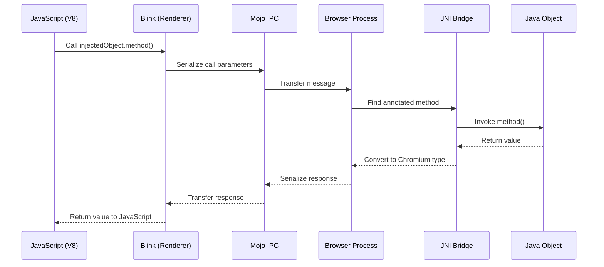

### 45.6.7 WebView 模式下的合成器架构

WebView 的合成器与 Chrome 的运行方式不同。在 Chrome 中，合成器运行在专用的 GPU 进程中并独立产生帧。在 WebView 中，合成器必须与 Android 的 `RenderThread` 集成：

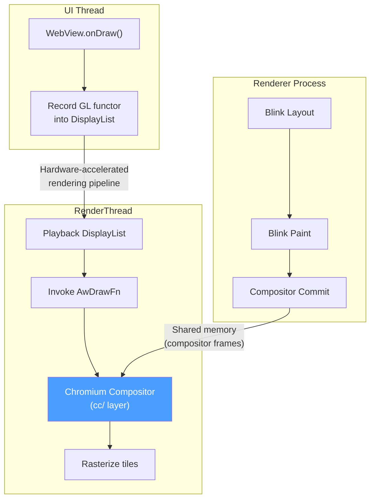

这一架构意味着：

1. Blink 渲染器计算布局和绘制操作，产生一个合成器帧（带有内容的图层树）。

2. 合成器帧通过共享内存传输到浏览器进程。

3. 在下一个 `RenderThread` 帧上，绘制函子被调用，Chromium 合成器将帧的瓦片光栅化到应用的 GPU 上下文中。

4. 结果与其他 Android 视图在同一遍 GPU 合成中一起组合。

在 Chromium 术语中这被称为**“同步合成器”**模式，因为合成器必须与 Android `RenderThread` 的节奏同步，而不是按照自己的时间线运行。

### 45.6.8 线程模型

WebView 在应用进程内使用多个线程：

| 线程 | 角色 |
|---|---|
| UI 线程（主） | Android 生命周期、WebView API 调用、Chromium 浏览器主线程 |
| IO 线程 | 网络 I/O、IPC 消息分发 |
| RenderThread | 硬件加速渲染、合成器 |
| ThreadPool 工作线程 | 后台任务、DNS 预取、文件 I/O |
| Java Bridge 线程 | `@JavascriptInterface` 方法执行 |

UI 线程身兼两职，既是 Android 主线程，也是 Chromium 的浏览器主线程。这是一个关键约束：在浏览器主线程上长时间运行的 Chromium 操作可能导致 Android 应用 ANR。Chromium 代码的设计避免了阻塞主线程，但包含许多框架的复杂页面加载仍可能导致卡顿。

### 45.6.9 Service Worker 支持

WebView 通过 `ServiceWorkerController` 和 `ServiceWorkerClient` 类支持 Service Worker：

```java
ServiceWorkerController swController = ServiceWorkerController.getInstance();
swController.setServiceWorkerClient(new ServiceWorkerClient() {
    @Override
    public WebResourceResponse shouldInterceptRequest(WebResourceRequest request) {
        // Intercept service worker requests
        return null; // null = let WebView handle normally
    }
});

ServiceWorkerWebSettings swSettings = swController.getServiceWorkerWebSettings();
swSettings.setAllowContentAccess(true);
swSettings.setCacheMode(WebSettings.LOAD_DEFAULT);
```

Service Worker 运行在渲染进程中，可以拦截网络请求，从而为嵌入在 WebView 中的 Web 应用启用离线支持和推送通知。

### 45.6.10 WebView 与 Chrome：关键差异

尽管 WebView 和 Chrome 共享相同的 Chromium 代码库，但存在显著的行为差异：

| 方面 | Chrome | WebView |
|---|---|---|
| 进程模型 | 独立的 GPU 进程 | 共享应用 GPU 线程 |
| 合成器 | 异步 | 同步（绑定到 RenderThread） |
| 浏览器 UI | 完整的 Chrome UI | 无浏览器 UI（应用提供 UI） |
| 导航 | 完整的 URL 栏、标签页 | 由应用代码控制 |
| 扩展 | 支持 | 不支持 |
| DevTools | 内置 | 需要显式启用 |
| Safe Browsing | 始终开启 | 默认开启，可禁用 |
| Cookie 存储 | Chrome profile | 按应用的 WebView 数据目录 |
| 自动填充 | Chrome 的自动填充 | Android 平台自动填充 |
| 下载处理 | Chrome 的下载管理器 | 通过 `DownloadListener` 回调给应用 |
| 多 profile | 支持 | 每个数据目录单一 profile |

---

## 45.7 WebView 与安全

### 45.7.1 同源策略

WebView 强制执行标准的 Web 同源策略：来自一个来源的脚本无法访问来自不同来源的资源或 DOM。来源由三元组（scheme、host、port）定义。

Android WebView 的特殊注意事项：

- 通过 `loadData()` 加载的内容来源为 `"null"`——它无法访问任何其他来源的资源。源代码文档明确警告：

  > 无论应用还是 WebView 中运行的任何 JavaScript 代码，都不得将此视为受信任的
  > 来源，因为恶意内容同样可以创建来源为 null 的框架。

- 通过 `loadDataWithBaseURL()` 加载并带有 HTTP/HTTPS base URL 的内容获得该 URL 的来源，从而实现有意义的同源检查。

- `file://` URL 共享单一来源，这就是为什么对面向 API 30+ 的应用来说，`setAllowFileAccess(false)` 是安全默认值。

### 45.7.2 混合内容处理

WebView 为混合内容（从 HTTPS 页面加载的 HTTP 资源）提供三种处理模式：

```java
// Most secure: block all mixed content
webSettings.setMixedContentMode(WebSettings.MIXED_CONTENT_NEVER_ALLOW);

// Least secure: allow all mixed content
webSettings.setMixedContentMode(WebSettings.MIXED_CONTENT_ALWAYS_ALLOW);

// Browser-compatible: block some, allow others
webSettings.setMixedContentMode(WebSettings.MIXED_CONTENT_COMPATIBILITY_MODE);
```

对安全敏感的应用建议使用 `MIXED_CONTENT_NEVER_ALLOW`。`MIXED_CONTENT_COMPATIBILITY_MODE` 遵循 Chromium 不断演进的策略，该策略越来越倾向于默认阻止混合内容。

### 45.7.3 Safe Browsing

WebView 集成 Google Safe Browsing 以保护用户免受恶意网站的侵害。Safe Browsing 系统会根据定期更新的已知威胁数据库检查 URL。

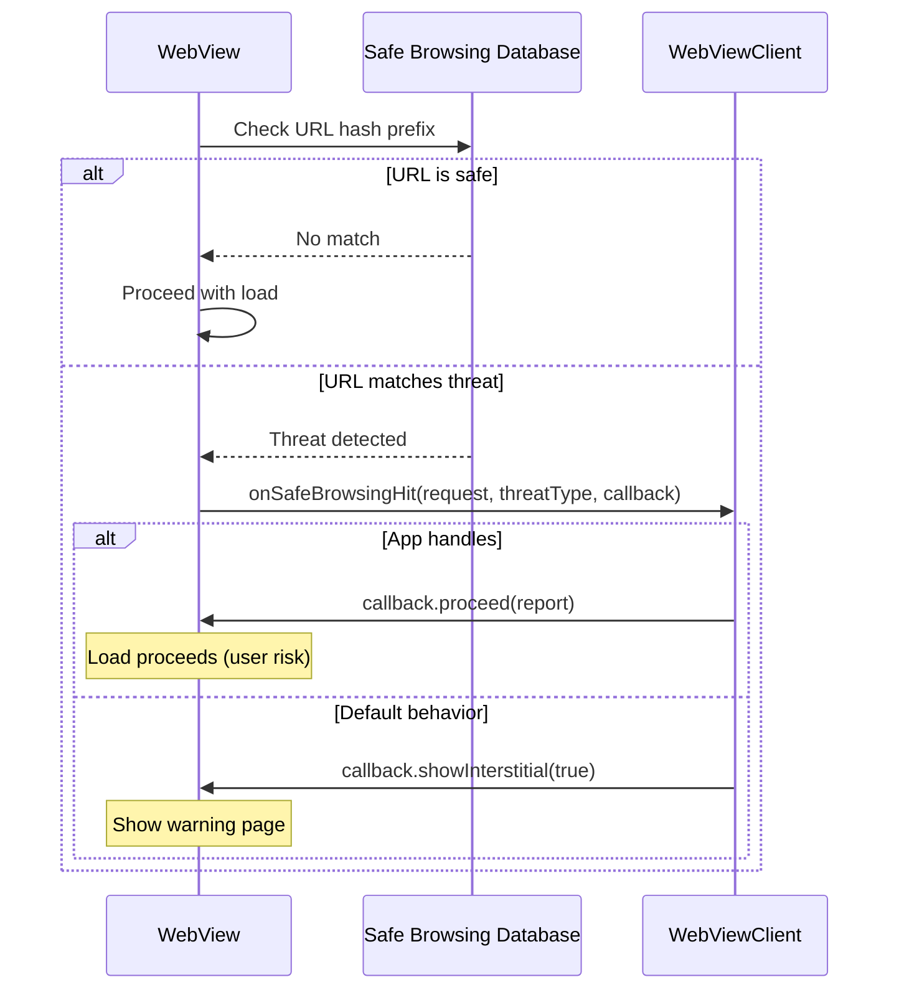

Safe Browsing 默认启用。应用可以：

- 通过 `WebSettings.setSafeBrowsingEnabled(false)` 禁用它
- 通过 `WebView.setSafeBrowsingWhitelist()` 将特定主机加入允许列表
- 通过 `WebViewClient.onSafeBrowsingHit()` 自定义处理威胁
- 通过 `WebView.getSafeBrowsingPrivacyPolicyUrl()` 链接到隐私政策

从 WebView 版本 122.0.6174.0 开始，Safe Browsing 初始化是自动的。以前必需的 `WebView.startSafeBrowsing()` 调用现在已被弃用并变为空操作。

### 45.7.4 SSL/TLS 安全

WebView 使用 Chromium 的 TLS 实现，提供：

- TLS 1.2 和 1.3 支持
- 证书透明度（Certificate Transparency）强制执行
- HSTS（HTTP 严格传输安全）预加载列表
- OCSP 装订（stapling）
- 强密码套件选择

当发生 SSL 错误时，会调用 `WebViewClient.onReceivedSslError()` 回调。默认行为是取消加载：

```java
public void onReceivedSslError(WebView view, SslErrorHandler handler, SslError error) {
    handler.cancel(); // Secure default: reject
}
```

客户端证书身份验证通过 `onReceivedClientCertRequest()` 处理，默认是取消（不发送客户端证书）：

```java
public void onReceivedClientCertRequest(WebView view, ClientCertRequest request) {
    request.cancel(); // Default: no client cert
}
```

### 45.7.5 JavaScript 桥安全

`addJavascriptInterface()` 机制历史上一直是安全漏洞的来源。关键缓解措施：

1. **`@JavascriptInterface` 注解要求**（API 17+）：只有被注解的方法才会暴露，防止基于反射的攻击。

2. **特权进程排除**：WebView 拒绝在 system_server、电话、NFC、蓝牙或 root 进程中加载。

3. **来源盲目性警告**：注入的对象可从所有框架访问，包括跨来源的 iframe。应用不得假设调用框架是受信任的。

4. **线程隔离**：对 Java 对象的 JavaScript 调用在私有后台线程上执行，而不是 UI 线程。这防止了 UI 线程阻塞，但需要线程安全的实现。

### 45.7.6 文件访问控制

WebView 提供对本地文件访问的细粒度控制：

| 设置 | 默认值（API &lt; 30） | 默认值（API >= 30） |
|---|---|---|
| `setAllowFileAccess()` | `true` | `false` |
| `setAllowContentAccess()` | `true` | `true` |
| `setAllowFileAccessFromFileURLs()` | `false`（API 16+） | `false` |
| `setAllowUniversalAccessFromFileURLs()` | `false`（API 16+） | `false` |

源代码中的建议很明确：

> 应用不应在 WebView 中打开来自任何外部来源的 file:// URL。建议始终使用
> `androidx.webkit.WebViewAssetLoader`，通过 http(s):// 方案（而不是 file:// URL）
> 来访问包括 assets 和 resources 在内的文件。

文件方案的 Cookie 默认也是禁用并已弃用的：

```java
@Deprecated
public static void setAcceptFileSchemeCookies(boolean accept) {
    getInstance().setAcceptFileSchemeCookiesImpl(accept);
}
```

### 45.7.7 Content Security Policy 集成

WebView 遵循网页设置的 Content Security Policy（CSP）头和元标签。CSP 通过指定允许哪些内容来源来提供额外的防御层。例如：

```
Content-Security-Policy: default-src 'self'; script-src 'self' https://cdn.example.com
```

这指示 WebView 只执行来自页面自身来源或指定 CDN 的脚本。CSP 违规会通过 `WebChromeClient` 中的 `onConsoleMessage()` 回调报告。

嵌入不可信 Web 内容时，应用应验证加载的页面是否具有适当的 CSP 头。然而，CSP 由渲染器强制执行，并由 Web 内容控制。嵌入应用无法通过 `loadUrl()` 加载的第三方内容注入 CSP 头。

### 45.7.8 网络安全配置

Android 的网络安全配置（NSC）适用于 WebView 的网络栈。应用可以通过其 `network_security_config.xml` 自定义信任锚点、证书固定和明文流量策略：

```xml
<?xml version="1.0" encoding="utf-8"?>
<network-security-config>
    <domain-config>
        <domain includeSubdomains="true">example.com</domain>
        <pin-set expiration="2025-12-31">
            <pin digest="SHA-256">base64_encoded_hash=</pin>
        </pin-set>
    </domain-config>
    <base-config cleartextTrafficPermitted="false" />
</network-security-config>
```

当 `cleartextTrafficPermitted` 为 `false` 时，WebView 会阻止所有 HTTP（非 HTTPS）请求。除了 Chromium 内置的证书验证外，NSC 中声明的证书固定对 WebView 连接也会强制执行。

### 45.7.9 数据目录隔离

WebView 支持多进程应用的数据目录隔离。`WebViewFactory.setDataDirectorySuffix()` 方法必须在创建任何 WebView 之前调用：

```java
// In Application.onCreate(), before any WebView creation
WebView.setDataDirectorySuffix("process_name");
```

这对在多个进程中使用 WebView 的应用至关重要。如果没有唯一的后缀，多个进程会争用同一个数据目录（Cookie、缓存、本地存储），可能导致数据损坏。该实现会验证后缀以防止路径遍历：

```java
static void setDataDirectorySuffix(String suffix) {
    synchronized (sProviderLock) {
        if (sProviderInstance != null) {
            throw new IllegalStateException(
                    "Can't set data directory suffix: WebView already initialized");
        }
        if (suffix.indexOf(File.separatorChar) >= 0) {
            throw new IllegalArgumentException("Suffix " + suffix
                                               + " contains a path separator");
        }
        sDataDirectorySuffix = suffix;
    }
}
```

### 45.7.10 渲染器优先级策略

应用可以影响系统回收渲染进程内存的激进程度：

```java
// Keep the renderer alive even when WebView is not visible
webView.setRendererPriorityPolicy(
    WebView.RENDERER_PRIORITY_IMPORTANT,
    false /* waivedWhenNotVisible */);

// Allow the system to kill the renderer when WebView is not visible
webView.setRendererPriorityPolicy(
    WebView.RENDERER_PRIORITY_BOUND,
    true /* waivedWhenNotVisible */);
```

优先级级别：

| 优先级 | 常量 | 行为 |
|---|---|---|
| Important | `RENDERER_PRIORITY_IMPORTANT` | 渲染器以 `Context.BIND_IMPORTANT` 绑定，与应用主进程优先级相同（默认策略） |
| Bound | `RENDERER_PRIORITY_BOUND` | 渲染器像绑定的服务一样对待 |
| Waived | `RENDERER_PRIORITY_WAIVED` | 渲染器优先级低，容易被杀死 |

当 `waivedWhenNotVisible` 为 `true` 时，只要 WebView 未附加到窗口或不可见，优先级就会降到 `WAIVED`。这让系统可以更积极地回收后台 WebView 的内存。

### 45.7.11 WebView 禁用

框架提供了在进程中完全禁用 WebView 的机制：

```java
static void disableWebView() {
    synchronized (sProviderLock) {
        if (sProviderInstance != null) {
            throw new IllegalStateException(
                    "Can't disable WebView: WebView already initialized");
        }
        sWebViewDisabled = true;
    }
}
```

禁用后，任何后续创建 WebView 的尝试都会抛出 `IllegalStateException`。不应加载 Web 内容的系统组件出于安全隔离目的使用此机制。它确保不会有任何东西意外触发 WebView。

### 45.7.12 功能检测

在尝试使用 WebView 之前，应用应验证设备是否支持它：

```java
static boolean isWebViewSupported() {
    if (sWebViewSupported == null) {
        sWebViewSupported = AppGlobals.getInitialApplication().getPackageManager()
                .hasSystemFeature(PackageManager.FEATURE_WEBVIEW);
    }
    return sWebViewSupported;
}
```

一些 Android 设备（特别是嵌入式/IoT 设备、不支持浏览器的 Android Automotive 或 Android Things）可能不包含 WebView 实现。在此类设备上尝试创建 WebView 会抛出 `UnsupportedOperationException`。

---

## 45.8 WebView 调试

### 45.8.1 启用远程调试

WebView 支持 Chrome DevTools 远程调试。它以编程方式启用：

```java
WebView.setWebContentsDebuggingEnabled(true);
```

这个静态方法委托给提供方：

```java
public static void setWebContentsDebuggingEnabled(boolean enabled) {
    getFactory().getStatics().setWebContentsDebuggingEnabled(enabled);
}
```

启用后，WebView 会打开一个 Unix 域套接字，Chrome DevTools Protocol（CDP）客户端可以连接它。

### 45.8.2 chrome://inspect

主要的调试工作流程：

1. 在应用中启用调试（通过上面的 API 调用，或者应用的 manifest 声明 `android:debuggable="true"`）

2. 通过 USB 连接设备并启用 USB 调试

3. 在开发机的 Chrome 中打开 `chrome://inspect`

4. WebView 实例出现在设备列表下

5. 点击 “inspect” 为该 WebView 打开完整的 DevTools 窗口

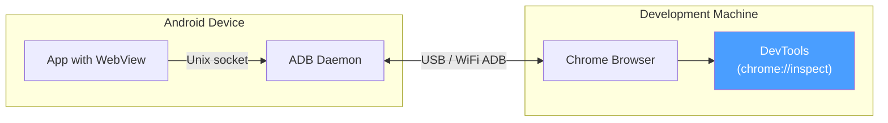

### 45.8.3 DevTools 功能

连接后，完整的 Chrome DevTools 套件都可以使用：

| 面板 | 功能 |
|---|---|
| Elements | 检查和修改 DOM 与 CSS |
| Console | 执行 JavaScript、查看控制台输出 |
| Sources | 设置断点、逐步执行 JavaScript |
| Network | 监控所有网络请求/响应 |
| Performance | 录制和分析渲染性能 |
| Memory | 堆快照、分配分析 |
| Application | 检查 Cookie、本地存储、IndexedDB |
| Security | 查看证书详情、混合内容 |

### 45.8.4 控制台消息转发

即使没有连接 DevTools，也可以通过 `WebChromeClient.onConsoleMessage()` 捕获 JavaScript 控制台消息：

```java
webView.setWebChromeClient(new WebChromeClient() {
    @Override
    public boolean onConsoleMessage(ConsoleMessage consoleMessage) {
        Log.d("WebView", consoleMessage.message()
                + " -- From line " + consoleMessage.lineNumber()
                + " of " + consoleMessage.sourceId());
        return true; // Message handled
    }
});
```

`ConsoleMessage` 包括：

- 消息文本
- 源文件 ID
- 行号
- 消息级别（DEBUG、ERROR、LOG、TIP、WARNING）

### 45.8.5 TracingController

对于性能分析，WebView 提供了一个 `TracingController` API，与 Chromium 的跟踪基础设施集成：

```
Source: frameworks/base/core/java/android/webkit/TracingController.java
```

```java
TracingController tracingController = TracingController.getInstance();

// Start tracing
tracingController.start(new TracingConfig.Builder()
        .addCategories(TracingConfig.CATEGORIES_WEB_DEVELOPER)
        .build());

// ... perform operations ...

// Stop and collect trace data
tracingController.stop(new FileOutputStream("trace.json"),
        Executors.newSingleThreadExecutor());
```

跟踪输出采用 Chromium 的 JSON trace 格式，可以加载到：

- Chrome 中的 `chrome://tracing`
- Perfetto UI（https://ui.perfetto.dev）
- Android Studio Profiler

`TracingConfig` 支持多种类别预设：

- `CATEGORIES_NONE` -- 无类别
- `CATEGORIES_ALL` -- 所有类别
- `CATEGORIES_ANDROID_WEBVIEW` -- WebView 特定类别
- `CATEGORIES_WEB_DEVELOPER` -- 对 Web 开发者有用的类别
- `CATEGORIES_INPUT_LATENCY` -- 输入事件处理类别
- `CATEGORIES_RENDERING` -- 渲染管线类别
- `CATEGORIES_JAVASCRIPT_AND_RENDERING` -- JS 与渲染组合

跟踪系统还通过 `WebViewDelegate` 与 Android 的 systrace 集成：

```java
public boolean isTraceTagEnabled() {
    return Trace.isTagEnabled(Trace.TRACE_TAG_WEBVIEW);
}
```

### 45.8.6 崩溃诊断

当渲染进程崩溃时，应用会通过 `RenderProcessGoneDetail` 收到信息：

```
Source: frameworks/base/core/java/android/webkit/RenderProcessGoneDetail.java
```

```java
public abstract boolean didCrash();          // true = crash, false = killed by system
public abstract int rendererPriorityAtExit(); // Priority at time of exit
```

为测试崩溃处理，特殊 URL `chrome://crash` 会触发一次有意的渲染器崩溃。

---

## 45.9 Android 17 中的 WebView

Android 17 并没有重写前面各节描述的 WebView 架构。它做出了四项值得关注的聚焦变更。前两项是更新服务的已启动 APEX 外壳，以及第二代更新服务实现的全面铺开。另外两项是移除线程检查兼容性退路，以及为文本选择菜单新增的 OEM 钩子。本节以 17 的源码为基础逐一讲解。

### 45.9.1 WebViewBootstrap APEX 外壳

标志性的结构变更是 `com.android.webview.bootstrap`，这是在 `packages/modules/WebViewBootstrap/` 下定义的一个新的已启动 APEX。它是一个 Mainline 风格的外壳。其目的是让 WebView **提供方选择**逻辑能够像 Tethering、ART 及其他 Mainline 模块那样，独立于平台镜像发布和更新。就当前源码而言，它还是一个空外壳。`apex` 规则只声明了 manifest、密钥和证书，其负载中没有任何 Java 库或应用。更新服务代码仍然位于 `frameworks/base` 中。

```
Source: packages/modules/WebViewBootstrap/apex/Android.bp
Source: packages/modules/WebViewBootstrap/apex/manifest.json
```

重要的是要把两件事区分开：

- **WebView 提供方**（基于 Chromium 的实现 APK，例如 `com.google.android.webview`）早已可以独立更新。这一点没有变化。
- **提供方选择机制**才是 bootstrap APEX 打算承载的东西。它包括 `WebViewUpdateService`、其 `WebViewUpdateServiceImpl2` 选择逻辑、`WebViewUpdateManager` 客户端包装器，以及 `IWebViewUpdateService` Binder 接口。把这些代码移入模块后，选择策略及其客户端 API 可以在不进行完整 OS 更新的情况下演进。

该 APEX 使用共享的 `v-launched-apex-module` 默认值构建。这个默认值把它标记为在 V（Android 15 / VanillaIceCream）周期内已启动（变得可加载）并被顺延的模块：

```
Source: packages/modules/WebViewBootstrap/apex/Android.bp (apex "com.android.webview.bootstrap", defaults: ["v-launched-apex-module"])
Source: packages/modules/common/sdk/Android.bp (v-launched-apex-module default)
```

该模块由一个发布开关控制，并且在 AOSP 中**默认关闭**。`base_system.mk` 构建逻辑只在 `RELEASE_USE_WEBVIEW_BOOTSTRAP_MODULE` 为 `true` 时才把该 APEX 加入镜像，而该开关声明的值为 `false`：

```
Source: build/make/target/product/base_system.mk (RELEASE_USE_WEBVIEW_BOOTSTRAP_MODULE guard)
Source: build/release/flag_declarations/RELEASE_USE_WEBVIEW_BOOTSTRAP_MODULE.textproto
```

因此在默认的 Android 17 构建中，更新服务仍然在平台中运行。APEX、签名密钥和构建管线都已就位。它们随时可以被打开。

下图展示了 bootstrap APEX 打算承载什么，以及什么仍保持为可单独更新的提供方 APK。目前，APEX 框中的所有内容仍然在平台中发布：

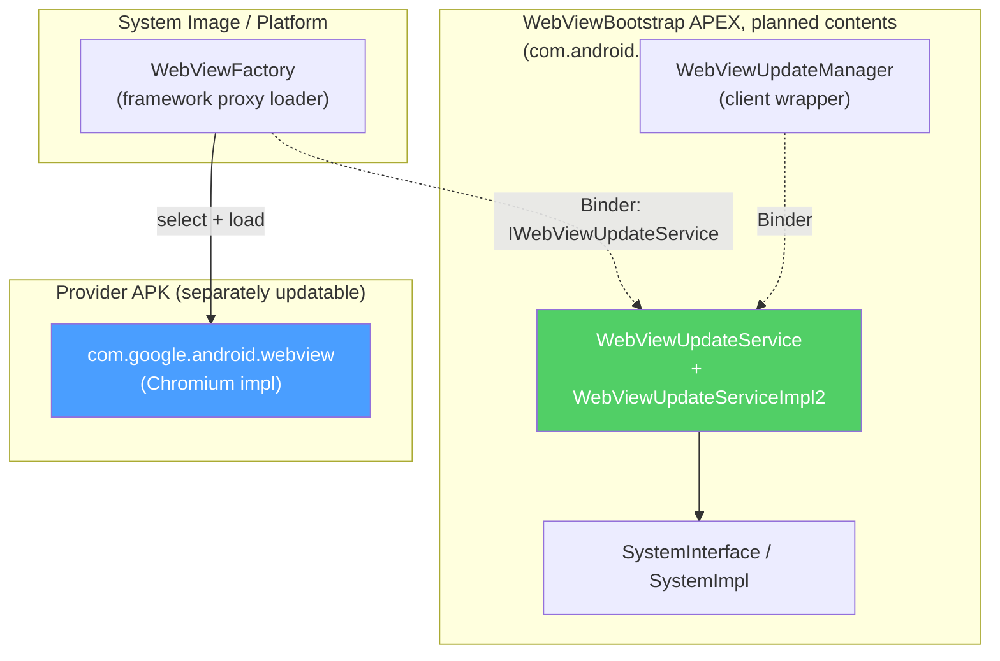

框架代码被刻意重构以支持这种打包方式。更新服务只通过由 `SystemImpl` 实现的 `SystemInterface` 抽象与平台其余部分对话。因此选择逻辑有一个干净、可模拟的边界，可以放进模块中：

```
Source: frameworks/base/services/core/java/com/android/server/webkit/SystemInterface.java
Source: frameworks/base/services/core/java/com/android/server/webkit/SystemImpl.java
```

模块所需的面向客户端的 API 在 `android.webkit` 的 `mainline_apis` aconfig 开关之后声明。`WebViewBootstrapFrameworkInitializer` 注册 `WebViewUpdateManager` 系统服务。这让应用可以通过 `Context.getSystemService()` 访问它：

```
Source: frameworks/base/core/java/android/webkit/WebViewBootstrapFrameworkInitializer.java
Source: frameworks/base/core/java/android/webkit/flags.aconfig (flag "mainline_apis")
```

### 45.9.2 更新服务 v2 全面铺开

第二代更新服务 `WebViewUpdateServiceImpl2` 过去是在 `android.webkit.update_service_v2` aconfig 开关之后被选中的。在 Android 17 中，该开关已完全铺开。旧实现已被移除，因此 `WebViewUpdateService` 无条件构造新的实现：

```
Source: frameworks/base/services/core/java/com/android/server/webkit/WebViewUpdateService.java (lines 64, 73)
Source: frameworks/base/services/core/java/com/android/server/webkit/flags.aconfig (flag "update_service_v2")
```

45.4 节描述的提供方选择算法和有效性检查（`VALIDITY_INCORRECT_SDK_VERSION`、`VALIDITY_INCORRECT_VERSION_CODE`、`VALIDITY_INCORRECT_SIGNATURE`、`VALIDITY_NO_LIBRARY_FLAG`）都在这个实现中：

```
Source: frameworks/base/services/core/java/com/android/server/webkit/WebViewUpdateServiceImpl2.java (validityResult(), lines 589-606; findPreferredWebViewPackage(), lines 476-512)
```

注意签名检查中的一个细微之处。在可调试构建中签名会被跳过（便于开发）。系统应用会被接受为提供方，不受签名限制，这发生在配置签名比较运行之前：

```
Source: frameworks/base/services/core/java/com/android/server/webkit/WebViewUpdateServiceImpl2.java (providerHasValidSignature(), lines 669-681)
```

### 45.9.3 线程检查现为无条件

如 45.3.2 节所述，Android 17 移除了 `sEnforceThreadChecking` 字段和 `always_enforce_thread_checking` 开关。`WebView.checkThread()` 现在无论应用的 `targetSdkVersion` 如何，只要在错误线程上调用 WebView 方法，就总是抛出 `RuntimeException`。此前，面向 API 18 以下的应用只会得到一条日志警告。这关闭了一个长期存在的兼容性缺口——过时的应用可能悄悄从错误线程调用 WebView，从而引发难以诊断的损坏：

```
Source: frameworks/base/core/java/android/webkit/WebView.java (checkThread(), lines 2643-2657)
```

### 45.9.4 SelectionActionMenuClient：OEM 选择菜单自定义

Android 17 新增了 `SelectionActionMenuClient`，这是一个 `@SystemApi` 类。OEM 实现它来自定义文本选择菜单。这是用户在 WebView 中选择文本时显示的浮动/下拉菜单。它由 `selection_action_menu_client` aconfig 开关控制：

```
Source: frameworks/base/core/java/android/webkit/SelectionActionMenuClient.java
Source: frameworks/base/core/java/android/webkit/flags.aconfig (flag "selection_action_menu_client")
```

该客户端是一个进程全局对象。WebView 通过 `WebViewDelegate.getSelectionActionMenuClient()` 桥接只请求它一次，该桥接会实例化由 `config_webViewSelectionActionMenuClientPackage` 框架资源命名的类。同一实例在该进程的所有 WebView 实例间复用：

```
Source: frameworks/base/core/java/android/webkit/WebViewDelegate.java (getSelectionActionMenuClient(), lines 187-207)
```

它的接口让 OEM 可以：

| 方法 | 用途 |
|---|---|
| `getDefaultMenuItemOrder(int menuType)` | 为浮动菜单和下拉菜单排序内置项（剪切、复制、粘贴、分享、全选、网页搜索） |
| `getAdditionalMenuItems(...)` | 向菜单添加自定义 `MenuItem` 条目（带有唯一 ID） |
| `filterTextProcessingActivities(List<ResolveInfo>)` | 过滤哪些 `PROCESS_TEXT` 活动会出现 |
| `handleMenuItemClick(Context, MenuItem)` | 处理其添加的自定义项的点击 |

两种菜单类型是 `MENU_TYPE_FLOATING`（浮动工具栏）和 `MENU_TYPE_DROPDOWN`。默认项由 `DEFAULT_ITEM_*` 常量枚举（`DEFAULT_ITEM_CUT`、`DEFAULT_ITEM_COPY`、`DEFAULT_ITEM_PASTE`、`DEFAULT_ITEM_PASTE_AS_PLAIN_TEXT`、`DEFAULT_ITEM_SHARE`、`DEFAULT_ITEM_SELECT_ALL`、`DEFAULT_ITEM_WEB_SEARCH`）。由于这是一个由框架配置资源决定的 `@SystemApi`，它是一个 OEM/设备集成商钩子，而不是普通应用可以设置的东西。

## 45.10 动手实践

本节提供动手练习，在真实设备或模拟器上探索 WebView 内部机制。

### 练习 45.1：检查当前激活的 WebView 提供方

查询系统以查看当前激活的 WebView 提供方是哪个：

```bash
# Show the update service state: the current provider package plus the full
# "WebView packages:" list of configured providers
adb shell dumpsys webviewupdate
```

注意 `cmd webviewupdate` 只支持 `set-webview-implementation`（以及 `help`）；`dumpsys webviewupdate` 才是检查激活和可用提供方的方法。预期输出包括提供方包名、版本代码，以及它是按默认还是按用户偏好选择的。

### 练习 45.2：切换 WebView 提供方

在具有多个提供方的设备上（例如独立 WebView 和 Chrome）：

```bash
# List available providers (see the "WebView packages:" section of the dump)
adb shell dumpsys webviewupdate

# Switch to Chrome as WebView provider (if available)
adb shell cmd webviewupdate set-webview-implementation com.android.chrome

# Switch back to standalone WebView
adb shell cmd webviewupdate set-webview-implementation com.google.android.webview
```

你也可以从 设置 > 开发者选项 > WebView 实现 中切换提供方。

### 练习 45.3：观察 WebView Zygote

```bash
# Find the WebView Zygote process
adb shell ps -A | grep webview_zygote

# Look at the zygote's child processes (renderers)
adb shell ps -A | grep isolated

# Check the zygote's SELinux context
adb shell ps -AZ | grep webview_zygote
```

### 练习 45.4：监控 RELRO 文件创建

```bash
# Watch for RELRO file changes
adb shell ls -la /data/misc/shared_relro/

# Trigger RELRO recreation by force-updating WebView
adb shell cmd webviewupdate set-webview-implementation com.google.android.webview

# Check RELRO files again
adb shell ls -la /data/misc/shared_relro/
```

### 练习 45.5：构建一个最小化 WebView 应用

创建一个最小化应用，练习关键的 WebView API：

```java
public class WebViewExplorerActivity extends Activity {
    private WebView webView;

    @Override
    protected void onCreate(Bundle savedInstanceState) {
        super.onCreate(savedInstanceState);
        webView = new WebView(this);
        setContentView(webView);

        // Enable debugging
        WebView.setWebContentsDebuggingEnabled(true);

        // Configure settings
        WebSettings settings = webView.getSettings();
        settings.setJavaScriptEnabled(true);
        settings.setDomStorageEnabled(true);
        settings.setMixedContentMode(WebSettings.MIXED_CONTENT_NEVER_ALLOW);

        // Set up clients
        webView.setWebViewClient(new WebViewClient() {
            @Override
            public void onPageFinished(WebView view, String url) {
                Log.d("WebViewExplorer", "Page loaded: " + url);
            }

            @Override
            public boolean onRenderProcessGone(WebView view,
                    RenderProcessGoneDetail detail) {
                Log.e("WebViewExplorer", "Renderer gone! Crashed: "
                        + detail.didCrash());
                // Clean up and recreate
                webView.destroy();
                webView = new WebView(WebViewExplorerActivity.this);
                setContentView(webView);
                return true;
            }
        });

        webView.setWebChromeClient(new WebChromeClient() {
            @Override
            public void onProgressChanged(WebView view, int newProgress) {
                Log.d("WebViewExplorer", "Progress: " + newProgress + "%");
            }

            @Override
            public boolean onConsoleMessage(ConsoleMessage consoleMessage) {
                Log.d("WebViewJS", consoleMessage.message());
                return true;
            }
        });

        // Set up render process monitoring
        webView.setWebViewRenderProcessClient(new WebViewRenderProcessClient() {
            @Override
            public void onRenderProcessUnresponsive(
                    WebView view, WebViewRenderProcess renderer) {
                Log.w("WebViewExplorer", "Renderer unresponsive!");
            }

            @Override
            public void onRenderProcessResponsive(
                    WebView view, WebViewRenderProcess renderer) {
                Log.i("WebViewExplorer", "Renderer responsive again.");
            }
        });

        // Add a JavaScript interface
        webView.addJavascriptInterface(new Object() {
            @JavascriptInterface
            public String getDeviceInfo() {
                return Build.MODEL + " / Android " + Build.VERSION.RELEASE;
            }
        }, "AndroidBridge");

        // Load a page
        webView.loadUrl("https://example.com");
    }

    @Override
    protected void onPause() {
        super.onPause();
        webView.onPause();
    }

    @Override
    protected void onResume() {
        super.onResume();
        webView.onResume();
    }

    @Override
    protected void onDestroy() {
        webView.destroy();
        super.onDestroy();
    }
}
```

### 练习 45.6：使用 DevTools 进行远程调试

1. 构建并安装练习 45.5 中的应用。

2. 在开发机上打开 Chrome，导航到 `chrome://inspect`。

3. 应用的 WebView 应该出现在 “Remote Target” 下。

4. 点击 “inspect” 打开 DevTools。

5. 在 DevTools Console 中尝试：
   ```javascript
   // Call the Java bridge
   AndroidBridge.getDeviceInfo()

   // Inspect the page
   document.title

   // Monitor network
   // (Switch to Network tab and reload the page)
   ```

### 练习 45.7：测试渲染器崩溃处理

在练习 45.5 的应用运行时：

```bash
# Trigger a renderer crash
adb shell "echo 'javascript:void(0)' | am start -a android.intent.action.VIEW -d 'chrome://crash'"
```

或者在 DevTools 控制台中：
```javascript
// This navigates to a special URL that crashes the renderer
location.href = "chrome://crash";
```

观察 logcat 中触发的 `onRenderProcessGone` 回调：
```bash
adb logcat -s WebViewExplorer
```

### 练习 45.8：跟踪 WebView 性能

```java
// In your app, add tracing:
TracingController tc = TracingController.getInstance();

// Start tracing
tc.start(new TracingConfig.Builder()
    .addCategories(TracingConfig.CATEGORIES_WEB_DEVELOPER)
    .setTracingMode(TracingConfig.RECORD_UNTIL_FULL)
    .build());

// Perform some WebView operations
webView.loadUrl("https://example.com");

// After a few seconds, stop and save
tc.stop(new FileOutputStream(
    getExternalFilesDir(null) + "/webview_trace.json"),
    Executors.newSingleThreadExecutor());
```

然后拉取跟踪文件并在 `chrome://tracing` 中加载：
```bash
adb pull /sdcard/Android/data/<your.package>/files/webview_trace.json
```

### 练习 45.9：查看 WebView 内存使用

```bash
# Find the WebView-using app's PID
adb shell pidof <your.package.name>

# Examine its memory map for the WebView library
adb shell cat /proc/<PID>/maps | grep webviewchromium

# Check for RELRO sharing
adb shell cat /proc/<PID>/maps | grep shared_relro

# Get a full memory report
adb shell dumpsys meminfo <your.package.name>
```

查找 `libwebviewchromium.so` 映射。验证 RELRO 段是从共享文件映射的。它应该显示为到 `/data/misc/shared_relro/libwebviewchromium64.relro` 的文件映射。

### 练习 45.10：检查 WebView 提供方包

```bash
# Get the current provider package name from the dumpsys output, which prints
# "Current WebView package (name, version): (<package>, <version>)"
PROVIDER=$(adb shell dumpsys webviewupdate | \
    grep "Current WebView package" | sed 's/.*(//; s/,.*//')

# Examine its APK details
adb shell dumpsys package $PROVIDER | head -50

# Check the WebViewLibrary metadata
adb shell dumpsys package $PROVIDER | grep -A5 "meta-data"

# List its native libraries
adb shell pm path $PROVIDER
# Then examine the APK
adb shell "unzip -l $(pm path $PROVIDER | sed 's/package://') | grep .so"
```

### 练习 45.11：监控 WebView IPC

使用 `strace` 观察 WebView 初始化期间发起的系统调用：

```bash
# Attach strace to the app process during WebView creation
# (requires root or debuggable app)
adb shell strace -f -e trace=openat,mmap,connect -p <PID> 2>&1 | \
    grep -E "(shared_relro|webviewchromium|zygote)"
```

这揭示了 RELRO 文件映射、原生库加载和 zygote 通信。

### 练习 45.12：拦截并修改 Web 请求

在练习 45.5 的基础上拦截并修改资源请求：

```java
webView.setWebViewClient(new WebViewClient() {
    @Override
    public WebResourceResponse shouldInterceptRequest(WebView view,
            WebResourceRequest request) {
        String url = request.getUrl().toString();

        // Log all requests
        Log.d("Intercept", request.getMethod() + " " + url
                + " mainFrame=" + request.isForMainFrame()
                + " redirect=" + request.isRedirect());

        // Block requests to tracking domains
        if (url.contains("analytics.example.com")) {
            return new WebResourceResponse(
                "text/plain", "UTF-8",
                new ByteArrayInputStream(new byte[0]));
        }

        // Serve local assets for a specific path
        if (url.startsWith("https://myapp.local/assets/")) {
            String assetPath = url.replace("https://myapp.local/assets/", "");
            try {
                InputStream is = getAssets().open(assetPath);
                return new WebResourceResponse(
                    "text/html", "UTF-8", is);
            } catch (IOException e) {
                Log.e("Intercept", "Asset not found: " + assetPath);
            }
        }

        return null; // Let WebView handle normally
    }
});
```

然后加载一个页面并在 logcat 中观察被拦截的请求。

### 练习 45.13：Web 消息通道

演示 HTML5 MessageChannel API：

```java
// In the Activity
WebMessagePort[] channel = webView.createWebMessageChannel();
WebMessagePort appPort = channel[0];
WebMessagePort pagePort = channel[1];

// Listen for messages from the web page
appPort.setWebMessageCallback(new WebMessagePort.WebMessageCallback() {
    @Override
    public void onMessage(WebMessagePort port, WebMessage message) {
        Log.d("WebMessage", "Received from page: " + message.getData());

        // Send a response back
        port.postMessage(new WebMessage("Response from Android!"));
    }
});

// Load a page and send the port to it
webView.loadDataWithBaseURL("https://example.com", """
    <html><body>
    <script>
    window.addEventListener('message', function(event) {
        // Receive the port
        var port = event.ports[0];
        port.onmessage = function(e) {
            document.body.innerHTML += '<p>From Android: ' + e.data + '</p>';
        };
        // Send a message to Android
        port.postMessage('Hello from JavaScript!');
    });
    </script>
    <p>Waiting for messages...</p>
    </body></html>
    """, "text/html", "UTF-8", null);

// Transfer the port to the page
webView.postWebMessage(
    new WebMessage("init", new WebMessagePort[]{pagePort}),
    Uri.parse("https://example.com"));
```

### 练习 45.14：探究 WebView 提供方内部结构

探索 WebView 提供方 APK 的内部结构：

```bash
# Find the provider APK path (parse the package name out of the
# "Current WebView package (name, version): (<package>, <version>)" line)
PROVIDER_PKG=$(adb shell dumpsys webviewupdate 2>/dev/null | \
    grep "Current WebView package" | sed 's/.*(//; s/,.*//')
APK_PATH=$(adb shell pm path $PROVIDER_PKG | head -1 | sed 's/package://')

echo "Provider: $PROVIDER_PKG"
echo "APK: $APK_PATH"

# Check the native library size
adb shell "unzip -l $APK_PATH 2>/dev/null | grep libwebviewchromium"

# Check the WebView library metadata
adb shell dumpsys package $PROVIDER_PKG | grep -A2 "com.android.webview.WebViewLibrary"

# Check the provider's declared permissions
adb shell dumpsys package $PROVIDER_PKG | grep "permission"

# Check the provider's version info
adb shell dumpsys package $PROVIDER_PKG | grep -E "(versionCode|versionName)"
```

### 练习 45.15：监控多进程 WebView

在页面加载期间观察 WebView 的多进程特性：

```bash
# Start monitoring processes
adb shell "while true; do
    echo '--- $(date) ---'
    ps -A | grep -E '(webview|isolated|your.package)'
    sleep 2
done"
```

在第二个终端中，启动你的 WebView 应用并加载一个页面。你应该观察到：

1. 主应用进程立即出现
2. 渲染器启动时会派生一个 `isolated` 进程
3. `webview_zygote` 进程可能作为 isolated 进程的父进程可见

要查看进程关系：
```bash
# Show process tree including WebView processes
adb shell ps -A -o PID,PPID,NAME | grep -E "(webview|isolated|zygote)"
```

### 练习 45.16：Cookie 检查

检查 Cookie 如何在 WebView 实例间被管理：

```java
CookieManager cm = CookieManager.getInstance();

// Set a test cookie
cm.setCookie("https://httpbin.org", "test_key=test_value; Max-Age=3600");

// Load the page
webView.loadUrl("https://httpbin.org/cookies");

// After page loads, read cookies back
String cookies = cm.getCookie("https://httpbin.org");
Log.d("Cookies", "Stored cookies: " + cookies);

// Check if third-party cookies are accepted
boolean thirdParty = cm.acceptThirdPartyCookies(webView);
Log.d("Cookies", "Third-party cookies accepted: " + thirdParty);
```

httpbin.org 的 `/cookies` 端点显示浏览器发送了哪些 Cookie。用它来验证通过 `CookieManager` 设置的 Cookie 是否随请求被正确发送。

### 练习 45.17：Safe Browsing 测试

使用已知测试 URL 测试 Safe Browsing 集成：

```java
webView.setWebViewClient(new WebViewClient() {
    @Override
    public void onSafeBrowsingHit(WebView view, WebResourceRequest request,
            int threatType, SafeBrowsingResponse callback) {
        String threatName;
        switch (threatType) {
            case SAFE_BROWSING_THREAT_MALWARE:
                threatName = "MALWARE";
                break;
            case SAFE_BROWSING_THREAT_PHISHING:
                threatName = "PHISHING";
                break;
            case SAFE_BROWSING_THREAT_UNWANTED_SOFTWARE:
                threatName = "UNWANTED_SOFTWARE";
                break;
            default:
                threatName = "UNKNOWN (" + threatType + ")";
        }

        Log.w("SafeBrowsing", "Threat detected: " + threatName
                + " at " + request.getUrl());

        // Show the default interstitial
        callback.showInterstitial(true);
    }
});

// Google provides test URLs for Safe Browsing:
// https://testsafebrowsing.appspot.com/
webView.loadUrl("https://testsafebrowsing.appspot.com/");
```

### 练习 45.18：检查 WebViewBootstrap APEX 与提供方选择

在 Android 17 构建上，检查 bootstrap APEX 是否存在。然后观察该 APEX 打算承载的更新服务：

```bash
# Is the WebViewBootstrap APEX installed? (only on builds with the release flag on)
adb shell pm list packages --apex-only | grep webview.bootstrap

# Inspect the APEX module info if present
adb shell cmd apexservice getActivePackages | grep webview

# The update service still answers regardless of where it is hosted; its dump
# shows the current package chosen by findPreferredWebViewPackage()
adb shell dumpsys webviewupdate
```

在默认的 AOSP 17 镜像中，该 APEX 不存在，因为 `RELEASE_USE_WEBVIEW_BOOTSTRAP_MODULE` 默认为 `false`。无论选择逻辑运行在平台还是模块中，`dumpsys webviewupdate` 的输出都是相同的。这正是 `SystemInterface` 边界的意义所在。

---

## 总结

Android 的 WebView 是架构分层研究的典范。一层薄薄的框架代理委托给一个可更新的、基于 Chromium 的提供方。提供方在沙箱化的渲染进程中运行 Web 内容。关键组件包括：

- **WebViewFactory**：协调者，负责加载提供方、验证签名、管理 RELRO 共享，并强制执行安全约束（`frameworks/base/core/java/android/webkit/WebViewFactory.java`）。

- **提供方抽象**：`WebViewFactoryProvider`、`WebViewProvider` 和 `WebViewDelegate` 定义了框架与实现之间的契约（`frameworks/base/core/java/android/webkit/WebViewFactoryProvider.java`、`frameworks/base/core/java/android/webkit/WebViewProvider.java`、`frameworks/base/core/java/android/webkit/WebViewDelegate.java`）。

- **更新机制**：system_server 中的 `WebViewUpdateServiceImpl2` 管理提供方选择、RELRO 准备和故障转移（`frameworks/base/services/core/java/com/android/server/webkit/WebViewUpdateServiceImpl2.java`）。

- **WebView Zygote**：一个专门的子 zygote，为快速的渲染进程创建预加载提供方 APK（`frameworks/base/core/java/android/webkit/WebViewZygote.java`）。

- **API 表面**：`WebView`、`WebSettings`、`WebViewClient`、`WebChromeClient`、`CookieManager` 和 `@JavascriptInterface` 提供面向开发者的 API（都在 `frameworks/base/core/java/android/webkit/` 中）。

- **安全**：包括进程沙箱化、特权进程排除、签名验证、同源策略、Safe Browsing 和 SSL/TLS 强制执行在内的多层防御，同时保护设备和用户。

- **Android 17 变更**：一个已启动的 APEX 外壳 `com.android.webview.bootstrap` 被保留给提供方选择机制，以便它最终能作为 Mainline 模块发布。目前它是一个空外壳，在 `RELEASE_USE_WEBVIEW_BOOTSTRAP_MODULE` 之后默认关闭，更新服务代码仍在平台中。第二代 `WebViewUpdateServiceImpl2` 已完全铺开，更旧的实现已被移除。`WebView.checkThread()` 现在无条件抛出异常，无论目标 SDK 如何。`SelectionActionMenuClient` 给 OEM 提供了一个自定义文本选择菜单的钩子（`packages/modules/WebViewBootstrap/apex/`、`frameworks/base/core/java/android/webkit/SelectionActionMenuClient.java`）。

WebView 的可更新性——独立于平台操作系统版本——是 Android 在安全和 Web 兼容性方面最重要的架构决策之一。它确保即使不再接收完整 OS 更新的设备也能保持 Web 渲染与时俱进。Android 17 通过把提供方选择逻辑本身向 Mainline 模块迁移，延续了这一理念。
