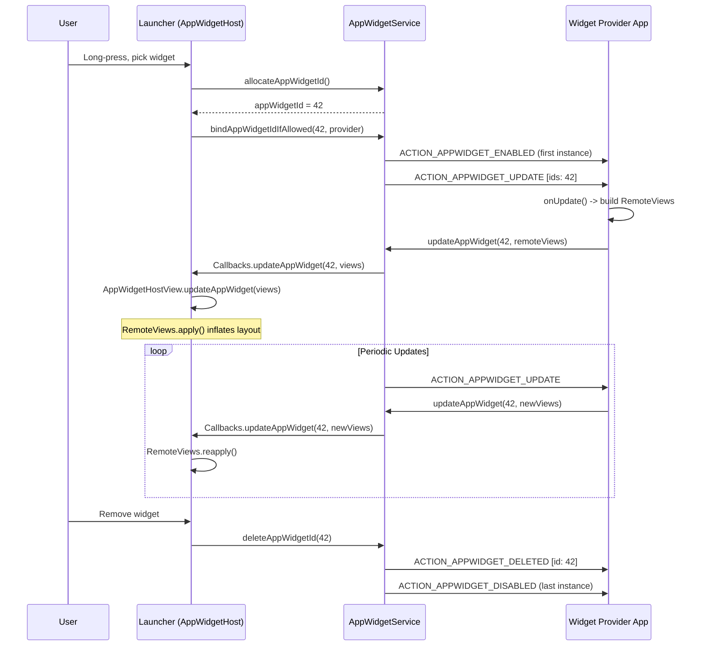
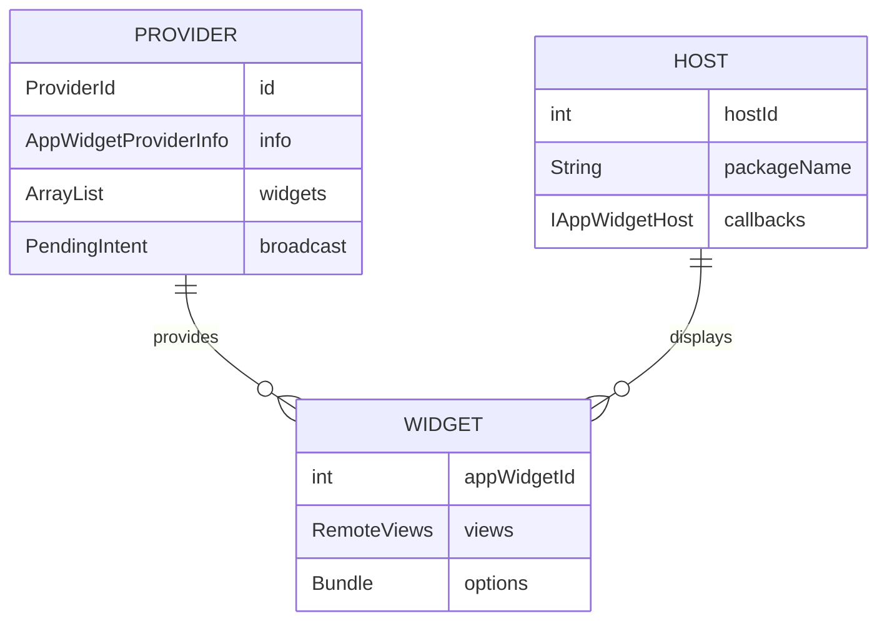
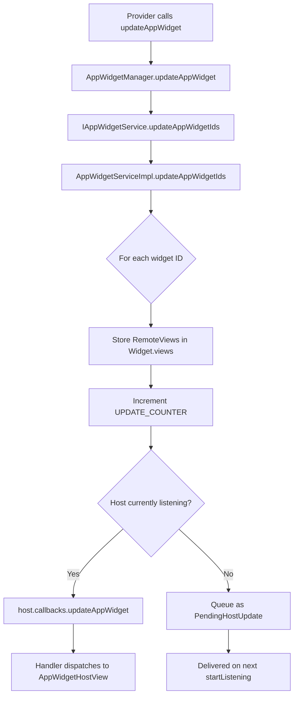
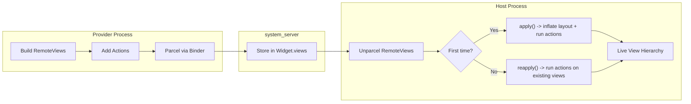
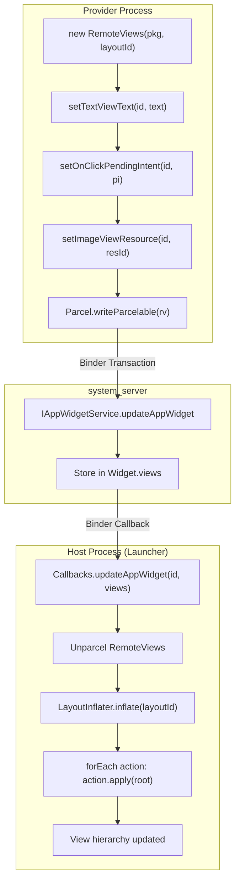
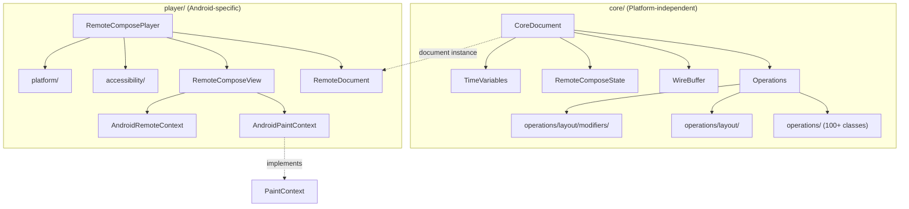
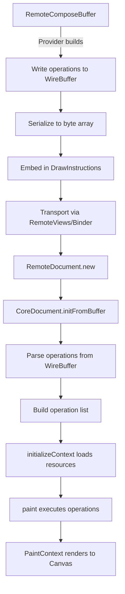
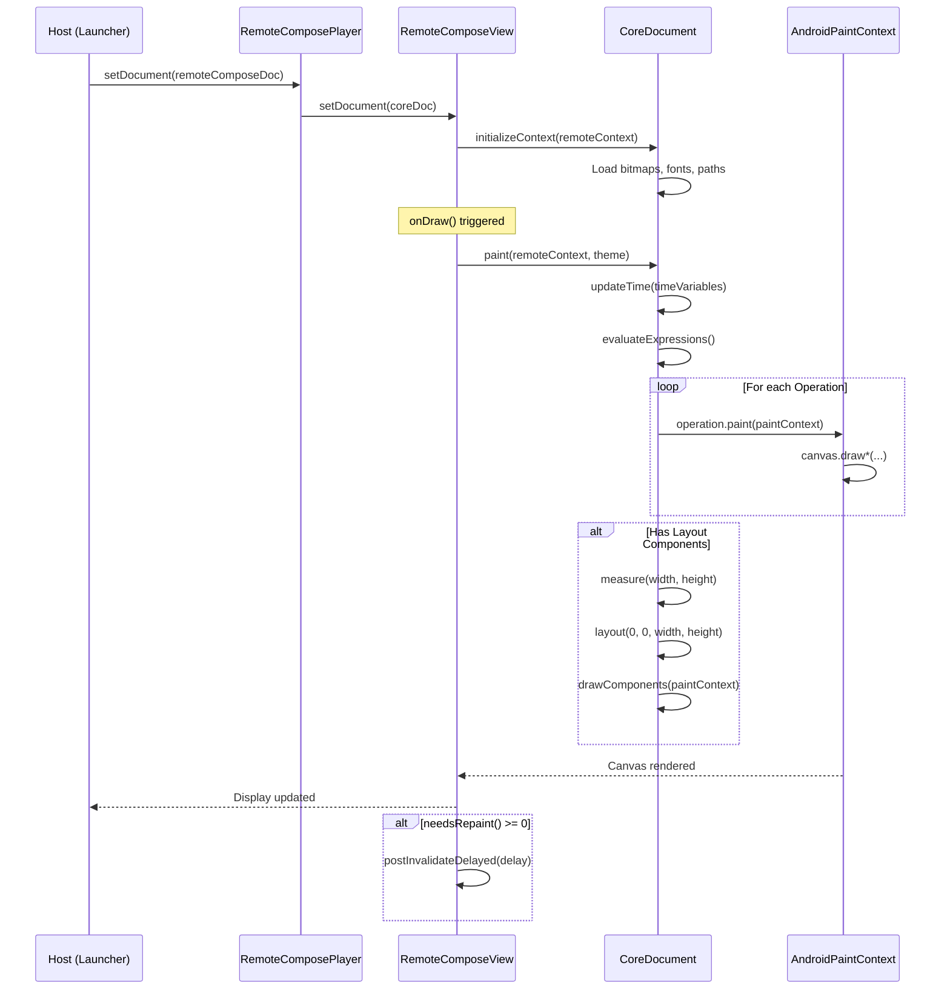
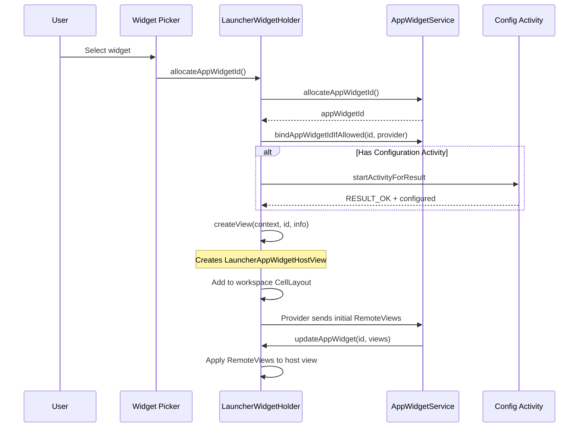
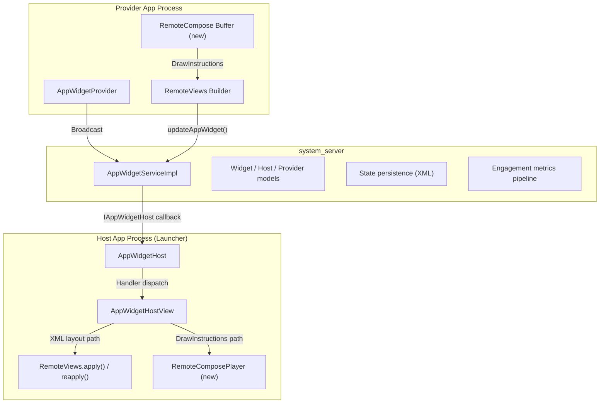

# 第 44 章：Widget 与 RemoteViews

Android widget 是平台中最古老、也最具架构特色的功能之一。与普通应用 UI 不同，widget 的视图层次结构位于一个并未创建它的进程中——通常是启动器（launcher）。这种跨进程渲染的需求驱动了 `RemoteViews`、`AppWidgetService` 以及新的 `RemoteCompose` 子系统的整个设计。

本章追踪每一层。它从提供方一侧的 `AppWidgetProvider` 开始，然后介绍负责协调更新的系统服务，以及 `RemoteViews` 的动作序列化与填充（inflate）流水线。最后介绍 RemoteCompose 引擎，它最终可能会彻底取代基于 XML 布局的方式。

---

## 44.1 AppWidget 框架

客户端 AppWidget 框架定义在
`frameworks/base/core/java/android/appwidget/` 中。它由 9 个 Java 文件组成（并非
全部公开——`AppWidgetManagerInternal` 是一个系统内部接口）。它们共同定义了 widget
提供方（提供 widget 内容的应用程序）与 widget 宿主（显示它们的应用程序）之间的契约。

### 44.1.1 核心类

该框架围绕五个中心类展开：

| 类 | 角色 |
|---|---|
| `AppWidgetProvider` | 提供方的 BroadcastReceiver 便捷封装 |
| `AppWidgetHost` | 宿主一侧与 AppWidgetService 的连接 |
| `AppWidgetHostView` | 渲染 RemoteViews 的实际 View 容器 |
| `AppWidgetManager` | 系统服务的客户端代理（单例） |
| `AppWidgetProviderInfo` | 描述 widget 提供方的 Parcelable 元数据 |

此外还有较新的新增类：

| 类 | 角色 |
|---|---|
| `AppWidgetEvent` | widget 交互的参与度指标 |
| `PendingHostUpdate` | 宿主重新连接期间排队的更新类型 |
| `AppWidgetConfigActivityProxy` | 跨资料配置活动的代理 |
| `AppWidgetManagerInternal` | system-server 内部 API 接口 |

### 44.1.2 AppWidgetProvider——提供方入口

`AppWidgetProvider` 继承自 `BroadcastReceiver`。它是一个纯粹的便捷类：用原始的
接收器也可以完成它所做的一切。它的 `onReceive()` 方法根据收到的 intent 动作分发到
各个钩子方法：

```java
// frameworks/base/core/java/android/appwidget/AppWidgetProvider.java
public void onReceive(Context context, Intent intent) {
    String action = intent.getAction();
    if (AppWidgetManager.ACTION_APPWIDGET_ENABLE_AND_UPDATE.equals(action)) {
        this.onReceive(context, new Intent(intent)
                .setAction(AppWidgetManager.ACTION_APPWIDGET_ENABLED));
        this.onReceive(context, new Intent(intent)
                .setAction(AppWidgetManager.ACTION_APPWIDGET_UPDATE));
    } else if (AppWidgetManager.ACTION_APPWIDGET_UPDATE.equals(action)) {
        Bundle extras = intent.getExtras();
        if (extras != null) {
            int[] appWidgetIds = extras.getIntArray(
                    AppWidgetManager.EXTRA_APPWIDGET_IDS);
            if (appWidgetIds != null && appWidgetIds.length > 0) {
                this.onUpdate(context,
                        AppWidgetManager.getInstance(context), appWidgetIds);
            }
        }
    } else if (AppWidgetManager.ACTION_APPWIDGET_DELETED.equals(action)) {
        // ...extract single ID, call onDeleted()
    } else if (AppWidgetManager.ACTION_APPWIDGET_OPTIONS_CHANGED.equals(action)) {
        // ...extract options bundle, call onAppWidgetOptionsChanged()
    } else if (AppWidgetManager.ACTION_APPWIDGET_ENABLED.equals(action)) {
        this.onEnabled(context);
    } else if (AppWidgetManager.ACTION_APPWIDGET_DISABLED.equals(action)) {
        this.onDisabled(context);
    } else if (AppWidgetManager.ACTION_APPWIDGET_RESTORED.equals(action)) {
        // ...call onRestored() then onUpdate()
    }
}
```

分发逻辑很直截了当，但请注意合并的广播动作
`ACTION_APPWIDGET_ENABLE_AND_UPDATE`。这是一项较新的优化（由
`COMBINED_BROADCAST_ENABLED` DeviceConfig 标志控制）。它把启用与初始更新合并到
一次广播中，从而降低 widget 启动延迟。

子类重写的钩子方法如下：

| 回调 | 调用时机 |
|---|---|
| `onUpdate()` | 周期性更新定时器触发，或 widget 首次绑定 |
| `onEnabled()` | 该提供方的首个实例被放置到任何宿主上 |
| `onDisabled()` | 该提供方的最后一个实例从所有宿主移除 |
| `onDeleted()` | 某个具体的 widget 实例被移除 |
| `onAppWidgetOptionsChanged()` | widget 被调整大小或选项发生变化 |
| `onRestored()` | widget 实例从备份恢复（随后调用 onUpdate） |

### 44.1.3 AppWidgetHost——宿主入口

`AppWidgetHost` 是宿主应用程序在 widget 系统中的句柄。例如，Launcher3 会以固定
的宿主 ID 1024 创建一个 `AppWidgetHost`。

该类有三个关键的架构元素：

**1. IPC 回调 Stub：**

```java
// frameworks/base/core/java/android/appwidget/AppWidgetHost.java
static class Callbacks extends IAppWidgetHost.Stub {
    private final WeakReference<Handler> mWeakHandler;

    public void updateAppWidget(int appWidgetId, RemoteViews views) {
        if (isLocalBinder() && views != null) {
            views = views.clone();
        }
        Handler handler = mWeakHandler.get();
        if (handler == null) return;
        Message msg = handler.obtainMessage(HANDLE_UPDATE,
                appWidgetId, 0, views);
        msg.sendToTarget();
    }
    // ... providerChanged, appWidgetRemoved, viewDataChanged, etc.
}
```

注意 `isLocalBinder()` 检查。当调用来自同一进程（system_server 调用自身）时，
`RemoteViews` 必须被克隆。这可以防止共享可变状态被破坏。

**2. 基于 Handler 的消息分发：**

六种消息类型从回调 stub 经由 Handler 流动：

| 常量 | 值 | 含义 |
|---|---|---|
| `HANDLE_UPDATE` | 1 | 有新的 RemoteViews 可用 |
| `HANDLE_PROVIDER_CHANGED` | 2 | 提供方 APK 已更新 |
| `HANDLE_PROVIDERS_CHANGED` | 3 | 可用 widget 列表发生变化 |
| `HANDLE_VIEW_DATA_CHANGED` | 4 | 集合数据已失效 |
| `HANDLE_APP_WIDGET_REMOVED` | 5 | widget 实例在服务端被移除 |
| `HANDLE_VIEW_UPDATE_DEFERRED` | 6 | 为惰性填充而延迟的更新 |

**3. 监听器注册表（SparseArray）：**

```java
private final SparseArray<AppWidgetHostListener> mListeners = new SparseArray<>();
```

每个 widget 实例由一个整数 `appWidgetId` 标识。监听器接口
（`AppWidgetHostListener`）定义了：

- `updateAppWidget(RemoteViews views)`——应用新内容
- `onUpdateProviderInfo(AppWidgetProviderInfo)`——提供方发生变化
- `onViewDataChanged(int viewId)`——集合数据发生变化
- `updateAppWidgetDeferred(String, int)`——惰性求值路径
- `collectWidgetEvent()`——参与度指标收集

**服务绑定**通过一个静态工厂惰性发生。一个
`Function<Context, IAppWidgetService>` 匿名类执行一次性初始化，并把结果缓存到
静态的 `sService` 字段中：

```java
private static final Function<Context, IAppWidgetService> sServiceFactory =
        new Function<>() {
    private final Object mServiceLock = new Object();
    private boolean mServiceInitialized = false;

    @Override
    public IAppWidgetService apply(Context context) {
        synchronized (mServiceLock) {
            if (mServiceInitialized) {
                return sService;
            }
            mServiceInitialized = true;
            // ... bail out unless FEATURE_APP_WIDGETS or
            //     config_enableAppWidgetService is present ...
            IBinder b = ServiceManager.getService(Context.APPWIDGET_SERVICE);
            sService = IAppWidgetService.Stub.asInterface(b);
            return sService;
        }
    }
};
```

### 44.1.4 AppWidgetProviderInfo——Widget 元数据

`AppWidgetProviderInfo` 是一个描述 widget 能力的 `Parcelable`。它由提供方
manifest 中的 `<appwidget-provider>` XML 元数据填充。

关键字段：

| 字段 | 类型 | 说明 |
|---|---|---|
| `provider` | `ComponentName` | BroadcastReceiver 的身份标识 |
| `minWidth/minHeight` | `int` | 以像素为单位的最小尺寸 |
| `minResizeWidth/Height` | `int` | 最小调整尺寸 |
| `maxResizeWidth/Height` | `int` | 最大调整尺寸 |
| `targetCellWidth/Height` | `int` | 以网格单元表示的默认大小 |
| `updatePeriodMillis` | `int` | 请求的更新间隔（至少 30 分钟） |
| `initialLayout` | `int` | 初始布局的资源 ID |
| `initialKeyguardLayout` | `int` | 锁屏显示的布局 |
| `configure` | `ComponentName` | 配置活动 |
| `resizeMode` | `int` | 位掩码：RESIZE_HORIZONTAL、RESIZE_VERTICAL |
| `widgetCategory` | `int` | HOME_SCREEN、KEYGUARD、SEARCHBOX、NOT_KEYGUARD |
| `widgetFeatures` | `int` | RECONFIGURABLE、HIDE_FROM_PICKER、CONFIGURATION_OPTIONAL |
| `generatedPreviewCategories` | `int` | 有可用生成预览的类别 |

### 44.1.5 AppWidgetEvent——参与度指标

`AppWidgetEvent` 是一个较新的新增类（在
`frameworks/base/core/java/android/appwidget/flags.aconfig` 中仍被置于
`engagement_metrics` 标志之下），它跟踪用户与 widget 的交互：

```java
// frameworks/base/core/java/android/appwidget/AppWidgetEvent.java
public final class AppWidgetEvent implements Parcelable {
    public static final int MAX_NUM_ITEMS = 10;

    private final int mAppWidgetId;
    private final Duration mVisibleDuration;
    private final Instant mStart;
    private final Instant mEnd;
    private final Rect mPosition;
    private final int[] mClickedIds;   // max 10 view IDs
    private final int[] mScrolledIds;  // max 10 view IDs
}
```

`Builder` 类跟踪可见性窗口：

```java
public Builder startVisibility() {
    long now = System.currentTimeMillis();
    if (now < mStart) mStart = now;
    mLastVisibilityChangeMillis = SystemClock.uptimeMillis();
    return this;
}

public Builder endVisibility() {
    long now = System.currentTimeMillis();
    if (now > mEnd) mEnd = now;
    mDurationMillis += SystemClock.uptimeMillis() - mLastVisibilityChangeMillis;
    return this;
}
```

事件被序列化为 `PersistableBundle`，并通过
`AppWidgetHost.reportAllWidgetEvents()` 上报给 `UsageStatsManager`
（`frameworks/base/core/java/android/appwidget/AppWidgetHost.java:693`）。提供方
通过 `AppWidgetManager.queryAppWidgetEvents()` 查询自己 widget 的事件（见 44.10.3
节）。

### 44.1.6 Widget 生命周期



### 44.1.7 AppWidgetHostView——视图容器

`AppWidgetHostView`（位于
`frameworks/base/core/java/android/appwidget/AppWidgetHostView.java`）继承
`FrameLayout` 并实现 `AppWidgetHostListener`。它是实际被放入宿主布局层次结构中的
`View`。主要职责：

1. **填充或重新应用 RemoteViews**——在调用 `updateAppWidget()` 时
2. **处理错误状态**——当提供方崩溃时显示错误布局
3. **通过 `AppWidgetEvent.Builder` 支持参与度指标**
4. **应用颜色资源**——用于动态主题
5. **管理锁屏与主屏幕**的布局切换——基于 `OPTION_APPWIDGET_HOST_CATEGORY`

`updateAppWidget()` 方法在 `apply()`（首次）与 `reapply()`（后续使用兼容布局的
更新）之间做出选择：

```java
public void updateAppWidget(RemoteViews remoteViews) {
    // ... null checks, error handling ...
    if (mView != null) {
        mView = remoteViews.reapply(/* ... */);
    } else {
        mView = remoteViews.apply(/* ... */);
    }
}
```

---

## 44.2 AppWidgetService

系统一侧的 `AppWidgetService` 管理所有用户的全部 widget 的注册、绑定、更新和安全
策略。实现位于
`frameworks/base/services/appwidget/java/com/android/server/appwidget/`。

### 44.2.1 服务架构

该服务拆分为两个类：

| 类 | 角色 |
|---|---|
| `AppWidgetService.java` | 生命周期封装，注册为 `APPWIDGET_SERVICE` |
| `AppWidgetServiceImpl.java` | 实际的 IPC 实现 |

`AppWidgetServiceImpl` 继承 `IAppWidgetService.Stub`，并实现
`WidgetBackupProvider` 和 `OnCrossProfileWidgetProvidersChangeListener`。

### 44.2.2 内部数据模型

该服务维护五个核心数据结构，均由 `mLock` 保护：

```java
// frameworks/base/services/appwidget/java/.../AppWidgetServiceImpl.java
private final ArrayList<Widget> mWidgets = new ArrayList<>();
private final ArrayList<Host> mHosts = new ArrayList<>();
private final ArrayList<Provider> mProviders = new ArrayList<>();
private final ArraySet<Pair<Integer, String>> mPackagesWithBindWidgetPermission
        = new ArraySet<>();
private final SparseBooleanArray mLoadedUserIds = new SparseBooleanArray();
```

这些关系构成一张多对多图：



### 44.2.3 Widget 分配与绑定

当宿主请求一个新 widget 时：

1. **`allocateAppWidgetId()`** 从每个用户的 `mNextAppWidgetIds` 分配一个单调递增的
   整数。创建一个 `Widget` 对象，并将其与调用方的 `Host` 关联。

2. **`bindAppWidgetIdIfAllowed()`** 或 **`bindAppWidgetId()`** 把 widget 链接到某个
   具体的 `Provider`。这会触发：
    - 安全策略检查（调用方必须持有 `BIND_APPWIDGET` 权限，或位于
      `mPackagesWithBindWidgetPermission` 的按包允许列表中）
    - 通过 `DevicePolicyManagerInternal` 进行跨资料检查
    - 调度初始的 `ACTION_APPWIDGET_UPDATE` 广播

### 44.2.4 更新流水线

当提供方调用 `AppWidgetManager.updateAppWidget()` 时：



`PendingHostUpdate` 机制处理宿主调用 `stopListening()`（例如，activity 进入后台）
的情况。当再次调用 `startListening()` 时，所有排队的更新按顺序投递：

```java
public void startListening() {
    List<PendingHostUpdate> updates;
    updates = mService.startListening(mCallbacks, mContextOpPackageName,
            mHostId, idsToUpdate).getList();
    for (PendingHostUpdate update : updates) {
        switch (update.type) {
            case TYPE_VIEWS_UPDATE: updateAppWidgetView(/*...*/); break;
            case TYPE_PROVIDER_CHANGED: onProviderChanged(/*...*/); break;
            case TYPE_VIEW_DATA_CHANGED: viewDataChanged(/*...*/); break;
            case TYPE_APP_WIDGET_REMOVED: dispatchOnAppWidgetRemoved(/*...*/); break;
        }
    }
}
```

### 44.2.5 通过 AlarmManager 进行周期性更新

该服务使用 `AlarmManager` 调度周期性更新，最短间隔为 30 分钟（由
`MIN_UPDATE_PERIOD` 强制）：

```java
// AppWidgetServiceImpl.java
private static final int MIN_UPDATE_PERIOD = DEBUG ? 0 : 30 * 60 * 1000;
```

### 44.2.6 位图内存限制

该服务根据显示尺寸计算最大位图内存预算：

```java
private void computeMaximumWidgetBitmapMemory() {
    Display display = mContext.getDisplayNoVerify();
    Point size = new Point();
    display.getRealSize(size);
    // 1.5 * 4 bytes/pixel * w * h ==> 6 * w * h
    mMaxWidgetBitmapMemory = 6 * size.x * size.y;
}
```

该限制由 `AppWidgetServiceImpl.ensureWidgetViewsMemoryLimitLocked()` 在服务存储
widget 更新时强制执行。该方法对 widget 已存储的 `RemoteViews` 累加
`estimateMemoryUsage()`。如果超出预算，它会抛出
`IllegalArgumentException`。在 1080x2400 的屏幕上，预算约为 15.5 MB。

### 44.2.7 状态持久化

Widget 状态按用户持久化到一个 XML 文件中，路径为
`/data/system/users/<userId>/appwidgets.xml`（通过
`Environment.getUserSystemDirectory()` 获取；`/data/system_ce/<user>/appwidget/`
目录只保存生成的预览，而不是状态 XML）：

```java
private static final String STATE_FILENAME = "appwidgets.xml";
private static final int CURRENT_VERSION = 1;
```

`handleSaveMessage()` 方法在 `mLock` 下把状态转换为字节，然后在锁外写入磁盘，以
尽量减少争用。

### 44.2.8 生成的预览

Widget 提供方可以通过 `AppWidgetManager.setWidgetPreview()` 设置生成的预览（选择器
中 widget 内容的快照）。这些预览存储在
`/data/system_ce/<user>/appwidget/previews/`，并受到速率限制：

```java
private static final long DEFAULT_GENERATED_PREVIEW_RESET_INTERVAL_MS =
        Duration.ofHours(1).toMillis();
private static final int DEFAULT_GENERATED_PREVIEW_MAX_CALLS_PER_INTERVAL = 2;
private static final int DEFAULT_GENERATED_PREVIEW_MAX_PROVIDERS = 50;
```

### 44.2.9 参与度指标上报

`reportWidgetEvents()` 方法接收宿主传来的 `AppWidgetEvent[]`，并作为
`USER_INTERACTION` 事件转发给 `UsageStatsManager`。`ReportWidgetEventsJob`
周期性触发收集：

```java
private static final long DEFAULT_WIDGET_EVENTS_REPORT_INTERVAL_MS =
        Duration.ofHours(1).toMillis();
```

### 44.2.10 安全策略与限制

硬性限制用于防止滥用：

| 限制 | 值 |
|---|---|
| 每个包的最大宿主数 | 20 |
| 每个宿主的最大 widget 数 | 200 |
| 最小更新间隔 | 30 分钟 |
| 每小时的生成预览 API 调用次数 | 2 |
| 拥有预览的最大提供方数 | 50 |

---

## 44.3 RemoteViews

`RemoteViews` 是 Android 中跨进程 UI 的核心机制。它定义在
`frameworks/base/core/java/android/widget/RemoteViews.java`，把视图修改的描述序列化
为 `Parcelable` 动作。这些动作可以经由 Binder 发送，然后在接收进程中被应用（填充）。

### 44.3.1 架构概览



### 44.3.2 支持的视图

`RemoteViews` 限制了哪些 `View` 类可以被使用。视图必须带有 `@RemoteView` 注解：

**布局（ViewGroup）：**

- `AdapterViewFlipper`
- `FrameLayout`
- `GridLayout`
- `GridView`
- `LinearLayout`
- `ListView`
- `RelativeLayout`
- `StackView`
- `ViewFlipper`

**Widget（叶子视图）：**

- `AnalogClock`、`Button`、`Chronometer`、`ImageButton`、`ImageView`
- `ProgressBar`、`TextClock`、`TextView`

**API 31+ 新增：**

- `CheckBox`、`RadioButton`、`RadioGroup`、`Switch`

该过滤器在填充时强制执行：

```java
// RemoteViews.java
private static final LayoutInflater.Filter INFLATER_FILTER =
        (clazz) -> clazz.isAnnotationPresent(RemoteViews.RemoteView.class);
```

### 44.3.3 动作系统

对 `RemoteViews` 对象的每一次修改都会创建一个 `Action`，并将其追加到一个内部的
`ArrayList<Action>` 中：

```java
@UnsupportedAppUsage
private ArrayList<Action> mActions;
```

每个 `Action` 子类都有一个用于打包的唯一标签。已定义的标签如下：

| 标签常量 | 值 | 用途 |
|---|---|---|
| `SET_ON_CLICK_RESPONSE_TAG` | 1 | 点击处理器 |
| `REFLECTION_ACTION_TAG` | 2 | 通过反射进行通用设置 |
| `SET_DRAWABLE_TINT_TAG` | 3 | Drawable 着色 |
| `VIEW_GROUP_ACTION_ADD_TAG` | 4 | 添加子 RemoteViews |
| `VIEW_CONTENT_NAVIGATION_TAG` | 5 | 内容导航 |
| `SET_EMPTY_VIEW_ACTION_TAG` | 6 | 为适配器设置空视图 |
| `VIEW_GROUP_ACTION_REMOVE_TAG` | 7 | 移除子视图 |
| `SET_PENDING_INTENT_TEMPLATE_TAG` | 8 | 集合点击模板 |
| `SET_REMOTE_VIEW_ADAPTER_INTENT_TAG` | 10 | 旧式集合适配器 |
| `TEXT_VIEW_DRAWABLE_ACTION_TAG` | 11 | 复合 drawable |
| `BITMAP_REFLECTION_ACTION_TAG` | 12 | 通过反射设置位图 |
| `TEXT_VIEW_SIZE_ACTION_TAG` | 13 | 文本大小 |
| `VIEW_PADDING_ACTION_TAG` | 14 | 视图内边距 |
| `SET_REMOTE_INPUTS_ACTION_TAG` | 18 | 通知的远程输入 |
| `LAYOUT_PARAM_ACTION_TAG` | 19 | 布局参数 |
| `SET_RIPPLE_DRAWABLE_COLOR_TAG` | 21 | 涟漪效果颜色 |
| `SET_INT_TAG_TAG` | 22 | 视图上的整数标签 |
| `REMOVE_FROM_PARENT_ACTION_TAG` | 23 | 从父视图移除 |
| `RESOURCE_REFLECTION_ACTION_TAG` | 24 | 基于资源的反射 |
| `COMPLEX_UNIT_DIMENSION_REFLECTION_ACTION_TAG` | 25 | 尺寸单位 |
| `SET_COMPOUND_BUTTON_CHECKED_TAG` | 26 | CheckBox/Switch 选中状态 |
| `SET_RADIO_GROUP_CHECKED` | 27 | RadioGroup 选择 |
| `SET_VIEW_OUTLINE_RADIUS_TAG` | 28 | 视图轮廓圆角半径 |
| `SET_ON_CHECKED_CHANGE_RESPONSE_TAG` | 29 | 选中状态变化处理器 |
| `NIGHT_MODE_REFLECTION_ACTION_TAG` | 30 | 深色模式变体 |
| `SET_REMOTE_COLLECTION_ITEMS_ADAPTER_TAG` | 31 | 集合条目 |
| `ATTRIBUTE_REFLECTION_ACTION_TAG` | 32 | 主题属性 |
| `SET_REMOTE_ADAPTER_TAG` | 33 | 新式适配器 |
| `SET_ON_STYLUS_HANDWRITING_RESPONSE_TAG` | 34 | 手写笔输入 |
| `SET_DRAW_INSTRUCTION_TAG` | 35 | RemoteCompose 指令 |

`Action` 基类定义了契约：

```java
// RemoteViews.java
private abstract static class Action {
    @IdRes int mViewId;

    public abstract void apply(View root, ViewGroup rootParent,
            ActionApplyParams params) throws ActionException;

    public static final int MERGE_REPLACE = 0;
    public static final int MERGE_APPEND = 1;
    public static final int MERGE_IGNORE = 2;

    public int mergeBehavior() { return MERGE_REPLACE; }
    public abstract int getActionTag();
    public String getUniqueKey() {
        return (getActionTag() + "_" + mViewId);
    }

    // Async variant for background preparation
    public Action initActionAsync(ViewTree root, ViewGroup rootParent,
            ActionApplyParams params) {
        return this;
    }
}
```

### 44.3.4 反射动作

最通用的 `Action` 类型是 `ReflectionAction`，它会在视图上调用任意 setter 方法。
当你调用 `RemoteViews.setTextViewText()` 时，它会创建一个调用 `setText()` 的
`ReflectionAction`：

```java
public void setTextViewText(@IdRes int viewId, CharSequence text) {
    setCharSequence(viewId, "setText", text);
}
```

反射查找缓存在 `sMethods`（一个 `ArrayMap<MethodKey, MethodArgs>`）中，并使用
`MethodHandle` 进行高效调用。

### 44.3.5 布局模式

`RemoteViews` 支持三种用于响应式布局的模式：

| 模式 | 常量 | 说明 |
|---|---|---|
| 普通 | `MODE_NORMAL` | 单一布局 |
| 横屏/竖屏 | `MODE_HAS_LANDSCAPE_AND_PORTRAIT` | 按方向使用两个布局 |
| 分尺寸 | `MODE_HAS_SIZED_REMOTEVIEWS` | 按尺寸使用多个布局（最多 16 个） |

分尺寸模式（API 31+）允许提供方在多个不同断点处提供多个 `RemoteViews`：

```java
public RemoteViews(Map<SizeF, RemoteViews> remoteViews) {
    // Creates a sized RemoteViews with up to MAX_INIT_VIEW_COUNT (16) variants
}
```

### 44.3.6 位图缓存

位图通过 `BitmapCache` 去重：

```java
@UnsupportedAppUsage
private BitmapCache mBitmapCache = new BitmapCache();
```

只有层次结构中的根 `RemoteViews` 存储该缓存。嵌套的 `RemoteViews`（来自
`addView` 或横屏/竖屏）通过索引引用父级的缓存。`reduceImageSizes()` 方法强制执行
最大尺寸限制：

```java
public void reduceImageSizes(int maxWidth, int maxHeight) {
    ArrayList<Bitmap> cache = mBitmapCache.mBitmaps;
    for (int i = 0; i < cache.size(); i++) {
        Bitmap bitmap = cache.get(i);
        cache.set(i, Icon.scaleDownIfNecessary(bitmap, maxWidth, maxHeight));
    }
}
```

### 44.3.7 Apply 与 Reapply

两个核心操作：

**`apply()`**——完整填充：

1. 使用带有 `INFLATER_FILTER` 的 `LayoutInflater` 填充 XML 布局资源
2. 遍历动作列表，把每个动作应用到填充出的视图树
3. 返回填充出的根 `View`

**`reapply()`**——增量更新：

1. 复用现有视图层次结构（不重新填充）
2. 通过 `getRemoteViewsToReapply()` 选择匹配的分尺寸/方向变体
3. 通过 `performApply()` 在现有树上重新运行该 RemoteViews 的完整动作列表

`Action` 上的 `MERGE_REPLACE` / `MERGE_APPEND` / `MERGE_IGNORE` 常量并不属于
reapply。它们驱动单独的 `mergeRemoteViews()` API（`@hide`），该 API 在应用*之前*
合并两个 RemoteViews——例如，`AppWidgetServiceImpl` 在部分 widget 更新时使用它。
具有 `MERGE_REPLACE` 的动作会覆盖之前具有相同唯一键的动作；具有 `MERGE_APPEND` 的
动作则累积（例如添加子视图）：

```java
public void mergeRemoteViews(RemoteViews newRv) {
    HashMap<String, Action> map = new HashMap<>();
    for (Action a : mActions) {
        map.put(a.getUniqueKey(), a);
    }
    for (Action a : copy.mActions) {
        String key = a.getUniqueKey();
        int mergeBehavior = a.mergeBehavior();
        if (map.containsKey(key) && mergeBehavior == Action.MERGE_REPLACE) {
            mActions.remove(map.get(key));
        }
        if (mergeBehavior == MERGE_REPLACE || mergeBehavior == MERGE_APPEND) {
            mActions.add(a);
        }
    }
    reconstructCaches();
}
```

### 44.3.8 异步 Apply

为了更流畅的 UI，`RemoteViews` 支持异步填充：

```java
public CancellationSignal applyAsync(Context context, ViewGroup parent,
        Executor executor, OnViewAppliedListener listener) {
    // Inflate and apply on executor thread, callback on UI thread
}
```

动作可以重写 `initActionAsync()`，以便在 UI 线程之外执行昂贵的工作（如解析
RemoteCompose 文档），然后返回一个在 UI 上运行的轻量 `RuntimeAction`。

### 44.3.9 序列化流水线



打包过程会写入：

1. 模式字节（普通、横屏/竖屏或分尺寸）
2. `BitmapCache`（仅在根节点）
3. `RemoteCollectionCache`（仅在根节点）
4. `ApplicationInfo`
5. 布局 ID、视图 ID、浅色背景布局 ID
6. 动作数量，然后是每个动作（标签 + 数据）
7. Apply 标志、提供方实例 ID、hasDrawInstructions 标志

### 44.3.10 RemoteViewsAdapter 与 RemoteViewsService

对于集合类 widget（ListView、GridView、StackView），需要一种不同的机制，因为适配器
数据可能很大且是动态的。

**`RemoteViewsService`** 是一个抽象 `Service`，用于托管
`RemoteViewsFactory` 实例：

```java
// frameworks/base/core/java/android/widget/RemoteViewsService.java
public interface RemoteViewsFactory {
    void onCreate();
    void onDataSetChanged();  // Heavy work allowed synchronously
    void onDestroy();
    int getCount();
    RemoteViews getViewAt(int position);
    RemoteViews getLoadingView();
    int getViewTypeCount();
    long getItemId(int position);
    boolean hasStableIds();
}
```

**`RemoteViewsAdapter`** 是宿主一侧的适配器，通过 `IRemoteViewsFactory`（AIDL）连接
到 `RemoteViewsService`。它管理：

- 服务连接生命周期
- 视图缓存与回收
- 异步获取期间的加载视图
- 通过 `notifyDataSetChanged()` 进行的数据变化通知

较新的 `RemoteCollectionItems` API（API 31+）允许内联集合数据而无需服务，从而减少
IPC 开销：

```java
new RemoteViews.RemoteCollectionItems.Builder()
    .addItem(id, remoteViewsForItem)
    .setHasStableIds(true)
    .build();
```

### 44.3.11 DrawInstructions——通往 RemoteCompose 的桥梁

`SET_DRAW_INSTRUCTION_TAG`（35）动作把 `RemoteViews` 与新的 `RemoteCompose`
系统连接起来：

```java
// RemoteViews.java
@FlaggedApi(FLAG_DRAW_DATA_PARCEL)
public RemoteViews(@NonNull final DrawInstructions drawInstructions) {
    Objects.requireNonNull(drawInstructions);
    mHasDrawInstructions = true;
    addAction(new SetDrawInstructionAction(drawInstructions));
}
```

`SetDrawInstructionAction` 把绘制指令应用到一个 `RemoteComposePlayer`：

```java
private class SetDrawInstructionAction extends Action {
    private final DrawInstructions mInstructions;

    @Override
    public void apply(View root, ViewGroup rootParent, ActionApplyParams params) {
        applyAction(root, (player, doc) -> {
            player.setDocument(doc);
            applyActionListener(player, params);
            return ACTION_NOOP;
        });
    }

    @Override
    public final Action initActionAsync(ViewTree root, ViewGroup rootParent,
            ActionApplyParams params) {
        return applyAction(root.mRoot, (player, doc) -> {
            PreparedDocument preparedDoc = player.prepareDocument(doc);
            return preparedDoc == null ? ACTION_NOOP
                : new RunnableAction(() -> {
                    player.setPreparedDocument(preparedDoc);
                    applyActionListener(player, params);
                });
        });
    }
}
```

`initActionAsync` 变体支持后台文档解析，从而保持 UI 线程的响应性。

---

## 44.4 通知中的 RemoteViews

通知是 `RemoteViews` 的另一个主要使用者。虽然大多数通知使用平台的标准模板，但自定义
通知直接使用 `RemoteViews`。

### 44.4.1 通知模板系统

`Notification.Builder` 会为标准模板在内部创建 `RemoteViews`：

```java
Notification.Builder builder = new Notification.Builder(context, channelId)
    .setContentTitle("Title")
    .setContentText("Content");
```

在内部，`Notification.Builder.createContentView()` 从系统布局资源构建一个
`RemoteViews`，并用标题、文本、图标等动作填充它。

自定义通知提供自己的 RemoteViews：

```java
RemoteViews customView = new RemoteViews(getPackageName(),
        R.layout.notification_custom);
customView.setTextViewText(R.id.title, "Custom Title");
builder.setCustomContentView(customView);
```

### 44.4.2 SystemUI 的 NotifRemoteViewsFactory

SystemUI 使用 `NotifRemoteViewsFactory`（位于
`frameworks/base/packages/SystemUI/src/com/android/systemui/statusbar/notification/row/NotifRemoteViewsFactory.kt`）
来拦截通知 RemoteViews 内部的视图填充：

```kotlin
// NotifRemoteViewsFactory.kt
interface NotifRemoteViewsFactory {
    fun instantiate(
        row: ExpandableNotificationRow,
        @InflationFlag layoutType: Int,
        parent: View?,
        name: String,
        context: Context,
        attrs: AttributeSet
    ): View?
}
```

该工厂模式是一种 `LayoutInflater.Factory2` 风格的、基于名称的替换：SystemUI 会把
通知中标准视图替换为优化过的实现。树内实现包括
`PrecomputedTextViewFactory`、`NotificationOptimizedLinearLayoutFactory`、
`BigPictureLayoutInflaterFactory`、`NotificationViewFlipperFactory` 和
`NotificationRowIconViewInflaterFactory`。请注意，`DrawInstructions` 内容不会经过
这个钩子——它完全绕过 `LayoutInflater`，而是在 `RemoteViews.inflateView()` 内部
处理（见 44.12.4 节）。

### 44.4.3 NotifRemoteViewCache

`NotifRemoteViewCache` 接口（由 `NotifRemoteViewCacheImpl` 实现）缓存通知内容视图的
`RemoteViews`。这使得重新绑定（rebind）可以复用它们，而不是从通知中重新提取：

```java
// NotifRemoteViewCache.java
public interface NotifRemoteViewCache {
    boolean hasCachedView(NotificationEntry entry, @InflationFlag int flag);
    @Nullable RemoteViews getCachedView(NotificationEntry entry,
            @InflationFlag int flag);
    void putCachedView(NotificationEntry entry, @InflationFlag int flag,
            RemoteViews remoteView);
    void removeCachedView(NotificationEntry entry, @InflationFlag int flag);
    // ...
}
```

### 44.4.4 安全考虑

通知 RemoteViews 在 SystemUI 的进程中以提升的权限运行。若干安全措施适用：

1. **视图过滤**：`INFLATER_FILTER` 确保只有带 `@RemoteView` 注解的类才能被实例化
2. **嵌套限制**：`MAX_NESTED_VIEWS = 10` 防止栈溢出
3. **位图限制**：显示前会调用 `reduceImageSizes()`
4. **URI 授权**：`visitUris()` 收集所有被引用的 URI，以便发出适当的权限授予
5. **PendingIntent 验证**：带有 PendingIntent 的动作会根据调用方包进行验证

---

## 44.5 RemoteCompose 架构

RemoteCompose 是 AOSP 中一个新的渲染系统，为跨进程渲染提供了一种相对于 XML 布局
的可编程替代方案。它位于
`frameworks/base/core/java/com/android/internal/widget/remotecompose/`，由 299 个
Java 文件组成。

### 44.5.1 设计目标

RemoteCompose 解决了基于 XML 的 `RemoteViews` 的根本限制：

1. **静态布局**：XML 布局无法在不进行完整重新序列化的情况下表达动画、数据驱动的值
   或条件渲染
2. **有限的视图集**：只有带 `@RemoteView` 注解的视图可用
3. **性能**：每次更新都需要通过 Binder 进行完整的 Parcel 序列化
4. **表达能力**：复杂的视觉设计需要大量动作

RemoteCompose 用一种二进制字节码格式（`WireBuffer`）取代了这一切。该格式把绘制
操作、布局指令、变量、表达式和动画编码进一份紧凑的文档。播放器可以渲染这份文档。

### 44.5.2 架构拆分：core/ 与 player/



`core/` 包被设计为平台无关——理论上它可以在非 Android 的 JVM 上运行。`player/` 包
绑定到 Android API（`Canvas`、`Paint`、`View` 系统、无障碍功能）。

### 44.5.3 CoreDocument

`CoreDocument`（位于 `core/CoreDocument.java`）是核心数据结构。它包含：

```java
// frameworks/base/.../remotecompose/core/CoreDocument.java
public class CoreDocument implements Serializable {
    public static final int MAJOR_VERSION = 1;
    public static final int MINOR_VERSION = 3;
    public static final int PATCH_VERSION = 0;
    public static final int DOCUMENT_API_LEVEL = 9;

    ArrayList<Operation> mOperations = new ArrayList<>();
    RootLayoutComponent mRootLayoutComponent = null;
    RemoteComposeState mRemoteComposeState = new RemoteComposeState();
    TimeVariables mTimeVariables = new TimeVariables();
    Version mVersion;
    String mContentDescription;
    long mRequiredCapabilities = 0L;
    int mWidth = 0;
    int mHeight = 0;
    int mContentScroll, mContentSizing, mContentMode;
    int mContentAlignment = RootContentBehavior.ALIGNMENT_CENTER;
    RemoteComposeBuffer mBuffer = new RemoteComposeBuffer();
    // ... expression maps, clock, touch operations ...
}
```

文档生命周期：

1. **构建**：在提供方一侧创建，操作被追加进来
2. **序列化**：写入一个 `RemoteComposeBuffer`（字节流）
3. **传输**：作为 `DrawInstructions` 嵌入 `RemoteViews`
4. **反序列化**：`initFromBuffer()` 重建操作
5. **初始化**：`initializeContext()` 加载资源、缓存位图
6. **绘制**：`paint()` 通过 `PaintContext` 执行操作

### 44.5.4 WireBuffer

`WireBuffer`（位于 `core/WireBuffer.java`）是二进制编码层：

```java
// frameworks/base/.../remotecompose/core/WireBuffer.java
public class WireBuffer {
    int mMaxSize;
    byte[] mBuffer;
    int mIndex = 0;
    int mSize = 0;
    boolean[] mValidOperations = new boolean[256];

    // Default ctor allocates Limits.BUFFER_SIZE (1 MB) into mBuffer.
    public WireBuffer() {
        this(Limits.BUFFER_SIZE);
    }

    public void start(int type) {
        if (!mValidOperations[type]) {
            throw new RuntimeException(
                    "Operation " + type + " is not supported for this version");
        }
        mStartingIndex = mIndex;
        writeByte(type);
    }
}
```

该缓冲区支持：

- 基本类型：`writeByte`、`writeInt`、`writeFloat`、`writeLong`
- 通过长度前缀编码的字符串
- 超出容量时自动扩容
- 通过 `mValidOperations` 数组进行按版本控制的操作

### 44.5.5 PaintContext

`PaintContext`（位于 `core/PaintContext.java`）是抽象的渲染接口：

```java
// frameworks/base/.../remotecompose/core/PaintContext.java
public abstract class PaintContext {
    public static final int TEXT_MEASURE_MONOSPACE_WIDTH = 0x01;
    public static final int TEXT_MEASURE_FONT_HEIGHT = 0x02;
    public static final int TEXT_MEASURE_SPACES = 0x04;
    public static final int TEXT_COMPLEX = 0x08;

    protected RemoteContext mContext;

    public abstract void drawBitmap(int imageId,
            int srcLeft, int srcTop, int srcRight, int srcBottom,
            int dstLeft, int dstTop, int dstRight, int dstBottom, int cdId);
    public abstract void scale(float scaleX, float scaleY);
    public abstract void translate(float translateX, float translateY);
    public abstract void drawArc(float left, float top, float right,
            float bottom, float startAngle, float sweepAngle);
    public abstract void drawSector(/*...*/);
    public abstract void drawCircle(float x, float y, float radius);
    public abstract void drawLine(float x1, float y1, float x2, float y2);
    public abstract void drawRect(float l, float t, float r, float b);
    public abstract void drawRoundRect(/*...*/);
    public abstract void drawOval(/*...*/);
    public abstract void drawTextRun(/*...*/);
    public abstract void drawComplexText(/*...*/);
    public abstract void drawTextOnPath(/*...*/);
    public abstract void drawPath(/*...*/);
    // ... matrix operations, clipping, paint state ...
}
```

这一抽象使核心层能够表达渲染，而不必直接依赖 Android 的 `Canvas` API。

### 44.5.6 RemoteComposeState

`RemoteComposeState`（位于 `core/RemoteComposeState.java`）管理文档的运行时状态：

```java
// frameworks/base/.../remotecompose/core/RemoteComposeState.java
public class RemoteComposeState implements CollectionsAccess {
    public static final int START_ID = 42;
    public static final int BITMAP_TEXTURE_ID_OFFSET = 2000;

    private final IntMap<Object> mIntDataMap = new IntMap<>();
    private final HashMap<Object, Integer> mDataIntMap = new HashMap<>();
    private final IntFloatMap mFloatMap = new IntFloatMap();
    private final IntIntMap mIntegerMap = new IntIntMap();
    private final IntIntMap mColorMap = new IntIntMap();
    private final IntMap<DataMap> mDataMapMap = new IntMap<>();
    private final IntMap<Object> mPathMap = new IntMap<>();
}
```

该状态保存：

- **命名数据**：位图、文本字符串、路径、着色器——全部以整数 ID 索引
- **变量**：浮点数、整数、颜色——带有用于宿主一侧值的覆盖标志
- **集合**：用于数据驱动内容的列表和映射
- **路径数据**：预计算的路径坐标与缠绕规则

---

## 44.6 RemoteCompose 操作

`core/` 下的 `operations/` 目录包含 100 多个操作类。每个操作都有一个在
`Operations.java` 中定义的唯一操作码。

### 44.6.1 操作注册表

`Operations.java` 定义了所有操作码并注册它们的伴随（工厂）对象。操作码跨越多个类别：

**协议操作：**

| 操作码 | 值 | 类 |
|---|---|---|
| `HEADER` | 0 | `Header` |
| `THEME` | 63 | `Theme` |
| `CLICK_AREA` | 64 | `ClickArea` |
| `ROOT_CONTENT_BEHAVIOR` | 65 | `RootContentBehavior` |
| `ROOT_CONTENT_DESCRIPTION` | 103 | `RootContentDescription` |
| `ACCESSIBILITY_SEMANTICS` | 250 | `CoreSemantics` |

**绘制操作：**

| 操作码 | 值 | 类 |
|---|---|---|
| `DRAW_RECT` | 42 | `DrawRect` |
| `DRAW_TEXT_RUN` | 43 | `DrawText` |
| `DRAW_BITMAP` | 44 | `DrawBitmap` |
| `DRAW_CIRCLE` | 46 | `DrawCircle` |
| `DRAW_LINE` | 47 | `DrawLine` |
| `DRAW_ROUND_RECT` | 51 | `DrawRoundRect` |
| `DRAW_SECTOR` | 52 | `DrawSector` |
| `DRAW_TEXT_ON_PATH` | 53 | `DrawTextOnPath` |
| `DRAW_OVAL` | 56 | `DrawOval` |
| `DRAW_ARC` | 152 | `DrawArc` |
| `DRAW_PATH` | 124 | `DrawPath` |
| `DRAW_TWEEN_PATH` | 125 | `DrawTweenPath` |
| `DRAW_TEXT_ANCHOR` | 133 | `DrawTextAnchored` |
| `DRAW_BITMAP_SCALED` | 149 | `DrawBitmapScaled` |
| `DRAW_BITMAP_INT` | 66 | `DrawBitmapInt` |
| `DRAW_CONTENT` | 139 | `DrawContent` |
| `DRAW_TO_BITMAP` | 190 | `DrawToBitmap` |
| `DRAW_BITMAP_TEXT_ANCHORED` | 184 | `DrawBitmapTextAnchored` |

**数据操作：**

| 操作码 | 值 | 类 |
|---|---|---|
| `DATA_TEXT` | 102 | `TextData` |
| `DATA_BITMAP` | 101 | `BitmapData` |
| `DATA_SHADER` | 45 | `ShaderData` |
| `DATA_PATH` | 123 | `PathData` |
| `DATA_FLOAT` | 80 | `FloatConstant` |
| `DATA_INT` | 140 | `IntegerConstant` |
| `DATA_LONG` | 148 | `LongConstant` |
| `DATA_BOOLEAN` | 143 | `BooleanConstant` |
| `DATA_FONT` | 189 | `FontData` |
| `DATA_BITMAP_FONT` | 167 | `BitmapFontData` |

**矩阵操作：**

| 操作码 | 值 | 类 |
|---|---|---|
| `MATRIX_SCALE` | 126 | `MatrixScale` |
| `MATRIX_TRANSLATE` | 127 | `MatrixTranslate` |
| `MATRIX_SKEW` | 128 | `MatrixSkew` |
| `MATRIX_ROTATE` | 129 | `MatrixRotate` |
| `MATRIX_SAVE` | 130 | `MatrixSave` |
| `MATRIX_RESTORE` | 131 | `MatrixRestore` |
| `MATRIX_CONSTANT` | 186 | `MatrixConstant` |
| `MATRIX_FROM_PATH` | 181 | `MatrixFromPath` |
| `MATRIX_EXPRESSION` | 187 | `MatrixExpression` |
| `MATRIX_VECTOR_MATH` | 188 | `MatrixVectorMath` |

**裁剪操作：**

| 操作码 | 值 | 类 |
|---|---|---|
| `CLIP_PATH` | 38 | `ClipPath` |
| `CLIP_RECT` | 39 | `ClipRect` |

**绘制状态操作：**

| 操作码 | 值 | 类 |
|---|---|---|
| `PAINT_VALUES` | 40 | `PaintData` |

### 44.6.2 绘制操作详解：DrawText

`DrawText` 展示了贯穿始终使用的变量绑定模式：

```java
// frameworks/base/.../remotecompose/core/operations/DrawText.java
public class DrawText extends PaintOperation implements VariableSupport {
    int mTextID;
    float mX, mY;       // Source coordinates (may be NaN for variables)
    float mOutX, mOutY; // Resolved coordinates
    boolean mRtl;

    @Override
    public void updateVariables(RemoteContext context) {
        mOutX = Float.isNaN(mX) ? context.getFloat(Utils.idFromNan(mX)) : mX;
        mOutY = Float.isNaN(mY) ? context.getFloat(Utils.idFromNan(mY)) : mY;
    }

    @Override
    public void registerListening(RemoteContext context) {
        if (Float.isNaN(mX)) context.listensTo(Utils.idFromNan(mX), this);
        if (Float.isNaN(mY)) context.listensTo(Utils.idFromNan(mY), this);
    }
}
```

NaN 编码技巧很巧妙：为 `Float.NaN` 且带有特定位模式的坐标值编码了变量 ID。
`Utils.idFromNan()` 从 NaN 载荷中提取 ID。这让同一套序列化格式既能容纳字面值，也
能容纳变量引用。

### 44.6.3 位图操作

`BitmapData`（操作码 101）把位图加载到文档状态中：

```java
public class BitmapData extends Operation
        implements SerializableToString, Serializable {
    public final int mImageId;
    int mImageWidth;
    int mImageHeight;
    short mType;      // Pixel format
    short mEncoding;  // Encoding (e.g. PNG-compressed vs. raw)
    @NonNull byte[] mBitmap; // Encoded bitmap bytes
    // ...
}
```

存在多个绘制变体：

- `DrawBitmap`：源/目标矩形映射
- `DrawBitmapInt`：用于像素级精确渲染的整数坐标
- `DrawBitmapScaled`：带自动适配的缩放渲染
- `DrawBitmapTextAnchored`：从位图字体字形渲染文本

### 44.6.4 路径操作

路径在 RemoteCompose 中是一等对象：

| 操作 | 说明 |
|---|---|
| `PathData` | 原始路径坐标数据 |
| `PathCreate` | 由基本图元构造路径 |
| `PathAppend` | 向现有路径追加线段 |
| `PathCombine` | 对路径进行布尔运算 |
| `PathTween` | 在两条路径之间插值 |
| `PathExpression` | 由表达式生成的动态路径 |
| `DrawPath` | 渲染一条已存储的路径 |
| `DrawTweenPath` | 渲染动画化的路径过渡 |

### 44.6.5 表达式与动画操作

RemoteCompose 通过表达式操作支持数据驱动的渲染：

| 操作码 | 值 | 说明 |
|---|---|---|
| `ANIMATED_FLOAT` | 81 | 动画化的浮点值 |
| `COLOR_EXPRESSIONS` | 134 | 由表达式计算出的颜色 |
| `FLOAT_LIST` | 147 | 浮点值列表 |
| `INTEGER_EXPRESSION` | 144 | 由表达式计算出的整数 |
| `TEXT_FROM_FLOAT` | 135 | 由浮点值生成的文本 |
| `TEXT_MERGE` | 136 | 拼接文本值 |
| `TEXT_LOOKUP` | 151 | 按键查找文本 |
| `TEXT_LOOKUP_INT` | 153 | 按整数键查找文本 |
| `DATA_MAP_LOOKUP` | 154 | 在数据映射中查找值 |
| `TOUCH_EXPRESSION` | 157 | 由触摸输入驱动的表达式 |

### 44.6.6 触觉反馈

`HapticFeedback` 操作（操作码 177）从文档触发设备触觉反馈：

```java
// frameworks/base/.../remotecompose/core/operations/HapticFeedback.java
public class HapticFeedback extends Operation {
    private int mHapticFeedbackType;

    @Override
    public void write(WireBuffer buffer) {
        apply(buffer, mHapticFeedbackType);
    }
}
```

播放器一侧的 `HapticSupport` 类把反馈类型常量转换为 Android 的
`HapticFeedbackConstants`。

### 44.6.7 粒子系统

RemoteCompose 包含一个用于动画效果的粒子系统：

| 操作码 | 值 | 说明 |
|---|---|---|
| `PARTICLE_DEFINE` | 161 | 定义粒子发射器参数 |
| `PARTICLE_PROCESS` | 162 | 处理粒子模拟步骤 |
| `PARTICLE_LOOP` | 163 | 循环粒子渲染 |
| `IMPULSE_START` | 164 | 触发脉冲动画 |
| `IMPULSE_PROCESS` | 165 | 处理脉冲状态 |

### 44.6.8 条件与控制流

| 操作码 | 值 | 说明 |
|---|---|---|
| `CONDITIONAL_OPERATIONS` | 178 | 根据条件执行操作 |
| `FUNCTION_DEFINE` | 168 | 定义可复用函数 |
| `FUNCTION_CALL` | 166 | 调用已定义的函数 |
| `DEBUG_MESSAGE` | 179 | 输出调试信息 |
| `WAKE_IN` | 191 | 延迟后调度一次重绘 |

---

## 44.7 RemoteCompose 布局与状态

### 44.7.1 布局系统

RemoteCompose 包含一个完整的布局系统，操作码在 200+ 区间：

**布局容器：**

| 操作码 | 值 | 类 | 说明 |
|---|---|---|---|
| `LAYOUT_ROOT` | 200 | `RootLayoutComponent` | 文档根节点 |
| `LAYOUT_CONTENT` | 201 | `LayoutComponentContent` | 内容占位符 |
| `LAYOUT_BOX` | 202 | `BoxLayout` | 覆盖层布局（类似 FrameLayout） |
| `LAYOUT_FIT_BOX` | 176 | `FitBoxLayout` | 缩放适配布局 |
| `LAYOUT_ROW` | 203 | `RowLayout` | 水平布局 |
| `LAYOUT_COLUMN` | 204 | `ColumnLayout` | 垂直布局 |
| `LAYOUT_CANVAS` | 205 | `CanvasLayout` | 自由形式画布 |
| `LAYOUT_CANVAS_CONTENT` | 207 | `CanvasContent` | 画布子节点 |
| `LAYOUT_TEXT` | 208 | `TextLayout` | 文本组件 |
| `LAYOUT_STATE` | 217 | `StateLayout` | 状态驱动的布局 |
| `LAYOUT_IMAGE` | 234 | `ImageLayout` | 图像组件 |
| `LAYOUT_COLLAPSIBLE_ROW` | 230 | `CollapsibleRowLayout` | 可折叠的水平布局 |
| `LAYOUT_COLLAPSIBLE_COLUMN` | 233 | `CollapsibleColumnLayout` | 可折叠的垂直布局 |

**结构操作：**

| 操作码 | 值 | 说明 |
|---|---|---|
| `COMPONENT_START` | 2 | 开始组件定义 |
| `CONTAINER_END` | 214 | 结束容器作用域 |
| `LOOP_START` | 215 | 开始循环迭代 |

布局管理器（位于 `operations/layout/managers/`）实现了一个测量-布局-绘制的循环，
类似于 Android 的 `View` 系统，但完全发生在 RemoteCompose 内部。

### 44.7.2 布局管理器

每种布局类型都有一个对应的管理器类：

```
core/operations/layout/managers/
    BoxLayout.java
    CanvasLayout.java
    CollapsibleColumnLayout.java
    CollapsiblePriority.java
    CollapsibleRowLayout.java
    ColumnLayout.java
    CoreText.java
    FitBoxLayout.java
    FlowLayout.java
    ImageLayout.java
    LayoutManager.java
    RowLayout.java
    StateLayout.java
    TextLayout.java
    TextStyle.java
```

`LayoutManager` 是基类。每个管理器实现：

- **测量**：计算内在尺寸和约束尺寸
- **布局**：在分配的空间内摆放子节点
- **绘制**：委托给绘制操作

### 44.7.3 修饰符系统

修饰符在不改变布局类型的前提下调整组件行为。它们以链的形式应用，类似于 Jetpack
Compose 的修饰符模式：

**尺寸修饰符：**

| 操作码 | 值 | 类 |
|---|---|---|
| `MODIFIER_WIDTH` | 16 | `WidthModifierOperation` |
| `MODIFIER_HEIGHT` | 67 | `HeightModifierOperation` |
| `MODIFIER_WIDTH_IN` | 231 | `WidthInModifierOperation` |
| `MODIFIER_HEIGHT_IN` | 232 | `HeightInModifierOperation` |

**视觉修饰符：**

| 操作码 | 值 | 类 |
|---|---|---|
| `MODIFIER_BACKGROUND` | 55 | `BackgroundModifierOperation` |
| `MODIFIER_BORDER` | 107 | `BorderModifierOperation` |
| `MODIFIER_PADDING` | 58 | `PaddingModifierOperation` |
| `MODIFIER_CLIP_RECT` | 108 | `ClipRectModifierOperation` |
| `MODIFIER_ROUNDED_CLIP_RECT` | 54 | `RoundedClipRectModifierOperation` |
| `MODIFIER_GRAPHICS_LAYER` | 224 | `GraphicsLayerModifierOperation` |
| `MODIFIER_RIPPLE` | 229 | `RippleModifierOperation` |
| `MODIFIER_MARQUEE` | 228 | `MarqueeModifierOperation` |

**布局修饰符：**

| 操作码 | 值 | 类 |
|---|---|---|
| `MODIFIER_OFFSET` | 221 | `OffsetModifierOperation` |
| `MODIFIER_ZINDEX` | 223 | `ZIndexModifierOperation` |
| `MODIFIER_SCROLL` | 226 | `ScrollModifierOperation` |
| `MODIFIER_VISIBILITY` | 211 | `ComponentVisibilityOperation` |
| `MODIFIER_COLLAPSIBLE_PRIORITY` | 235 | `CollapsiblePriorityModifierOperation` |

**交互修饰符：**

| 操作码 | 值 | 类 |
|---|---|---|
| `MODIFIER_CLICK` | 59 | `ClickModifierOperation` |
| `MODIFIER_TOUCH_DOWN` | 219 | `TouchDownModifierOperation` |
| `MODIFIER_TOUCH_UP` | 220 | `TouchUpModifierOperation` |
| `MODIFIER_TOUCH_CANCEL` | 225 | `TouchCancelModifierOperation` |
| `MODIFIER_DRAW_CONTENT` | 174 | `DrawContentOperation` |

**动作修饰符：**

| 操作码 | 值 | 类 |
|---|---|---|
| `HOST_ACTION` | 209 | `HostActionOperation` |
| `HOST_METADATA_ACTION` | 216 | `HostActionMetadataOperation` |
| `HOST_NAMED_ACTION` | 210 | `HostNamedActionOperation` |
| `RUN_ACTION` | 236 | `RunActionOperation` |
| `VALUE_INTEGER_CHANGE_ACTION` | 212 | `ValueIntegerChangeActionOperation` |
| `VALUE_STRING_CHANGE_ACTION` | 213 | `ValueStringChangeActionOperation` |
| `VALUE_FLOAT_CHANGE_ACTION` | 222 | `ValueFloatChangeActionOperation` |

`ComponentModifiers` 类把修饰符聚合成一条链：

```
core/operations/layout/modifiers/ComponentModifiers.java
```

### 44.7.4 状态与变量

**VariableSupport 接口：**

```java
// frameworks/base/.../remotecompose/core/VariableSupport.java
public interface VariableSupport {
    void registerListening(RemoteContext context);
    void updateVariables(RemoteContext context);
    void markDirty();
}
```

依赖运行时值的操作实现 `VariableSupport`。它们通过
`context.listensTo(id, this)` 注册对特定变量 ID 的关注。当变量变化时，会调用
`updateVariables()`，操作重新计算其输出值。

**TimeVariables：**

```java
// frameworks/base/.../remotecompose/core/TimeVariables.java
public class TimeVariables {
    public void updateTime(@NonNull RemoteContext context) {
        RemoteClock.TimeSnapshot snapshot = mClock.snapshot(null);

        context.loadFloat(RemoteContext.ID_OFFSET_TO_UTC,
                snapshot.getOffsetSeconds());
        context.loadFloat(RemoteContext.ID_CONTINUOUS_SEC,
                snapshot.getContinuousSeconds());
        context.loadInteger(RemoteContext.ID_EPOCH_SECOND,
                snapshot.getEpochSeconds());
        context.loadFloat(RemoteContext.ID_TIME_IN_SEC, snapshot.getTimeInSec());
        context.loadFloat(RemoteContext.ID_TIME_IN_MIN, snapshot.getTimeInMin());
        context.loadFloat(RemoteContext.ID_TIME_IN_HR, snapshot.getHour());
        context.loadFloat(RemoteContext.ID_CALENDAR_MONTH, snapshot.getMonth());
        context.loadFloat(RemoteContext.ID_DAY_OF_MONTH, snapshot.getDayOfMonth());
        context.loadFloat(RemoteContext.ID_WEEK_DAY, snapshot.getDayOfWeek());
        context.loadFloat(RemoteContext.ID_DAY_OF_YEAR, snapshot.getDayOfYear());
        context.loadFloat(RemoteContext.ID_YEAR, snapshot.getYear());
        context.loadFloat(RemoteContext.ID_API_LEVEL,
                CoreDocument.getDocumentApiLevel() + CoreDocument.BUILD);
    }
}
```

这使得表盘 widget 和依赖时间的动画无需任何 Binder 往返即可实现——播放器在本地更新
时间变量并重绘。

**命名变量：**

`NamedVariable` 操作（操作码 137）把人类可读的名称与一个变量 ID 和类型关联起来。
类型有：

- `STRING_TYPE` (0)
- `FLOAT_TYPE` (1)
- `COLOR_TYPE` (2)
- `IMAGE_TYPE` (3)
- `INT_TYPE` (4)
- `LONG_TYPE` (5)
- `FLOAT_ARRAY_TYPE` (6)

这允许宿主按名称发现并设置文档变量。

**RemoteComposeState 数据映射：**

该状态使用高效的专用映射：

```java
private final IntFloatMap mFloatMap = new IntFloatMap();
private final IntIntMap mIntegerMap = new IntIntMap();
private final IntIntMap mColorMap = new IntIntMap();
private final IntMap<DataMap> mDataMapMap = new IntMap<>();
```

覆盖标志（`mColorOverride[]`、`mFloatOverride[]` 等）跟踪哪些值是宿主设置的，哪些
值是文档自己设置的。

### 44.7.5 序列化

**WireBuffer 编码：**

每个操作把自己写入 `WireBuffer`：

1. `buffer.start(opcode)`——写入 1 字节操作码
2. 操作特定的数据（基本类型、字符串、字节数组）
3. 没有显式的结束标记——读取器知道每个操作的确切格式

**Serializable 接口：**

```java
// frameworks/base/.../remotecompose/core/serialize/Serializable.java
public interface Serializable {
    // serialize to a MapSerializer for JSON/debug output
}
```

**SerializeTags：**

```java
// frameworks/base/.../remotecompose/core/serialize/SerializeTags.java
// Tag constants for map-based serialization format
```

**MapSerializer：**

```java
// frameworks/base/.../remotecompose/core/serialize/MapSerializer.java
public interface MapSerializer {
    MapSerializer addType(String type);
    MapSerializer addFloatExpressionSrc(String key, float[] value);
    MapSerializer addIntExpressionSrc(String key, int[] value, int mask);
    MapSerializer addPath(String key, float[] path);
    // ... other typed add methods
}
```

`MapSerializer` 提供了一种结构化的序列化格式，用于调试、测试以及文档潜在的 JSON
导出。

### 44.7.6 文档流



---

## 44.8 RemoteCompose 播放器

`player/` 目录提供了 Android 特定的渲染实现。

### 44.8.1 RemoteComposePlayer

`RemoteComposePlayer`（位于 `player/RemoteComposePlayer.java`）继承 `FrameLayout`，
是用于渲染 RemoteCompose 文档的主要 widget：

```java
// frameworks/base/.../remotecompose/player/RemoteComposePlayer.java
public class RemoteComposePlayer extends FrameLayout
        implements RemoteContextActions {

    private RemoteComposeView mInner;
    private StateUpdater mStateUpdater;
    private final ThemeSupport mThemeSupport = new ThemeSupport();
    private final SensorSupport mSensorsSupport = new SensorSupport();
    private final HapticSupport mHapticSupport = new HapticSupport();

    // Version compatibility check
    private static final int MAX_SUPPORTED_MAJOR_VERSION = MAJOR_VERSION;
    private static final int MAX_SUPPORTED_MINOR_VERSION = MINOR_VERSION;

    // Theme constants
    public static final int THEME_UNSPECIFIED = Theme.UNSPECIFIED;
    public static final int THEME_LIGHT = Theme.LIGHT;
    public static final int THEME_DARK = Theme.DARK;
}
```

关键能力：

- **文档加载**：`setDocument()` 或 `setPreparedDocument()`（用于异步）
- **主题支持**：亮色/暗色主题切换
- **传感器集成**：把加速度计、陀螺仪的值作为变量
- **触觉反馈**：把文档的触觉请求转换为设备振动
- **触摸处理**：把触摸事件传播给文档组件
- **滚动支持**：`showOnScreen()`、`scrollByOffset()`、`scrollDirection()`
- **点击处理**：`performClick()` 路由到文档的点击区域

### 44.8.2 RemoteDocument

`RemoteDocument`（位于 `player/RemoteDocument.java`）是加载文档的公共 API：

```java
// frameworks/base/.../remotecompose/player/RemoteDocument.java
public class RemoteDocument {
    private @NonNull CoreDocument mDocument;

    public RemoteDocument(@NonNull byte[] inputStream) {
        this(new ByteArrayInputStream(inputStream), RemoteClock.SYSTEM);
    }

    public RemoteDocument(@NonNull InputStream inputStream,
            @NonNull RemoteClock clock) {
        mDocument = new CoreDocument(clock);
        RemoteComposeBuffer buffer = RemoteComposeBuffer.fromInputStream(inputStream);
        mDocument.initFromBuffer(buffer);
    }

    public void paint(@NonNull RemoteContext context, int theme) {
        mDocument.paint(context, theme);
    }

    public int needsRepaint() {
        return mDocument.needsRepaint(); // -1 = no, 0 = ASAP, >0 = delay ms
    }

    public boolean canBeDisplayed(int majorVersion, int minorVersion,
            long capabilities) {
        return mDocument.canBeDisplayed(majorVersion, minorVersion, capabilities);
    }
    // ...
}
```

### 44.8.3 PreparedDocument 与异步加载

为了更流畅的 UI，文档可以在后台线程上准备：

```java
public class RemoteComposePlayer extends FrameLayout {
    public PreparedDocument prepareDocument(RemoteDocument doc) {
        // Parse and initialize on background thread
        // Returns PreparedDocument that can be set on UI thread
    }

    public void setPreparedDocument(PreparedDocument doc) {
        // Apply pre-initialized document on UI thread (fast)
    }
}
```

这映射到 RemoteViews 中 `SetDrawInstructionAction.initActionAsync()` 的路径。

### 44.8.4 AndroidPaintContext

`AndroidPaintContext`（位于 `player/platform/AndroidPaintContext.java`）是 Android 的
具体 `PaintContext` 实现：

```java
// frameworks/base/.../player/platform/AndroidPaintContext.java
public class AndroidPaintContext extends PaintContext {
    Paint mPaint = new Paint();
    // Maps to android.graphics.Canvas operations:
    // - drawBitmap -> canvas.drawBitmap()
    // - drawRect -> canvas.drawRect()
    // - drawText -> canvas.drawTextRun()
    // - drawPath -> canvas.drawPath()
    // - clipRect -> canvas.clipRect()
    // - save/restore -> canvas.save()/restore()
    // Supports:
    // - LinearGradient, RadialGradient, SweepGradient, BitmapShader
    // - RuntimeShader (AGSL/SkSL)
    // - Custom fonts via FontFamily/FontVariationAxis
    // - RenderEffect, BlendMode, PorterDuff
}
```

### 44.8.5 平台支持类

`player/platform/` 目录包含 Android 集成类：

| 类 | 角色 |
|---|---|
| `RemoteComposeView` | 绘制 CoreDocument 的自定义 View |
| `AndroidRemoteContext` | RemoteContext 的 Android 实现 |
| `AndroidPaintContext` | 基于 Canvas 的 PaintContext 实现 |
| `ThemeSupport` | 把 Android 主题属性解析为 RemoteCompose 值 |
| `SensorSupport` | 把设备传感器数据送入文档变量 |
| `HapticSupport` | 转换触觉反馈请求 |
| `FloatsToPath` | 把浮点数组转换为 android.graphics.Path |
| `ClickAreaView` | 用于点击检测的透明视图覆盖层 |
| `RemotePreparedDocument` | 异步准备好的文档持有者 |
| `AndroidRcPlatformServices` | 平台服务解析 |
| `AndroidComputedTextLayout` | 使用 Android API 进行文本测量 |
| `SettingsRetriever` | 系统设置访问 |

### 44.8.6 无障碍功能

`player/accessibility/` 目录实现无障碍支持：

| 类 | 角色 |
|---|---|
| `RemoteComposeTouchHelper` | `ExploreByTouchHelper` 实现 |
| `PlatformRemoteComposeTouchHelper` | 平台特定的触摸无障碍功能 |
| `CoreDocumentAccessibility` | 从 CoreDocument 提取语义树 |
| `RemoteComposeDocumentAccessibility` | 公共无障碍 API |
| `RemoteComposeAccessibilityRegistrar` | 向无障碍框架注册 |
| `SemanticNodeApplier` | 把语义应用到无障碍节点 |
| `AndroidPlatformSemanticNodeApplier` | Android 特定的节点填充 |

无障碍层遍历文档的组件树，并通过 Android 的 `AccessibilityNodeInfo` 框架暴露语义
信息（内容描述、点击动作、滚动状态）。

### 44.8.7 状态管理

`player/state/` 目录包含：

| 类 | 角色 |
|---|---|
| `StateUpdater` | 用于外部状态注入的接口 |
| `StateUpdaterImpl` | 默认实现 |

状态更新允许宿主在不重建文档的情况下把值（例如天气数据、通知数量）注入文档变量。

### 44.8.8 渲染流水线



---

## 44.9 Launcher3 Widget 集成

Launcher3 应用（位于 `packages/apps/Launcher3/`）是大多数 Android 设备上的主要 widget
宿主。它的 widget 集成层处理发现、固定、调整大小和生命周期管理。

### 44.9.1 关键 Widget 类

| 类 | 路径 | 角色 |
|---|---|---|
| `LauncherWidgetHolder` | `widget/LauncherWidgetHolder.java` | 用于后台执行的 AppWidgetHost 封装 |
| `LauncherAppWidgetHostView` | `widget/LauncherAppWidgetHostView.java` | 带有长按、自动推进功能的自定义宿主视图 |
| `WidgetManagerHelper` | `widget/WidgetManagerHelper.java` | AppWidgetManager 封装 |
| `PendingAddWidgetInfo` | `widget/PendingAddWidgetInfo.java` | 正在添加的 widget（尚未绑定） |
| `PendingAppWidgetHostView` | `widget/PendingAppWidgetHostView.java` | widget 加载期间的占位符 |
| `WidgetHostViewLoader` | `widget/WidgetHostViewLoader.java` | 异步 widget 加载 |
| `WidgetAddFlowHandler` | `widget/WidgetAddFlowHandler.java` | Widget 添加/配置流程 |
| `LauncherAppWidgetProviderInfo` | `widget/LauncherAppWidgetProviderInfo.java` | 扩展的提供方信息 |
| `DatabaseWidgetPreviewLoader` | `widget/DatabaseWidgetPreviewLoader.java` | 预览图像加载 |
| `LocalColorExtractor` | `widget/LocalColorExtractor.java` | 动态主题颜色提取 |

### 44.9.2 LauncherWidgetHolder

`LauncherWidgetHolder` 封装 `AppWidgetHost`，以便在后台线程上运行 widget 操作：

```java
// packages/apps/Launcher3/src/com/android/launcher3/widget/LauncherWidgetHolder.java
public class LauncherWidgetHolder {
    public static final int APPWIDGET_HOST_ID = 1024;

    protected static final int FLAG_LISTENING = 1;
    protected static final int FLAG_STATE_IS_NORMAL = 1 << 1;
    protected static final int FLAG_ACTIVITY_STARTED = 1 << 2;
    protected static final int FLAG_ACTIVITY_RESUMED = 1 << 3;

    private static final int FLAGS_SHOULD_LISTEN =
        FLAG_STATE_IS_NORMAL | FLAG_ACTIVITY_STARTED | FLAG_ACTIVITY_RESUMED;

    protected final ListenableAppWidgetHost mWidgetHost;
    protected final SparseArray<LauncherAppWidgetHostView> mViews = new SparseArray<>();
}
```

标志系统确保监听只在启动器完全可见且处于正常状态时发生。概览模式和暂停状态不算作
正常状态。

### 44.9.3 LauncherAppWidgetHostView

`LauncherAppWidgetHostView` 在框架的 `AppWidgetHostView` 基础上增加了启动器特定的
功能：

```java
// packages/apps/Launcher3/.../widget/LauncherAppWidgetHostView.java
public class LauncherAppWidgetHostView extends BaseLauncherAppWidgetHostView
        implements TouchCompleteListener, View.OnLongClickListener,
                   UpdateDeferrableView, Poppable {

    private static final long ADVANCE_INTERVAL = 20000;   // 20 seconds
    private static final long ADVANCE_STAGGER = 250;      // 250ms stagger
    private static final long UPDATE_LOCK_TIMEOUT_MILLIS = 1000;

    private final CheckLongPressHelper mLongPressHelper;
    private boolean mIsScrollable;
    private long mDeferUpdatesUntilMillis = 0;
    private RemoteViews mLastRemoteViews;
}
```

关键特性：

- **长按处理**：`CheckLongPressHelper` 检测长按以调整 widget 大小或移除 widget
- **自动推进**：`StackView` 之类的 widget 每 20 秒自动推进一次，widget 之间错开
  250ms
- **更新延迟**：在动画或过渡期间，更新最多延迟 1 秒，以防止视觉闪烁
- **颜色资源**：`setColorResources()` 应用动态主题颜色
- **可滚动性检测**：跟踪 widget 是否包含可滚动内容

### 44.9.4 Widget 选择器

选择器数据层（位于 `widget/picker/`）提供 widget 选择器 UI 背后的模型：

| 类 | 路径 | 角色 |
|---|---|---|
| `WidgetPickerDataProvider` | `widget/picker/model/WidgetPickerDataProvider.kt` | 向 widget 选择器、应用特定选择器和 widget 快捷方式提供 `WidgetPickerData` |
| `WidgetPickerData` | `widget/picker/model/data/WidgetPickerData.kt` | 选择器中显示的 widget 条目快照 |
| `WidgetPreviewContainerSize` | `widget/picker/util/WidgetPreviewContainerSize.kt` | 以网格跨度表示的预览容器尺寸 |
| `WidgetPreviewContainerSizes` | `widget/picker/util/WidgetPreviewContainerSizes.kt` | 按设备配置划分的预览容器尺寸预设 |

### 44.9.5 Widget 固定流程

当用户添加一个 widget 时：



### 44.9.6 Widget 调整大小

Widget 调整大小涉及：

1. 用户进入调整大小模式（长按然后点击调整手柄）
2. `AppWidgetResizeFrame` 绘制调整手柄
3. 用户拖动到新的尺寸
4. 启动器计算新的网格单元尺寸
5. 使用新的尺寸 bundle 调用 `AppWidgetManager.updateAppWidgetOptions()`
6. 服务向提供方发送 `ACTION_APPWIDGET_OPTIONS_CHANGED`
7. 提供方为新的尺寸重建 RemoteViews（或使用分尺寸 RemoteViews）

### 44.9.7 Widget 工具类

| 类 | 用途 |
|---|---|
| `WidgetSizes` | 从网格单元计算 widget 尺寸 |
| `WidgetSizeHandler` | 处理 widget 尺寸选项更新 |
| `WidgetDragScaleUtils` | 拖动期间的缩放计算 |

---

## 44.10 Android 17 Widget 变更

widget 栈在 Android 17 中收到了几项渐进但影响深远的变更。它们由
`frameworks/base/core/java/android/appwidget/flags.aconfig` 中的标志控制，该文件是
平台正在推进内容的权威清单。本节介绍那些改变开发者可见契约或渲染流水线的变更。

### 44.10.1 连接显示器感知

现在有更多设备使用外部显示器和已连接的显示器。widget 需要知道它*在哪个*显示器上
渲染，以便据此调整自身尺寸并读取正确的 `DisplayMetrics`。Android 17 在
`widget_display_changes` 标志（`FLAG_WIDGET_DISPLAY_CHANGES`）下新增了这一能力。

框架在 widget 的选项 bundle 上暴露了一个新的选项键
`AppWidgetManager.OPTION_APPWIDGET_DISPLAY_ID`
（`frameworks/base/core/java/android/appwidget/AppWidgetManager.java:270`）：

```java
// frameworks/base/core/java/android/appwidget/AppWidgetManager.java
@FlaggedApi(Flags.FLAG_WIDGET_DISPLAY_CHANGES)
public static final String OPTION_APPWIDGET_DISPLAY_ID = "appWidgetDisplayId";
```

`AppWidgetHostView` 在向服务推送新的尺寸选项时会填充这个键，读取自身所附着的显示器
（`frameworks/base/core/java/android/appwidget/AppWidgetHostView.java:450`）：

```java
// frameworks/base/core/java/android/appwidget/AppWidgetHostView.java
if (widgetDisplayChanges() && getDisplay() != null) {
    options.putInt(AppWidgetManager.OPTION_APPWIDGET_DISPLAY_ID,
            getDisplay().getDisplayId());
}
```

提供方可以从选项 bundle 中读取 `OPTION_APPWIDGET_DISPLAY_ID`。它可以把该 ID 交给
`DisplayManager.getDisplay(int)`，以恢复 `Display` 及其密度。然后它可以构建相应缩放
的 `RemoteViews`。在这次变更之前，被移动到副显示器的 widget 只能从 min/max 宽度和
高度 extras 推断尺寸。

同一个标志还控制公开的复合单位内边距重载方法
`setViewPadding(int, float, float, float, float, int)`
（`frameworks/base/core/java/android/widget/RemoteViews.java:7624`）。它让提供方可以
用任何 `TypedValue.COMPLEX_UNIT_*`（例如 `COMPLEX_UNIT_DIP`）来表达内边距。内边距
不必使用像素 `ViewPaddingAction`。这一点之所以重要，恰恰是因为像素值无法在密度不同
的显示器之间移动后保留下来。

### 44.10.2 将 RemoteViews 预览持久化为 Protobuf

生成的预览（44.2.8 节）是选择器中显示的 widget 内容的 `RemoteViews` 快照。要把一个
活跃的 `RemoteViews` parcel 跨重启持久化是很脆弱的，因为 `Parcel` 并不是一个稳定的
磁盘格式。Android 17 在 `remote_views_proto` 标志（`FLAG_REMOTE_VIEWS_PROTO`）下新增
了一个稳定的 protobuf 表示。

线格式定义在
`frameworks/base/core/proto/android/widget/remoteviews.proto` 中，作为
`RemoteViewsProto` 消息。编码/解码逻辑位于一个专门的配套文件中：
`frameworks/base/core/java/android/widget/RemoteViewsSerializers.java`。
`RemoteViews` 本身新增了两个带标志的方法
（`frameworks/base/core/java/android/widget/RemoteViews.java:10681` 和 `:10752`）：

```java
// frameworks/base/core/java/android/widget/RemoteViews.java
@FlaggedApi(FLAG_REMOTE_VIEWS_PROTO)
public void writePreviewToProto(@NonNull Context context, ProtoOutputStream out) { ... }

@FlaggedApi(FLAG_REMOTE_VIEWS_PROTO)
public static RemoteViews createPreviewFromProto(Context context, ProtoInputStream in)
        throws Exception { ... }
```

与 `Parcel` 不同，proto 编码的是资源*名称*，而不是原始整数资源 ID（例如
`out.write(RemoteViewsProto.LAYOUT_ID, ...)` 写入的是资源名称）。因此，预览可以经受
重新分配资源 ID 的 APK 更新。`.proto` 带有显式的 `Next tag` 标记，并记录说明已删除
的字段必须设为 `reserved`。这表明该格式意在持久且向前兼容。`RemoteViewsSerializers`
知道如何通过同一个 proto schema 对 `CharSequence` span、`ColorStateList`、`Icon` 和
`BlendMode` 进行往返转换。

### 44.10.3 查询参与度事件

44.1.5 节介绍了 `AppWidgetEvent`。Android 17 通过面向提供方的读取 API
`AppWidgetManager.queryAppWidgetEvents()`
（`frameworks/base/core/java/android/appwidget/AppWidgetManager.java:1688`）补全了
整个闭环，该 API 仍置于 `engagement_metrics` 标志之下：

```java
// frameworks/base/core/java/android/appwidget/AppWidgetManager.java
@FlaggedApi(Flags.FLAG_ENGAGEMENT_METRICS)
@NonNull
public List<AppWidgetEvent> queryAppWidgetEvents(long beginTime, long endTime) {
    ParceledListSlice<AppWidgetEvent> events = mService.queryAppWidgetEvents(
            mPackageName, beginTime, endTime);
    return events != null ? events.getList() : Collections.emptyList();
}
```

该方法只返回调用包所提供的 widget 的事件，且不需要更多权限。系统只保留事件几天。宿主
一侧负责喂入流水线。`AppWidgetHost.reportAllWidgetEvents()`
（`frameworks/base/core/java/android/appwidget/AppWidgetHost.java:693`）把收集到的
`AppWidgetEvent` 刷新给服务。服务把它们转发给 `UsageStatsManager`。它还通过
`ReportWidgetEventsJob`
（`frameworks/base/services/appwidget/java/com/android/server/appwidget/ReportWidgetEventsJob.java`）
触发周期性收集。

### 44.10.4 列表 Setter 与更小的系统圆角半径

两项较小的完善为这次发布画上了句号：

- **`setCharSequenceList()`**——一个新的通用 setter
  （`frameworks/base/core/java/android/widget/RemoteViews.java:8262`），它调用接收单个
  `List<CharSequence>` 参数的视图方法。该动作使用 `Parcel.writeCharSequenceList()`
  序列化列表。在 `remote_views_proto` 下，列表通过
  `writeCharSequenceListToProto()` 进行往返。这填补了一个长期存在的缺口：通过反射只能
  访问标量 `CharSequence` setter。

- **更小的默认 widget 圆角半径**——`use_smaller_app_widget_system_radius` 标志
  （固定只读）把系统提供的背景半径从 28dp 改为 24dp。这两个值共存于
  `frameworks/base/core/res/res/values/dimens.xml:1115`。每个值都带有特性标志标签，
  因此资源会在运行时解析为正确的值：

```xml
<!-- frameworks/base/core/res/res/values/dimens.xml -->
<dimen name="system_app_widget_background_radius"
    android:featureFlag="!android.appwidget.flags.use_smaller_app_widget_system_radius">28dp</dimen>
<dimen name="system_app_widget_background_radius"
    android:featureFlag="android.appwidget.flags.use_smaller_app_widget_system_radius">24dp</dimen>
```

### 44.10.5 新的 Widget 类别与 App-Lock 移除

`AppWidgetProviderInfo` 新增了 `WIDGET_CATEGORY_NOT_KEYGUARD`（值为 8，
`frameworks/base/core/java/android/appwidget/AppWidgetProviderInfo.java:108`），由
`not_keyguard_category` 标志控制。提供方给 widget 打上这个类别标签，以声明该 widget
应当在除锁屏之外的*所有*地方提供。相比之前全有或全无的 `WIDGET_CATEGORY_KEYGUARD`，
这是一个更清晰的契约。

在服务一侧，`app_lock_widget_removal` 标志把
`AppWidgetServiceImpl`
（`frameworks/base/services/appwidget/java/com/android/server/appwidget/AppWidgetServiceImpl.java`）
连接起来，以移除属于被置于应用锁定之下的包的 widget。这样，被锁定应用的内容就不会
暴露在主屏幕上。

## 44.11 Android 17 RemoteCompose 变更

RemoteCompose 仍然是本子系统中变化最快的部分。在 Android 16 和 17 之间，树内包增长
到 299 个 Java 文件。文档格式版本也同步推进。

### 44.11.1 文档版本升级

`CoreDocument`
（`frameworks/base/core/java/com/android/internal/widget/remotecompose/core/CoreDocument.java`）
现在声明 `MINOR_VERSION = 3` 和 `DOCUMENT_API_LEVEL = 9`（Android 16 发布时为
`MINOR_VERSION = 2` / `DOCUMENT_API_LEVEL = 8`）：

```java
// frameworks/base/.../remotecompose/core/CoreDocument.java
public static final int MAJOR_VERSION = 1;
public static final int MINOR_VERSION = 3;
public static final int PATCH_VERSION = 0;
public static final int DOCUMENT_API_LEVEL = 9;
```

API level 是播放器对外声明、文档所要求的契约。播放器通过 `ID_API_LEVEL` 时间变量
暴露其支持的 level（`TimeVariables.updateTime()` 加载 `DOCUMENT_API_LEVEL + BUILD`）。
文档通过 `WireBuffer.mValidOperations[]` 依据它对操作进行门控（44.5.4 节）。

当宿主的播放器声明 level 9 时，针对 level 8 构建的文档仍然可以加载。原因在于
`canBeDisplayed()` 检查（`frameworks/base/core/java/com/android/internal/widget/remotecompose/player/RemoteDocument.java`，
委托给 `CoreDocument`）。它会在播放器尝试绘制之前，把文档的主/次版本与播放器的版本进行
比较。（该方法还接受一个必需能力的位掩码参数，但目前未使用——播放器传入 `0L`。）这种
向前/向后兼容的握手让基于不同平台版本编译的 widget 宿主与提供方仍然能够互通。

### 44.11.2 操作集持续扩展

`frameworks/base/core/java/com/android/internal/widget/remotecompose/core/Operations.java`
中的操作注册表在各版本之间保持操作码分配稳定。44.6 和 44.7 节中记录的绘制、数据、矩阵、
修饰符和布局操作码均未改变。这正是版本门控机制所要求的。操作码的数值绝不能被复用。这样
较旧的播放器就能可靠地拒绝它不理解的操作，而不会误解释它们。

新能力通过追加新的操作码并提升 `MINOR_VERSION` 来添加，而不是重新用途化已有的操作码。
`flags.aconfig` 中的 `remote_document_features_2025q4` 标志跟踪这一增长的最新一轮新增。

---

## 44.12 动手试试：构建一个自定义 Widget

本节给出一个实践练习，展示本章涵盖的概念。

### 44.12.1 基于 XML 的 Widget（传统方式）

**第 1 步：创建 AppWidgetProvider**

```java
// src/com/example/widget/MyWidgetProvider.java
public class MyWidgetProvider extends AppWidgetProvider {

    @Override
    public void onUpdate(Context context, AppWidgetManager appWidgetManager,
            int[] appWidgetIds) {
        for (int appWidgetId : appWidgetIds) {
            RemoteViews views = new RemoteViews(
                    context.getPackageName(), R.layout.widget_layout);

            // Set text
            views.setTextViewText(R.id.widget_title, "My Widget");
            views.setTextViewText(R.id.widget_subtitle,
                    new SimpleDateFormat("HH:mm").format(new Date()));

            // Set click handler
            Intent intent = new Intent(context, MainActivity.class);
            PendingIntent pendingIntent = PendingIntent.getActivity(
                    context, 0, intent, PendingIntent.FLAG_IMMUTABLE);
            views.setOnClickPendingIntent(R.id.widget_root, pendingIntent);

            appWidgetManager.updateAppWidget(appWidgetId, views);
        }
    }

    @Override
    public void onEnabled(Context context) {
        // First widget instance placed -- start any background work
    }

    @Override
    public void onDisabled(Context context) {
        // Last widget instance removed -- clean up
    }
}
```

**第 2 步：定义 widget 布局**

```xml
<!-- res/layout/widget_layout.xml -->
<LinearLayout xmlns:android="http://schemas.android.com/apk/res/android"
    android:id="@+id/widget_root"
    android:layout_width="match_parent"
    android:layout_height="match_parent"
    android:orientation="vertical"
    android:padding="16dp"
    android:background="@drawable/widget_background">

    <TextView
        android:id="@+id/widget_title"
        android:layout_width="wrap_content"
        android:layout_height="wrap_content"
        android:textSize="18sp"
        android:textColor="?android:attr/textColorPrimary" />

    <TextView
        android:id="@+id/widget_subtitle"
        android:layout_width="wrap_content"
        android:layout_height="wrap_content"
        android:textSize="14sp"
        android:textColor="?android:attr/textColorSecondary" />
</LinearLayout>
```

**第 3 步：定义 widget 元数据**

```xml
<!-- res/xml/widget_info.xml -->
<appwidget-provider xmlns:android="http://schemas.android.com/apk/res/android"
    android:minWidth="180dp"
    android:minHeight="60dp"
    android:targetCellWidth="3"
    android:targetCellHeight="1"
    android:updatePeriodMillis="1800000"
    android:initialLayout="@layout/widget_layout"
    android:resizeMode="horizontal|vertical"
    android:widgetCategory="home_screen"
    android:widgetFeatures="reconfigurable|configuration_optional"
    android:previewLayout="@layout/widget_layout"
    android:description="@string/widget_description" />
```

**第 4 步：在 AndroidManifest.xml 中注册**

```xml
<receiver android:name=".widget.MyWidgetProvider"
    android:exported="true">
    <intent-filter>
        <action android:name="android.appwidget.action.APPWIDGET_UPDATE" />
    </intent-filter>
    <meta-data
        android:name="android.appwidget.provider"
        android:resource="@xml/widget_info" />
</receiver>
```

### 44.12.2 使用 RemoteViewsService 的集合 Widget

**第 1 步：实现工厂**

```java
// src/com/example/widget/MyRemoteViewsFactory.java
public class MyWidgetService extends RemoteViewsService {
    @Override
    public RemoteViewsFactory onGetViewFactory(Intent intent) {
        return new MyRemoteViewsFactory(this, intent);
    }
}

class MyRemoteViewsFactory implements RemoteViewsService.RemoteViewsFactory {
    private List<String> mItems = new ArrayList<>();

    @Override
    public void onDataSetChanged() {
        // Fetch fresh data -- this runs on a binder thread,
        // heavy work is safe here
        mItems.clear();
        mItems.addAll(fetchItems());
    }

    @Override
    public RemoteViews getViewAt(int position) {
        RemoteViews rv = new RemoteViews(mPackageName,
                R.layout.widget_list_item);
        rv.setTextViewText(R.id.item_text, mItems.get(position));

        // Fill-in intent for individual item clicks
        Intent fillInIntent = new Intent();
        fillInIntent.putExtra("item_position", position);
        rv.setOnClickFillInIntent(R.id.item_root, fillInIntent);

        return rv;
    }

    @Override
    public int getCount() { return mItems.size(); }

    @Override
    public RemoteViews getLoadingView() { return null; } // Use default

    @Override
    public int getViewTypeCount() { return 1; }

    @Override
    public long getItemId(int position) { return position; }

    @Override
    public boolean hasStableIds() { return true; }

    @Override
    public void onCreate() { }

    @Override
    public void onDestroy() { mItems.clear(); }
}
```

**第 2 步：在提供方中配置适配器**

```java
@Override
public void onUpdate(Context context, AppWidgetManager manager,
        int[] appWidgetIds) {
    for (int id : appWidgetIds) {
        RemoteViews views = new RemoteViews(context.getPackageName(),
                R.layout.widget_collection);

        // Set up the collection adapter
        Intent serviceIntent = new Intent(context, MyWidgetService.class);
        views.setRemoteAdapter(R.id.widget_list, serviceIntent);
        views.setEmptyView(R.id.widget_list, R.id.widget_empty);

        // Set up click template
        Intent clickIntent = new Intent(context, DetailActivity.class);
        PendingIntent clickPending = PendingIntent.getActivity(
                context, 0, clickIntent,
                PendingIntent.FLAG_UPDATE_CURRENT | PendingIntent.FLAG_MUTABLE);
        views.setPendingIntentTemplate(R.id.widget_list, clickPending);

        manager.updateAppWidget(id, views);
    }
}
```

### 44.12.3 用于响应式布局的分尺寸 RemoteViews

```java
@Override
public void onUpdate(Context context, AppWidgetManager manager,
        int[] appWidgetIds) {
    for (int id : appWidgetIds) {
        Map<SizeF, RemoteViews> viewMapping = new ArrayMap<>();

        // Small: 2x1 cells -- show only title
        RemoteViews small = new RemoteViews(context.getPackageName(),
                R.layout.widget_small);
        small.setTextViewText(R.id.title, "Title");
        viewMapping.put(new SizeF(120f, 40f), small);

        // Medium: 3x2 cells -- show title and image
        RemoteViews medium = new RemoteViews(context.getPackageName(),
                R.layout.widget_medium);
        medium.setTextViewText(R.id.title, "Title");
        medium.setImageViewResource(R.id.image, R.drawable.preview);
        viewMapping.put(new SizeF(200f, 100f), medium);

        // Large: 4x3 cells -- show title, image, and description
        RemoteViews large = new RemoteViews(context.getPackageName(),
                R.layout.widget_large);
        large.setTextViewText(R.id.title, "Title");
        large.setImageViewResource(R.id.image, R.drawable.preview);
        large.setTextViewText(R.id.description, "Full description");
        viewMapping.put(new SizeF(300f, 200f), large);

        manager.updateAppWidget(id, new RemoteViews(viewMapping));
    }
}
```

### 44.12.4 RemoteCompose Widget（DrawInstructions）

```java
@Override
public void onUpdate(Context context, AppWidgetManager manager,
        int[] appWidgetIds) {
    for (int id : appWidgetIds) {
        // Build a RemoteCompose document
        RemoteComposeBuffer buffer = new RemoteComposeBuffer();
        // ... add Header, theme, draw operations to buffer ...

        WireBuffer wireBuffer = buffer.getBuffer();
        byte[] documentBytes = Arrays.copyOf(
                wireBuffer.getBuffer(), wireBuffer.getSize());
        List<byte[]> instructions = new ArrayList<>();
        instructions.add(documentBytes);

        DrawInstructions drawInstructions =
                new DrawInstructions.Builder(instructions).build();

        // Create RemoteViews from DrawInstructions
        RemoteViews views = new RemoteViews(drawInstructions);

        manager.updateAppWidget(id, views);
    }
}
```

当宿主应用这些 RemoteViews 时，`RemoteViews.inflateView()`（从 `apply()` 中调用）会
检查 `hasDrawInstructions()`。然后它会用一个 `RemoteComposePlayer` 替换填充出的 XML
布局。

### 44.12.5 参与度指标

```java
// In your widget's AppWidgetHostView setup
RemoteViews views = new RemoteViews(packageName, R.layout.widget);

// Tag views for event tracking
views.setAppWidgetEventTag(R.id.button_1, 1001);
views.setAppWidgetEventTag(R.id.scroll_list, 2001);

// Later, query the calling package's events over a time window
List<AppWidgetEvent> events =
        AppWidgetManager.getInstance(context)
                .queryAppWidgetEvents(beginTimeMillis, endTimeMillis);
for (AppWidgetEvent event : events) {
    Duration visible = event.getVisibleDuration();
    int[] clicked = event.getClickedIds();
    int[] scrolled = event.getScrolledIds();
    // Analyze engagement...
}
```

### 44.12.6 构建与测试

要在 AOSP 树中构建一个 widget：

```bash
# Build the widget app
m MyWidgetApp

# Install on device
adb install -r $OUT/system/app/MyWidgetApp/MyWidgetApp.apk

# Force a widget update (useful for testing)
adb shell am broadcast -a android.appwidget.action.APPWIDGET_UPDATE \
    --ei appWidgetIds 42 \
    -n com.example.widget/.MyWidgetProvider

# Dump widget service state
adb shell dumpsys appwidget

# Check widget memory usage
adb shell dumpsys meminfo com.example.widget
```

### 44.12.7 调试提示

1. **Widget 在选择器中不出现**：确认 `<receiver>` 在 manifest 中有正确的
   intent-filter 和 `<meta-data>`。用 `adb shell dumpsys appwidget` 检查已注册的
   提供方。

2. **更新没有到达**：检查 `updatePeriodMillis`（生产环境中至少 30 分钟）。要更频繁地
   更新，请使用 `AlarmManager` 或 `WorkManager`。

3. **RemoteViews 崩溃**：`ActionException` 的消息通常包含失败的方法名和参数类型。常见
   原因：
    - 使用了非 `@RemoteView` 的视图类
    - 嵌套深度超过 `MAX_NESTED_VIEWS`（10）
    - 位图大小超过 `mMaxWidgetBitmapMemory`

4. **RemoteCompose 没有渲染**：确认 `RemoteViews.inflateView()` 正在替换为一个
   `RemoteComposePlayer`（当 `hasDrawInstructions()` 为 true 时会这样做）。用
   `canBeDisplayed()` 检查文档版本兼容性。

5. **参与度指标没有收集**：确认 `FLAG_ENGAGEMENT_METRICS` 特性标志已启用。确认
   `setAppWidgetEventTag()` 是在视图被应用之前调用的。

---

## Summary

Android widget 系统是一个多层架构，通过一个系统服务中介把应用提供方连接到宿主进程：



关键要点：

1. **RemoteViews** 把视图修改序列化为一个有序的、带类型的 `Action` 对象列表，这些动作
   被应用到填充出的 XML 布局上。共有 30 种动作类型，标签为 1-35 且存在空缺。

2. **AppWidgetService** 在提供方与宿主之间协调关系，强制执行安全策略，管理状态持久化，
   并通过 `AlarmManager` 处理周期性更新。

3. **RemoteCompose** 是一项重要的新增（299 个文件），为渲染提供了一种二进制字节码格式。
   它支持绘制操作、布局容器、修饰符、变量、表达式、动画、触觉反馈和无障碍功能——远远
   超过 `RemoteViews` 所能表达的范围。

4. **新旧之间的桥梁**是 `DrawInstructions` 类和 `SET_DRAW_INSTRUCTION_TAG`（35），它把
   RemoteCompose 文档嵌入传统的 `RemoteViews` parcel 中。

5. **Launcher3** 在框架之上增加了大量 widget 特定逻辑。其中包括后台线程的宿主操作、动画
   期间的更新延迟、集合 widget 的自动推进，以及完整的 widget 选择器 UI。

### Key Source Paths

| 路径 | 说明 |
|---|---|
| `frameworks/base/core/java/android/appwidget/AppWidgetProvider.java` | AppWidget 提供方基类 |
| `frameworks/base/core/java/android/appwidget/AppWidgetHost.java` | AppWidget 宿主抽象 |
| `frameworks/base/core/java/android/appwidget/AppWidgetEvent.java` | Widget 事件模型 |
| `frameworks/base/core/java/android/appwidget/AppWidgetHostView.java` | 渲染 widget 的宿主视图 |
| `frameworks/base/core/java/android/appwidget/AppWidgetManager.java` | 公共 API 入口点 |
| `frameworks/base/core/java/android/appwidget/AppWidgetProviderInfo.java` | Widget 元数据 |
| `frameworks/base/services/appwidget/java/com/android/server/appwidget/AppWidgetServiceImpl.java` | system_server 实现 |
| `frameworks/base/core/java/android/widget/RemoteViews.java` | RemoteViews 动作序列化 |
| `frameworks/base/core/java/android/widget/RemoteViewsSerializers.java` | RemoteViews protobuf 预览序列化 |
| `frameworks/base/core/proto/android/widget/remoteviews.proto` | `RemoteViewsProto` 预览线格式 |
| `frameworks/base/core/java/android/widget/RemoteViewsService.java` | 集合 widget 服务 |
| `frameworks/base/core/java/android/widget/RemoteViewsAdapter.java` | 集合 widget 适配器 |
| `frameworks/base/core/java/com/android/internal/widget/remotecompose/core/CoreDocument.java` | RemoteCompose 文档模型 |
| `frameworks/base/core/java/com/android/internal/widget/remotecompose/core/Operations.java` | RemoteCompose 操作注册表 |
| `frameworks/base/core/java/com/android/internal/widget/remotecompose/core/WireBuffer.java` | RemoteCompose 线格式 |
| `frameworks/base/core/java/com/android/internal/widget/remotecompose/core/PaintContext.java` | RemoteCompose 绘制上下文 |
| `frameworks/base/core/java/com/android/internal/widget/remotecompose/player/RemoteComposePlayer.java` | RemoteCompose 播放器 |
| `frameworks/base/core/java/com/android/internal/widget/remotecompose/player/RemoteDocument.java` | RemoteCompose 文档加载器 |
| `frameworks/base/core/java/com/android/internal/widget/remotecompose/player/platform/AndroidPaintContext.java` | Android 特定的绘制上下文 |
| `frameworks/base/packages/SystemUI/src/com/android/systemui/statusbar/notification/row/NotifRemoteViewsFactory.kt` | 通知 RemoteViews 工厂 |
| `packages/apps/Launcher3/src/com/android/launcher3/widget/LauncherWidgetHolder.java` | Launcher3 widget 宿主持有者 |
| `packages/apps/Launcher3/src/com/android/launcher3/widget/LauncherAppWidgetHostView.java` | Launcher3 宿主视图 |
