# 第 23 章：Window 系统

Android 窗口系统是一个多层架构。它从原生合成层（SurfaceFlinger）出发，经过 Java 框架服务（WindowManagerService），一直延伸到负责编排动画与功能界面的呈现层库（WM Shell）。本章对窗口管理层进行全面剖析。这一层是位于"申请屏幕空间的应用程序"与"向显示器绘制像素的合成器"之间的策略引擎。

第 13 章（图形与渲染管线）讲述了缓冲区如何从应用程序经由 HWUI 流向 SurfaceFlinger。本章讲述其上一层的内容。它解释了窗口如何被创建、跟踪、组织为层次结构，以及如何通过转场进行动画。它还解释了窗口如何在多个显示器和窗口模式之间进行管理。一份配套的三部分详细报告（见 23.11 节引用）提供了包含 100 个小节的深度剖析。本章提供了阅读该报告所需的架构基础。

---

## 23.1 窗口管理架构

### 23.1.1 架构概览

窗口管理系统被组织为四个截然不同的层次，每一层都有明确的职责划分：

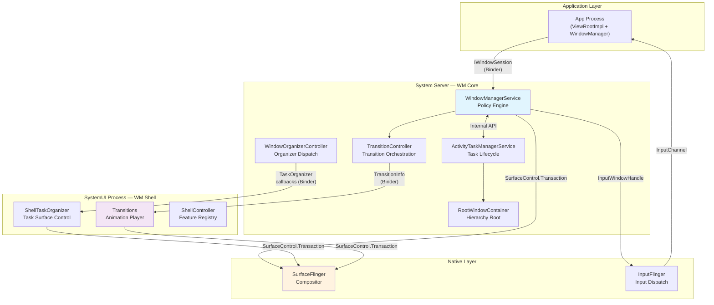

关键的洞见在于：所有三个 Java 层（App、WM Core、WM Shell）都能直接向 SurfaceFlinger 发出 `SurfaceControl.Transaction` 命令。这并不是一条严格的流水线，而是一种协作模型：WM Core 制定策略，Shell 负责呈现，两者都把 surface 操作推送给合成器。

### 23.1.2 WindowManagerService

`WindowManagerService`（WMS）是窗口系统的中央策略引擎。其位置为：

```
frameworks/base/services/core/java/com/android/server/wm/WindowManagerService.java
```

它是 Android 框架中最大的类之一。WMS 继承自 `IWindowManager.Stub`，并实现了 `Watchdog.Monitor` 和 `WindowManagerPolicy.WindowManagerFuncs`：

```java
public class WindowManagerService extends IWindowManager.Stub
        implements Watchdog.Monitor, WindowManagerPolicy.WindowManagerFuncs {
```

WMS 负责：

1. **窗口生命周期管理** -- 通过 `IWindowSession` 添加、移除和重新挂载窗口
2. **焦点管理** -- 决定哪个窗口获得输入焦点，共有五种更新模式（`UPDATE_FOCUS_NORMAL`、`UPDATE_FOCUS_WILL_ASSIGN_LAYERS`、`UPDATE_FOCUS_PLACING_SURFACES`、`UPDATE_FOCUS_WILL_PLACE_SURFACES`、`UPDATE_FOCUS_REMOVING_FOCUS`）
3. **策略执行** -- 窗口类型权限、安全内容标志、覆盖层限制
4. **Surface 同步** -- 保护所有窗口状态的全局锁（`mGlobalLock`），与 `ActivityTaskManagerService` 共享
5. **显示器配置** -- DPI 覆盖、强制缩放模式、显示设置
6. **动画协调** -- 窗口动画缩放、转场超时

关键常量定义了运行边界：

```java
static final int WINDOW_FREEZE_TIMEOUT_DURATION = 2000;        // 2 seconds
static final int LAST_ANR_LIFETIME_DURATION_MSECS = 2 * 60 * 60 * 1000; // 2 hours
```

（每次动画的时长上限是 `TransitionAnimation.MAX_ANIMATION_DURATION`，它在 `WindowState.startAnimation()` 中被应用——由 `WindowStateAnimator.applyAnimationLocked()` 调用——经由 `restrictDuration()` 实现，而不是一个 WMS 字段。）

WMS 持有对关键子系统控制器的引用：

- `mDisplayAreaPolicyProvider` -- 控制每个显示器的 `DisplayArea` 层次如何构建
- `mWindowTracing` / `mTransitionTracer` -- 调试基础设施
- `mConstants` -- 可通过 `WindowManagerConstants` 在运行时配置的参数

### 23.1.3 WindowContainer 层次结构

窗口系统把所有与窗口相关的对象建模为一棵 `WindowContainer` 节点树。每个节点都维护一个父引用、一个按 z-order 排列的子列表，以及与 SurfaceFlinger 图层树中一个 `SurfaceControl` 的 1:1 映射。

**Source file:** `frameworks/base/services/core/java/com/android/server/wm/WindowContainer.java`

```java
class WindowContainer<E extends WindowContainer> extends ConfigurationContainer<E>
        implements Comparable<WindowContainer>, Animatable {

    private WindowContainer<WindowContainer> mParent = null;
    protected final ArrayList<E> mChildren = new ArrayList<E>();
    protected SurfaceControl mSurfaceControl;
    protected final SurfaceAnimator mSurfaceAnimator;
    final TransitionController mTransitionController;
}
```

`WindowContainer` 的关键属性：

- **子节点按 z-order 排列**：`mChildren` 列表按 z-order 维护，最顶层的子节点位于尾部（最高索引）。`POSITION_TOP` 和 `POSITION_BOTTOM` 常量（`Integer.MAX_VALUE` 和 `Integer.MIN_VALUE`）支持显式排序。

- **Surface 1:1 映射**：`mSurfaceControl` 在 SurfaceFlinger 图层树中镜像此节点。每一次层次变更（重新挂载、重排序）都会产生一次对应的 `SurfaceControl.Transaction`。

- **通过 leash 实现动画**：`mSurfaceAnimator` 管理一个独立的 `SurfaceControl`（即"leash"），在动画期间被插入到该节点与其父节点之间。所有子节点都会被重新挂载到 leash 上，以便动画可以变换整个子树。

- **同步状态机**：`mSyncState` 跟踪该容器是否参与某个 BLAST 同步组（`SYNC_STATE_NONE`、`SYNC_STATE_WAITING_FOR_DRAW`、`SYNC_STATE_READY`）。

- **配置传播**：继承自 `ConfigurationContainer`，因此配置变更（旋转、密度、窗口模式）会沿树向下级联。

### 23.1.4 完整的类层次

下图展示了从 `WindowContainer` 到具体叶子类型的完整继承层次：

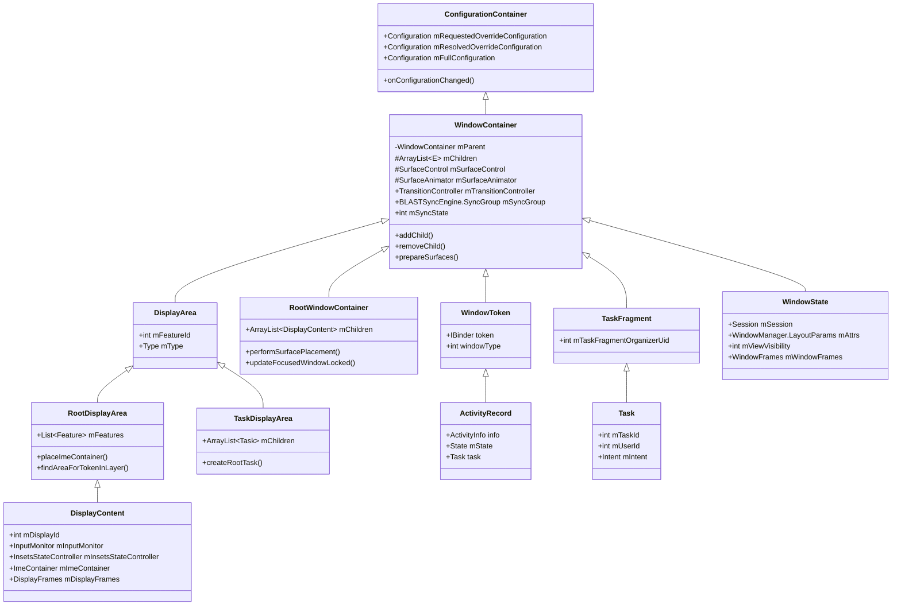

典型显示器从根到叶子的层次为：

```
RootWindowContainer
  └── DisplayContent (display 0)
        └── DisplayArea.Root
              ├── DisplayArea (HideDisplayCutout)
              │     ├── DisplayArea (OneHanded)
              │     │     ├── DisplayArea (Magnification)
              │     │     │     ├── TaskDisplayArea (DefaultTaskDisplayArea)
              │     │     │     │     ├── Task (root task)
              │     │     │     │     │     ├── Task (leaf task)
              │     │     │     │     │     │     ├── ActivityRecord
              │     │     │     │     │     │     │     └── WindowState (main window)
              │     │     │     │     │     │     │           └── WindowState (sub-window)
              │     │     │     │     │     │     └── ActivityRecord
              │     │     │     │     │     └── Task (leaf task)
              │     │     │     │     └── Task (root task - PiP)
              │     │     │     └── WindowToken (TYPE_WALLPAPER)
              │     │     │           └── WindowState (wallpaper)
              │     │     └── WindowToken (TYPE_STATUS_BAR)
              │     │           └── WindowState (status bar)
              │     └── DisplayArea (AppZoomOut)
              ├── ImeContainer
              │     └── WindowToken (TYPE_INPUT_METHOD)
              │           └── WindowState (IME)
              ├── WindowToken (TYPE_NAVIGATION_BAR)
              │     └── WindowState (nav bar)
              └── WindowToken (TYPE_NOTIFICATION_SHADE)
                    └── WindowState (shade)
```

### 23.1.5 WindowState

`WindowState` 是单个窗口在服务端的表示。它继承自 `WindowContainer<WindowState>`，这意味着它的子节点是子窗口（TYPE_APPLICATION_PANEL、TYPE_APPLICATION_MEDIA 等）。

**Source file:** `frameworks/base/services/core/java/com/android/server/wm/WindowState.java`

```java
class WindowState extends WindowContainer<WindowState>
        implements WindowManagerPolicy.WindowState,
                   InputTarget,
                   InsetsControlTarget {
```

WindowState 实现了三个关键接口：

- `WindowManagerPolicy.WindowState` -- 关于窗口属性的策略查询
- `InputTarget` -- 输入派发目标
- `InsetsControlTarget` -- Insets 动画控制

关键字段：

| 字段 | 类型 | 用途 |
|-------|------|---------|
| `mSession` | `Session` | 与客户端进程的 Binder 连接 |
| `mAttrs` | `WindowManager.LayoutParams` | 窗口类型、标志、软输入模式 |
| `mViewVisibility` | `int` | 客户端请求的可见性（VISIBLE/INVISIBLE/GONE） |
| `mWindowFrames` | `WindowFrames` | 计算得到的 frame、display frame、content frame |
| `mRequestedWidth/Height` | `int` | 客户端请求的尺寸 |
| `mGlobalScale` | `float` | 兼容性缩放因子 |
| `mInsetsSourceProviders` | `SparseArray` | 此窗口提供给其他窗口的 Insets |
| `mWinAnimator` | `WindowStateAnimator` | 旧式动画状态 |

### 23.1.6 DisplayContent

`DisplayContent` 表示窗口层次中的一个逻辑显示器。它继承自 `RootDisplayArea`，后者又继承自 `DisplayArea.Dimmable`，后者继承自 `DisplayArea`，后者继承自 `WindowContainer`。

**Source file:** `frameworks/base/services/core/java/com/android/server/wm/DisplayContent.java`

```java
class DisplayContent extends RootDisplayArea
        implements WindowManagerPolicy.DisplayContentInfo {

    final int mDisplayId;
    @Nullable String mCurrentUniqueDisplayId;
    private SurfaceControl mOverlayLayer;
    private SurfaceControl mInputOverlayLayer;
    private final ImeContainer mImeContainer;
    int mMinSizeOfResizeableTaskDp;
}
```

DisplayContent 维护若干特殊的 surface 图层：

- `mOverlayLayer` -- 始终位于顶层的 surface（严格模式闪烁、放大镜覆盖层）
- `mInputOverlayLayer` -- 与输入相关的覆盖层 surface
- `mPointerEventDispatcherOverlayLayer` -- 接收显示器上所有指针输入
- `mA11yOverlayLayer` -- 无障碍覆盖层 surface

每个 DisplayContent 都会创建自己的 `InsetsStateController` 来管理系统栏 insets、自己的 `InputMonitor` 用于输入派发，以及自己的 `DisplayFrames` 用于布局计算。

### 23.1.7 RootWindowContainer

`RootWindowContainer` 是窗口层次的绝对根节点。它是 `WindowManagerService` 的直接子节点，包含所有 `DisplayContent` 实例。

**Source file:** `frameworks/base/services/core/java/com/android/server/wm/RootWindowContainer.java`

它的主要职责是：

- `performSurfacePlacement()` -- 计算窗口位置并推送 surface 事务的主布局过程
- `updateFocusedWindowLocked()` -- 决定跨所有显示器全局聚焦的窗口
- 在显示器连接/断开时管理显示器的添加/移除
- 将 intent 和 activity 路由到合适的显示器

### 23.1.8 Surface 放置周期

窗口布局遵循由 `RootWindowContainer.performSurfacePlacement()` 驱动的循环模式：

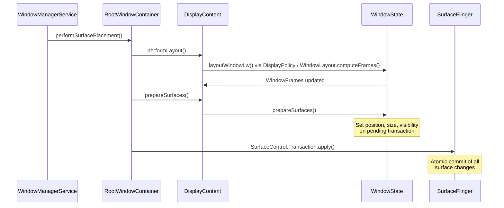

`LAYOUT_REPEAT_THRESHOLD`（4）限制了布局过程在单个 placement 周期内可以重新运行的次数。这可以防止当布局变更触发进一步布局变更时出现无限循环。

### 23.1.9 WMS 内部数据结构

WindowManagerService 维护若干关键集合，以实现快速的窗口查找和生命周期管理：

```java
// Active client sessions (one per connected process)
final ArraySet<Session> mSessions = new ArraySet<>();

// Fast lookup: IWindow binder token → WindowState
final HashMap<IBinder, WindowState> mWindowMap = new HashMap<>();

// Fast lookup: InputWindowHandle token → WindowState
final HashMap<IBinder, WindowState> mInputToWindowMap = new HashMap<>();

// Windows currently being resized (need client notification after transaction)
final ArrayList<WindowState> mResizingWindows = new ArrayList<>();

// Windows with frame changes pending
final ArrayList<WindowState> mFrameChangingWindows = new ArrayList<>();

// Windows whose surfaces should be destroyed
final ArrayList<WindowState> mDestroySurface = new ArrayList<>();

// Emergency: force-remove windows when out of memory
final ArrayList<WindowState> mForceRemoves = new ArrayList<>();

// Callbacks for "all windows drawn" events
final ArrayMap<WindowContainer<?>, Message> mWaitingForDrawnCallbacks = new ArrayMap<>();

// Windows that hide non-system overlay windows (SYSTEM_FLAG_HIDE_NON_SYSTEM_OVERLAY_WINDOWS)
private ArrayList<WindowState> mHidingNonSystemOverlayWindows = new ArrayList<>();

// Key interception info for each input token
final Map<IBinder, KeyInterceptionInfo> mKeyInterceptionInfoForToken =
        Collections.synchronizedMap(new ArrayMap<>());

// IME display policy cache (accessed without lock)
volatile Map<Integer, Integer> mDisplayImePolicyCache =
        Collections.unmodifiableMap(new ArrayMap<>());
```

`mGlobalLock`（`WindowManagerGlobalLock`）是 WMS 与 `ActivityTaskManagerService` 共享的中央同步原语。所有窗口层次的修改都必须持有这把锁。

### 23.1.10 Window 会话

每个创建窗口的应用程序进程都会通过 `IWindowSession` 与 WMS 建立一个 `Session`。该会话是按进程建立的 Binder 连接，提供以下 API：

- 添加窗口（`addToDisplayAsUser`）
- 移除窗口（`remove`）
- 重新布局（尺寸/位置变更）（`relayout`）
- 完成绘制（`finishDrawing`）
- 窗口定位更新
- 输入事件投递设置

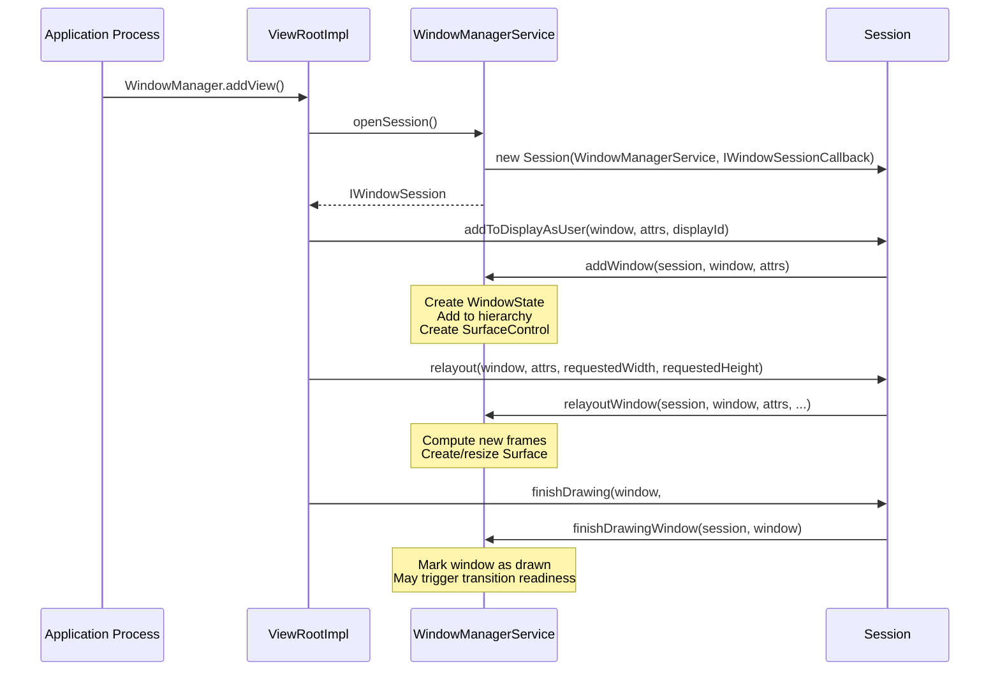

### 23.1.11 全局锁与线程安全

`WindowManagerGlobalLock`（`mGlobalLock`）是系统服务器中争用最严重的锁之一。它保护：

- 所有 `WindowContainer` 层次操作
- 窗口状态变更（可见性、焦点、配置）
- Surface 事务的准备工作
- 显示器配置变更

该锁在 WMS 与 ATMS 之间共享，以避免操作跨越两个服务时发生死锁。在动画系统中，使用独立的 `SurfaceAnimationThread` 来投递动画回调，以避免在帧回调期间持有 `mGlobalLock`。

WMS 还使用若干专门的机制来降低锁争用：

1. **volatile 缓存**：`mDisplayImePolicyCache` 是一个 volatile `Map`，无需持锁即可读取
2. **Handler 投递**：需要该锁但不紧急的操作会被投递到 `WindowManagerService.H` 处理器
3. **只读快照**：`InsetsState`、`TransitionInfo` 和 `TaskInfo` 都是快照对象，无需持锁即可发送给其他线程/进程

### 23.1.12 BLASTSyncEngine

**Source file:** `frameworks/base/services/core/java/com/android/server/wm/BLASTSyncEngine.java`

`BLASTSyncEngine` 是一种同步机制，它确保参与某个转场的所有窗口在转场动画播放之前都已重绘其内容。它的名字来自 BLAST（"Buffer as LayerState"），即取代旧式 `BufferQueue` 消费端模型的缓冲区投递机制。

如源码文档所述，该同步引擎分五个步骤运行：

1. **开启同步集**：`startSyncSet(TransactionReadyListener)` -- 返回一个 ID
2. **添加参与者**：`addToSyncSet(id, WindowContainer)` -- 注册容器
3. **应用变更**：配置变更、重新挂载、可见性变更
4. **标记就绪**：`setReady(id)` -- 表示所有变更都已完成
5. **等待绘制**：每个参与者重绘；当全部完成后，`transactionReady` 触发

同步方法：
```java
METHOD_UNDEFINED = -1; // No method specified
METHOD_NONE = 0;       // Apps draw internally, just report completion
METHOD_BLAST = 1;      // Apps send buffers to be applied in sync
```

并行同步系统可以防止依赖环。假设同步 B 依赖于同步 A，并且有一个容器被加入 A，而该容器已经是 B 所监视的。那么该容器就会从 B 移到 A。这不会产生环。

### 23.1.13 DisplayContent 内部结构

`DisplayContent` 为其显示器维护大量状态。除了已经讨论过的那些之外，关键内部结构还有：

```java
// Display metrics and configuration
int mInitialDisplayWidth, mInitialDisplayHeight;
int mInitialDisplayDensity;
float mInitialPhysicalXDpi, mInitialPhysicalYDpi;
DisplayCutout mInitialDisplayCutout;
RoundedCorners mInitialRoundedCorners;
DisplayShape mInitialDisplayShape;

// Overridable metrics (via adb shell wm size/density)
int mBaseDisplayWidth, mBaseDisplayHeight;
int mBaseDisplayDensity;
boolean mIsSizeForced, mIsDensityForced;

// Display policy and rotation
final DisplayPolicy mDisplayPolicy;
final DisplayRotation mDisplayRotation;
DisplayFrames mDisplayFrames;

// Token registry (IBinder → WindowToken)
private final HashMap<IBinder, WindowToken> mTokenMap = new HashMap();

// Gesture exclusion zones
private final Region mSystemGestureExclusion = new Region();
private int mSystemGestureExclusionLimit;

// Keep-clear areas (for PiP avoidance, etc.)
Set<Rect> mRestrictedKeepClearAreas = new ArraySet<>();
Set<Rect> mUnrestrictedKeepClearAreas = new ArraySet<>();

// Layout state
private boolean mLayoutNeeded;
int pendingLayoutChanges;
boolean mWaitingForConfig;

// PiP task controller
final PinnedTaskController mPinnedTaskController;

// Display area policy (controls DisplayArea hierarchy)
final DisplayAreaPolicy mDisplayAreaPolicy;

// Content recording (screen capture/mirror)
@Nullable ContentRecorder mContentRecorder;
```

`mDisplayAreaPolicy` 至关重要：它由 `DisplayAreaPolicy.Provider`（在 WMS 中配置）创建，并决定该显示器的 `DisplayArea` 层次如何组织。不同的设备类型可以提供不同的策略。

显示器通过 `mDisplayRotation` 跟踪旋转，并维护依赖旋转的缓存，用于：

- 显示屏切口几何形状（`mDisplayCutoutCache`）
- 圆角几何形状（`mRoundedCornerCache`）
- 隐私指示器边界（`mPrivacyIndicatorBoundsCache`）
- 显示屏形状（`mDisplayShapeCache`）

这些缓存使用 `RotationCache`，以避免在每次旋转变更时重新计算几何形状，仅在旋转确实发生变化时才重新计算。

---

## 23.2 WM Shell 库

### 23.2.1 Shell 与 Core：架构拆分

窗口系统被拆分为两半：

| 方面 | WM Core | WM Shell |
|--------|---------|----------|
| **Location** | `frameworks/base/services/core/.../server/wm/` | `frameworks/base/libs/WindowManager/Shell/` |
| **Process** | 系统服务器（主 WM 线程） | SystemUI 进程（Shell 主线程） |
| **Role** | 策略引擎——决定*发生什么* | 呈现引擎——决定*看起来怎么样* |
| **API 表面** | 系统服务器内部使用 | 通过 AIDL 导出给 SystemUI 和 Launcher |
| **窗口访问** | 直接操作 WindowState/Task | TaskOrganizer 回调、SurfaceControl |
| **动画** | 触发转场、管理同步 | 接收 TransitionInfo、为 surface 做动画 |

引入这一拆分是为了让 OEM 厂商和系统组件（SystemUI、Launcher）可以在不修改核心 WM 策略的情况下自定义窗口行为。WM Core 表达意图（"此任务正在进入 PiP"），Shell 决定呈现方式（"用这条曲线动画到这个角落"）。请注意，这两半运行在不同的进程中。WM Core 运行在 `system_server` 中，而 WM Shell 是一个静态库（`WindowManager-Shell`），被链接进 SystemUI 应用。因此，每一次 Core 与 Shell 之间的交互都要跨越 Binder 边界，经由 `WindowOrganizer`/`TaskOrganizer` AIDL 接口进行。

### 23.2.2 Shell 目录结构

Shell 库按功能模块组织：

```
frameworks/base/libs/WindowManager/Shell/src/com/android/wm/shell/
├── ShellTaskOrganizer.java          — Central task lifecycle listener
├── RootTaskDisplayAreaOrganizer.java — Display area management
├── RootDisplayAreaOrganizer.java     — Root display area control
├── WindowManagerShellWrapper.java    — WMS API wrapper
├── dagger/                           — Dependency injection modules
│   ├── WMShellModule.java           — Phone-specific providers
│   ├── WMShellBaseModule.java       — Shared providers
│   ├── WMShellConcurrencyModule.java — Threading configuration
│   ├── TvWMShellModule.java         — TV-specific providers
│   ├── WMComponent.java            — Dagger component definition
│   └── WMSingleton.java            — Scope annotation
├── transition/                       — Transition animation system
│   ├── Transitions.java             — Master transition player
│   ├── DefaultTransitionHandler.java — Default animations
│   ├── MixedTransitionHandler.java  — Cross-feature transitions
│   └── RemoteTransitionHandler.java — Launcher remote transitions
├── splitscreen/                      — Split-screen feature
│   ├── StageCoordinator.java        — Split layout management
│   ├── SplitScreenController.java   — API surface
│   └── SplitScreenTransitions.java  — Split-specific animations
├── pip/                              — Picture-in-Picture
│   ├── PipTaskOrganizer.java        — PiP task management
│   ├── PipTransition.java           — PiP transition handler
│   └── PipAnimationController.java  — PiP animation logic
├── bubbles/                          — Bubble notifications
│   ├── BubbleController.java        — Bubble lifecycle
│   ├── BubbleStackView.java         — Bubble UI
│   └── transitions/BubbleTransitions.java — Bubble animations
├── desktopmode/                      — Desktop windowing
│   ├── DesktopTasksController.kt    — Desktop task management
│   ├── DesktopTasksLimiter.kt       — Task count limits
│   └── WindowDragTransitionHandler.kt — Drag-to-move
├── freeform/                         — Freeform windowing
│   ├── FreeformTaskListener.java    — Freeform task events
│   └── FreeformTaskTransitionHandler.java — Freeform animations
├── back/                             — Predictive back gestures
│   ├── BackAnimationController.java — Back gesture handling
│   └── CrossTaskBackAnimation.java  — Cross-task animations
├── windowdecor/                      — Window decorations (caption bars)
├── onehanded/                        — One-handed mode
├── unfold/                           — Foldable unfold animation
├── recents/                          — Recent apps integration
├── fullscreen/                       — Fullscreen task listener
├── keyguard/                         — Keyguard transition handler
├── common/                           — Shared utilities
├── sysui/                            — SystemUI integration
├── animation/                        — Animation utilities
└── ProtoLogController.java           — ProtoLog configuration
```

### 23.2.3 ShellTaskOrganizer

`ShellTaskOrganizer` 是 Shell 从 WM Core 接收任务生命周期事件的中心枢纽。它继承自 `TaskOrganizer`，并根据窗口模式将事件分发给已注册的监听器。

**Source file:** `frameworks/base/libs/WindowManager/Shell/src/com/android/wm/shell/ShellTaskOrganizer.java`

监听器类型系统将任务路由到对应的功能模块：

```java
// Listener types registered with ShellTaskOrganizer
TASK_LISTENER_TYPE_FULLSCREEN  → FullscreenTaskListener
TASK_LISTENER_TYPE_MULTI_WINDOW → StageCoordinator (split-screen)
TASK_LISTENER_TYPE_PIP         → PipTaskOrganizer
TASK_LISTENER_TYPE_FREEFORM    → FreeformTaskListener
```

不存在桌面专用的监听器类型：桌面模式的任务使用 `WINDOWING_MODE_FREEFORM`，并经由 `TASK_LISTENER_TYPE_FREEFORM` 路由。

当 WM Core 变更某个任务的窗口模式时，`ShellTaskOrganizer` 会自动将任务重新路由到合适的监听器。例如，这正是进入 PiP 时把任务管理从全屏监听器转移给 `PipTaskOrganizer` 的机制。

### 23.2.4 依赖注入架构

Shell 使用 Dagger 2 进行依赖注入，组织为分层的模块层次：

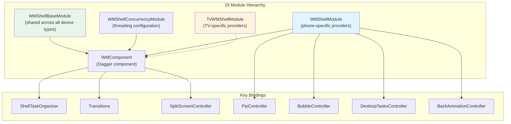

**Source files:**

- `WMShellBaseModule.java` -- 提供所有变体共享的组件（ShellTaskOrganizer、Transitions、DisplayController、SyncTransactionQueue）
- `WMShellModule.java` -- 手机/平板专用组件（PIP 手机实现、Bubbles、桌面模式、分屏）
- `TvWMShellModule.java` -- TV 专用组件（PIP TV 实现，无 Bubbles）
- `WMShellConcurrencyModule.java` -- 线程基础设施

`@WMSingleton` 作用域注解确保 `ShellTaskOrganizer` 和 `Transitions` 等组件在 Shell 组件内是单例：

```java
@WMSingleton
@Subcomponent(modules = {WMShellModule.class})
public interface WMComponent { ... }
```

`WMComponent` 本身只指定了设备专用模块；该模块通过其 `@Module(includes = ...)` 注解引入共享模块和功能模块：

```java
// WMShellModule.java
@Module(
        includes = {
                WMShellBaseModule.class,
                PipModule.class,
                ShellBackAnimationModule.class,
                LetterboxModule.class,
                PinnedLayerModule.class,
                DesktopModule.class,
                // ...
        })
public abstract class WMShellModule { ... }
```

按变体定制是通过替换设备专用模块实现的。例如，TV 用 `TvWMShellModule` 替换 `WMShellModule`，它提供 TV 专用的 PIP 实现，并完全省略 Bubbles。

### 23.2.5 Shell 通信模型

Shell 通过多个通道与外部组件通信：

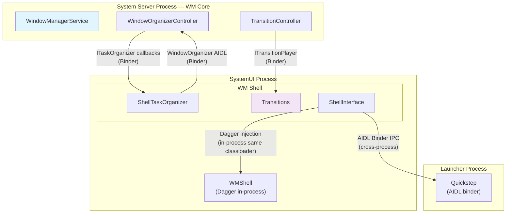

**跨进程通信（Shell 到 WM Core）**：

- Shell 通过 `WindowOrganizer`/`ITaskOrganizerController` AIDL 接口发送 `WindowContainerTransaction` 来应用层次变更（例如 `TaskOrganizer.applyTransaction()` 会把一次 Binder 调用包装进 `WindowOrganizerController`）
- WM Core 通过 organizer 回调（`ITaskOrganizer.onTaskAppeared()`、`ITransitionPlayer.onTransitionReady()`）调用 Shell，回调从 binder 线程分发到 Shell 主线程
- 因此，每一次 Core 与 Shell 的交互都要跨越进程边界（Binder）和线程边界（binder 线程到 Shell 线程）

**进程内通信（Shell 到 SystemUI）**：

- SystemUI 在其进程内将 Shell 作为 Dagger 组件加载
- Shell 通过 Dagger 注入提供接口（例如 `Pip`、`SplitScreen`、`Bubbles`）
- 通信方式是带线程注解（`@ExternalThread`、`@ShellMainThread`）的直接 Java 方法调用

**跨进程通信（Shell 到 Launcher）**：

- Launcher 通过 AIDL binder 接口（`IShellTransitions`、`ISplitScreen`、`IBackAnimation` 等）进行通信
- Shell 通过 `ExternalInterfaceBinder` 模式提供 binder 实现
- 调用从 binder 线程分发到 Shell 主线程

### 23.2.6 线程模型

Shell 使用多线程架构，带有显式的线程注解和基于 executor 的分发：

**Source file:** `frameworks/base/libs/WindowManager/Shell/src/com/android/wm/shell/dagger/WMShellConcurrencyModule.java`

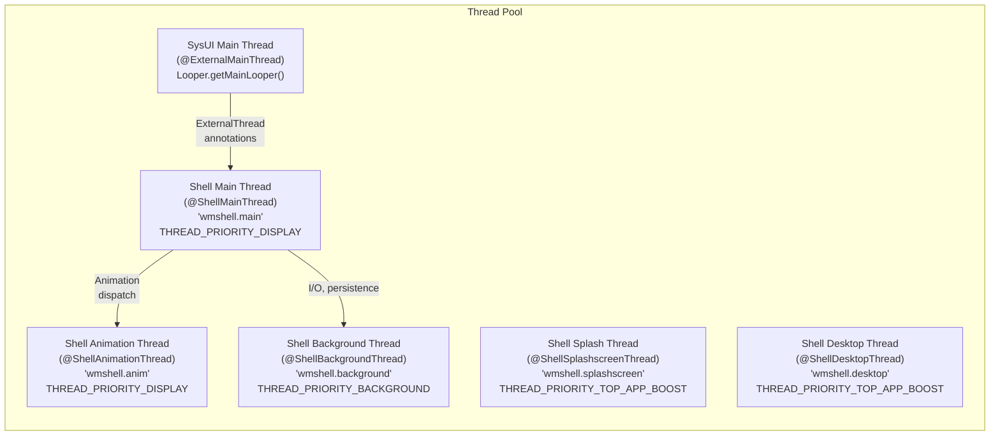

`@ShellMainThread` 是 Shell 组件的主要执行线程。它以 `THREAD_PRIORITY_DISPLAY` 优先级运行，与 RenderThread 相同（SurfaceFlinger 以更高的 `PRIORITY_URGENT_DISPLAY` 运行）。这样可以确保较低优先级的工作不会抢占窗口管理操作。

线程模型强制执行严格的契约：

- Shell 组件在 `@ShellMainThread` 上执行
- SystemUI 通过投递到 Shell 线程的 `@ExternalMainThread` executor 调用 Shell
- Launcher 通过 AIDL binder 调用 Shell，同样会分发到 Shell 线程
- 需要逐帧精确计时的动画使用 `@ShellAnimationThread`
- 繁重的操作（快照采集、持久化）使用 `@ShellBackgroundThread`

`enableShellMainThread()` 配置检查决定是创建专用的 Shell 线程，还是让 Shell 复用 SysUI 主线程：

```java
public static boolean enableShellMainThread(Context context) {
    return context.getResources().getBoolean(R.bool.config_enableShellMainThread);
}
```

消息队列监控的投递与分发阈值都设置为 30ms，从而可以在调试构建中检测线程争用：

```java
private static final int MSGQ_SLOW_DELIVERY_THRESHOLD_MS = 30;
private static final int MSGQ_SLOW_DISPATCH_THRESHOLD_MS = 30;
```

---

## 23.3 转场系统

### 23.3.1 概览：从旧式 AppTransition 到 Shell Transitions

转场系统管理窗口变更（打开、关闭、调整大小、旋转）如何以动画呈现。Android 已从旧式 `AppTransition` 系统演进为"Shell Transitions"架构。在旧系统中，WM Core 同时负责决定和播放转场。而在 Shell Transitions 中，WM Core 收集参与的窗口，Shell 驱动动画。

Shell Transitions 系统（`ENABLE_SHELL_TRANSITIONS = true`）现在是主要路径。关键好处在于 Shell 可以编排复杂的多窗口动画（例如两个任务同时进入分屏），这是旧系统无法处理的。

### 23.3.2 TransitionController（WM Core 侧）

**Source file:** `frameworks/base/services/core/java/com/android/server/wm/TransitionController.java`

`TransitionController` 在 WM Core 侧管理转场的收集与同步阶段。其 Javadoc 提供了关键的架构洞见：

> *"目前，一次只能有一个转场充当主要的'收集者'。然而，收集实际上可以分为两个阶段：（1）真正做出 WM 变更并记录参与的容器。（2）等待参与的容器变为就绪（例如重绘内容）。因为（2）占据了大部分时间，而且不改变 WM，我们实际上可以让多个转场同时处于阶段（2），而只有一个处于阶段（1）。我们称这种安排为'并行'收集。"*

关键设计点：

- **并行收集**：多个转场可以同时等待就绪，但只有一个可以主动收集参与者
- **轨道分配**：当一个转场进入"播放"状态时，会与其他所有正在播放的转场做检查。如果它不重叠，就会获得一条新的"track"用于并行动画。如果它与多于一条 track 上的转场重叠，就会被标记为 SYNC，并等待之前所有动画完成。
- **超时管理**：涉及应用启动的转场使用 `DEFAULT_TIMEOUT_MS`（5000ms）；配置变更使用 `CHANGE_TIMEOUT_MS`（2000ms）

```java
class TransitionController {
    private static final int DEFAULT_TIMEOUT_MS = 5000;
    private static final int CHANGE_TIMEOUT_MS = 2000;

    static final int SYNC_METHOD =
            SystemProperties.getBoolean("persist.wm.debug.shell_transit_blast", false)
                    ? BLASTSyncEngine.METHOD_BLAST : BLASTSyncEngine.METHOD_NONE;
}
```

### 23.3.3 Transition（WM Core 侧）

**Source file:** `frameworks/base/services/core/java/com/android/server/wm/Transition.java`

每个 `Transition` 实例表示一次转场，从创建历经收集、就绪、播放直到完成。转场类型在 `WindowManager` 中定义：

| 常量 | 值 | 描述 |
|----------|-------|-------------|
| `TRANSIT_OPEN` | 1 | 窗口/任务出现 |
| `TRANSIT_CLOSE` | 2 | 窗口/任务消失 |
| `TRANSIT_TO_FRONT` | 3 | 现有任务移到前台 |
| `TRANSIT_TO_BACK` | 4 | 任务移到后台 |
| `TRANSIT_CHANGE` | 6 | 配置变更（旋转、边界） |
| `TRANSIT_PIP` | 10 | 进入画中画 |
| `TRANSIT_WAKE` | 11 | 显示器唤醒 |
| `TRANSIT_SLEEP` | 12 | 显示器休眠 |

（值 7-9 是已废弃的 `TRANSIT_KEYGUARD_GOING_AWAY`、`TRANSIT_KEYGUARD_OCCLUDE` 和 `TRANSIT_KEYGUARD_UNOCCLUDE` 类型，已被 `TRANSIT_TO_FRONT`/`TRANSIT_TO_BACK` 加上 keyguard 转场标志取代。）

`Transition` 类跟踪：

- **参与者**：哪些 `WindowContainer` 节点参与
- **变更**：每个参与者发生了什么变化（open、close、change 等）
- **动画选项**：按 activity 的动画覆盖、跨 profile 动画
- **同步状态**：所有参与者是否都已重绘其内容

### 23.3.4 Transitions（Shell 侧——动画播放器）

**Source file:** `frameworks/base/libs/WindowManager/Shell/src/com/android/wm/shell/transition/Transitions.java`

Shell 侧的 `Transitions` 类是动画的总编排者。它向 WM Core 注册一个内部类 `TransitionPlayerImpl extends ITransitionPlayer.Stub` 作为转场播放器，并从 Shell 视角管理转场的生命周期：

```
--start--> PENDING --onTransitionReady--> READY --play--> ACTIVE --finish--> |
                                                --merge--> MERGED --^
```

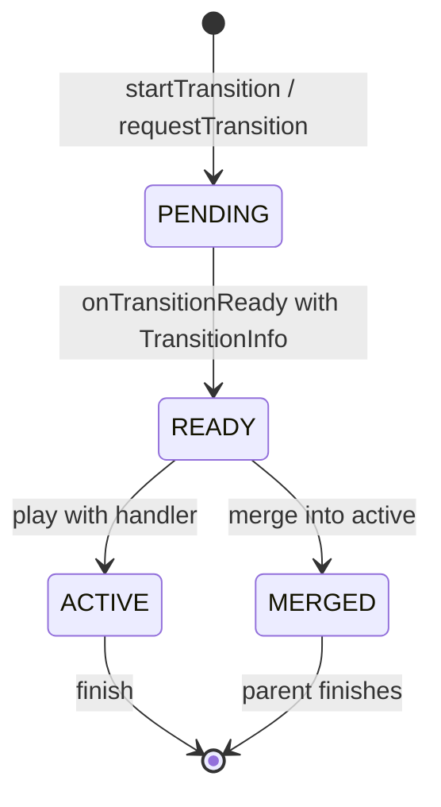

Shell 为功能专用转场定义了超出核心类型的自定义转场类型：

```java
// Shell-specific custom transition types (TRANSIT_FIRST_CUSTOM + N)
TRANSIT_EXIT_PIP              = TRANSIT_FIRST_CUSTOM + 1;
TRANSIT_EXIT_PIP_TO_SPLIT     = TRANSIT_FIRST_CUSTOM + 2;
TRANSIT_REMOVE_PIP            = TRANSIT_FIRST_CUSTOM + 3;
TRANSIT_SPLIT_SCREEN_PAIR_OPEN = TRANSIT_FIRST_CUSTOM + 4;
TRANSIT_SPLIT_SCREEN_OPEN_TO_SIDE = TRANSIT_FIRST_CUSTOM + 5;
TRANSIT_SPLIT_DISMISS_SNAP    = TRANSIT_FIRST_CUSTOM + 6;
TRANSIT_SPLIT_DISMISS         = TRANSIT_FIRST_CUSTOM + 7;
TRANSIT_MAXIMIZE              = TRANSIT_FIRST_CUSTOM + 8;
TRANSIT_RESTORE_FROM_MAXIMIZE = TRANSIT_FIRST_CUSTOM + 9;
TRANSIT_PIP_BOUNDS_CHANGE     = TRANSIT_FIRST_CUSTOM + 16;
TRANSIT_MINIMIZE              = TRANSIT_FIRST_CUSTOM + 20;
```

### 23.3.5 转场处理器链

Shell 使用处理器链将转场分发到对应的功能模块：

```mermaid
graph TB
    subgraph "Transition Handler Chain"
        TI["TransitionInfo from WM Core"]
        TI --> MH["MixedTransitionHandler<br/>(cross-feature transitions)"]
        MH -->|"not handled"| KH["KeyguardTransitionHandler<br/>(keyguard occlude/unocclude)"]
        KH -->|"not handled"| SH["SleepHandler<br/>(sleep/wake transitions)"]
        SH -->|"not handled"| PT["PipTransition<br/>(PiP enter/exit)"]
        PT -->|"not handled"| SCT["SplitScreenTransitions<br/>(split enter/exit)"]
        SCT -->|"not handled"| FTH["FreeformTaskTransitionHandler<br/>(freeform bounds changes)"]
        FTH -->|"not handled"| RTH["RemoteTransitionHandler<br/>(Launcher remote transitions)"]
        RTH -->|"not handled"| DTH["DefaultTransitionHandler<br/>(standard open/close/change)"]
    end

    style TI fill:#e1f5fe
    style DTH fill:#e8f5e9
```

链中的每个处理器都实现 `TransitionHandler`，可以：

1. **认领**：从 `startAnimation()` 返回 `true` 来认领该转场，并负责在完成后调用 `finishTransition()`
2. **拒绝**：返回 `false`，将其传给下一个处理器
3. **请求合并**：如果转场兼容，请求与当前正在播放的转场合并

`MixedTransitionHandler` 很特殊：它处理同时涉及多个功能的转场（例如另一个窗口正在进入 PiP 时进入分屏）。

### 23.3.6 转场生命周期：端到端流程

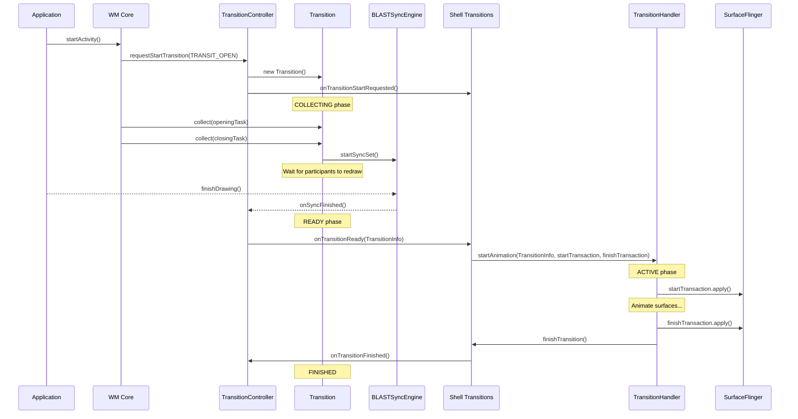

两个 SurfaceControl.Transaction——`startTransaction` 和 `finishTransaction`——至关重要：

- **startTransaction**：在动画开始时应用；建立初始动画状态（可能显示/隐藏 surface、设置初始位置）
- **finishTransaction**：在动画结束时应用；设置最终状态（最终位置、最终可见性）。这是动画结束后持续存在的"地面真相"。

### 23.3.7 TransitionInfo：数据契约

`TransitionInfo` 是从 WM Core 传给 Shell 的数据对象，描述了 Shell 为转场制作动画所需的一切信息：

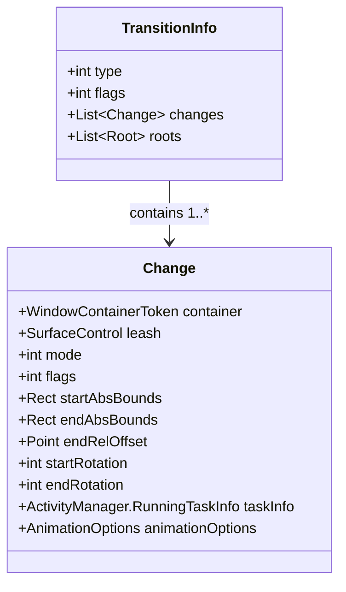

`startTransaction` 和 `finishTransaction` 并不是 `TransitionInfo` 的成员；它们作为 `ITransitionPlayer.onTransitionReady()` 的独立 `SurfaceControl.Transaction` 参数，与 info 对象一起传递。

`TransitionInfo` 中的每个 `Change` 表示一个参与容器，包含：

- 其 `mode`（OPEN、CLOSE、TO_FRONT、TO_BACK、CHANGE）
- 其 `flags`（IS_WALLPAPER、IS_INPUT_METHOD、IS_DISPLAY、FILLS_TASK、TRANSLUCENT 等）
- 用于插值的起始和结束边界
- 用于旋转动画的起始和结束旋转角度
- 一个 Shell 可以制作动画的 `leash` SurfaceControl

单个 change 上的标志为 Shell 提供了足够的上下文来决定动画：

```java
FLAG_IS_WALLPAPER            // This change is a wallpaper
FLAG_IS_INPUT_METHOD         // This change is the IME
FLAG_IS_DISPLAY              // This change represents a display-level transition
FLAG_FILLS_TASK              // Activity fills its task bounds
FLAG_TRANSLUCENT             // Activity has translucent windows
FLAG_SHOW_WALLPAPER          // Activity shows wallpaper behind
FLAG_NO_ANIMATION            // Suppress animation for this change
FLAG_IS_BEHIND_STARTING_WINDOW // Hidden behind splash screen
FLAG_MOVED_TO_TOP            // Container moved to top of z-order
FLAG_IN_TASK_WITH_EMBEDDED_ACTIVITY // Container in embedded activity task
FLAG_DISPLAY_HAS_ALERT_WINDOWS // Display has visible alert windows
FLAG_TASK_LAUNCHING_BEHIND   // Task launching behind current
FLAG_IS_VOICE_INTERACTION    // Voice interaction window
FLAG_IS_OCCLUDED             // Occluded by keyguard
FLAG_CONFIG_AT_END           // Configuration applies at animation end
FLAG_WILL_IME_SHOWN          // IME will be shown after transition
```

### 23.3.8 转场合并

当多条转场在同一 track 内并发就绪时，系统会尝试将它们**合并**。合并将一条新转场并入正在播放的转场，使动画能够平滑地纳入额外的变更，而无需重新开始。

合并流程：

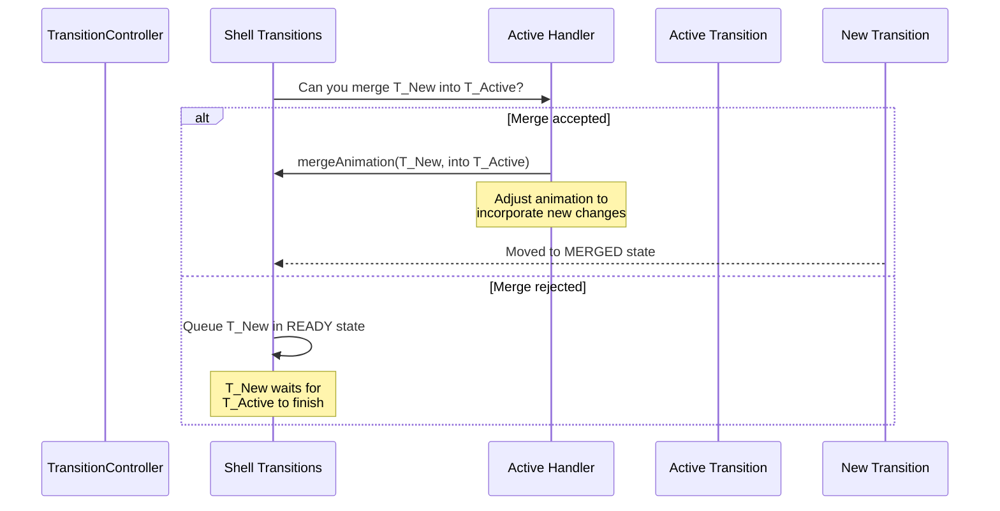

常见的合并场景：

- 连续快速打开多个 activity（第二次合并进第一次）
- 应用转场动画进行中发生配置变更
- 应用转场期间 IME 的显示/隐藏

### 23.3.9 并行轨道

track 系统支持真正的并行动画。当 WM Core 判定一条新转场与任何正在播放的转场都不重叠时，就会把该转场分配到一条新 track：

```
Track 0: [Transition A: Task 1 open] → [Transition C: Task 1 close]
Track 1: [Transition B: Task 2 change] → [Transition D: Task 2 PiP]
```

同一条 track 内的转场串行执行。跨 track 的转场同时播放。

如果一条转场与多条 track 重叠（例如它同时涉及 Track 0 和 Track 1 的容器），它会被标记为 SYNC。SYNC 转场会阻塞，直到所有活动 track 完成其当前动画，然后独占式播放。

### 23.3.10 DefaultTransitionHandler

`DefaultTransitionHandler` 是兜底处理器，提供标准的 Android 窗口动画。它处理：

- **Open/close**：带可选缩放的淡入/淡出
- **To front/back**：现有窗口在 z-order 中的移动
- **Change**：边界变更、旋转变更
- **Wallpaper transitions**：与壁纸的视差和交叉淡入淡出

**Source file:** `frameworks/base/libs/WindowManager/Shell/src/com/android/wm/shell/transition/DefaultTransitionHandler.java`

`DefaultTransitionHandler` 通过 `ValueAnimator` 创建 `SurfaceControl.Transaction` 帧回调，将 surface 属性（位置、大小、alpha、圆角半径）从起始状态平滑插值到结束状态。

### 23.3.11 RemoteTransitionHandler

`RemoteTransitionHandler` 使外部组件（主要是 Launcher/Quickstep）能够注册 `RemoteTransition` 对象，由它们处理特定转场。Launcher 就是这样提供其自定义的最近任务动画、应用到主屏幕动画和应用启动动画的。

**Source file:** `frameworks/base/libs/WindowManager/Shell/src/com/android/wm/shell/transition/RemoteTransitionHandler.java`

远程转场使用 `TransitionFilter` 来匹配特定转场模式（例如"关闭应用以显示主屏幕"）。当匹配成功时，远程处理器通过 AIDL 将 `TransitionInfo` 转发给远程组件。

---

## 23.4 多窗口架构

### 23.4.1 窗口模式

Android 在 `WindowConfiguration` 中定义了五种窗口模式：

**Source file:** `frameworks/base/core/java/android/app/WindowConfiguration.java`

```java
public static final int WINDOWING_MODE_UNDEFINED   = 0;
public static final int WINDOWING_MODE_FULLSCREEN  = 1;
public static final int WINDOWING_MODE_PINNED      = 2;  // Picture-in-Picture
public static final int WINDOWING_MODE_FREEFORM    = 5;  // Freely resizable
public static final int WINDOWING_MODE_MULTI_WINDOW = 6; // Split-screen
```

窗口模式决定了任务的布局行为：

| 模式 | 边界 | 可由用户调整大小 | Z-Order | 用例 |
|------|--------|----------------|---------|----------|
| FULLSCREEN | 填满显示器 | 否 | 常规堆叠 | 默认手机模式 |
| PINNED | 小的固定矩形 | 受限 | 始终在顶层 | 视频 PiP |
| FREEFORM | 用户自定义矩形 | 是（拖动边缘） | 常规堆叠 | 桌面模式 |
| MULTI_WINDOW | 显示器的一半/一部分 | 通过分隔条 | 并排 | 分屏 |

`tasksAreFloating()` 辅助方法用于识别哪些模式会产生浮动窗口。它委托给 `isFloating()`，后者只把 freeform 和 PiP 计为浮动；分屏（multi-window）是平铺的，不是浮动的：

```java
// WindowConfiguration.java
public boolean tasksAreFloating() {
    return isFloating(mWindowingMode);
}

public static boolean isFloating(@WindowingMode int windowingMode) {
    return windowingMode == WINDOWING_MODE_FREEFORM
            || windowingMode == WINDOWING_MODE_PINNED;
}
```

### 23.4.2 分屏架构

分屏把显示器划分为两个 stage，每个 stage 托管一个或多个任务。该架构横跨 WM Core 和 Shell。

**Key source files:**

- `frameworks/base/libs/WindowManager/Shell/src/com/android/wm/shell/splitscreen/StageCoordinator.java`
- `frameworks/base/libs/WindowManager/Shell/src/com/android/wm/shell/splitscreen/SplitScreenController.java`
- `frameworks/base/libs/WindowManager/Shell/src/com/android/wm/shell/splitscreen/StageTaskListener.java`

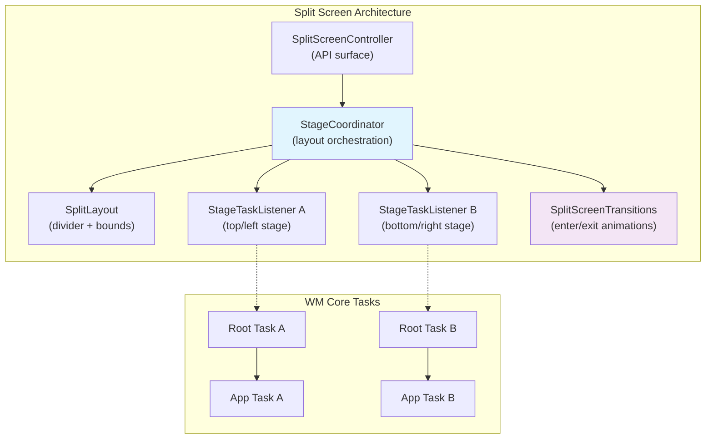

`StageCoordinator` 管理 stage 之间的空间关系。分屏位置被定义为常量：

```java
SPLIT_POSITION_TOP_OR_LEFT     // First stage
SPLIT_POSITION_BOTTOM_OR_RIGHT // Second stage
SPLIT_POSITION_UNDEFINED       // Not in split
```

吸附位置定义了分隔条的比例：

```java
SNAP_TO_2_50_50  // Equal split
SNAP_TO_2_10_90  // First stage small
SNAP_TO_2_90_10  // First stage large
```

分屏还可以在"flexible"模式（`enableFlexibleSplit` 标志）下运行，此时可以有超过两个任务参与，分隔条位置也更加灵活。

退出原因被枚举出来，用于跟踪分屏为何被关闭：

```java
EXIT_REASON_APP_DOES_NOT_SUPPORT_MULTIWINDOW
EXIT_REASON_APP_FINISHED
EXIT_REASON_CHILD_TASK_ENTER_PIP
EXIT_REASON_CHILD_TASK_ENTER_BUBBLE
EXIT_REASON_DESKTOP_MODE
EXIT_REASON_DEVICE_FOLDED
EXIT_REASON_DRAG_DIVIDER
EXIT_REASON_FULLSCREEN_REQUEST
EXIT_REASON_FULLSCREEN_SHORTCUT
EXIT_REASON_RETURN_HOME
EXIT_REASON_ROOT_TASK_VANISHED
EXIT_REASON_SCREEN_LOCKED_SHOW_ON_TOP
EXIT_REASON_UNKNOWN
```

### 23.4.3 Picture-in-Picture (PiP)

PiP 允许一个任务缩小为一个小的浮动覆盖窗口，同时用户可以与其他应用交互。

**Key source files:**

- `frameworks/base/libs/WindowManager/Shell/src/com/android/wm/shell/pip/PipTaskOrganizer.java`
- `frameworks/base/libs/WindowManager/Shell/src/com/android/wm/shell/pip/PipTransition.java`
- `frameworks/base/libs/WindowManager/Shell/src/com/android/wm/shell/pip/PipAnimationController.java`

`PipTaskOrganizer` 扩展了任务 organizer 模式，直接管理 PiP 任务的 surface：

```java
// Registered as TASK_LISTENER_TYPE_PIP with ShellTaskOrganizer
```

PiP 动画方向定义了转场阶段：

```java
TRANSITION_DIRECTION_TO_PIP                  // Entering PiP
TRANSITION_DIRECTION_LEAVE_PIP               // Expanding back to fullscreen
TRANSITION_DIRECTION_LEAVE_PIP_TO_SPLIT_SCREEN // Expanding into split
TRANSITION_DIRECTION_EXPAND_OR_UNEXPAND      // User expand/collapse gesture
TRANSITION_DIRECTION_REMOVE_STACK            // Dismissing PiP entirely
TRANSITION_DIRECTION_SNAP_AFTER_RESIZE       // Snapping to edge after resize
TRANSITION_DIRECTION_USER_RESIZE             // User pinch-to-resize
TRANSITION_DIRECTION_SAME                    // No direction change
TRANSITION_DIRECTION_NONE                    // No transition
```

PiP 动画可以有两种类型：

- `ANIM_TYPE_BOUNDS` -- 边界变更动画（移动、调整大小）
- `ANIM_TYPE_ALPHA` -- alpha 淡入淡出动画（进入、退出）

### 23.4.4 Freeform 模式

Freeform 模式（`WINDOWING_MODE_FREEFORM`）启用桌面风格的、可自由调整大小的窗口。该模式是 Android 桌面窗口体验的基础。

**Key source files:**

- `frameworks/base/libs/WindowManager/Shell/src/com/android/wm/shell/freeform/FreeformTaskListener.java`
- `frameworks/base/libs/WindowManager/Shell/src/com/android/wm/shell/freeform/FreeformTaskTransitionHandler.java`

`FreeformTaskListener` 处理任务出现/消失事件，并为 freeform 窗口管理窗口装饰（标题栏）。`FreeformTaskTransitionHandler` 为涉及 freeform 任务的转场制作动画，例如从全屏进入 freeform 或调整大小。

### 23.4.5 桌面模式

桌面模式是 freeform 的演进，增加了完整的桌面窗口体验，包括任务管理、窗口数量限制和多桌面支持。

**Key source files:**

- `frameworks/base/libs/WindowManager/Shell/src/com/android/wm/shell/desktopmode/DesktopTasksController.kt`
- `frameworks/base/libs/WindowManager/Shell/src/com/android/wm/shell/desktopmode/DesktopTasksLimiter.kt`
- `frameworks/base/libs/WindowManager/Shell/src/com/android/wm/shell/desktopmode/WindowDragTransitionHandler.kt`

桌面模式目录包含大量组件（50 多个文件），反映了完整桌面窗口体验的复杂性：

```
desktopmode/
├── DesktopTasksController.kt              — Central controller
├── DesktopTasksLimiter.kt                — Enforces max open task count
├── WindowDragTransitionHandler.kt         — Drag-to-move transitions
├── DragToDesktopTransitionHandler.kt      — Drag from dock to desktop
├── DesktopImeHandler.kt                  — IME integration for freeform
├── DesktopImmersiveController.kt         — Immersive mode in desktop
├── DesktopDisplayEventHandler.kt         — Display connect/disconnect
├── DesktopModeMoveToDisplayTransitionHandler.kt — Move a desk task to another display
├── DisplayDisconnectTransitionHandler.kt  — Migrate desks off a removed display
├── DesktopPipTransitionController.kt     — PiP within desktop mode
├── DesktopTaskPosition.kt                — Window position management
├── DesktopWallpaperActivity.kt           — Desktop wallpaper surface
├── DesktopModeVisualIndicator.java       — Drag visual indicator
├── multidesks/                            — Multi-desk support (DesksController, DesksOrganizer)
├── homescreenpeeking/                     — Home-screen peek hot corners
├── desktoptaskshandlers/                  — Desk task transition handlers
├── DesktopMinimizationTransitionHandler.kt — Task minimization
├── education/                             — User onboarding
├── animation/                             — Desktop-specific animations
├── data/                                  — Desktop state persistence
├── common/                                — Shared utilities
└── desktopfirst/                          — Desktop-first experience
```

桌面模式引入了窗口操作专用的转场类型：

```java
TRANSIT_MAXIMIZE              // Freeform → maximized
TRANSIT_RESTORE_FROM_MAXIMIZE // Maximized → freeform
TRANSIT_MINIMIZE              // Task minimization
```

### 23.4.6 多窗口任务流

下图展示了任务如何在窗口模式之间转换：

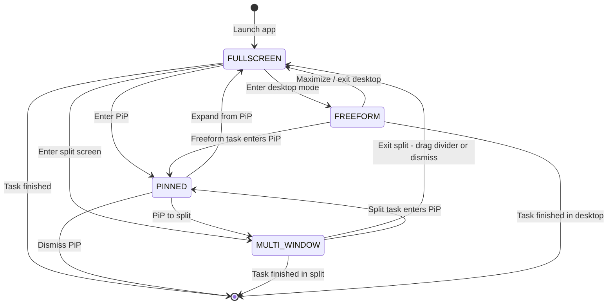

模式之间的每次转换都涉及：

1. WM Core 更新任务的 `WindowConfiguration.windowingMode`
2. 创建一条转场并由 `TransitionController` 收集
3. 旧的 Shell 监听器释放任务，新的监听器获取它（经由 `ShellTaskOrganizer`）
4. Shell 通过相应的 `TransitionHandler` 为转场制作动画

### 23.4.7 WindowContainerTransaction

`WindowContainerTransaction`（WCT）是 Shell 用来对窗口层次进行变更的原子操作机制。Shell 不是对 WM Core 逐个调用，而是把变更批量打包进单个 WCT：

```java
WindowContainerTransaction wct = new WindowContainerTransaction();
wct.setBounds(taskToken, newBounds);           // Change bounds
wct.setWindowingMode(taskToken, FREEFORM);     // Change windowing mode
wct.reorder(taskToken, true /* onTop */);      // Reorder in z-stack
wct.reparent(taskToken, newParentToken, true); // Move to different parent

// Apply atomically via the organizer
shellTaskOrganizer.applyTransaction(wct);
```

WCT 操作包括：

- `setBounds()` -- 变更任务边界
- `setWindowingMode()` -- 变更窗口模式
- `reorder()` -- 在 z-order 中移动
- `reparent()` -- 移动到不同的父容器
- `setFocusable()` -- 设置焦点策略
- `setHidden()` -- 隐藏/显示容器
- `startTask()` -- 在此事务上下文中启动一个 pending intent
- `sendPendingIntent()` -- 通过 pending intent 启动

WCT 可以带转场或不带转场提交。当带转场提交时，WCT 变更被收集为转场的一部分，并由 Shell 制作动画。

### 23.4.8 Task 与 TaskFragment 层次

在多窗口系统中，任务层次为：

```
TaskDisplayArea
  └── Task (root task, often windowing-mode-specific)
        ├── Task (leaf task, holds activities)
        │     ├── TaskFragment (optional, for activity embedding)
        │     │     └── ActivityRecord
        │     │           └── WindowState
        │     └── ActivityRecord
        │           └── WindowState
        └── Task (another leaf task)
```

`Task` 类继承自 `TaskFragment`：

```java
class Task extends TaskFragment { ... }
```

而 `TaskFragment` 继承自 `WindowContainer`：

```java
class TaskFragment extends WindowContainer<WindowContainer> { ... }
```

这一层次支持：

- **根任务**：用于窗口模式分组（例如分屏的根任务包含两个叶子任务）
- **叶子任务**：用于单个 activity
- **TaskFragments**：用于 activity 嵌入（同一个任务内并排的 activity，由 Jetpack WindowManager 使用）

### 23.4.9 ActivityRecord 与窗口-Activity 关系

`ActivityRecord` 继承自 `WindowToken`，后者继承自 `WindowContainer<WindowState>`：

```java
final class ActivityRecord extends WindowToken { ... }
class WindowToken extends WindowContainer<WindowState> { ... }
```

这意味着一个 `ActivityRecord` 直接包含 `WindowState` 子节点。单个 activity 可能有多个窗口：

- 主应用窗口（`TYPE_BASE_APPLICATION`）
- 启动/闪屏窗口（`TYPE_APPLICATION_STARTING`）
- 子窗口（面板、媒体 surface）
- 对话框窗口

`ActivityRecord` 管理 activity 生命周期状态（INITIALIZING、STARTED、RESUMED、PAUSED、STOPPED、FINISHING、DESTROYED），这些状态会影响窗口可见性和转场行为。

### 23.4.10 边界计算

多窗口边界通过级联计算：

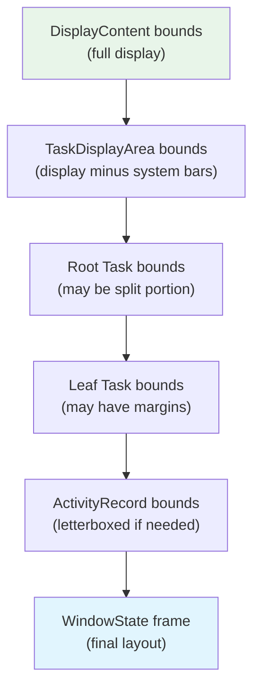

每个层级都可以约束或变换边界：

- **DisplayContent**：完整显示器尺寸减去适用的刘海/切口
- **TaskDisplayArea**：减去持久系统 UI 之后的显示区域
- **Root Task**：在分屏模式下，这是任务显示区域的一半（或一部分）
- **Leaf Task**：可能有额外约束（最小尺寸、宽高比）
- **ActivityRecord**：如果 activity 不支持可用边界，可能需要被 letterbox（添加黑边）
- **WindowState**：由布局计算出的最终 frame，考虑了 insets 和兼容性缩放

---

## 23.5 多显示器

### 23.5.1 DisplayContent 与显示器模型

每个已连接的显示器（物理或虚拟）在窗口层次中由一个 `DisplayContent` 实例表示。层次顶部的 `RootWindowContainer` 为每个显示器包含一个 `DisplayContent` 子节点。

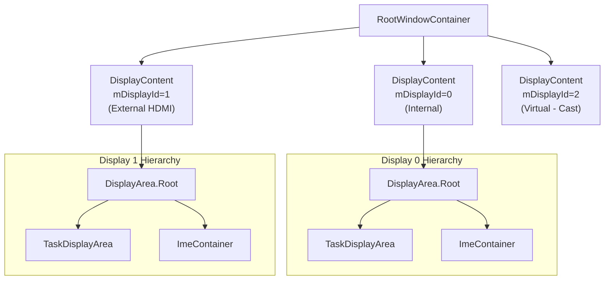

每个 `DisplayContent` 都是自包含的，拥有自己的：

- `DisplayArea` 层次（由 `DisplayAreaPolicy` 配置）
- `InsetsStateController`（系统栏 insets 是按显示器划分的）
- `InputMonitor`（输入窗口列表是按显示器划分的）
- `DisplayFrames`（屏幕边界、切口、insets）
- 焦点跟踪（按显示器的聚焦窗口）
- IME 容器（IME 可以是本地的，或回退到默认显示器）

### 23.5.2 显示器标识

显示器使用两种标识方案：

| 标识符 | 类型 | 稳定性 | 来源 |
|-----------|------|-----------|--------|
| `mDisplayId` | `int` | 单次启动内稳定 | 由 `DisplayManagerService` 分配 |
| `mCurrentUniqueDisplayId` | `String` | 可在运行时变化 | 物理显示器 EDID 或虚拟显示器 token |

如果底层物理显示硬件发生变化（例如热插拔了另一台显示器），`mCurrentUniqueDisplayId` 可能会变化。相比之下，`mDisplayId` 在 `DisplayContent` 的整个生命周期内保持稳定。

### 23.5.3 虚拟显示器

虚拟显示器通过 `DisplayManagerService` 创建，并由一个 `Surface` 而不是物理硬件来支撑。它们用于：

- **屏幕投射/镜像** -- 内容被渲染到一个虚拟显示器上，被捕获并通过网络发送
- **Presentation API** -- `android.app.Presentation` 渲染到虚拟显示器以供副屏使用
- **伴随设备** -- 虚拟设备框架为远程设备创建虚拟显示器
- **测试** -- Instrumentation 为多显示器测试创建虚拟显示器

虚拟显示器标志控制行为：

| 标志 | 效果 |
|------|--------|
| `VIRTUAL_DISPLAY_FLAG_PUBLIC` | 使显示器公开；缺少该标志时显示器为私有，内容仅对创建它的进程可见 |
| `VIRTUAL_DISPLAY_FLAG_SHOULD_SHOW_SYSTEM_DECORATIONS` | 显示器获得状态栏/导航栏 |
| `VIRTUAL_DISPLAY_FLAG_CAN_SHOW_WITH_INSECURE_KEYGUARD` | 可以在 keyguard 激活时显示内容 |
| `VIRTUAL_DISPLAY_FLAG_ALLOWS_CONTENT_MODE_SWITCH` | 显示器内容模式可以变更 |

### 23.5.4 跨显示器窗口移动

任务可以通过若干机制在显示器之间移动：

1. **WindowContainerTransaction**：Shell 发出一个 `WindowContainerTransaction`，将任务重新挂载到另一个显示器的 `TaskDisplayArea`
2. **Activity 启动定向**：activity 可以通过 `ActivityOptions.setLaunchDisplayId()` 定向启动到特定显示器
3. **显示器断开**：当显示器被移除时，其任务必须迁移到一个幸存的显示器

跨显示器移动过程：

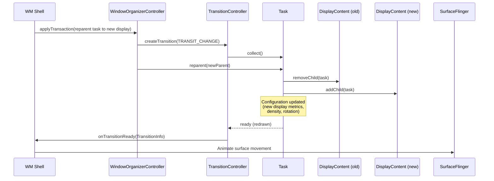

`DisplayContent` 类跟踪若干影响跨显示器行为的关键设置：

- `mMinSizeOfResizeableTaskDp` -- 此显示器上的最小任务尺寸
- IME 策略（`DISPLAY_IME_POLICY_LOCAL` 与 `DISPLAY_IME_POLICY_FALLBACK_DISPLAY`）-- IME 出现在此显示器上还是默认显示器上
- 显示器内容模式管理（通过 `ENABLE_DISPLAY_CONTENT_MODE_MANAGEMENT` 标志启用）

### 23.5.5 按显示器的焦点

窗口系统在两个层面维护焦点：

1. **按显示器的焦点** -- 每个 `DisplayContent` 跟踪其自己的聚焦窗口
2. **全局焦点** -- `RootWindowContainer` 决定哪个显示器的聚焦窗口是"顶层"焦点（接收按键事件）

这一双层系统对多显示器场景至关重要。在这些场景中，用户可能同时使用不同的显示器（例如在一个显示器上打字，同时在另一个显示器上观看视频）。

### 23.5.6 显示器组与拓扑

显示器可以被组织为组以实现协调行为。显示器组影响：

- **壁纸共享**：同一组中的显示器可能共享壁纸
- **配置继承**：组级别的配置覆盖
- **焦点行为**：焦点策略可能感知组

显示器拓扑系统管理显示器之间的空间关系：

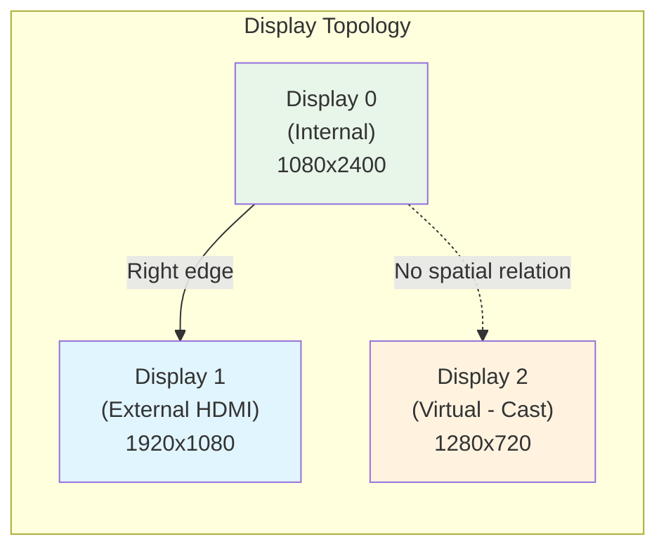

空间关系支持：

- 光标跨相邻显示器边缘移动
- 显示器之间的拖放
- 窗口在显示器之间拖动移动

### 23.5.7 按显示器的 IME 策略

每个显示器都有一个 IME（输入法编辑器）策略，决定软件键盘出现在哪里：

```java
DISPLAY_IME_POLICY_LOCAL           // IME shows on this display
DISPLAY_IME_POLICY_FALLBACK_DISPLAY // IME shows on default display
```

该策略在 WMS 中被缓存到 volatile 的 `mDisplayImePolicyCache` 映射中，以便无锁访问。虚拟显示器和一些副显示器使用 `FALLBACK_DISPLAY` 策略，因为它们可能没有适合 IME 交互的系统装饰或触摸输入。

每个 `DisplayContent` 内的 `ImeContainer` 管理 IME 窗口的 z-order。IME 需要特殊的 z-order 逻辑，因为它必须出现在：

- 目标窗口（请求输入的窗口）之上
- 系统覆盖层和导航栏之下
- 相对于 `DisplayArea` 层次的正确位置

### 23.5.8 显示器配置与覆盖

每个 `DisplayContent` 都跟踪初始的和被覆盖的显示器指标。这些可以通过以下方式修改：

- **adb shell**：`wm size`、`wm density`、`wm scaling` 命令
- **设置**：用户可访问的显示尺寸/密度设置
- **系统服务器**：程序化的显示器配置变更

覆盖系统在强制密度和初始密度之间维护一个比例（`mForcedDisplayDensityRatio`）。当显示器分辨率发生变化时（例如在支持可变分辨率的设备上），该比例用于成比例地缩放密度。这保持了用户选择的显示尺寸。

```java
// DisplayContent fields for override tracking
int mBaseDisplayWidth = 0;     // May differ from mInitialDisplayWidth
int mBaseDisplayHeight = 0;    // May differ from mInitialDisplayHeight
int mBaseDisplayDensity = 0;   // May differ from mInitialDisplayDensity
boolean mIsSizeForced = false;
boolean mIsDensityForced = false;
float mForcedDisplayDensityRatio = 0.0f;
```

### 23.5.9 跨显示器拖放

拖动手势并不局限于它开始的那个显示器。已连接显示器的设置构成单一拓扑（23.5.6 节）。在这种情况下，用户可以在某个显示器上的内容上按下，并把阴影拖过接缝。然后用户可以把它放到另一个显示器上的一个窗口中。相关机制完全位于 WindowManager 的 `DragState` 和 `DragDropController` 中（`frameworks/base/services/core/java/com/android/server/wm/`）。那一个拖动 surface 会跟随指针从一个显示器的 surface 层次离开，进入另一个显示器的层次。

拖动在 `DragDropController.performDrag()`（`DragDropController.java:162`）中开始。该方法构建拖动 `SurfaceControl`，并将其挂载到起始显示器的覆盖层上（`reparentToOverlay`，第 301 行）。它还在 `DragState` 上记录起始显示器和当前显示器：

```java
// DragState.java
DisplayContent mStartDragDisplayContent;    // line 139 -- where the drag began
DisplayContent mCurrentDisplayContent;      // line 144 -- where the pointer is now
```

拖动自己的输入窗口以 `DISPLAY_TOPOLOGY_AWARE` 方式创建（`DragState.java:445`）。正是这一点让指针——进而让拖动——能够离开起始显示器。输入派发遵循显示器拓扑，而不是被限制在一个显示器的边界内。

*拖动 surface 如何跟随指针到达另一个显示器*

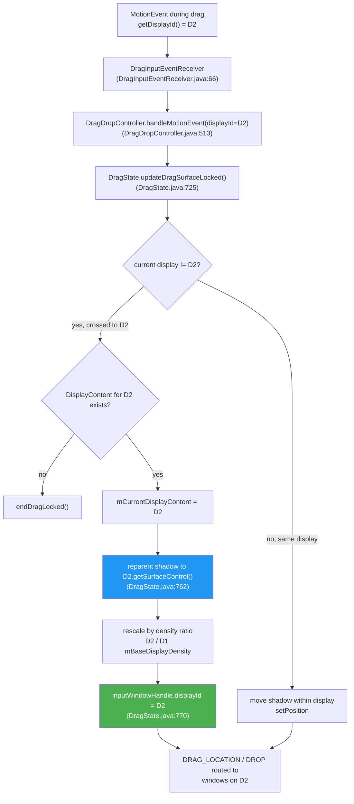

每一个拖动动作事件都携带指针当前所在的显示器。`DragInputEventReceiver` 读取 `motionEvent.getDisplayId()`（`DragInputEventReceiver.java:66`），并将其转发给 `DragDropController.handleMotionEvent(keepHandling, displayId, x, y)`（`DragDropController.java:513`），后者调用 `DragState.updateDragSurfaceLocked()`（`DragState.java:725`）。该方法就是处理显示器跨越的地方：

- **检测跨越。** 它比较传入的 `displayId` 与当前显示器（`if (mCurrentDisplayContent.mDisplayId != displayId)`，第 736 行）。如果目标 `DisplayContent` 不再存在，拖动结束。否则 `mCurrentDisplayContent` 会被更新为新的显示器（第 745 行）。
- **重新挂载拖动 surface。** 阴影被移入新显示器的 surface 树——`mTransaction.reparent(mSurfaceControl, mCurrentDisplayContent.getSurfaceControl())`（第 762 行）。这就是 surface 在显示器之间的字面交接。
- **按密度重新缩放。** 动画缩放和缩略图偏移会乘以新显示器的 `mBaseDisplayDensity` 与旧显示器的比值（第 756-761 行）。这是因为两个显示器的密度可能不同。这让阴影在跨越时保持相同的物理尺寸。例如，从 160-dpi 的显示器以 1.0 的缩放放到 420-dpi 的面板上，会变成约 2.6。
- **重定向输入。** 拖动输入窗口的 `displayId` 被更新并重新应用（`inputWindowHandle.displayId = displayId`，第 770 行）。因此，后续的派发以及 `ACTION_DRAG_LOCATION` / `ACTION_DROP` 事件会路由到新显示器上的窗口。

窗口通过 `broadcastDragStartedLocked()` 了解拖动，该方法会遍历*每一个*显示器上的*每一个*窗口（`mService.mRoot.forAllWindows(...)`），而不仅仅是起始显示器上的窗口。一个细节是坐标：`ACTION_DRAG_STARTED` 携带窗口相对的*像素*坐标，但跨显示器并不存在全局像素空间，只有全局 dp。因此，对于与拖动起点不同显示器上的窗口，`sendDragStartedLocked()` 会刻意发送一个哨兵位置（`new PointF(-newWin.getBounds().left - 1, -newWin.getBounds().top - 1)`，`DragState.java:569`）。该位置表示"拖动在此显示器之外"，而不会暗示一个真实的距离。相比之下，按显示器的 `ACTION_DRAG_LOCATION` 事件携带的是有效的显示器本地坐标。

还有两个细节完善了跨显示器的画面：

- **返回动画。** 假设拖动在未被消费的情况下释放。如果指针随后结束在不同的显示器上（`mCurrentDisplayContent.getDisplayId() != mStartDragDisplayContent.getDisplayId()`，`DragState.java:825`），吸附回弹动画会缩放到 `DIFFERENT_DISPLAY_RETURN_ANIMATION_SCALE = 0.75f`（第 85 行）。这被用来代替为一个无意义的跨显示器平移做动画。
- **拖动中途的拓扑变更。** 如果在拖动进行中显示器被添加、移除或重新排列，`DragDropController.handleDisplayTopologyChange()`（`DragDropController.java:493`）会直接取消拖动。这是因为缓存的 `DisplayContent` 实例现在可能已经过时。

未被门控的是目标显示器。`isValidDropTarget()` 强制的是常规的窗口级规则——`DRAG_FLAG_GLOBAL`（跨窗口）、`DRAG_FLAG_GLOBAL_SAME_APPLICATION`（仅同 UID）、URI 权限授予以及跨 profile 的复制限制。这些规则都没有测试目标窗口是否与源窗口位于*同一个显示器*上。因此，只要目标窗口符合条件，无论它由哪个显示器承载，都允许放置。跨显示器拖动是窗口系统由来已久的行为，而不是 Android 17 的新增；Android 17 保持该模型不变。

---

## 23.6 输入系统集成

### 23.6.1 从 InputFlinger 到 WMS 的管道

输入系统和窗口系统是紧密耦合的。InputFlinger 需要知道窗口布局，才能把触摸事件路由到正确的窗口。WMS 需要跟踪焦点以便路由键盘输入。

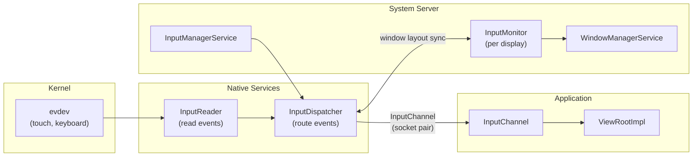

### 23.6.2 InputMonitor

**Source file:** `frameworks/base/services/core/java/com/android/server/wm/InputMonitor.java`

`InputMonitor` 按显示器实例化（`DisplayContent` 会创建一个），负责用当前窗口布局更新 InputFlinger。当窗口发生变化时，`InputMonitor` 会遍历窗口层次，构建一份有序的 `InputWindowHandle` 结构列表，告知 InputFlinger：

- 每个窗口的边界
- 它是否可触摸（`FLAG_NOT_TOUCHABLE`）
- 它是否是触摸模态（`FLAG_NOT_TOUCH_MODAL`）
- 它是否根本不应接收输入（`INPUT_FEATURE_NO_INPUT_CHANNEL`）
- 用于派发事件的输入通道
- 可信覆盖层状态（`PRIVATE_FLAG_TRUSTED_OVERLAY`）
- 用于输入监控的 SPY 标志（`INPUT_FEATURE_SPY`）

系统级的输入拦截注册了特殊的输入消费者：

```java
INPUT_CONSUMER_PIP              // PiP gesture handling
INPUT_CONSUMER_RECENTS_ANIMATION // Recents swipe gesture
INPUT_CONSUMER_WALLPAPER        // Wallpaper touch forwarding
```

### 23.6.3 窗口目标定位

当触摸事件到达时，InputDispatcher 通过以下步骤解析目标窗口：

1. **查找显示器**：通过显示器拓扑把事件坐标映射到一个显示器
2. **遍历窗口列表**：从上到下遍历该显示器的窗口列表
3. **命中测试**：检查事件坐标是否落在某个窗口的可触摸区域内
4. **检查标志**：跳过带有 `FLAG_NOT_TOUCHABLE` 的窗口；穿过没有 `FLAG_NOT_TOUCH_MODAL` 的窗口
5. **可信覆盖层检查**：对应拦截但不消费输入的可信覆盖层做特殊处理
6. **投递**：通过窗口的 `InputChannel` 发送事件

对于键盘/按键事件，派发更简单：事件被发送到聚焦窗口（由 `DisplayContent.mCurrentFocus` 决定）。

### 23.6.4 焦点管理

焦点管理是一个由 `WindowManagerService.updateFocusedWindowLocked()` 触发的多步过程：

```java
static final int UPDATE_FOCUS_NORMAL = 0;
static final int UPDATE_FOCUS_WILL_ASSIGN_LAYERS = 1;
static final int UPDATE_FOCUS_PLACING_SURFACES = 2;
static final int UPDATE_FOCUS_WILL_PLACE_SURFACES = 3;
static final int UPDATE_FOCUS_REMOVING_FOCUS = 4;
```

这五种模式控制焦点在 surface placement 周期中的更新时机：

| 模式 | 使用时机 | 行为 |
|------|-----------|----------|
| `UPDATE_FOCUS_NORMAL` | 常规焦点更新 | 如果焦点发生变化则触发重新布局 |
| `UPDATE_FOCUS_WILL_ASSIGN_LAYERS` | 在图层分配之前 | 图层在焦点更新之后分配 |
| `UPDATE_FOCUS_PLACING_SURFACES` | 在 surface 放置期间 | 布局已在进行中 |
| `UPDATE_FOCUS_WILL_PLACE_SURFACES` | 布局随后进行 | 把布局推迟到下一轮进行 |
| `UPDATE_FOCUS_REMOVING_FOCUS` | 聚焦窗口正在被移除 | 清理正在移除的焦点 |

焦点是通过从上到下遍历窗口层次来确定的，找到第一个满足以下条件的窗口：

- 可见（或正在变得可见）
- 可聚焦（没有 `FLAG_NOT_FOCUSABLE`）
- 不在 keyguard 之后（除非带有 `FLAG_SHOW_WHEN_LOCKED`）
- 设置了 `mIsFocusable` 属性（没有被显式设为不可聚焦）

### 23.6.5 输入与显示器拓扑

对于多显示器场景，输入系统必须处理显示器拓扑——即知道哪些显示器相邻，以及如何路由跨越显示器边界的事件。`DisplayContent` 维护：

```java
private SurfaceControl mInputOverlayLayer;
private SurfaceControl mPointerEventDispatcherOverlayLayer;
```

窗口布局参数上的 `INPUT_FEATURE_DISPLAY_TOPOLOGY_AWARE` 标志表明该窗口应以显示器拓扑感知的方式接收输入事件，从而支持光标在显示器之间无缝移动。

### 23.6.6 InputChannel：事件投递机制

`InputChannel` 是一对 Unix 域套接字，把 InputDispatcher（原生层）与应用程序的 `ViewRootImpl`（Java 层）连接起来。每个可以接收输入的 `WindowState` 都会获得一个 `InputChannel`：

```mermaid
graph LR
    subgraph "Native (InputDispatcher)"
        ID["InputDispatcher"]
        SC_S["Server socket"]
    end

    subgraph "Application Process"
        SC_C["Client socket"]
        IER["InputEventReceiver"]
        VRI["ViewRootImpl"]
    end

    ID --> SC_S
    SC_S <-->|"Unix socket pair"| SC_C
    SC_C --> IER
    IER --> VRI
```

该套接字对在 `addWindow()` 期间创建，服务端套接字通过 `InputWindowHandle` 注册到 `InputDispatcher`。客户端套接字通过 `IWindowSession` 返回给应用程序。

事件以序列化的 `InputMessage` 结构形式流经套接字。应用程序在其 `InputEventReceiver`（挂接到 Looper）中读取这些事件，通过 `ViewRootImpl` 的 InputStage 链进行处理，然后通过套接字发回一个完成信号。

### 23.6.7 窗口输入标志

窗口输入行为由若干标志控制：

| 标志 | 效果 |
|------|--------|
| `FLAG_NOT_FOCUSABLE` | 窗口不能接收键盘焦点 |
| `FLAG_NOT_TOUCHABLE` | 触摸事件穿过此窗口 |
| `FLAG_NOT_TOUCH_MODAL` | 窗口边界之外的触摸事件传给后面的窗口 |
| `FLAG_SLIPPERY` | 触摸可以滑到相邻窗口 |
| `INPUT_FEATURE_NO_INPUT_CHANNEL` | 窗口没有输入通道（对输入不可见） |
| `INPUT_FEATURE_SPY` | 窗口接收所有输入事件的副本（监控） |
| `INPUT_FEATURE_SENSITIVE_FOR_PRIVACY` | 窗口内容涉及隐私敏感 |
| `INPUT_FEATURE_DISPLAY_TOPOLOGY_AWARE` | 处理跨显示器指针移动 |
| `PRIVATE_FLAG_TRUSTED_OVERLAY` | 覆盖层是可信的（系统签名） |

`FLAG_NOT_TOUCH_MODAL` 标志对多窗口场景尤为重要。没有它，一个窗口就会消费显示器边界内的所有触摸事件，即使是在窗口可见区域之外的那些事件。

### 23.6.8 输入消费者

WMS 可以注册特殊的"输入消费者"，在输入到达普通窗口之前进行拦截：

```java
INPUT_CONSUMER_PIP              // Intercepts gestures for PiP manipulation
INPUT_CONSUMER_RECENTS_ANIMATION // Intercepts swipe-up for recents gesture
INPUT_CONSUMER_WALLPAPER        // Forwards touch to wallpaper for parallax
```

输入消费者实现为 `InputConsumerImpl` 对象，它们有自己的 `InputChannel` 和 `SurfaceControl`。它们被插入输入窗口列表中的特定 z-order 位置，以便在事件到达应用窗口之前进行拦截。

### 23.6.9 Spy 窗口

`INPUT_FEATURE_SPY` 标志允许一个窗口接收输入事件的副本而不消费它们。以下场景使用它：

- 系统手势（边缘滑动检测）
- 无障碍覆盖层
- 用于分析的输入监控

Spy 窗口不影响发往普通窗口的事件派发——它们只进行观察。

### 23.6.10 光标与触摸 sprite（libinputservice）

23.6.1–23.6.9 节追踪了输入事件从内核 evdev 一路进入 `ViewRootImpl` 的 `InputStage` 链的过程。这些子系统都不绘制任何东西——它们只是路由事件。

跟随指针移动的可见图形是鼠标光标箭头和触控笔尖端指示器。它们还包括开发者选项中启用"显示触摸"后出现在指尖下的白色圆点。有一个独立的库负责绘制它们。它位于 `frameworks/base/libs/input/`，打包为 `libinputservice`。本小节涵盖该库的功能、它在进程树中的位置，以及它如何与 InputFlinger 和 SurfaceFlinger 交互。

#### 为什么需要独立的库

InputFlinger 位于其自己的原生守护进程中，且对性能至关重要；它不能引入 `libhwui`、`libgui` 或任何其他沉重的图形依赖。但指针策略（显示哪个光标、是否淡出、如何动画触摸点）必须*渲染*。这种拆分是有意为之的：

- InputFlinger 定义了一个抽象的 `PointerControllerInterface`（在 `frameworks/native/services/inputflinger/include/` 中）。
- 一个独立的库 `libinputservice` 提供具体的实现。把这两者连接起来的头文件明确记录了依赖关系：

```cpp
// Source: frameworks/native/services/inputflinger/include/
//   PointerChoreographerPolicyInterface.h
// "library, libinputservice, that has the additional dependencies. The PointerController
//  will be mocked when testing PointerChoreographer."
virtual std::shared_ptr<PointerControllerInterface> createPointerController(
        PointerControllerInterface::ControllerType type) = 0;
```

- 工厂调用由 `PointerChoreographerPolicyInterface` 发出，*system_server* 通过其 JNI 原生侧实现该接口。`frameworks/base/services/core/jni/Android.bp`（第 142 行）把 `libinputservice` 链接进 JNI bundle，因此具体的 `PointerController` 是在 `system_server` 进程内构建的，而不是在 InputFlinger 内构建的。

最终效果是：沉重的图形依赖被排除在 InputFlinger 二进制文件之外。InputFlinger 持有一个不透明的 `PointerControllerInterface*`。它对其调用 `move(...)`、`setPosition(...)`、`setSpots(...)`、`updatePointerIcon(...)`。它并不知道这些调用最终会调度 SurfaceFlinger 事务。

#### 库中包含什么

该共享库在 `frameworks/base/libs/input/` 中约有 10 个文件：

| 文件 | 用途 |
|------|---------|
| `PointerController.{h,cpp}` | 具体的 `PointerControllerInterface` 实现；按显示器的 sprite 属主 |
| `PointerControllerContext.{h,cpp}` | 每个指针控制器的共享状态（策略、looper、sprite 控制器、消息处理器） |
| `MouseCursorController.{h,cpp}` | 管理每个显示器的单个鼠标光标 sprite：位置、图标样式、淡出动画 |
| `TouchSpotController.{h,cpp}` | 管理每个显示器最多 12 个"spot"sprite（每个活动手指一个） |
| `SpriteController.{h,cpp}` | 基于 `SurfaceComposerClient` 的通用 Sprite/SpriteController 抽象 |
| `SpriteIcon.{h,cpp}` | 绘制进 sprite surface 的位图与热点对 |

该库以 `cc_library_shared` 编译，并使用 `inputflinger_defaults` 构建标志，因此 InputFlinger 代码形态在两个二进制文件中保持一致。它的依赖列表就是破绽所在：

```blueprint
// Source: frameworks/base/libs/input/Android.bp:34
shared_libs: [
    "libandroid_runtime",
    "libbinder",
    "libcutils",
    "libhwui",       // graphics
    "liblog",
    "libutils",
    "libgui",        // SurfaceComposerClient
    "libinput",
],
header_libs: [
    "libinputflinger_headers",
],
```

`libhwui` 和 `libgui` 正是 InputFlinger 无法承担的依赖。

#### 三种 sprite 角色

`PointerController` 有三个具体子类，每个子类都通过致命断言来*禁用*不适用于其角色的操作：

```cpp
// Source: frameworks/base/libs/input/PointerController.h:143
class MousePointerController : public PointerController {
    // disables setPresentation(), setSpots(), clearSpots()
    // — mouse pointers never use spot rendering
};

class TouchPointerController : public PointerController {
    // disables move(), setPosition(), getPosition(), fade(), unfade(), ...
    // — touch spots are coordinate-driven, not delta-driven; no fade
};

class StylusPointerController : public PointerController {
    // disables setPresentation(), setSpots(), clearSpots()
    // — stylus is a single tip indicator
};
```

致命断言模式（`LOG_ALWAYS_FATAL("Should not be called")`）是有意为之的：上游代码的误用会在 CI 中大声崩溃，而不是在屏幕上静默地渲染出错误的内容。每个角色只有一条有效的调用路径，类型系统确保 InputFlinger 不会意外地让触摸控制器去 `move(...)` 一个光标。

共享基类持有：

- 一个 `MouseCursorController`（每个指针控制器对应单个光标）
- 一个按显示器的映射 `unordered_map<LogicalDisplayId, TouchSpotController>`（惰性创建的 spot 控制器，每个有活动触摸的显示器一个）
- 一个向 `WindowInfosListener` 注册的 `DisplayInfoListener`，用于接收跨显示器拓扑变更

#### Sprite 生命周期

`SpriteController` 是渲染的核心。每个 `Sprite` 都由一个 `SurfaceControl` 支撑。它被挂载在 WindowManagerService 自己创建并安排 z-order 的按显示器指针覆盖层之下。

`DisplayContent` 在其"Display Overlays"图层（位于 `Integer.MAX_VALUE`）之下构建一个"Pointer Overlays" surface。它给这个 surface 分配 `TYPE_POINTER` 策略图层。该父 surface 经由 `ParentSurfaceProvider` 回调到达 `SpriteController`，该回调从 JNI 层一路经过 `InputManagerService`，到达 `system_server` 中的 `DisplayContent.getPointerOverlayLayer()`。SurfaceFlinger 既不提供该图层，也不选择其 z-order。由 WM 分配的 z-order 让光标位于每个窗口之上，即使是 `TYPE_SYSTEM_ALERT` 窗口。

```mermaid
sequenceDiagram
    participant IF as InputFlinger<br/>(PointerChoreographer)
    participant SS as system_server<br/>(JNI policy)
    participant PC as PointerController<br/>(libinputservice)
    participant SC as SpriteController
    participant SF as SurfaceFlinger

    IF->>SS: createPointerController(MOUSE)
    SS->>PC: PointerController::create(policy, looper, spriteController, MOUSE)
    PC->>PC: build MouseCursorController, register WindowInfosListener
    Note over PC: cursor sprite created lazily on first setIcon()
    IF->>PC: move(dx, dy) on each mouse event
    PC->>PC: clamp to displayViewport, apply Transform
    PC->>SC: setPosition(sprite, x, y) — under controller's lock
    SC->>SC: invalidateSpriteLocked(sprite) + post MSG_UPDATE_SPRITES
    SC->>SC: doUpdateSprites() on looper thread
    SC->>SF: SurfaceComposerClient transaction (setPosition, setLayer)
    SF-->>SC: next vsync renders sprite at new position
```

两个分层设计选择尤为突出：

- **所有公开的 setter 都会获取控制器的锁，但 surface 工作是异步的。** `Sprite::setPosition(...)` 更新本地的 `SpriteState` 字段，标记一个 `DIRTY_POSITION` 位，并向控制器的 `Handler` 投递一条消息。实际的 `SurfaceComposerClient` 事务在一条独立的 looper 线程上运行，因此输入热路径永远不会被 SurfaceFlinger 的 Binder 往返阻塞。
- **`SpriteState` 是可拷贝的。** looper 线程的更新路径会*拷贝*出加锁的状态，释放锁，然后运行事务。调整 sprite surface 的大小或重绘它不会卡住输入线程，哪怕是一瞬间。`SpriteController.h:170` 中的注释对此有明确说明。它写道："the surfaces can be resized and redrawn without blocking the client by holding a lock on the sprites for a long time"。

#### 触摸 spot 的细节

`TouchSpotController` 拥有最多 `MAX_SPOTS = 12` 个 `Spot` 记录，每个记录绑定一个手指指针 ID。当"显示触摸"开启时（开发者选项 → `SHOW_TOUCHES`），`PointerController::setSpots(...)` 会接收当前的 `PointerCoords` 数组以及一个活动 ID 的 `BitSet32`：

```cpp
// Source: frameworks/base/libs/input/PointerController.h:64
void setSpots(const PointerCoords* spotCoords, const uint32_t* spotIdToIndex,
              BitSet32 spotIdBits, ui::LogicalDisplayId displayId) override;
```

其实现：

1. 查找按显示器的 `TouchSpotController`（首次使用时创建）。
2. 对 `spotIdBits` 中的每一位，要么更新一个现有的 `Spot`，要么从回收池中取用一个。控制器缓存最多 12 个 sprite SurfaceControl，以避免同一个手指 ID 再次出现时的 Binder 往返。
3. 调用 `Spot::updateSprite(...)`，它在底层 `Sprite` 上设置图标/位置/alpha。
4. 不出现在新位掩码中的 spot 会淡出并被回收。

随 spot 一起传递的 `skipScreenshot` 标志会把 `ISurfaceComposerClient::eSkipScreenshot` 添加到 sprite 的 SurfaceControl 标志中。因此，屏幕截图和屏幕镜像不会捕获触摸指示器（兼顾隐私，并让投屏画面更干净）。

#### 显示器拓扑感知

`PointerController` 注册了一个 `DisplayInfoListener`（`WindowInfosListener` 的子类）。当窗口信息快照发生变化时（显示器旋转、虚拟显示器出现、外部监视器的视口偏移），监听器会触发 `onDisplayInfosChangedLocked(...)`，它：

- 更新按显示器的 `Transform`，用于把指针坐标从物理空间转换到逻辑显示器空间。
- 重建 spot 控制器映射，丢弃已不存在显示器的条目。
- 更新 `displaysToSkipScreenshot`，使 spot sprite 在拓扑变化后继续在正确的显示器上跳过截图。

监听器使用的锁与控制器内部使用的锁相同。`PointerController.h:102` 中的构造函数注释解释了这一选择。监听器的寿命可能超过控制器（因为 `WindowInfosListener` 注册会持有强引用）。因此，与控制器共享监听器的锁可以避免额外引入一把具有相同排序规则的锁。

#### 按显示器跳过截图

`setSkipScreenshotFlagForDisplay(LogicalDisplayId)` / `clearSkipScreenshotFlags()` 让系统可以请求在特定显示器上把*光标*也排除在屏幕截图/镜像画面之外。这用于 screenrecord 和投影场景——否则光标会作为残留伪影出现在捕获的画面中。该标志经由 `MouseCursorController` 一路传到 `Sprite::setSkipScreenshot(bool)`，然后通过相同的异步事务路径进入 sprite 的 `SurfaceControl` 标志。

#### 小结：该库为何存在于这一边界

sprite 层是 AOSP 中*按照依赖剖面拆分子系统*最干净的范例之一：

- InputFlinger 得以保持为一个紧凑、依赖轻量的守护进程，专注于事件投递。
- 指针/spot 渲染策略位于 `system_server` 中。在那里它可以与 SurfaceFlinger 通信，通过框架的资源系统加载图标位图，并遵循窗口拓扑变化。
- 两者之间的接缝（`PointerControllerInterface` + `PointerChoreographerPolicyInterface`）足够小，InputFlinger 的单元测试可以轻易地将其 mock。它仍然让 `system_server` 完全掌控实际出现在屏幕上的内容。

对于大多数调用者来说，`libinputservice` 是不可见的——它的表面表现就是"光标跟随我的鼠标，开发者选项开启时出现触摸圆点"。框架开发者则会去追查光标为何闪烁、淡出或出现在错误的显示器上。对他们而言，`PointerController` 及其协作者 `MouseCursorController` / `TouchSpotController` 就包含着答案。

---

## 23.7 Surface 与 Leash

### 23.7.1 SurfaceControl 层次

WM 层次中的每个 `WindowContainer` 在 SurfaceFlinger 中都有一个对应的 `SurfaceControl`。这形成了一棵平行的树：

```mermaid
graph TB
    subgraph "WM Hierarchy (Java)"
        RWC_J["RootWindowContainer"]
        DC_J["DisplayContent"]
        DA_J["DisplayArea"]
        TDA_J["TaskDisplayArea"]
        T_J["Task"]
        AR_J["ActivityRecord"]
        WS_J["WindowState"]
    end

    subgraph "Surface Hierarchy (SurfaceFlinger)"
        RWC_S["SurfaceControl<br/>(root)"]
        DC_S["SurfaceControl<br/>(display)"]
        DA_S["SurfaceControl<br/>(display area)"]
        TDA_S["SurfaceControl<br/>(task display area)"]
        T_S["SurfaceControl<br/>(task)"]
        AR_S["SurfaceControl<br/>(activity)"]
        WS_S["SurfaceControl<br/>(window buffer layer)"]
    end

    RWC_J -.->|"1:1"| RWC_S
    DC_J -.->|"1:1"| DC_S
    DA_J -.->|"1:1"| DA_S
    TDA_J -.->|"1:1"| TDA_S
    T_J -.->|"1:1"| T_S
    AR_J -.->|"1:1"| AR_S
    WS_J -.->|"1:1"| WS_S

    RWC_S --> DC_S
    DC_S --> DA_S
    DA_S --> TDA_S
    TDA_S --> T_S
    T_S --> AR_S
    AR_S --> WS_S
```

这一 1:1 映射是系统的一个基本不变量。每当一个子节点被添加或从一个 `WindowContainer` 中移除时，都会通过 `SurfaceControl.Transaction` 向 SurfaceFlinger 发出一次对应的 `SurfaceControl` reparent 操作。

surface 放置过程会调用 `prepareSurfaces()` 方法。该方法让每个 `WindowContainer` 在事务提交之前更新其 `SurfaceControl` 属性（位置、大小、alpha、可见性、图层顺序）。

### 23.7.2 动画 leash 机制

动画 leash 是实现窗口容器平滑动画的关键机制。`SurfaceAnimator` 类负责管理它：

**Source file:** `frameworks/base/services/core/java/com/android/server/wm/SurfaceAnimator.java`

源码 Javadoc 中写道：

> *"We do this by reparenting all child surfaces of an object onto a new surface, called the 'Leash'. The Leash gets attached in the surface hierarchy where the children were attached to. We then hand off the Leash to the component handling the animation. When the animation is done, our callback to finish the animation will be invoked, at which we reparent the children back to the original parent."*

```mermaid
graph TB
    subgraph "Before Animation"
        P1["Parent SurfaceControl"]
        C1["Container SurfaceControl"]
        CH1["Child Surface A"]
        CH2["Child Surface B"]
        P1 --> C1
        C1 --> CH1
        C1 --> CH2
    end

    subgraph "During Animation"
        P2["Parent SurfaceControl"]
        L2["LEASH SurfaceControl<br/>(animation target)"]
        C2["Container SurfaceControl"]
        CH3["Child Surface A"]
        CH4["Child Surface B"]
        P2 --> L2
        L2 --> C2
        C2 --> CH3
        C2 --> CH4
    end

    subgraph "After Animation"
        P3["Parent SurfaceControl"]
        C3["Container SurfaceControl"]
        CH5["Child Surface A"]
        CH6["Child Surface B"]
        P3 --> C3
        C3 --> CH5
        C3 --> CH6
    end

    style L2 fill:#fff3e0
```

leash 的创建流程：

```java
void startAnimation(Transaction t, AnimationAdapter anim, boolean hidden,
        @AnimationType int type, ...) {
    cancelAnimation(t, true /* restarting */, true /* forwardCancel */);
    mAnimation = anim;
    mAnimationType = type;
    SurfaceControl surface = mAnimatable.getSurfaceControl();
    if (mLeash == null) {
        mLeash = createAnimationLeash(mAnimatable, surface, t, type,
                mAnimatable.getSurfaceWidth(), mAnimatable.getSurfaceHeight(),
                0, 0, hidden, mService.mTransactionFactory);
        mAnimatable.onAnimationLeashCreated(t, mLeash);
    }
    mAnimatable.onLeashAnimationStarting(t, mLeash);
    mAnimation.startAnimation(mLeash, t, type, mInnerAnimationFinishedCallback);
}
```

### 23.7.3 动画类型

`SurfaceAnimator` 定义了若干动画类型，对 leash 机制的不同用途进行分类：

```java
ANIMATION_TYPE_NONE           = 0;       // No animation
ANIMATION_TYPE_SCREEN_ROTATION = 1 << 1; // Screen rotation
ANIMATION_TYPE_DIMMER         = 1 << 2;  // Background dimming
ANIMATION_TYPE_RECENTS        = 1 << 3;  // Recents gesture
ANIMATION_TYPE_WINDOW_ANIMATION = 1 << 4; // Per-window animation
ANIMATION_TYPE_INSETS_CONTROL = 1 << 5;  // Insets show/hide
ANIMATION_TYPE_TOKEN_TRANSFORM = 1 << 6; // Fixed rotation
ANIMATION_TYPE_STARTING_REVEAL = 1 << 7; // Starting window reveal
ANIMATION_TYPE_PREDICT_BACK   = 1 << 8;  // Predictive back gesture
ANIMATION_TYPE_ALL            = -1;      // Match any type
```

这些是位标志，支持类似"该容器或其子节点上是否正在运行 X 类型的动画？"的查询。

### 23.7.4 图层分配与 leash 的交互

当 leash 存在时，图层操作必须针对 leash 而不是底层 surface。`SurfaceAnimator` 透明地处理这一点：

```java
void setLayer(Transaction t, int layer) {
    t.setLayer(mLeash != null ? mLeash : mAnimatable.getSurfaceControl(), layer);
}

void setRelativeLayer(Transaction t, SurfaceControl relativeTo, int layer) {
    t.setRelativeLayer(mLeash != null ? mLeash : mAnimatable.getSurfaceControl(),
            relativeTo, layer);
}
```

### 23.7.5 动画转移

动画可以在 `SurfaceAnimator` 实例之间转移而不会出现视觉中断。当窗口在动画进行期间被重新挂载时，就会用到这一机制：

```java
void transferAnimation(SurfaceAnimator from) {
    // Steal the leash, animation, and callbacks from the source
    mLeash = from.mLeash;
    mAnimation = from.mAnimation;
    mAnimationType = from.mAnimationType;
    mSurfaceAnimationFinishedCallback = from.mSurfaceAnimationFinishedCallback;

    // Cancel source without forwarding to the animation adapter
    from.cancelAnimation(t, false, false /* forwardCancel */);

    // Reparent our surface to the stolen leash
    t.reparent(surface, mLeash);
    t.reparent(mLeash, parent);

    // Register in the transfer map for callback routing
    mService.mAnimationTransferMap.put(mAnimation, this);
}
```

`WindowManagerService` 中的 `mAnimationTransferMap` 确保动画适配器的完成回调被路由到新的 `SurfaceAnimator`，而不是原来的那个。

### 23.7.6 Animatable 接口

`SurfaceAnimator.Animatable` 接口定义了任何可动画容器都必须实现的契约：

```java
interface Animatable {
    // The transaction that will be used for pending surface operations
    Transaction getPendingTransaction();
    Transaction getSyncTransaction();
    void commitPendingTransaction();

    // Surface control management
    SurfaceControl getSurfaceControl();
    SurfaceControl getAnimationLeashParent();
    SurfaceControl getParentSurfaceControl();

    // Surface dimensions
    int getSurfaceWidth();
    int getSurfaceHeight();

    // Leash lifecycle callbacks
    void onAnimationLeashCreated(Transaction t, SurfaceControl leash);
    void onAnimationLeashLost(Transaction t);
    void onLeashAnimationStarting(Transaction t, SurfaceControl leash);

    // Builder for creating the leash surface
    Builder makeAnimationLeash();
}
```

`WindowContainer` 实现了 `Animatable`，这意味着层次中的每个节点都可以通过 leash 机制制作动画。其用途包括：

- 应用转场（打开、关闭、变更）
- 窗口动画（进入、退出）
- 屏幕旋转
- Insets 动画（状态栏隐藏/显示）
- 最近任务手势动画
- 预测性返回手势

### 23.7.7 Leash 创建细节

`SurfaceAnimator` 中的 `createAnimationLeash()` 静态方法构建 leash surface：

```java
private static SurfaceControl createAnimationLeash(Animatable animatable,
        SurfaceControl surface, Transaction t, @AnimationType int type,
        int width, int height, int x, int y, boolean hidden,
        Supplier<Transaction> transactionFactory) {

    // The leash is parented at build time to where the surface was
    SurfaceControl leash = animatable.makeAnimationLeash()
            .setParent(animatable.getAnimationLeashParent())
            .setName(surface + " - animation-leash of " + animationTypeToString(type))
            .setHidden(hidden)
            .setEffectLayer()
            .setCallsite("SurfaceAnimator.createAnimationLeash")
            .build();

    // Position and size the leash
    t.setWindowCrop(leash, width, height);
    t.setPosition(leash, x, y);
    t.show(leash);
    t.setAlpha(leash, hidden ? 0 : 1);

    // Reparent the surface under the leash
    t.reparent(surface, leash);
    return leash;
}
```

leash 被创建为一个 `EffectLayer`（一个没有缓冲区的纯容器 surface）。这意味着它不会消耗 GPU 内存，也不会影响合成性能。它只在 surface 树中提供了一个变换节点。

### 23.7.8 事务批处理与原子应用

一次 placement 周期中的所有 surface 变更都被累积进单个 `SurfaceControl.Transaction` 并原子地应用：

```mermaid
sequenceDiagram
    participant WMS as WindowManagerService
    participant WC as WindowContainers
    participant TX as SurfaceControl.Transaction
    participant SF as SurfaceFlinger

    WMS->>WC: performSurfacePlacement()
    loop For each container
        WC->>TX: setPosition(...)
        WC->>TX: setLayer(...)
        WC->>TX: setVisibility(...)
        WC->>TX: setCrop(...)
        WC->>TX: setAlpha(...)
        WC->>TX: setMatrix(...)
    end

    WMS->>TX: apply()
    TX->>SF: Atomic transaction commit
    Note over SF: All changes visible<br/>in a single frame
```

这种原子提交确保用户永远不会看到某些窗口已经移动、而另一些窗口尚未移动的中间状态。原子性由 SurfaceFlinger 的事务系统保证，它在下一帧之前于单次提交中处理所有操作。

### 23.7.9 同步事务与挂起事务

`WindowContainer` 维护两个语义不同的事务对象：

- **`mPendingTransaction`**（`getPendingTransaction()`）：累积的变更，将在下一次 `performSurfacePlacement()` 期间应用。这是布局变更的常规路径。

- **`mSyncTransaction`**（`getSyncTransaction()`）：在 BLAST 同步期间使用。当一个容器是某个同步组的一部分时，其 surface 变更会被重定向到同步事务。同步事务被保留，直到所有参与者都就绪。然后它与同步的缓冲区投递一起被原子地应用。

这一区分对转场至关重要。在转场期间，参与者把它们的 surface 变更重定向到同步事务。这使视觉更新（surface 移动）与内容更新（surface 显示新内容）同步进行。

---

## 23.8 窗口类型与 Z-Order

### 23.8.1 窗口类型范围

Android 把窗口类型组织为三个范围，定义于 `WindowManager.LayoutParams`：

**Source file:** `frameworks/base/core/java/android/view/WindowManager.java`

```java
// Application windows: 1-99
public static final int FIRST_APPLICATION_WINDOW = 1;
public static final int LAST_APPLICATION_WINDOW  = 99;

// Sub-windows (attached to an application window): 1000-1999
public static final int FIRST_SUB_WINDOW = 1000;
public static final int LAST_SUB_WINDOW  = 1999;

// System windows (special purpose): 2000-2999
public static final int FIRST_SYSTEM_WINDOW = 2000;
public static final int LAST_SYSTEM_WINDOW  = 2999;
```

### 23.8.2 应用窗口类型

| 常量 | 值 | 描述 |
|----------|-------|-------------|
| `TYPE_BASE_APPLICATION` | 1 | Activity 的基础窗口 |
| `TYPE_APPLICATION` | 2 | 普通应用窗口 |
| `TYPE_APPLICATION_STARTING` | 3 | 启动/闪屏窗口 |
| `TYPE_DRAWN_APPLICATION` | 4 | 等待首次绘制的变体 |
| `TYPE_APPLICATION_OVERLAY` | 2038 | 应用覆盖层（需要 SYSTEM_ALERT_WINDOW） |

应用窗口（1-99）是最常见的。`TYPE_BASE_APPLICATION` 会为每个 `ActivityRecord` 自动创建。

### 23.8.3 子窗口类型

| 常量 | 值 | 描述 |
|----------|-------|-------------|
| `TYPE_APPLICATION_PANEL` | 1000 | 应用顶部的面板 |
| `TYPE_APPLICATION_MEDIA` | 1001 | 媒体 surface（如视频） |
| `TYPE_APPLICATION_SUB_PANEL` | 1002 | 子面板 |
| `TYPE_APPLICATION_ATTACHED_DIALOG` | 1003 | 附加到应用的对话框 |
| `TYPE_APPLICATION_MEDIA_OVERLAY` | 1004 | 媒体覆盖层 |
| `TYPE_APPLICATION_ABOVE_SUB_PANEL` | 1005 | 子面板之上 |

子窗口是 `WindowState` 层次中应用窗口的子节点。它们相对于父节点确定 z-order。

### 23.8.4 系统窗口类型

系统窗口构成了最大的类别。下面的偏移量只是 2000-2999 范围内的常量值。相对 z-order 由 `WindowManagerPolicy.getWindowLayerFromTypeLw()` 单独分配。该方法是一个显式的 switch，把每种类型映射到一个任意的图层索引。该索引与类型值并不是单调关系（例如 `TYPE_WALLPAPER`，尽管其类型值处于中间范围，却被映射到最底层的图层）：

| Constant | Offset | Description |
|----------|--------|-------------|
| `TYPE_STATUS_BAR` | +0 | 状态栏 |
| `TYPE_SEARCH_BAR` | +1 | 搜索栏 |
| `TYPE_PHONE` | +2 | 电话通话窗口 |
| `TYPE_SYSTEM_ALERT` | +3 | 系统警告对话框 |
| `TYPE_KEYGUARD` | +4 | Keyguard（已废弃） |
| `TYPE_TOAST` | +5 | Toast 通知 |
| `TYPE_SYSTEM_OVERLAY` | +6 | 系统覆盖层 |
| `TYPE_PRIORITY_PHONE` | +7 | 优先电话通话 |
| `TYPE_SYSTEM_DIALOG` | +8 | 系统对话框 |
| `TYPE_KEYGUARD_DIALOG` | +9 | Keyguard 对话框 |
| `TYPE_SYSTEM_ERROR` | +10 | 系统错误 |
| `TYPE_INPUT_METHOD` | +11 | 输入法（键盘） |
| `TYPE_INPUT_METHOD_DIALOG` | +12 | IME 候选选择器 |
| `TYPE_WALLPAPER` | +13 | 壁纸 |
| `TYPE_STATUS_BAR_PANEL` | +14 | 状态栏面板 |
| `TYPE_SECURE_SYSTEM_OVERLAY` | +15 | 安全覆盖层 |
| `TYPE_DRAG` | +16 | 拖动 surface |
| `TYPE_STATUS_BAR_SUB_PANEL` | +17 | 状态栏子面板 |
| `TYPE_POINTER` | +18 | 指针 |
| `TYPE_NAVIGATION_BAR` | +19 | 导航栏 |
| `TYPE_VOLUME_OVERLAY` | +20 | 音量控制 |
| `TYPE_BOOT_PROGRESS` | +21 | 启动进度 |
| `TYPE_INPUT_CONSUMER` | +22 | 输入消费者 |
| `TYPE_NAVIGATION_BAR_PANEL` | +24 | 导航栏面板 |
| `TYPE_DISPLAY_OVERLAY` | +26 | 显示器覆盖层 |
| `TYPE_MAGNIFICATION_OVERLAY` | +27 | 放大覆盖层 |
| `TYPE_PRIVATE_PRESENTATION` | +30 | 私有演示 |
| `TYPE_VOICE_INTERACTION` | +31 | 语音交互 |
| `TYPE_ACCESSIBILITY_OVERLAY` | +32 | 无障碍覆盖层 |
| `TYPE_VOICE_INTERACTION_STARTING` | +33 | 语音交互启动 |
| `TYPE_DOCK_DIVIDER` | +34 | 分屏分隔条 |
| `TYPE_QS_DIALOG` | +35 | 快速设置对话框 |
| `TYPE_SCREENSHOT` | +36 | 截图窗口 |
| `TYPE_PRESENTATION` | +37 | 演示显示器 |
| `TYPE_APPLICATION_OVERLAY` | +38 | 应用覆盖层 |
| `TYPE_ACCESSIBILITY_MAGNIFICATION_OVERLAY` | +39 | 无障碍放大 |
| `TYPE_NOTIFICATION_SHADE` | +40 | 通知栏 |
| `TYPE_STATUS_BAR_ADDITIONAL` | +41 | 附加状态栏 |

### 23.8.5 Z-Order 图层分配

`DisplayAreaPolicy` 框架根据窗口类型把它们组织到 `DisplayArea` 区域中。在每个区域内，图层分配遵循 `TYPE_LAYER_MULTIPLIER` 系统：

**Source file:** `frameworks/base/core/java/android/view/WindowManagerPolicyConstants.java`

```java
int TYPE_LAYER_MULTIPLIER = 10000;  // Layer spacing between types
int TYPE_LAYER_OFFSET     = 1000;   // Sub-layer offset within a type

int WATERMARK_LAYER       = TYPE_LAYER_MULTIPLIER * 100;
int STRICT_MODE_LAYER     = TYPE_LAYER_MULTIPLIER * 101;
int WINDOW_FREEZE_LAYER   = TYPE_LAYER_MULTIPLIER * 200;
int SCREEN_FREEZE_LAYER_BASE = WINDOW_FREEZE_LAYER + TYPE_LAYER_MULTIPLIER;
```

每个窗口获得一个 `getWindowLayerFromTypeLw(type) * TYPE_LAYER_MULTIPLIER` 的基础图层。这是策略分配的图层索引乘以该乘数，而不是原始类型值。`TYPE_LAYER_OFFSET` 为该类型内的子窗口留出了空间。大多数系统窗口类型解析到 `APPLICATION_LAYER` 之上的策略图层，但并非全部：`TYPE_WALLPAPER`（2013）解析到策略图层 1，位于每个应用窗口之下。

### 23.8.6 基于 DisplayArea 的 Z-Ordering

现代 z-ordering 系统使用 `DisplayArea` 层次，而不是原始图层编号。`DisplayAreaPolicy.DefaultProvider` 构建一棵按功能对窗口分组的层次：

```mermaid
graph TB
    ROOT["DisplayArea.Root<br/>(z-order root)"]

    subgraph "Below Apps"
        WALL["Wallpaper (TYPE_WALLPAPER)"]
    end

    subgraph "App Zone"
        HCT["HideDisplayCutout"]
        OH["OneHanded"]
        MAG["Magnification"]
        AZO["AppZoomOut"]
        TDA["DefaultTaskDisplayArea<br/>(all app tasks here)"]
    end

    subgraph "Above Apps"
        SBAR["StatusBar (TYPE_STATUS_BAR)"]
        NAV["NavigationBar (TYPE_NAVIGATION_BAR)"]
        IME["ImeContainer (TYPE_INPUT_METHOD)"]
        SHADE["NotificationShade (TYPE_NOTIFICATION_SHADE)"]
    end

    subgraph "Overlay Zone"
        ACC["AccessibilityOverlay"]
        MGOV["MagnificationOverlay"]
    end

    ROOT --> WALL
    ROOT --> HCT
    HCT --> OH
    OH --> MAG
    MAG --> TDA
    MAG --> AZO
    ROOT --> SBAR
    ROOT --> NAV
    ROOT --> IME
    ROOT --> SHADE
    ROOT --> ACC
    ROOT --> MGOV
```

`FEATURE_HIDE_DISPLAY_CUTOUT`、`FEATURE_ONE_HANDED` 和 `FEATURE_FULLSCREEN_MAGNIFICATION` 等功能实现为 `DisplayArea` 节点，包裹层次的各个部分。当某个功能激活时，它会变换其子树中的所有 surface（例如 `OneHanded` 把整个应用区域向下平移）。

### 23.8.7 DisplayAreaPolicy and DisplayAreaPolicyBuilder

**Source file:** `frameworks/base/services/core/java/com/android/server/wm/DisplayAreaPolicy.java`

`DisplayAreaPolicy` 是一个抽象类，定义了如何为显示器构建 `DisplayArea` 层次：

```java
public abstract class DisplayAreaPolicy {
    protected final WindowManagerService mWmService;
    protected final RootDisplayArea mRoot;

    // Attach a WindowToken to the appropriate DisplayArea
    public abstract void addWindow(WindowToken token);

    // Find the DisplayArea for a given window type
    public abstract DisplayArea.Tokens findAreaForWindowType(int type,
            Bundle options, boolean ownerCanManageAppTokens,
            boolean roundedCornerOverlay);

    // Get DisplayAreas for a given feature
    public abstract List<DisplayArea<? extends WindowContainer>>
            getDisplayAreas(int featureId);
}
```

`DisplayAreaPolicyBuilder` 使用基于功能的方式构建层次：

```java
// Feature IDs from DisplayAreaOrganizer (relative to FEATURE_SYSTEM_FIRST = 0)
FEATURE_DEFAULT_TASK_CONTAINER = 1;   // Where apps go
FEATURE_ONE_HANDED = 3;               // One-handed mode
FEATURE_TOP_LEVEL_ZOOM = 4;           // Builds the "WindowedMagnification" DisplayArea
FEATURE_FULLSCREEN_MAGNIFICATION = 5; // Fullscreen magnification
FEATURE_HIDE_DISPLAY_CUTOUT = 6;      // Display cutout hiding
FEATURE_IME_PLACEHOLDER = 7;          // IME positioning
FEATURE_APP_ZOOM_OUT = 10;            // App zoom out
```

功能通过指定它们适用的窗口类型在策略中配置。然后构建器生成一棵 `DisplayArea` 节点树，把窗口类型分组到相应的功能节点之下。这是一个自动过程——构建器确定满足所有功能需求所需的最小 `DisplayArea` 节点集合。

### 23.8.8 DisplayArea 变体

`DisplayArea` 有几个用于不同目的的子类：

```mermaid
classDiagram
    class DisplayArea~T~ {
        +int mFeatureId
        +String mName
        +boolean mOrganized
    }

    class RootDisplayArea {
        +List~Feature~ mFeatures
    }

    class DisplayArea_Tokens {
        +addChild(WindowToken)
    }

    class DisplayArea_Dimmable {
        +Dimmer mDimmer
    }

    class TaskDisplayArea {
        +createRootTask()
        +getRootHomeTask()
        +getRootPinnedTask()
    }

    DisplayArea <|-- RootDisplayArea
    DisplayArea <|-- DisplayArea_Tokens
    DisplayArea <|-- DisplayArea_Dimmable
    DisplayArea_Dimmable <|-- TaskDisplayArea
```

- **`DisplayArea.Tokens`**：一个叶子 `DisplayArea`，直接持有 `WindowToken` 实例（例如用于壁纸、状态栏）
- **`DisplayArea.Dimmable`**：一个支持对其内容进行调暗的 `DisplayArea`（用作任务区域的基础）
- **`TaskDisplayArea`**：应用程序任务被放置的主要区域
- **`RootDisplayArea`**：显示器层次的根（或显示器区域组的子根）

### 23.8.9 DisplayAreaOrganizer

正如 `TaskOrganizer` 让 Shell 控制任务一样，`DisplayAreaOrganizer` 让 Shell 控制 `DisplayArea` 节点。其用途包括：

- `RootTaskDisplayAreaOrganizer` -- 控制根任务显示区域，用于单手模式等功能
- `RootDisplayAreaOrganizer` -- 控制根显示区域，用于显示器级效果

organizer 在其 `DisplayArea` 被创建或移除时接收回调，并可以应用 surface 变换（缩放、位置、裁剪）来影响该区域内的所有内容。

### 23.8.10 窗口类型到 DisplayArea 的映射

当一个新窗口被添加到系统时，会调用 `DisplayAreaPolicy.addWindow()` 来找到该窗口类型对应的 `DisplayArea`。策略遍历功能树，把窗口放置在覆盖其类型的最具体的 `DisplayArea.Tokens` 节点中。

例如：

- `TYPE_WALLPAPER`（2013）进入应用区域之下的壁纸 `DisplayArea.Tokens`
- `TYPE_STATUS_BAR`（2000）进入应用之上、覆盖层之下的状态栏 `DisplayArea.Tokens`
- `TYPE_BASE_APPLICATION`（1）经由其所属的 `Task` 进入 `TaskDisplayArea`
- `TYPE_NAVIGATION_BAR`（2019）进入导航栏 `DisplayArea.Tokens`
- `TYPE_NOTIFICATION_SHADE`（2040）进入导航栏之上

正是这种基于类型的路由创造了 z-ordering 保证：系统窗口在应用之上，覆盖层在系统窗口之上，依此类推。

---

## 23.9 Insets 系统

### 23.9.1 什么是 Insets？

Insets 表示被系统 UI（状态栏、导航栏、IME）或显示特性（切口、圆角）占据的屏幕区域。窗口在布局其内容时必须考虑这些区域。

insets 系统已从旧式的 `fitSystemWindows()` 演进为带有 `InsetsController` 的现代 `WindowInsets` API。

### 23.9.2 InsetsStateController

**Source file:** `frameworks/base/services/core/java/com/android/server/wm/InsetsStateController.java`

`InsetsStateController` 按 `DisplayContent` 实例化，并管理该显示器的全局 insets 状态：

```java
class InsetsStateController {
    private final InsetsState mState = new InsetsState();
    private final DisplayContent mDisplayContent;
    private final SparseArray<InsetsSourceProvider> mProviders = new SparseArray<>();
    private final ArrayMap<InsetsControlTarget, ArrayList<InsetsSourceProvider>>
            mControlTargetProvidersMap = new ArrayMap<>();
}
```

关键概念：

- **InsetsState**：该显示器上所有 insets 源的快照。每个 `WindowState` 会根据其在 z-order 中的位置（经由 `mAboveInsetsState`）获得一个定制的 `InsetsState`。

- **InsetsSourceProvider**：每个提供 insets 的窗口（状态栏、导航栏、IME）都有一个向控制器注册的 `InsetsSourceProvider`。

- **InsetsControlTarget**：控制 insets 可见性的窗口（通常是聚焦的应用窗口）。控制目标可以用动画方式显示/隐藏系统栏。

### 23.9.3 InsetsSource 类型

`WindowInsets.Type` 类定义了 insets 类别：

| 类型 | 位掩码 | 来源 |
|------|---------|--------|
| `statusBars()` | `1 << 0` | 状态栏窗口 |
| `navigationBars()` | `1 << 1` | 导航栏窗口 |
| `captionBar()` | `1 << 2` | 标题栏 |
| `ime()` | `1 << 3` | 输入法（键盘） |
| `systemGestures()` | `1 << 4` | 系统手势排除区 |
| `mandatorySystemGestures()` | `1 << 5` | 强制手势区 |
| `tappableElement()` | `1 << 6` | 可点击的系统 UI 元素 |
| `displayCutout()` | `1 << 7` | 显示屏切口区域 |

### 23.9.4 Insets 流程：从提供者到消费者

```mermaid
sequenceDiagram
    participant SB as Status Bar Window (InsetsSourceProvider)
    participant ISC as InsetsStateController
    participant FW as Focused App Window (InsetsControlTarget)
    participant IC as InsetsController (client-side)

    Note over SB: Status bar visible,<br/>provides TOP insets

    SB->>ISC: Register InsetsSource(statusBars, frame)
    ISC->>ISC: Update InsetsState
    ISC->>FW: notifyInsetsChanged()
    FW->>IC: WindowInsets dispatched

    Note over IC: App receives insets,<br/>adjusts content area

    IC->>ISC: requestControl(statusBars)
    ISC->>FW: InsetsSourceControl granted

    Note over IC: User swipes to hide status bar

    IC->>ISC: hide(statusBars)
    ISC->>SB: Animate status bar out
```

### 23.9.5 本地 Insets 源

`WindowContainer` 支持本地 insets 源（`mLocalInsetsSources`），它们只应用于层次的某个子树，而不是整个显示器：

```java
// WindowContainer.java
@Nullable
SparseArray<InsetsSource> mLocalInsetsSources = null;
```

它们被用于 freeform/桌面模式的标题栏等功能，在这些功能中，insets 应只应用于特定任务内的窗口。`addLocalInsetsFrameProvider()` 方法支持两种 frame 来源：

- `SOURCE_ARBITRARY_RECTANGLE`：一个固定矩形定义了 insets
- `SOURCE_ATTACHED_CONTAINER_BOUNDS`：容器自身的边界定义了 insets

本地 insets 通过 `updateAboveInsetsState()` 沿层次向下传播，该方法在访问子容器时合并父级与本地的 insets 源。

### 23.9.6 被排除的 Insets 类型

`WindowContainer` 还支持 insets 类型排除：

```java
protected @InsetsType int mMergedExcludeInsetsTypes = 0;
private @InsetsType int mExcludeInsetsTypes = 0;
```

这允许特定容器选择不接收某些 insets 类型，对边到边渲染和自定义系统 UI 配置非常有用。

### 23.9.7 IME Insets

IME（输入法编辑器）是一个特殊的 insets 源（`ID_IME`），有独特的处理方式：

- **按显示器的 IME 策略**：`DISPLAY_IME_POLICY_LOCAL` 表示 IME 出现在与聚焦窗口相同的显示器上；`DISPLAY_IME_POLICY_FALLBACK_DISPLAY` 把 IME 路由到默认显示器
- **空控制目标**：当没有窗口想要 IME 控制时，`mEmptyImeControlTarget` 会隐藏 IME：

```java
private final InsetsControlTarget mEmptyImeControlTarget = new InsetsControlTarget() {
    @Override
    public void notifyInsetsControlChanged(int displayId) {
        InsetsSourceControl[] controls = getControlsForDispatch(this);
        for (InsetsSourceControl control : controls) {
            if (control.getType() == WindowInsets.Type.ime()) {
                mDisplayContent.mWmService.mH.post(() ->
                        InputMethodManagerInternal.get().removeImeSurface(displayId));
            }
        }
    }
};
```

### 23.9.8 Insets 动画

insets 系统支持系统栏带动画的显示/隐藏。当用户滑动隐藏导航栏，或当 IME 滑上来时，客户端的 `InsetsController` 驱动动画。服务端的 `InsetsStateController` 与之协调。

动画流程：

```mermaid
sequenceDiagram
    participant App as InsetsController (client)
    participant ISC as InsetsStateController (server)
    participant SB as System Bar Window
    participant SF as SurfaceFlinger

    App->>ISC: show(navigationBars())
    ISC->>ISC: Grant InsetsSourceControl to App
    ISC-->>App: InsetsSourceControl (leash + initial state)

    loop Animation frames
        App->>SF: setPosition(leash, interpolatedY)
        App->>SF: setAlpha(leash, interpolatedAlpha)
    end

    App->>ISC: insetsAnimationFinished()
    ISC->>SB: Update visible state
```

`InsetsSourceControl` 包含一个 leash `SurfaceControl`，客户端可以直接为它制作动画，从而实现逐帧精确的动画，而无需往返系统服务器。

### 23.9.9 边到边与 Insets 消费

随着 Android 15 的边到边强制执行，insets 系统变得更加重要。选择加入边到边渲染（或被迫使用）的应用必须显式处理 insets：

```java
// LayoutParams flags
PRIVATE_FLAG_OPT_OUT_EDGE_TO_EDGE  // App explicitly opts out
```

`InsetsSource` 上的 `FLAG_FORCE_CONSUMING` 强制某些 insets 被窗口框架消费，即使应用没有处理它们。这可以防止内容渲染到系统栏背后。

### 23.9.10 安全区域边界

`WindowContainer` 支持安全区域边界，用于约束内容可以出现的位置：

```java
@Nullable
private Rect mSafeRegionBounds;
```

这些边界被 `AppCompatSafeRegionPolicy` 使用，以确保在具有特殊显示形状（折叠屏设备、圆形显示器）的设备上，内容保持在可用区域内。安全区域边界沿层次向下传播——父级的边界适用于所有后代，除非被覆盖。

---

## 23.10 Shell 功能

Shell 功能是构建在 Shell 基础设施之上的、面向用户的窗口管理能力。每个功能都实现为一个模块，拥有自己的任务监听器、转场处理器，有时还有专用的 surface 管理。

### 23.10.1 画中画（PiP）

**Directory:** `frameworks/base/libs/WindowManager/Shell/src/com/android/wm/shell/pip/`

PiP 允许视频或通信 activity 在一个小型浮动窗口中继续运行。该实现有手机专用变体和 TV 专用变体：

- `pip/phone/` -- 手机实现，支持拖动关闭、双击调整大小
- `pip/tv/` -- TV 实现，支持遥控器导航

核心组件：

- `PipTaskOrganizer` -- 管理 PiP 任务 surface、边界和窗口模式变更
- `PipTransition` -- 通过 Shell Transitions 处理进入/退出 PiP 的转场
- `PipAnimationController` -- 控制动画曲线（边界、alpha、旋转）
- `PipTransitionState` -- 跟踪 PiP 生命周期的状态机

PiP 转场通过自定义转场类型（`TRANSIT_EXIT_PIP`、`TRANSIT_REMOVE_PIP`、`TRANSIT_PIP_BOUNDS_CHANGE`）与更广泛的 Shell 转场系统集成。

PiP 到分屏的流程（`TRANSIT_EXIT_PIP_TO_SPLIT`）展示了跨功能转场处理。一个 PiP 窗口扩展为分屏布局的一侧。这需要 PiP 模块和分屏模块的协调。

**交叉引用：** 详细的 PiP 分析见配套报告第 2 部分第 66 节。

### 23.10.2 Bubbles

**Directory:** `frameworks/base/libs/WindowManager/Shell/src/com/android/wm/shell/bubbles/`

Bubbles 以浮动的、可拖动的圆圈形式呈现通知内容，这些圆圈会展开为一个由任务支撑的 UI：

核心组件：

- `BubbleController`（30 多个支持类）-- 中央生命周期管理
- `BubbleStackView` -- 浮动的气泡圆圈堆叠
- `BubbleExpandedView` -- 展开的内容面板
- `BubbleData` -- 气泡排序、溢出、持久化
- `BubbleTransitions` -- 进入/退出/展开/折叠动画
- `BubbleTaskView` -- 任务支撑的内容渲染

Bubbles 使用 `SurfaceControlViewHost` 进行嵌入式窗口渲染，这让 Shell 可以在自己的 surface 层次中托管某个任务的内容，而无需传统的窗口。

**交叉引用：** 详细的 Bubbles 分析见第 2 部分第 67 节。

### 23.10.3 分屏

**Directory:** `frameworks/base/libs/WindowManager/Shell/src/com/android/wm/shell/splitscreen/`

分屏把显示器划分为两个（或更多）stage：

核心组件：

- `SplitScreenController` -- 公共 API 表面、IPC 接口
- `StageCoordinator` -- 编排布局、边界、分隔条位置
- `StageCoordinator2.kt` -- 新一代 Kotlin 协调器
- `StageTaskListener` -- 按 stage 的任务生命周期监听器
- `SplitScreenTransitions` -- 进入/退出/关闭动画
- `SplitLayout` -- 分隔条几何形状、吸附点、视差

分屏支持多种进入机制：

- 从最近任务拖动
- 启动相邻 intent 标志
- 在最近任务中长按以进行分屏快捷操作
- 桌面模式拖动到屏幕边缘

**交叉引用：** 详细的分屏分析见第 2 部分第 68 节。

### 23.10.4 桌面窗口化

**Directory:** `frameworks/base/libs/WindowManager/Shell/src/com/android/wm/shell/desktopmode/`

桌面窗口化是最复杂的 Shell 功能，提供完整的桌面体验，包括：

- 带有标题栏、调整大小手柄、最小化/最大化/关闭按钮的 **Freeform 窗口**
- 用于管理资源使用的**任务限制**（`DesktopTasksLimiter`）
- 用于移动/调整大小操作的**窗口拖动**（`WindowDragTransitionHandler`）
- 作为背景 surface 的**桌面壁纸**（`DesktopWallpaperActivity`）
- 用于虚拟桌面切换的**多桌面支持**（`multidesks/`，包含 `DesksController` 和 `DesksOrganizer`）
- 用于多显示器桌面的**跨显示器移动**（`DesktopModeMoveToDisplayTransitionHandler`、`DisplayDisconnectTransitionHandler`）
- 用于桌面中全屏应用的**沉浸模式**（`DesktopImmersiveController`）
- 用于 freeform 窗口中键盘布局的 **IME 处理**（`DesktopImeHandler`）
- 用于任务栏集成的**最小化**（`DesktopMinimizationTransitionHandler.kt`，以及 `data/Desk.kt` 中的 `minimizedTasks` 集合）

仅桌面模式目录就包含 50 多个文件，反映了将桌面级窗口化引入 Android 的重大工程投入。

**多个 desk。** 单个显示器可以托管多个*desk*（虚拟桌面），每个 desk 都有自己一组打开的窗口。Linux 桌面以同样的方式提供若干个 workspace。`multidesks/` 包在桌面窗口化栈之上实现了这一点。

`DesksController`（`.../desktopmode/multidesks/DesksController.kt`）拥有创建/激活/取消激活/移除的逻辑。它驱动一个 `DesksOrganizer`（即 `RootTaskDesksOrganizer` 实现）。organizer 在显示器的 `TaskDisplayArea` 下为每个 desk 提供其自己的根任务容器。激活某个 desk 会把它容器重新排序到前面。`DeskSwitchTransitionHandler` 为同一显示器上两个 desk 之间的横向移动制作动画。

按 desk 的状态是 `activeTasks`、`visibleTasks`、`minimizedTasks`，以及 `leftTiledTaskId`/`rightTiledTaskId` 吸附槽位。它保存在按用户的 `DesktopRepository` 内部的 `Desk` 数据模型（`.../desktopmode/data/Desk.kt`）中（该仓库内部跟踪按显示器的 desk 状态）。`DesktopUserRepositories` 为每个用户实例化该仓库。

因此，多 desk 复用了现有的按显示器任务层次和转场机制。它们没有添加一套平行的机制。一个 desk 就是 organizer 显示或隐藏的一个根任务。切换 desk 是一次普通的 Shell 转场。

几个桌面子功能完善了 surface 呈现。

`DesktopWallpaperActivity`（`.../desktopmode/DesktopWallpaperActivity.kt`）是一个透明 activity，在 freeform 窗口背后绘制壁纸，由 `enable_desktop_windowing_wallpaper_activity` 门控。`DesktopImmersiveController`（`.../desktopmode/DesktopImmersiveController.kt`）通过 `moveTaskToImmersive()` 让一个 freeform 任务进出全沉浸状态。在此状态下，任务填满显示器，状态栏是瞬时的。`DesktopHomeScreenPeekController`（`.../desktopmode/homescreenpeeking/DesktopHomeScreenPeekController.kt`）把桌面窗口向屏幕边缘推移，以窥探其背后的主屏幕，由 `enable_home_screen_peeking` 门控。

桌面手势的首次运行引导在 `education/` 中。`AppHandleEducationController` 介绍把应用拉入 freeform 窗口的应用手柄拖动（`enable_desktop_windowing_app_handle_education`）。`AppToWebEducationController` 介绍应用到 Web 的转场（`enable_desktop_windowing_app_to_web_education`、`enable_enhanced_app_to_web_transition`）。

**交叉引用：** 第 22 章（Activity 与窗口管理）涵盖了桌面窗口化的 *WM-core* 侧。它解释了 `Task` 窗口模式、桌面任务生命周期以及 `DesktopExperienceFlags` 门控如何驱动策略。本章涵盖 *Shell 呈现*侧：为桌面窗口制作动画的 surface、转场处理器和标题装饰。详细的桌面模式分析也见配套报告第 2 部分第 69 节。

### 23.10.5 Predictive Back

**Directory:** `frameworks/base/libs/WindowManager/Shell/src/com/android/wm/shell/back/`

Predictive back 实现了 Android 14+ 的返回手势系统，即向后滑动会在提交之前显示目标页面的预览：

核心组件：

- `BackAnimationController` -- 手势进度跟踪、动画选择
- `CrossTaskBackAnimation` -- 不同任务之间的动画
- `CrossActivityBackAnimation.kt` -- 同一任务内 activity 之间的动画
- `DefaultCrossActivityBackAnimation.kt` -- 默认的跨 activity 动画
- `CustomCrossActivityBackAnimation.kt` -- 自定义动画（共享元素等）
- `ShellBackAnimationRegistry` -- 返回动画处理器的注册

Predictive back 在 `SurfaceAnimator` 系统中使用 `ANIMATION_TYPE_PREDICT_BACK`，使其可以与其他动画类型共存。

**交叉引用：** 详细的 predictive back 分析见第 2 部分第 70 节。

### 23.10.6 其他 Shell 功能

| 功能 | 目录 | 用途 |
|---------|-----------|---------|
| Window Decorations | `windowdecor/` | 标题栏、freeform/桌面窗口的调整大小手柄 |
| One-Handed Mode | `onehanded/` | 把显示内容向下平移以便单手使用 |
| Unfold Animation | `unfold/` | 折叠屏设备展开转场 |
| App-to-Web | `apptoweb/` | 应用与 Web 内容之间的跨上下文转场 |
| App Zoom Out | `appzoomout/` | 显示器级缩小效果 |
| Activity Embedding | `activityembedding/` | 任务内的嵌入 activity |
| Compat UI | `compatui/` | letterbox、尺寸兼容性 UI |
| Starting Surface | `startingsurface/` | 闪屏管理 |
| Fullscreen | `fullscreen/` | 默认全屏任务处理 |
| Keyguard | `keyguard/` | 锁屏转场集成 |
| Recents | `recents/` | 最近任务集成 |
| Crash Handling | `crashhandling/` | 窗口模式内的应用崩溃 UX |
| Drag and Drop | `draganddrop/` | 跨窗口拖放 |
| Pinned Layer | `pinnedlayer/` | 置顶 surface 管理 |

### 23.10.7 功能模块模式

所有 Shell 功能都遵循一致的架构模式：

```mermaid
graph TB
    subgraph "Feature Module Pattern"
        IFACE["Feature Interface<br/>(e.g., Pip.java, SplitScreen.java)<br/>Public API for external callers"]
        CTRL["Feature Controller<br/>(e.g., PipController, SplitScreenController)<br/>External API implementation"]
        TASK["Feature TaskListener<br/>(e.g., PipTaskOrganizer, StageTaskListener)<br/>Task lifecycle management"]
        TRANS["Feature TransitionHandler<br/>(e.g., PipTransition, SplitScreenTransitions)<br/>Animation logic"]
        STATE["Feature State<br/>(e.g., PipTransitionState, SplitState)<br/>State tracking"]
    end

    IFACE --> CTRL
    CTRL --> TASK
    CTRL --> TRANS
    CTRL --> STATE
    TASK --> STATE
    TRANS --> STATE

    subgraph "Shell Infrastructure"
        STO["ShellTaskOrganizer"]
        TR["Transitions"]
        SC["ShellController"]
    end

    TASK -->|"registerTaskListener"| STO
    TRANS -->|"registerHandler"| TR
    CTRL -->|"registerFeature"| SC
```

每个功能模块：

1. 为它的窗口模式向 `ShellTaskOrganizer` **注册**一个任务监听器
2. 为它的自定义转场类型向 `Transitions` **注册**一个转场处理器
3. 为生命周期管理向 `ShellController` **注册**自身
4. 为外部调用者（SystemUI、Launcher）**暴露**一个公共接口（AIDL 或 Java）

### 23.10.8 MixedTransitionHandler：跨功能协调

`MixedTransitionHandler` 处理同时跨越多个功能的转场：

**Source file:** `frameworks/base/libs/WindowManager/Shell/src/com/android/wm/shell/transition/MixedTransitionHandler.java`

混合转场在若干场景中出现：

| 场景 | 涉及的功能 |
|----------|-------------------|
| Entering split while PiP is active | Split + PiP |
| PiP entering while keyguard shows | PiP + Keyguard |
| Desktop task moving while split is active | Desktop + Split |
| Recents gesture while PiP is visible | Recents + PiP |

`MixedTransitionHandler` 本身只是一个标记接口，继承自 `Transitions.TransitionHandler`。其实现 `DefaultMixedHandler` 通过检查 `TransitionInfo` 变更来检测这些场景。它把子动画委托给相应的功能处理器，并协调它们的时序。

`DefaultMixedTransition` 和 `RecentsMixedTransition` 为常见的混合场景继承 `DefaultMixedHandler.MixedTransition`：

```
DefaultMixedHandler.MixedTransition
├── DefaultMixedTransition    — General cross-feature handling
└── RecentsMixedTransition    — Recents + other feature handling
```

### 23.10.9 窗口装饰

**Directory:** `frameworks/base/libs/WindowManager/Shell/src/com/android/wm/shell/windowdecor/`

窗口装饰为 freeform 和桌面模式窗口提供标题栏（caption bars）。该实现使用 `SurfaceControlViewHost` 在 Shell 的 surface 层次内渲染装饰视图，位于任务内容之上但低于系统覆盖层。

关键能力：

- **拖动移动**：标题栏作为窗口定位的拖动手柄
- **调整大小手柄**：用于调整窗口大小的边缘和角落手柄
- **窗口控件**：最小化、最大化/恢复、关闭按钮
- **标题显示**：显示 activity 标签
- **主题**：适配浅色/深色模式和强调色
- **View host 池化**：重用 `SurfaceControlViewHost` 实例以提高效率

caption bar 系统已经演进。旧方法基于 `DecorView`（应用进程渲染自己的标题栏）。新方法基于 Shell（Shell 在外部渲染标题栏）。Shell 方法提供了一致的样式，消除了应用端的渲染开销，并启用了系统级的拖动/调整大小处理。

调整大小也包括*吸附*。把一个 freeform 窗口拖动到屏幕边缘，或切换最大化，会通过 `SnapController`（`frameworks/base/libs/WindowManager/Shell/src/com/android/wm/shell/desktopmode/SnapController.kt`）把它吸附到半屏位置。其 `snapToHalfScreen()` 接收一个 `DesktopTasksController.SnapPosition`（左或右）。它被接入窗口装饰的拖动定位器中。当设置了 `enable_cross_display_snap_support` 时，吸附可以跨显示器工作，而 `enable_freeform_box_shadows_v2` 控制围绕 freeform 窗口绘制的投影。

### 23.10.10 Shell 初始化与生命周期

Shell 功能通过 `ShellInit` 初始化，后者提供确定性的初始化顺序：

```mermaid
sequenceDiagram
    participant SI as ShellInit
    participant SC as ShellController
    participant STO as ShellTaskOrganizer
    participant TR as Transitions
    participant PIP as PipController
    participant SPLIT as SplitScreenController
    participant DESK as DesktopTasksController
    participant BACK as BackAnimationController

    SI->>SC: init()
    SI->>STO: init()
    SI->>TR: init()
    SI->>PIP: init()
    SI->>SPLIT: init()
    SI->>DESK: init()
    SI->>BACK: init()

    Note over STO: Register with WM Core<br/>TaskOrganizer
    Note over TR: Register as ITransitionPlayer<br/>with WM Core
    Note over PIP: Register PIP listener<br/>with ShellTaskOrganizer
    Note over SPLIT: Register split listener<br/>with ShellTaskOrganizer
```

初始化顺序很重要，因为功能依赖于基础设施组件。`ShellTaskOrganizer` 必须先向 WM Core 注册，功能模块才能向其注册监听器。`Transitions` 必须先注册为转场播放器，功能模块才能注册其处理器。

### 23.10.11 Shell 错误处理

**Directory:** `frameworks/base/libs/WindowManager/Shell/src/com/android/wm/shell/crashhandling/`

`ShellCrashHandler` 不是异常捕获器。WM Shell 运行在 SystemUI 进程内，因此一个未处理的 Shell 异常会带走 SystemUI——而不是系统服务器——然后该进程会被重启。`ShellCrashHandler` 向 `ShellInit` 注册，并在重启后于初始化时运行。它清理崩溃前遗留的状态：

1. 移除运行中任务上遗留的气泡覆盖（`handleBubbleTaskCleanup()`）
2. 清理遗留的 PiP 任务状态（`handlePipTaskCleanup()`）
3. 把主屏幕任务恢复到顶层，以便用户停留在一个合理的界面上

### 23.10.12 性能监控

**Directory:** `frameworks/base/libs/WindowManager/Shell/src/com/android/wm/shell/performance/`

Shell 与 Android 的 `SystemPerformanceHinter` 集成，在转场期间提供性能提示：

- 转场开始触发性能提升提示
- 繁重的动画（进入分屏、桌面窗口拖动）请求持续性能
- 动画完成释放性能提升

`InteractionJankMonitor` 集成跟踪由 Shell 驱动的动画中的掉帧情况。这为转场、PiP 调整大小、分屏分隔条拖动和其他交互操作启用了卡顿检测与报告。

---

## 23.11 详细参考

### 23.11.1 配套三部分报告

本章提供了窗口系统的架构基础。要深入了解每个子系统，请查阅位于本书补充材料中的配套三部分报告：

| 部分 | 小节 | 覆盖内容 |
|------|----------|----------|
| **第 1 部分：基础** | 第 1-45 节 | 架构概览、Android 与 Linux 图形栈、Activity/Window/Task 关系、WM Core 与 Shell、转场、动画、显示系统、多窗口、多显示器、渲染管线、输入系统 |
| **第 2 部分：功能** | 第 46-75 节 | SystemUI/Launcher 集成、测试、标题栏、拖放、缓冲区管理、虚拟显示器、伴随设备、显示刷新、旋转、折叠屏设备、keyguard、启动窗口、应用兼容性、壁纸、色彩管理、窗口类型、无障碍、IME、PiP、Bubbles、分屏、桌面模式、predictive back、客户端架构、配置、多用户、任务快照、安全 |
| **第 3 部分：平台** | 第 76-100 节 | 系统 UI 窗口、功耗/性能、任务管理、无障碍功能、折叠屏 shell、调试、内容保护、架构演进、显示屏切口、SurfaceFlinger FrontEnd、系统按键、启动动画、原子操作、显示镜像、车载、TaskFragment、dreams、同步、TV WM、Wear OS WM、窗口装饰 |

### 23.11.2 快速小节查找器

对于常见主题，使用此交叉引用在配套报告中找到相关小节：

| 主题 | 报告小节 |
|-------|-------------------|
| Activity 如何映射到窗口 | 第 1 部分，第 5 节 |
| Task 与 TaskFragment 层次 | 第 1 部分，第 6 节，第 3 部分第 95 节 |
| WM Core 内部结构 | 第 1 部分，第 7 节 |
| WM Shell 架构 | 第 1 部分，第 8 节 |
| Shell DI 与线程 | 第 1 部分，第 10-11 节 |
| 转场动画框架 | 第 1 部分，第 15-19 节 |
| Surface leash 机制 | 第 1 部分，第 16 节 |
| DisplayArea 层次 | 第 1 部分，第 22 节 |
| Insets 系统 | 第 1 部分，第 23 节 |
| 多窗口模式 | 第 1 部分，第 26-31 节 |
| 多显示器 | 第 1 部分，第 32-35 节 |
| InputFlinger 集成 | 第 1 部分，第 44 节 |
| PiP 实现 | 第 2 部分，第 66 节 |
| Bubbles 实现 | 第 2 部分，第 67 节 |
| 分屏实现 | 第 2 部分，第 68 节 |
| 桌面窗口化 | 第 2 部分，第 69 节 |
| Predictive back | 第 2 部分，第 70 节 |
| ViewRootImpl 客户端侧 | 第 2 部分，第 71 节 |
| 缓冲区管理 | 第 2 部分，第 51-52 节 |
| HWUI 与渲染 | 第 1 部分，第 37 节 |
| SurfaceFlinger 合成 | 第 3 部分，第 89 节 |
| 窗口装饰（DecorView） | 第 3 部分，第 100 节 |
| 调试与跟踪 | 第 3 部分，第 84 节 |

### 23.11.3 关键源文件参考

下表列出了本章每一节最重要的源文件：

| 文件 | 章节小节 |
|------|-----------------|
| `WindowManagerService.java` | 23.1（架构） |
| `WindowContainer.java` | 23.1（层次结构） |
| `WindowState.java` | 23.1（窗口状态） |
| `DisplayContent.java` | 23.1, 23.5（显示器） |
| `RootWindowContainer.java` | 23.1（层次根节点） |
| `Task.java` | 23.1, 23.4（任务） |
| `ActivityRecord.java` | 23.1（Activity） |
| `TaskFragment.java` | 23.1（Task 片段） |
| `DisplayArea.java` | 23.8（Z-Order） |
| `DisplayAreaPolicy.java` | 23.8（Z-Order 策略） |
| `TransitionController.java` | 23.3（Core 转场） |
| `Transition.java` | 23.3（转场状态） |
| `Transitions.java` (Shell) | 23.3（Shell 动画） |
| `SurfaceAnimator.java` | 23.7（Leash 机制） |
| `InsetsStateController.java` | 23.9（Insets） |
| `InputMonitor.java` | 23.6（输入） |
| `StageCoordinator.java` | 23.4（分屏） |
| `PipTaskOrganizer.java` | 23.4（PiP） |
| `DesktopTasksController.kt` | 23.4（桌面） |
| `BackAnimationController.java` | 23.10（Predictive back） |
| `WMShellModule.java` | 23.2（DI） |
| `WMShellConcurrencyModule.java` | 23.2（线程） |

### 23.11.4 调试窗口系统

窗口系统提供了广泛的调试基础设施：

**dumpsys commands:**

```bash
# Full WMS state dump (includes transition and focus state)
adb shell dumpsys window

# Windows only
adb shell dumpsys window windows

# Display state (includes the DisplayArea structure)
adb shell dumpsys window displays

# Window containers hierarchy (DisplayAreas, tasks, windows)
adb shell dumpsys window containers

# Input dispatch state
adb shell dumpsys input
```

请注意，不存在 `transitions`、`focus` 或 `display-areas` 子命令——无法识别的参数会被当作窗口名称过滤器处理（`"Bad window command, or no windows match"`）。转场和焦点状态来自完整的 `dumpsys window`（或 `dumpsys window -a`）转储，DisplayArea 结构则来自 `containers` 或 `displays`。

**Perfetto tracing:**

窗口系统集成了 Perfetto 以进行生产级跟踪。关键跟踪类别：

- `TRACE_TAG_WINDOW_MANAGER` -- 所有 WM 操作
- 窗口状态变更会作为 Perfetto 跟踪事件记录下来
- 转场生命周期从创建到结束都被跟踪
- `TransitionTracer` 提供专门的转场跟踪

**ProtoLog:**

WM Core 使用 ProtoLog 进行结构化日志记录，支持按组启用/禁用：

```java
// Log groups (can be enabled/disabled at runtime)
WM_DEBUG_ADD_REMOVE         // Window add/remove operations
WM_DEBUG_FOCUS              // Focus changes (verbose)
WM_DEBUG_FOCUS_LIGHT        // Focus changes (brief)
WM_DEBUG_ANIM               // Animation events
WM_DEBUG_ORIENTATION        // Orientation changes
WM_DEBUG_WINDOW_TRANSITIONS_MIN // Transition events (minimal)
WM_DEBUG_SYNC_ENGINE        // BLAST sync engine events
WM_DEBUG_BOOT               // Boot sequence
WM_DEBUG_SCREEN_ON          // Screen on/off
WM_DEBUG_STARTING_WINDOW    // Starting window lifecycle
WM_DEBUG_WINDOW_MOVEMENT    // Window position changes
WM_ERROR                    // Error conditions
WM_SHOW_TRANSACTIONS        // Surface transactions
WM_SHOW_SURFACE_ALLOC       // Surface allocation/deallocation
```

Shell 有自己的 ProtoLog 组（例如 `WM_SHELL_TRANSITIONS`、`WM_SHELL_SPLIT_SCREEN`）用于功能专用日志记录。

**Window traces:**

`WindowTracing` 以 Protocol Buffer 消息的形式捕获整个窗口层次的定期快照。它们可以用 Winscope 工具进行分析，以调试布局、可见性和 z-order 问题。

### 23.11.5 架构速查表

快速参考，核心架构模式：

1. **WindowContainer 树** -- 所有窗口实体构成一棵以 `RootWindowContainer` 为根的单一树。每个节点都有一个 1:1 的 `SurfaceControl`。

2. **Organizer 模式** -- `TaskOrganizer`、`DisplayAreaOrganizer`、`TaskFragmentOrganizer` 让 Shell 可以订阅并控制层次的子集，而无需修改 Core。

3. **Shell 转场** -- WM Core 把参与的容器收集到一个 `Transition` 中，等待就绪，然后把一个 `TransitionInfo` 交给 Shell 制作动画。Shell 通过 `finishTransition()` 交还控制权。

4. **Leash 动画** -- 为了给一个 surface 子树制作动画，会在容器与其父节点之间插入一个新的"leash"surface。动画目标是 leash；子节点随之移动。

5. **Insets 契约** -- 提供 insets 的窗口注册 `InsetsSourceProvider`。消费 insets 的窗口接收 `InsetsState` 快照。聚焦窗口可以通过 `InsetsSourceControl` 控制 insets 的可见性。

6. **按显示器隔离** -- 每个 `DisplayContent` 都有自己的 `InsetsStateController`、`InputMonitor`、焦点跟踪和 `DisplayArea` 层次。跨显示器操作需要显式重新挂载。

7. **用于变体定制的 Dagger DI** -- Phone、TV 和 Auto 通过替换 Dagger 模块来提供变体专用的 Shell 功能实现（例如 TV PiP 与 Phone PiP）。

---

## 23.12 Android 17 窗口系统变更

Android 17 没有重构窗口系统。它确实落地了针对本章负责部分的几处聚焦变更：insets 投递、连接显示器呈现以及 caption bar 处理。桌面*窗口模式策略和生命周期*位于 WM core 中，第 22 章涵盖它们。下面的变更是窗口、surface、insets 和显示侧的部分。此处的每个标志都是 Android 17（`android17-release`）树中的真实条目，因此读者可以在源码中 grep 到相同名称。

### 23.12.1 Insets 投递与旋转

两个 `windowing_frontend` 标志完善了 insets 如何到达客户端。

**Source file:** `frameworks/base/core/java/android/window/flags/windowing_frontend.aconfig`

- `send_new_insets_state_with_rotation` -- *"在显示器旋转时把新的 InsetsState 发送给 shell。"* 在此之前，insets 快照和旋转可能不同步地投递，因此客户端可能短暂地按照旋转前的 insets 进行布局。现在显示器更新路径会把新鲜的 `InsetsState` 与旋转事件捆绑在一起。该标志在 `DisplayUpdater.java`、`DeferredDisplayUpdater.java` 和 `DisplayRotation.java`（均位于 `frameworks/base/services/core/java/com/android/server/wm/` 下）中经由 `com.android.window.flags.Flags.sendNewInsetsStateWithRotation()` 读取。

- `synced_insets_animation` -- *"把应用于视图的 insets 与正在进行的系统 insets 动画同步。"* 这是一个客户端变更，在 `frameworks/base/core/java/android/view/InsetsController.java` 和 `frameworks/base/core/java/android/view/ViewRootImpl.java` 中使用。它使一个视图看到的 insets 与正在进行的系统栏/IME 动画保持同步。因此，内容不会跳到它所响应的系统栏前面（或后面）一帧。

    这完善了 23.9 节描述的 insets 契约，而不是取代它。服务端仍然授予带有 leash 的 `InsetsSourceControl`，客户端仍然为其制作动画。该标志只是收紧了*已应用*的 insets 值更新的时机。

旋转时的 insets 投递（Android 17）：

```mermaid
sequenceDiagram
    participant DR as DisplayRotation
    participant DU as DisplayUpdater
    participant ISC as InsetsStateController
    participant Client as ViewRootImpl / InsetsController

    DR->>DU: rotation computed
    Note over DU: sendNewInsetsStateWithRotation()<br/>bundles fresh InsetsState
    DU->>ISC: snapshot InsetsState for new rotation
    ISC->>Client: rotation + matching InsetsState together
    Note over Client: syncedInsetsAnimation()<br/>keeps applied insets in step<br/>with ongoing bar/IME animation
```

### 23.12.2 连接显示器呈现

连接显示器的工作（外部监视器、大屏）在 `lse_desktop_experience` 命名空间中添加了显示侧门控。

**Source file:** `frameworks/base/core/java/android/window/flags/lse_desktop_experience.aconfig`

- `mask_presentation_flags_on_internal_displays` -- *"为内部显示器上的某些应用屏蔽 Display.FLAG_PRESENTATION。"* 某些应用把任何 `FLAG_PRESENTATION` 显示器都视为副屏外接屏幕。在连接显示器设备上，内部面板对这些应用来说不应看起来像一个演示目标。因此该标志为它们屏蔽了它。
- `enable_connected_displays_wallpaper_presentations` -- 把壁纸演示扩展到已连接的外部显示器。
- `disable_display_force_freeform_on_pc` -- *"防止显示器仅仅因为它连接在 PC 上就被强制进入 freeform。"* 连接到 PC 形态因子的显示器不再被无条件推入 freeform 窗口模式；窗口模式改为由策略决定。
- `enable_presentation_stops_top_task_bugfix` -- 修正了当演示在显示器上显示时的顶层任务处理。

显示器内容模式机制本身由 `DesktopExperienceFlags.ENABLE_DISPLAY_CONTENT_MODE_MANAGEMENT` 门控，在 `DisplayContent.java` 中读取（例如在内容模式更新路径附近）。`DesktopExperienceFlags`（`frameworks/base/core/java/android/window/DesktopExperienceFlags.java`）是 Android 17 的门控机制，它用开发者选项覆盖包装这些窗口标志。借助它，整个连接显示器功能可以被连贯地切换以进行测试。

在 Shell 侧，`frameworks/base/libs/WindowManager/Shell/src/com/android/wm/shell/desktopmode/` 中的两个转场处理器负责显示器接入和移除时的 surface 编排：

- `DesktopModeMoveToDisplayTransitionHandler.kt` -- 为把一个 desk 任务移动到另一个显示器制作动画。
- `DisplayDisconnectTransitionHandler.kt` -- *"为显示器断开连接制作转场动画，"* 它把内容从被移除的显示器迁移走。它自己的源码 TODO 注明，随着通用化，它可能会从 desktop 包中移出。

这些是对 23.5 节中按 `DisplayContent` 重新挂载模型的补充而非取代。WM core 仍然会在 `DisplayContent` 实例之间重新挂载 `Task` 容器。这些处理器为该 reparent 提供 Shell 侧的动画。

### 23.12.3 Caption-Bar Insets 重构

caption bar（来自 23.10.9 节的 freeform/桌面窗口标题栏）在 Android 17 中获得了更精细的 insets 控制。

- `FLAG_FORCE_CONSUMING_OPAQUE_CAPTION_BAR`（`frameworks/base/core/java/android/view/InsetsSource.java`）是 `FLAG_FORCE_CONSUMING`（23.9.9 节）的 caption 专用对应物。设置后，`captionBar()` insets 会被消费，*即使 caption bar 被请求可见*——除非窗口选择加入 `APPEARANCE_TRANSPARENT_CAPTION_BAR_BACKGROUND`。这让系统可以把应用内容保持在不透明 caption 之外。它仍然让绘制自己透明 caption 背景的应用占用该空间。
- `refactor_caption_sandboxing_to_core`（`lse_desktop_experience`）-- *"Refactor sandboxing of caption insets from app bounds from shell to core."* 把 caption insets 排除在应用报告边界之外的逻辑正从 Shell 移入 WM core。这整合了应用边界沙箱化决策的所在地。
- `exclude_caption_insets_opt_out_api`（已导出）-- *"Allow app developers to opt out from OVERRIDE_EXCLUDE_CAPTION_INSETS_FROM_APP_BOUNDS,"* 为应用提供了一个公共 API，以退出 caption insets 排除行为。

这些变更共同收紧了 23.9 节针对桌面/caption 情形的 insets 模型。Caption insets 成为一个一等公民的、由 core 拥有的 insets 源，具有显式消费策略和应用退出机制，而不是对应用边界的 Shell 专用调整。

### 23.12.4 灵活分屏

23.4.2 节中的双栏分屏在 Android 17 中正泛化为灵活布局，由 `frameworks/base/libs/WindowManager/Shell/aconfig/multitasking.aconfig` 中的 Shell 标志门控：

- `enable_flexible_split` -- 在 `StageCoordinator.java` 和 `DesktopTasksController.kt` 中被读取为 `com.android.wm.shell.Flags.enableFlexibleSplit()`。
- `enable_flexible_two_app_split` -- 在 `SplitStatusBarHider.kt` 及相关分屏组件中被读取为 `enableFlexibleTwoAppSplit()`。它涵盖双应用灵活分屏布局（包括 10:90 / 90:10 比例）及相应的状态栏处理。

新的 `LayoutEngine.kt`（`.../splitscreen/LayoutEngine.kt`）从节点树计算灵活分屏边界（`calculateFlexibleSplit()`），这是超越单个固定分隔条的布局基础。这是 23.4.2 节中 `StageCoordinator` / `SplitLayout` 模型的演进，而不是取代：stage 和监听器结构保持不变。

### 23.12.5 SurfaceControlViewHost 与 Surface 镜像

Android 17 在跨进程视图嵌入路径——`SurfaceControlViewHost`（SCVH）及其引擎 `WindowlessWindowManager`——上落地了一系列变更，外加一个新的公共 surface 镜像 API。SCVH 是让一个进程在另一个进程的 `SurfaceControl` 树中托管 `View` 层次的机制。Bubbles 在 23.10.2 中使用它，窗口装饰在 23.10.9 中使用它。这些变更是对它的完善而非重构。

**一个新的公共镜像 API。** `AttachedSurfaceControl.createMirror()`（`@FlaggedApi(mirror_surface_api)`，`frameworks/base/core/java/android/view/AttachedSurfaceControl.java`；工作实现是 `ViewRootImpl.createMirror()`，第 13104 行）返回一个新的 `SurfaceControl`，它把窗口根 surface 层次的一个*镜像*挂载为子节点。应用于返回控件的变换只影响副本，不影响原件。因此应用可以在另一个 surface 上显示其自身内容的实时副本，而无需再次渲染。该标志描述是明确的："允许应用获得其自身窗口的镜像 surface control。" 调用方拥有返回的控件，并且必须调用 `release()`。

createMirror() 把窗口 surface 树的一份独立副本挂载为子节点：

```mermaid
graph TD
    subgraph REAL["Window root hierarchy"]
        A["A = root SurfaceControl"] --> B["B = child"]
    end
    subgraph MIR["createMirror() result"]
        SC["SC = returned parent"] --> Ap["A' = mirror of A"]
        Ap --> Bp["B' = mirror of B"]
    end
    A -. "mirrored" .-> Ap
    B -. "mirrored" .-> Bp
```

**可识别的嵌入 surface。** `SCVH.setView` 现在用宿主包名给底层 `SurfaceControl` 命名——`setName("SurfaceControlViewHost[" + context.getPackageName() + "]")`。SCVH 的 `Builder` 增加了 `setTitle()` / `getTitle()`（`@FlaggedApi(scvh_set_focusable_api)`）。其标题被注入窗口 `LayoutParams`（`wmLayoutParams.setTitle(mTitle)`）和无窗口输入句柄名称。这两者让嵌入 surface 在 `dumpsys SurfaceFlinger` 和 Winscope 中可以被识别——此前每个 SCVH surface 都共享通用名称 "SurfaceControlViewHost"。一个新的 `@hide getViewRoot()` 暴露了被包装的 `ViewRootImpl`。

**焦点与生命周期修复。** 门控 SCVH 焦点控制 API 的标志从 `scvh_set_focusable` 重命名为 `scvh_set_focusable_api`。配套的 bugfix 标志 `scvh_surface_control_lifetime_fix`（"Fix lifetime issue with SurfaceControl's created by SCVH"）修复了 SCVH 创建的 surface 的一个真实生命周期 bug（两者都在 `frameworks/base/core/java/android/window/flags/window_surfaces.aconfig` 中）。

**无窗口输入管道重构。** `WindowlessWindowManager` 现在向 `grantInputChannel()` / `updateInputChannel()` 传递单个 `WindowInputChannelParams` 结构（`frameworks/base/core/java/android/view/WindowInputChannelParams.aidl`），而不是冗长的位置参数列表。它还在状态变更时调用 `dispatchStateToClients()`，因此嵌入宿主可以获知宿主 token 和配置更新。它经由 `onDispatchAttachedToWindow` 转发 `onConfigurationChanged` 和宿主 `InputTransferToken`。已废弃的 `addToDisplayWithoutInputChannel()` 重写已被移除。

这些与进程外渲染（第 13 章，13.41 节）是不同的。SCVH 共享 SurfaceControl 和输入通道，以嵌入来自另一个进程的*实时 View 层次*。该层次仍在嵌入进程中渲染。OOPR 则发送一份*录制的命令缓冲区*，由 SurfaceFlinger 重放。两者都通过 SurfaceControl 事务跨越进程边界，但它们解决的是不同的问题。

---

## 动手实践

使用运行 Android 17（`android17-release`）的设备或模拟器来观察本章描述的结构。窗口系统通过 `dumpsys window` 暴露了其大部分状态。

1. **遍历 WindowContainer 树。** 运行 `adb shell dumpsys window containers`。沿层次从 `RootWindowContainer` 向下追踪，经过 `DisplayContent`、`DisplayArea` 节点、`TaskDisplayArea`、`Task`、`ActivityRecord` 和 `WindowState`（23.1.4 节）。确认系统窗口（状态栏、导航栏、IME）位于它们自己的 `DisplayArea.Tokens` 节点中，与应用的 `TaskDisplayArea` 分开。

2. **检查按显示器的 insets。** 打开一个应用，运行 `adb shell dumpsys window displays` 并找到 `InsetsState` / `InsetsSourceProvider` 块（23.9 节）。显示或隐藏 IME 后再转储一次。看 `ime()` 源出现和消失。看聚焦窗口的 `InsetsControlTarget` 发生变化。

3. **观察转场。** 运行 `adb shell dumpsys window`。在转储中找到转场/`TransitionController` 状态（没有 `transitions` 子命令）。然后启动并关闭一个应用，并在其运行期间再次转储。观察一条 `Transition` 经过 collecting/ready/playing 的推进，并注意 track 分配（23.3.9 节）。

    在启动期间捕获一条 Winscope 跟踪。然后逐帧重放 leash 动画（23.7.2 节）。

4. **演练 Android 17 路径。** 如果设备支持连接显示器或桌面窗口化，启用桌面体验开发者开关。它由 `DesktopExperienceFlags`（23.12.2 节）支撑。然后接入一个外部显示器。

    在显示器之间移动一个窗口，观察 `dumpsys window displays` 显示 `Task` 被重新挂载到第二个 `DisplayContent`。用一个对 insets 有响应的应用旋转设备。看捆绑的旋转 + `InsetsState` 投递（23.12.1 节）。

5. **把窗口类型映射到其图层。** 从 `dumpsys window windows` 中挑一个窗口，记下它的类型以及它落入的 `DisplayArea`。对照 23.8.5 节和 23.8.10 节中类型到 `DisplayArea` 的路由进行核对。

## 小结

### 架构回顾

Android 窗口系统是一个三层架构：

- **WM Core**（系统服务器）管理 `WindowContainer` 层次、执行策略、协调转场，并与 SurfaceFlinger 同步
- **WM Shell**（Shell 库）管理 surface 呈现、驱动转场动画，并实现功能 UI（PiP、分屏、气泡、桌面模式）
- **SurfaceFlinger**（原生合成器）把 surface 树合成到物理和虚拟显示器上

### 关键设计模式

1. **WindowContainer 层次** -- 所有窗口实体构成一棵以 `RootWindowContainer` 为根的单一树。每个节点在 SurfaceFlinger 的图层树中维护一个 1:1 的 `SurfaceControl`。该树在 `mChildren` 列表中按从底到顶的顺序排列。

2. **Organizer 模式** -- `TaskOrganizer`、`DisplayAreaOrganizer` 和 `TaskFragmentOrganizer` 让 Shell 可以通过回调订阅并控制层次的子集，而无需修改 Core 策略代码。

3. **Shell 转场** -- WM Core 把参与的容器收集到一个 `Transition` 中，通过 `BLASTSyncEngine` 等待就绪。然后它把带有 surface leash 的 `TransitionInfo` 交给 Shell 制作动画。Shell 通过 `finishTransition()` 交还控制权。多条 track 支持并行动画。

4. **Leash 动画** -- 为了给一个 surface 子树制作动画，会在容器与其父节点之间插入一个新的"leash" `EffectLayer`。动画变换 leash；子节点随之移动。动画结束后，子节点被重新挂载回去。

5. **Insets 契约** -- 提供系统 UI 的窗口注册 `InsetsSourceProvider`。消费窗口接收 `InsetsState` 快照。聚焦窗口通过 `InsetsSourceControl` 控制 insets 可见性，并带有直接的 leash 动画。

6. **按显示器隔离** -- 每个 `DisplayContent` 都有自己的 `InsetsStateController`、`InputMonitor`、焦点跟踪、`DisplayAreaPolicy` 和 `DisplayArea` 层次。跨显示器操作需要显式重新挂载并更新配置。

7. **用于变体定制的 Dagger DI** -- Phone、TV 和 Auto 通过替换 Dagger 模块（`WMShellModule`、`TvWMShellModule`）来提供变体专用的 Shell 功能实现，同时共享 `WMShellBaseModule` 基础设施。

8. **事务原子性** -- 一次 placement 周期内的所有 surface 变更都累积进单个 `SurfaceControl.Transaction` 并原子地应用，确保用户永远不会看到中间状态。

### 系统规模

窗口系统是 AOSP 中最大的子系统之一：

| 组件 | 文件 |
|-----------|-------|
| WM Core (`server/wm/`) | 250+ |
| WM Shell (`wm/shell/`) | 400+ |
| Window API (`view/`) | 50+ |
| Total | 700+ |

`WindowManagerService.java`、`ActivityRecord.java`、`DisplayContent.java`、`Task.java` 和 `WindowState.java` 是窗口系统中最大的五个源文件，反映了窗口管理的深度复杂性。

### 演进方向

窗口系统正沿着几个清晰的方向发展：

1. **桌面优先**：`desktopmode/` 目录中超过 50 个文件标志着迈向桌面级计算的战略推进。桌面窗口化、多桌面支持和显示器焦点管理的功能标志也传递出同样的信号。

2. **Kotlin 采用**：新的 Shell 组件（如 `StageCoordinator2.kt`、`DesktopTasksController.kt`、`WindowDragTransitionHandler.kt`）使用 Kotlin 编写，而现有的 Java 组件则继续维护。

3. **并行转场**：`TransitionController`（WM Core）和 Shell `Transitions` 类中基于 track 的并行转场机制继续向更多并发动画支持演进。

4. **多显示器成熟度**：Android 17 的标志如 `enable_connected_displays_wallpaper_presentations` 和 `mask_presentation_flags_on_internal_displays`、`DesktopExperienceFlags.ENABLE_DISPLAY_CONTENT_MODE_MANAGEMENT` 门控，以及跨显示器 desk 处理器（`DesktopModeMoveToDisplayTransitionHandler`、`DisplayDisconnectTransitionHandler`）表明更深入的多显示器支持。这种支持超越了镜像，走向真正的多显示器计算（见 23.12 节）。

5. **灵活分屏**：`enableFlexibleSplit` 和 `enableFlexibleTwoAppSplit` 标志表明正迈向超越传统双栏分屏的更动态的多窗口布局。

关于每个子系统、实现细节和边缘情况的 100 小节深度剖析，见配套的三部分报告。第 1 部分包含 1-45 节，第 2 部分包含 46-75 节，第 3 部分包含 76-100 节。
