# 第 66 章：Windows 游戏

一台现代 Android 手机搭载的 ARM64 GPU，性能足以运行桌面 PC 游戏。但游戏本身是 x86-64 的 Windows 二进制文件。它们期望 Win32 API、Wine 底层那种 glibc 风味的 Linux 内核 ABI，以及桌面级图形驱动。在一台原厂未 root 的 Android 设备上，这些东西一样都不存在。

**GameNative** 项目，以及它所构建其上的 **Winlator** 运行时，完全在用户态弥合了这一鸿沟：不需要 root、不需要内核补丁、不需要定制 ROM。它们在本书写其他章节所剖析的同一套 AOSP 内部机制之上，堆叠了一条翻译层链。每一层解决阻抗失配中的一个切面。

本章以 GameNative 为完整示例，自上而下走完整个技术栈。它从 Android 应用以及以 APK 形式随应用携带的 glibc rootfs 开始讲起。接着讨论 `bionic`/glibc 边界以及跨越该边界的各种重定向。随后是 x86-64 到 AArch64 的翻译器（**FEX** 和 **Box64**）以及作为 Windows API 层的 **Wine**。最后几部分介绍直达真实 Adreno GPU 的 Direct3D 到 Vulkan 图形链，以及终点为 **AAudio** 的音频通路。

每一层都是一项自成一体的技术。因此每一层都有它自己的架构、它自己的设计理由，以及它自己的一张“接入位置图”，标明它插在前面各章讲过的 Android 内部机制的哪个位置。

关于源码引用有一处说明。Android 的接触点按 AOSP 代码树中的文件路径加行号来引用，与本书其他部分完全一致。翻译栈相关的项目（GameNative、Winlator、Wine、FEX、Box64）都是演进很快的外部仓库。因此它们只按仓库相对文件路径引用，不带行号。行号在墨迹未干之前就会过时。

---

## 66.1 问题与分层蛋糕

### 66.1.1 两种正交的翻译

在 ARM 手机上运行 Windows 游戏并不是一个问题，而是两个互不相干、却很容易被混淆的问题：

1. **指令集翻译。** 游戏是一串字节流式的 x86-64 机器指令。ARM64 CPU 无法执行它们。必须有人把 x86-64 翻译成 AArch64，无论是在运行前翻译还是即时翻译。这是 **FEX** 或 **Box64** 的工作。这是*纯粹的 CPU 模拟*：它对窗口、文件、套接字一无所知，只认识操作码、寄存器和标志位。

2. **API 与 ABI 翻译。** 游戏调用的是 Windows API：`CreateFileW`、`NtUserCreateWindowEx`、`D3D11CreateDevice`。这些函数在 Linux 上并不存在。必须有人在 POSIX/Linux 内核之上实现 Windows API。这是 **Wine** 的工作。它*不是*模拟器：它根本不包含任何指令翻译，只有用原生代码重新实现的 Windows 行为。

把这两项工作分开，是整个技术栈中最重要的一条架构思想。整个系统的性能取决于尽可能少地做模拟——理想情况下只模拟游戏自身的代码。这样 Wine、图形驱动和音频服务器就可以作为原生 ARM64 运行。我们会反复回到这个主题。这是因为最新的设计（ARM64EC，66.5.8 节将讲到）的存在，恰恰就是为了把“被模拟”的框缩小到只剩游戏本身。

### 66.1.2 整个技术栈一览

从顶部的 Windows 游戏到底部 Android 内核的各个层次，看起来是这样的。

#### 图：Android 上的 Windows 游戏翻译栈

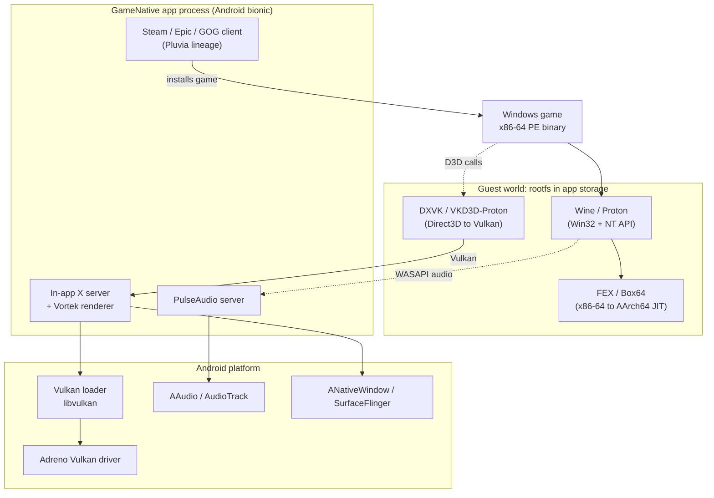

把它读成三个带。**客户机（guest）**带是一个运行在普通 Android 应用私有存储里的 Linux x86-64 世界。**应用**带是原生 ARM64 的 Android 代码，它承载着负责游戏画面的应用内 X 服务器、负责音频的 PulseAudio 服务器，以及下载游戏的商店客户端。**平台**带就是纯粹的 AOSP：第 13 章讲过的 Vulkan 加载器和 `ANativeWindow`、第 15 章讲过的 AAudio，以及第 24 章讲过的 SurfaceFlinger 合成器。

关键在于，那两条虚线的 Direct3D 与音频箭头很早就*离开了*模拟器。游戏的 D3D 调用进入 DXVK。在快速配置下，DXVK 作为原生 ARM64 代码运行并生成 Vulkan。因此繁重的图形翻译本身并不是被模拟的。音频同理。只有从游戏进入 Wine、以及从 Wine 进入模拟器的那两条实线箭头，代表着 JIT 必须真正翻译的 x86-64 代码。

### 66.1.3 无需 Root，无需改动内核

客户机带中的一切都以普通已安装应用的权限运行。没有 `su`，没有 `insmod`，没有 SELinux 策略变更，没有对系统镜像的修改。这一约束使得这些应用可以在锁定 bootloader 的设备上从商店直接安装，也正是它迫使本章中大多数工程巧思的产生。桌面版 Wine 配置可以 `chroot` 进一个 rootfs、挂载文件系统、并直接 `dlopen` 系统的 glibc GPU 驱动。Android 应用一样都做不到。每一种缺失的能力都由一个用户态替身来替代：

| 桌面端能力 | 在未 root 的 Android 上被禁止 | 用户态替代方案 |
|--------------------|-------------------------------|-----------------------|
| `chroot` 进入 rootfs | 需要 `CAP_SYS_ADMIN` | **PRoot**（ptrace 路径重写） |
| 挂载 rootfs 镜像 | 需要 root | 解压到应用私有存储 |
| System V 共享内存 | 受内核限制 | 基于 ashmem/`memfd` 的垫片 |
| `dlopen` glibc GPU 驱动 | 驱动是 `bionic` 库 | 通过 IPC 交给原生渲染器，或使用 thunk |
| 运行系统级 PulseAudio | 无系统守护进程访问权 | 在应用内捆绑一个 PulseAudio 服务器 |

### 66.1.4 用 AOSP 术语表述未 root 应用的约束

三个 AOSP 机制决定了这个技术栈能做什么、不能做什么，三者都在前面的章节中介绍过。

**链接器命名空间（第 7 章）。** 应用的原生库在一个隔离的链接器命名空间中加载，因此它们看不到任意的系统库。管理这一点的 `android_dlopen_ext` 标志位于 `bionic/libc/include/android/dlext.h`。`ANDROID_DLEXT_USE_NAMESPACE`（`bionic/libc/include/android/dlext.h:115`）允许调用者为库选择目标命名空间，但头文件把它标记为仅限内部使用。原因是命名空间没有 NDK API。

公开的 `ANDROID_DLEXT_USE_LIBRARY_FD`（`bionic/libc/include/android/dlext.h:80`）允许调用者直接从文件描述符加载库，例如一个以未压缩形式存放在 APK 内部的 `.so`。Vulkan 加载器自身在打开设备驱动时就使用了这个命名空间标志，我们将在 66.7.4 节看到。

**W^X 强制（第 7 章）。** JIT 必须先写入机器码，然后执行它。对于目标 API 26 及以上的应用，动态链接器拒绝加载任何同时可写且可执行的 ELF *加载段*。`bionic/linker/linker_phdr.cpp:1057` 会发出 `"has load segments that are both writable and executable"` 的诊断信息，`bionic/linker/linker_phdr.cpp:1061` 会记录 `W+E load segments` 警告。因此 FEX 或 Box64 这类翻译器不能随附带有 RWX 段的预构建 `.so` 文件。

这项检查只覆盖链接器映射的 ELF 文件。匿名 JIT 映射不受其影响。SELinux 甚至授予应用进程 `execmem` 权限（`system/sepolicy/private/app.te:213`），因此应用可以映射匿名的 `PROT_WRITE | PROT_EXEC` 内存。尽管如此，翻译器们仍然遵循这一加固约定。它们先把 JIT 页面映射为可写、填充代码，然后用 `mprotect` 把它翻转为可执行。因此在任何时刻，每一页都是写-异-执行（write-xor-execute）的。

**应用数据目录中的执行限制。** 在较新的 Android 上，从应用可写的数据目录执行二进制文件受到越来越严格的限制。翻译栈必须通过它自己控制的加载器（PRoot 或某个重定向库）来运行客户机的可执行文件。它不能把应用数据目录下的路径直接交给内核并调用 `execve`。这正是 GameNative 专有的 `libredirect.so` 的其中一项工作，66.4.4 节会讨论它。

---

## 66.2 GameNative：集成化应用

GameNative 是一个在本地运行 Windows PC 游戏的 Android 应用，内置了 Steam、Epic Games Store、GOG 和 Amazon Games 的商店集成。它是这一完整技术栈最完整的公开实例，因此本章以它为锚。它采用 GPL-3.0 许可证，包名为 `app.gamenative`。

### 66.2.1 血统：Pluvia 与 Winlator 的嫁接

理解 GameNative 的最好方式，是把它看作两个上游代码库的嫁接，而不是一次单纯的 fork：

1. **应用与 Steam 客户端层来自 Pluvia**，这是一个面向 Android 的轻量级非官方 Steam 客户端。它的指纹就在源码中：`Application` 子类是 `PluviaApp.kt`，Room 数据库是 `PluviaDatabase.kt`，Steam 连接使用 **JavaSteam** 库。Pluvia 提供了账户登录、库视图和 SteamPipe 仓库下载器。

2. **运行时与兼容层来自 Winlator。** 整个 `com.winlator.*` Java 树被原样收编到 `app/src/main/java/com/winlator/` 之下，子包包括 `container`、`core`、`xserver`、`xenvironment`、`winhandler`、`box86_64`、`fexcore`、`inputcontrols` 和 `renderer`。`app/src/main/cpp/winlator/` 下的原生部分同样来自 Winlator。

因此，用代码来源的术语来说，GameNative 就是**Pluvia（商店应用）加上 Winlator（Wine 与模拟运行时）**，统一在 GameNative 自己的 GPL-3.0 Kotlin 层之下。那些把它简单称为“Winlator 的一个 fork”的流行文章，把这种双来源结构抹掉了。准确的说法就是上面这一句。本章其余部分所依赖的是 Winlator 这一半——也就是真正负责运行游戏的那一半。

### 66.2.2 应用架构

面向 Android 的那一半是 Kotlin，使用 Jetpack Compose UI 和 Dagger Hilt 依赖注入。对我们来说重要的有三件：

- **`SteamService`**（一个前台 `Service`）拥有 Steam 会话；Epic、GOG 和 Amazon 各自的商店服务与它并列。
- **`XServerScreen`** 是游戏渲染所进入的全屏 Compose 界面，由 `XServerViewModel` 驱动。应用内 X 服务器、音频服务器和图形渲染器都是在这里启动的。
- **被收编的 Winlator 运行时**负责实际的容器、rootfs、Wine 和模拟器工作，由 `com.winlator.xenvironment` 包统一编排。

### 66.2.3 容器模型

**容器（container）**是某个游戏的隔离 Windows 环境：一个 Wine 前缀加上它的配置（图形驱动、模拟器、音频驱动、DLL 覆盖、环境变量）。`com.winlator.container.Container` 和 `ContainerManager` 这两个类定义并管理它们，而默认值是对“GameNative 技术栈究竟是什么”最清晰的一句话陈述。来自 `app/src/main/java/com/winlator/container/Container.java`：

```java
// GameNative: app/src/main/java/com/winlator/container/Container.java
public static final String DEFAULT_EMULATOR        = "FEXCore";
public static final String DEFAULT_AUDIO_DRIVER    = "pulseaudio";
public static final String DEFAULT_DXWRAPPER       = "dxvk";
// graphics driver default resolves to "vortek"
```

固定下来的组件版本存放在一旁的 `app/src/main/java/com/winlator/core/DefaultVersion.java` 中：Box64、Box86、FEXCore 构建号、Turnip（Mesa 的 Adreno Vulkan 驱动）、DXVK、VKD3D，等等。默认的 Wine 记录在 `WineInfo.java` 中。这两个文件让人一眼看清整条默认流水线。所以本章末尾的“试一试”练习，就是简单地去读它们。

### 66.2.4 默认技术栈

把容器的默认值拼起来，一个新创建的 GameNative 容器会运行：

- 以 **ARM64EC** 配置（66.6 节）作为 Windows API 层的 **Wine / Proton**，由 **FEXCore** 翻译游戏的 x86-64 代码，另有一个 WoW64 辅助器翻译任何 32 位代码（66.5.8 节）。
- 把 Direct3D 9/10/11 翻译成 Vulkan 的 **DXVK**，Direct3D 12 则用 **VKD3D-Proton**（66.7.2 节）。
- 作为直达设备 Adreno 驱动的 Vulkan 通路的 **Vortek**（66.7.3 节），并备有 **Turnip**（Mesa）作为替代。
- 作为音频服务器的 **PulseAudio**（66.8 节）。

带有经典 glibc 启动路径的 Box64 也一并捆绑，作为非 ARM64EC 的 Wine 构建的替代路线。一个不同的启动器组件负责选择这条路线（66.5.6 节）。

### 66.2.5 打包：各个部件如何抵达设备

GameNative 通过三种截然不同的交付机制，在一个应用里随附了数量惊人的预构建原生软件。

1. **Android 进程原生库**随附在 `jniLibs/arm64-v8a/` 中，由平台的包管理器解压到应用的 `nativeLibraryDir`。这些库加载进*Android*（bionic）进程。它们是 PulseAudio 服务器库（`libpulse.so` 及伙伴库）、原生图形渲染器（`libvortekrenderer.so`、`libvirglrenderer.so`）、应用内 X 服务器（`libwinlator.so`），以及专有的 `libsteambootstrap.so`。

2. **客户机组件**以压缩 tar 归档（Zstandard 的 `.tzst` 和 xz 的 `.txz`）形式随附在 `assets/` 中，并在运行时由 `com.winlator.core.TarCompressorUtils` 解压到 rootfs 中。Wine、FEX、Box64、DXVK、VKD3D、Vulkan 驱动和 Windows DLL 组件都是以这种方式送达的。解压之后，它们的 ELF 解释器和 RPATH 会用一个被收编的 `patchelf` 打补丁。

3. **大型或可选负载**按需下载。Ubuntu rootfs 以独立的 Android **动态特性模块**（`ubuntufs/`，`dist:on-demand`）交付。图形驱动、额外的 DXVK 构建和 Proton 容器模板则依据 `assets/*_download.json` 清单从 GameNative 的下载服务器获取。这样基础 APK 保持可安装，而数 GB 的 Linux 用户态只在首次运行游戏时到达。

### 66.2.6 端到端启动序列

#### 图：在 GameNative 中启动一款游戏

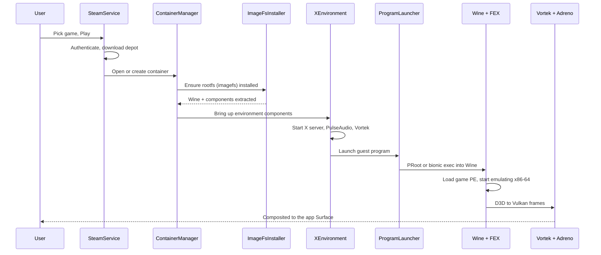

`XEnvironment` 对象持有一个有序的**组件**列表。每个组件都是 `com.winlator.xenvironment.components` 中的一个小类，负责启动一个子系统。排在最前面的组件启动 X 服务器和 `PulseAudioComponent`。接下来的组件启动图形渲染器（`VortekRendererComponent` 或某个 VirGL 渲染器）和一个 System V 共享内存组件。最后一个组件是一个程序启动器，它在模拟器下派生出 Wine。启动器要么是 `BionicProgramLauncherComponent`（默认的 ARM64EC/FEX 路径），要么是 `GuestProgramLauncherComponent`（经典的 glibc/Box64 路径）。

### 66.2.7 许可证与 GPL 聚合问题

GameNative 是 GPL-3.0，被收编的 Winlator 代码亦然。大部分随附的运行时带有各自的上游许可证，大多是宽松许可证或 LGPL。Wine 和 PulseAudio 是 LGPL-2.1，Mesa（Turnip、Zink）大体上是 MIT，DXVK 采用 zlib 许可证，Box64 和 FEX 是 MIT/BSD 风格。项目的 `THIRD_PARTY_NOTICES` 文件对 copyleft 组件作出了一揽子书面源码提供要约。

有两个组件是刻意闭源的，它们也正是法律上有趣的部分：

- **`libredirect.so`**（随附于 `assets/redirect.tzst`）只通过 `LD_PRELOAD` 加载进 Wine/Proton 子进程，从不加载进 Android 应用自己的地址空间。它重写一个遗留的包标识符，并适配进程启动以应对新版 Android 关于从数据目录执行文件的限制。
- **`libsteambootstrap.so`** 是一个 JNI 垫片，驱动一个真正的进程内 Steam 客户端，用于成就、云存档和覆盖层。

维护者表明的立场是：它们作为独立的程序/子进程运行，只通过操作系统接口通信。因此按照 GPL-3.0 第 5 条，它们只是聚合，而不是 GPL 应用的衍生作品。这是该项目的说法，而非已裁决的事实。闭源的 `LD_PRELOAD` 和 JNI 垫片与一个 GPL-3.0 应用一起发布时能否经受审查，是一个真实存在且尚无定论的 GPL 问题。这个应用在两个库都不存在的情况下也能构建和运行，只是兼容性会降低——这也是维护者可分离性论证的一部分。

---

## 66.3 rootfs：应用内部的 glibc Linux 用户态

### 66.3.1 rootfs 里有什么

Wine、模拟器的客户机库以及游戏，都期望一个按常规方式布局的 Linux 文件系统。它有 `/usr/lib`、`/bin`、`ld-linux` 动态加载器，最重要的是一个 **glibc** C 库。Android 一样都不会提供给应用；它提供的是 `bionic` 和一个应用私有数据目录。因此，这个技术栈随附了一整个小型 Linux 发行版（在 Winlator 中历史上被称为 **imagefs**），并把它解压到应用的私有存储中。

rootfs 基于 **Ubuntu**（最初的 Winlator 使用 Focal Fossa 20.04）。里面有一个 glibc 用户态、位于 `/opt` 下的 Wine 安装，以及位于 `/home/xuser/.wine` 的每个容器各自的 **Wine 前缀**。这些路径常量定义在 `com.winlator.xenvironment.ImageFs` 中。

### 66.3.2 随附与解压

用户态以压缩形式随附，首次使用时解压，绝不挂载（应用无法挂载）。相关代码位于两个类中。`ImageFsInstaller` 把 Wine tarball 解压到 `<rootfs>/opt/<version>`。`TarCompressorUtils` 处理 GameNative 所用的 Zstandard `.tzst` 和 xz `.txz` 两种格式。解压完成后，ELF 二进制文件会用 `patchelf` 进行修正。这使它们的解释器和库搜索路径指向 rootfs 内部，而不是指向一个并不存在的系统。

体积正是 rootfs 以按需动态特性模块（66.2.5 节）交付的原因。一个完整的 Ubuntu 加 Wine 用户态有数百 MB 到数 GB，大得无法放在基础 APK 中。

### 66.3.3 进入 rootfs：PRoot

桌面配置会 `chroot` 进 rootfs。未 root 的应用做不到。Winlator 的经典答案是 **PRoot**，一个完全构建在 Linux `ptrace` 系统调用之上的 `chroot` 与绑定挂载的用户态重新实现。

PRoot 把客户机程序作为被追踪的子进程启动。每当子进程发起一个带路径的系统调用，PRoot 就在内核边界拦截它。PRoot *改写被追踪进程内存中的路径字符串*，比如把 `/usr/lib/...` 变成 `<app data>/imagefs/usr/lib/...`，然后让内核继续执行。客户机以为自己生活在 `/` 下，但 PRoot 会即时重映射每一条路径。同样的技巧在 `execve` 时被重新施加，使子进程继续保持隔离。像 `--bind=/dev` 和 `--bind=/proc` 这样的绑定挂载也以同样的方式实现——重映射相关的前缀。

#### 图：PRoot 如何用 ptrace 重映射客户机路径

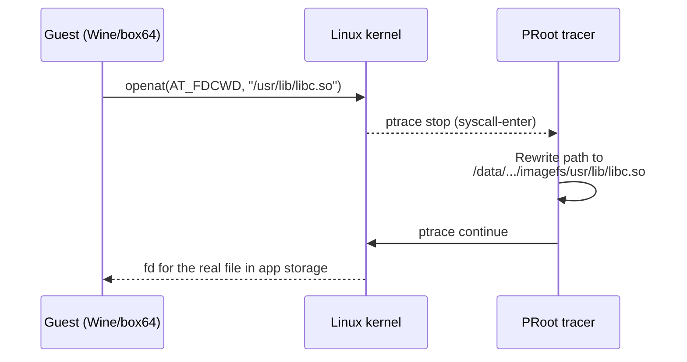

代价是无 root 方案必须支付的门票：每一个带路径的系统调用都要经历一次进入 PRoot 进程的 `ptrace` 暂停-继续往返。这项开销正是更新的 **bionic** 设计（66.3.6 节）试图彻底消除 PRoot 的主要原因。

### 66.3.4 glibc 与 bionic：核心错位

rootfs 给了 Wine 一个 glibc 世界，而这恰恰是 Wine 想要的。但它制造了整个技术栈的定义性问题。**这个进程现在包含 glibc，而每一个原生 Android 库（包括 GPU 驱动）都是针对 `bionic` 构建的。** 你不能把 `bionic` 的 `.so` 简单 `dlopen` 进一个 glibc 进程。这两个 C 库在线程局部存储布局、动态加载器内部结构、`errno`、`pthread_t`、栈金丝雀等问题上互不相容。把一个 libc 的共享对象加载进另一个 libc 的进程，会破坏状态并导致崩溃。

这正是“bionic 重定向”存在所要解决的问题，它足够重要，拥有自己的一节（66.4 节）。现在只需注意两种答案的形状。第一种答案是保留 glibc 世界，通过**进程间通信**而不是链接来访问 Android 服务。PulseAudio 服务器、Vortek 渲染器和 SysV-SHM 服务器都是通过套接字可达的独立端点。第二种答案是放弃 glibc，直接在 `bionic` 上运行 Wine（较新的分支）。

### 66.3.5 基于 ashmem 的 System V 共享内存

bionic 重定向最干净的具体例子是 System V 共享内存。X11、DXVK 和其他组件使用 `shmget`/`shmat` 在进程之间共享大型缓冲区。Android 内核限制 System V SHM API。因此 Winlator 的 glibc rootfs 随附了一个小型**垫片库** `libandroid-sysvshm.so`，启动器组件用 `LD_PRELOAD` 把它注入客户机进程。它拦截 `shmget`/`shmat`/`shmdt` 一族函数，并在 Android 的匿名共享内存之上重新实现它们。Android 侧有一个小型服务器（`com.winlator.sysvshm`）为此做中介。

在 Android 侧，自然的原语是 `ASharedMemory_create`（`frameworks/native/include/android/sharedmem.h:78`），这个 NDK 入口点返回一个匿名的、带引用计数的共享内存区文件描述符。在底层，它由 `memfd_create`（`bionic/libc/include/sys/mman.h:183`，API 30 起可用）或较老的 ashmem 驱动支撑。这个重定向把客户机内部的一次 System V `shmget` 调用变成宿主机上一个 `ASharedMemory` 风格的 fd，并通过套接字传回去。客户机继续使用它生来就使用的 System V API；宿主机则用内核真正允许的一个 Android 原语来满足它。

### 66.3.6 bionic-Wine 替代方案

最新的 Winlator 分支以及 GameNative 的默认路径，选择的是另一条路：为 **`bionic`** 构建 Wine，并抛弃 PRoot。如果 Wine 本身就运行在 `bionic` 上，它与 Android GPU 驱动之间就不存在 libc 错位，也没有每次系统调用的 `ptrace` 税。代价是 Wine 依赖 glibc 所做的一切都必须在 `bionic` 上提供。这就是为什么这条路径依赖 ARM64EC 的 Wine 构建（66.5.8 节）和一组重定向库。这些库取代 PRoot，就地修正路径与行为的差异。接下来我们转向这些库。

---

## 66.4 Bionic 重定向与 libc 边界

“Bionic 重定向”是对这些技术的统称。它们让一个围绕 glibc 风味的 Linux 软件构建的技术栈，与一个围绕 `bionic` 构建的 Android 系统协作。这个短语之下藏着几个不同的问题，它们有不同的解决方案。

### 66.4.1 为什么两个 libc 不能共存于一个进程

下面精确地陈述核心约束，因为其他一切都由此而来。一个 Linux 进程只有恰好一个动态加载器和一个 C 库。这个库提供加载器的内部状态、TLS 块、`malloc` 和系统调用包装。glibc 和 `bionic` 是内部布局互不兼容的不同实现。

一个 glibc 进程的线程拥有 glibc 的 `pthread` 结构和 glibc 的 TLS 模型。一个被编译成在 `bionic` 偏移处寻找其线程控制块的 `bionic` `.so`，会读到垃圾数据。没有任何标志能让两者共存。两者之间的边界必须由*某种*不需要链接的机制来跨越。这个技术栈中恰好有三种这样的机制：进程间通信、ABI thunking（ thunk 转换），或者为整个进程选择一种 libc。

### 66.4.2 链接器命名空间与 dlext

即使技术栈确实运行原生 `bionic` 代码，它也受制于第 7 章讲过的链接器命名空间隔离。应用的原生库加载进一个受限命名空间，看不到大多数系统库。驱动加载路径使用带 `ANDROID_DLEXT_USE_NAMESPACE`（`bionic/libc/include/android/dlext.h:115`）的 `android_dlopen_ext` 来瞄准特定命名空间。**adrenotools** 这类自定义驱动加载器（用于侧载比设备自带的更新的 Turnip 构建）就完全依赖这套机制。它们用它把选定的 `.so` 加载进一个能触达 GPU 内核接口的命名空间。`ANDROID_DLEXT_USE_LIBRARY_FD` 标志（`bionic/libc/include/android/dlext.h:80`）是配套标志，直接从文件描述符加载驱动。

### 66.4.3 W^X 与 JIT

翻译器是 JIT，66.1.4 节的 JIT 规范适用。Android 上的每个翻译器都遵循相同的模式。它先以 `PROT_READ | PROT_WRITE` 映射一个代码缓冲区，并把 AArch64 指令发射进去。然后清除该范围的指令缓存。最后，在跳入之前，它对该缓冲区调用 `mprotect`，使其变为 `PROT_READ | PROT_EXEC`。任何时刻，一个页面都不会同时可写且可执行。

这是翻译器自己的加固模式，而不是对链接器 W+E 拒绝（`bionic/linker/linker_phdr.cpp:1057`）的合规。该拒绝只适用于 ELF 加载段，永远看不到这些匿名代码缓冲区。某些设备和 Android 版本还进一步限制从应用数据执行代码。在那里，翻译器必须把它的代码页分配为它自己拥有的匿名内存。它绝不能映射数据目录中的一个文件。

### 66.4.4 路径重定向：PRoot 与 libredirect

PRoot（66.3.3 节）是路径重定向的一种形式：用 `ptrace` 改写内核 ABI 中的路径。它通用但缓慢。bionic 路径用一个预加载库取代它——GameNative 的 `libredirect.so`，以 `LD_PRELOAD` 注入 Wine 子进程。这个库并不通过 `ptrace` 拦截每一次系统调用。它拦截那些带路径的 libc 函数，并在进程内改写它们的参数，没有追踪器的往返。

这个库还适配进程启动，以应对新版 Android 关于从应用数据目录执行文件的限制。它替代了未 root 应用不被允许使用的内核机制。代价是用通用性换取速度。预加载库只能捕获经过它所拦截函数的调用，而 PRoot 在内核边界捕获一切。但预加载方式避免了支配 PRoot 开销的逐系统调用 `ptrace` 成本。

### 66.4.5 IPC 逃生舱

最稳健的重定向，是干脆不在进程内跨越 libc 边界。技术栈的三个服务位于 Android（`bionic`）侧，作为独立端点存在，由客户机通过 Unix 域套接字访问：

- **PulseAudio 服务器**，客户机的 Wine 音频后端以普通 PulseAudio 客户端的身份连接（66.8 节）；
- **Vortek Vulkan 渲染器**，客户机只持有一个薄薄的 Vulkan ICD。该 ICD 通过套接字把命令序列化给原生渲染器（66.7.3 节）；
- **System V SHM 服务器**（66.3.5 节）。

因为边界是套接字，两侧可以使用不同的 C 库、不同的指令集和不同的内存模型。这些都无关紧要：唯一的契约是线路协议。Binder 之所以能跨不同运行时的进程工作（第 9 章），也是同样的原因。它的代价是一次序列化和一次拷贝，但它彻底绕开了 libc 问题。这就是为什么性能关键但并非最热的通路（音频、命令提交）以这种方式构建，而真正热的通路（CPU 翻译）则不是。

---

## 66.5 FEX 与 Box64：把 x86-64 翻译成 AArch64

这一层负责完成 66.1.1 节所说的实际指令集模拟。有两个项目占主导地位，GameNative 两者都随附：**FEX**（默认，经由其 FEXCore 引擎）和 **Box64**。它们以截然相反的哲学解决同一个问题，理解这种差异就能解释用户遇到的大多数兼容性与速度之间的权衡。

本章是对第 19 章的补充。那一章讲的是 Android *自己*的进程内二进制翻译器，它们接入 Native Bridge。一个是 **Berberis**，即在 x86_64 设备上运行 riscv64 应用代码的 AOSP 翻译器（其 CPU 模拟核心在 Android 17 中被整合到 `frameworks/libs/binary_translation/cpu_emulation/` 之下）。另一个是历史上的闭源 **Houdini**，它曾在 Intel x86 上运行 ARM 应用代码。两者都是在 ART 下运行*客户机 Android APK*的原生代码，方向与此处 x86-64-on-AArch64 的问题相反，两者都不参与这个技术栈。

FEX 和 Box64 是同一个 dynarec 思想应用于整个 Linux/Windows x86-64 *程序*的产物。它们运行在一个普通应用进程内，而不是作为 Native Bridge 插件。它们把 x86-64 翻译成 AArch64，这是任何 AOSP 自带翻译器都不覆盖的方向。

### 66.5.1 动态重编译器做什么

动态重编译器（dynarec）是一种面向外来机器代码的 JIT。它读取一段 x86-64 指令，把它们翻译成 AArch64 指令，只翻译一次。它缓存结果，并在客户机每次再次到达该地址时跳转到缓存的翻译。翻译后的代码把客户机寄存器保存在宿主机寄存器中，把客户机内存作为普通的宿主机内存，只在块边界退回到调度器，由调度器决定下一步运行什么。

dynarec 通常比解释器快五到十倍。因为每条指令的解码成本只在翻译时支付一次，而不是在每次执行时都支付。

有三件事让 x86 到 ARM 的翻译特别困难，每一处都是 FEX 和 Box64 投入工程精力的地方：

1. **标志位。** 几乎每条 x86 算术指令都会更新 EFLAGS 寄存器。在 ARM 上每次操作后都计算这些标志位是*代价高昂得离谱*的。因此一个好的 dynarec 会延迟并省略标志计算。它只在确实有东西读取标志位时才把它们具体化。
2. **向量指令。** SSE、AVX 和 x87 浮点必须映射到 ARM 的 NEON 向量寄存器（在宿主机支持时映射到 SVE）。这需要仔细关注 NaN 处理和舍入。
3. **内存模型。** x86 具有强内存模型（全存储排序，Total Store Ordering）；ARM 的内存模型更弱。在这里保持正确性既微妙又昂贵，足以让它拥有自己的小节（66.5.3 节）。

### 66.5.2 FEXCore 流水线

FEX 是面向 AArch64 宿主机的用户态 x86 与 x86-64 模拟器。它的模拟引擎是一个名为 **FEXCore** 的库，其翻译流水线是一个干净的四阶段设计：

#### 图：FEXCore 翻译流水线

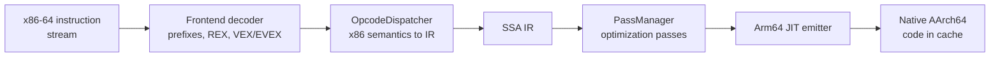

对照 FEX 源码树走一遍各阶段：

- **前端解码器**读取原始字节流并找出指令边界。它处理 x86 的传统前缀、REX 前缀以及 AVX 所用的 VEX/EVEX 编码。
- **`OpcodeDispatcher`**（`FEXCore/Source/Interface/Core/OpcodeDispatcher.cpp`，向量与 x87 处理拆分在 `OpcodeDispatcher/Vector.cpp` 和 `OpcodeDispatcher/X87.cpp`）把每条解码后的指令翻译成 FEX 自己的 SSA 形式中间表示。IR 操作码本身定义在 `FEXCore/Source/Interface/IR/IR.json` 中。
- **`PassManager`**（`FEXCore/Source/Interface/IR/PassManager.cpp`）在 IR 上运行优化遍。对性能最重要的是寄存器分配、冗余标志消除和一个 x87 栈优化遍。寄存器分配把 IR 值映射到 ARM 寄存器。冗余标志消除会丢弃从未被读取的 EFLAGS 更新。
- **JIT 后端**（`FEXCore/Source/Interface/Core/JIT/JIT.cpp`）从优化后的 IR 发射原生 AArch64 指令到代码缓存。FEX 使用一个定制的 ARM64 发射器而不是现成的汇编器，以保持代码生成快速而紧凑。

FEX 支持 MMX、一直到 SSE4 的 SSE、x87 以及 AVX/AVX2。它翻译多块区域而不是单个基本块，并通过查找缓存在缓存的翻译之间调度。FEX 能处理自修改代码。它检测客户机对包含已翻译代码的页面的写操作，并使受影响的缓存块失效。

### 66.5.3 TSO 内存模型问题

这是整个模拟层中最重要的性能微妙之处。x86 保证全存储排序（Total Store Ordering）：来自一个核心的存储按程序顺序对其他核心可见。ARM 不保证这一点；除非你插入屏障或使用 acquire/release 指令，否则它允许存储被重排。一个为 x86 强排序编写的多线程游戏，如果把它的内存操作天真地翻译成普通的 ARM 加载和存储，就会发生竞争并崩溃。

FEX 默认正确的答案是模拟 TSO。它使用 ARM 的 acquire/release 加载和存储指令（`FEAT_LRCPC` 扩展）以及原子操作（`FEAT_LSE2` 用于 x86 允许但 ARM 通常禁止的非对齐原子操作）。这种模拟是昂贵的。在弱内存模型上忠实地复现 x86 排序，可能给受影响的内存流量带来约 10 倍的减速。在向量密集的游戏代码中这种代价感受最强烈。

泄压阀是**硬件 TSO**。一些 ARM 核心可以切换到硬件全存储排序模式。Apple Silicon 就是这样做的（这也是 Rosetta 2 速度快的原因）。在宿主机 CPU 暴露这种模式的地方，FEX 会请求它并放宽它的软件模拟，从而获得巨大收益。FEX 还提供可调项来禁用向量访问或栈内存的 TSO 模拟（栈是线程私有的，因此安全）。这些可调项用一点稳定性换取速度。

对手机而言的实际结论是：一颗骁龙处理器的具体内存排序能力会实质性地影响模拟运行的速度，独立于原始时钟频率。

### 66.5.4 FEX Thunk：调用原生 ARM64 图形

如果 FEX 翻译游戏进程执行的*每一条*指令，包括整个 Vulkan 驱动，性能将毫无希望。避免这一点的杠杆是 **thunking**，也叫库转发（library forwarding）。一个 thunk 让被模拟的 x86 客户机代码直接调用一个**原生 AArch64** 宿主机库。因此像 GPU 驱动这样的重量级库以原生代码运行，而不是以翻译代码运行。

设计是双面的。在客户机一侧，FEX 提供一个小型 x86 存根库，呈现正常的客户机 ABI（例如一个客户机 `libvulkan.so`）。它不包含驱动，而是把每次调用转发到边界之外。在宿主机一侧，一个原生 ARM64 thunk 库接收被转发的调用并调用真正的宿主机库。FEX 源码为关键的图形库携带了两半：Vulkan 的 `ThunkLibs/libvulkan/Guest.cpp` 和 `ThunkLibs/libvulkan/Host.cpp`，OpenGL 的 `ThunkLibs/libGL/`。

#### 图：一次跨模拟边界的 thunk 化 Vulkan 调用

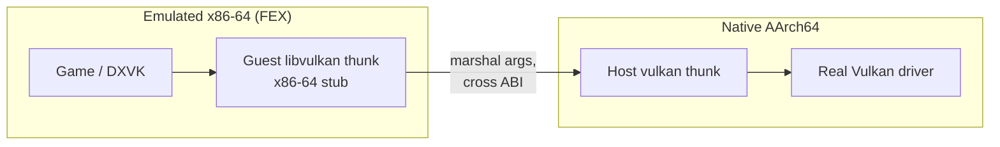

困难的部分是编组（marshalling）。客户机和宿主机在 32 位情形的指针大小、结构布局和调用约定上都不一致。回调（宿主机库会调用回来的函数指针）必须用跳板（trampoline）反向穿过边界。FEX 的 thunking 双向处理函数指针，并在边界转换数据结构布局。一个 `ThunksDB.json` 对此进行配置：它把每个客户机库映射到它的宿主机覆盖层。Thunking 是基于 FEX 的图形能够接近原生速度的最大单一原因：只有游戏的绘制调用*准备*被模拟，而驱动工作以原生方式运行。

### 66.5.5 FEX 的 rootfs 需求

当 FEX 作为独立 Linux 模拟器运行时，它模拟一个完整的 x86-64 *进程*。它因此需要一个 x86-64 root 文件系统来提供客户机 glibc 和基础库。在桌面 Linux 上，`FEXRootFSFetcher` 正是为此下载一个 SquashFS 或 EroFS 镜像。这是“一切皆被模拟”的模型。这也是 Box64 与它分歧的主要轴，因为 Box64 包装宿主机库，并不模拟一个完整的客户机用户态。

然而在 GameNative 的默认 ARM64EC 配置中，FEX 根本不作为 Linux 模拟器运行。它作为一个仅 CPU 的模块接入 Wine（66.5.8 节）。Wine 负责 Windows 系统调用，而不是客户机 glibc。因此不再需要单独的 x86 rootfs。所以 FEX 的 rootfs 需求是“一切皆被模拟”路径的一个属性，而不是 ARM64EC 默认路径的属性。ARM64EC 摆脱了这一需求，这是它的具体收益之一。

### 66.5.6 Box64：包装的原生库

Box64，由 ptitSeb 开发，是一个 dynarec，核心任务相同，但对系统库的哲学不同。Box64 不从一个 rootfs 模拟 x86-64 的 glibc、GL 和 Vulkan。相反，Box64 检测客户机即将调用那些知名库之一的时刻，并**用宿主机原生的 ARM64 实现替代它**。它包装每次调用来转换调用约定。手写的包装器位于 Box64 源码的 `src/wrapped/` 下，例如 Vulkan 的 `src/wrapped/wrappedvulkan.c` 和 C 库的 `src/wrapped/wrappedlibc.c`。

结果是 Box64 不需要它所包装的那些库的完整 x86 rootfs；它借用宿主机的。这使它比 FEX 更轻。它是经典 Winlator 的历史默认，在那里启动链字面上就是 `proot` 然后 `box64` 然后 `wine`。GameNative 的 `GuestProgramLauncherComponent` 为 glibc 路径构建的正是那条 `box64 <guest exe>` 命令。代价是包装的正确性仅与包装器相当。当一个被包装库的行为偏离客户机的预期时，它可能以全模拟方式不会出现的方式出错。

32 位的故事是对称的。Box64 处理 x86-64，它的姊妹 **Box86** 处理 32 位 x86。对于没有 32 位 ARM 环境的宿主机，Box64 有一个实验性的 `BOX32` 模式，在 64 位环境内模拟一个 32 位环境。Box64 自己的 `docs/WINE.md` 列出了 Wine 变体（x86、x86-64、x86-64 WoW64、ARM64 WoW64）的矩阵，以及每种变体需要的 Box 组合。它是关于模拟器与 Wine 如何契合的最佳首选参考。

### 66.5.7 FEX 与 Box64 对比

#### 图：两种模拟哲学

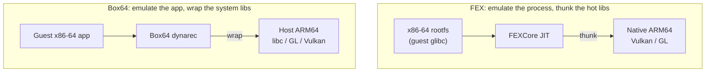

| 维度 | FEX | Box64 |
|-----------|-----|-------|
| 系统库 | 从 x86-64 rootfs 模拟 | 包装为宿主机原生 ARM64 |
| 磁盘占用 | 更重（完整 rootfs） | 更轻（借用宿主机库） |
| 原生库逃生 | thunk（GL、Vulkan） | 包装器（libc、GL、Vulkan，更多） |
| 32 位代码 | 同一核心；WoW64/ARM64EC | 单独的 Box86，或 BOX32 |
| 精度立场 | 完整的 IR 重编译器，严格的 TSO | 务实；依赖包装器保真度 |
| 在 GameNative 中的角色 | 默认（FEXCore） | 随附的替代方案 |

两者都不是普遍更优。FEX 的全模拟精度有助于重度模组或不寻常的游戏；Box64 的更轻占用和成熟的包装器使它成为 Winlator 长期以来的默认。GameNative 两者都随附，并由容器选择。

### 66.5.8 ARM64EC 与 WoW64：只模拟游戏

最重要的近期转变是架构性的，而非渐进式的：停止让 Wine 本身穿过模拟器运行。在“一切皆被模拟”的模型中，JIT 翻译游戏*以及*整个 Wine*以及* Wine 之下的 x86 Linux 库。模拟器位于每条指令的热路径上。**ARM64EC** 模型则相反，它原生地为 ARM64 构建 Wine，并且只模拟游戏的 x86-64 代码。

ARM64EC（“Emulation Compatible”，模拟兼容）是微软的一种 ABI，在 Wine 中被重新实现，其中原生 ARM64 代码被布局为与被模拟的 x86-64 代码调用兼容。Wine 的系统 DLL 以这种 ABI 编译。因此当被模拟的游戏调用 Windows API 时，执行会转入*原生*的 ARM64 Wine 代码，而不是转入更多的模拟。模拟器被缩减为一个 CPU 核心，在 ABI 边界以可加载模块的形式接入 Wine。

在这种配置中，模拟器以 Windows DLL 的形式交付，由 Wine 加载。FEX 作为 `libarm64ecfex.dll` 交付，用于 64 位代码。对于 32 位 WoW64 路径，该 DLL 要么是 `libwow64fex.dll`（FEX），要么是 `wowbox64.dll`（Box64）。GameNative 在其 `BionicProgramLauncherComponent` 中根据配置的 Wine 构建是否为 ARM64EC 来在这两者之间选择。

#### 图：用 ARM64EC 缩小被模拟区域

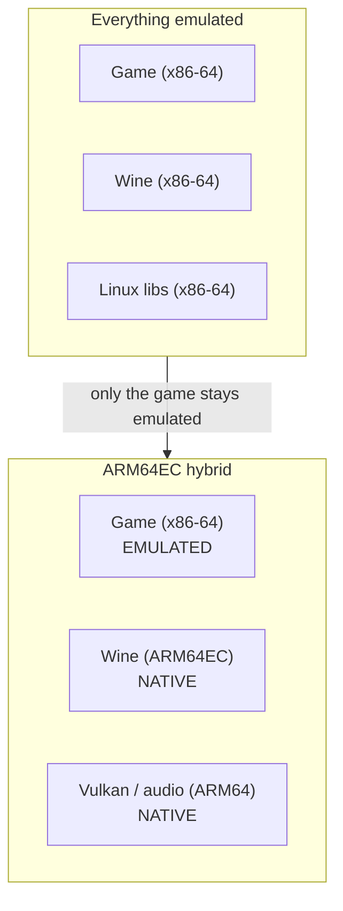

收益是巨大的。Windows API 工作、图形翻译和音频通路全部以原生 ARM64 运行。只有游戏自己的指令流被翻译。这是 GameNative 默认的设计，也是这个技术栈足够快、在手机上可用的原因。

---

## 66.6 Wine：实现 Windows API

Wine 是让游戏以为自己运行在 Windows 上的那一层。模拟器处理指令，而 Wine 处理含义。Wine 在 Linux 内核之上对 Windows API 的重新实现，服务于游戏对该 API 发出的每一次调用。

### 66.6.1 不是模拟器

这个名字是一个递归式缩写，“Wine Is Not an Emulator”（Wine 不是模拟器），而在 ARM Android 上，这一区分不是吹毛求疵，而是架构本身。Wine 不包含任何指令翻译。它取一个 Windows PE 二进制文件，把它加载进一个 Linux 进程。它用与 Linux 对话的原生代码来回答该二进制文件的 Windows API 和 NT 系统调用。

在 x86-64 Linux 上，那些原生代码直接运行。在 ARM Android 上，Wine 本身*要么*被模拟（“一切皆被模拟”模型），要么以 ARM64EC 原生编译（混合模型）。无论哪种情况，Wine 都不做 x86 到 ARM 的翻译。那始终是 FEX 或 Box64 的工作。这两层是正交的，正如 66.1.1 节所阐述的那样。

### 66.6.2 PE/Unix 分裂

现代 Wine 围绕 Windows PE 代码与 Unix 后端之间的一条硬边界组织。Wine 的内置 DLL（`ntdll`、`kernel32`、`kernelbase`、`user32`、`gdi32`）被编译为真正的 PE 文件。因此，从游戏的观点看，它调用的是普通的 Windows DLL。那些必须触碰宿主机操作系统的 DLL 子集，被拆分成一个 PE 部分和一个 Unix 部分。

最典型的例子是 `ntdll`。PE 侧（`dlls/ntdll/`）构建 `ntdll.dll`。Unix 侧（`dlls/ntdll/unix/`）构建 `ntdll.so`，一个在启动时 `dlopen` 的 ELF 库，其关键文件是 `dlls/ntdll/unix/loader.c`、`dlls/ntdll/unix/virtual.c` 和 `dlls/ntdll/unix/signal_x86_64.c`。两半之间的契约声明在 `dlls/ntdll/unixlib.h` 中。

进程启动一开始是一个完全普通的 Linux 进程。一个小型加载器 `dlopen` `ntdll.so`。这个库构建 Windows 进程控制结构（PEB 和 TEB），映射 PE `ntdll.dll` 和初始可执行文件，并连接到 wineserver。最后，它跳入 PE 侧的初始化。此后，控制权就“仿佛运行在 Windows 上”那样流转。

#### 图：Wine 的 PE 与 Unix 两半以及系统调用边界

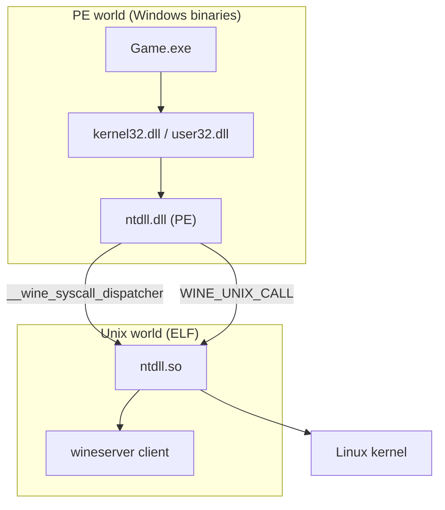

有两种机制跨越边界。NT 系统调用（`NtCreateFile`、`NtUserCreateWindowEx`）经由设置在 `dlls/ntdll/unix/signal_x86_64.c` 中的一个 `__wine_syscall_dispatcher` 汇入。调度器保存 CPU 状态，切换到 Unix 栈，索引系统调用表，并调用 Unix 实现。那些拥有绕过 NT 表的 Unix 后端的 DLL，改用 `WINE_UNIX_CALL`。Wine 把 Windows API 调用路由穿过一个显式的、类似 NT 的系统调用边界。这正是 66.5.8 节的 ARM64EC 和 WoW64 转换得以实现的原因：边界本来就在那里可供挂钩。

### 66.6.3 wineserver

wineserver 是一个独立守护进程，为 Wine 提供大致相当于 Windows 内核在 Windows 上提供的服务。每一个使用同一个前缀的 Wine 进程，都通过 wineserver 共享 NT 保存在内核空间的那些东西。这些是句柄和对象命名空间、同步对象（事件、互斥锁、信号量）、进程与线程、窗口管理状态，以及注册表。

客户端通过一个 `AF_UNIX` 套接字与它对话。它们通过 `wine_server_call` 编组请求。服务器的请求处理程序位于 `server/request.c`。该套接字位于一个以前缀的设备和 inode 为键的每前缀目录中，因此每个前缀都有自己的服务器。一个特别重要的细节是，该套接字使用标准的 `SCM_RIGHTS` 辅助数据技术在进程之间传递**文件描述符**。因此，一个 Windows `HANDLE` 可以由从服务器移交的一个真实 Linux fd 来支撑。

性能上的注意事项在手机上很重要。游戏会不断同步线程，而经典的“每次都询问 wineserver”模型让每一次同步都成为一次套接字往返。Wine 已逐步把同步移出服务器：**esync**（基于 eventfd）、**fsync**（基于 futex），以及最近的 **ntsync**。**ntsync** 是一个 Linux 内核驱动，暴露 `/dev/ntsync` 并在内核中建模 NT 同步原语。

更快的路径是否可用取决于宿主机内核。Android 内核可能根本不暴露 `/dev/ntsync`。在这种情况下，技术栈回退到基于 futex 的 fsync，而 futex Android 是有的。

### 66.6.4 前缀、C 盘和注册表

一个 **Wine 前缀**（`WINEPREFIX`，此处是 rootfs 内的 `/home/xuser/.wine`）是一份自包含的虚拟 Windows 安装。它有自己的 C 盘、自己的注册表和自己的 wineserver。其中，`drive_c/windows/system32` 存放 64 位系统 DLL，`drive_c/windows/syswow64` 存放 32 位的那些（Windows 的命名倒置被保留下来）。`dosdevices/` 存放把盘符映射到宿主机路径的符号链接。注册表以文本 `.reg` 文件的形式存储在前缀根部（HKLM 对应 `system.reg`，HKCU 对应 `user.reg`），并由 wineserver 实时服务。

这一布局解释了为什么一个容器是可移植且可丢弃的：它只是一个目录树。GameNative 的每游戏容器就是恰如其分的每游戏前缀，这也是两个 DLL 或注册表需求冲突的游戏如何保持隔离的方式。

### 66.6.5 DLL 覆盖：DXVK 如何取代 Wine 的 Direct3D

Wine 对每个 DLL 决定是使用它自己的内置实现，还是使用放在前缀中的一个**原生** DLL。该选择由 `WINEDLLOVERRIDES` 环境变量和 `HKCU\Software\Wine\DllOverrides` 下的注册表条目驱动。

整个图形快速通路就是通过这单一机制安装的。DXVK 和 VKD3D-Proton 随附的 PE DLL 与 Wine 内置的 Direct3D DLL 完全同名（`d3d9.dll`、`d3d11.dll`、`dxgi.dll`、`d3d12.dll`）。安装器把它们复制进前缀的 `system32`/`syswow64`，并把这些名字设置为 `native`。下一次游戏调用 `D3D11CreateDevice` 时，Wine 的加载器会把 `d3d11.dll` 解析到 DXVK 文件，而不是它自己基于 `wined3d` 的内置实现。Direct3D 现在就翻译成 Vulkan（66.7 节），而不是 OpenGL。

### 66.6.6 Wine 与模拟器相遇之处

本节把 66.5 和 66.6 联系起来。在 ARM64EC 配置中，Wine 是原生 ARM64EC，它的 DLL 在系统调用边界转换到原生代码。模拟器（`libarm64ecfex.dll` 或 WoW64 辅助器）仅在运行游戏的 x86-64 指令流时才被调用。在“一切皆被模拟”配置中，整个 Wine 都是 x86-64 的，运行在 Box64 或 FEX 之上，后者面对的是 rootfs 的 glibc。

两种配置向游戏呈现一个完全相同的 Windows。它们只在游戏之下的进程部分有多少被模拟、多少是原生这一点上不同。这是帧率最大的单一决定因素。

---

## 66.7 图形：从 Direct3D 到 Adreno GPU

图形是这个技术栈要么成功、要么明显失败的地方。它是本书中最长的翻译链。一个由 x86-64 游戏发出的 Direct3D 调用，最终变成由手机的 Adreno 驱动执行的一个 Vulkan 命令，并由 SurfaceFlinger 合成。该链中的每一环都是一门独立的技术。

### 66.7.1 翻译链

#### 图：完整的 Direct3D 到显示链路

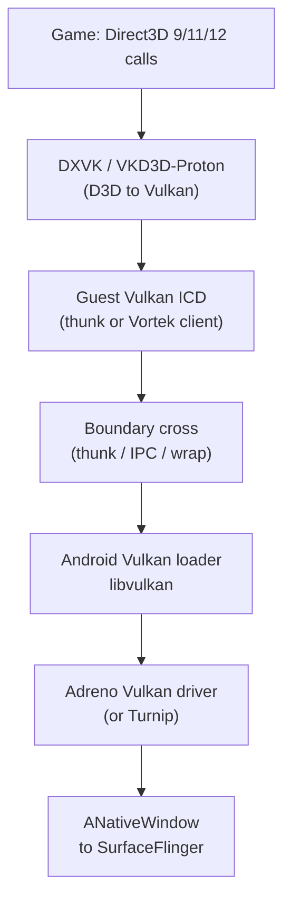

该链由 66.4 节的 libc 边界分成两半。在边界之上，即 Windows/客户机世界中，Direct3D 变成 Vulkan。在边界之下，即 Android 侧，Vulkan 触达真实的驱动，帧触达显示器。有趣的工程完全在于如何跨越这条边界。

### 66.7.2 D3D 到 Vulkan：DXVK、VKD3D 与回退方案

几个翻译器覆盖了 Direct3D 的版本空间，全都作为 Wine DLL 覆盖安装（66.6.5 节）：

- **DXVK** 把 Direct3D 9/10/11 翻译成 Vulkan。它随附 `d3d9.dll`、`d3d11.dll`、`dxgi.dll` 及相关 DLL。它是 GameNative 容器中默认的 `DEFAULT_DXWRAPPER`。
- **VKD3D-Proton** 把 Direct3D 12 翻译成 Vulkan，随附 `d3d12.dll` 和 `d3d12core.dll`。它是 WineHQ 自己的 vkd3d 经 Valve 调优的分支，为游戏性能而优化。
- **D8VK** 把 DXVK 向下扩展到 Direct3D 8。
- **wined3d** 是 Wine 的内置回退方案，把 Direct3D 翻译成 OpenGL 而不是 Vulkan。它较慢，只在游戏与 DXVK 不兼容时使用。
- **cnc-ddraw** 处理遗留的 DirectDraw 老游戏。

关键的架构要点是，在 ARM64EC 上这些翻译器是原生 ARM64 代码（66.5.8 节）。只有游戏的 D3D *调用*源自被模拟的代码。繁重的工作——把一帧的绘制调用变成 Vulkan 命令缓冲区——以原生方式运行。这就是为什么手机上的 DXVK 远比“在完全被模拟的 x86 Wine 内部翻译 Direct3D”这一替代方案快得多。

### 66.7.3 触达真实 GPU：Turnip 与 Vortek

Vulkan 命令现在必须触达真正的 Adreno GPU。对此有两种策略，这一选择是图形设计中最重要的分叉。

**Turnip** 是 Mesa 面向 Adreno GPU 的开源 Vulkan 驱动。这个技术栈随附一个 Turnip 构建。它也可以通过 adrenotools（66.4.2 节）侧载一个更新的构建。因此，客户机拥有一个真实的、完整的 Vulkan 实现，它直接与 Adreno 内核接口对话。

Turnip 的存在，是因为手机上随附的 Vulkan 驱动对于 Wine 和 DXVK 产生的异常工作负载往往不完整或有缺陷。一个已知良好的 Mesa 驱动绕开了这个问题。在 FEX 世界中，客户机通过 **thunk** 机制（66.5.4 节）触达 Turnip：一个客户机 `libvulkan` 存根转发到原生 Turnip。

**Vortek** 是 Winlator 自己的 Vulkan 兼容层。它采用 66.4.5 节的 IPC 路线，不使用 thunk。它是一个客户端/服务器设计。客户机链接一个薄薄的 Vortek Vulkan **ICD**，该 ICD 从一个 `assets/.../vortek-*` 归档被送入 rootfs。

该 ICD 把每一个 Vulkan 调用序列化成一个命令流。它通过 Unix 套接字把该流发送给一个**原生 Android 服务器**。这个服务器就是预构建的 `libvortekrenderer.so`，由 `VortekRendererComponent` 驱动。服务器针对设备的真实 Vulkan 驱动重放这些命令。它还可以修补 SPIR-V 着色器、解码宿主机驱动缺少的纹理格式，并在过程中模拟各种特性。

Vortek 之所以是 GameNative 的默认图形驱动，正是因为套接字边界让它对 glibc/`bionic` 错位具有鲁棒性。客户机与宿主机驱动从不共享地址空间。

#### 图：Turnip（thunk）与 Vortek（IPC）通往 GPU 的对比

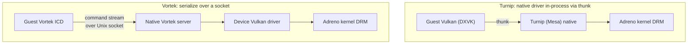

还有少数其他通路用于非 Vulkan 或低端的情形。**Zink** 是 Mesa 的 OpenGL-on-Vulkan。**VirGL** 是一个带有自己的客户端/服务器的 virtio-gpu 虚拟 3D 渲染器。**llvmpipe** 是一个纯 CPU 的软件光栅化器，是最后的手段。

Zink 值得停留片刻，因为它是某个 AOSP 组件的客户机侧镜像。客户机可能需要 OpenGL，而宿主机只有一个好的 Vulkan 驱动。这时 Zink 就把 GL 重新表达为 Vulkan。Android 自己的 **ANGLE**（`external/angle/`）为调用 OpenGL ES 的原生应用（第 13 章）做的正是这件事。

ANGLE 在大多数设备上并不是平台默认的 GLES 驱动，正如 EGL 加载器自己所指出的那样（`frameworks/native/opengl/libs/EGL/Loader.cpp:555`）。它按应用或在系统范围内被选择。Windows 游戏技术栈并不经由 ANGLE 路由。这是因为客户机在 rootfs 内部运行自己的 GL 到 Vulkan 翻译（Zink，或 `wined3d` 的 GL 输出）。它通过 Vulkan 加载器触达设备。两者的相似是概念上的，而不是共享的代码路径。

### 66.7.4 Android Vulkan 加载器

无论使用哪条客户机路径，链的底部都是第 13 章讲过的同一个 AOSP Vulkan 加载器。该加载器在 `frameworks/native/vulkan/libvulkan/driver.cpp` 中发现并加载设备的 Vulkan 驱动。`LoadDriver` 例程（`frameworks/native/vulkan/libvulkan/driver.cpp:153`）通过两个分支之一打开 HAL 驱动（`vulkan.<board>.so`）。当提供了驱动命名空间时（可更新的、由 Play 交付的驱动路径），它使用带 `ANDROID_DLEXT_USE_NAMESPACE` 的 `android_dlopen_ext`（`frameworks/native/vulkan/libvulkan/driver.cpp:171`）。这就是 66.4.2 节的命名空间标志。而普通的内置驱动则改用 `android_load_sphal_library`（`frameworks/native/vulkan/libvulkan/driver.cpp:178`）从 sphal 命名空间打开。

一个原生渲染器（比如 Vortek 的服务器，或被 thunk 的 Turnip），最终只是这个加载器和这个驱动的另一个客户端。这就是为什么整个大厦无需任何平台修改就能工作。GPU 是通过任何 Android 游戏所用的同一个公共 Vulkan 接口来触达的。

### 66.7.5 呈现：应用内 Surface

渲染出的帧必须变成屏幕上的像素。游戏得到的不是一个真实的 X 显示或一个真实的窗口系统。它得到的是 GameNative 的**应用内 X 服务器**。这是一个在应用内部实现的小型 X11 服务器（`com.winlator.xserver`，原生代码位于 `app/src/main/cpp/winlator/` 之下）。它接收游戏的输出和游戏绘制进入的窗口。X 服务器的内容用 Vulkan 绘制，并呈现到一个 Android **Surface**。

最后这一步使用第 13 章的原生窗口 API。帧通过 `ANativeWindow` 到达合成器。对于 CPU 访问路径，函数是 `ANativeWindow_lock`（`frameworks/native/libs/nativewindow/include/android/native_window.h:179`）和 `ANativeWindow_unlockAndPost`（`frameworks/native/libs/nativewindow/include/android/native_window.h:188`）。零拷贝 GPU 路径把一个 `AHardwareBuffer`（`frameworks/native/libs/nativewindow/include/android/hardware_buffer.h:479`，经由 `AHardwareBuffer_allocate`）绑定为 Vulkan 交换链图像。然后 GPU 直接渲染进一个 SurfaceFlinger 可以扫描输出的缓冲区。从 SurfaceFlinger 起（第 24 章），游戏的帧就只是另一个被合成到显示器的图层了。

### 66.7.6 帧生成

作为一个可选的最后修饰，GameNative 可以插入一个执行帧生成的 Vulkan 隐式层。该层拦截 `vkQueuePresentKHR` 并在渲染出的帧之间插值出合成帧。它在 Vulkan 的意义上就是一个层，并接入加载器的层链。它表明，图形技术栈的很大一部分是由标准 Vulkan 扩展点构建的，而不是定制的挂钩。

---

## 66.8 音频：从 WASAPI 到 AAudio

音频链比图形链短，但它跨越同样的 libc 边界。66.4.5 节的 IPC 模式解决了它。一个真正的音频服务器运行在 Android 侧，客户机作为客户端连接到它。

### 66.8.1 Wine 的音频后端

一个 Windows 游戏通过几个前端 API 之一发出音频（经由 `mmdevapi` 的现代 WASAPI、遗留的 DirectSound，或古老的 `winmm`/`waveOut`）。Wine 把它们全部架在运行时选定的一个后端驱动之上。这里重要的是 `winepulse.drv`，它面向 **PulseAudio**。其他选项是 `winealsa.drv`（ALSA）和 `wineoss.drv`（OSS）。在现代 Wine 中，每个后端都是一个仅 Unix 的库。例如，由 `dlls/winepulse.drv/pulse.c` 构建的 `winepulse.so` 调用宿主机 PulseAudio 客户端库。

PE 半部分位于 `mmdevapi` 自身之中。它用 `__wine_load_unix_lib` 加载后端，并通过 `__wine_unix_call` 调用它（`dlls/mmdevapi/main.c`）。

在 ARM64EC 配置中，后端及其客户端库是原生 ARM64 的。因此音频混合与传输没有被模拟。只有游戏对前端 API 的调用穿过模拟器。

### 66.8.2 应用内的 PulseAudio 服务器

未 root 的应用拿不到系统 PulseAudio 守护进程，因此这个技术栈随附了一个。GameNative 的 `PulseAudioComponent` 从捆绑的原生库（`libpulse.so` 以及 `jniLibs/` 中 PulseAudio 13 的 `libpulsecommon`/`libpulsecore` 库）启动一个 PulseAudio 服务器。Wine 的 `winepulse.drv` 连接到这个服务器，方式与连接桌面版 PulseAudio 完全相同，经由 PulseAudio 的正常套接字协议。契约就是 PulseAudio 线路协议。因此客户机侧（glibc，可能被模拟）与服务器侧（`bionic`，原生）跨 libc 边界互操作。它们不共享地址空间。

#### 图：从游戏到扬声器的音频通路


### 66.8.3 ALSA 桥

Winlator 还提供一个更底层的 ALSA 路线。rootfs 携带一个自定义 ALSA PCM 插件（Winlator 的 `android_alsa`，`module_pcm_android_aserver.c`），它暴露一个“android aserver”PCM 设备。在 Android 侧，`com.winlator.alsaserver` 实现服务器端点。一个原生客户端（`app/src/main/cpp/winlator/` 音频代码）把 PCM 帧发送到应用。无论音频走 PulseAudio 路线还是 ALSA 路线，结构都相同：一个客户机音频 API、一个套接字，以及一个原生 Android 端点。

### 66.8.4 经由 AAudio 触达扬声器

Android 端点最终把解码后的 PCM 写入一条 Android 音频流。自然的 API 是第 15 章讲过的 **AAudio**。一条流用 `AAudio_createStreamBuilder`（`frameworks/av/media/libaaudio/include/aaudio/AAudio.h:1216`）创建。然后流被配置、打开，并用 `AAudioStream_write` 喂数据。此后，帧经由音频 HAL 流向扬声器。（较老或受 `targetSdk` 限制的构建可能会改用 `AudioTrack` 或 OpenSL ES，但 AAudio 是现代的低延迟通路。）

因此，音频链终止于与任何原生 Android 游戏的音频所终止的完全相同的 AOSP 子系统。

### 66.8.5 延迟

音频要穿过一个客户机 API、一个套接字和一个服务器，代价就是延迟。技术栈为此做了调优。PulseAudio 配置了一个刻意放大的缓冲区。容器设置一个数量级在一百来毫秒的 `PULSE_LATENCY_MSEC`。这用响应性换取模拟与 IPC 引入的抖动下的无卡顿播放。

这是一个务实的选择。穿过这么多层，完全紧致的音频延迟是无法实现的。对大多数游戏来说，稳定的播放比几十毫秒的滞后更重要。

---

## 66.9 整合：追踪三条路径

把整章内容整合起来的最清晰方式，是跟随三个不同的操作，从游戏向下走到 Android 平台。注意每一个都以不同的路线穿过各层。

#### 图：三个操作，穿过技术栈的三条路线

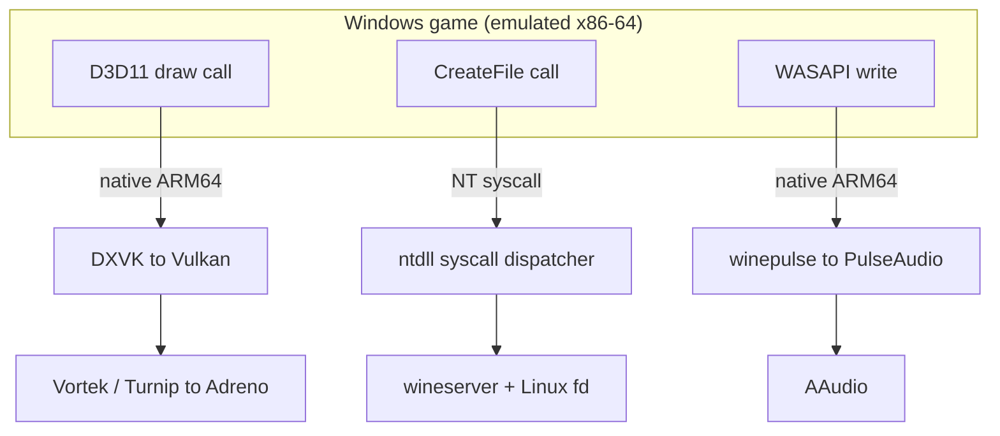

1. **一次 Direct3D 11 绘制调用。** 游戏的 `ID3D11DeviceContext::Draw` 是一个 x86-64 调用（被模拟）。它进入 DXVK，在 ARM64EC 上 DXVK 是原生的，并构建一个 Vulkan 命令缓冲区。该调用随后经由 thunk（Turnip）或套接字（Vortek）跨越 libc 边界，到达 Adreno 驱动。SurfaceFlinger 合成结果。这其中几乎没有任何东西被模拟；只有最初的调用点被模拟。

2. **一次 `CreateFile` 调用。** 游戏请求打开一个文件。这是一个 Windows API 调用，它变成一个 NT 系统调用。该调用经 Wine 的 `__wine_syscall_dispatcher` 汇入 `ntdll.so`。该库本身把 NT 路径翻译成 Unix 路径（`nt_to_unix_file_name`，`dlls/ntdll/unix/file.c`）。它在 `create_file` 请求中把那个 Unix 路径发送给 wineserver。

   服务器打开文件并返回一个 Windows `HANDLE`。在需要时，底层的 Linux fd 通过 `SCM_RIGHTS` 从服务器获取。PRoot 或 `libredirect` 沿途把路径重映射进 rootfs。Linux 的 `openat` 最终落在应用的私有存储中。没有 GPU，没有音频，与路径 1 是完全不同的机制。

3. **一次音频缓冲区写入。** 游戏的 WASAPI 写入进入 `winepulse.drv`（在 ARM64EC 上是原生的）。该驱动经由 PulseAudio 套接字把 PCM 发送到应用内服务器。服务器把它写入一条通向扬声器的 AAudio 流。

三个操作，三条完全不同的路径，只有画在被模拟盒子内部的部分才真正逐条指令地被翻译。整个技术栈的艺术就在于保持那个盒子很小。

---

## 66.10 Android 17 为这个技术栈改变了什么

本章中的翻译项目都不随附在 AOSP 内部，因此 Android 17 不会“新增”一个 Windows 游戏运行时。17 所做的是移动这个技术栈所站立的*平台地基*。有三次转变值得锁定，因为每一次要么帮助、要么约束了上面的一层。

### 66.10.1 技术栈所依托的平台接口是稳定的

整个设计之所以有效，是因为它只触碰公共的、稳定的 AOSP 表面。这些表面是：

- Vulkan 加载器（`frameworks/native/vulkan/libvulkan/driver.cpp`）
- 原生窗口 API（`frameworks/native/libs/nativewindow/include/android/native_window.h`）
- `AHardwareBuffer`
- AAudio（`frameworks/av/media/libaaudio/include/aaudio/AAudio.h`）
- `ASharedMemory`（`frameworks/native/include/android/sharedmem.h`）
- `android_dlopen_ext` 扩展标志（`bionic/libc/include/android/dlext.h`——实践中是稳定的，尽管命名空间标志本身被文档标注为仅限内部使用）
- 链接器的 W^X 规则（`bionic/linker/linker_phdr.cpp`）

在 Android 17 中，所有这些都存在，并且拥有前面各节所依赖的相同契约。这恰恰是 Winlator 级应用无需平台补丁就能跨版本持续工作的原因。这个技术栈在底部不发明任何东西，因此它继承该版本所提供的任何公共 Vulkan、音频和链接器表面。

### 66.10.2 Berberis 不是这个技术栈，17 对它做了重组

人们很容易假设 Android 自己的二进制翻译器必然参与其中。并没有。Android 17 重组了 **Berberis**（第 19 章）。其 CPU 模拟核心的每一个模块都被整合到一个新的 `frameworks/libs/binary_translation/cpu_emulation/` 目录之下。三层引擎（`cpu_emulation/interpreter/`、`cpu_emulation/lite_translator/`、`cpu_emulation/heavy_optimizer/`）以及层调度器（`cpu_emulation/translator/`）现在都是它下面的同级目录。

但 Berberis 把**riscv64 客户机代码翻译成 x86_64 宿主机**（`frameworks/libs/binary_translation/README.md`），并通过 Native Bridge 接入 ART（`frameworks/libs/binary_translation/native_bridge/`）。这对 PC 游戏来说方向错了（riscv64 到 x86_64，不是 x86-64 到 AArch64）。集成点也错了（ART 内的 APK 代码，不是一个完整 Windows 进程）。

17 的这次重组对第 19 章是真实且相关的。但它对本章没有任何改变。FEX 和 Box64 仍然在这里完全承担 x86-64 到 AArch64 的翻译，没有 AOSP 自带的翻译器与它们竞争。

### 66.10.3 ANGLE 适合的位置，以及不适合的位置

Android 的 GLES-on-Vulkan 翻译器 **ANGLE**（`external/angle/`，第 13 章）是平台对“在只有 Vulkan 的驱动上表达 OpenGL ES”这个问题的自有答案。它在概念上与客户机内部的 Zink 和 `wined3d`-to-GL 路径重叠。人们很想把 ANGLE 称为 Android 17 上的“默认”。但 EGL 加载器自己的注释明确说明，它在大多数设备上不是默认的 GLES 驱动（`frameworks/native/opengl/libs/EGL/Loader.cpp:555`）。它是按应用选择启用或通过系统配置启用的。

对这个技术栈而言，实际要点没有改变。客户机执行它自己的 GL 或 D3D 到 Vulkan 的翻译，并通过 Vulkan 加载器触达 GPU。因此设备的 ANGLE 设置既不帮助也不阻碍 Windows 游戏。两者是对 libc 边界两侧同一形状问题的两个平行解决方案，而不是共享的路径。

---

## 66.11 试一试

这些练习使用 GameNative 源码的一个检出，以及一台装有 Winlator 级应用的设备或模拟器。源码阅读只需要一个克隆。设备上的步骤假设你已经合法安装了这样一个应用，以及一款你拥有的游戏。

1. **从默认值读出技术栈。** 克隆 GameNative，打开 `app/src/main/java/com/winlator/container/Container.java` 和 `app/src/main/java/com/winlator/core/DefaultVersion.java`。写下默认的模拟器、图形驱动、音频驱动和 DX 包装器。写下 Wine、DXVK、VKD3D 和 Turnip 的固定版本。你刚刚从两个文件重构出了整条默认流水线。

2. **找到启动命令。** 阅读 `app/src/main/java/com/winlator/xenvironment/components/GuestProgramLauncherComponent.java`。定位它组装 `box64 <guest exe>` 命令的位置。然后阅读 `BionicProgramLauncherComponent.java`。找到它根据 Wine 构建是否为 ARM64EC 进行分支的位置。比较两条启动路径。

3. **检查捆绑的组件。** 列出 `app/src/main/assets/`。找出 FEX、Box64、DXVK 和 Vulkan 驱动的 `.tzst`/`.txz` 归档。找出按需获取其余内容的 `*_download.json` 清单。注意哪些部分在 APK 中，哪些是下载的。

4. **在设备上观察进程。** 在应用中运行一款游戏。使用 `adb shell ps -A`，查找以应用 UID 运行的 Wine、wineserver、PulseAudio 和 X 服务器进程。然后对 Wine 进程运行 `adb shell cat /proc/<pid>/maps`。观察 JIT 的匿名可执行映射和 rootfs 库。

5. **查看套接字。** 对 Wine 进程运行 `adb shell ls -l /proc/<pid>/fd`。找出把它连接到 wineserver、Vulkan 渲染器和 PulseAudio 的 Unix 域套接字。这些就是 66.4.5 节的边界跨越，现在变得可见了。

6. **探索前缀。** 在应用的数据目录下找到容器的 Wine 前缀。检查 `drive_c/windows/system32` 中覆盖了 Wine 内置 Direct3D 的 DXVK DLL。检查把那些 DLL 放在那里的 `user.reg` 中的 `Software\Wine\DllOverrides` 条目。

7. **确认 AOSP 接触点。** 在 AOSP 检出中，打开 `frameworks/native/vulkan/libvulkan/driver.cpp` 的 `LoadDriver` 函数（第 153 行）。找出它的两个分支。带 `android_dlopen_ext` 和 `ANDROID_DLEXT_USE_NAMESPACE` 的分支用于更新的驱动。带 `android_load_sphal_library` 的分支用于内置的那个。这就是整个图形技术栈最终汇入的加载器。

---

## 66.12 小结

一款 Windows 游戏通过一栈单用途翻译层，在一台未 root 的 ARM Android 手机上运行。每一层弥合一个 Windows x86-64 游戏与本书其余部分所覆盖的 AOSP 内部机制之间的缺口。

| 层次 | 它解决的问题 | 关键技术 |
|-------|-------------------|----------------|
| GameNative 应用 | 编排、商店、打包 | Pluvia + Winlator 嫁接，GPL-3.0 |
| rootfs（imagefs） | 一个没有 root 的 glibc Linux 用户态 | 解压到应用存储的 Ubuntu 树，经由 PRoot 或 bionic 加载器进入 |
| bionic 重定向 | `bionic` 系统上的 glibc 软件 | 路径重写、基于 ashmem 的 SysV-SHM、IPC 服务器 |
| FEX / Box64 | AArch64 上的 x86-64 指令 | dynarec、TSO 模拟、thunk 与包装库 |
| ARM64EC / WoW64 | 只模拟游戏 | 原生 ARM64 的 Wine，模拟器作为一个 DLL |
| Wine | Linux 上的 Windows API | PE/Unix 分裂、wineserver、DLL 覆盖 |
| DXVK / VKD3D | Vulkan GPU 上的 Direct3D | D3D 到 Vulkan，作为原生 DLL 覆盖安装 |
| Turnip / Vortek | Vulkan 到真实的 Adreno GPU | 经 thunk 的 Mesa 驱动，或经套接字的客户端/服务器 |
| PulseAudio | Windows 音频到扬声器 | 应用内音频服务器，经 AAudio 输出 |

反复出现的教训：

1. **两种正交的翻译。** 指令集翻译（FEX/Box64）与 Windows API 翻译（Wine）是两个完全分离的问题。把它们混为一谈是对这类应用如何工作的最常见误解。

2. **尽可能少地模拟。** 技术栈中的每一个性能收益都来自离开被模拟盒子的工作。主要的例子是 GPU 驱动的 thunk 和包装器、原生 ARM64 的 DXVK，以及最重要的 ARM64EC。ARM64EC 只留下游戏自己的代码被模拟。

3. **libc 边界是难点所在。** glibc 和 `bionic` 不能共享一个进程。跨越边界的三种方式（IPC、ABI thunking，或在 `bionic` 上原生执行）塑造了技术栈中的每一个设计决策。

4. **底层全都是标准的 AOSP。** Vulkan 加载器、`ANativeWindow`、`AHardwareBuffer`、AAudio、链接器命名空间、`ASharedMemory` 以及 W^X 规则，就是任何 Android 应用都会使用的相同平台接口。翻译栈在底部不发明任何东西。它的天才之处在于，从上方许多层的 Windows 游戏触达那些公共接口。

### 关键源文件参考

| 文件 | 用途 |
|------|---------|
| `bionic/libc/include/android/dlext.h:115` | `ANDROID_DLEXT_USE_NAMESPACE`，把驱动加载进选定的链接器命名空间 |
| `bionic/libc/include/android/dlext.h:80` | `ANDROID_DLEXT_USE_LIBRARY_FD`，从文件描述符加载库 |
| `bionic/linker/linker_phdr.cpp:1057` | 拒绝同时可写且可执行的 ELF 段（W^X） |
| `bionic/libc/include/sys/mman.h:183` | `memfd_create`，匿名共享内存的支撑 |
| `frameworks/native/include/android/sharedmem.h:78` | `ASharedMemory_create`，SysV-SHM 重定向的宿主机侧 |
| `frameworks/native/vulkan/libvulkan/driver.cpp:153` | `LoadDriver`，发现并打开设备的 Vulkan 驱动 |
| `frameworks/native/libs/nativewindow/include/android/native_window.h:179` | `ANativeWindow_lock`，CPU 呈现路径 |
| `frameworks/native/libs/nativewindow/include/android/native_window.h:188` | `ANativeWindow_unlockAndPost`，把一帧投递给合成器 |
| `frameworks/native/libs/nativewindow/include/android/hardware_buffer.h:479` | `AHardwareBuffer_allocate`，零拷贝 GPU 呈现缓冲区 |
| `frameworks/av/media/libaaudio/include/aaudio/AAudio.h:1216` | `AAudio_createStreamBuilder`，音频通路的 Android 汇点 |
